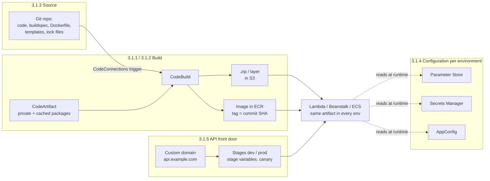

# Task 3.1: Prepare deployable application artifacts

**Domain 3 · Task 3.1** · [Domain overview](../README.md)

This task covers everything that happens before a deployment starts: packaging code with its dependencies, building and storing container images in Amazon Elastic Container Registry (ECR), connecting Git repositories to the build, keeping environment-specific values in AWS AppConfig, Parameter Store, Secrets Manager, Lambda, and API Gateway, and configuring API Gateway stages and endpoints. The idea that ties it together is **build once, deploy many**: one immutable artifact, traceable to a commit, promoted unchanged through every environment while only its external configuration changes. [Task 3.2](../task-3.2-test-applications/README.md) then tests that artifact in isolated environments, and [Task 3.3](../task-3.3-deploy-with-ci-cd/README.md) ships it through CodePipeline, CodeDeploy, and safe deployment strategies.

> **DVA-C02 vs DVA-C03.** DVA-C03 names Dockerfiles, ECR repositories, image tags, and lifecycle policies as an explicit skill (3.1.2), and moves API Gateway stages and custom domains here from DVA-C02 Task 3.4 (3.1.5).

## Skills

| Skill | Note | Covers |
|---|---|---|
| 3.1.1 | [Packaging dependencies and configuration](3.1.1-packaging-dependencies-and-configuration.md) | What goes inside an artifact, build once deploy many, language packaging and lock files, native dependencies for Lambda, Lambda size limits, AWS CodeArtifact (domains, upstreams, external connections, tokens, origin controls), Elastic Beanstalk source bundles and `.ebextensions`, CodeBuild artifacts |
| 3.1.2 | [Container images and ECR](3.1.2-container-images-and-ecr.md) | Dockerfile instructions, multi-stage builds, Lambda base images, ECR login and push, CodeBuild privileged mode, tagging strategy, tag immutability, lifecycle policy rules and priority, archive storage class, basic and enhanced scanning, replication, pull-through cache, virtual private cloud (VPC) endpoints |
| 3.1.3 | [Code repositories in deployment](3.1.3-code-repositories-in-deployment.md) | AWS CodeConnections, CodePipeline V2 triggers (branch, tag, PR, file path), CodeBuild pull request (PR) webhooks, full clone, commit traceability, what belongs in the repository, branches and environments, CodeCommit status |
| 3.1.4 | [Environment-specific configuration](3.1.4-environment-specific-configuration.md) | Choosing AppConfig, Parameter Store, Secrets Manager, Lambda environment variables, stage variables, or infrastructure as code (IaC) parameters; Parameter Store hierarchy and tiers; AppConfig profiles, validators, strategies, alarm rollback, agent and extension; Amazon Elastic Container Service (ECS) `secrets`; Beanstalk properties; CloudFormation dynamic references; `samconfig.toml` |
| 3.1.5 | [API Gateway stages and endpoints](3.1.5-api-gateway-stages-and-endpoints.md) | Deployments versus stages, stage URLs, HTTP API auto-deploy, stage settings, stage variables with Lambda aliases and permissions, canary releases, edge-optimized, Regional, and private endpoints, custom domains, API mappings, routing rules, stages in IaC |

## How the skills fit together

Use this table to route a scenario to the right note:

| The question is about | Go to |
|---|---|
| A build that breaks on a public package, a compiled library failing on Lambda, a package too large, `.ebextensions`, private npm or PyPI packages | [3.1.1](3.1.1-packaging-dependencies-and-configuration.md) |
| A Dockerfile, pushing to ECR, `latest` pointing at the wrong image, old images piling up, scanning | [3.1.2](3.1.2-container-images-and-ecr.md) |
| Starting a pipeline from GitHub, PR builds, tag-based releases, secrets in the repo | [3.1.3](3.1.3-code-repositories-in-deployment.md) |
| Where a value should live: feature flags, rotating credentials, cheap config, per-alias settings, ECS secrets | [3.1.4](3.1.4-environment-specific-configuration.md) |
| Changes not live, stage URLs, alias per stage, canary on a stage, endpoint type, custom domain certificate | [3.1.5](3.1.5-api-gateway-stages-and-endpoints.md) |

## Study checklist

- [ ] 3.1.1 Explain build once, deploy many, and list what belongs inside and outside an artifact.
- [ ] 3.1.1 Package Python and Node.js dependencies for Lambda, including native libraries built for Amazon Linux and the right architecture.
- [ ] 3.1.1 Describe CodeArtifact domains, upstream repositories, external connections, token lifetime, and package origin controls.
- [ ] 3.1.1 Place `.ebextensions/*.config` correctly and configure a Beanstalk application version lifecycle policy.
- [ ] 3.1.2 Write a multi-stage Dockerfile and explain layer caching.
- [ ] 3.1.2 Authenticate to ECR, tag with a commit hash (SHA), and push from CodeBuild with privileged mode.
- [ ] 3.1.2 Turn on tag immutability and explain why `latest` is risky.
- [ ] 3.1.2 Write a lifecycle policy with several rules and predict which rule wins for each image.
- [ ] 3.1.3 Connect GitHub to CodePipeline with CodeConnections and choose branch, PR, tag, or file-path triggers.
- [ ] 3.1.3 Keep secrets out of the repository and trace a running artifact back to its commit.
- [ ] 3.1.4 Choose AppConfig, Parameter Store, or Secrets Manager for a given value and justify it.
- [ ] 3.1.4 Configure an AppConfig deployment with a validator, a strategy, and an alarm monitor.
- [ ] 3.1.4 Read a Parameter Store hierarchy by path with `kms:Decrypt` for `SecureString`, and cache it in Lambda.
- [ ] 3.1.4 Inject secrets into ECS with the `secrets` block and the task execution role.
- [ ] 3.1.5 Explain deployments versus stages and why console changes are not live.
- [ ] 3.1.5 Point stages at Lambda aliases with stage variables and add the per-alias permissions.
- [ ] 3.1.5 Choose an endpoint type and put the AWS Certificate Manager (ACM) certificate in the correct Region.
- [ ] 3.1.5 Map a custom domain to several APIs with base paths, and run a canary release on a stage.

## Labs and practice

- [Labs](labs.md):
  - Lab 1: build an image, push it to ECR, and attach a lifecycle policy.
  - Lab 2: deploy one .zip twice and read per-environment configuration from Parameter Store.
- [Practice questions](practice-questions.md): 3 scenario-based multiple-choice questions, each with the answer, an explanation, and why the other options are wrong.
