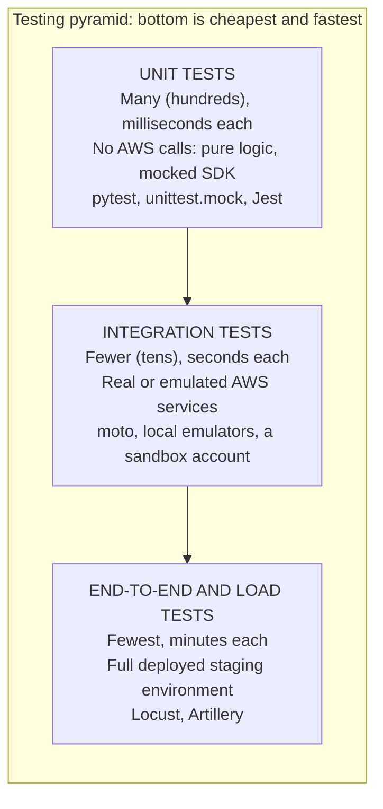
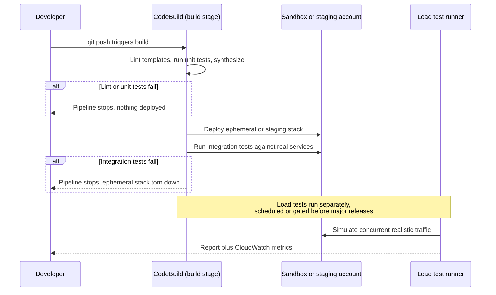
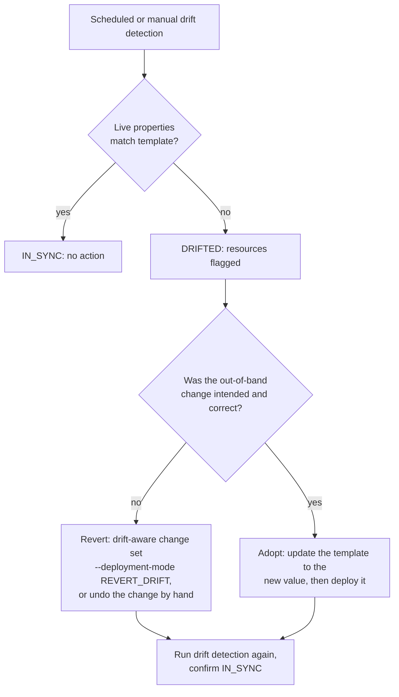

# 3.2.1 Develop and validate tests with tools and templates such as AWS SAM, AWS CDK, and CloudFormation

**Domain 3 · Task 3.2 · Skill 3.2.1** · [Task overview](README.md) · Previous: [3.1.5 API Gateway stages and endpoints](../task-3.1-prepare-deployable-artifacts/3.1.5-api-gateway-stages-and-endpoints.md) · Next: [3.2.2 Mock APIs](3.2.2-mock-apis.md)

## What the exam expects

This skill tests whether you can test serverless code and infrastructure as code (IaC) before and after it reaches AWS. Questions name a goal ("run the function locally with a sample S3 event", "prove the stack creates an encrypted bucket", "block templates that break a rule", "find out who changed a resource outside the pipeline") and ask for the AWS Serverless Application Model (AWS SAM) command, AWS Cloud Development Kit (AWS CDK) test type, or AWS CloudFormation feature that fits. Wrong answers usually test too late (in production), test the wrong layer, or confuse a preview of future changes with detection of past changes.

You must be able to:

- Place a check at the right layer of the testing pyramid: unit, integration, or end-to-end and load.
- Use the SAM command line interface (CLI) to build, validate, invoke locally, emulate API Gateway, and invoke deployed functions.
- Write CDK assertion tests (fine-grained and snapshot) and enforce rules at synthesis time.
- Validate CloudFormation templates with `validate-template`, cfn-lint, CloudFormation Guard, pre-deployment validation, and change sets.
- Detect drift after deployment and choose how to remediate it.

> **DVA-C02 vs DVA-C03.** DVA-C02 placed unit testing with AWS SAM in Domain 1, Task 1.1. DVA-C03 moves it here, into the testing task. The material is the same; the classification changed.

## Key terms

| Term | Meaning |
|---|---|
| Unit test | Tests one function or module in isolation, with AWS software development kit (SDK) calls mocked. Milliseconds, no network. |
| Integration test | Tests code against real or emulated AWS services, so AWS Identity and Access Management (IAM) permissions, key schemas, and event wiring are exercised. |
| End-to-end (E2E) test | Tests a full user flow against a deployed environment. |
| Load test | Sends realistic concurrent traffic to a deployed staging environment to find limits. |
| `sam local` | SAM CLI commands that run Lambda functions and an API Gateway emulator in local containers. |
| Synthesis | `cdk synth`: running CDK code to produce a CloudFormation template. |
| Fine-grained assertion | A CDK test that checks one resource or property in the synthesized template. |
| Snapshot test | A test that compares the whole synthesized template with a stored baseline. |
| Aspect | CDK code that visits every construct during synthesis; can add errors that fail `cdk synth`. |
| cfn-lint | Open-source linter that checks CloudFormation templates against the resource specification and best practices. |
| CloudFormation Guard | Open-source policy-as-code tool (`cfn-guard`) that checks templates against rules you write. |
| Change set | A preview of what a stack update will add, modify, replace, or delete. |
| Drift | A difference between a stack's live resources and its template, caused by changes outside CloudFormation. |

## The testing pyramid for serverless apps

A serverless testing strategy decides which kind of test runs where, how often, and against what. The width of each layer is how many tests you should have, not how important the layer is.



| Layer | What it catches | What it cannot catch | When it runs |
|---|---|---|---|
| Unit | Validation logic, calculations, branching, response formatting, event parsing | IAM permission gaps, real query behavior, service limits | Every commit, before any deploy |
| Integration | Wrong key schema or expression, missing IAM permission, wrong event wiring, real payload shapes | Behavior under concurrency and throttling | After deploying to an ephemeral or dev stack |
| E2E and load | Cold starts under burst, concurrency limits, downstream throttling, latency percentiles | Logic bugs cheaply (too slow and expensive for that) | On a schedule or before major releases, never on every push |

Signals to recognize:

- "Fast, no AWS calls, many of them" is a unit test.
- "Talks to a real or emulated AWS service, fewer of them" is an integration test.
- "Simulates realistic concurrent users against a deployed environment" is a load test.
- A suite that is mostly end-to-end tests against a live stack and runs for 25 to 40 minutes is an **inverted pyramid**. The fix is to push coverage down into unit and integration tests, not to run the slow tests in parallel.
- A function that passes every unit test but fails with `AccessDenied` when deployed is the gap integration tests close. The unit test mocked the SDK, so the execution role's real permissions were never exercised.

### Where each layer runs in a pipeline



### Worked example: one function, three layers

The function under test separates pure logic from the AWS call, which makes the logic unit-testable:

```python
# handler.py
import os
import boto3

def validate_order(order):
    if order.get("quantity", 0) <= 0:
        raise ValueError("quantity must be positive")
    return True

def handler(event, context):
    order = event["order"]
    validate_order(order)
    table = boto3.resource("dynamodb").Table(os.environ["TABLE_NAME"])
    table.put_item(Item=order)
    return {"statusCode": 201}
```

Unit test, no AWS SDK involved:

```python
import pytest
from handler import validate_order

def test_rejects_zero_quantity():
    with pytest.raises(ValueError):
        validate_order({"quantity": 0})

def test_accepts_positive_quantity():
    assert validate_order({"quantity": 1}) is True
```

Integration test against a real or emulated DynamoDB table (here a local emulator on port 4566):

```python
import os
import boto3
import pytest
from handler import handler

@pytest.fixture(scope="module")
def table():
    ddb = boto3.client("dynamodb", endpoint_url="http://localhost:4566", region_name="us-east-1")
    ddb.create_table(
        TableName="orders-it",
        KeySchema=[{"AttributeName": "id", "KeyType": "HASH"}],
        AttributeDefinitions=[{"AttributeName": "id", "AttributeType": "S"}],
        BillingMode="PAY_PER_REQUEST")
    os.environ["TABLE_NAME"] = "orders-it"
    os.environ["AWS_ENDPOINT_URL"] = "http://localhost:4566"  # boto3 in the handler uses it too
    yield
    ddb.delete_table(TableName="orders-it")

def test_handler_writes_order(table):
    result = handler({"order": {"id": "abc", "quantity": 2}}, None)
    assert result["statusCode"] == 201
```

Load test with Locust (open source) against a staging API:

```python
# locustfile.py
from locust import HttpUser, task, between

class OrderUser(HttpUser):
    wait_time = between(0.5, 2)

    @task
    def submit_order(self):
        self.client.post("/orders", json={"order": {"id": "load-test", "quantity": 1}})
```

```bash
locust -f locustfile.py --host https://staging-api.example.com \
  --users 200 --spawn-rate 20 --run-time 5m --headless
```

Each layer needs more infrastructure than the one below it: nothing but Python, then an emulator or sandbox, then a deployed staging endpoint. That is why each layer runs less often. A load test's value is the CloudWatch metrics it produces during the run (Lambda concurrent executions, throttles, p99 duration, DynamoDB throttled requests, API Gateway 5xx rate), which show what breaks first. See [4.3.5 Performance bottleneck detection](../../domain-4-troubleshooting-and-optimization/task-4.3-optimize-applications/4.3.5-performance-bottleneck-detection.md).

Tests cost what they consume. Unit tests use CodeBuild build minutes only. Integration tests incur normal per-request charges at test scale. Load tests generate real Lambda invocations, API Gateway requests, and database capacity use, so run them against staging, on a schedule.

## AWS SAM: test locally and in the cloud

AWS SAM is a CloudFormation extension. The line `Transform: AWS::Serverless-2016-10-31` turns `AWS::Serverless::Function`, `AWS::Serverless::Api`, `AWS::Serverless::HttpApi`, and `AWS::Serverless::SimpleTable` into plain CloudFormation resources at deploy time. Template authoring and deployment belong to [3.3.3 Infrastructure as code deployment](../task-3.3-deploy-with-ci-cd/3.3.3-infrastructure-as-code-deployment.md). This skill covers the CLI commands that test and validate.

### SAM CLI commands for testing

| Command | What it does | Test layer |
|---|---|---|
| `sam validate` | Checks the SAM template is valid; `--lint` also runs cfn-lint | Static check |
| `sam build` | Resolves dependencies and builds artifacts; `--use-container` builds inside a Lambda-like image so native libraries match the Lambda operating system (OS) and architecture | Build |
| `sam local invoke` | Runs one function once in a local container with an event (`-e event.json`), then exits | Unit and handler-level |
| `sam local start-api` | Starts a local HTTP server that emulates API Gateway for all API events in the template; reloads on code changes | Local API testing with curl or Postman |
| `sam local start-lambda` | Starts a local endpoint that emulates the Lambda Invoke API; point an SDK client at it for automated tests | Automated local tests |
| `sam local generate-event` | Prints sample payloads for S3, API Gateway, Amazon Simple Queue Service (SQS), Amazon Simple Notification Service (SNS), Kinesis, DynamoDB, and more. See [3.2.3](3.2.3-test-events-and-payloads.md) | Test data |
| `sam sync --watch` | SAM Accelerate: syncs code changes to the cloud in seconds, bypassing CloudFormation for code-only changes | Dev-only iteration in the cloud |
| `sam remote invoke` | Invokes a deployed function (or other supported resource) from your machine | Cloud integration and smoke tests |
| `sam remote test-event` | Creates, lists, and runs shareable test events stored in the cloud | Shared team test events |
| `sam logs`, `sam traces` | Fetch CloudWatch Logs and AWS X-Ray traces for deployed functions | Debugging after a test |
| `sam pipeline init` | Generates a continuous integration and continuous delivery (CI/CD) pipeline configuration with build, test, and deploy stages | Pipeline setup |

```bash
sam validate --lint
sam build --use-container
sam local generate-event s3 put --bucket my-bucket --key photo.jpg \
  | sam local invoke ImageFunction -e -
sam local start-api &            # http://127.0.0.1:3000
curl http://127.0.0.1:3000/hello
sam remote invoke ImageFunction --stack-name my-app-dev --event-file events/s3-put.json
```

### Automated tests against `sam local start-lambda`

```python
# test_local_lambda.py  (run after: sam local start-lambda)
import json
import boto3
from botocore.config import Config

lambda_client = boto3.client(
    "lambda",
    endpoint_url="http://127.0.0.1:3001",
    region_name="us-east-1",
    config=Config(retries={"max_attempts": 0}, read_timeout=60),
)

def test_hello_returns_200():
    resp = lambda_client.invoke(
        FunctionName="HelloFunction",
        Payload=json.dumps({"httpMethod": "GET", "path": "/hello"}),
    )
    body = json.loads(resp["Payload"].read())
    assert body["statusCode"] == 200
```

### What local emulation does not reproduce

- **IAM.** `sam local` runs with your local credentials (choose them with `--profile`), not the function's execution role. A permission error that appears only after deployment is expected; catch it with an integration test in the cloud.
- **Configuration.** Environment variables, layers, virtual private cloud (VPC) settings, and resource policies of the deployed function are not all replicated. Pass local values with `--env-vars env.json`.
- **Real AWS calls.** If the handler calls DynamoDB or S3 while running locally, it calls real AWS (or whatever endpoint you configure). Use the correct profile, or point the SDK at an emulator.
- **Runtime.** `sam local` needs a container runtime such as Docker or Finch.

AWS guidance favors testing in the cloud for integration behavior: deploy a dev or ephemeral stack (`sam sync --watch` while developing), then run integration tests against it. Read endpoint names from stack outputs instead of hard-coding them:

```python
# test_integration_cloud.py
import os
import boto3
import requests

def stack_outputs(name):
    cfn = boto3.client("cloudformation")
    outs = cfn.describe_stacks(StackName=name)["Stacks"][0]["Outputs"]
    return {o["OutputKey"]: o["OutputValue"] for o in outs}

def test_post_order_round_trip():
    api_url = stack_outputs(os.environ["STACK_NAME"])["ApiUrl"]
    r = requests.post(f"{api_url}/orders", json={"id": "it-1", "quantity": 1}, timeout=10)
    assert r.status_code == 201
```

### Test CDK-defined functions with the SAM CLI

The SAM CLI can run functions defined in a CDK app. Synthesize first, then point SAM at the generated template:

```bash
cdk synth
sam local invoke -t ./cdk.out/MyCdkStack.template.json MyFunction -e events/api.json
```

## AWS CDK: test the infrastructure code

CDK code is application code, so it gets unit tests. The `aws-cdk-lib/assertions` module (`aws_cdk.assertions` in Python) loads a synthesized template and lets a test framework such as Jest or pytest assert on it.

| Test type | What it checks | When to use |
|---|---|---|
| Fine-grained assertion | One resource, property, output, or count in the template | "The stack must create a versioned, encrypted bucket" |
| Snapshot test | The whole template against a stored baseline | "A refactor must not change the generated infrastructure at all" |

Load the template with `Template.fromStack(stack)` for a stack built in CDK, or `Template.fromString(json)` for a template built outside CDK.

```typescript
// test/my-stack.test.ts
import * as cdk from 'aws-cdk-lib';
import { Template, Match } from 'aws-cdk-lib/assertions';
import { MyStack } from '../lib/my-stack';

test('bucket is versioned and encrypted', () => {
  const app = new cdk.App();
  const stack = new MyStack(app, 'TestStack');
  const template = Template.fromStack(stack);

  // Fine-grained assertions
  template.resourceCountIs('AWS::S3::Bucket', 1);
  template.hasResourceProperties('AWS::S3::Bucket', {
    VersioningConfiguration: { Status: 'Enabled' },
    BucketEncryption: Match.objectLike({}),
  });
  template.hasResourceProperties('AWS::Lambda::Function', {
    Runtime: 'nodejs20.x',
  });

  // Snapshot test
  expect(template.toJSON()).toMatchSnapshot();
});
```

```python
# tests/test_my_stack.py
import aws_cdk as cdk
from aws_cdk.assertions import Template
from my_app.my_stack import MyStack

def test_queue_has_dlq():
    app = cdk.App()
    template = Template.from_stack(MyStack(app, "TestStack"))
    template.resource_count_is("AWS::SQS::Queue", 2)
    template.has_resource_properties("AWS::SQS::Queue", {
        "RedrivePolicy": {"maxReceiveCount": 3}
    })
```

Useful matchers: `Match.objectLike` (partial object), `Match.arrayWith` (array contains), `Match.absent()` (property not set), `Match.anyValue()`, and `Capture` (grab a value to assert on later). Snapshot tests fail on any change, including intended ones, so a developer must review and update the snapshot deliberately.

### Enforce rules at synthesis time with Aspects

An assertion test checks the stacks a test author chose. An Aspect runs on every construct in the app during `cdk synth`, so a rule applies everywhere without anyone remembering to test it. `Annotations.of(node).addError(...)` makes synthesis, and therefore deployment, fail.

```typescript
import { IAspect, Aspects, Annotations, Tokenization } from 'aws-cdk-lib';
import * as s3 from 'aws-cdk-lib/aws-s3';
import { IConstruct } from 'constructs';

class BucketVersioningChecker implements IAspect {
  public visit(node: IConstruct): void {
    if (node instanceof s3.CfnBucket) {
      const cfg = node.versioningConfiguration;
      if (!cfg || (!Tokenization.isResolvable(cfg) &&
          (cfg as s3.CfnBucket.VersioningConfigurationProperty).status !== 'Enabled')) {
        Annotations.of(node).addError('Bucket versioning is not enabled');
      }
    }
  }
}

Aspects.of(app).add(new BucketVersioningChecker());
```

The open-source cdk-nag library packages many such checks as Aspects (security and compliance rule packs).

### CDK commands that validate

| Command | Role in testing |
|---|---|
| `cdk synth` | Runs your code and produces the template; Aspect errors fail here. Run in CI before tests. |
| `cdk diff` | Compares the newly synthesized template with the deployed stack. A pre-deployment review step, often a pipeline gate. |
| `cdk deploy --hotswap` | Dev-only fast update of Lambda code and some resources, bypassing a full CloudFormation deployment (like `sam sync`). Never for production. |
| `cdk bootstrap` | Creates the `CDKToolkit` stack (asset bucket, deployment roles) per account and Region. An integration-test deploy into a new account fails without it. |

## CloudFormation: validate templates before and after deployment

| Tool or feature | What it checks | When |
|---|---|---|
| `aws cloudformation validate-template` | JavaScript Object Notation (JSON) or YAML Ain't Markup Language (YAML) syntax and top-level template structure. It does not check property values against resource types. | Build stage |
| cfn-lint (`sam validate --lint` also runs it) | Properties, types, allowed values, and best practices against the CloudFormation resource specification | Build stage, editor |
| CloudFormation Guard (`cfn-guard validate`) | Your own policy rules, such as "every bucket is encrypted" or "no security group allows 0.0.0.0/0 on port 22" | Build stage |
| Pre-deployment validation | Runs automatically on create stack, update stack, and create change set. Checks property syntax and resource name conflicts with existing resources on all three; change sets also check S3 bucket emptiness, service quotas, AWS Config recorder conflicts, and Amazon Elastic Container Registry (ECR) repository delete readiness | At deployment, before resources are touched |
| Change set | What an update will add, modify, replace, or delete | Before executing an update |
| CloudFormation Hooks | Proactive checks (Guard rules or Lambda functions) that CloudFormation invokes before creating, updating, or deleting resources, and can block noncompliant ones | At deployment, account-wide |
| TaskCat (open source) | Deploys a template in several Regions and reports pass or fail | Template test runs |
| Drift detection | Whether live resources still match the template | After deployment, on a schedule |

A CloudFormation Guard rule and the command that runs it:

```text
# rules/s3.guard
let buckets = Resources.*[ Type == 'AWS::S3::Bucket' ]

rule s3_buckets_versioned when %buckets !empty {
    %buckets.Properties.VersioningConfiguration.Status == 'Enabled'
}
```

```bash
cfn-lint template.yaml
cfn-guard validate --data template.yaml --rules rules/
aws cloudformation validate-template --template-body file://template.yaml
```

Pre-deployment validation reduces common failures but does not guarantee success. A change set also tells you what will change, not whether the update will succeed.

### Change sets

```bash
aws cloudformation create-change-set --stack-name my-stack \
  --change-set-name add-bucket --template-body file://template.yaml
aws cloudformation describe-change-set --stack-name my-stack --change-set-name add-bucket
aws cloudformation execute-change-set --stack-name my-stack --change-set-name add-bucket
```

Creating a change set changes nothing. The describe output shows each resource's action and whether a modification requires **replacement** (a new physical resource, such as a new database). Use it before updating production. Change set mechanics in deployments are in [3.3.3](../task-3.3-deploy-with-ci-cd/3.3.3-infrastructure-as-code-deployment.md).

### A validation pipeline in one buildspec

```yaml
# buildspec.yml (build stage, runs before any deploy stage)
version: 0.2
phases:
  install:
    commands:
      - pip install cfn-lint pytest pytest-cov
  pre_build:
    commands:
      - cfn-lint template.yaml
      - cfn-guard validate --data template.yaml --rules rules/
  build:
    commands:
      - pytest tests/unit --junitxml=reports/unit.xml --cov=src --cov-report=xml:reports/coverage.xml
      - sam build
reports:
  unit-tests:
    files: ['reports/unit.xml']
    file-format: JUNITXML
  coverage:
    files: ['reports/coverage.xml']
    file-format: COBERTURAXML
```

A failure in any command fails the build, so nothing is deployed. Test and coverage reports are covered in [3.2.5](3.2.5-ai-assisted-testing.md#run-tests-and-read-results-in-codebuild).

## Drift detection: validation after deployment

A template can be valid at deploy time and still diverge from reality later. **Drift** happens when someone changes a CloudFormation-managed resource outside CloudFormation: an on-call engineer opens a security group port during an incident, or a teammate raises a function's memory in the console. CDK and SAM stacks drift exactly like raw CloudFormation stacks, because they deploy CloudFormation stacks.

**Drift detection** compares each resource's live configuration with the template's expected configuration. Run it on a whole stack (`detect-stack-drift`) or one resource (`detect-stack-resource-drift`). It is asynchronous and returns a detection ID.

| Status level | Values |
|---|---|
| Stack | `DRIFTED`, `IN_SYNC`, `NOT_CHECKED`, `UNKNOWN` |
| Resource | `IN_SYNC`, `MODIFIED`, `DELETED`, `NOT_CHECKED` |

For a `MODIFIED` resource, drift detection shows the **expected** (template) and **actual** (live) value of each drifted property.


*Source: [AWS CloudFormation User Guide, "Detect drift on an entire CloudFormation stack"](https://docs.aws.amazon.com/AWSCloudFormation/latest/UserGuide/detect-drift-stack.html), © Amazon Web Services.*

```bash
# 1. Start detection (returns a detection ID)
aws cloudformation detect-stack-drift --stack-name orders-api-stack
# 2. Poll until it completes
aws cloudformation describe-stack-drift-detection-status --stack-drift-detection-id <id>
# 3. Stack-level status
aws cloudformation describe-stacks --stack-name orders-api-stack \
  --query 'Stacks[0].DriftInformation'
# 4. Which resources drifted, and how
aws cloudformation describe-stack-resource-drifts --stack-name orders-api-stack \
  --stack-resource-drift-status-filters MODIFIED DELETED
```

Limits to know:

- It reports drift; it never fixes it.
- It checks only properties set explicitly in the template or through parameters.
- Not every resource type supports it. `NOT_CHECKED` means "not evaluated", not "clean".
- Write-only properties (passwords, secrets) are not compared with live values.
- It is a point-in-time snapshot. Drift status is not re-evaluated after an update until you run detection again.

### Remediate drift

Drift detection tells you **that** something changed and what it looks like now. A person or a policy decides whether the change was correct.



Re-deploying the **unchanged** template does not revert drift. A traditional change set compares the new template with the previous template, so CloudFormation sees no changes and leaves the drifted resource alone. The old workaround was a dummy change and a revert. Since November 2025, a **drift-aware change set** compares three states (actual, previous deployment, desired) and brings drifted resources back to the template:

```bash
aws cloudformation create-change-set \
  --stack-name orders-api-stack \
  --change-set-name revert-drift \
  --template-body file://template.yaml \
  --deployment-mode REVERT_DRIFT
aws cloudformation describe-change-set --stack-name orders-api-stack --change-set-name revert-drift
aws cloudformation execute-change-set --stack-name orders-api-stack --change-set-name revert-drift
```

Drift-aware change sets cannot reconcile immutable properties, compare write-only properties against the previous deployment, and leave AWS-managed values (such as an Auto Scaling group's desired capacity) alone. When you adopt a change by editing the template to match the live value, a drift-aware change set resets the drift status without modifying the resource.

To prevent drift instead of detecting it, restrict direct changes to CloudFormation-managed resources with IAM policies so changes flow through the pipeline.

### Detect drift across many accounts

> **Not on the DVA-C03 service list.** AWS Config is not in the in-scope list, but it is the documented way to run drift checks continuously at scale. The managed rule `cloudformation-stack-drift-detection-check` evaluates each stack in each member account, an AWS Config aggregator collects results centrally, and an EventBridge schedule plus a Lambda function can send an SNS alert listing drifted stacks. This avoids a script that loops over `detect-stack-drift` account by account.


*Source: [AWS Prescriptive Guidance, "Set up CloudFormation drift detection in a multi-Region, multi-account organization"](https://docs.aws.amazon.com/prescriptive-guidance/latest/patterns/set-up-aws-cloudformation-drift-detection-in-a-multi-region-multi-account-organization.html), © Amazon Web Services.*

### Looking ahead versus looking back

| | `cdk diff` or change set | Drift detection |
|---|---|---|
| Direction | Ahead: what will this update do? | Back: did anyone change resources outside CloudFormation? |
| Compares | New template with the last deployed template | Last deployed template with live resources |
| Changes resources? | Only when you execute | Never |

A clean `cdk diff` says nothing about drift, and a `DRIFTED` stack says nothing about pending code changes.

### Troubleshooting drift

- `MODIFIED` on a property nobody touched by hand: look for a second automation path (a custom resource, another team's script, an external controller) changing the same resource.
- Drift right after a successful deployment: something is reconciling the resource immediately after CloudFormation, often a custom resource or controller racing the stack.
- `detect-stack-drift` stays `DETECTION_IN_PROGRESS`: large stacks take time; poll the status instead of assuming a hang.
- Status unchanged after a redeploy: run detection again; status reflects the last detection run.

## SAM, CDK, and CloudFormation testing compared

| | CloudFormation | AWS SAM | AWS CDK |
|---|---|---|---|
| Authoring format | YAML or JSON template | YAML or JSON with serverless shorthand | TypeScript, Python, Java, C#, or Go that synthesizes to CloudFormation |
| Static validation | `validate-template`, cfn-lint, Guard | `sam validate --lint` | `cdk synth`, Aspects, cdk-nag |
| Infrastructure unit tests | None built in | None built in | `assertions` module: fine-grained and snapshot |
| Local Lambda runner | None | `sam local invoke`, `start-api`, `start-lambda` | None; use `cdk synth` plus `sam local invoke -t` |
| Preview changes | Change set | Change set (`sam deploy` creates one) | `cdk diff` |
| Fast dev loop | None | `sam sync --watch` | `cdk deploy --hotswap`, `cdk watch` |
| Drift | Drift detection | Same (it is a CloudFormation stack) | Same |

A scenario that needs loops and conditions over many near-identical resources points to CDK. A scenario that needs fast local testing of Lambda functions and API Gateway before any deployment points to SAM.

## Exam triggers

| Scenario clue | Answer | Why the alternatives are wrong |
|---|---|---|
| Run a Lambda function locally with a realistic S3 event | `sam local generate-event s3 put` piped into `sam local invoke -e -` | Deploying first is slower and not local |
| Test the API locally with curl or Postman | `sam local start-api` | `sam local invoke` runs one function, not an HTTP endpoint |
| Automated test suite calls a local Lambda endpoint | `sam local start-lambda` plus an SDK client with `endpoint_url` | `start-api` emulates API Gateway, not the Invoke API |
| See code changes in the cloud within seconds during development | `sam sync --watch` | `sam deploy` goes through a full change set; sync is dev only |
| Invoke a deployed function from a laptop to smoke-test it | `sam remote invoke` | `sam local invoke` does not touch the deployed function |
| Locally test a Lambda function defined in CDK | `cdk synth`, then `sam local invoke -t cdk.out/<stack>.template.json` | CDK has no local Lambda runner |
| Prove the CDK stack creates a versioned bucket | CDK fine-grained assertion (`hasResourceProperties`) | A snapshot test does not state the intent |
| Make sure a refactor did not change generated infrastructure | CDK snapshot test | Fine-grained checks cover only chosen properties |
| Every bucket in every CDK stack must be versioned, enforced automatically | Aspect with `Annotations.addError` | A test on one stack or a manual `cdk diff` is not app-wide |
| Enforce organizational rules on CloudFormation templates in CI | CloudFormation Guard (or cfn-lint for spec errors) | `validate-template` checks syntax only |
| Catch template errors before deploying | `cfn-lint` or `sam validate --lint` in the build stage | Deploying and relying on rollback finds errors late |
| See which resources an update will replace | Change set | Drift detection looks backward |
| Find resources someone changed in the console | Drift detection | Change sets compare templates, not live state; CloudTrail shows who but not the template mismatch |
| Revert drifted resources to the template | Drift-aware change set (`--deployment-mode REVERT_DRIFT`) | Redeploying the unchanged template reports no changes |
| A manual fix should become the new standard | Update the template to the live value, then deploy | Reverting would undo the correct fix |
| Drift detection across 200 accounts with central alerts | AWS Config managed rule plus aggregator and alerting | A per-account script does not scale |
| Suite takes 40 minutes, mostly E2E against staging | Inverted pyramid: move coverage to unit and integration tests | Parallelizing keeps the slow, flaky shape |
| Function passes unit tests but fails with `AccessDenied` when deployed | Add an integration test with the real execution role | Unit tests mocked the SDK and never exercised IAM |
| Confidence before a 10x traffic event | Scheduled load test against staging, read CloudWatch metrics | Unit or integration tests cannot show concurrency limits |

## Common traps

- `validate-template` checks syntax and structure, not whether property values are valid for the resource type.
- `sam local` does not use the function's execution role. Local success does not prove permissions.
- `sam sync` and `cdk deploy --hotswap` are for development stacks only.
- A snapshot test fails on intended changes too; update it on purpose, after review.
- `cdk diff` and change sets preview future changes. Drift detection reports past out-of-band changes. They answer different questions.
- Redeploying an unchanged template does not fix drift. Use a drift-aware change set, undo by hand, or adopt the change in the template.
- `NOT_CHECKED` is not the same as `IN_SYNC`.
- Load tests do not belong in the per-commit build. They run on a schedule or before releases, against staging, not production.
- Console test events are manual checks during development, not a repeatable automated test suite.
- A change set, or pre-deployment validation, does not guarantee the update will succeed.

## Quick recall

- Pyramid: many unit tests, fewer integration tests, fewest E2E and load tests.
- `sam local invoke` = one function once; `start-api` = local API Gateway; `start-lambda` = local Invoke endpoint for automated tests.
- `sam validate --lint` runs cfn-lint; `sam build --use-container` matches the Lambda OS.
- `sam remote invoke` tests the deployed function; `sam sync --watch` is dev only.
- CDK `assertions`: `Template.fromStack`, `hasResourceProperties`, `resourceCountIs`, `toJSON()` for snapshots.
- Aspects plus `Annotations.addError` fail `cdk synth` app-wide.
- CloudFormation Guard = your policy rules; cfn-lint = spec and best practices; `validate-template` = syntax.
- Pre-deployment validation runs automatically on create, update, and change set operations.
- Drift statuses: `IN_SYNC`, `MODIFIED`, `DELETED`, `NOT_CHECKED`; detection never fixes.
- Revert drift with `create-change-set --deployment-mode REVERT_DRIFT`.

## Related skills

- [3.2.2 Mock APIs](3.2.2-mock-apis.md): mocking SDK clients and backends for unit and integration tests.
- [3.2.3 Test events and payloads](3.2.3-test-events-and-payloads.md): the event files that `sam local invoke` and `sam remote invoke` consume.
- [3.2.4 Isolated test environments](3.2.4-isolated-test-environments.md): the dev and ephemeral stacks integration tests run against.
- [3.2.5 AI-assisted testing](3.2.5-ai-assisted-testing.md): generating tests and reading CodeBuild test and coverage reports.
- [3.3.3 Infrastructure as code deployment](../task-3.3-deploy-with-ci-cd/3.3.3-infrastructure-as-code-deployment.md): authoring and deploying SAM and CloudFormation templates.
- [3.3.7 Rollback](../task-3.3-deploy-with-ci-cd/3.3.7-rollback.md): what happens when a deployment that passed validation still fails.
- [4.1.4 Diagnosing deployment failures](../../domain-4-troubleshooting-and-optimization/task-4.1-root-cause-analysis/4.1.4-diagnosing-deployment-failures.md): reading stack events when validation did not catch an error.

## Sources

- Merged from: `archive/dva-c03-study-notes/03-testing-deployment.md` (skill 3.2.1, gotchas, quick recall), `archive/dva-c03/domain-3-testing-deployment/testing-strategies-for-serverless-apps.md`, `archive/dva-c03/domain-3-testing-deployment/iac-drift-detection-and-remediation.md`, `archive/dva-c03/domain-3-testing-deployment/README.md` (Task 3.2 in practice, SAM vs CDK vs CloudFormation, testing pyramid, IaC drift, scenarios), `archive/dva-c03/domain-3-testing-deployment/MASTER-CHUNK.md` (sections 2 CDK, 4 CloudFormation, 15 SAM), `archive/aws-dva-notes/Markdown Files/15. CloudFormation.md` (section 16), `archive/aws-dva-notes/Markdown Files/22. SAM - Serverless Application Model.md`, `archive/aws-dva-notes/Markdown Files/23. CDK - Cloud Development Kit.md`, `archive/dva-c03/exam-bank/bank-1.md` (drift and Aspects scenarios).
- Official outline: `00-foundations/exam-guide.md`; [DVA-C02 and DVA-C03 comparison](https://docs.aws.amazon.com/aws-certification/latest/developer-associate-03/dva-03-comparison.html)
- AWS documentation: [Using drift-aware change sets](https://docs.aws.amazon.com/AWSCloudFormation/latest/UserGuide/drift-aware-change-sets.html) (settles drift remediation)
- AWS documentation: [Validate stack deployments](https://docs.aws.amazon.com/AWSCloudFormation/latest/UserGuide/validate-stack-deployments.html) (pre-deployment validation)
- AWS documentation: [Detect drift on an entire CloudFormation stack](https://docs.aws.amazon.com/AWSCloudFormation/latest/UserGuide/detect-drift-stack.html)
- AWS Prescriptive Guidance: [Set up CloudFormation drift detection in a multi-Region, multi-account organization](https://docs.aws.amazon.com/prescriptive-guidance/latest/patterns/set-up-aws-cloudformation-drift-detection-in-a-multi-region-multi-account-organization.html)
- AWS documentation: [Introduction to cloud testing with sam remote invoke](https://docs.aws.amazon.com/serverless-application-model/latest/developerguide/using-sam-cli-remote-invoke.html)
