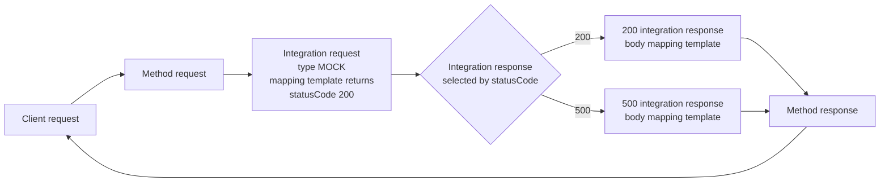

# 3.2.2 Replace external dependencies with mock APIs through services and tools such as API Gateway

**Domain 3 · Task 3.2 · Skill 3.2.2** · [Task overview](README.md) · Previous: [3.2.1 Testing with SAM, CDK, and CloudFormation](3.2.1-testing-with-sam-cdk-and-cloudformation.md) · Next: [3.2.3 Test events and payloads](3.2.3-test-events-and-payloads.md)

## What the exam expects

This skill tests whether you can keep testing when a dependency is missing, slow, costly, or unreliable. The named tool is Amazon API Gateway's **mock integration**, which returns a configured response without calling any backend. Questions also describe code that calls AWS services or third-party application programming interfaces (APIs) and ask how to test it without those services. Wrong answers usually provision real infrastructure for every test run, test only in production, or claim the thing cannot be tested.

You must be able to:

- Configure an API Gateway REST API method with a `MOCK` integration, including status-code selection with a mapping template.
- Choose between an API-level mock, a software development kit (SDK) mock in unit tests, a local emulator, and a stub backend.
- Mock AWS Step Functions service integrations with the `TestState` API.
- Explain what mocks cannot prove (permissions, real query behavior) and when to switch to an integration test.

## Key terms

| Term | Meaning |
|---|---|
| Mock | A fake dependency that returns canned responses so the code under test runs without the real one. |
| Stub | A minimal stand-in implementation, such as a Lambda function that returns fixed data. |
| `MOCK` integration | An API Gateway REST API integration type that generates the response inside API Gateway; no backend is called. |
| Mapping template | A Velocity Template Language (VTL) script that transforms a request or response in a REST API non-proxy integration. |
| Integration response | The API Gateway configuration that maps a backend (or mock) result to a method response, selected by status code or pattern. |
| SDK mocking | Intercepting AWS SDK calls in unit tests, for example with moto, botocore `Stubber`, or `aws-sdk-client-mock`. |
| Emulator | A local program that implements AWS service APIs, such as DynamoDB local. |
| Contract test | A test that checks requests and responses match an agreed API definition, such as an OpenAPI document. |

## Choose a mocking approach

| Dependency to replace | Approach | Fidelity | Speed |
|---|---|---|---|
| A backend API that does not exist yet, for front-end or partner teams | API Gateway `MOCK` integration | Response shape only | Deployed, instant responses |
| A third-party HTTP API (payment, shipping) in tests | Stub HTTP server (WireMock or a stub Lambda function) behind a stage-specific URL (uniform resource locator) | Configurable, including errors and latency | Fast |
| AWS SDK calls inside a Lambda handler, in unit tests | moto, botocore `Stubber`, `unittest.mock`, `aws-sdk-client-mock` | Low to medium | Milliseconds |
| DynamoDB behavior (key schema, expressions) without AWS | DynamoDB local, or a third-party emulator | Medium | Fast |
| Step Functions service integrations | `TestState` API with `--mock` | State logic, retries, catches | Seconds, no deploy |
| Everything, including AWS Identity and Access Management (IAM) and real limits | No mock: integration test in a sandbox account | High | Slow |

Mocks make tests fast and deterministic. They also hide anything the mock does not model, which is why the testing pyramid in [3.2.1](3.2.1-testing-with-sam-cdk-and-cloudformation.md#the-testing-pyramid-for-serverless-apps) keeps a layer of real integration tests.

## API Gateway mock integrations

A `MOCK` integration lets API Gateway answer a REST API method itself. Typical uses:

- Unblock front-end or partner teams that need the API before the backend is built.
- Simulate a third-party API, including its error codes, so client retry and error handling can be tested.
- Serve a static landing page or a fixed response for an API root.
- Answer CORS (cross-origin resource sharing) preflight `OPTIONS` requests. Enabling CORS in the console creates an `OPTIONS` method with a mock integration.

HTTP APIs do not support mock integrations. If a scenario needs a mock, the answer is a REST API.

### How the response is chosen



1. The **integration request** mapping template returns a JavaScript Object Notation (JSON) object with a `statusCode`, for example `{"statusCode": 200}`.
2. API Gateway selects the **integration response** configured for that status code. With no request template, it uses the default integration response (the one with no status pattern), as long as the passthrough behavior allows it.
3. The integration response's **body mapping template** produces the response body.
4. The **method response** must declare that status code.

The request template can branch, so one mock method can return success or failure:

```velocity
{
  #if( $input.params('scope') == "internal" )
    "statusCode": 200
  #else
    "statusCode": 500
  #end
}
```

With this template, `GET /orders?scope=internal` returns the 200 response and any other call returns the 500 response. The same technique simulates a third-party API's `429` or `503` so you can test client backoff from [1.1.3](../../domain-1-development-with-aws-services/task-1.1-build-application-code/1.1.3-resilience-retries-and-backoff.md).

Mock integrations are not meant for large response templates. If you need large or computed responses, use a Lambda function as a stub instead.

### Create a mock method with the AWS CLI

The AWS command line interface (CLI) builds the same method step by step:

```bash
API=abc123; RES=def456   # REST API ID and resource ID for /orders

aws apigateway put-method --rest-api-id $API --resource-id $RES \
  --http-method GET --authorization-type NONE

aws apigateway put-integration --rest-api-id $API --resource-id $RES \
  --http-method GET --type MOCK \
  --request-templates '{"application/json": "{\"statusCode\": 200}"}'

aws apigateway put-method-response --rest-api-id $API --resource-id $RES \
  --http-method GET --status-code 200

aws apigateway put-integration-response --rest-api-id $API --resource-id $RES \
  --http-method GET --status-code 200 \
  --response-templates '{"application/json": "{\"orderId\": \"o-1\", \"status\": \"SHIPPED\"}"}'

# Nothing is live until you deploy to a stage
aws apigateway create-deployment --rest-api-id $API --stage-name mock
curl https://$API.execute-api.us-east-1.amazonaws.com/mock/orders
```

### Define the mock as code

The same mock in an OpenAPI definition, which you can import into API Gateway or embed in an `AWS::Serverless::Api` `DefinitionBody`:

```yaml
openapi: "3.0.1"
info:
  title: orders-mock
  version: "1.0"
paths:
  /orders:
    get:
      responses:
        "200":
          description: OK
      x-amazon-apigateway-integration:
        type: mock
        requestTemplates:
          application/json: '{"statusCode": 200}'
        responses:
          default:
            statusCode: "200"
            responseTemplates:
              application/json: '{"orderId": "o-1", "status": "SHIPPED"}'
```

Keeping the mock in the same OpenAPI document as the real API gives consumers a contract to build against. When the backend is ready, replace the `x-amazon-apigateway-integration` block with the real integration and redeploy; clients keep the same paths and response shapes.

### Point each stage at a different backend

A mock integration cannot be switched on and off with a stage variable. To give a test stage a fake third-party backend while production uses the real one, use an HTTP integration whose URL comes from a stage variable:

```text
Integration type: HTTP
Endpoint URL:     https://${stageVariables.paymentHost}/charge

Stage "test":  paymentHost = payments-stub.internal.example.com   (WireMock or a stub function behind a URL)
Stage "prod":  paymentHost = api.payments-provider.com
```

Stage variables and stage URLs are covered in [3.1.5](../task-3.1-prepare-deployable-artifacts/3.1.5-api-gateway-stages-and-endpoints.md) and [3.1.4](../task-3.1-prepare-deployable-artifacts/3.1.4-environment-specific-configuration.md).

### Test invoke is not a mock

The API Gateway console **Test** tab (and the `test-invoke-method` API) calls the method's real integration. If the method deletes data, the data is deleted. Only the CloudWatch Logs output is simulated. Use it to inspect mapping and integration behavior without deploying a stage, not to avoid backend side effects. Details are in [3.2.3](3.2.3-test-events-and-payloads.md#api-gateway-console-test).

## Mock AWS SDK calls in unit tests

Unit tests should not call AWS. Three common Python techniques and one JavaScript library:

| Tool | How it works | Good for |
|---|---|---|
| `unittest.mock` / `pytest-mock` | Replace `boto3.client` or a method with a `MagicMock` | Testing your branching around a response |
| botocore `Stubber` | Queue expected requests and canned responses on a real client; fails if parameters differ | Asserting exact request parameters, simulating service errors |
| moto (`@mock_aws`) | In-process fake AWS that keeps state (tables, buckets, queues) | Tests that write then read |
| `aws-sdk-client-mock` | Mocks AWS SDK for JavaScript v3 clients by command | Node.js handlers |

### botocore Stubber: assert the request and simulate a throttle

```python
# handler.py
import boto3
ddb = boto3.client("dynamodb", region_name="us-east-1")

def get_order(order_id):
    resp = ddb.get_item(TableName="Orders", Key={"id": {"S": order_id}})
    return resp.get("Item")
```

```python
# test_handler.py
import pytest
from botocore.stub import Stubber
from botocore.exceptions import ClientError
import handler

def test_get_order_found():
    with Stubber(handler.ddb) as stub:
        stub.add_response(
            "get_item",
            {"Item": {"id": {"S": "abc"}}},
            {"TableName": "Orders", "Key": {"id": {"S": "abc"}}},  # expected params
        )
        assert handler.get_order("abc") == {"id": {"S": "abc"}}

def test_get_order_throttled():
    with Stubber(handler.ddb) as stub:
        stub.add_client_error("get_item",
                              service_error_code="ProvisionedThroughputExceededException",
                              http_status_code=400)
        with pytest.raises(ClientError):
            handler.get_order("abc")
```

### moto: a stateful fake

```python
import boto3
from moto import mock_aws

@mock_aws
def test_put_then_get():
    ddb = boto3.client("dynamodb", region_name="us-east-1")
    ddb.create_table(
        TableName="Orders",
        KeySchema=[{"AttributeName": "id", "KeyType": "HASH"}],
        AttributeDefinitions=[{"AttributeName": "id", "AttributeType": "S"}],
        BillingMode="PAY_PER_REQUEST")
    ddb.put_item(TableName="Orders", Item={"id": {"S": "abc"}})
    item = ddb.get_item(TableName="Orders", Key={"id": {"S": "abc"}})["Item"]
    assert item["id"]["S"] == "abc"
```

Create clients inside the mocked scope (or after the mock starts) so they do not capture real credentials and endpoints.

### JavaScript v3: aws-sdk-client-mock

```javascript
import { mockClient } from 'aws-sdk-client-mock';
import { DynamoDBDocumentClient, GetCommand } from '@aws-sdk/lib-dynamodb';
import { handler } from '../src/handler.mjs';

const ddbMock = mockClient(DynamoDBDocumentClient);

beforeEach(() => ddbMock.reset());

test('returns 404 when the item is missing', async () => {
  ddbMock.on(GetCommand).resolves({});            // no Item
  const res = await handler({ pathParameters: { id: 'missing' } });
  expect(res.statusCode).toBe(404);
});
```

### What SDK mocks cannot prove

- That the execution role allows the call. A mocked client never checks IAM.
- That your key schema, condition expression, or index name is valid. `MagicMock` accepts anything; moto and emulators catch more, but not all.
- Real limits: item size, throttling under load, eventual consistency timing.

Cover these with a small number of integration tests against a sandbox stack, as in [3.2.1](3.2.1-testing-with-sam-cdk-and-cloudformation.md#worked-example-one-function-three-layers).

## Local emulators and stub backends

- **DynamoDB local:** an AWS-provided downloadable version of DynamoDB (also a Docker image) for development and tests. Point the SDK at it with `endpoint_url="http://localhost:8000"`.
- **Third-party AWS emulators:** open-source projects such as Floci or LocalStack expose many AWS APIs on `localhost:4566`. They are not AWS services; behavior can differ from AWS.
- **WireMock or similar HTTP stubs:** record or define responses for third-party HTTP APIs, including delays and error codes.
- **A stub Lambda function:** deploy a function that returns canned data in the test environment, and point the caller at it through configuration.

## Mock Step Functions service integrations

The Step Functions `TestState` API runs one state, or one state inside a full definition, without creating a state machine. Since November 2025 it accepts a **mock** of the service integration result, so you can unit test `Choice` routing, `Retry` and `Catch` behavior, data transformations, and `Map` and `Parallel` states without calling Lambda or DynamoDB. With a mock, the IAM role is optional.

```bash
aws stepfunctions test-state \
  --definition '{"Type":"Task","Resource":"arn:aws:states:::lambda:invoke",
                 "Parameters":{"FunctionName":"ChargeCard","Payload.$":"$"},
                 "Retry":[{"ErrorEquals":["States.TaskFailed"],"MaxAttempts":2}],
                 "Catch":[{"ErrorEquals":["States.ALL"],"Next":"NotifyFailure"}],
                 "End":true}' \
  --input '{"orderId":"o-1","amount":50}' \
  --mock '{"errorOutput":{"error":"States.TaskFailed","cause":"card declined"}}' \
  --inspection-level DEBUG
```

The response shows `status` (`SUCCEEDED`, `FAILED`, `RETRIABLE`, or `CAUGHT_ERROR`), `nextState`, and for retries the `retryIndex` and backoff, so a test can assert which handler fired. Mocks are required to test `Map`, `Parallel`, Activity, `.sync`, and `.waitForTaskToken` states. The console Test state feature does not yet support mocking; use the CLI or SDK.

Older material uses **Step Functions Local** (a Docker image with a mock configuration file). AWS now marks Step Functions Local as unsupported and without feature parity; prefer `TestState`.

> **Not on the DVA-C03 service list.** AWS Fault Injection Service (FIS) runs controlled experiments that inject faults (stop instances, add latency, throttle APIs) into a real test environment. It tests how the system behaves when a real dependency fails, which a mock only approximates. Know the name; questions about replacing a dependency point to mocks.

## Exam triggers

| Scenario clue | Answer | Why the alternatives are wrong |
|---|---|---|
| Front-end team needs the API before the backend exists | API Gateway REST API `MOCK` integration | Waiting blocks the team; a hand-built fake server is more work |
| Mock must return 200 for some requests and 500 for others | Integration request mapping template that sets `statusCode` conditionally | A single default response cannot vary |
| Mock integration needed on an HTTP API | Use a REST API; HTTP APIs have no mock integration | HTTP API features do not include mocks |
| Mock changes are not visible to clients | Deploy the REST API to the stage | Edits are not live until deployed |
| Unit test code that calls DynamoDB without AWS | Mock the SDK client (moto, `Stubber`, `unittest.mock`) or use DynamoDB local | A real table makes the test slow and flaky |
| Assert the exact parameters sent to an AWS API | botocore `Stubber` with expected params | `MagicMock` accepts any parameters |
| Test retry logic when DynamoDB throttles | `Stubber.add_client_error` with a throttling error code | Waiting for real throttling is not deterministic |
| Test stage must call a fake payment provider; prod calls the real one | HTTP integration URL from a stage variable per stage | A mock integration cannot be toggled by stage variable |
| Test a state machine's `Choice` and `Catch` paths without calling services | `TestState` API with `--mock` | Deploying and running real executions for every commit is slow |
| Function works with mocks but fails with `AccessDenied` in AWS | Add an integration test with the real role | Mocks never evaluate IAM |

## Common traps

- The API Gateway console Test tab calls the real backend. It is not a mock.
- `MOCK` exists only for REST APIs.
- A mock integration still needs a method response for every status code it returns, and a deployment to a stage.
- Third-party emulators (Floci, LocalStack) are not AWS services. DynamoDB local is AWS-provided.
- Step Functions Local is unsupported; `TestState` with mocks is the current tool.
- A green test suite built only on mocks says nothing about IAM, quotas, or real latency.
- Do not "solve" testing by making a resource public or giving the test role `*` permissions.

## Quick recall

- REST API `MOCK` integration: request template returns `{"statusCode": N}`, integration response builds the body.
- Conditional VTL in the request template returns different status codes.
- No mock integrations on HTTP APIs.
- CORS preflight `OPTIONS` uses a mock integration.
- Console Test tab = real call, simulated logs.
- `Stubber` checks exact params; moto keeps state; `aws-sdk-client-mock` for JavaScript v3.
- DynamoDB local is AWS-provided; LocalStack and Floci are third party.
- `aws stepfunctions test-state --mock` tests one state without deploying.

## Related skills

- [1.1.4 APIs, transformation, and validation](../../domain-1-development-with-aws-services/task-1.1-build-application-code/1.1.4-apis-transformation-and-validation.md): integration types and VTL mapping templates in depth.
- [1.1.5 AWS SDKs and service APIs](../../domain-1-development-with-aws-services/task-1.1-build-application-code/1.1.5-aws-sdks-and-service-apis.md): the SDK calls these mocks replace.
- [3.1.5 API Gateway stages and endpoints](../task-3.1-prepare-deployable-artifacts/3.1.5-api-gateway-stages-and-endpoints.md): stage variables that switch backends per stage.
- [3.2.1 Testing with SAM, CDK, and CloudFormation](3.2.1-testing-with-sam-cdk-and-cloudformation.md): where mocked unit tests sit in the pyramid.
- [3.2.3 Test events and payloads](3.2.3-test-events-and-payloads.md): the input side of the same tests.

## Sources

- Merged from: `archive/dva-c03-study-notes/03-testing-deployment.md` (skill 3.2.2), `archive/dva-c03-study-notes/01-development-with-aws-services.md` (TestState), `archive/dva-c03/domain-3-testing-deployment/testing-strategies-for-serverless-apps.md`, `archive/dva-c03/domain-3-testing-deployment/README.md`, `archive/aws-dva-notes/Markdown Files/20. Serverless - API Gateway.md` (sections 6 and 16), `archive/aws-dva-notes/Markdown Files/30. AI Services & Security (DVA-C03).md` (section 10), `archive/dva-c03/exam-bank/bank-1.md` (SDK mocking scenario), `archive/dva-c03/exam-bank/bank-2.md` (FIS scenario), `archive/dva-c03/exam-bank/bank-3.md` (Step Functions mocked integrations scenario).
- AWS documentation: [Mock integrations for REST APIs in API Gateway](https://docs.aws.amazon.com/apigateway/latest/developerguide/how-to-mock-integration.html)
- AWS documentation: [Choose between REST APIs and HTTP APIs](https://docs.aws.amazon.com/apigateway/latest/developerguide/http-api-vs-rest.html) (mock integrations and test invocations are REST-only)
- AWS documentation: [Use the API Gateway console to test a REST API method](https://docs.aws.amazon.com/apigateway/latest/developerguide/how-to-test-method.html) (test calls are real)
- AWS documentation: [Testing state machines with TestState API](https://docs.aws.amazon.com/step-functions/latest/dg/test-state-isolation.html) (November 2025 mocking enhancements)
- AWS documentation: [Testing state machines with Step Functions Local (unsupported)](https://docs.aws.amazon.com/step-functions/latest/dg/sfn-local-computer.html)
