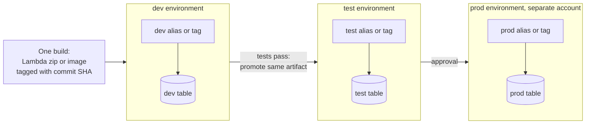

# 3.2.4 Create isolated test environments with Lambda aliases, container tags, Amplify branches, Copilot environments, and API Gateway APIs

**Domain 3 · Task 3.2 · Skill 3.2.4** · [Task overview](README.md) · Previous: [3.2.3 Test events and payloads](3.2.3-test-events-and-payloads.md) · Next: [3.2.5 AI-assisted testing](3.2.5-ai-assisted-testing.md)

## What the exam expects

This skill tests whether you can give code a place to be tested that is separate from production, and then promote the same tested artifact forward. The exam guide names five mechanisms: Lambda aliases, container image tags, AWS Amplify branches, AWS Copilot environments, and API Gateway APIs and stages. Questions describe a team's need ("every pull request gets its own preview", "test then prod for a container service with a simple command line interface (CLI)", "the prod stage must call the prod function version") and ask which mechanism fits. Wrong answers rebuild the artifact per environment, mix test and production data, or rely on a mutable pointer such as `latest`.

You must be able to:

- Use Lambda versions and aliases as stable per-environment targets, and wire API Gateway stages to them with stage variables.
- Tag and promote container images so each environment runs a known, traceable image.
- Map Amplify branches to environments and use pull request (PR) previews and per-developer sandboxes.
- Describe Copilot's application, environment, and service model, and its support status.
- Choose between API Gateway stages and separate APIs, and between shared and separate AWS accounts.
- Deploy one infrastructure as code (IaC) template to several environments with parameters.

## Key terms

| Term | Meaning |
|---|---|
| Environment | An isolated copy of an application (dev, test, staging, prod) with its own configuration and data. |
| Ephemeral environment | A short-lived environment created for one branch or pull request and deleted afterward. |
| Lambda version | An immutable snapshot of a function's code and configuration, with its own Amazon Resource Name (ARN). |
| Lambda alias | A mutable, named pointer to a version (or two versions with weights), with its own ARN. |
| Image tag | A human-readable label on a container image in Amazon Elastic Container Registry (Amazon ECR), such as `1.4.2` or a Git commit SHA. |
| Image digest | The content hash of an image (`sha256:...`); it never changes for the same image. |
| Stage | A named, deployed snapshot of an API Gateway API with its own URL (uniform resource locator) and settings. |
| Stage variable | A key-value pair defined per stage and referenced as `${stageVariables.name}`. |
| Promotion | Moving the same tested artifact to the next environment, instead of rebuilding it. |

## Isolation levels

| Level | Mechanism | Isolation | Typical use |
|---|---|---|---|
| Strongest | Separate AWS account per environment | Separate AWS Identity and Access Management (IAM), quotas, billing, blast radius | Production versus everything else; recommended baseline |
| Strong | Separate stack or app per environment from one template | Separate resources, shared account limits | Dev, test, staging in one non-prod account |
| Medium | Separate API Gateway APIs | Separate resources, authorizers, and throttling | Teams or environments that must not share an API definition |
| Lighter | API Gateway stages on one API | Same API, different deployments, settings, and stage variables | dev, test, prod stages of one API |
| Lightest | Lambda aliases on one function | Same function, different versions | Promotion and traffic shifting |

The lighter mechanisms share more. A Lambda alias does not get its own data store, and a stage does not get its own backend unless you point it at one. Combine them: separate accounts or stacks for data and permissions, aliases and stages for promotion within a stack.



Build once, deploy many: the artifact does not change between environments; configuration does. Keep environment-specific values in AWS AppConfig, Parameter Store, Secrets Manager, stage variables, or IaC parameters, as covered in [3.1.4](../task-3.1-prepare-deployable-artifacts/3.1.4-environment-specific-configuration.md).

## Lambda aliases

- Publishing a **version** freezes the function's code **and configuration**, including environment variables, memory, and timeout.
- An **alias** points to one version, or to two versions with a weight on the second for traffic shifting. Weighted aliases need published versions, not `$LATEST`.
- An alias cannot point to another alias.
- Triggers, event source mappings, destinations, and API Gateway integrations should target the **alias ARN** (`...:function:orders-fn:prod`), so promotion does not require reconfiguring them.
- Promotion is an alias update. Rollback is moving the alias back.

```bash
# Publish what is in $LATEST as an immutable version
aws lambda publish-version --function-name orders-fn            # -> Version "7"

# One alias per environment
aws lambda create-alias --function-name orders-fn --name dev  --function-version 7
aws lambda create-alias --function-name orders-fn --name test --function-version 6
aws lambda create-alias --function-name orders-fn --name prod --function-version 5

# Promote version 6 to prod after tests pass
aws lambda update-alias --function-name orders-fn --name prod --function-version 6

# Or shift 10% of prod traffic to version 7 first
aws lambda update-alias --function-name orders-fn --name prod --function-version 6 \
  --routing-config '{"AdditionalVersionWeights": {"7": 0.10}}'
```

Automated traffic shifting with CodeDeploy and SAM `AutoPublishAlias` plus `DeploymentPreference` is in [3.3.4](../task-3.3-deploy-with-ci-cd/3.3.4-codedeploy.md) and [3.3.6](../task-3.3-deploy-with-ci-cd/3.3.6-deployment-strategies.md).

### Environment variables do not vary by alias

Environment variables belong to the version. Two aliases that point to the same version see the same variables. To give each environment its own configuration:

- Deploy separate functions per environment (separate stacks), each with its own variables, or
- Read configuration at runtime from a per-environment path, choosing the path from the alias in the invoked ARN:

```python
import boto3

ssm = boto3.client("ssm")
_cache = {}

def handler(event, context):
    # arn:aws:lambda:us-east-1:111122223333:function:orders-fn:prod
    parts = context.invoked_function_arn.split(":")
    env = parts[7] if len(parts) == 8 else "dev"   # unqualified call runs $LATEST
    if env not in _cache:
        _cache[env] = ssm.get_parameter(Name=f"/orders/{env}/table-name")["Parameter"]["Value"]
    table_name = _cache[env]
    ...
```

Keep secrets in Secrets Manager or Parameter Store `SecureString` and cache them, rather than in environment variables. See [2.2.7](../../domain-2-security/task-2.2-encrypt-and-protect-sensitive-data/2.2.7-secrets-management.md).

### API Gateway stages bound to aliases

One API, three stages, each calling a different alias through a stage variable:

```text
Integration (Lambda):  arn:aws:lambda:us-east-1:111122223333:function:orders-fn:${stageVariables.lambdaAlias}

Stage dev:   lambdaAlias = dev
Stage test:  lambdaAlias = test
Stage prod:  lambdaAlias = prod
```

API Gateway needs permission to invoke **each alias**. When the integration uses a stage variable, the console cannot add these permissions for you:

```bash
for ALIAS in dev test prod; do
  aws lambda add-permission \
    --function-name orders-fn --qualifier "$ALIAS" \
    --statement-id "apigw-$ALIAS" \
    --action lambda:InvokeFunction \
    --principal apigateway.amazonaws.com \
    --source-arn "arn:aws:execute-api:us-east-1:111122223333:abc123/*/POST/orders"
done
```

A missing permission for one alias shows up as a 500 error on that stage only. Stage URLs, stage variables, and canary settings are in [3.1.5](../task-3.1-prepare-deployable-artifacts/3.1.5-api-gateway-stages-and-endpoints.md).

## Container image tags

| Tag style | Example | Use |
|---|---|---|
| Git commit SHA | `git-3f2a9c1` | Traceability: which commit is running |
| Semantic version | `1.4.2` | Releases that humans refer to |
| Build number | `build-123` | Pipeline runs |
| Environment | `staging`, `prod` | A moving pointer for an environment; mutable by nature |
| `latest` | `latest` | Avoid for deployments: you cannot tell what is running or roll back cleanly |

Patterns to know:

- **Build once, tag many.** Build the image once, tag it with the commit SHA, and promote that exact image. Do not rebuild for each environment; a rebuild can pull different base layers or dependencies.
- **Deploy by digest** (`orders@sha256:...`) when the exact image must be guaranteed. A tag can be moved; a digest cannot.
- **Tag immutability.** With the repository set to immutable, pushing an existing tag fails with `ImageTagAlreadyExistsException`, so `1.4.2` always means the same image. If you also use moving environment tags, `IMMUTABLE_WITH_EXCLUSION` lets you exempt tag patterns (such as `staging` or `latest`) from immutability.
- **Retag without pulling.** Add an environment tag to an existing image by reusing its manifest:

```bash
MANIFEST=$(aws ecr batch-get-image --repository-name orders \
  --image-ids imageTag=git-3f2a9c1 --query 'images[0].imageManifest' --output text)
aws ecr put-image --repository-name orders --image-tag staging --image-manifest "$MANIFEST"
```

- Each environment's Amazon Elastic Container Service (Amazon ECS) task definition, or Kubernetes manifest on Amazon Elastic Kubernetes Service (Amazon EKS), references the tag or digest for that environment. Environment-specific settings go in task definition `environment` and `secrets` entries, not in the image.

Image builds, tagging, scanning, and lifecycle policies are in [3.1.2](../task-3.1-prepare-deployable-artifacts/3.1.2-container-images-and-ecr.md). Deploying the images is [3.3.2](../task-3.3-deploy-with-ci-cd/3.3.2-container-deployments.md).

## AWS Amplify branches

Amplify Hosting is Git-based continuous integration and continuous delivery (CI/CD) and hosting for web front ends and full-stack apps. Its environment model is the Git branch.

- **Branches map to environments.** Connect `main` as production and `dev` as development. Each connected branch gets its own build, URL (`https://<branch>.<app-id>.amplifyapp.com`), and, for full-stack apps, its own backend.
- **Feature branch deployments.** Branch auto-detection can connect new branches that match a pattern (such as `feature/*`) and disconnect them when the branch is deleted.
- **Pull request previews (full-stack previews).** Each pull request to a preview-enabled branch gets an ephemeral environment at a URL such as `pr-1.<app-id>.amplifyapp.com`. On GitHub, Amplify posts the URL on the pull request. When the pull request is merged or closed, the preview and its ephemeral backend are deleted. For security, full-stack previews are disabled for public repositories that contain Amplify backend templates. To avoid a new backend per preview, previews can reuse the `dev` branch's backend.
- **Per-developer cloud sandboxes (Amplify Gen 2).** `npx ampx sandbox` deploys an isolated cloud backend for one developer and redeploys as files change; `npx ampx sandbox delete` removes it. Sandboxes are for development, not shared environments.
- **Per-branch settings.** Environment variables per branch, password protection (access control) for non-production branches, custom subdomains per branch, and rollback to a previous build.
- **Tests in the pipeline.** Add a `test` phase to `amplify.yml` (for example, Cypress end-to-end tests) so a failing test stops the deployment.

```yaml
# amplify.yml (excerpt)
version: 1
frontend:
  phases:
    preBuild:
      commands: [npm ci]
    build:
      commands: [npm run build]
  artifacts:
    baseDirectory: dist
    files: ['**/*']
test:
  phases:
    test:
      commands: [npx cypress run]
```

Amplify Gen 1 (Amplify CLI and Studio) is in maintenance mode with end of life on May 1, 2027. New projects use Gen 2. The exam may still use Gen 1 terms.

## AWS Copilot environments

AWS Copilot is a CLI for building, releasing, and operating containerized applications on Amazon ECS (and AWS App Runner). It generates CloudFormation from short YAML Ain't Markup Language (YAML) manifests.

| Copilot concept | Meaning |
|---|---|
| Application | A group of related services and environments |
| Environment | Shared infrastructure for one stage (a virtual private cloud or VPC, an ECS cluster, a load balancer), such as `test` or `prod`; can live in a different account or Region |
| Service | A long-running container: Load Balanced Web Service, Backend Service, Worker Service (reads Amazon Simple Queue Service, or SQS, messages), Request-Driven Web Service (App Runner), Static Site |
| Job | A scheduled container task |
| Pipeline | A CodePipeline that builds and deploys services through environments in order |

```bash
copilot app init orders
copilot env init --name test --profile nonprod
copilot env deploy --name test
copilot env init --name prod --profile prod
copilot env deploy --name prod
copilot svc init --name api --svc-type "Load Balanced Web Service" --dockerfile ./Dockerfile
copilot svc deploy --name api --env test     # test first
copilot svc deploy --name api --env prod     # then prod
copilot pipeline init && copilot pipeline deploy
```

**Support status.** AWS Copilot CLI reached end of support on June 12, 2026. It remains open source on GitHub, and existing deployments keep running, but AWS no longer ships features, security patches, or support. AWS recommends migrating to Amazon ECS Express Mode (fastest path from container image to a production web service) or AWS CDK Level 3 (L3) constructs (fine-grained control). Because Copilot generates standard CloudFormation stacks, teams can also adopt and manage those stacks directly. The DVA-C03 outline still names Copilot environments, so know the model: one application, several environments, the same service deployed to each in turn.

## API Gateway APIs and stages

| Choice | Isolation | Trade-off |
|---|---|---|
| One API, stages `dev`, `test`, `prod` | Each stage has its own deployment snapshot, URL, stage variables, throttling, logging, caching, and canary settings | Resources, methods, and authorizers come from the same API; a deployment you promote is the same definition |
| Separate APIs per environment (often from one OpenAPI file or template) | Fully separate resources, authorizers, and usage plans | More to manage; usually created by IaC per stack |
| Separate APIs per account | Strongest | Matches per-account environments |

- REST API changes are not live until you deploy them to a stage. HTTP APIs can auto-deploy to the `$default` stage.
- A stage URL includes the stage name: `https://{api-id}.execute-api.{region}.amazonaws.com/{stage}/...`.
- Stage variables bind each stage to its environment's backend: a Lambda alias, an HTTP endpoint, or a value passed to the function.
- Canary settings on a stage send a percentage of traffic to a new deployment; see [3.3.6](../task-3.3-deploy-with-ci-cd/3.3.6-deployment-strategies.md).

## One template, many environments

### AWS SAM: `samconfig.toml`

```toml
version = 0.1

[dev.deploy.parameters]
stack_name = "orders-dev"
region = "us-east-1"
parameter_overrides = "Env=dev"
resolve_s3 = true

[prod.deploy.parameters]
stack_name = "orders-prod"
region = "us-east-1"
parameter_overrides = "Env=prod"
resolve_s3 = true
```

```bash
sam deploy --config-env dev
sam deploy --config-env prod
```

`samconfig.toml` uses Tom's Obvious Minimal Language (TOML). One template produces separate dev and prod stacks.

### AWS CDK: stacks per environment

```typescript
const app = new cdk.App();
new OrdersStack(app, 'Orders-Dev',  { env: { account: '111111111111', region: 'us-east-1' }, stage: 'dev' });
new OrdersStack(app, 'Orders-Prod', { env: { account: '222222222222', region: 'us-east-1' }, stage: 'prod' });
```

`OrdersStack` accepts a custom `stage` prop and sizes resources from it. CDK Pipelines and the `Stage` construct group stacks into deployable units per environment; each target account and Region must be bootstrapped.

### Ephemeral stacks per pull request

```bash
# In the PR build
sam deploy --stack-name "orders-pr-${PR_NUMBER}" --parameter-overrides Env=pr \
  --resolve-s3 --no-confirm-changeset --capabilities CAPABILITY_IAM
STACK_NAME="orders-pr-${PR_NUMBER}" pytest tests/integration
# When the PR closes
sam delete --stack-name "orders-pr-${PR_NUMBER}" --no-prompts
```

The stack name keeps resources separate; the delete step keeps costs down. Resources with fixed names (a hard-coded table or bucket name) collide across stacks, so let CloudFormation generate names or include the environment in them.

## Exam triggers

| Scenario clue | Answer | Why the alternatives are wrong |
|---|---|---|
| Point prod traffic at a validated Lambda version without reconfiguring triggers | Move the `prod` alias to that version | Pointing triggers at a version number needs reconfiguration each release |
| Same API, different Lambda alias per stage | Stage variable in the integration ARN, plus invoke permission per alias | Separate functions per stage duplicate code |
| One stage returns 500 after adding a stage-variable alias | Add the Lambda resource-based permission for that alias | The integration ARN is fine; the permission is missing |
| Different config per alias with env vars | Not possible; use per-environment stacks or read config by alias at runtime | Env vars are frozen into the version |
| Trace a running container back to source | Commit SHA tag (or deploy by digest) | `latest` hides what is running |
| A released tag must never be overwritten | ECR tag immutability | A naming convention does not enforce anything |
| Promote the tested image to prod | Retag or deploy the same digest | Rebuilding can change dependencies |
| Every feature branch or pull request gets its own preview of the web app | Amplify branch deployments or pull request previews | Building a CloudFront stack per branch by hand is slower |
| Each developer needs an isolated cloud backend while coding | Amplify Gen 2 cloud sandbox | A shared dev backend causes conflicts |
| Deploy a container service to test, then prod, with a simple CLI | AWS Copilot environments (note: end of support June 2026; ECS Express Mode or CDK for new work) | Hand-written CloudFormation is not "simple CLI" |
| Same SAM app to dev and prod with different settings | `samconfig.toml` plus `sam deploy --config-env` | Copying the template per environment drifts |
| Ephemeral environment per pull request, removed afterward | Stack per PR name, `sam delete` on close | A shared test stack mixes PRs |
| Strongest isolation between test and prod | Separate AWS accounts | Stages and aliases share resources and limits |

## Common traps

- An alias is not an environment by itself. It does not isolate data, permissions, or configuration.
- Weighted aliases can split between two published versions only, and cannot use `$LATEST`.
- Each alias used through a stage variable needs its own invoke permission.
- `latest` is a moving tag. Deploy a specific tag or digest.
- Tag immutability blocks re-pushing a tag. Use exclusions for intentionally moving tags.
- Amplify full-stack PR previews are disabled for public repositories with backend templates.
- Copilot's support has ended. If an answer offers ECS Express Mode or CDK for a new project, that matches AWS's current guidance; if the question names Copilot environments, answer with the Copilot model.
- REST API stage changes need a deployment; HTTP API `$default` can auto-deploy.

## Quick recall

- Version = immutable code plus config; alias = mutable pointer with its own ARN.
- Weighted alias: two versions, published only.
- Stage variable `${stageVariables.lambdaAlias}` plus `add-permission --qualifier <alias>` per alias.
- Tag images with the commit SHA; promote the same digest; avoid `latest`.
- ECR tag immutability; `IMMUTABLE_WITH_EXCLUSION` for moving tags.
- Amplify: branch = environment; PR previews at `pr-N.<app-id>.amplifyapp.com`; `npx ampx sandbox` per developer.
- Copilot: app, environments, services, pipeline; end of support June 12, 2026.
- `sam deploy --config-env <env>` with `samconfig.toml`.
- Separate accounts give the strongest isolation.

## Related skills

- [1.2.2 Lambda configuration](../../domain-1-development-with-aws-services/task-1.2-develop-lambda-functions/1.2.2-lambda-configuration.md): environment variables and what a version freezes.
- [3.1.2 Container images and ECR](../task-3.1-prepare-deployable-artifacts/3.1.2-container-images-and-ecr.md): building, tagging, and lifecycle policies.
- [3.1.4 Environment-specific configuration](../task-3.1-prepare-deployable-artifacts/3.1.4-environment-specific-configuration.md): where per-environment values live.
- [3.1.5 API Gateway stages and endpoints](../task-3.1-prepare-deployable-artifacts/3.1.5-api-gateway-stages-and-endpoints.md): stages, stage URLs, and stage variables.
- [3.3.5 CodePipeline release promotion](../task-3.3-deploy-with-ci-cd/3.3.5-codepipeline-release-promotion.md): promoting through these environments in a pipeline.
- [3.3.8 Versions and releases](../task-3.3-deploy-with-ci-cd/3.3.8-versions-and-releases.md): branches and tags in source control.

## Sources

- Merged from: `archive/dva-c03-study-notes/03-testing-deployment.md` (skills 3.1.4, 3.2.4), `archive/dva-c03-study-notes/05-cheat-sheet.md`, `archive/aws-dva-notes/Markdown Files/18. Serverless - Lambda.md` (section 17), `archive/aws-dva-notes/Markdown Files/20. Serverless - API Gateway.md` (section 5), `archive/aws-dva-notes/Markdown Files/22. SAM - Serverless Application Model.md` (section 8), `archive/aws-dva-notes/Markdown Files/23. CDK - Cloud Development Kit.md` (bootstrapping), `archive/aws-dva-notes/Markdown Files/25. Other Serverless - Step Functions & AppSync.md` (section 10, Amplify), `archive/aws-dva-notes/Markdown Files/30. AI Services & Security (DVA-C03).md` (sections 9 and 10).
- AWS documentation: [Creating Amazon ECS resources using the AWS Copilot CLI](https://docs.aws.amazon.com/AmazonECS/latest/developerguide/ECS_CLI.html) (end-of-support notice)
- AWS blog: [Announcing the end-of-support for the AWS Copilot CLI](https://aws.amazon.com/blogs/containers/announcing-the-end-of-support-for-the-aws-copilot-cli/) (June 12, 2026; ECS Express Mode and CDK migration paths)
- Amplify documentation: [Fullstack previews](https://docs.amplify.aws/react/deploy-and-host/amplify-hosting/pr-previews/), [Use cloud sandbox in dev environment](https://docs.amplify.aws/nextjs/deploy-and-host/sandbox-environments/setup/), [Amplify Gen 1 documentation](https://docs.amplify.aws/gen1/nextjs/) (maintenance mode, end of life May 1, 2027)
- AWS documentation: [Preventing image tags from being overwritten in Amazon ECR](https://docs.aws.amazon.com/AmazonECR/latest/userguide/image-tag-mutability.html)
