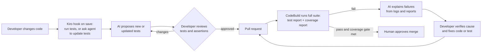

# 3.2.5 Use AWS AI tools to generate tests, run repetitive test workflows, analyze results, automate regression testing, and find coverage gaps

**Domain 3 · Task 3.2 · Skill 3.2.5** · [Task overview](README.md) · Previous: [3.2.4 Isolated test environments](3.2.4-isolated-test-environments.md) · Next: [3.3.1 Lambda packaging](../task-3.3-deploy-with-ci-cd/3.3.1-lambda-packaging.md)

## What the exam expects

This skill is new in the AWS Certified Developer - Associate (DVA-C03) exam. It applies the artificial intelligence (AI) development pattern from [1.1.9](../../domain-1-development-with-aws-services/task-1.1-build-application-code/1.1.9-ai-assisted-development-tools.md) to testing. The official in-scope AI developer tool is **Kiro**. Questions describe a testing chore (write tests for new code, run tests whenever files change, explain failures, keep a regression suite current, find untested paths) and ask which capability or workflow fits. The right answer keeps automation and a human checkpoint together. Wrong answers merge AI-generated tests without review, let AI "fix" a failing test by weakening it, or send secrets and customer data to the tool.

You must be able to:

- Map each part of the skill (generate, run, analyze, regression, coverage) to an AI capability and to the AWS service that runs the tests.
- Use Kiro specs, hooks, steering, and headless mode for testing work.
- Publish test and code coverage reports from AWS CodeBuild and gate a pipeline on them.
- Review AI-generated tests for meaningful assertions and add the business-specific cases an AI cannot infer.

> **DVA-C02 vs DVA-C03.** AI-generated tests, automated execution, result analysis, regression automation, and coverage checks are listed as content added to Task 3.2 in DVA-C03. DVA-C02's two testing tasks (11 skills) were consolidated into this five-skill task.

## Key terms

| Term | Meaning |
|---|---|
| Test generation | An AI tool proposing unit, integration, or application programming interface (API) tests from code, a specification, or an OpenAPI document. |
| Regression test | A test that re-checks existing behavior so a change does not bring back an old bug. |
| Code coverage | The share of code that tests execute: line coverage (statements) and branch coverage (paths through `if` and `case`). |
| Coverage gap | Code, especially branches and error paths, that no test executes. |
| Property-based test (PBT) | A test that states a rule that must always hold and runs it against many generated inputs, shrinking any failure to the smallest example. |
| EARS | Easy Approach to Requirements Syntax: "WHEN [condition], THE System SHALL [behavior]". Kiro writes acceptance criteria in this form. |
| Test report | Structured results (pass, fail, duration) in a format such as JUnit XML that CodeBuild can display. |
| Report group | A CodeBuild container for test or coverage reports across builds, used for trends. |
| Flaky test | A test that passes and fails on the same code. |

## Where AI fits in the test lifecycle

| Part of the skill | What an AI tool does | Where it runs | What a human still checks |
|---|---|---|---|
| Generate tests | Unit tests from a handler, edge cases, mocks, test events; API tests from an OpenAPI document; property-based tests from requirements | Kiro in the integrated development environment (IDE) or command line interface (CLI) | Assertions check correct behavior, not current behavior; business rules |
| Run repetitive test workflows | Run tests or linters on every file save or after each task; generate a test file when a source file appears | Kiro hooks locally; CodeBuild in continuous integration (CI) | The hook runs the right suite and fails loudly |
| Analyze results | Explain a stack trace or failing assertion, group related failures, propose a fix | Kiro chat or headless CLI step in CI | The proposed cause matches the raw output; the fix does not delete the assertion |
| Automate regression testing | Add a regression test with each bug fix; keep tests updated as code changes; run the full suite on each change | Bugfix specs, hooks, pipeline | The regression test fails before the fix and passes after |
| Find coverage gaps | Read a coverage report and propose tests for uncovered branches and error paths | Kiro plus CodeBuild coverage reports | Coverage is a signal, not proof of correctness |



## Kiro for testing

Kiro's features are described in [1.1.9](../../domain-1-development-with-aws-services/task-1.1-build-application-code/1.1.9-ai-assisted-development-tools.md#kiro). This section covers how each one applies to tests.

### Specs: tests that trace to requirements

- A feature spec's `requirements.md` holds user stories with acceptance criteria in EARS form ("WHEN a user submits an order with quantity 0, THE System SHALL return 400"). Each criterion is a test you can write.
- `design.md` includes a testing strategy, and `tasks.md` includes test tasks, so tests are planned with the feature rather than added afterward.
- **Property-based tests.** Kiro extracts testable properties from EARS requirements during design ("for any authenticated user and any active listing, the user can view that listing"), generates property-based tests, and runs hundreds or thousands of random inputs against the implementation. When a property fails, it shrinks the input to the smallest failing example and surfaces it so you can fix the code, the test, or the requirement. Property-based tests are optional by default. They give evidence of correctness, not proof, and a weak property passes while real behavior is wrong.
- **Bugfix specs** record current behavior, expected behavior, and behavior that must stay unchanged, which maps directly to a regression test that fails before the fix and passes after it.

### Hooks: run repetitive test workflows automatically

Hooks are JavaScript Object Notation (JSON) files in `.kiro/hooks/`. A command hook runs a shell command; an agent hook injects a prompt. Triggers relevant to testing include File Save (`PostFileSave`), File Create, Post Task Execution (after a spec task), and Agent Stop.

```json
{
  "version": "v1",
  "hooks": [
    {
      "name": "Run unit tests on save",
      "trigger": "PostFileSave",
      "matcher": "^src/.*\\.py$",
      "action": { "type": "command", "command": "pytest -q tests/unit" },
      "timeout": 120
    },
    {
      "name": "Keep tests in step with handlers",
      "trigger": "PostFileSave",
      "matcher": "^src/handlers/.*\\.py$",
      "action": {
        "type": "agent",
        "prompt": "Update or add pytest tests in tests/unit for the handler that just changed. Cover the API Gateway proxy event shape, missing fields, and AWS SDK errors using botocore Stubber. Do not weaken or delete existing assertions."
      }
    }
  ]
}
```

A File Create hook can generate a test file when a new source file appears. A Post Task Execution hook can run the whole suite after each spec task.

### Steering: consistent test conventions

A steering file such as `.kiro/steering/testing.md` states the team's rules: test framework, folder layout, mock library, fixture location (`events/`), naming, "every handler has tests for malformed input", and "no real customer data in fixtures". The agent follows these in every generated test, instead of relying on each prompt to repeat them.

### Headless mode in CI

With the `KIRO_API_KEY` environment variable set, the Kiro CLI runs non-interactively, so a CodeBuild or GitHub Actions step can ask it to write missing tests for changed files, explain why the build's tests failed, or summarize a coverage report. Give that CI agent the minimum tool permissions it needs (read-only for analysis), store the key in Secrets Manager, and keep the merge decision with a human or an existing approval gate.

### Model Context Protocol

Model Context Protocol (MCP) servers connect the agent to tools and data, such as a test management system, an issue tracker with bug reports to turn into regression tests, or AWS documentation.

> **Not on the DVA-C03 service list.** Amazon Q Developer offered unit test generation in the IDE (the `/test` agent) in DVA-C02-era material. DVA-C03 names Kiro instead. Map an older question to the same capability and apply the same review rules.

## Run tests and read results in CodeBuild

AI-generated tests run in the pipeline like any other tests. CodeBuild turns result files into **test reports** and **code coverage reports** in the console.

| Report type | Supported file formats |
|---|---|
| Test reports | JUnit XML, NUnit XML, NUnit3 XML, TestNG XML, Visual Studio TRX (`.trx` and `.xml`), Cucumber JSON |
| Code coverage reports | JaCoCo XML, SimpleCov JSON, Clover XML, Cobertura XML, LCOV INFO |

```yaml
# buildspec.yml
version: 0.2
phases:
  install:
    commands:
      - pip install -r requirements-dev.txt
  build:
    commands:
      # --cov-fail-under turns the coverage target into a build failure
      - pytest tests --junitxml=reports/junit.xml --cov=src --cov-branch --cov-report=xml:reports/coverage.xml --cov-fail-under=80
reports:
  unit-tests:                       # report group: <project-name>-unit-tests
    files: ['junit.xml']
    base-directory: reports
    file-format: JUNITXML
  coverage:
    files: ['coverage.xml']
    base-directory: reports
    file-format: COBERTURAXML
```

- Add a `reports` section to the buildspec. If you give a name, CodeBuild creates the report group (named `<project>-<name>`) on the first run; give an Amazon Resource Name (ARN) to use an existing group.
- Each run adds a report to the group. The group shows trends, pass rates, and durations across builds, which helps spot flaky tests.
- Reports expire after 30 days. Export raw results to an S3 bucket in the report group settings to keep them; exported files do not expire. The CodeBuild service role needs permission to write to that bucket.
- A failing test command fails the build, which stops the pipeline before deployment. Coverage reports display line and branch coverage; enforce a threshold in the test command (as with `--cov-fail-under`).
- For results from many projects in one view, point them at shared report groups and view them in the CodeBuild console, or build dashboards from the exported data.

Run the regression suite on every change through the pipeline, and on a schedule (an EventBridge Scheduler or EventBridge rule can start a CodeBuild build) for slower suites. Pipeline structure is in [3.3.5](../task-3.3-deploy-with-ci-cd/3.3.5-codepipeline-release-promotion.md).

## Worked example: generated tests and the case only a human knows

A developer asks the assistant for tests of a handler that returns a user's orders. The assistant produces two useful tests:

```python
# AI-generated: happy path and empty result
import json
from unittest.mock import patch, MagicMock
from src.orders import handler

def test_returns_orders_for_valid_user():
    with patch("boto3.resource") as mock_resource:
        table = MagicMock()
        table.query.return_value = {"Items": [{"orderId": "o1"}]}
        mock_resource.return_value.Table.return_value = table
        result = handler({"pathParameters": {"userId": "u1"}}, None)
        assert result["statusCode"] == 200

def test_returns_empty_list_for_user_with_no_orders():
    with patch("boto3.resource") as mock_resource:
        table = MagicMock()
        table.query.return_value = {"Items": []}
        mock_resource.return_value.Table.return_value = table
        result = handler({"pathParameters": {"userId": "u2"}}, None)
        assert json.loads(result["body"]) == []
```

The developer adds a third test. After a past incident, the team decided that a request with no `pathParameters` must return a clean 400 instead of raising `KeyError` (which surfaced to callers as an opaque 502):

```python
# Human-added: encodes a team decision that is not visible in the code
def test_missing_path_parameters_returns_400():
    result = handler({}, None)
    assert result["statusCode"] == 400
```

The test fails against the current handler, which is the point: it records required behavior, not existing behavior. The AI covered the obvious cases fast; the human added the case that depends on incident history and business rules.

## Review AI-generated tests

| Failure mode | What it looks like | Check |
|---|---|---|
| Asserting current behavior | The generated test passes because it encodes today's bug as expected output | Compare expected values with the requirement, not the code |
| Tautological assertions | `assert result is not None`, or asserting what the mock was told to return | Each test should fail if the logic breaks |
| Weakening a failing test | An automated "fix" deletes or loosens the assertion so the build goes green | Never auto-commit AI fixes to tests; review every diff |
| Mocking everything | The test mocks the function under test or every collaborator, so nothing real runs | Keep integration tests for AWS Identity and Access Management (IAM) and real service behavior ([3.2.2](3.2.2-mock-apis.md#what-sdk-mocks-cannot-prove)) |
| Coverage chasing | Tests execute lines without checking outcomes | Read the assertions, not the percentage |
| Sensitive data in fixtures | Generated events copied from production logs contain personally identifiable information (PII) or tokens | Synthetic data only; `.kiroignore` sensitive files; scrub before pasting |
| Over-broad test permissions | A generated test role or policy uses `"Action": "*"` | Scope test roles like any other role ([2.1.6](../../domain-2-security/task-2.1-authentication-and-authorization/2.1.6-least-privilege-permissions.md)) |

AI tools assist. They do not remove code review, tests in CI, approval gates, or least privilege.

## Exam triggers

| Scenario clue | Answer | Why the alternatives are wrong |
|---|---|---|
| Generate unit tests for new code and run them in the pipeline | AI test generation (Kiro), human review, then CodeBuild runs them with test reports | Merging unreviewed tests risks wrong assertions |
| Run tests automatically whenever a source file is saved | Kiro hook on File Save running the test command | A manual reminder is not automatic |
| Create a test file whenever a new handler file is created | Kiro hook on File Create with an agent prompt | Steering guides content but does not trigger on events |
| Generated tests must follow team conventions | Steering file with testing rules | Repeating rules in each prompt is inconsistent |
| Requirements must trace to tests; find edge cases nobody listed | Kiro spec acceptance criteria plus property-based tests | Example tests cover only the cases someone thought of |
| Explain why tests fail after a change | AI-assisted result analysis, verified against the raw logs | Rerunning until green hides the problem |
| AI suggests a fix that removes the failing assertion | Reject it; fix the code or correct the requirement | Deleting assertions creates false confidence |
| Bug fixed; make sure it never returns | Regression test (bugfix spec) that fails before and passes after the fix | Manual retesting does not scale |
| Identify untested code paths | Coverage report (CodeBuild, Cobertura or JaCoCo) plus AI-proposed tests for uncovered branches | Coverage percentage alone does not prove correctness |
| Centralized pass and fail trends across builds | CodeBuild test reports and report groups | AWS Config and CodePipeline do not aggregate test results |
| Keep test results longer than 30 days | Export report data to S3 from the report group | Reports expire after 30 days |
| Run an AI test-generation or triage step inside CI | Kiro CLI headless mode with `KIRO_API_KEY`, least-privilege tool permissions | Interactive login cannot run in a pipeline |

## Common traps

- An AI-generated test that passes is not proof the code is right. It may assert the wrong behavior.
- Higher coverage is not better tests. Review assertions.
- Hooks are the automation ("whenever a file is saved"); steering is the guidance ("tests must follow our conventions").
- Property-based tests are evidence, not formal verification.
- Never let an automated step commit AI changes to tests or code straight to the deploy branch.
- Do not paste stack traces with credentials, or production events with PII, into an AI tool.
- Amazon Quick is a business-user AI workspace, not a testing tool.
- CodeBuild test reports expire after 30 days unless exported to S3.

## Quick recall

- Skill parts: generate, run repetitive workflows, analyze results, regression, coverage.
- Kiro specs: EARS acceptance criteria become tests; property-based tests from requirements; bugfix specs give regression tests.
- Kiro hooks: File Save, File Create, Post Task Execution triggers; command or agent action.
- Steering: testing conventions. Headless CLI: `KIRO_API_KEY` in CI.
- CodeBuild `reports` section; test formats include JUnit XML, NUnit, TestNG, TRX, Cucumber JSON.
- Coverage formats: JaCoCo, SimpleCov, Clover, Cobertura, LCOV; line and branch coverage.
- Reports expire in 30 days; export to S3.
- AI proposes, human verifies and approves merges.

## Related skills

- [1.1.9 AI-assisted development tools](../../domain-1-development-with-aws-services/task-1.1-build-application-code/1.1.9-ai-assisted-development-tools.md): Kiro's features and responsible-use rules in full.
- [3.2.1 Testing with SAM, CDK, and CloudFormation](3.2.1-testing-with-sam-cdk-and-cloudformation.md): the test layers AI-generated tests belong to.
- [3.2.3 Test events and payloads](3.2.3-test-events-and-payloads.md): realistic event fixtures for generated tests.
- [3.3.9 AI-assisted deployment](../task-3.3-deploy-with-ci-cd/3.3.9-ai-assisted-deployment.md): the same pattern applied to approvals and post-deployment validation.
- [4.1.5 AI-assisted error analysis](../../domain-4-troubleshooting-and-optimization/task-4.1-root-cause-analysis/4.1.5-ai-assisted-error-analysis.md): verifying AI explanations against logs and traces.
- [2.2.6 Sensitive data detection and masking](../../domain-2-security/task-2.2-encrypt-and-protect-sensitive-data/2.2.6-sensitive-data-detection-and-masking.md): keeping PII out of test data.

## Sources

- Merged from: `archive/dva-c03-study-notes/03-testing-deployment.md` (skill 3.2.5), `archive/dva-c03/domain-1-development/ai-assisted-development.md` (test generation scenario, failure modes, Kiro spec workflow), `archive/dva-c03/domain-3-testing-deployment/testing-strategies-for-serverless-apps.md` (use case 6, AI-generated test review), `archive/dva-c03/domain-3-testing-deployment/README.md` (AI-assisted cross-link), `archive/aws-dva-notes/Markdown Files/30. AI Services & Security (DVA-C03).md` (section 8), `archive/dva-c03/exam-bank/bank-3.md` (CodeBuild test reports scenario), `archive/dva-c03/practice-questions/full-exams/exam-1-answer-key.md` (AI-generated test review).
- Official outline: `00-foundations/exam-guide.md`; [DVA-C02 and DVA-C03 comparison](https://docs.aws.amazon.com/aws-certification/latest/developer-associate-03/dva-03-comparison.html)
- Kiro documentation: [Correctness with property-based tests](https://kiro.dev/docs/specs/correctness/), [Hooks](https://kiro.dev/docs/hooks/), [Hook types](https://kiro.dev/docs/hooks/types/), [Specs](https://kiro.dev/docs/specs/), [Headless mode](https://kiro.dev/docs/cli/headless/)
- AWS documentation: [Test reports in AWS CodeBuild](https://docs.aws.amazon.com/codebuild/latest/userguide/test-reporting.html) (formats, report groups, 30-day expiry, S3 export)
- AWS documentation: [Create code coverage reports](https://docs.aws.amazon.com/codebuild/latest/userguide/code-coverage-report.html) (coverage formats, line and branch coverage)
