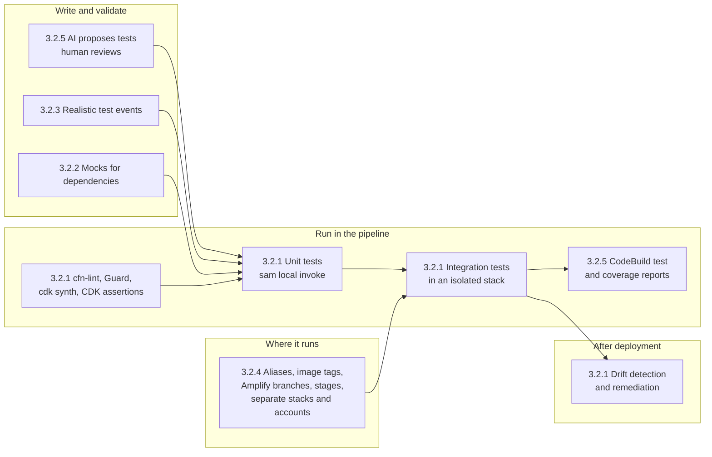

# Task 3.2: Test applications in AWS environments

**Domain 3 · Task 3.2** · [Domain overview](../README.md)

This task covers how a developer proves code and infrastructure work before and after they reach production. It starts with test tooling for AWS Serverless Application Model (AWS SAM), AWS Cloud Development Kit (AWS CDK), and CloudFormation templates, including drift detection after deployment. It then covers replacing dependencies with mock APIs, feeding functions realistic JSON (JavaScript Object Notation) test events, giving each stage its own isolated environment, and using AI (artificial intelligence) tools to generate and run tests. The task sits between [Task 3.1](../task-3.1-prepare-deployable-artifacts/README.md), which produces the artifact, and [Task 3.3](../task-3.3-deploy-with-ci-cd/README.md), which deploys it through CI/CD (continuous integration and continuous delivery) pipelines; the tests here are the gates those pipelines run.

> **DVA-C02 vs DVA-C03.** DVA-C02 had two testing tasks with 11 skills. DVA-C03 consolidates them into this five-skill task and adds AI-generated tests, automated execution, result analysis, regression automation, and coverage checks. Unit testing with AWS SAM moved here from Domain 1, Task 1.1.

## Skills

| Skill | Note | Covers |
|---|---|---|
| 3.2.1 | [Testing with SAM, CDK, and CloudFormation](3.2.1-testing-with-sam-cdk-and-cloudformation.md) | Testing pyramid, SAM command line interface (CLI) local and remote testing, CDK assertion and snapshot tests, Aspects, cfn-lint, CloudFormation Guard, pre-deployment validation, change sets, drift detection and drift-aware change sets |
| 3.2.2 | [Mock APIs](3.2.2-mock-apis.md) | API Gateway `MOCK` integrations, stage-specific stub backends, AWS software development kit (SDK) mocking (moto, `Stubber`, `aws-sdk-client-mock`), emulators, Step Functions `TestState` mocks |
| 3.2.3 | [Test events and payloads](3.2.3-test-events-and-payloads.md) | Lambda console private and shareable test events, `aws lambda invoke`, `sam local generate-event`, `sam remote invoke`, API Gateway test invoke, event shapes per source, `test-event-pattern` |
| 3.2.4 | [Isolated test environments](3.2.4-isolated-test-environments.md) | Lambda versions and aliases, stage variables, container image tags and digests, Amplify branches, pull request previews and sandboxes, Copilot environments, API Gateway stages versus APIs, per-environment stacks |
| 3.2.5 | [AI-assisted testing](3.2.5-ai-assisted-testing.md) | Kiro specs, property-based tests, hooks, steering, and headless mode for testing; CodeBuild test and coverage reports; reviewing AI-generated tests |

## How the skills fit together

Use this table to route a scenario to the right note:

| The question is about | Go to |
|---|---|
| Running a function or API locally, CDK tests, template linting or policy rules, change sets, inverted test pyramids, load tests, resources changed outside CloudFormation | [3.2.1](3.2.1-testing-with-sam-cdk-and-cloudformation.md) |
| A backend that does not exist yet, a third-party API to fake, unit testing code that calls AWS, Step Functions branch testing | [3.2.2](3.2.2-mock-apis.md) |
| Simulating an S3, SQS, SNS, stream, or API Gateway trigger, sharing console test events, CLI invoke errors, parsing bugs from wrong event shapes, testing EventBridge patterns | [3.2.3](3.2.3-test-events-and-payloads.md) |
| dev, test, and prod for functions, containers, web apps, or APIs; previews per pull request; promoting the same artifact | [3.2.4](3.2.4-isolated-test-environments.md) |
| Generating tests with AI, running tests on file save, explaining failures, regression suites, coverage reports and gates | [3.2.5](3.2.5-ai-assisted-testing.md) |

## Study checklist

- [ ] 3.2.1 Draw the testing pyramid and recognize an inverted pyramid and its fix.
- [ ] 3.2.1 Pick `sam local invoke`, `sam local start-api`, `sam local start-lambda`, `sam remote invoke`, or `sam sync --watch` for a scenario, and say what local emulation does not reproduce.
- [ ] 3.2.1 Write a CDK fine-grained assertion and a snapshot test, and enforce an app-wide rule with an Aspect.
- [ ] 3.2.1 Tell `validate-template`, cfn-lint, CloudFormation Guard, pre-deployment validation, and change sets apart.
- [ ] 3.2.1 Run drift detection, read its statuses, and revert drift with a drift-aware change set or adopt it in the template.
- [ ] 3.2.2 Configure a REST API `MOCK` integration that returns different status codes, and know HTTP APIs have none.
- [ ] 3.2.2 Choose between `unittest.mock`, botocore `Stubber`, moto, DynamoDB local, and a stub backend, and say what mocks cannot prove.
- [ ] 3.2.2 Test Step Functions states with `TestState` and a mock.
- [ ] 3.2.3 Create private and shareable Lambda test events and invoke with `aws lambda invoke` and `--cli-binary-format raw-in-base64-out`.
- [ ] 3.2.3 Recognize API Gateway (payload 1.0 and 2.0), SQS, SNS, S3, Kinesis, DynamoDB Streams, and EventBridge event shapes and their parsing traps.
- [ ] 3.2.3 Explain that API Gateway console tests call the real backend.
- [ ] 3.2.4 Promote with Lambda aliases, wire stage variables to aliases with per-alias permissions, and explain why environment variables cannot differ per alias.
- [ ] 3.2.4 Tag, retag, and deploy container images by commit SHA or digest with tag immutability.
- [ ] 3.2.4 Use Amplify branches, pull request previews, and sandboxes; describe Copilot's model and its end of support.
- [ ] 3.2.5 Map generate, run, analyze, regression, and coverage to Kiro features and CodeBuild reports.
- [ ] 3.2.5 Review an AI-generated test for meaningful assertions and add the business case it missed.

## Labs and practice

- [Labs](labs.md):
  - Lab 1: validate a SAM template and invoke a handler locally with a test event.
  - Lab 2: break a stack out of band, detect the drift, and revert it.
  - Lab 3: a unit test and an integration test for the same Lambda handler.
- [Practice questions](practice-questions.md): 3 scenario-based multiple-choice questions, each with the answer, an explanation, and why the other options are wrong.
