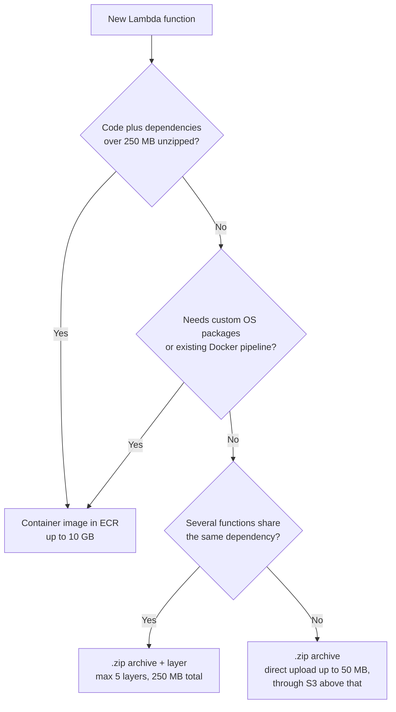

# 3.3.1 Select efficient Lambda packaging methods, including ZIP archives, container images, and layers

**Domain 3 · Task 3.3 · Skill 3.3.1** · [Task overview](README.md) · Previous: [3.2.5 AI-assisted testing](../task-3.2-test-applications/3.2.5-ai-assisted-testing.md) · Next: [3.3.2 Container deployments](3.3.2-container-deployments.md)

## What the exam expects

AWS Lambda accepts code in two deployment package types: a .zip file archive or a container image. Layers add shared dependencies to .zip functions. Questions give you a package size, a dependency shape, or a team constraint and ask which packaging method fits, or why a deployment did not pick up new code.

You must be able to:

- Choose between a .zip archive, a .zip archive plus layers, and a container image, using the size limits.
- Build a .zip package with dependencies that match the Lambda operating system (OS) and central processing unit (CPU) architecture.
- Build a Lambda container image that implements the Lambda Runtime API and push it to Amazon Elastic Container Registry (ECR).
- Reference packaged code from AWS CloudFormation, AWS Serverless Application Model (SAM), and the AWS Cloud Development Kit (CDK), and avoid the "code never updated" trap.
- Keep packages small for faster deploys and cold starts.

## Key terms

| Term | Meaning |
|---|---|
| Deployment package | The artifact that holds function code and dependencies. Either a .zip file archive or a container image. |
| Package type | `Zip` or `Image`. Set when the function is created and cannot be changed afterward. |
| Layer | A versioned .zip archive of libraries, a custom runtime, or data that Lambda extracts into `/opt`. Works only with .zip functions. |
| Layer version | An immutable snapshot of a layer with its own Amazon Resource Name (ARN), for example `...:layer:shared-utils:4`. |
| Lambda Runtime API | The HTTP application programming interface (API) a runtime uses to fetch invocation events and post responses. Every container image must implement it. |
| Runtime interface client (RIC) | An AWS open-source library that implements the Runtime API inside a non-AWS base image. |
| Runtime interface emulator (RIE) | A local proxy for the Runtime API, used to test a Lambda container image with `docker run` and `curl`. |
| AWS base image | An image from `public.ecr.aws/lambda/<runtime>` that already contains the runtime, the RIC, and the RIE. |

## The three packaging methods

| Method | Size limits | Strengths | Use when |
|---|---|---|---|
| .zip archive | **50 MB zipped** when uploaded directly through the Lambda API, an AWS software development kit (SDK), or the console. Larger archives go through Amazon S3. **250 MB unzipped**, including all layers and custom runtimes. | Smallest artifact, fastest to build, works with the console code editor | Most functions; small dependency sets |
| .zip archive + layers | Up to **5 layers** per function. Layers count toward the same **250 MB unzipped** limit. | Shares one copy of a dependency across many functions; dependency updates are separate from code updates | Several functions share a library, a custom runtime, or a pinned SDK version |
| Container image | Up to **10 GB** uncompressed, including all image layers. Stored in an ECR repository in the **same Region** as the function (the repository can be in another account). | Large dependencies, operating system packages, and existing Docker tooling and scanning | Machine learning (ML) libraries, native binaries, or anything over 250 MB unzipped |



Two rules decide most questions:

- **Package type is permanent.** You cannot convert an existing function from `Zip` to `Image` or back. Create a new function and move the event sources or alias.
- **Layers do not apply to container images.** For an image function, install the runtime and every dependency in the image itself.

## .zip file archives

### Build the package

The archive contains your handler file and every dependency the runtime does not already provide. The AWS SDK is included in the managed runtimes, but bundling a pinned version (in the package or a layer) protects you from SDK changes.

| Runtime | How to build |
|---|---|
| Python | `pip install -r requirements.txt --target ./package`, then zip the contents of `package/` together with the handler |
| Node.js | `npm ci --omit=dev`, then zip `node_modules/` with the handler, or bundle and tree-shake with esbuild into one file |
| Java | Build a fat JAR or a .zip with the `.jar` files in `lib/` (Maven Shade or Gradle) |
| Go and Rust | Compile a single static executable named `bootstrap` for the `provided.al2023` runtime. AWS recommends against layers for Go and Rust because loading extra assemblies slows the cold start. |
| .NET | `dotnet lambda package` |

```bash
# Python: build a .zip with dependencies at the archive root
pip install -r requirements.txt --target ./package \
  --platform manylinux2014_aarch64 --only-binary=:all: --python-version 3.12
cp app.py ./package/
(cd package && zip -r ../function.zip .)

# Upload directly (zipped size under 50 MB)
aws lambda update-function-code --function-name orders-api \
  --zip-file fileb://function.zip --publish

# Larger archive: upload to S3 first, then point Lambda at it
aws s3 cp function.zip s3://my-artifacts/orders-api/function-v42.zip
aws lambda update-function-code --function-name orders-api \
  --s3-bucket my-artifacts --s3-key orders-api/function-v42.zip --publish
```

`--publish` creates an immutable version in the same call. Without it, the update changes only `$LATEST`. Versions and aliases are covered in [3.3.8 Versions and releases](3.3.8-versions-and-releases.md).

### Native dependencies must match Lambda

Compiled libraries (for example `numpy`, `cryptography`, `sharp`, `bcrypt`) must be built for Amazon Linux and for the function's architecture (`x86_64` or `arm64`). A package built on macOS or Windows often fails at import time with an "invalid ELF header" or "cannot open shared object file" error.

Fixes:

- `sam build --use-container` builds inside a Lambda-like container.
- Build in AWS CodeBuild on an Amazon Linux image with the same architecture.
- Use `pip --platform ... --only-binary=:all:` to download the matching wheels, as in the example above.

### What to leave out

- Test files, documentation, build tools, and development dependencies.
- Configuration that differs per environment. Read it at runtime from environment variables, AWS AppConfig, Parameter Store, or Secrets Manager so the same artifact promotes from dev to prod. See [3.1.1 Packaging dependencies and configuration](../task-3.1-prepare-deployable-artifacts/3.1.1-packaging-dependencies-and-configuration.md) and [3.1.4 Environment-specific configuration](../task-3.1-prepare-deployable-artifacts/3.1.4-environment-specific-configuration.md).
- Secrets. Never bake credentials into a package; see [2.2.7 Secrets management](../../domain-2-security/task-2.2-encrypt-and-protect-sensitive-data/2.2.7-secrets-management.md).

## Layers

A layer is a .zip archive that Lambda extracts into `/opt` in the execution environment. Each runtime adds a language-specific folder to its search path, so the folder structure inside the layer archive matters.

| Runtime | Path inside the layer .zip | Extracted to |
|---|---|---|
| Python | `python/` (or `python/lib/python3.x/site-packages/`) | `/opt/python` |
| Node.js | `nodejs/node_modules/` | `/opt/nodejs/node_modules` |
| Java | `java/lib/` | `/opt/java/lib` |
| Custom runtime | `bootstrap` at the root | `/opt/bootstrap` |


*Source: [AWS Lambda Developer Guide, "Managing Lambda dependencies with layers"](https://docs.aws.amazon.com/lambda/latest/dg/chapter-layers.html), © Amazon Web Services.*

```bash
# Package and publish a shared Python layer
mkdir -p layer/python
pip install requests==2.32.3 --target layer/python
(cd layer && zip -r ../shared-deps.zip python)

LAYER_ARN=$(aws lambda publish-layer-version --layer-name shared-deps \
  --zip-file fileb://shared-deps.zip --compatible-runtimes python3.12 \
  --compatible-architectures arm64 --query LayerVersionArn --output text)

aws lambda update-function-configuration --function-name orders-api \
  --layers "$LAYER_ARN"
```

Facts the exam uses:

- Maximum **5 layers** per function. The function code plus all layers must stay within **250 MB unzipped**.
- A function references an **exact layer version ARN**. Publishing a new layer version does not change functions that use an older one. Each function picks up the new version on its next configuration update, which keeps upgrades deliberate.
- Layers can be shared with other accounts or made public through layer version permissions.
- Layers reduce duplicated packages and speed up deploys of the function code. They do not raise the 250 MB limit.
- Extensions are usually delivered as layers. Layer and extension configuration is covered in [1.2.2 Lambda configuration](../../domain-1-development-with-aws-services/task-1.2-develop-lambda-functions/1.2.2-lambda-configuration.md#layers).

## Container images

### Requirements

- Linux only, and one architecture per image. Lambda does not run multi-architecture images, so build with `--platform linux/amd64` or `--platform linux/arm64` to match the function.
- The image must implement the Lambda Runtime API. AWS base images already do. For an Alpine, Debian, or company base image, install the runtime interface client for your language.
- Docker image manifest V2 schema 2 or Open Container Initiative (OCI) format.
- The image lives in a private ECR repository in the same Region as the function. A different account works if the repository policy allows Lambda to pull. Images from Docker Hub or AWS Marketplace must be copied into your ECR repository first.
- The identity that creates the function needs `ecr:BatchGetImage` and `ecr:GetDownloadUrlForLayer` on the repository.

| Base image choice | Contains | Use for |
|---|---|---|
| AWS base image (`public.ecr.aws/lambda/python:3.12`) | Runtime, RIC, RIE, Amazon Linux 2023 for newer runtimes | Supported languages; the default choice |
| AWS OS-only base image (`public.ecr.aws/lambda/provided:al2023`) | Amazon Linux and the RIE | Go, Rust, and custom runtimes |
| Non-AWS base image | Whatever you install | Organization-standard images; you must add the RIC |

### Dockerfile and push

```dockerfile
# Build stage: compile dependencies with build tools
FROM public.ecr.aws/lambda/python:3.12 AS build
COPY requirements.txt .
RUN pip install -r requirements.txt --target /deps

# Runtime stage: only what the function needs
FROM public.ecr.aws/lambda/python:3.12
COPY --from=build /deps ${LAMBDA_TASK_ROOT}
COPY app.py ${LAMBDA_TASK_ROOT}
CMD [ "app.handler" ]
```

```bash
ACCOUNT=123456789012; REGION=us-east-1
REPO=$ACCOUNT.dkr.ecr.$REGION.amazonaws.com/orders-api

aws ecr get-login-password --region $REGION | \
  docker login --username AWS --password-stdin $ACCOUNT.dkr.ecr.$REGION.amazonaws.com

docker build --platform linux/arm64 -t $REPO:1.4.2 .
docker push $REPO:1.4.2

# Test locally first: AWS base images include the runtime interface emulator
docker run --rm -p 9000:8080 $REPO:1.4.2
curl -XPOST "http://localhost:9000/2015-03-31/functions/function/invocations" -d '{"id":"42"}'

# Point the function at the new image
aws lambda update-function-code --function-name orders-api \
  --image-uri $REPO:1.4.2 --publish
```

Lambda resolves the tag to an image digest when you update the function. Pushing a new image under the same tag does not change a running function until you call `update-function-code` again. Tagging, immutability, scanning, and lifecycle policies for the repository are in [3.1.2 Container images and ECR](../task-3.1-prepare-deployable-artifacts/3.1.2-container-images-and-ecr.md).

### Image best practices

- Start from AWS base images. They are stable, built on Amazon Linux, and cached by Lambda, which shortens cold starts.
- Use multi-stage builds so build tools never reach the final image.
- Order Dockerfile instructions from least to most frequently changed. Dependencies go before application code so Docker reuses cached layers.
- Keep functions that share large image layers in one ECR repository. ECR stores identical layers once.
- Keep the image manifest small (AWS suggests under 25,400 bytes) by limiting the number of image layers.

## Packaging through infrastructure as code

Every infrastructure as code (IaC) tool ends up giving AWS CloudFormation an S3 location or an image uniform resource identifier (URI). Template authoring is covered in [3.3.3 Infrastructure as code deployment](3.3.3-infrastructure-as-code-deployment.md).

| Tool | .zip function | Container image function |
|---|---|---|
| CloudFormation (`AWS::Lambda::Function`) | `Code.S3Bucket`, `Code.S3Key`, optional `Code.S3ObjectVersion`; or `Code.ZipFile` for short inline code with no dependencies | `PackageType: Image` and `Code.ImageUri` |
| AWS SAM (`AWS::Serverless::Function`) | `CodeUri: src/` (local folder). `sam build` resolves dependencies; `sam deploy` zips and uploads to S3 and rewrites the path. | `PackageType: Image` plus a `Metadata` block with `Dockerfile` and `DockerContext`. `sam deploy` builds and pushes to ECR. |
| AWS CDK | `lambda.Code.fromAsset('lambda')`; the CDK uploads the asset to the bootstrap S3 bucket | `lambda.DockerImageFunction` with `DockerImageCode.fromImageAsset('.')` |
| AWS Command Line Interface (CLI) with raw CloudFormation | `aws cloudformation package` uploads local paths to S3 and writes a template that references them | Push the image yourself and pass the URI as a parameter |

```yaml
# Raw CloudFormation: .zip function from S3
Resources:
  OrdersFunction:
    Type: AWS::Lambda::Function
    Properties:
      Runtime: python3.12
      Handler: app.handler
      Architectures: [arm64]
      Role: !GetAtt OrdersRole.Arn
      Code:
        S3Bucket: my-artifacts
        S3Key: orders-api/function-v42.zip   # change the key (or S3ObjectVersion) on every release
      Layers:
        - !Ref SharedDepsLayer

  SharedDepsLayer:
    Type: AWS::Lambda::LayerVersion
    Properties:
      LayerName: shared-deps
      CompatibleRuntimes: [python3.12]
      Content:
        S3Bucket: my-artifacts
        S3Key: layers/shared-deps-7.zip
```

```yaml
# AWS SAM: container image function built by sam build
Resources:
  ImageFunction:
    Type: AWS::Serverless::Function
    Properties:
      PackageType: Image
      Architectures: [arm64]
    Metadata:
      Dockerfile: Dockerfile
      DockerContext: ./image_function
      DockerTag: v1
```

### The "function never updated" trap

CloudFormation updates a resource only when a property in the template changes. If a pipeline overwrites `function.zip` in S3 under the same key and redeploys the same template, nothing changes and the old code keeps running.

Fixes, from most to least common:

- Use `sam deploy`, `aws cloudformation package`, or CDK assets. They upload with a content-hash key, so the key changes whenever the code changes.
- Put a version or Git commit hash (SHA) in the S3 key (`function-<sha>.zip`).
- Enable versioning on the bucket and pass the new `S3ObjectVersion` as a parameter.

For container images, reference the image by a new tag or by digest on every release. Reusing a mutable tag such as `latest` has the same problem.

### Multiple accounts

Keep artifacts in one bucket in a tools account. The bucket policy grants the other accounts read access, and the CloudFormation execution role in each target account needs `s3:GetObject` on the artifacts. If the bucket uses a customer managed AWS Key Management Service (KMS) key, the key policy must also allow those roles. The same pattern applies to cross-account ECR pulls through a repository policy. Pipeline-level cross-account setup is in [3.3.5 CodePipeline release promotion](3.3.5-codepipeline-release-promotion.md#cross-account-and-cross-region-deployments).

## Making packages efficient

| Technique | Effect |
|---|---|
| Remove development dependencies, tests, and docs | Smaller archive, faster upload and cold start |
| Bundle and tree-shake Node.js code with esbuild | One small file instead of a large `node_modules` |
| Move shared libraries to a layer | Each function package stays small; teams pin one tested version |
| Build for `arm64` (AWS Graviton) | Lower price per GB-second for most workloads; dependencies must be built for arm64 |
| Use a container image only when needed | Images allow 10 GB but take longer to build and push than a small .zip |
| Lambda SnapStart (Java, Python, .NET) | Snapshots the initialized environment when you publish a version, cutting cold-start time. Configuration details are in [1.2.2](../../domain-1-development-with-aws-services/task-1.2-develop-lambda-functions/1.2.2-lambda-configuration.md). |
| Initialize clients outside the handler | Warm invocations reuse connections. Covered in [1.2.2](../../domain-1-development-with-aws-services/task-1.2-develop-lambda-functions/1.2.2-lambda-configuration.md). |

## Exam triggers

| Scenario clue | Answer | Why the alternatives are wrong |
|---|---|---|
| Deployment package with ML libraries exceeds 250 MB unzipped | Container image in ECR (up to 10 GB) | More layers do not help, because layers count toward the same 250 MB; storing code in S3 and downloading it at runtime adds cold-start latency |
| Zipped package is 80 MB and the CLI upload fails | Upload the .zip to S3 and reference the bucket and key | The 50 MB limit applies only to direct uploads; a container image is not required |
| Twelve functions bundle the same 40 MB library | Publish it as a layer and reference the layer version ARN | Copying the library into each package causes drift and slow deploys |
| Function needs OS packages installed with `dnf` and the team already scans images in ECR | Container image built from an AWS base image | A .zip archive cannot install OS packages; custom runtimes are more work |
| `import` fails with "invalid ELF header" after deploying from a laptop | Rebuild native dependencies for Amazon Linux and the right architecture (`sam build --use-container`) | Raising memory or timeout does not fix a binary built for the wrong platform |
| CloudFormation update succeeds but old code still runs | The S3 key and object version did not change; use `sam deploy`/`cloudformation package` or a versioned key | The stack update did run; CloudFormation saw no property change |
| Convert an existing .zip function to a container image | Create a new function with `PackageType: Image`, then move traffic | Package type cannot be changed on an existing function |
| Image function needs a shared observability extension | Install the extension in the image during the build | Layers cannot be attached to container image functions |
| Run an arbitrary existing Docker image that does not implement the Runtime API | Amazon Elastic Container Service (ECS) on AWS Fargate (see [3.3.2](3.3.2-container-deployments.md)) | Lambda images must implement the Runtime API |
| Test a Lambda container image locally | `docker run` the image and call the runtime interface emulator endpoint, or `sam local invoke` | Deploying to test is slower and costs money |

## Common traps

- Thinking layers raise the size limit. The 250 MB unzipped limit covers the function and all layers combined.
- Attaching layers to a container image function. Not supported.
- Pulling a Lambda image from Docker Hub or ECR Public directly. Lambda pulls only from a private ECR repository in the same Region.
- Building a multi-architecture image for Lambda. Build one architecture that matches the function.
- Overwriting the same S3 key or image tag and expecting CloudFormation to redeploy.
- Baking environment-specific settings into the package, which forces a rebuild per environment.
- Putting Go or Rust dependencies in layers. AWS recommends shipping a single executable.
- Assuming the 50 MB limit is the maximum package size. It is the direct-upload limit for the zipped file.

## Quick recall

- .zip: 50 MB zipped direct upload, larger through S3, 250 MB unzipped including layers.
- Container image: 10 GB uncompressed, private ECR, same Region, cross-account allowed with a repository policy.
- Layers: 5 per function, extracted to `/opt`, immutable versions, .zip functions only.
- Package type (`Zip` or `Image`) cannot change after creation.
- Images must implement the Runtime API: AWS base image, or add the runtime interface client.
- Test images locally with the runtime interface emulator.
- Native libraries must be built for Amazon Linux and the function architecture.
- CloudFormation redeploys code only when `S3Key`, `S3ObjectVersion`, or `ImageUri` changes.
- `sam deploy`, `aws cloudformation package`, and CDK assets upload local code and rewrite the template.

## Related skills

- [1.2.2 Lambda configuration](../../domain-1-development-with-aws-services/task-1.2-develop-lambda-functions/1.2.2-lambda-configuration.md): runtimes, handlers, layer configuration, extensions, and SnapStart.
- [3.1.1 Packaging dependencies and configuration](../task-3.1-prepare-deployable-artifacts/3.1.1-packaging-dependencies-and-configuration.md): dependency management and CodeArtifact.
- [3.1.2 Container images and ECR](../task-3.1-prepare-deployable-artifacts/3.1.2-container-images-and-ecr.md): Dockerfiles, tags, immutability, and lifecycle policies.
- [3.3.3 Infrastructure as code deployment](3.3.3-infrastructure-as-code-deployment.md): templates that reference packaged code.
- [3.3.4 CodeDeploy](3.3.4-codedeploy.md): shifting traffic to a newly published version.
- [4.3.2 Memory and compute tuning](../../domain-4-troubleshooting-and-optimization/task-4.3-optimize-applications/4.3.2-memory-and-compute-tuning.md): cold starts and performance after deployment.

## Sources

- Merged from: `archive/dva-c03-study-notes/03-testing-deployment.md` (skill 3.3.1), `archive/aws-dva-notes/Markdown Files/18. Serverless - Lambda.md` (sections 14, 16, 19), `archive/aws-dva-notes/Markdown Files/22. SAM - Serverless Application Model.md`, `archive/aws-dva-notes/Markdown Files/30. AI Services & Security (DVA-C03).md` (section 9), `archive/dva-c03/domain-3-testing-deployment/MASTER-CHUNK.md` (Lambda, SAM), `archive/dva-c03/domain-3-testing-deployment/README.md` (use cases), `archive/aws-dva-notes/Markdown Files/31. Exam Day Cheat Sheet.md`
- AWS documentation: [Lambda quotas](https://docs.aws.amazon.com/lambda/latest/dg/gettingstarted-limits.html)
- AWS documentation: [Create a Lambda function using a container image](https://docs.aws.amazon.com/lambda/latest/dg/images-create.html)
- AWS documentation: [Managing Lambda dependencies with layers](https://docs.aws.amazon.com/lambda/latest/dg/chapter-layers.html)
- AWS documentation: [Lambda execution environment](https://docs.aws.amazon.com/lambda/latest/dg/lambda-runtime-environment.html)
