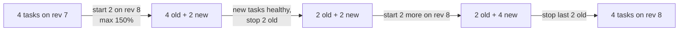

# 3.3.2 Deploy containers through ECS task definitions, EKS manifests, Fargate launch types, and rolling updates

**Domain 3 · Task 3.3 · Skill 3.3.2** · [Task overview](README.md) · Previous: [3.3.1 Lambda packaging](3.3.1-lambda-packaging.md) · Next: [3.3.3 Infrastructure as code deployment](3.3.3-infrastructure-as-code-deployment.md)

## What the exam expects

DVA-C03 added container deployment as a direct test area. Questions describe a containerized service on Amazon Elastic Container Service (ECS) or Amazon Elastic Kubernetes Service (EKS), often on AWS Fargate, and ask how to ship a new image without downtime, why a task will not start, or how to roll back a bad release automatically.

You must be able to:

- Read and write an ECS task definition, including roles, networking, secrets, logging, and health checks.
- Deploy a new image by registering a task definition revision and updating the service.
- Tune a rolling update with `minimumHealthyPercent` and `maximumPercent`, and add the deployment circuit breaker or alarm-based rollback.
- Choose between the Amazon Elastic Compute Cloud (EC2) and Fargate launch types, and know Fargate's limits.
- Write a Kubernetes `Deployment` manifest with a rolling update strategy and probes, apply it to EKS, and roll it back.
- Tell ECS apart from EKS in a scenario.

## Key terms

| Term | Meaning |
|---|---|
| Cluster | A logical group of capacity (EC2 instances, Fargate, or both) where ECS runs tasks. |
| Task definition | A versioned JSON document that tells ECS how to run one to ten containers: image, central processing unit (CPU) and memory, ports, environment, secrets, roles, logging, health checks. |
| Revision | Each `RegisterTaskDefinition` call creates `family:N+1`. Revisions are immutable. |
| Task | A running instance of a task definition. |
| Service | Keeps a desired number of tasks running, replaces failed ones, registers them with a load balancer, and runs deployments. |
| Launch type / capacity provider | Where tasks run: EC2 instances you manage, Fargate (serverless), or ECS Managed Instances. Capacity providers can mix them, such as Fargate and Fargate Spot. |
| Task role | AWS Identity and Access Management (IAM) role your application code uses to call AWS services. |
| Task execution role | IAM role the ECS agent or Fargate uses to pull images, write logs, and fetch secrets for the task. |
| Deployment circuit breaker | ECS feature that marks a rolling deployment failed when new tasks cannot reach a steady state, and optionally rolls back. |
| Kubernetes manifest | YAML describing Kubernetes objects such as `Deployment`, `Service`, `Ingress`, and `ConfigMap`. |
| Pod | The smallest Kubernetes unit: one or more containers scheduled together. |
| Fargate profile | EKS setting that selects which pods (by namespace and labels) run on Fargate. |

## Container services at a glance

| Service | Role |
|---|---|
| Amazon ECS | AWS's own container orchestrator, with a proprietary application programming interface (API) and deep AWS integration |
| Amazon EKS | Managed upstream Kubernetes; AWS runs the control plane |
| AWS Fargate | Serverless compute for ECS tasks and EKS pods; no instances to manage |
| Amazon Elastic Container Registry (ECR) | Private image registry; covered in [3.1.2 Container images and ECR](../task-3.1-prepare-deployable-artifacts/3.1.2-container-images-and-ecr.md) |


*Source: [Amazon ECS Developer Guide](https://docs.aws.amazon.com/AmazonECS/latest/developerguide/Welcome.html), © Amazon Web Services.*

## ECS task definitions

```json
{
  "family": "checkout-service",
  "requiresCompatibilities": ["FARGATE"],
  "networkMode": "awsvpc",
  "cpu": "512",
  "memory": "1024",
  "runtimePlatform": { "cpuArchitecture": "ARM64", "operatingSystemFamily": "LINUX" },
  "taskRoleArn": "arn:aws:iam::123456789012:role/checkout-task-role",
  "executionRoleArn": "arn:aws:iam::123456789012:role/ecsTaskExecutionRole",
  "containerDefinitions": [
    {
      "name": "checkout",
      "image": "123456789012.dkr.ecr.us-east-1.amazonaws.com/checkout:3f9c2ab",
      "essential": true,
      "portMappings": [{ "containerPort": 8080, "protocol": "tcp" }],
      "environment": [{ "name": "APP_ENV", "value": "prod" }],
      "secrets": [
        { "name": "DB_PASSWORD", "valueFrom": "arn:aws:secretsmanager:us-east-1:123456789012:secret:prod/checkout/db" },
        { "name": "API_URL", "valueFrom": "arn:aws:ssm:us-east-1:123456789012:parameter/checkout/prod/api-url" }
      ],
      "logConfiguration": {
        "logDriver": "awslogs",
        "options": {
          "awslogs-group": "/ecs/checkout",
          "awslogs-region": "us-east-1",
          "awslogs-stream-prefix": "checkout"
        }
      },
      "healthCheck": {
        "command": ["CMD-SHELL", "curl -f http://localhost:8080/health || exit 1"],
        "interval": 30, "timeout": 5, "retries": 3, "startPeriod": 10
      }
    }
  ]
}
```

| Field | What to know |
|---|---|
| `family` | Name shared by all revisions. `checkout-service` means the latest active revision; `checkout-service:7` pins one. |
| `requiresCompatibilities` | `FARGATE`, `EC2`, or both. |
| `networkMode` | `awsvpc` gives each task its own elastic network interface (ENI) and security group. **Required for Fargate.** EC2 tasks can also use `bridge` or `host`. |
| `cpu`, `memory` | Task-level sizes are required on Fargate and must be a valid Fargate combination. |
| `image` | Use an immutable tag (version or Git commit hash, SHA) or a digest, not `latest`. |
| `environment` | Plain, non-sensitive values. Bulk values can come from an environment file in Amazon S3 (`environmentFiles`). |
| `secrets` | Secrets Manager or Parameter Store Amazon Resource Names (ARNs) injected as environment variables at task start. The **execution role** needs read access (and AWS Key Management Service (KMS) decrypt for customer managed keys). |
| `logConfiguration` | `awslogs` sends stdout and stderr to Amazon CloudWatch Logs; FireLens routes logs elsewhere. |
| `healthCheck` | Container-level health command. ECS replaces tasks whose essential container is unhealthy. Probes and target group health checks are covered in [4.2.5 Health checks and probes](../../domain-4-troubleshooting-and-optimization/task-4.2-observability/4.2.5-health-checks-and-probes.md). |
| `essential` | If an essential container stops, the whole task stops. |

Up to 10 containers fit in one task definition. Put a sidecar (log router, proxy, agent) in the same task when it must share the task's network and lifecycle.

### Task role versus execution role

| Symptom | Role to fix |
|---|---|
| Container gets `AccessDenied` calling Amazon S3 or Amazon DynamoDB | **Task role**: permissions for your code |
| Task never starts: cannot pull the image from ECR, cannot create the log stream, cannot read a secret referenced in `secrets` | **Task execution role** (or the EC2 instance profile on the EC2 launch type) |

Use a separate task role per service for least privilege. On the EC2 launch type, the instance profile is used by the ECS agent on the host and must not be how application code gets permissions. More on roles for compute in [2.1.6 Least-privilege permissions](../../domain-2-security/task-2.1-authentication-and-authorization/2.1.6-least-privilege-permissions.md).

## Launch types: EC2 versus Fargate

| | EC2 launch type | Fargate |
|---|---|---|
| Infrastructure | You run EC2 instances with the ECS agent; choose instance types, Amazon Machine Images (AMIs), graphics processing units (GPUs) | No instances; AWS runs each task in its own isolated environment |
| What you size | Task resources and the cluster's instance capacity | Task CPU and memory only |
| Scaling | Scale tasks and instances (use a capacity provider linked to an Auto Scaling group) | Scale the task count |
| Networking | `awsvpc`, `bridge`, or `host` | `awsvpc` only |
| Task placement strategies | `binpack`, `spread`, `random`, and constraints | Not applicable |
| GPU | Supported | Not supported |
| Billing | Per instance-hour | Per second for requested vCPU and memory |

Fargate facts that show up in questions:

- Maximum task size **16 vCPU and 120 GB** of memory. A larger single task rules Fargate out.
- Ephemeral storage defaults to **20 GiB**, configurable up to **200 GiB**.
- No GPUs and, on EKS, no DaemonSets (there are no nodes).
- A task in a private subnet needs a **network address translation (NAT) gateway** or **virtual private cloud (VPC) endpoints** for ECR (`ecr.api`, `ecr.dkr`), an S3 gateway endpoint, and CloudWatch Logs to pull the image and write logs. Missing both is a common cause of `CannotPullContainerError`.
- Fargate Spot runs interruption-tolerant tasks at a discount.

On the EC2 launch type, an instance joins the cluster named by `ECS_CLUSTER` in `/etc/ecs/ecs.config` (usually set in user data). If unset, it joins `default`. A new cluster whose instances keep registering with an old one has a stale value there.

### Placement on the EC2 launch type

| Strategy or constraint | Behavior | Goal |
|---|---|---|
| `binpack` | Place on the instance with the least remaining CPU or memory | Fewer instances, lower cost |
| `spread` | Spread evenly by a field such as `attribute:ecs.availability-zone` | High availability |
| `random` | Place randomly | Simplicity |
| `distinctInstance` | Never two tasks of the service on one instance | Isolation |
| `memberOf` | Cluster Query Language expression, such as an instance type | Targeting |

Strategies can be combined, for example spread across Availability Zones, then binpack on memory.

### Load balancer integration

- An Application Load Balancer (ALB) fits most services. A Network Load Balancer (NLB) fits very high throughput or AWS PrivateLink. Fargate does not support the Classic Load Balancer.
- With `awsvpc`, register tasks as **`ip` targets**. Each task has its own private IP. The task security group allows the container port from the ALB security group.
- On EC2 with `bridge` mode, leave the host port empty for **dynamic host port mapping**. The instance security group must allow the ephemeral port range from the ALB security group, not only port 80.

## Deploying a new version to ECS

A deployment is always: build and push a new image, register a new task definition revision that points to it, then update the service.

```bash
# 1. New revision (never overwrites the old one)
aws ecs register-task-definition --cli-input-json file://taskdef.json
# -> checkout-service:8

# 2. Move the service to the new revision; ECS runs a rolling update
aws ecs update-service --cluster prod --service checkout \
  --task-definition checkout-service:8

# 3. Watch it settle
aws ecs wait services-stable --cluster prod --services checkout
aws ecs describe-services --cluster prod --services checkout \
  --query 'services[0].deployments'
```

Rollback means pointing the service at the previous revision (`checkout-service:7`). You never edit a revision in place.

### Mutable tags and `--force-new-deployment`

ECS resolves the image tag to a digest when a deployment starts, and every task in that deployment runs the same digest. If you push a new image under the same tag and do nothing else, running tasks keep the old digest. `aws ecs update-service --force-new-deployment` starts a new deployment that resolves the tag again. The cleaner fix is a unique tag per build, which gives every release its own revision and an exact rollback target.

### Deploying from CodePipeline

| Pipeline deploy action | Build artifact it needs | What happens |
|---|---|---|
| Amazon ECS (standard) | `imagedefinitions.json`: `[{"name":"checkout","imageUri":"...:3f9c2ab"}]` | Registers a revision with the new image and runs the service's configured deployment (rolling by default) |
| Amazon ECS (blue/green), provider `CodeDeployToECS` | `imageDetail.json`, `taskdef.json`, `appspec.yaml` | Hands the deployment to AWS CodeDeploy for blue/green traffic shifting (see [3.3.4](3.3.4-codedeploy.md#ecs-compute-platform)) |

```yaml
# buildspec.yml post_build for the standard ECS action
post_build:
  commands:
    - docker push $REPO_URI:$COMMIT_SHA
    - printf '[{"name":"checkout","imageUri":"%s"}]' $REPO_URI:$COMMIT_SHA > imagedefinitions.json
artifacts:
  files:
    - imagedefinitions.json
```

The `name` in `imagedefinitions.json` must match the container name in the task definition. A mismatch is a common failed-deploy cause. Pipeline wiring is covered in [3.3.5 CodePipeline release promotion](3.3.5-codepipeline-release-promotion.md).

## ECS rolling updates

The rolling update (deployment controller `ECS`) is the default. Two settings in the service's deployment configuration control the pace:

- **`minimumHealthyPercent`**: the floor on running, healthy tasks as a percent of the desired count (rounded up). Default 100.
- **`maximumPercent`**: the ceiling on total running tasks during the deployment (rounded down). Default 200.

| Settings (desired count 4) | Behavior |
|---|---|
| Min 100%, Max 200% (defaults) | Start up to 4 new tasks, wait for them to be healthy, then stop the old ones. Capacity never dips; needs room for 8 tasks. |
| Min 100%, Max 150% | Start 2 new, stop 2 old, repeat. Capacity never dips; at most 6 tasks. |
| Min 50%, Max 100% | Stop 2 old, start 2 new, repeat. No extra capacity, but capacity drops to 50%. |
| Min 0%, Max 100% | Stop everything, then start new tasks. Downtime. |

The scheduler must be able to stop or start at least one task. With desired count 2 and min 75%, max 125%, nothing can move and the deployment sticks with a service event telling you to change the values.



### Detecting failed deployments

| Method | Triggers on | Configure |
|---|---|---|
| **Deployment circuit breaker** | New tasks repeatedly fail to start or fail health checks and never reach steady state | `deploymentCircuitBreaker: { enable: true, rollback: true }`. Off unless you enable it. Needs no alarms. |
| **CloudWatch alarms** | Application metrics, such as 5xx rate or latency, breach during the deployment | `alarms: { alarmNames: [...], enable: true, rollback: true }` |

Both can be on together. The deployment fails as soon as either criterion is met. With `rollback: true`, ECS returns the service to the last completed service revision. Without it, ECS only stops the deployment.

```bash
aws ecs update-service --cluster prod --service checkout \
  --deployment-configuration '{
    "minimumHealthyPercent": 100,
    "maximumPercent": 200,
    "deploymentCircuitBreaker": {"enable": true, "rollback": true},
    "alarms": {"alarmNames": ["checkout-5xx-high"], "enable": true, "rollback": true}
  }'
```

### Other ECS deployment strategies

| Strategy | Mechanism | Notes |
|---|---|---|
| Rolling update | ECS service scheduler replaces tasks in place | Default; cheapest; mixed versions run during the rollout |
| ECS native blue/green, linear, canary | ECS starts the new revision alongside the old one, shifts load balancer traffic, supports bake time, test traffic, and Lambda lifecycle hooks | Added in 2025; removes the CodeDeploy dependency for these patterns |
| CodeDeploy blue/green | Deployment controller `CODE_DEPLOY`; CodeDeploy creates a replacement task set behind a second target group | Required `appspec.yaml`; covered in [3.3.4](3.3.4-codedeploy.md#ecs-compute-platform) |

Choosing between rolling, blue/green, and canary is skill [3.3.6 Deployment strategies](3.3.6-deployment-strategies.md). Rollback configuration across services is skill [3.3.7 Rollback](3.3.7-rollback.md).

### Service auto scaling (summary)

ECS Service Auto Scaling changes the desired task count through Application Auto Scaling, using target tracking on average CPU, average memory, or ALB request count per target, plus step and scheduled scaling. On the EC2 launch type, a **capacity provider** linked to an Auto Scaling group adds instances when tasks cannot be placed. Details are in [4.3.1 Concurrency controls](../../domain-4-troubleshooting-and-optimization/task-4.3-optimize-applications/4.3.1-concurrency-controls.md).

### Storage for tasks (summary)

| Storage | Shared across tasks? | Persistent? | Launch types |
|---|---|---|---|
| Amazon Elastic File System (EFS) | Yes, across Availability Zones | Yes | EC2, Fargate |
| Bind mount | Only containers in the same task | No | EC2 (instance storage), Fargate (ephemeral storage) |

## Amazon EKS manifests

EKS runs standard Kubernetes, so you deploy with the same manifests, `kubectl`, and Helm charts used anywhere else. AWS manages the control plane. Worker capacity comes from managed node groups, self-managed nodes, or Fargate profiles.

```yaml
# deployment.yaml
apiVersion: apps/v1
kind: Deployment
metadata:
  name: checkout
  labels: { app: checkout }
spec:
  replicas: 4
  selector:
    matchLabels: { app: checkout }
  strategy:
    type: RollingUpdate
    rollingUpdate:
      maxSurge: 1          # at most 1 extra pod during the rollout
      maxUnavailable: 0    # never drop below 4 ready pods
  template:
    metadata:
      labels: { app: checkout }
    spec:
      serviceAccountName: checkout-sa   # mapped to an IAM role (Pod Identity or IRSA)
      containers:
        - name: checkout
          image: 123456789012.dkr.ecr.us-east-1.amazonaws.com/checkout:3f9c2ab
          ports:
            - containerPort: 8080
          resources:
            requests: { cpu: 250m, memory: 512Mi }
            limits: { memory: 512Mi }
          readinessProbe:            # gate traffic until ready
            httpGet: { path: /ready, port: 8080 }
            periodSeconds: 5
          livenessProbe:             # restart if stuck
            httpGet: { path: /health, port: 8080 }
            initialDelaySeconds: 15
---
apiVersion: v1
kind: Service
metadata:
  name: checkout
spec:
  selector: { app: checkout }
  ports:
    - port: 80
      targetPort: 8080
```

| Object | Purpose |
|---|---|
| `Deployment` | Desired replicas, pod template, and rollout strategy. Changing the image starts a rolling update. |
| `Service` | Stable virtual IP address and Domain Name System (DNS) name in front of matching pods |
| `Ingress` | HTTP routing; the AWS Load Balancer Controller turns it into an ALB |
| `ConfigMap` / `Secret` | Configuration and sensitive values mounted or injected into pods |
| `HorizontalPodAutoscaler` | Scales replicas on CPU, memory, or custom metrics |

### Rolling updates in Kubernetes

- `maxSurge`: how many pods above `replicas` may exist during the rollout. Default 25%.
- `maxUnavailable`: how many pods below `replicas` may be unavailable. Default 25%.
- `maxUnavailable: 0` plus `maxSurge: 1` gives a zero-capacity-loss rollout, the Kubernetes equivalent of ECS min 100%.
- A pod counts as available only after its **readiness probe** passes. Without one, Kubernetes sends traffic to pods that are still starting.
- The alternative `type: Recreate` stops all old pods first, which causes downtime.

```bash
aws eks update-kubeconfig --name prod-cluster --region us-east-1

kubectl apply -f deployment.yaml
kubectl set image deployment/checkout checkout=$REPO_URI:4a1d7e0   # new image -> rollout
kubectl rollout status deployment/checkout
kubectl rollout history deployment/checkout
kubectl rollout undo deployment/checkout                            # back to previous ReplicaSet
```

### EKS details that show up in questions

- **IAM for pods:** use EKS Pod Identity or IAM roles for service accounts (IRSA) so each pod's service account gets its own IAM role. Do not rely on the node instance role for application permissions.
- **Cluster access:** an IAM principal also needs a Kubernetes mapping (EKS access entries or the `aws-auth` ConfigMap). Valid AWS credentials alone give `kubectl` an authorization error.
- **Fargate profiles:** pods whose namespace and labels match a profile's selector run on Fargate. A pod that matches no profile and has no node group stays `Pending`.
- **Pipelines into EKS:** continuous integration and continuous delivery (CI/CD) with AWS CodePipeline and AWS CodeBuild build and push to ECR, then run `kubectl apply` or `helm upgrade` (for example in a CodeBuild step or the CodePipeline EKS deploy action). GitOps tools such as Argo CD or Flux are common outside the exam. CodeDeploy does not deploy to EKS.
- **Storage:** a StorageClass with a Container Storage Interface (CSI) driver for Amazon Elastic Block Store (EBS), Amazon EFS (the option that works with Fargate), or Amazon FSx.
- **Observability:** CloudWatch Container Insights collects cluster, node, and pod metrics and logs.

## ECS versus EKS

| Clue in the question | Pick |
|---|---|
| Team already uses Kubernetes, Helm charts, operators, or must stay portable across clouds | EKS |
| Wants the simplest AWS-native orchestration with no Kubernetes knowledge | ECS |
| "No servers or nodes to manage" | Fargate with either orchestrator |
| Needs GPUs or a DaemonSet on every node | EC2 launch type or EKS node groups, not Fargate |
| Needs CodeDeploy blue/green traffic shifting | ECS (CodeDeploy has no EKS platform) |
| Easiest way to run a web container with the platform handling everything | AWS Elastic Beanstalk is also an option; ECS gives finer control |

## Exam triggers

| Scenario clue | Answer | Why the alternatives are wrong |
|---|---|---|
| Update an ECS service to a new image with zero downtime | Register a new task definition revision and `update-service`; keep `minimumHealthyPercent` at 100 with `maximumPercent` above 100 | Editing the running task is impossible; stopping all tasks first causes downtime |
| Roll back automatically when new ECS tasks keep crashing on start | Deployment circuit breaker with `rollback: true` | Service Auto Scaling changes counts, not versions; CodeDeploy is not required for this |
| Roll back an ECS rolling deployment when the 5xx alarm fires | ECS deployment alarms with rollback enabled | The circuit breaker only sees task start and health failures, not application metrics |
| Cluster cannot afford any extra tasks during a deploy | `maximumPercent: 100` with `minimumHealthyPercent` below 100 | Min 100% with max 100% blocks the deployment |
| Pushed a new image to the same tag but tasks still run the old code | Force a new deployment, or better, use a unique tag and a new revision | Restarting the ECS agent or the cluster does not re-resolve the digest |
| Fargate task in a private subnet fails with `CannotPullContainerError` | Add a NAT gateway or ECR, S3, and CloudWatch Logs VPC endpoints; check the execution role | The task role is not used for image pulls |
| Container code gets `AccessDenied` on DynamoDB | Add permissions to the task role | The execution role is for ECS itself, not your code |
| Secret must reach the container without code changes | `secrets` block referencing Secrets Manager or Parameter Store, readable by the execution role | Plain `environment` values are visible in the task definition |
| Run containers without managing servers | Fargate launch type | The EC2 launch type requires instance management |
| Kubernetes rollout must never reduce ready pods | `maxUnavailable: 0`, `maxSurge: 1` or more, plus readiness probes | `Recreate` strategy removes all pods first |
| Revert a bad EKS rollout | `kubectl rollout undo deployment/<name>` | CodeDeploy does not manage EKS |
| Pods on EKS Fargate stay `Pending` | Fargate profile selector does not match the namespace or labels | Adding IAM permissions does not schedule pods |
| CodePipeline ECS deploy fails with a container-name error | `name` in `imagedefinitions.json` must match the task definition container name | The image URI is usually fine |

## Common traps

- Mixing up the task role and the task execution role.
- Forgetting that Fargate requires `awsvpc` and task-level CPU and memory.
- Using `latest` in production. You cannot tell what is running, and rollback has no exact target.
- Expecting the circuit breaker to be on by default. You enable it per service.
- Expecting the circuit breaker to react to error rates. Use CloudWatch alarms for application metrics.
- Setting min and max percentages that leave the scheduler unable to start or stop a task.
- Opening only port 80 on EC2 instances with dynamic host port mapping.
- Using the `instance` target type with `awsvpc` tasks. Use `ip`.
- Choosing Fargate for GPU workloads or tasks larger than 16 vCPU and 120 GB.
- Assuming CodeDeploy can do blue/green on EKS.
- Treating `imagedefinitions.json` and `imageDetail.json` as interchangeable.

## Quick recall

- Task definition revisions are immutable; deploy = new revision + `update-service`; rollback = previous revision.
- Rolling update defaults: `minimumHealthyPercent` 100, `maximumPercent` 200.
- Circuit breaker catches tasks that never stabilize; alarms catch bad metrics; both can roll back.
- Fargate: `awsvpc` only, task-level CPU and memory, max 16 vCPU and 120 GB, 20 to 200 GiB ephemeral storage, no GPU.
- Task role = app permissions; execution role = pull image, write logs, read secrets.
- Standard ECS pipeline action needs `imagedefinitions.json`; ECS blue/green action needs `imageDetail.json`, `taskdef.json`, `appspec.yaml`.
- ECS native blue/green, linear, and canary exist since 2025; CodeDeploy blue/green is still tested.
- Kubernetes `RollingUpdate`: `maxSurge` and `maxUnavailable` (25% each by default); readiness gates traffic.
- `kubectl rollout status`, `history`, `undo`.
- EKS pod permissions: Pod Identity or IRSA; cluster access needs access entries or `aws-auth`.

## Related skills

- [3.1.2 Container images and ECR](../task-3.1-prepare-deployable-artifacts/3.1.2-container-images-and-ecr.md): building, tagging, scanning, and expiring the images these deployments use.
- [3.2.4 Isolated test environments](../task-3.2-test-applications/3.2.4-isolated-test-environments.md): container image tags and AWS Copilot environments.
- [3.3.4 CodeDeploy](3.3.4-codedeploy.md): ECS blue/green through CodeDeploy.
- [3.3.6 Deployment strategies](3.3.6-deployment-strategies.md): when to use rolling, blue/green, or canary.
- [3.3.7 Rollback](3.3.7-rollback.md): rollback options across services.
- [4.1.4 Diagnosing deployment failures](../../domain-4-troubleshooting-and-optimization/task-4.1-root-cause-analysis/4.1.4-diagnosing-deployment-failures.md): reading stopped-task reasons and service events.
- [4.2.5 Health checks and probes](../../domain-4-troubleshooting-and-optimization/task-4.2-observability/4.2.5-health-checks-and-probes.md): container health checks and Kubernetes liveness and readiness probes.

## Sources

- Merged from: `archive/aws-dva-notes/Markdown Files/13. Containers on AWS.md`, `archive/aws-dva-notes/Markdown Files/30. AI Services & Security (DVA-C03).md` (section 9), `archive/dva-c03-study-notes/03-testing-deployment.md` (skill 3.3.2), `archive/dva-c03/domain-3-testing-deployment/MASTER-CHUNK.md` (Fargate, ECS, EKS, containers versus VMs versus serverless), `archive/dva-c03/domain-3-testing-deployment/README.md` (container CI/CD deep dive), `archive/dva-c03/exam-bank/bank-2.md` (circuit breaker scenario), `archive/aws-dva-notes/Markdown Files/31. Exam Day Cheat Sheet.md`
- AWS documentation: [Deploy Amazon ECS services by replacing tasks (rolling update)](https://docs.aws.amazon.com/AmazonECS/latest/developerguide/deployment-type-ecs.html)
- AWS documentation: [What is Amazon ECS?](https://docs.aws.amazon.com/AmazonECS/latest/developerguide/Welcome.html)
- AWS News Blog: [Accelerate safe software releases with new built-in blue/green deployments in Amazon ECS](https://aws.amazon.com/blogs/aws/accelerate-safe-software-releases-with-new-built-in-blue-green-deployments-in-amazon-ecs/)
- AWS What's New: [Amazon ECS now supports built-in linear and canary deployments](https://aws.amazon.com/about-aws/whats-new/2025/10/amazon-ecs-built-in-linear-canary-deployments/)
