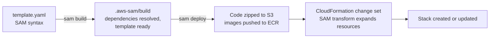

# 3.3.3 Define and deploy infrastructure with CloudFormation and AWS SAM templates

**Domain 3 · Task 3.3 · Skill 3.3.3** · [Task overview](README.md) · Previous: [3.3.2 Container deployments](3.3.2-container-deployments.md) · Next: [3.3.4 CodeDeploy](3.3.4-codedeploy.md)

## What the exam expects

Infrastructure as code (IaC) means describing resources in a template that is versioned, reviewed, and deployed the same way every time. AWS CloudFormation is the engine. AWS Serverless Application Model (SAM) and the AWS Cloud Development Kit (CDK) both produce CloudFormation templates. Questions ask you to read a template snippet, pick the right section or intrinsic function, deploy safely, or explain a deployment error.

You must be able to:

- Write a CloudFormation template with parameters, mappings, conditions, resources, and outputs.
- Use `Ref`, `Fn::GetAtt`, `Fn::Sub`, `Fn::FindInMap`, `Fn::ImportValue`, and the condition functions correctly.
- Deploy and update stacks with change sets, and acknowledge capabilities.
- Protect resources with `DeletionPolicy`, stack policies, and termination protection.
- Share values between stacks, and choose nested stacks or StackSets.
- Write a SAM template, build and deploy it, and use policy templates, `Globals`, events, and per-environment configuration.
- Recognize when the CDK fits better than a template.

Template testing and drift detection are covered in [3.2.1 Testing with SAM, CDK, and CloudFormation](../task-3.2-test-applications/3.2.1-testing-with-sam-cdk-and-cloudformation.md). Rollback behavior is covered in [3.3.7 Rollback](3.3.7-rollback.md).

## Key terms

| Term | Meaning |
|---|---|
| Template | YAML or JSON file that declares resources. `Resources` is the only required section. |
| Stack | The set of resources created from one template, managed and deleted as a unit. |
| Logical ID | The resource's name inside the template, such as `OrdersTable`. |
| Physical ID | The real resource identifier AWS assigns, such as a table name or instance ID. |
| Change set | A preview of what a stack update will add, modify, or replace. Executing it applies the update. |
| Transform | A macro CloudFormation runs before deployment. `AWS::Serverless-2016-10-31` turns SAM resources into plain CloudFormation. |
| Capability | An explicit acknowledgment you pass for templates that create AWS Identity and Access Management (IAM) resources or use macros. |
| Service role | An IAM role CloudFormation assumes to create resources on your behalf. |
| Nested stack | A stack created as a resource (`AWS::CloudFormation::Stack`) inside a parent stack. |
| StackSet | One template deployed as stack instances across many accounts and Regions. |

## How CloudFormation works


*Source: [AWS CloudFormation User Guide](https://docs.aws.amazon.com/AWSCloudFormation/latest/UserGuide/Welcome.html), © Amazon Web Services.*

- CloudFormation is **declarative**. You state what you want; it works out the order from references and `DependsOn`, then creates, updates, or deletes resources.
- Templates are uploaded to Amazon S3 and referenced by CloudFormation. The console does this for you.
- You cannot edit a deployed template version. To change a stack, submit a new template version.
- Deleting a stack deletes every resource it created, unless a `DeletionPolicy` says otherwise.
- CloudFormation itself is free. You pay for the resources it creates.
- Benefits the exam cites: reviewable changes in source control, identical environments, cost tracking through stack tags, and the option to delete dev stacks at night and recreate them in the morning.

## Template anatomy

```yaml
AWSTemplateFormatVersion: '2010-09-09'
Description: Orders service (one template, any environment)

Parameters:
  EnvType:
    Type: String
    AllowedValues: [dev, prod]
    Default: dev
  LatestAmiId:
    Type: AWS::SSM::Parameter::Value<AWS::EC2::Image::Id>
    Default: /aws/service/ami-amazon-linux-latest/al2023-ami-kernel-default-x86_64

Mappings:
  EnvConfig:
    dev:  { InstanceType: t3.micro }
    prod: { InstanceType: m7g.large }

Conditions:
  IsProd: !Equals [!Ref EnvType, prod]

Resources:
  OrdersTable:
    Type: AWS::DynamoDB::Table
    DeletionPolicy: Retain
    UpdateReplacePolicy: Retain
    Properties:
      BillingMode: PAY_PER_REQUEST
      AttributeDefinitions:
        - { AttributeName: id, AttributeType: S }
      KeySchema:
        - { AttributeName: id, KeyType: HASH }
      PointInTimeRecoverySpecification:
        PointInTimeRecoveryEnabled: !If [IsProd, true, false]

  AppServer:
    Type: AWS::EC2::Instance
    Properties:
      ImageId: !Ref LatestAmiId
      InstanceType: !FindInMap [EnvConfig, !Ref EnvType, InstanceType]
      UserData:
        Fn::Base64: !Sub |
          #!/bin/bash
          echo "TABLE=${OrdersTable}" >> /etc/environment
          echo "Stack ${AWS::StackName} in ${AWS::Region}" > /tmp/info

  ProdAlarmTopic:
    Type: AWS::SNS::Topic
    Condition: IsProd

Outputs:
  TableName:
    Value: !Ref OrdersTable
    Export:
      Name: !Sub '${AWS::StackName}-TableName'
  TableArn:
    Value: !GetAtt OrdersTable.Arn
```

| Section | Purpose | Notes |
|---|---|---|
| `AWSTemplateFormatVersion` | Template format version | Always `'2010-09-09'` |
| `Description` | Free text | Optional |
| `Parameters` | Inputs supplied at deploy time | Use for values that change between deployments or users |
| `Mappings` | Fixed lookup tables | Values known in advance: per Region Amazon Machine Images (AMIs), per environment sizes |
| `Conditions` | Booleans that control creation of resources and outputs | Built from parameters, mappings, and other conditions |
| `Transform` | Macros to run first | `AWS::Serverless-2016-10-31` for SAM |
| `Resources` | **The only mandatory section** | Type format `AWS::Service::DataType`, such as `AWS::EC2::Instance`. Hundreds of types. |
| `Outputs` | Values to display or export | Exports feed `Fn::ImportValue` in other stacks |

### Parameters

- Types: `String`, `Number`, `CommaDelimitedList`, `List<Number>`, AWS-specific types such as `AWS::EC2::KeyPair::KeyName` and `AWS::EC2::VPC::Id` (validated against the account), and **AWS Systems Manager (SSM) parameter types** that read the current value from Parameter Store at deploy time. The public parameter `/aws/service/ami-amazon-linux-latest/...` gives the latest AMI ID.
- Constraints: `AllowedValues`, `AllowedPattern`, `MinLength`, `MaxLength`, `MinValue`, `MaxValue`, `Default`, `ConstraintDescription`.
- `NoEcho: true` masks the value in the console and API output. It does not encrypt or rotate anything, so prefer dynamic references for real secrets.
- Reference with `!Ref ParamName` anywhere in the template.

### Pseudo parameters

Always available without declaring them: `AWS::AccountId`, `AWS::Region`, `AWS::StackName`, `AWS::StackId`, `AWS::Partition`, `AWS::URLSuffix`, `AWS::NotificationARNs`, and `AWS::NoValue` (removes a property when used with `Fn::If`).

### Mappings versus parameters

| | Mappings | Parameters |
|---|---|---|
| Values known in advance? | Yes, derived from Region, account, or environment | No, supplied by the person or pipeline deploying |
| Read with | `!FindInMap [Map, TopKey, SecondKey]` | `!Ref` |
| Trade-off | Safer, fixed | Flexible |

### Conditions

- Defined with `Fn::Equals`, `Fn::And`, `Fn::Or`, `Fn::Not`; applied with the `Condition` attribute on a resource or output, or inline with `Fn::If`.
- Conditions are evaluated from parameters, so **parameters cannot have conditions**. A condition can control resources, outputs, and property values.

### Intrinsic functions

| Function | Returns | Example |
|---|---|---|
| `Ref` | A parameter's value, or a resource's physical ID (for many types) | `!Ref OrdersTable` gives the table name |
| `Fn::GetAtt` | A named attribute of a resource | `!GetAtt OrdersTable.Arn`, `!GetAtt MyInstance.PublicDnsName` |
| `Fn::Sub` | A string with `${Var}` substituted from parameters, resources, and pseudo parameters | `!Sub 'arn:aws:s3:::${Bucket}/*'` |
| `Fn::Join` | Values joined with a delimiter | `!Join ['-', [!Ref EnvType, orders]]` |
| `Fn::FindInMap` | A value from a mapping | see above |
| `Fn::ImportValue` | A value exported by another stack in the same Region | `!ImportValue network-VpcId` |
| `Fn::Base64` | Base64 encoding; **EC2 `UserData` must be Base64** | see above |
| `Fn::If`, `Fn::Equals`, `Fn::And`, `Fn::Or`, `Fn::Not` | Condition logic | `!If [IsProd, m7g.large, t3.micro]` |
| `Fn::GetAZs`, `Fn::Select`, `Fn::Split`, `Fn::Cidr` | Helpers | `!Select [0, !GetAZs '']` |

`Ref` versus `Fn::GetAtt` is the most tested pair. What each returns depends on the resource type, so check the resource reference page. `Ref` on an `AWS::Lambda::Function` gives the function name; `!GetAtt Fn.Arn` gives the Amazon Resource Name (ARN).

### Dynamic references for secrets

```yaml
MasterUserPassword: '{{resolve:secretsmanager:prod/orders/db:SecretString:password}}'
DbHost:            '{{resolve:ssm:/orders/prod/db-host}}'
```

CloudFormation resolves the value at deploy time and never stores it in the template or shows it in stack events. For Amazon Relational Database Service (RDS), `ManageMasterUserPassword: true` lets RDS create and rotate the secret in Secrets Manager. See [2.2.7 Secrets management](../../domain-2-security/task-2.2-encrypt-and-protect-sensitive-data/2.2.7-secrets-management.md).

## Deploying and updating stacks

| Command | What it does |
|---|---|
| `aws cloudformation create-stack` | Creates a new stack. Fails if the stack exists. |
| `aws cloudformation update-stack` | Updates in place with no preview |
| `aws cloudformation create-change-set` / `describe-change-set` / `execute-change-set` | Preview, review, then apply |
| `aws cloudformation deploy` | Creates or updates through a change set in one command. Common in pipelines. |
| `aws cloudformation package` | Uploads local artifacts (Lambda code, nested templates) to S3 and writes a new template that points to them |
| `aws cloudformation validate-template` | Syntax check only |

```bash
aws cloudformation package --template-file template.yaml \
  --s3-bucket my-artifacts --output-template-file packaged.yaml

aws cloudformation deploy --template-file packaged.yaml --stack-name orders-prod \
  --parameter-overrides EnvType=prod \
  --capabilities CAPABILITY_NAMED_IAM \
  --role-arn arn:aws:iam::123456789012:role/cfn-deploy-role
```

### Change sets

- A change set shows each resource that will be added, modified, or removed, and whether a modification causes **replacement**.
- Creating a change set changes nothing. Only executing it does.
- It tells you what will change, not whether the update will succeed.
- Use one before every production update, especially when a property change might replace a database or a named resource.

```bash
aws cloudformation create-change-set --stack-name orders-prod \
  --change-set-name add-gsi --template-body file://template.yaml
aws cloudformation describe-change-set --stack-name orders-prod --change-set-name add-gsi \
  --query 'Changes[].ResourceChange.[Action,LogicalResourceId,Replacement]'
aws cloudformation execute-change-set --stack-name orders-prod --change-set-name add-gsi
```

### Update behaviors

| Behavior | Meaning | Example |
|---|---|---|
| Update with no interruption | Resource changes in place, keeps its physical ID | Changing a Lambda function's memory |
| Update with some interruption | Resource keeps its ID but restarts | Changing an EC2 instance type (stop and start) |
| Replacement | A new resource with a new physical ID is created, then the old one is deleted | Renaming a DynamoDB table, changing an RDS DB identifier |

Replacement of a named resource fails if the name must stay unique. Remove the custom name or change it at the same time.

### Capabilities and the service role

| Capability | Required when |
|---|---|
| `CAPABILITY_IAM` | The template creates or updates IAM resources (roles, policies, users, instance profiles) |
| `CAPABILITY_NAMED_IAM` | Those IAM resources have custom names |
| `CAPABILITY_AUTO_EXPAND` | The template uses macros or transforms, including the SAM transform, or nested stacks that contain them |

Deploying without the required capability fails with `InsufficientCapabilitiesException`.

A **service role** lets CloudFormation act with permissions the user does not have. The user needs `cloudformation:*` on the stack and **`iam:PassRole`** for the role; the role holds the resource permissions. This is how pipelines deploy with least privilege.

### Waiting for instances to finish setup

A resource with a `CreationPolicy` stays in `CREATE_IN_PROGRESS` until it receives success signals, sent by `cfn-signal` at the end of the instance's user data script. If no signal arrives before the timeout, the stack rolls back. Use it when an instance must finish bootstrapping before dependent resources are created.

## Protecting resources

| Protection | Protects against | Details |
|---|---|---|
| `DeletionPolicy` | Losing a resource when the stack is deleted or the resource is removed from the template | `Delete` (default for most types; **fails on a non-empty S3 bucket**), `Retain` (any type), `Snapshot` (Amazon Elastic Block Store (EBS) volumes, RDS, ElastiCache, Redshift, Neptune, DocumentDB), `RetainExceptOnCreate` (deletes it if the stack creation rolls back) |
| `UpdateReplacePolicy` | Losing the old resource when an update replaces it | Same values as `DeletionPolicy` |
| Stack policy | Unintended updates during a stack update | JSON document. Once set, every resource is protected by default; add explicit `Allow` statements |
| Termination protection | Accidental deletion of the whole stack | Enable on the stack |

For standalone RDS DB instances and DB clusters, the default `DeletionPolicy` is `Snapshot`. Snapshots keep costing money until you delete them.

```json
{
  "Statement": [
    { "Effect": "Allow", "Action": "Update:*", "Principal": "*", "Resource": "*" },
    { "Effect": "Deny", "Action": ["Update:Replace", "Update:Delete"], "Principal": "*",
      "Resource": "LogicalResourceId/OrdersTable" }
  ]
}
```

## Sharing and splitting stacks

| Need | Use | Notes |
|---|---|---|
| One team's stack publishes virtual private cloud (VPC) or subnet IDs for app stacks | Outputs with `Export` + `Fn::ImportValue` | Export names are unique per Region. You cannot delete or change an export while another stack imports it. |
| Reuse a component (for example, a standard Application Load Balancer (ALB)) inside many applications | Nested stacks (`AWS::CloudFormation::Stack`) | The parent manages the child's lifecycle. Use `aws cloudformation package` to upload child templates. |
| Same baseline in many accounts and Regions | StackSets | Created from the management account or a delegated administrator. Updating the StackSet updates all stack instances, with configurable concurrency and failure tolerance. |
| A resource CloudFormation does not support, or custom logic during create, update, delete | Custom resource (`Custom::Name`) backed by Lambda or Amazon Simple Notification Service (SNS) through `ServiceToken` | The function must send `SUCCESS` or `FAILED` to the presigned response URL, or the stack waits until timeout. Classic use: empty an S3 bucket before deletion. |

Nested stacks are for reuse inside one application lifecycle. Cross-stack references are for independently managed stacks that share values.

### Template and stack quotas

| Quota | Value |
|---|---|
| Template body passed directly in the API call | 51,200 bytes |
| Template uploaded to S3 | 1 MB |
| Resources per stack | 500 |
| Parameters per template | 200 |
| Outputs per template | 200 |
| Mappings per template | 200 |

A template that exceeds 500 resources needs nested stacks or a split into several stacks. SAM templates reach the limit sooner, because each `AWS::Serverless::Function` expands into several CloudFormation resources.

## AWS SAM templates

SAM is an open-source CloudFormation extension for serverless applications. The `Transform` line tells CloudFormation to expand SAM resource types into plain resources. Without it, `AWS::Serverless::*` types are unknown.


*Source: [AWS SAM Developer Guide, "How AWS SAM works"](https://docs.aws.amazon.com/serverless-application-model/latest/developerguide/what-is-sam-overview.html), © Amazon Web Services.*

```yaml
AWSTemplateFormatVersion: '2010-09-09'
Transform: AWS::Serverless-2016-10-31

Parameters:
  Env:
    Type: String
    AllowedValues: [dev, prod]

Globals:
  Function:
    Runtime: python3.12
    Architectures: [arm64]
    Timeout: 10
    MemorySize: 512
    Tracing: Active
    Environment:
      Variables:
        TABLE_NAME: !Ref OrdersTable

Resources:
  GetOrderFunction:
    Type: AWS::Serverless::Function
    Properties:
      CodeUri: src/get_order/
      Handler: app.handler
      Policies:
        - DynamoDBReadPolicy:
            TableName: !Ref OrdersTable
      Events:
        GetOrder:
          Type: HttpApi
          Properties:
            Path: /orders/{id}
            Method: get
      AutoPublishAlias: live
      DeploymentPreference:
        Type: Canary10Percent5Minutes
        Alarms:
          - !Ref GetOrderErrorsAlarm
        Hooks:
          PreTraffic: !Ref PreTrafficHookFunction

  ProcessOrderFunction:
    Type: AWS::Serverless::Function
    Properties:
      CodeUri: src/process_order/
      Handler: app.handler
      Policies:
        - SQSPollerPolicy:
            QueueName: !GetAtt OrdersQueue.QueueName
        - DynamoDBCrudPolicy:
            TableName: !Ref OrdersTable
      Events:
        FromQueue:
          Type: SQS
          Properties:
            Queue: !GetAtt OrdersQueue.Arn
            BatchSize: 10

  OrdersQueue:
    Type: AWS::SQS::Queue

  OrdersTable:
    Type: AWS::Serverless::SimpleTable
    Properties:
      PrimaryKey: { Name: id, Type: String }

  GetOrderErrorsAlarm:
    Type: AWS::CloudWatch::Alarm
    Properties:
      Namespace: AWS/Lambda
      MetricName: Errors
      Dimensions:
        - { Name: FunctionName, Value: !Ref GetOrderFunction }
      Statistic: Sum
      Period: 60
      EvaluationPeriods: 1
      Threshold: 1
      ComparisonOperator: GreaterThanOrEqualToThreshold

  # PreTrafficHookFunction omitted; see 3.3.4 for a hook function

Outputs:
  ApiUrl:
    Value: !Sub 'https://${ServerlessHttpApi}.execute-api.${AWS::Region}.amazonaws.com'
```

### SAM resource types

| SAM type | Expands to |
|---|---|
| `AWS::Serverless::Function` | Lambda function, execution role, event source mappings or permissions, and (with `AutoPublishAlias`) a version and alias |
| `AWS::Serverless::Api` | API Gateway REST API, deployment, and stage |
| `AWS::Serverless::HttpApi` | API Gateway HTTP API |
| `AWS::Serverless::SimpleTable` | DynamoDB table with a single-attribute primary key |
| `AWS::Serverless::LayerVersion` | Lambda layer version |
| `AWS::Serverless::StateMachine` | Step Functions state machine |
| `AWS::Serverless::Application` | Nested application from the AWS Serverless Application Repository (SAR) or S3 |
| `AWS::Serverless::Connector` | IAM permissions between two resources, described by intent (`Read`, `Write`) |

### SAM features to recognize

- **`Globals`** sets shared properties once for all functions, APIs, or tables.
- **`Events`** attach triggers: `Api`, `HttpApi`, `S3`, `SQS`, `SNS`, `Kinesis`, `DynamoDB`, `Schedule`, `EventBridgeRule`, and more.
- **Policy templates** grant scoped permissions without IAM JSON: `S3ReadPolicy`, `SQSPollerPolicy`, `DynamoDBReadPolicy`, `DynamoDBCrudPolicy`, `SNSPublishMessagePolicy`, and others.
- **`AutoPublishAlias` + `DeploymentPreference`** publish a new version on every code change and shift the alias with AWS CodeDeploy (`Canary`, `Linear`, or `AllAtOnce`), with alarms and pre-traffic and post-traffic hooks. SAM generates the CodeDeploy application and deployment group, so you write no AppSpec file. Deployment configurations and hook functions are in [3.3.4 CodeDeploy](3.3.4-codedeploy.md#lambda-compute-platform).
- **`AWS::Serverless::Application`** nests a published SAR app. Publish your own with `sam package` and `sam publish`, shared publicly, privately, or with specific accounts or an organization.

```yaml
ImageResizer:
  Type: AWS::Serverless::Application
  Properties:
    Location:
      ApplicationId: arn:aws:serverlessrepo:us-east-1:123456789012:applications/image-resizer
      SemanticVersion: 1.0.0
```

### Build and deploy flow



| Command | Purpose |
|---|---|
| `sam init` | Scaffold a project |
| `sam validate --lint` | Validate the template (uses cfn-lint) |
| `sam build` (`--use-container`) | Resolve dependencies and prepare artifacts; container builds match Lambda's operating system |
| `sam deploy --guided` | First deploy: prompts for stack name, Region, and capabilities, then saves answers to `samconfig.toml` |
| `sam deploy` | Package (upload to S3 and Amazon Elastic Container Registry (ECR)) and deploy through a change set. Replaces the older separate `sam package` step. |
| `sam sync --watch` | SAM Accelerate: pushes code changes through service APIs in seconds, bypassing CloudFormation for code-only changes. **Development stacks only.** |
| `sam delete` | Delete the stack and its artifacts |
| `sam pipeline init --bootstrap` | Generate a continuous integration and continuous delivery (CI/CD) pipeline and per-stage resources |

Local testing commands (`sam local invoke`, `start-api`, `generate-event`, `remote invoke`) belong to [3.2.1](../task-3.2-test-applications/3.2.1-testing-with-sam-cdk-and-cloudformation.md#aws-sam-test-locally-and-in-the-cloud) and [3.2.3](../task-3.2-test-applications/3.2.3-test-events-and-payloads.md).

### One template, many environments

```toml
# samconfig.toml
version = 0.1

[dev.deploy.parameters]
stack_name = "orders-dev"
region = "us-east-1"
capabilities = "CAPABILITY_IAM CAPABILITY_AUTO_EXPAND"
parameter_overrides = "Env=dev"
resolve_s3 = true

[prod.deploy.parameters]
stack_name = "orders-prod"
region = "us-east-1"
capabilities = "CAPABILITY_IAM CAPABILITY_AUTO_EXPAND"
parameter_overrides = "Env=prod"
resolve_s3 = true
```

```bash
sam build
sam deploy --config-env dev
sam deploy --config-env prod
```

The same template produces separate stacks with different parameters. In a pipeline, CloudFormation deploy actions pass parameters through a template configuration file per stage (see [3.3.5](3.3.5-codepipeline-release-promotion.md#promoting-through-environments)).

## AWS CDK (summary)

The CDK defines infrastructure in TypeScript, JavaScript, Python, Java, C#, or Go. `cdk synth` turns the code into a CloudFormation template; `cdk deploy` deploys it.

```typescript
const table = new dynamodb.Table(this, 'Orders', {
  partitionKey: { name: 'id', type: dynamodb.AttributeType.STRING },
  billingMode: dynamodb.BillingMode.PAY_PER_REQUEST,
});
const fn = new lambda.Function(this, 'GetOrder', {
  runtime: lambda.Runtime.PYTHON_3_12,
  handler: 'app.handler',
  code: lambda.Code.fromAsset('src/get_order'),
  environment: { TABLE_NAME: table.tableName },
});
table.grantReadData(fn);   // generates a least-privilege IAM policy
```

| Item | What to know |
|---|---|
| Construct levels | **L1** (`Cfn*`, one-to-one with CloudFormation, every property explicit), **L2** (one resource with sensible defaults and helper methods such as `grantRead`), **L3** patterns (several resources, such as `ecs_patterns.ApplicationLoadBalancedFargateService`) |
| `cdk bootstrap` | Creates the `CDKToolkit` stack (S3 bucket and IAM roles) once per account and Region. A first deploy that fails with "Policy contains a statement with one or more invalid principal" needs bootstrapping. |
| `cdk diff` | Compares local code with the deployed stack |
| App workflow | `cdk init` → write code → build (compiled languages) → `cdk synth` → `cdk deploy` |
| CDK Pipelines | A construct library that builds a self-updating CodePipeline for CDK apps |

### CloudFormation, SAM, or CDK

| Scenario | Choose |
|---|---|
| Full control in plain YAML or JSON; mixed non-serverless resources | CloudFormation |
| Serverless app with concise syntax, local Lambda testing, and built-in gradual Lambda deployments | SAM |
| Loops, conditions, classes, reusable components in a programming language; any AWS service | CDK |
| Locally test a Lambda defined in CDK | `cdk synth`, then `sam local invoke -t cdk.out/<Stack>.template.json` |

All three end up as CloudFormation stacks, so change sets, rollback, drift detection, and quotas apply to all of them.

## Exam triggers

| Scenario clue | Answer | Why the alternatives are wrong |
|---|---|---|
| `InsufficientCapabilitiesException` on a template that creates a named IAM role | `--capabilities CAPABILITY_NAMED_IAM` | `CAPABILITY_IAM` is not enough for custom names; adding user permissions does not help |
| SAM deploy fails asking for `CAPABILITY_AUTO_EXPAND` | Acknowledge it; the SAM transform is a macro | Removing the transform breaks the template |
| See which resources an update will replace before touching production | Create and review a change set | `validate-template` checks syntax only |
| Value from the network team's stack in an app stack | `Export` in the network stack, `Fn::ImportValue` in the app stack | Hardcoding IDs breaks when the network changes |
| Cannot delete the network stack | Another stack still imports its export | Termination protection would show a different error |
| Keep the DynamoDB table when the stack is deleted | `DeletionPolicy: Retain` (and `UpdateReplacePolicy: Retain`) | A stack policy only guards updates |
| Prevent updates from replacing the production database | Stack policy denying `Update:Replace` on that resource | `DeletionPolicy` does not affect updates |
| Stack deletion fails on a bucket | Bucket is not empty; empty it first, often with a Lambda-backed custom resource | `DeletionPolicy: Delete` cannot delete a non-empty bucket |
| Same baseline in 200 accounts | StackSets | Running 200 separate deploys is manual and drifts |
| Latest Amazon Linux AMI without editing the template | SSM parameter type pointing to `/aws/service/ami-amazon-linux-latest/...` | Mappings require manual updates |
| Database password in a template | Dynamic reference to Secrets Manager, or `ManageMasterUserPassword` | `NoEcho` only hides the value; a default value in the template leaks it |
| Developers want code changes in the cloud within seconds | `sam sync --watch` on a dev stack | `sam deploy` runs a full change set; do not sync to production |
| Same SAM app to dev and prod with different settings | `samconfig.toml` environments and `sam deploy --config-env` | Copying the template per environment drifts |
| Gradual Lambda release with automatic rollback, in SAM | `AutoPublishAlias` + `DeploymentPreference` with `Alarms` and `Hooks` | A hand-written AppSpec is not needed with SAM |
| Read-write DynamoDB access for a SAM function with minimal effort | `DynamoDBCrudPolicy` policy template | `AmazonDynamoDBFullAccess` breaks least privilege |
| Infrastructure in TypeScript with loops | CDK | SAM and CloudFormation are declarative templates |
| First `cdk deploy` in a new Region fails with an invalid principal error | `cdk bootstrap aws://ACCOUNT/REGION` | The IAM user is not the problem |
| Instance must finish user data before the stack continues | `CreationPolicy` with `cfn-signal` | `DependsOn` only orders creation, it does not wait for software setup |

## Common traps

- Believing every section is required. Only `Resources` is.
- Attaching a condition to a parameter. Conditions apply to resources, outputs, and properties.
- Passing `UserData` without `Fn::Base64`.
- Confusing `Ref` (ID or name) with `Fn::GetAtt` (a specific attribute such as an ARN).
- Treating `NoEcho` as secret storage.
- Mixing up `DeletionPolicy` (stack deletion), stack policies (updates), and termination protection (whole stack).
- Forgetting `iam:PassRole` when a user deploys with a CloudFormation service role.
- Omitting the `Transform` line in a SAM template.
- Using `sam sync` for production deployments.
- Overwriting the same S3 key for Lambda code and expecting CloudFormation to update the function (see [3.3.1](3.3.1-lambda-packaging.md#the-function-never-updated-trap)).
- Expecting a change set to predict whether the update will succeed.

## Quick recall

- `Resources` is the only required section; `AWSTemplateFormatVersion` is `2010-09-09`.
- `!Ref` gives an ID or parameter value; `!GetAtt` gives an attribute; `!Sub` builds strings; `!ImportValue` reads another stack's export.
- `CAPABILITY_IAM`, `CAPABILITY_NAMED_IAM` for IAM resources; `CAPABILITY_AUTO_EXPAND` for macros and SAM.
- Change sets preview; `aws cloudformation deploy` creates and executes one.
- `aws cloudformation package` or `sam deploy` uploads local code to S3 and rewrites the template.
- `DeletionPolicy`: `Delete`, `Retain`, `Snapshot`, `RetainExceptOnCreate`; RDS defaults to `Snapshot`.
- Quotas: 500 resources, 200 parameters, 200 outputs, 51,200-byte inline body, 1 MB from S3.
- SAM = `Transform: AWS::Serverless-2016-10-31`; `sam build` then `sam deploy`.
- SAM policy templates: `S3ReadPolicy`, `SQSPollerPolicy`, `DynamoDBCrudPolicy`.
- `samconfig.toml` + `--config-env` for multiple environments.
- CDK: `cdk bootstrap` once per account and Region; `cdk synth` produces CloudFormation.

## Related skills

- [3.1.4 Environment-specific configuration](../task-3.1-prepare-deployable-artifacts/3.1.4-environment-specific-configuration.md): parameters and externalized settings per environment.
- [3.2.1 Testing with SAM, CDK, and CloudFormation](../task-3.2-test-applications/3.2.1-testing-with-sam-cdk-and-cloudformation.md): validation, CDK assertions, cfn-lint, Guard, and drift detection.
- [3.3.1 Lambda packaging](3.3.1-lambda-packaging.md): how templates reference function code.
- [3.3.4 CodeDeploy](3.3.4-codedeploy.md): what `DeploymentPreference` does at deploy time.
- [3.3.5 CodePipeline release promotion](3.3.5-codepipeline-release-promotion.md): CloudFormation deploy actions in a pipeline.
- [3.3.7 Rollback](3.3.7-rollback.md): stack rollback, rollback triggers, and `continue-update-rollback`.
- [2.1.6 Least-privilege permissions](../../domain-2-security/task-2.1-authentication-and-authorization/2.1.6-least-privilege-permissions.md): service roles and `iam:PassRole`.

## Sources

- Merged from: `archive/aws-dva-notes/Markdown Files/15. CloudFormation.md`, `archive/aws-dva-notes/Markdown Files/22. SAM - Serverless Application Model.md`, `archive/aws-dva-notes/Markdown Files/23. CDK - Cloud Development Kit.md`, `archive/dva-c03-study-notes/03-testing-deployment.md` (skill 3.3.3), `archive/dva-c03/domain-3-testing-deployment/MASTER-CHUNK.md` (CloudFormation, SAM, CDK), `archive/dva-c03/domain-3-testing-deployment/README.md` (SAM pipeline worked example, SAM versus CDK versus CloudFormation), `archive/aws-dva-notes/Markdown Files/31. Exam Day Cheat Sheet.md`
- AWS documentation: [What is AWS CloudFormation?](https://docs.aws.amazon.com/AWSCloudFormation/latest/UserGuide/Welcome.html)
- AWS documentation: [Understand CloudFormation quotas](https://docs.aws.amazon.com/AWSCloudFormation/latest/UserGuide/cloudformation-limits.html)
- AWS What's New: [CloudFormation increased limits on five service quotas](https://aws.amazon.com/about-aws/whats-new/2020/10/aws-cloudformation-now-supports-increased-limits-on-five-service-quotas/)
- AWS documentation: [How AWS SAM works](https://docs.aws.amazon.com/serverless-application-model/latest/developerguide/what-is-sam-overview.html)
