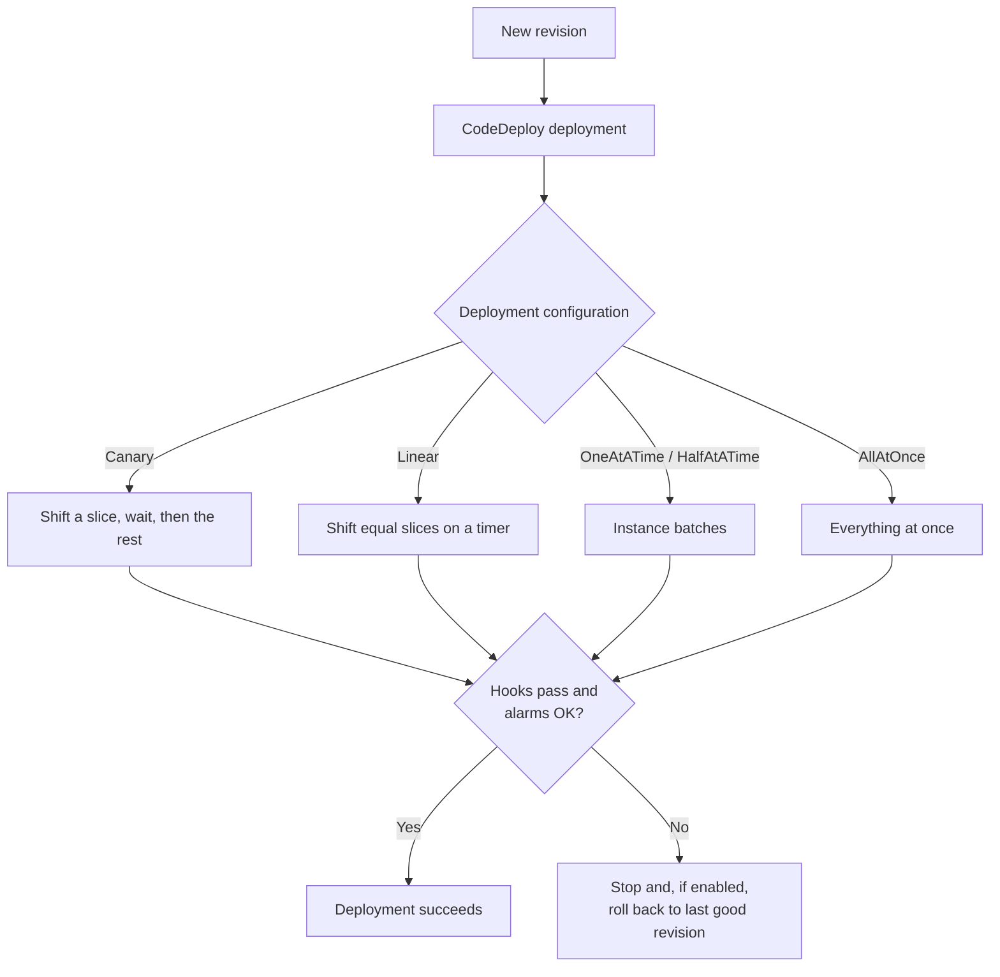
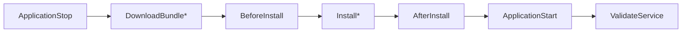

# 3.3.4 Deploy application revisions to target environments with CodeDeploy

**Domain 3 · Task 3.3 · Skill 3.3.4** · [Task overview](README.md) · Previous: [3.3.3 Infrastructure as code deployment](3.3.3-infrastructure-as-code-deployment.md) · Next: [3.3.5 CodePipeline release promotion](3.3.5-codepipeline-release-promotion.md)

## What the exam expects

AWS CodeDeploy automates releasing a new application revision to Amazon Elastic Compute Cloud (EC2) instances, on-premises servers, AWS Lambda functions, or Amazon Elastic Container Service (ECS) services. It controls the order and pace of the rollout, runs your validation scripts at fixed lifecycle points, and can roll back automatically. Questions ask about the AppSpec file, the order of lifecycle hooks, which deployment configuration matches a risk tolerance, and why a deployment failed.

You must be able to:

- Name CodeDeploy's components and set up an application and deployment group for each compute platform.
- Write an AppSpec file for EC2/on-premises, Lambda, and ECS.
- Put scripts in the right lifecycle hook, in the right order.
- Pick a predefined deployment configuration by name.
- Write a Lambda validation hook that reports back to CodeDeploy.
- Attach alarms and automatic rollback to a deployment group.
- Troubleshoot agent, permission, and hook failures.

## Key terms

| Term | Meaning |
|---|---|
| Application | A name that groups deployment groups and revisions. Has one compute platform: EC2/On-premises, Lambda, or ECS. |
| Deployment group | The target set (EC2 tags, Auto Scaling groups, on-premises tags, a Lambda function, or an ECS service) plus the service role, load balancer, alarms, and rollback settings. |
| Deployment configuration | The rollout rules: minimum healthy hosts for EC2, or the traffic-shifting pattern for Lambda and ECS. |
| Revision | What you deploy. For EC2/on-premises, a bundle in S3 (zip, tar, tgz) or GitHub with an AppSpec file at the root. For Lambda and ECS, the AppSpec file itself (YAML or JSON). |
| AppSpec file | `appspec.yml` (EC2/on-premises) or `appspec.yaml`/JSON (Lambda, ECS). Says what to deploy and which hooks to run. |
| Lifecycle event hook | A point in the deployment where CodeDeploy runs your script (EC2/on-premises) or Lambda function (Lambda, ECS). |
| CodeDeploy agent | Software on each EC2 or on-premises instance that pulls the revision and runs hooks. Not used for Lambda or ECS. |
| Service role | AWS Identity and Access Management (IAM) role CodeDeploy assumes to read Auto Scaling groups, tags, load balancers, alarms, and to shift traffic. |
| In-place deployment | Stops the app on existing instances, installs the new revision, restarts. EC2/on-premises only. |
| Blue/green deployment | Moves traffic from the original environment to a replacement: new EC2 instances, a new Lambda version, or a new ECS task set. |

## How CodeDeploy fits in a release

CodeDeploy deploys. AWS CodeBuild builds and tests. AWS CodePipeline orchestrates the stages around them. AWS CloudFormation manages infrastructure state, not the application rollout.



## Compute platforms compared

| | EC2/On-premises | AWS Lambda | Amazon ECS |
|---|---|---|---|
| Deployment types | In-place; blue/green (EC2 only, not on-premises) | Blue/green by alias traffic shifting only | Blue/green only, with a replacement task set |
| Agent required | Yes | No | No |
| Revision | Bundle in S3 or GitHub with `appspec.yml` at the root | AppSpec content | AppSpec content (often from CodePipeline) |
| Predefined configs | `AllAtOnce`, `HalfAtATime`, `OneAtATime` (default) | `LambdaCanary10Percent{5,10,15,30}Minutes`, `LambdaLinear10PercentEvery{1Minute,2Minutes,3Minutes,10Minutes}`, `LambdaAllAtOnce` | `ECSCanary10Percent{5,15}Minutes`, `ECSLinear10PercentEvery{1,3}Minutes`, `ECSAllAtOnce` |
| Hooks | Scripts on the instance | Lambda functions: `BeforeAllowTraffic`, `AfterAllowTraffic` | Lambda functions: `BeforeInstall`, `AfterInstall`, `AfterAllowTestTraffic`, `BeforeAllowTraffic`, `AfterAllowTraffic` |
| Required AppSpec fields | `version`, `os`, `files`, optional `permissions` and `hooks` | `Name`, `Alias`, `CurrentVersion`, `TargetVersion` | `TaskDefinition`, `LoadBalancerInfo.ContainerName`, `LoadBalancerInfo.ContainerPort` |
| Load balancer | Optional (needed for blue/green and traffic blocking) | Not used | Required: Application Load Balancer (ALB) or Network Load Balancer (NLB) with two target groups |

All predefined names start with `CodeDeployDefault.`, for example `CodeDeployDefault.LambdaCanary10Percent5Minutes`. Older course material lists `ECSLinear10PercentEvery10Minutes` and `ECSCanary10Percent30Minutes`; those do not exist. You can create custom canary and linear configurations for Lambda and ECS, and custom minimum-healthy-host configurations for EC2.

## EC2/on-premises compute platform


*Source: [AWS CodeDeploy User Guide, "What is CodeDeploy?"](https://docs.aws.amazon.com/codedeploy/latest/userguide/welcome.html), © Amazon Web Services.*

### Prerequisites

- The **CodeDeploy agent** runs on every instance. Install and update it with AWS Systems Manager.
- EC2 instances have an **instance profile** that can read the revision bundle from S3 (`s3:GetObject`, plus AWS Key Management Service (KMS) decrypt if the bucket uses a customer managed key). On-premises servers are registered with an IAM user or role.
- Instances are found by EC2 tags, on-premises tags, or Auto Scaling group names in the deployment group.
- The CodeDeploy **service role** (managed policy `AWSCodeDeployRole`) lets CodeDeploy read tags, Auto Scaling groups, and load balancers.

### The `appspec.yml` file

```yaml
version: 0.0
os: linux
files:
  - source: /build
    destination: /var/www/orders
permissions:
  - object: /var/www/orders
    owner: webapp
    group: webapp
    mode: 755
    type: [directory]
hooks:
  ApplicationStop:
    - location: scripts/stop_server.sh
      timeout: 120
      runas: root
  BeforeInstall:
    - location: scripts/backup_current.sh
  AfterInstall:
    - location: scripts/install_dependencies.sh
      timeout: 300
  ApplicationStart:
    - location: scripts/start_server.sh
  ValidateService:
    - location: scripts/health_check.sh
      timeout: 60
```

The file sits at the **root of the revision bundle**. Each hook script must exit 0. A non-zero exit or a timeout fails the lifecycle event, which fails the deployment on that instance.

### Lifecycle hooks, in order



`*` = reserved for the agent; you cannot script it.

| Hook | Use it for |
|---|---|
| `ApplicationStop` | Gracefully stop the running app or remove installed packages. Runs **before the new revision is downloaded**, using the **AppSpec and scripts from the previous successful revision**. It does not run on an instance's first deployment. |
| `DownloadBundle` | Agent copies the revision to a temporary folder (reserved) |
| `BeforeInstall` | Pre-install tasks: decrypt files, back up the current version |
| `Install` | Agent copies files to their destinations per the `files` section (reserved) |
| `AfterInstall` | Configure the app, change file permissions, install dependencies |
| `ApplicationStart` | Start or restart the services stopped in `ApplicationStop` |
| `ValidateService` | Last event. Verify the deployment succeeded, for example by calling a health endpoint |

With a load balancer, traffic hooks wrap the sequence: `BeforeBlockTraffic` → `BlockTraffic`* → `AfterBlockTraffic` before `ApplicationStop`, and `BeforeAllowTraffic` → `AllowTraffic`* → `AfterAllowTraffic` after `ValidateService`. The instance is deregistered from the load balancer while it is updated, then registered again.

Because `ApplicationStop` runs the previous revision's script, a broken stop script in the last revision breaks every later deployment at the first hook. Fix the script on the instance, or deploy with `--ignore-application-stop-failures` (console: "Don't fail the deployment if the ApplicationStop lifecycle event fails").

### In-place deployment configurations

| Configuration | Behavior (9 instances) | Succeeds when |
|---|---|---|
| `CodeDeployDefault.AllAtOnce` | Deploys to all 9 at once; most downtime | At least one instance succeeds |
| `CodeDeployDefault.HalfAtATime` | Up to 4 at a time (half, rounded down); capacity drops by about half | At least 5 succeed (half, rounded up) |
| `CodeDeployDefault.OneAtATime` | One at a time; slowest, least impact. **Default** if you do not choose one. | All succeed (a failure on the last instance alone still counts as success) |
| Custom | Minimum healthy hosts as a number or percent, optionally per Availability Zone (zonal configuration) | Your rule |

### Blue/green on EC2

- CodeDeploy provisions replacement instances (by copying an Auto Scaling group, or using instances you tag), installs the revision, then reroutes the load balancer to them.
- You choose when to reroute (immediately or after manual approval) and how long to keep the original instances before terminating them.
- A load balancer is required. On-premises servers cannot use blue/green.
- With Auto Scaling groups and in-place deployments, instances that the group launches later receive the last successful revision automatically.

## Lambda compute platform

CodeDeploy shifts traffic on a Lambda **alias** from the current version to the target version. Nothing is installed; the alias routing weights change.

```yaml
# appspec.yaml for Lambda
version: 0.0
Resources:
  - OrdersFunction:
      Type: AWS::Lambda::Function
      Properties:
        Name: orders-api
        Alias: live
        CurrentVersion: "4"
        TargetVersion: "5"
Hooks:
  - BeforeAllowTraffic: arn:aws:lambda:us-east-1:123456789012:function:orders-pre-traffic
  - AfterAllowTraffic: arn:aws:lambda:us-east-1:123456789012:function:orders-post-traffic
```

| Configuration | Shape |
|---|---|
| `LambdaCanary10Percent5Minutes` | 10%, then the remaining 90% after 5 minutes (also 10, 15, and 30 minutes) |
| `LambdaLinear10PercentEvery1Minute` | +10% every minute until 100% (also every 2, 3, and 10 minutes) |
| `LambdaAllAtOnce` | 100% immediately |

### Writing a hook function

A hook function runs your checks, then **must** call `PutLifecycleEventHookExecutionStatus`. If it never reports, the deployment waits until the hook times out and then fails. The hook's execution role needs `codedeploy:PutLifecycleEventHookExecutionStatus` and permission to invoke whatever it tests.

```python
import json
import os
import boto3

codedeploy = boto3.client("codedeploy")
lambda_client = boto3.client("lambda")

def handler(event, context):
    status = "Succeeded"
    try:
        # Invoke the NEW version directly. During BeforeAllowTraffic the alias
        # still points at the old version, so test the target version ARN
        # (SAM templates usually pass it in, e.g. !Ref OrdersFunction.Version).
        resp = lambda_client.invoke(
            FunctionName=os.environ["TARGET_VERSION_ARN"],
            Payload=json.dumps({"pathParameters": {"id": "smoke-test"}}),
        )
        body = json.loads(resp["Payload"].read())
        if resp.get("FunctionError") or body.get("statusCode") != 200:
            status = "Failed"
    except Exception:
        status = "Failed"

    codedeploy.put_lifecycle_event_hook_execution_status(
        deploymentId=event["DeploymentId"],
        lifecycleEventHookExecutionId=event["LifecycleEventHookExecutionId"],
        status=status,   # "Succeeded" or "Failed"
    )
```

### With AWS SAM

AWS Serverless Application Model (SAM)'s `AutoPublishAlias` and `DeploymentPreference` create the CodeDeploy application, deployment group, version, and alias for you. `Hooks.PreTraffic` maps to `BeforeAllowTraffic` and `Hooks.PostTraffic` to `AfterAllowTraffic`. Template syntax is in [3.3.3](3.3.3-infrastructure-as-code-deployment.md#sam-features-to-recognize).

```yaml
OrdersFunction:
  Type: AWS::Serverless::Function
  Properties:
    Handler: app.handler
    Runtime: python3.12
    AutoPublishAlias: live
    DeploymentPreference:
      Type: Linear10PercentEvery1Minute
      Alarms: [!Ref OrdersErrorsAlarm]
      Hooks:
        PreTraffic: !Ref PreTrafficHook
        PostTraffic: !Ref PostTrafficHook
```

A canary shift does not warm the new version. If the first users of the canary slice must not hit cold starts, configure provisioned concurrency on the new version before the shift. The two features are independent.

## ECS compute platform


*Source: [AWS CodeDeploy User Guide, "Deployments on an Amazon ECS compute platform"](https://docs.aws.amazon.com/codedeploy/latest/userguide/deployment-steps-ecs.html), © Amazon Web Services.*

- The ECS service uses the `CODE_DEPLOY` deployment controller.
- The load balancer has a **production listener** and an optional **test listener**, and two target groups (blue and green).
- CodeDeploy starts a **replacement task set** with the new task definition in the green target group, optionally sends test traffic through the test listener, then shifts production traffic by the configuration, and finally terminates the original task set after the wait time you set.
- With a Network Load Balancer, only `CodeDeployDefault.ECSAllAtOnce` is supported.

```yaml
# appspec.yaml for ECS
version: 0.0
Resources:
  - TargetService:
      Type: AWS::ECS::Service
      Properties:
        TaskDefinition: "<TASK_DEFINITION>"   # CodePipeline fills this in
        LoadBalancerInfo:
          ContainerName: "orders-api"
          ContainerPort: 8080
Hooks:
  - BeforeInstall: "arn:aws:lambda:us-east-1:123456789012:function:pre-install-checks"
  - AfterAllowTestTraffic: "arn:aws:lambda:us-east-1:123456789012:function:run-smoke-tests"
  - AfterAllowTraffic: "arn:aws:lambda:us-east-1:123456789012:function:post-traffic-checks"
```

| ECS hook | Runs |
|---|---|
| `BeforeInstall` | Before the replacement task set is created |
| `AfterInstall` | After the replacement task set is created, before any traffic |
| `AfterAllowTestTraffic` | After the test listener routes to the replacement tasks; run smoke tests here |
| `BeforeAllowTraffic` | Before production traffic shifts |
| `AfterAllowTraffic` | After production traffic has shifted |

In CodePipeline, the **Amazon ECS (blue/green)** action (`CodeDeployToECS`) takes `appspec.yaml`, `taskdef.json`, and `imageDetail.json` from the build artifact (see [3.3.5](3.3.5-codepipeline-release-promotion.md#deploy-actions)). You can also manage ECS blue/green declaratively with the CloudFormation `AWS::CodeDeploy::BlueGreen` hook, which supports only the predefined configurations.

Since 2025, ECS also offers built-in blue/green, linear, and canary deployments without CodeDeploy (see [3.3.2](3.3.2-container-deployments.md#other-ecs-deployment-strategies)). CodeDeploy-based blue/green still appears in exam questions.

## Running a deployment

```bash
# Package and register an EC2/on-premises revision
aws deploy push --application-name orders-app \
  --s3-location s3://my-deploy-bucket/orders/revision-42.zip --source ./build-output

# Deploy it
aws deploy create-deployment \
  --application-name orders-app \
  --deployment-group-name prod-fleet \
  --deployment-config-name CodeDeployDefault.OneAtATime \
  --s3-location bucket=my-deploy-bucket,key=orders/revision-42.zip,bundleType=zip \
  --description "commit 3f9c2ab"

aws deploy get-deployment --deployment-id d-ABC123XYZ --query 'deploymentInfo.status'
```

```bash
# Lambda: create the application and a canary deployment group
aws deploy create-application --application-name orders-lambda --compute-platform Lambda
aws deploy create-deployment-group --application-name orders-lambda \
  --deployment-group-name live-canary \
  --deployment-config-name CodeDeployDefault.LambdaCanary10Percent5Minutes \
  --deployment-style deploymentType=BLUE_GREEN,deploymentOption=WITH_TRAFFIC_CONTROL \
  --service-role-arn arn:aws:iam::123456789012:role/CodeDeployServiceRole \
  --alarm-configuration enabled=true,alarms=[{name=orders-errors-high}] \
  --auto-rollback-configuration enabled=true,events=DEPLOYMENT_FAILURE,DEPLOYMENT_STOP_ON_ALARM
```

## Alarms and rollback (summary)

- A deployment group can monitor up to **10 CloudWatch alarms**. When any alarm enters `ALARM`, CodeDeploy stops the deployment. The service role needs CloudWatch read permissions.
- Automatic rollback is a deployment group setting with two triggers: `DEPLOYMENT_FAILURE` (a hook or instance failed) and `DEPLOYMENT_STOP_ON_ALARM` (an attached alarm fired). Neither happens unless you configure it.
- A rollback is a **new deployment** of the last known good revision, with a new deployment ID. It is not a restore of the old deployment.
- Lambda and ECS rollbacks shift traffic back to the original version or task set, which is fast because the original never stopped.

Full rollback coverage, including CloudFormation and ECS, is in [3.3.7 Rollback](3.3.7-rollback.md). Strategy choice is in [3.3.6 Deployment strategies](3.3.6-deployment-strategies.md).

## Troubleshooting

| Symptom | Likely cause | Fix |
|---|---|---|
| EC2 deployment fails immediately on every instance | Agent not installed or not running | Install or restart the agent (Systems Manager) |
| Fails at `DownloadBundle` | Instance profile cannot read the S3 bundle, or KMS decrypt is missing | Grant `s3:GetObject` (and `kms:Decrypt`) to the instance profile |
| Fails at `ApplicationStop` after a bad release | The previous revision's stop script is broken | Fix it on the instance or use `--ignore-application-stop-failures` |
| Fails at a hook with a script error | Script exits non-zero, wrong path, missing execute permission, or wrong `runas` user | Check the agent log; fix the script |
| Deployment stuck `In Progress` | A hook script hangs, or a Lambda or ECS hook never calls `PutLifecycleEventHookExecutionStatus` | Add timeouts; make the hook report status |
| No rollback although errors spiked | Alarm not attached to the deployment group, or automatic rollback not enabled | Attach the alarm and enable `DEPLOYMENT_STOP_ON_ALARM` |
| Instances fail health checks behind the load balancer after install | App not listening, or health check path wrong | Check `ValidateService` output and target group health |
| Deployment group shows no instances | Tag or Auto Scaling group name in the deployment group does not match | Fix the tag filter |

Agent logs on Linux: `/var/log/aws/codedeploy-agent/codedeploy-agent.log` and per-deployment script output under `/opt/codedeploy-agent/deployment-root/deployment-logs/codedeploy-agent-deployments.log`. The console's deployment events show which lifecycle event failed on which instance. Reading these logs is skill [4.1.4 Diagnosing deployment failures](../../domain-4-troubleshooting-and-optimization/task-4.1-root-cause-analysis/4.1.4-diagnosing-deployment-failures.md).

## Pricing

No extra charge for deployments to EC2, Lambda, or ECS. On-premises deployments are charged per instance update.

## Exam triggers

| Scenario clue | Answer | Why the alternatives are wrong |
|---|---|---|
| Deploy to 100 EC2 instances with the least capacity impact | In-place with `CodeDeployDefault.OneAtATime` | `AllAtOnce` takes everything down; `HalfAtATime` halves capacity |
| Run a health check after the app has started | `ValidateService` hook | `AfterInstall` runs before the app starts |
| Gracefully stop the old app before the new files arrive | `ApplicationStop` (script from the previous revision) | `BeforeInstall` is for pre-install prep such as backups and decryption |
| Install dependencies or set permissions after files are copied | `AfterInstall` | `BeforeInstall` runs before the copy |
| Deployment fails at `ApplicationStop` after last week's bad release | The previous revision's script is broken; fix it or ignore application stop failures | Redeploying the same bundle hits the same script |
| EC2 deployment fails at `DownloadBundle` | Instance profile cannot read S3 | The CodeDeploy service role does not download bundles |
| Send 10% of Lambda traffic to the new version, then the rest after 5 minutes | `CodeDeployDefault.LambdaCanary10Percent5Minutes` | Linear shifts in repeated equal steps |
| Increase ECS traffic 10% every 3 minutes | `CodeDeployDefault.ECSLinear10PercentEvery3Minutes` | There is no `ECSLinear10PercentEvery10Minutes` |
| Run automated tests against the new Lambda version before it receives traffic | `BeforeAllowTraffic` hook (SAM `PreTraffic`) that calls `PutLifecycleEventHookExecutionStatus` | A test suite run after the deployment cannot stop the shift |
| ECS smoke tests through a test listener before production traffic | `AfterAllowTestTraffic` hook | `BeforeInstall` runs before the tasks exist |
| ECS blue/green with CodeDeploy using an NLB | Only `ECSAllAtOnce` is supported | Canary and linear require an ALB |
| Roll back automatically when the error-rate alarm fires during a shift | Attach the alarm to the deployment group and enable rollback on alarm | An alarm elsewhere in the account is not watched |
| Blue/green for on-premises servers | Not supported; use in-place | Blue/green needs EC2 instances behind a load balancer |
| Manually roll back | Redeploy the last good revision; it gets a new deployment ID | CodeDeploy does not restore the old deployment |
| Kubernetes on Amazon Elastic Kubernetes Service (EKS) needs gradual rollout | Kubernetes rolling updates (see [3.3.2](3.3.2-container-deployments.md)) | CodeDeploy has no EKS platform |

## Common traps

- Confusing `appspec.yml` (CodeDeploy) with `buildspec.yml` (CodeBuild).
- Thinking the agent is needed for Lambda or ECS. Only EC2 and on-premises use it.
- Putting the graceful stop in `BeforeInstall` and forgetting that `ApplicationStop` exists and uses the old revision's scripts.
- Trying to script `DownloadBundle`, `Install`, `BlockTraffic`, or `AllowTraffic`. They are reserved.
- Expecting rollback without configuring it, or expecting an unattached alarm to trigger it.
- Believing rollback restores the old deployment. It creates a new one.
- Choosing in-place for Lambda or ECS. Both are blue/green only.
- Writing a hook Lambda that runs tests but never reports status.
- Using made-up configuration names. Lambda linear uses `Every1Minute` (singular) and `Every2Minutes`; ECS linear uses `Every1Minutes` and `Every3Minutes`.

## Quick recall

- Components: application → deployment group → deployment configuration → revision (AppSpec).
- EC2 hooks: ApplicationStop → DownloadBundle → BeforeInstall → Install → AfterInstall → ApplicationStart → ValidateService.
- `ApplicationStop` uses the previous revision's scripts and skips the first deployment.
- Lambda hooks: `BeforeAllowTraffic`, `AfterAllowTraffic`. ECS adds `BeforeInstall`, `AfterInstall`, `AfterAllowTestTraffic`.
- Lambda AppSpec: `Name`, `Alias`, `CurrentVersion`, `TargetVersion`. ECS AppSpec: `TaskDefinition`, `ContainerName`, `ContainerPort`.
- EC2 default config is `OneAtATime`; `HalfAtATime`, `AllAtOnce`, or custom minimum healthy hosts.
- Lambda canary 5/10/15/30 minutes; linear every 1/2/3/10 minutes. ECS canary 5/15; linear every 1/3.
- Up to 10 alarms per deployment group; rollback = new deployment of the last good revision.
- Hook functions must call `PutLifecycleEventHookExecutionStatus`.
- Agent needed only on EC2/on-premises; instance profile reads the S3 bundle.

## Related skills

- [3.3.3 Infrastructure as code deployment](3.3.3-infrastructure-as-code-deployment.md): SAM `DeploymentPreference` that drives CodeDeploy for Lambda.
- [3.3.5 CodePipeline release promotion](3.3.5-codepipeline-release-promotion.md): CodeDeploy actions inside a pipeline.
- [3.3.6 Deployment strategies](3.3.6-deployment-strategies.md): choosing blue/green, canary, linear, or rolling.
- [3.3.7 Rollback](3.3.7-rollback.md): automatic and manual rollback in CodeDeploy and other services.
- [3.3.8 Versions and releases](3.3.8-versions-and-releases.md): Lambda versions and aliases that CodeDeploy shifts between.
- [4.2.3 Alerts and notifications](../../domain-4-troubleshooting-and-optimization/task-4.2-observability/4.2.3-alerts-and-notifications.md): alarms and notifications for completed or failed deployments.

## Sources

- Merged from: `archive/aws-dva-notes/Markdown Files/21. CICD - CodeCommit, CodePipeline, CodeBuild, CodeDeploy.md` (section 5), `archive/aws-dva-notes/Markdown Files/18. Serverless - Lambda.md` (section 17), `archive/aws-dva-notes/Markdown Files/22. SAM - Serverless Application Model.md` (section 6), `archive/dva-c03-study-notes/03-testing-deployment.md` (skill 3.3.4), `archive/dva-c03/domain-1-development/MASTER-CHUNK.md` (section 3, AWS CodeDeploy), `archive/dva-c03/domain-3-testing-deployment/MASTER-CHUNK.md` (section 8, AWS CodeDeploy), `archive/dva-c03/domain-3-testing-deployment/README.md` (ECS blue/green deep dive, named configurations, rollback mechanics), `archive/aws-dva-notes/Markdown Files/31. Exam Day Cheat Sheet.md`, `archive/dva-c03/exam-bank/bank-2.md` (lifecycle hook scenario)
- AWS documentation: [Working with deployment configurations in CodeDeploy](https://docs.aws.amazon.com/codedeploy/latest/userguide/deployment-configurations.html)
- AWS documentation: [AppSpec "hooks" section](https://docs.aws.amazon.com/codedeploy/latest/userguide/reference-appspec-file-structure-hooks.html)
- AWS documentation: [AWS::CodeDeploy::DeploymentGroup AlarmConfiguration](https://docs.aws.amazon.com/AWSCloudFormation/latest/UserGuide/aws-properties-codedeploy-deploymentgroup-alarmconfiguration.html)
- AWS documentation: [What is CodeDeploy?](https://docs.aws.amazon.com/codedeploy/latest/userguide/welcome.html)
- AWS documentation: [Deployments on an Amazon ECS compute platform](https://docs.aws.amazon.com/codedeploy/latest/userguide/deployment-steps-ecs.html)
