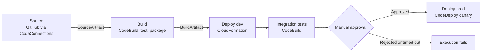
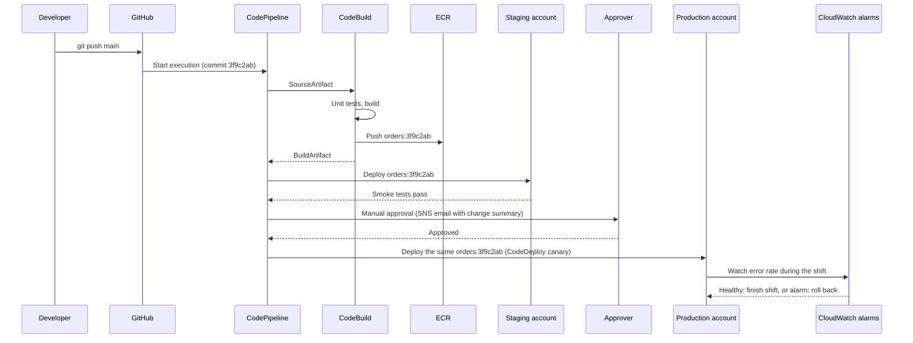
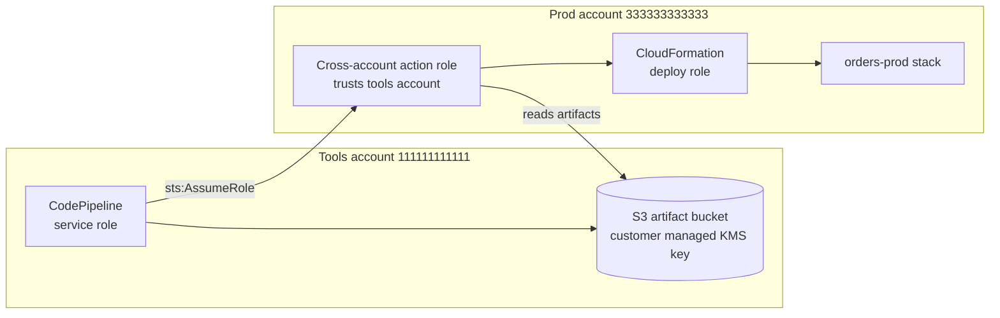

# 3.3.5 Use CodePipeline to connect source repositories and promote releases through multiple environments

**Domain 3 · Task 3.3 · Skill 3.3.5** · [Task overview](README.md) · Previous: [3.3.4 CodeDeploy](3.3.4-codedeploy.md) · Next: [3.3.6 Deployment strategies](3.3.6-deployment-strategies.md)

## What the exam expects

AWS CodePipeline is the orchestrator of continuous integration and continuous delivery (CI/CD) on AWS. It watches a source repository, passes artifacts between stages, and calls other services to build, test, approve, and deploy. The exam guide says you need to use an existing pipeline, not design one, so questions focus on reading a pipeline, wiring a source, adding a gate, passing secrets to a build, and promoting the same artifact from dev to prod.

You must be able to:

- Explain pipelines, stages, actions, artifacts, and the S3 artifact store.
- Connect GitHub, GitLab, or Bitbucket through AWS CodeConnections, or use Amazon S3 or Amazon Elastic Container Registry (ECR) as a source.
- Filter triggers by branch, tag, pull request, or file path, and pick an execution mode (V2 pipelines).
- Read and fix a `buildspec.yml` for AWS CodeBuild, including secrets, caching, artifacts, and virtual private cloud (VPC) access.
- Choose the right deploy action and the build files it needs.
- Promote one build through dev, test, and prod with approvals, separate accounts, and per-environment parameters.
- Troubleshoot pipeline failures and send notifications.

## Key terms

| Term | Meaning |
|---|---|
| Pipeline | A workflow of stages that runs when a source changes or when started manually. |
| Stage | A group of actions, such as `Build` or `DeployProd`. One execution at a time occupies a stage. |
| Action | One task in a stage, in a category: Source, Build, Test, Deploy, Approval, Invoke, or Compute. Actions with the same `runOrder` run in parallel. |
| Artifact | Files an action produces (output artifact) or consumes (input artifact). Stored in the pipeline's S3 artifact bucket between actions. |
| Execution | One run of the pipeline for a specific source revision. |
| Transition | The link between stages. You can disable it to hold changes back. |
| Pipeline type | V1 or V2. V2 is the default and the only type the console creates. |
| Execution mode | How concurrent executions behave: `SUPERSEDED`, `QUEUED`, or `PARALLEL` (V2 for the last two). |
| AWS CodeConnections | The service (formerly AWS CodeStar Connections) that authorizes CodePipeline and CodeBuild to read GitHub, GitLab, and Bitbucket. The action provider is still named `CodeStarSourceConnection`. |
| `buildspec.yml` | CodeBuild's build instructions, at the root of the source unless you name another path. |

## Pipeline anatomy


*Source: [AWS CodeBuild User Guide, "What is AWS CodeBuild?"](https://docs.aws.amazon.com/codebuild/latest/userguide/welcome.html), © Amazon Web Services.*

CodePipeline does not build or deploy anything itself. Each action delegates to another service.

| Category | Common providers |
|---|---|
| Source | GitHub, GitLab, Bitbucket (through CodeConnections), Amazon S3 (versioned bucket), Amazon ECR (image push), AWS CodeCommit |
| Build | AWS CodeBuild, Jenkins |
| Test | CodeBuild, AWS Device Farm, third-party tools |
| Deploy | AWS CloudFormation, AWS CodeDeploy, Amazon Elastic Container Service (ECS), standard and blue/green, Amazon Elastic Kubernetes Service (EKS), AWS Elastic Beanstalk, Amazon S3, AWS Lambda, AWS AppConfig, AWS Service Catalog |
| Approval | Manual approval |
| Invoke | AWS Lambda, AWS Step Functions |
| Compute (V2) | Commands action: run shell commands without creating a CodeBuild project |



- Each stage must finish successfully before the next starts. A failed action stops the execution at that stage.
- Artifacts are zipped into the **S3 artifact bucket**, encrypted with AWS Key Management Service (KMS). The default is the AWS managed key; cross-account pipelines need a customer managed key.
- Actions in one stage run in sequence or in parallel, depending on `runOrder`.
- A manual approval can be added to any stage.

```json
{
  "pipeline": {
    "name": "orders-api",
    "pipelineType": "V2",
    "executionMode": "QUEUED",
    "roleArn": "arn:aws:iam::111111111111:role/codepipeline-orders",
    "artifactStore": { "type": "S3", "location": "orders-pipeline-artifacts" },
    "stages": [
      { "name": "Source", "actions": [{
          "name": "GitHub", "runOrder": 1,
          "actionTypeId": { "category": "Source", "owner": "AWS", "provider": "CodeStarSourceConnection", "version": "1" },
          "configuration": { "ConnectionArn": "arn:aws:codeconnections:us-east-1:111111111111:connection/abc",
                             "FullRepositoryId": "example-org/orders-api", "BranchName": "main" },
          "outputArtifacts": [{ "name": "SourceArtifact" }] }] },
      { "name": "Build", "actions": [{
          "name": "UnitTestAndPackage", "runOrder": 1,
          "actionTypeId": { "category": "Build", "owner": "AWS", "provider": "CodeBuild", "version": "1" },
          "configuration": { "ProjectName": "orders-build" },
          "inputArtifacts": [{ "name": "SourceArtifact" }],
          "outputArtifacts": [{ "name": "BuildArtifact" }] }] },
      { "name": "ApproveProd", "actions": [{
          "name": "ManualApproval", "runOrder": 1,
          "actionTypeId": { "category": "Approval", "owner": "AWS", "provider": "Manual", "version": "1" },
          "configuration": { "NotificationArn": "arn:aws:sns:us-east-1:111111111111:release-approvals",
                             "CustomData": "Review the change set summary before approving" } }] },
      { "name": "DeployProd", "actions": [{
          "name": "DeployStack", "runOrder": 1,
          "actionTypeId": { "category": "Deploy", "owner": "AWS", "provider": "CloudFormation", "version": "1" },
          "configuration": { "ActionMode": "CREATE_UPDATE", "StackName": "orders-prod",
                             "TemplatePath": "BuildArtifact::packaged.yaml",
                             "TemplateConfiguration": "BuildArtifact::config/prod.json",
                             "Capabilities": "CAPABILITY_IAM,CAPABILITY_AUTO_EXPAND",
                             "RoleArn": "arn:aws:iam::333333333333:role/cfn-deploy" },
          "roleArn": "arn:aws:iam::333333333333:role/pipeline-cross-account",
          "inputArtifacts": [{ "name": "BuildArtifact" }] }] }
    ]
  }
}
```

## V1 versus V2 pipelines

| Feature | V1 | V2 |
|---|---|---|
| Action-level variables | Yes | Yes |
| Pipeline-level variables set at start time | No | Yes |
| Triggers with Git tag, branch, pull request, and file path filters | No | Yes |
| `QUEUED` and `PARALLEL` execution modes | No | Yes |
| Stage rollback, stage conditions, automatic stage retry on failure | No | Yes |
| Source revision overrides (start on a specific commit) | No | Yes |
| Commands action | No | Yes |
| Pricing | Per active pipeline per month | Per action execution minute (manual approvals and custom actions are not billed) |

### Execution modes

| Mode | Behavior | Use when |
|---|---|---|
| `SUPERSEDED` (default) | A newer execution can overtake an older one waiting at a stage; the older one is superseded | You only care about deploying the latest commit |
| `QUEUED` (V2) | Executions wait and run one at a time in order | Every commit must go through every stage, in order |
| `PARALLEL` (V2) | Executions run independently and at the same time | Feature-branch or pull-request pipelines that deploy isolated environments |

## Connecting source repositories

### GitHub, GitLab, and Bitbucket through CodeConnections

1. Create a connection in the Developer Tools console. It starts in `PENDING`.
2. Complete the OAuth handshake (install the AWS Connector app for GitHub). The connection becomes `AVAILABLE`.
3. Reference the connection Amazon Resource Name (ARN) in the source action, with the repository and branch.
4. The pipeline role needs `codeconnections:UseConnection` (older policies use `codestar-connections:UseConnection`).

The same connection can be shared by CodeBuild projects and AWS CloudFormation Git sync. Source actions can output a full Git clone (`OutputArtifactFormat: CODEBUILD_CLONE_REF`) when the build needs Git history or tags, instead of the default zip of the files.

### Triggers and filters (V2)

```json
"triggers": [{
  "providerType": "CodeStarSourceConnection",
  "gitConfiguration": {
    "sourceActionName": "GitHub",
    "push": [
      { "tags": { "includes": ["v*"] } },
      { "branches":  { "includes": ["main", "release/*"] },
        "filePaths": { "includes": ["services/orders/**"], "excludes": ["**/*.md"] } }
    ],
    "pullRequest": [{
      "events": ["OPEN", "UPDATED"],
      "branches": { "includes": ["main"] }
    }]
  }
}]
```

| Requirement | Trigger |
|---|---|
| Deploy to prod only when a release tag such as `v2.3.0` is pushed | Push trigger with a tag filter |
| Build only when files in one service's folder change (monorepo) | Push trigger with file path filters |
| Run checks on every pull request into `main` | Pull request trigger (or a CodeBuild webhook) |

Branch and tag strategy is skill [3.3.8 Versions and releases](3.3.8-versions-and-releases.md). Repository basics are skill [3.1.3 Code repositories in deployment](../task-3.1-prepare-deployable-artifacts/3.1.3-code-repositories-in-deployment.md).

### Amazon S3 and Amazon ECR sources

- **S3:** the bucket must have **versioning** enabled. CodePipeline detects new object versions through an Amazon EventBridge rule (recommended) or polling.
- **ECR:** a push of a specific image tag starts the pipeline through EventBridge. The output artifact includes `imageDetail.json`.

> **Not on the DVA-C03 service list.** AWS CodeCommit is not on the C03 in-scope list. It is a private Git service in your account: AWS Identity and Access Management (IAM) controls access (SSH keys or HTTPS Git credentials, or the `git-remote-codecommit` helper), data is encrypted with KMS at rest and only HTTPS or SSH in transit, and cross-account access uses an IAM role and `sts:AssumeRole`, never shared keys. Approval rule templates can require reviewers before a pull request merges, which is earlier than CodePipeline's deploy-time approval. AWS closed CodeCommit to new customers in July 2024 and returned it to full general availability on November 24, 2025. Changing a pipeline from CodeCommit to GitHub changes only the source action.

## Build and test with CodeBuild


*Source: [AWS CodeBuild User Guide, "AWS CodeBuild concepts"](https://docs.aws.amazon.com/codebuild/latest/userguide/concepts.html), © Amazon Web Services.*

CodeBuild is a fully managed build service. Each build runs in a fresh container from a managed image (Amazon Linux, Ubuntu, Windows, Arm) or your own image in ECR, scales without a queue, and is billed per build minute.

### `buildspec.yml`

```yaml
version: 0.2

env:
  variables:
    NODE_ENV: production
  parameter-store:
    API_URL: /orders/prod/api-url
  secrets-manager:
    NPM_TOKEN: prod/orders/npm:token
  exported-variables:
    - IMAGE_TAG

phases:
  install:
    runtime-versions:
      nodejs: 20
    commands:
      - npm ci
  pre_build:
    commands:
      - npm test
      - aws ecr get-login-password | docker login --username AWS --password-stdin $REPO_HOST
      - export IMAGE_TAG=$(echo $CODEBUILD_RESOLVED_SOURCE_VERSION | cut -c1-7)
  build:
    commands:
      - docker build -t $REPO_URI:$IMAGE_TAG .
  post_build:
    commands:
      - docker push $REPO_URI:$IMAGE_TAG
      - printf '[{"name":"orders-api","imageUri":"%s"}]' $REPO_URI:$IMAGE_TAG > imagedefinitions.json

reports:
  unit-tests:
    files: ['junit.xml']
    base-directory: reports
    file-format: JUNITXML

artifacts:
  files:
    - imagedefinitions.json
    - appspec.yaml

cache:
  paths:
    - 'node_modules/**/*'
```

| Section | What to know |
|---|---|
| `version` | `0.2` (current) |
| `env.variables` | Plain-text values. Do not put secrets here. |
| `env.parameter-store`, `env.secrets-manager` | Fetched at build start. The CodeBuild **service role** needs `ssm:GetParameters` or `secretsmanager:GetSecretValue`. Secret values can still leak if a command prints them, for example with `echo`. |
| `env.exported-variables` | Make values available to later pipeline actions as `#{BuildVariables.IMAGE_TAG}` (with the action's namespace) |
| `phases` | `install` (`runtime-versions`), `pre_build`, `build`, `post_build`. A command with a non-zero exit fails its phase and the build. `post_build` still runs after a `build` failure (check `CODEBUILD_BUILD_SUCCEEDING` before pushing or deploying there), so run tests in `pre_build` or `build` and guard any push in `post_build`. `on-failure: ABORT` stops a phase immediately. |
| `artifacts` | Files uploaded to S3 or passed to the next pipeline action. `base-directory`, `discard-paths`, and secondary artifacts are optional. |
| `reports` | Test and code coverage reports (JUnit, Cucumber, and others) shown in the console |
| `cache` | Reuse dependencies between builds. S3 cache or local cache (Docker layer, source, custom paths). The project's cache type must match. |

### Build environment settings

| Setting | Why it matters |
|---|---|
| **Privileged mode** | Required to run `docker build` inside CodeBuild |
| **VPC configuration** | Builds are not in your VPC by default. To reach a private Amazon Relational Database Service (RDS) database or internal service, attach subnets and security groups. The build then needs a network address translation (NAT) gateway or VPC endpoints to reach the internet and AWS APIs. |
| Service role | Permissions for the build: S3 artifacts, CloudWatch Logs, ECR push, secrets. Scope it to the resources the project needs. |
| Timeout | Default 60 minutes, configurable from 5 minutes up to 36 hours |
| Compute | Instance sizes, Arm, GPU, or Lambda compute for fast small builds |
| Logs | CloudWatch Logs and optional S3 |
| Local debugging | Run the CodeBuild agent locally in Docker to reproduce a build |

Private packages come from AWS CodeArtifact, which proxies and caches public registries; see [3.1.1 Packaging dependencies and configuration](../task-3.1-prepare-deployable-artifacts/3.1.1-packaging-dependencies-and-configuration.md). Container image build details are in [3.1.2 Container images and ECR](../task-3.1-prepare-deployable-artifacts/3.1.2-container-images-and-ecr.md). Test design in the build stage is in [3.2.1](../task-3.2-test-applications/3.2.1-testing-with-sam-cdk-and-cloudformation.md#where-each-layer-runs-in-a-pipeline).

## Deploy actions

| Deploy target | Provider | Input it expects | Notes |
|---|---|---|---|
| CloudFormation or AWS Serverless Application Model (SAM) stack | `CloudFormation` | Template file and optional template configuration file (parameters, tags, stack policy) | Action modes: `CREATE_UPDATE`, `DELETE_ONLY`, `REPLACE_ON_FAILURE`, `CHANGE_SET_REPLACE` (create a change set), `CHANGE_SET_EXECUTE`. Set `Capabilities` for IAM and SAM. |
| ECS rolling update | `ECS` | `imagedefinitions.json` | Updates the service's task definition image and runs the service's deployment |
| ECS blue/green | `CodeDeployToECS` | `imageDetail.json`, `taskdef.json` (with `<IMAGE1_NAME>`), `appspec.yaml` (with `<TASK_DEFINITION>`) | CodeDeploy shifts traffic between target groups; see [3.3.4](3.3.4-codedeploy.md#ecs-compute-platform) |
| Amazon Elastic Compute Cloud (EC2) or on-premises | `CodeDeploy` | Revision bundle with `appspec.yml` | In-place or blue/green |
| Lambda | `CloudFormation` with SAM `DeploymentPreference`, or `CodeDeploy` | Packaged template | Canary or linear alias shifting |
| EKS | `EKS` | Kubernetes manifests or a Helm chart | Or run `kubectl` in a CodeBuild action |
| Elastic Beanstalk | `ElasticBeanstalk` | Application bundle | Uses the environment's deployment policy |
| Static site | `S3` | Files to extract into a bucket | Optionally sets cache control |
| Custom step | `Lambda` (Invoke) | Any | The function **must** call `PutJobSuccessResult` or `PutJobFailureResult`, or the action waits until timeout |

Container-specific build files are explained in [3.3.2](3.3.2-container-deployments.md#deploying-from-codepipeline).

## Promoting through environments

The core rule is **build once, deploy many**. One build produces one immutable artifact, such as an image tagged with the Git commit hash (SHA) or a packaged template, and every later stage deploys that same artifact. Only the configuration differs per environment. If prod gets a separate build, what you tested is not what you shipped.



### Per-environment configuration

| Mechanism | How it varies by stage |
|---|---|
| CloudFormation template configuration file | `config/dev.json`, `config/prod.json` passed as `TemplateConfiguration` to each deploy action |
| `ParameterOverrides` on the CloudFormation action | Inline JSON per action, can reference variables such as `#{SourceVariables.CommitId}` |
| SAM `samconfig.toml` environments | `sam deploy --config-env prod` in a CodeBuild deploy step |
| Runtime configuration | AppConfig, Parameter Store, and Secrets Manager paths keyed by environment (see [3.1.4](../task-3.1-prepare-deployable-artifacts/3.1.4-environment-specific-configuration.md)) |

### Variables

- Source actions emit variables such as `#{SourceVariables.CommitId}` and `#{SourceVariables.BranchName}` (with the action's namespace).
- CodeBuild exports variables with `env.exported-variables`.
- V2 pipeline-level variables are set when an execution starts, such as a target environment or a release note.
- Pass the commit SHA into image tags, Lambda version descriptions, and stack parameters so every running release traces back to a commit.

### Manual approval actions

- The pipeline pauses at the action. An optional Amazon Simple Notification Service (SNS) topic notifies approvers, and `CustomData` and `ExternalEntityLink` give them context, such as a change set or a risk summary written by an artificial intelligence (AI) tool.
- The approver needs `codepipeline:PutApprovalResult` (and `codepipeline:GetPipelineState` to see it in the console).
- If nobody responds within the timeout (default **7 days**, configurable per action), the action fails.
- Place the approval **after** automated tests in a lower environment and **before** production. Approving before tests run means approving blind.

```bash
aws codepipeline get-pipeline-state --name orders-api \
  --query 'stageStates[?stageName==`ApproveProd`].actionStates[0].latestExecution.token'

aws codepipeline put-approval-result --pipeline-name orders-api \
  --stage-name ApproveProd --action-name ManualApproval \
  --result summary="Reviewed change set; no replacements",status=Approved \
  --token <token-from-get-pipeline-state>
```

AI tools can summarize the diff for the approver, but the human approval stays. That pattern is skill [3.3.9 AI-assisted deployment](3.3.9-ai-assisted-deployment.md).

### Stage conditions, rollback, and retry (V2)

- **Entry and exit conditions** check rules before or after a stage runs, for example "no CloudWatch alarm in `ALARM`" or a deployment time window, and can fail, roll back, or skip.
- **Stage rollback** redeploys the artifacts of the last successful execution of that stage, manually or automatically when the stage fails.
- **Retry** reruns failed actions in a stage, manually or automatically.

Rollback options across services are compared in [3.3.7 Rollback](3.3.7-rollback.md).

### Cross-account and cross-Region deployments

A common layout keeps the pipeline in a tools account and deploys into separate dev, staging, and prod accounts.



Requirements:

1. **Customer managed KMS key** for the artifact bucket. The AWS managed key cannot be shared across accounts. The key policy allows the target account roles to decrypt.
2. **Bucket policy** on the artifact bucket that allows the target account roles to read.
3. **A role in each target account** that trusts the tools account. The action's `roleArn` points to it. For CloudFormation actions, a separate deploy role (`RoleArn` in the configuration) holds the resource permissions.
4. The pipeline service role may call `sts:AssumeRole` on those roles. It never holds standing production credentials.

For **cross-Region** actions, CodePipeline needs an artifact bucket (and key) in each Region where an action runs. You set the action's `region`, and CodePipeline copies artifacts between Regions. To stage a multi-Region rollout, put each Region in its own stage with validation between them, so a problem in the first Region stops before the second. Role assumption mechanics are in [2.1.7 Assuming IAM roles](../../domain-2-security/task-2.1-authentication-and-authorization/2.1.7-assuming-iam-roles.md).

## Monitoring and troubleshooting

| Symptom | Where to look | Common fix |
|---|---|---|
| Stage failed with little detail in CodePipeline | The delegated service: CodeBuild logs, CloudFormation stack events, CodeDeploy deployment events | Fix the underlying build, template, or hook |
| Action fails with access denied | CodePipeline service role, or the cross-account action role | Add the missing permission (for example `codebuild:StartBuild`, `iam:PassRole`, `s3:GetObject`) |
| Pipeline never starts on push | Connection not `AVAILABLE`, trigger filters exclude the branch or path, or S3 bucket versioning off | Fix the connection or filters |
| Approver cannot see or approve | Missing `codepipeline:PutApprovalResult`, or SNS subscription not confirmed | Grant the permission; confirm the subscription |
| Build cannot reach a private database | CodeBuild project not in the VPC | Add VPC configuration and endpoints or NAT |
| Build cannot run Docker | Privileged mode off | Enable privileged mode |
| Secret appears in build logs | A command printed it | Remove the output; rotate the secret |
| Lambda invoke action hangs | Function never called `PutJobSuccessResult` or `PutJobFailureResult` | Report the job result |
| Older execution never reached prod | `SUPERSEDED` mode let a newer execution overtake it | Use `QUEUED` if every change must deploy |

- Pipeline, stage, and action state changes are EventBridge events. Create a rule for `FAILED` executions that targets Amazon SNS, or use notification rules to send to SNS or chat. See [4.2.3 Alerts and notifications](../../domain-4-troubleshooting-and-optimization/task-4.2-observability/4.2.3-alerts-and-notifications.md).
- AWS CloudTrail records CodePipeline API calls, including who approved a stage.
- Reading build and deployment logs is skill [4.1.4 Diagnosing deployment failures](../../domain-4-troubleshooting-and-optimization/task-4.1-root-cause-analysis/4.1.4-diagnosing-deployment-failures.md).

## Exam triggers

| Scenario clue | Answer | Why the alternatives are wrong |
|---|---|---|
| Start the pipeline when code is pushed to `main` in GitHub | Source action with a CodeConnections connection | Polling a personal access token or a cron job is legacy and less secure |
| Require a manager's sign-off before production | Manual approval action before the prod deploy stage, with SNS notification | Disabling the trigger still lets an unreviewed run reach prod |
| Approver gets access denied | Grant `codepipeline:PutApprovalResult` | Admin access breaks least privilege |
| Pass a database password to a build without hardcoding it | `env.secrets-manager` (or `env.parameter-store`) in the buildspec | `env.variables` stores plain text in source control |
| Build must reach a private RDS instance | CodeBuild VPC configuration | CodeBuild is not in your VPC by default |
| `docker build` fails in CodeBuild with a daemon error | Enable privileged mode | Changing the image tag does not help |
| Builds re-download dependencies every time | Buildspec `cache` with an S3 or local cache | Bigger compute does not remove downloads |
| CodeBuild says it cannot find build instructions | `buildspec.yml` must be at the source root, or set the buildspec path | Renaming the project does not help |
| Deploy into a prod account from a tools account | Cross-account role in prod, customer managed KMS key, artifact bucket policy | IAM users with prod keys in the tools account are standing credentials |
| Same tested artifact must reach every environment | One build stage; later stages deploy its artifact with per-stage parameters | Rebuilding per environment breaks traceability |
| Deploy to prod only when a `v*` tag is pushed | V2 trigger with a Git tag filter | A branch filter would deploy every merge |
| Monorepo: build only the service whose folder changed | V2 trigger with file path filters | Separate repos are not required |
| Every commit must deploy in order | `QUEUED` execution mode | `SUPERSEDED` skips older executions |
| Notify the team when a pipeline fails | EventBridge rule on pipeline execution state `FAILED` to SNS | CloudTrail is for auditing, not alerts |
| ECS blue/green action cannot find the image | `imageDetail.json` missing from the build artifact | `imagedefinitions.json` is for the standard ECS action |
| Custom Lambda step leaves the pipeline waiting | Call `PutJobSuccessResult` or `PutJobFailureResult` | Returning from the handler is not enough |
| Release must roll out Region by Region with validation | Separate deploy stages per Region with a gate between them | One action that deploys all Regions at once removes the checkpoint |

## Common traps

- Thinking CodePipeline builds or deploys code itself. It always delegates.
- Rebuilding the artifact for each environment instead of promoting one build.
- Putting secrets in `env.variables`, or printing injected secrets in commands.
- Forgetting that cross-account artifact sharing needs a customer managed KMS key.
- Using the AWS managed S3 key for a pipeline that deploys to other accounts.
- Placing the approval before the lower-environment tests.
- Expecting an S3 source to work without bucket versioning.
- Mixing up `imagedefinitions.json` (ECS standard) and `imageDetail.json` (ECS blue/green and ECR source output).
- Assuming V1 pipelines support tag triggers, `QUEUED` mode, or stage rollback.
- Confusing a CodeCommit merge-time approval rule with a CodePipeline deploy-time approval action.

## Quick recall

- Pipeline → stages → actions; artifacts in the S3 artifact bucket, encrypted with KMS.
- Source: CodeConnections (GitHub, GitLab, Bitbucket), S3 (versioned), ECR.
- V2: tag, branch, file path, and pull request triggers; pipeline variables; `QUEUED`/`PARALLEL`; stage rollback and conditions; billed per action execution minute.
- Default execution mode is `SUPERSEDED`.
- Buildspec at the source root; phases `install`, `pre_build`, `build`, `post_build`; secrets through `env.secrets-manager` or `env.parameter-store`.
- CodeBuild: privileged mode for Docker, VPC config for private resources, cache in S3, timeout up to 36 hours.
- Manual approval: SNS notification, `codepipeline:PutApprovalResult`, fails after 7 days by default.
- Cross-account: role in target account + customer managed KMS key + bucket policy.
- Cross-Region: an artifact bucket per Region.
- Lambda invoke action must call `PutJobSuccessResult` or `PutJobFailureResult`.
- Failures and notifications: EventBridge to SNS; audit with CloudTrail.

## Related skills

- [3.1.3 Code repositories in deployment](../task-3.1-prepare-deployable-artifacts/3.1.3-code-repositories-in-deployment.md): repository hosting, connections, and webhooks.
- [3.1.4 Environment-specific configuration](../task-3.1-prepare-deployable-artifacts/3.1.4-environment-specific-configuration.md): configuration that changes per stage while the artifact stays fixed.
- [3.3.3 Infrastructure as code deployment](3.3.3-infrastructure-as-code-deployment.md): templates deployed by CloudFormation actions.
- [3.3.4 CodeDeploy](3.3.4-codedeploy.md): the deploy service behind many pipeline actions.
- [3.3.7 Rollback](3.3.7-rollback.md): stage rollback compared with CodeDeploy and CloudFormation rollback.
- [3.3.8 Versions and releases](3.3.8-versions-and-releases.md): branches, tags, and traceable releases that trigger pipelines.
- [3.3.9 AI-assisted deployment](3.3.9-ai-assisted-deployment.md): AI review steps that feed the manual approval.
- [2.1.7 Assuming IAM roles](../../domain-2-security/task-2.1-authentication-and-authorization/2.1.7-assuming-iam-roles.md): cross-account role assumption.

## Sources

- Merged from: `archive/aws-dva-notes/Markdown Files/21. CICD - CodeCommit, CodePipeline, CodeBuild, CodeDeploy.md` (sections 1 to 4, 6), `archive/dva-c03-study-notes/03-testing-deployment.md` (skills 3.1.3, 3.3.5, 3.3.8), `archive/dva-c03/domain-1-development/MASTER-CHUNK.md` (section 4, AWS CodePipeline), `archive/dva-c03/domain-3-testing-deployment/MASTER-CHUNK.md` (sections 6, 7, 9: CodeBuild, CodeCommit, CodePipeline), `archive/dva-c03/domain-3-testing-deployment/README.md` (multi-environment promotion pipeline, pipeline identity and STS, worked SAM pipeline), `archive/dva-c03/exam-bank/bank-3.md` (multi-Region staged rollout scenario), `archive/aws-dva-notes/Markdown Files/31. Exam Day Cheat Sheet.md`
- AWS documentation: [What type of pipeline is right for me?](https://docs.aws.amazon.com/codepipeline/latest/userguide/pipeline-types-planning.html)
- AWS documentation: [How pipeline executions work](https://docs.aws.amazon.com/codepipeline/latest/userguide/concepts-how-it-works.html)
- AWS documentation: [Quotas in AWS CodePipeline](https://docs.aws.amazon.com/codepipeline/latest/userguide/limits.html)
- AWS documentation: [Add a manual approval action to a stage](https://docs.aws.amazon.com/codepipeline/latest/userguide/approvals)
- AWS documentation: [Quotas for AWS CodeBuild](https://docs.aws.amazon.com/codebuild/latest/userguide/limits.html)
- AWS documentation: [CodeBuild build phase transitions](https://docs.aws.amazon.com/codebuild/latest/userguide/view-build-details-phases.html)
- AWS What's New: [AWS CodeBuild build timeout limit increased to 36 hours](https://aws.amazon.com/about-aws/whats-new/2024/06/aws-codebuild-build-timeout-limit-increased-36-hours)
- AWS DevOps Blog: [How to migrate your AWS CodeCommit repository to another Git provider](https://aws.amazon.com/blogs/devops/how-to-migrate-your-aws-codecommit-repository-to-another-git-provider/) (notes the November 24, 2025 return to general availability)
