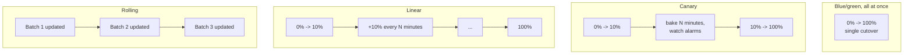
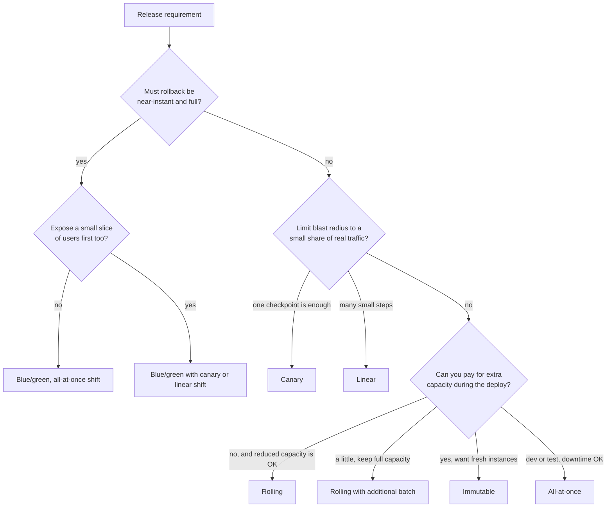
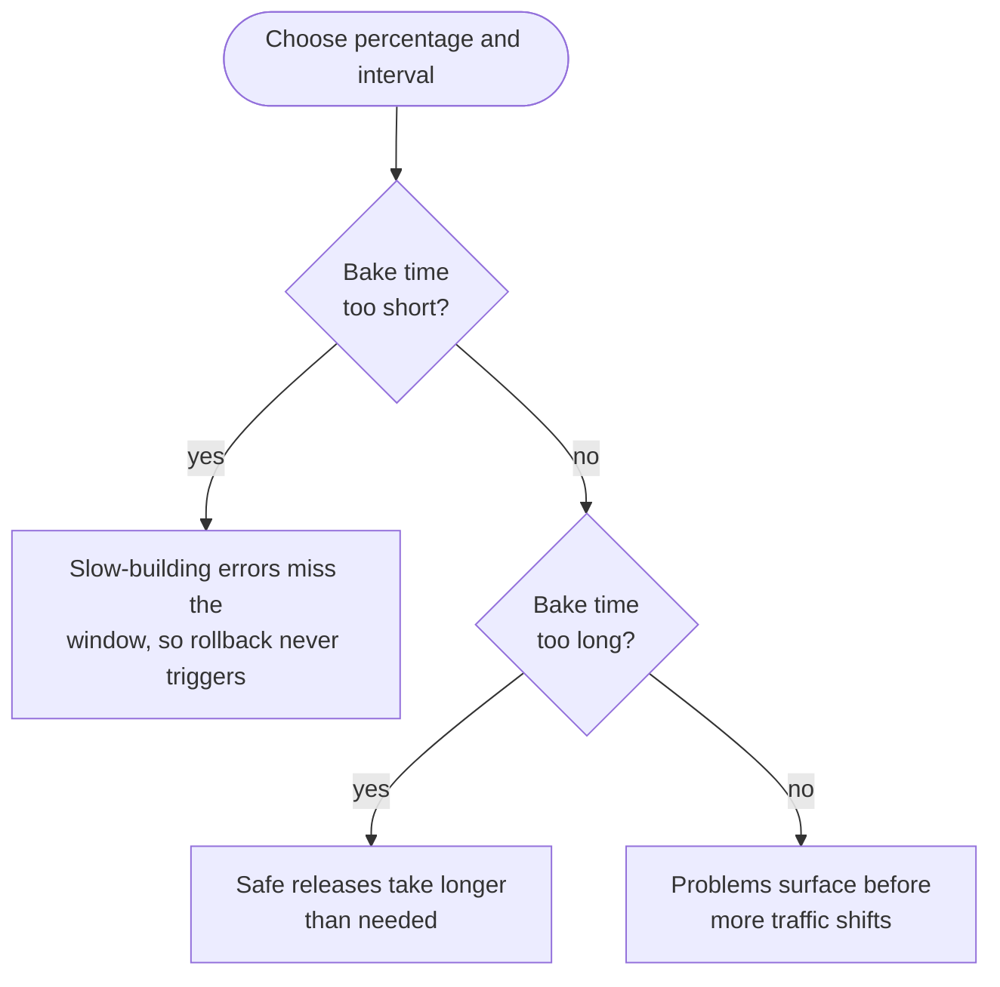

# 3.3.6 Choose and implement blue/green, canary, or rolling deployment strategies

**Domain 3 · Task 3.3 · Skill 3.3.6** · [Task overview](README.md) · Previous: [3.3.5 CodePipeline release promotion](3.3.5-codepipeline-release-promotion.md) · Next: [3.3.7 Rollback](3.3.7-rollback.md)

## What the exam expects

A deployment strategy decides how fast, and in what pattern, a new version starts receiving real users. Each strategy trades downtime, extra capacity cost, blast radius, and rollback speed differently. Questions describe a requirement ("instant rollback", "no extra cost", "10% of users first", "full capacity during the deploy") and a platform (AWS Lambda, Amazon Elastic Container Service (Amazon ECS), Amazon Elastic Compute Cloud (Amazon EC2), AWS Elastic Beanstalk, Amazon API Gateway), and ask which strategy and which AWS setting implements it.

You must be able to:

- Compare all-at-once, rolling, rolling with an additional batch, immutable, blue/green, canary, and linear on downtime, cost, blast radius, and rollback speed.
- Pick the AWS CodeDeploy compute platform and the predefined deployment configuration that matches a scenario, and read configuration names such as `CodeDeployDefault.LambdaCanary10Percent5Minutes`.
- Implement gradual Lambda deployments with AWS Serverless Application Model (AWS SAM) `AutoPublishAlias` and `DeploymentPreference`, or by hand with a weighted alias.
- Choose between ECS rolling updates, ECS built-in blue/green, linear, and canary deployments, and CodeDeploy blue/green.
- Match AWS Elastic Beanstalk deployment policies to requirements.
- Recognize canary features outside CodeDeploy: API Gateway canary release, AWS AppConfig deployment strategies.

## Key terms

| Term | Meaning |
|---|---|
| In-place deployment | The new version is installed on the existing servers or tasks. No new infrastructure. |
| All-at-once | Every target is updated at the same moment. Fastest, with downtime or full exposure to a bad release. |
| Rolling | Targets are updated in batches. Old and new versions run side by side during the deploy. |
| Rolling with additional batch | A rolling deployment that first launches an extra batch so capacity never drops. Elastic Beanstalk term. |
| Immutable | The new version goes to brand-new instances; old instances are untouched until the new ones pass health checks. |
| Blue/green | Two full environments: blue (current) and green (new). Traffic moves to green; blue stays available for a fast switch back. |
| Canary | A small share of traffic goes to the new version, the deployment waits, then the rest shifts in one step. |
| Linear | Traffic shifts in equal increments at equal intervals until 100%. |
| Traffic shifting | Moving the share of requests between versions. On AWS this is done by a load balancer, a Lambda alias, or an API Gateway stage. |
| Bake time | The wait at a traffic step while alarms are watched before more traffic moves. |
| Blast radius | The share of users affected if the new version is bad. |
| Deployment configuration | The CodeDeploy rule set that defines the shape and speed of a deployment. |
| Deployment group | The CodeDeploy set of targets plus settings (configuration, alarms, rollback, load balancer). |
| Replacement task set | In ECS blue/green through CodeDeploy, the new set of tasks behind the second target group. |
| Test listener | An optional load balancer listener that sends test traffic to green before production traffic moves. |

## The strategies compared

| Strategy | Downtime | Extra capacity | Blast radius | Rollback speed | Mixed versions during deploy |
|---|---|---|---|---|---|
| All-at-once (in place) | Yes, while targets restart | None | 100% at once | Slow: redeploy the old version | No |
| Rolling | No, but reduced capacity | None | Grows batch by batch | Slow: roll each batch back | Yes |
| Rolling with additional batch | No, full capacity | One batch, temporarily | Grows batch by batch | Slow: redeploy | Yes |
| Immutable | No | Full second set of instances, temporarily | All new instances at once, but only after they pass health checks | Fast: terminate the new instances | Briefly |
| Blue/green | No | Full second environment during cutover | 100% at cutover (all-at-once shift) or gradual if combined with canary/linear | Fastest: route traffic back to blue | No (unless shifting gradually) |
| Canary | No | Small, plus the second target | Small slice first (for example 10%) | Fast: send the slice back | Yes, during the bake |
| Linear | No | Small, plus the second target | Grows in equal steps | Fast: shift back | Yes, during the ramp |

Rolling has no single point where you can flip back. Undoing it means rolling each batch back, which takes as long as the deploy. Blue/green keeps the old environment running and warm, so the undo is a routing change. Canary and linear are traffic-shaping options that usually run on top of a blue/green setup (two Lambda versions behind an alias, or two ECS task sets behind two target groups).



Blue/green's safety comes from the green environment being fully built and validated before the jump, not from the jump being gradual. Canary has one checkpoint, then a large jump. Linear is a staircase with many small steps: the longest total rollout, with the most chances to catch a problem.

### Choosing a strategy



| Scenario | Strategy | Reason |
|---|---|---|
| Payments or checkout service, a bad release must be undone within seconds | Blue/green | Only blue/green keeps a complete, warm copy of the old version to route back to |
| Public API with a risky response change, validate on real traffic first | Canary | Exposes a small slice, then waits for alarms before committing |
| High-traffic API where even a single 10%-to-100% jump feels too large | Linear | Many smaller steps with a checkpoint at each |
| Internal batch service, cost matters more than rollback speed | Rolling | No duplicate infrastructure; a mixed-version window is acceptable |
| Dev environment, fastest possible deploy | All-at-once | Downtime is acceptable |
| Release bundles a breaking database schema change | None of the traffic-shifting strategies alone | Two code versions will run against one schema during any gradual shift. Use a backward-compatible (expand, then contract) migration first |

## Where each strategy lives on AWS

| Strategy | AWS implementations |
|---|---|
| All-at-once | CodeDeploy `CodeDeployDefault.AllAtOnce` (EC2), `LambdaAllAtOnce`, `ECSAllAtOnce`; Elastic Beanstalk all at once |
| Rolling | CodeDeploy `HalfAtATime` and `OneAtATime` in-place (EC2); ECS rolling update; Amazon Elastic Kubernetes Service (Amazon EKS) `Deployment` rolling update; Elastic Beanstalk rolling and rolling with additional batch |
| Immutable | Elastic Beanstalk immutable (temporary Auto Scaling group) |
| Blue/green | CodeDeploy blue/green for EC2 and ECS; ECS built-in blue/green; Elastic Beanstalk environment URL swap (a Canonical Name (CNAME) swap); Lambda alias repoint; Route 53 weighted records |
| Canary | CodeDeploy `LambdaCanary...` and `ECSCanary...`; ECS built-in canary; SAM `DeploymentPreference: Canary...`; Lambda weighted alias; API Gateway canary release; Elastic Beanstalk traffic splitting; AppConfig deployment strategies (for configuration) |
| Linear | CodeDeploy `LambdaLinear...` and `ECSLinear...`; ECS built-in linear; SAM `DeploymentPreference: Linear...`; AppConfig linear strategy |

## CodeDeploy deployment types and configurations

CodeDeploy supports three compute platforms. The platform decides which deployment types exist.

| Compute platform | In-place | Blue/green | How traffic moves | Default configuration |
|---|---|---|---|---|
| EC2/on-premises | Yes | Yes: a replacement set of instances (for example a copied Auto Scaling group) behind the same load balancer | Instances are registered and deregistered in batches | `CodeDeployDefault.OneAtATime` |
| AWS Lambda | No | Always (traffic shifting on an alias) | Alias weights move between two versions | Chosen on the deployment group |
| Amazon ECS | No | Always (replacement task set) | Listener rules move traffic between two target groups | Chosen on the deployment group |

The deployment configuration is set on the deployment group and can be overridden when you create a deployment. One application can have several deployment groups (staging, production), each with its own configuration.

### Predefined configurations

**EC2/on-premises**: the configuration sets the minimum number of healthy hosts during an in-place deploy, and the batch size for rerouting during blue/green.

| Configuration | Behavior |
|---|---|
| `CodeDeployDefault.AllAtOnce` | As many instances as possible at once. Succeeds if at least one instance succeeds. |
| `CodeDeployDefault.HalfAtATime` | Up to half the instances at a time (rounded down). Succeeds if at least half succeed. |
| `CodeDeployDefault.OneAtATime` | One instance at a time. The default. Slowest, smallest availability impact. |
| Custom | Your own minimum healthy hosts value, as a count or percentage, optionally per Availability Zone. |

**Lambda**:

| Configuration | Behavior |
|---|---|
| `CodeDeployDefault.LambdaCanary10Percent5Minutes` | 10%, then the remaining 90% after 5 minutes |
| `CodeDeployDefault.LambdaCanary10Percent10Minutes` | 10%, then the rest after 10 minutes |
| `CodeDeployDefault.LambdaCanary10Percent15Minutes` | 10%, then the rest after 15 minutes |
| `CodeDeployDefault.LambdaCanary10Percent30Minutes` | 10%, then the rest after 30 minutes |
| `CodeDeployDefault.LambdaLinear10PercentEvery1Minute` | +10% every minute |
| `CodeDeployDefault.LambdaLinear10PercentEvery2Minutes` | +10% every 2 minutes |
| `CodeDeployDefault.LambdaLinear10PercentEvery3Minutes` | +10% every 3 minutes |
| `CodeDeployDefault.LambdaLinear10PercentEvery10Minutes` | +10% every 10 minutes |
| `CodeDeployDefault.LambdaAllAtOnce` | 100% immediately |

**ECS**:

| Configuration | Behavior |
|---|---|
| `CodeDeployDefault.ECSCanary10Percent5Minutes` | 10%, then the rest after 5 minutes |
| `CodeDeployDefault.ECSCanary10Percent15Minutes` | 10%, then the rest after 15 minutes |
| `CodeDeployDefault.ECSLinear10PercentEvery1Minutes` | +10% every minute |
| `CodeDeployDefault.ECSLinear10PercentEvery3Minutes` | +10% every 3 minutes |
| `CodeDeployDefault.ECSAllAtOnce` | 100% immediately |

The names follow a pattern: `<Platform><Shape><Percent><Interval>`, so you can decode an unfamiliar one. The ECS linear names end in `Minutes` even for one minute. With a Network Load Balancer, ECS supports only `ECSAllAtOnce`. You can create custom canary and linear configurations for Lambda and ECS, except when ECS blue/green is managed through CloudFormation, which accepts only the predefined ones.

### Same AppSpec, three strategies

For Lambda and ECS, the AppSpec file describes what to deploy and which hooks to run. The strategy is only the deployment configuration name.

```yaml
# appspec.yaml (Lambda)
version: 0.0
Resources:
  - OrdersFunction:
      Type: AWS::Lambda::Function
      Properties:
        Name: "orders-api"
        Alias: "live"
        CurrentVersion: "4"
        TargetVersion: "5"
Hooks:
  - BeforeAllowTraffic: "PreTrafficValidation"
  - AfterAllowTraffic: "PostTrafficValidation"
```

```bash
# Blue/green with an instant shift
aws deploy create-deployment-group \
  --application-name orders-api --deployment-group-name prod \
  --deployment-config-name CodeDeployDefault.LambdaAllAtOnce \
  --service-role-arn arn:aws:iam::123456789012:role/CodeDeployServiceRole

# Canary: change only the configuration name
#   --deployment-config-name CodeDeployDefault.LambdaCanary10Percent5Minutes
# Linear:
#   --deployment-config-name CodeDeployDefault.LambdaLinear10PercentEvery1Minute
```

A question about "switching this function from blue/green to canary" is testing whether you know it is a one-line configuration change, not a new AppSpec or new code. The Lambda AppSpec requires `Name`, `Alias`, `CurrentVersion`, and `TargetVersion`.

The ECS AppSpec names a task definition and the container and port the load balancer targets. Nothing is installed; CodeDeploy starts a replacement task set, validates it, and moves traffic.

```yaml
# appspec.yaml (ECS)
version: 0.0
Resources:
  - TargetService:
      Type: AWS::ECS::Service
      Properties:
        TaskDefinition: "arn:aws:ecs:us-east-1:123456789012:task-definition/orders-api:22"
        LoadBalancerInfo:
          ContainerName: "orders-api"
          ContainerPort: 8080
Hooks:
  - BeforeInstall: "PreInstallLambdaHook"
  - AfterInstall: "PostInstallLambdaHook"
  - AfterAllowTestTraffic: "SmokeTestLambdaHook"
  - BeforeAllowTraffic: "PreTrafficLambdaHook"
  - AfterAllowTraffic: "PostTrafficLambdaHook"
```

| Platform | Hooks you can script, in order |
|---|---|
| Lambda | `BeforeAllowTraffic`, `AfterAllowTraffic` |
| ECS | `BeforeInstall`, `AfterInstall`, `AfterAllowTestTraffic`, `BeforeAllowTraffic`, `AfterAllowTraffic` |
| EC2/on-premises | `ApplicationStop`, `BeforeInstall`, `AfterInstall`, `ApplicationStart`, `ValidateService`, plus traffic hooks with a load balancer. See [3.3.4 CodeDeploy](3.3.4-codedeploy.md) |

Lambda and ECS hooks are Lambda functions that must call `PutLifecycleEventHookExecutionStatus` with `Succeeded` or `Failed`. CodeDeploy fails the deployment if it is not notified within one hour.


*Source: [AWS CodeDeploy User Guide, "Deployments on an Amazon ECS compute platform"](https://docs.aws.amazon.com/codedeploy/latest/userguide/deployment-steps-ecs.html), Amazon Web Services.*


*Source: [AWS CodeDeploy User Guide, "Deployments on an EC2/On-Premises compute platform"](https://docs.aws.amazon.com/codedeploy/latest/userguide/deployment-steps-server.html), Amazon Web Services.*

The two diagrams show different mechanics. "Replacement task set", "target group", and "test listener" describe the ECS traffic-shifting model. "File copy" and "lifecycle scripts on an instance" describe the EC2 model.

## Lambda: gradual deployments

### SAM `AutoPublishAlias` and `DeploymentPreference`

SAM wraps CodeDeploy. You write a few lines in the template, and the SAM transform creates the alias, the CodeDeploy application, and a deployment group. No separate AppSpec file is needed.

```yaml
Transform: AWS::Serverless-2016-10-31
Resources:
  GetOrderFunction:
    Type: AWS::Serverless::Function
    Properties:
      CodeUri: src/get_order/
      Handler: app.handler
      Runtime: python3.13
      AutoPublishAlias: live            # publish a version and move the alias on each code change
      DeploymentPreference:
        Type: Canary10Percent5Minutes   # or Linear10PercentEvery1Minute, AllAtOnce, ...
        Alarms:
          - !Ref AliasErrorAlarm        # roll back if this alarm fires during the shift
        Hooks:
          PreTraffic: !Ref PreTrafficHookFunction    # maps to BeforeAllowTraffic
          PostTraffic: !Ref PostTrafficHookFunction  # maps to AfterAllowTraffic
```

SAM `DeploymentPreference` types: `Canary10Percent5Minutes`, `Canary10Percent10Minutes`, `Canary10Percent15Minutes`, `Canary10Percent30Minutes`, `Linear10PercentEvery1Minute`, `Linear10PercentEvery2Minutes`, `Linear10PercentEvery3Minutes`, `Linear10PercentEvery10Minutes`, `AllAtOnce`.

- `AutoPublishAlias` detects new code from a change in the function's code location, publishes a version, and points the alias at it. Callers must invoke the alias (`function:live`), not `$LATEST`, to get the gradual shift.
- CodeDeploy needs an earlier version to shift from. For a brand-new function, deploy once with `AutoPublishAlias` only, then add `DeploymentPreference`.
- A failed pre-traffic or post-traffic hook, or an alarm entering `ALARM`, rolls the deployment back. See [3.3.7 Rollback](3.3.7-rollback.md).
- If the canary slice hits cold starts, add provisioned concurrency to the new version. Provisioned concurrency and traffic shifting are separate features you combine yourself.

### Weighted alias by hand

An alias can point to at most two versions with weights. This is the mechanism CodeDeploy drives for you.

```bash
aws lambda publish-version --function-name orders-api --description "commit 3f9c2ab"

# 95% to version 4, 5% to version 5
aws lambda update-alias --function-name orders-api --name live \
  --function-version 4 \
  --routing-config '{"AdditionalVersionWeights": {"5": 0.05}}'

# Promote: all traffic to version 5, clear the weights
aws lambda update-alias --function-name orders-api --name live \
  --function-version 5 \
  --routing-config '{"AdditionalVersionWeights": {}}'
```

Weighted alias rules:

- Both versions must be published. The alias cannot point to `$LATEST`.
- Both versions must have the same execution role and the same dead-letter queue configuration (or none).
- Routing is probabilistic, so low traffic shows large variance from the configured weight.
- To see which version served a request, use the `ExecutedVersion` metric dimension, the `Version` field in the `START` log line, or the `x-amz-executed-version` response header on synchronous calls.
- An alias cannot point to another alias.

A hand-built weighted alias gives you a canary with no alarms, hooks, or automatic rollback. Use CodeDeploy (directly or through SAM) when the scenario asks for automatic rollback or validation hooks.

## Containers: ECS and EKS

| Option | Deployment controller | Shapes | Notes |
|---|---|---|---|
| ECS rolling update | `ECS` | Rolling | Default. `minimumHealthyPercent` (default 100) and `maximumPercent` (default 200) control how many tasks may be below desired count or above it. Deployment circuit breaker and CloudWatch alarms can roll back. |
| ECS built-in blue/green, linear, canary | `ECS` | Blue/green, linear, canary | Native since 2025. Lifecycle hooks are Lambda functions or pause points; a bake time keeps blue running after production traffic shifts. Works with load balancers, Service Connect, or VPC Lattice. |
| CodeDeploy blue/green | `CODE_DEPLOY` | All-at-once, canary, linear | Two target groups, production listener, optional test listener, AppSpec hooks. Requires an Application Load Balancer or Network Load Balancer. |
| EKS `Deployment` | Kubernetes | Rolling | `maxSurge` and `maxUnavailable` control the pace. `maxUnavailable: 0` keeps full capacity. Readiness probes gate traffic to new pods. |

Container deployment mechanics (task definitions, `imagedefinitions.json` vs `imageDetail.json`, manifests, Fargate) are covered in [3.3.2 Container deployments](3.3.2-container-deployments.md).

## Elastic Beanstalk deployment policies

| Policy | Downtime or impact | Extra cost | Deploy time | Rollback | Code goes to |
|---|---|---|---|---|---|
| All at once (default) | Downtime | None | Fastest | Manual redeploy | Existing instances |
| Rolling | One batch out of service; reduced capacity | None | Long | Manual redeploy | Existing instances |
| Rolling with additional batch | Full capacity | Small (one extra batch) | Longer | Manual redeploy | New and existing instances |
| Immutable | Zero downtime | High (double, temporarily) | Longest | Terminate the new instances | New instances in a temporary Auto Scaling group |
| Traffic splitting | A set percentage of traffic to the new version for an evaluation period | High (double, temporarily) | Long | Automatic: traffic moves back and new instances are terminated | New instances in a temporary Auto Scaling group |
| Blue/green (not a deployment policy) | Zero downtime | High (two environments) | Varies | Swap URLs back | A separate, cloned environment |

- The console default is all at once. Environments created with the Elastic Beanstalk command line interface (EB CLI) that are scalable (not `--single`) default to rolling.
- Traffic splitting requires an Application Load Balancer.
- Blue/green on Elastic Beanstalk means cloning the environment, deploying v2 to the clone, testing it, then swapping environment URLs (a CNAME swap) with `eb swap` or `aws elasticbeanstalk swap-environment-cnames`. Route 53 weighted records can send part of the traffic to green first.
- Immutable and traffic splitting replace instances, so accumulated EC2 burst balances (T-instance CPU credits) are lost. All at once and rolling keep them.
- Keep production databases outside the Beanstalk environment. A database created inside the environment is deleted with it, which breaks a blue/green swap.

```yaml
# .ebextensions/deploy.config
option_settings:
  aws:elasticbeanstalk:command:
    DeploymentPolicy: RollingWithAdditionalBatch   # AllAtOnce | Rolling | Immutable | TrafficSplitting
    BatchSizeType: Fixed
    BatchSize: 5
```

Keyword decoder: fastest, dev, downtime OK → all at once. No extra cost, reduced capacity OK → rolling. Full capacity, small cost → rolling with additional batch. Zero downtime, safest, quickest rollback on failure → immutable. Percentage of traffic with automatic rollback → traffic splitting. Separate environment and URL swap → blue/green.

## Canary features outside CodeDeploy

### API Gateway canary release

A REST application programming interface (API) stage can carry canary settings: a second deployment, a percentage of the stage's traffic (0.0 to 100.0) routed to it, and stage variable overrides (for example pointing the canary at a different Lambda alias). Clients keep using the same stage URL. Canary requests get their own log groups with a `/Canary` suffix, so you can compare them. When metrics look good, promote the canary to the stage's deployment; otherwise turn it off. Stages and stage variables are covered in [3.1.5 API Gateway stages and endpoints](../task-3.1-prepare-deployable-artifacts/3.1.5-api-gateway-stages-and-endpoints.md).

### AppConfig deployment strategies

AppConfig applies the same idea to configuration and feature flags, not code. A deployment strategy sets the growth type (linear or exponential), growth factor, deployment duration, and final bake time, and an associated CloudWatch alarm rolls the configuration back automatically. See [3.1.4 Environment-specific configuration](../task-3.1-prepare-deployable-artifacts/3.1.4-environment-specific-configuration.md).

## Tuning bake time



A failure that takes longer than five minutes to appear (a slow memory leak, a nightly batch path) needs a longer interval or a custom configuration. An alarm that is too sensitive for normal traffic variance rolls back healthy releases.

## Exam triggers

| Scenario clue | Answer | Why the alternatives are wrong |
|---|---|---|
| "Near-zero downtime and instant, full rollback; brief double cost is acceptable" | Blue/green | Rolling has no single flip-back point; canary still needs a shift back and exposes users first |
| "Send 10% of traffic to the new Lambda version, then the rest after 5 minutes, roll back on errors" | `LambdaCanary10Percent5Minutes` (or SAM `Canary10Percent5Minutes`) with alarms | A weighted alias alone has no alarm-driven rollback |
| "Increase traffic to the new version by 10% every minute" | `LambdaLinear10PercentEvery1Minute` or `ECSLinear10PercentEvery1Minutes` | Canary makes one jump after one wait |
| "Deploy to an EC2 fleet one instance at a time" | CodeDeploy in-place, `CodeDeployDefault.OneAtATime` | `HalfAtATime` takes half the fleet down |
| "Canary traffic shifting for an ECS service" | CodeDeploy blue/green with an `ECSCanary...` configuration, or ECS built-in canary | ECS rolling updates replace tasks; they do not split traffic by percentage |
| "Beanstalk: zero downtime, full capacity, lowest extra cost" | Rolling with additional batch | Immutable doubles capacity; rolling reduces capacity |
| "Beanstalk: safest deployment, quick rollback if the new instances fail" | Immutable | Rolling leaves mixed versions after a failure |
| "Beanstalk: test the new version on 10% of traffic with automatic rollback" | Traffic splitting | Blue/green swap moves 100% at once |
| "Beanstalk: switch from v1 environment to v2 environment by URL" | Blue/green with CNAME swap | Deployment policies update one environment |
| "Route 5% of API requests to a new deployment without changing client URLs" | API Gateway canary release on the stage | A second stage has a different URL; usage plans do not split traffic |
| "Roll out a feature flag to 10% of users with automatic rollback" | AppConfig deployment strategy plus alarm | Parameter Store flips 100% instantly with no rollout |
| "Change the strategy from blue/green to canary" | Change the deployment configuration name only | The AppSpec and code stay the same |
| "Release includes a non-backward-compatible schema change" | Expand-and-contract migration before any gradual shift | Canary and linear run both code versions against one schema |

## Common traps

- Choosing rolling for "instant rollback". Rolling sounds safe, but undoing it is as slow as the deploy.
- Writing ECS linear configurations as `ECSLinear10PercentEvery1Minute`. The real names are `ECSLinear10PercentEvery1Minutes` and `ECSLinear10PercentEvery3Minutes`; ECS canary options are 5 and 15 minutes, not 30.
- Believing CodeDeploy has no blue/green for EC2. It does: a replacement set of instances behind the same load balancer. It is Lambda that has no in-place option, and ECS that supports only blue/green under CodeDeploy.
- Pointing the weighted alias at `$LATEST`. Both versions must be published.
- Invoking `$LATEST` or a version Amazon Resource Name (ARN) while SAM shifts the alias. Only callers of the alias see the gradual shift.
- Expecting the first SAM gradual deployment of a new function to shift traffic. There is no earlier version yet.
- Tearing down blue early to save cost. Blue/green's fast rollback depends on blue staying untouched until green is confirmed.
- Expecting immutable or traffic splitting to keep T-instance CPU credit balances. They launch new instances.
- Creating the production Amazon Relational Database Service (Amazon RDS) database inside the Beanstalk environment, then deleting the old environment after a swap.
- Treating a canary as safe for a breaking schema change.

## Quick recall

- Fastest rollback: blue/green. Smallest blast radius: canary or linear. No extra cost: rolling or all-at-once.
- CodeDeploy EC2 default: `OneAtATime`. EC2 supports in-place and blue/green; Lambda and ECS are always traffic-shifting blue/green.
- Lambda canary: 10% then the rest after 5, 10, 15, or 30 minutes. Lambda linear: 10% every 1, 2, 3, or 10 minutes.
- ECS canary: 5 or 15 minutes. ECS linear: every 1 or 3 minutes (`...Minutes`). Network Load Balancer: `ECSAllAtOnce` only.
- Strategy is a deployment configuration on the deployment group; the AppSpec does not change.
- SAM: `AutoPublishAlias` + `DeploymentPreference` (`Type`, `Alarms`, `Hooks.PreTraffic`, `Hooks.PostTraffic`).
- Weighted alias: two published versions, same role and dead-letter queue, no `$LATEST`.
- Hooks must call `PutLifecycleEventHookExecutionStatus` within one hour.
- Beanstalk: all at once (default), rolling, rolling with additional batch, immutable, traffic splitting; blue/green = CNAME swap.
- API Gateway REST canary: percentage of stage traffic plus stage variable overrides, then promote.

## Related skills

- [3.3.2 Container deployments](3.3.2-container-deployments.md): ECS task definitions, rolling update settings, EKS manifests.
- [3.3.3 Infrastructure as code deployment](3.3.3-infrastructure-as-code-deployment.md): SAM and CloudFormation templates that carry `DeploymentPreference`.
- [3.3.4 CodeDeploy](3.3.4-codedeploy.md): applications, deployment groups, the agent, EC2 AppSpec hooks.
- [3.3.5 CodePipeline release promotion](3.3.5-codepipeline-release-promotion.md): pipeline deploy actions that start these deployments.
- [3.3.7 Rollback](3.3.7-rollback.md): what happens when an alarm or hook fails during a shift.
- [3.2.4 Isolated test environments](../task-3.2-test-applications/3.2.4-isolated-test-environments.md): Lambda versions and aliases as environment pointers.
- [3.1.4 Environment-specific configuration](../task-3.1-prepare-deployable-artifacts/3.1.4-environment-specific-configuration.md): AppConfig deployment strategies for feature flags.
- [4.2.5 Health checks and probes](../../domain-4-troubleshooting-and-optimization/task-4.2-observability/4.2.5-health-checks-and-probes.md): the health signals that gate each step.

## Sources

- Merged from: `archive/dva-c03/domain-3-testing-deployment/blue-green-canary-linear-deployment-strategies.md`, `archive/dva-c03/domain-3-testing-deployment/README.md`, `archive/dva-c03/domain-3-testing-deployment/MASTER-CHUNK.md` (CodeDeploy, SAM, ECS, AppConfig sections), `archive/dva-c03-study-notes/03-testing-deployment.md` (skills 3.3.4 and 3.3.6), `archive/aws-dva-notes/Markdown Files/14. Elastic Beanstalk.md`, `archive/aws-dva-notes/Markdown Files/18. Serverless - Lambda.md`, `archive/aws-dva-notes/Markdown Files/21. CICD - CodeCommit, CodePipeline, CodeBuild, CodeDeploy.md`, `archive/aws-dva-notes/Markdown Files/30. AI Services & Security (DVA-C03).md`, `archive/dva-c03/exam-bank/bank-2.md` and `bank-3.md` (traps only)
- AWS documentation: [Working with deployment configurations in CodeDeploy](https://docs.aws.amazon.com/codedeploy/latest/userguide/deployment-configurations.html)
- AWS documentation: [AppSpec "hooks" section](https://docs.aws.amazon.com/codedeploy/latest/userguide/reference-appspec-file-structure-hooks.html)
- AWS documentation: [Implement Lambda canary deployments using a weighted alias](https://docs.aws.amazon.com/lambda/latest/dg/configuring-alias-routing.html)
- AWS documentation: [Deploying serverless applications gradually with AWS SAM](https://docs.aws.amazon.com/serverless-application-model/latest/developerguide/automating-updates-to-serverless-apps.html)
- AWS documentation: [Amazon ECS blue/green deployments](https://docs.aws.amazon.com/AmazonECS/latest/developerguide/deployment-type-blue-green.html), [Creating an Amazon ECS canary deployment](https://docs.aws.amazon.com/AmazonECS/latest/developerguide/deploy-canary-service.html)
- AWS documentation: [Elastic Beanstalk deployment policies and settings](https://docs.aws.amazon.com/elasticbeanstalk/latest/dg/using-features.rolling-version-deploy.html)
- AWS documentation: [Set up an API Gateway canary release deployment](https://docs.aws.amazon.com/apigateway/latest/developerguide/canary-release.html)
