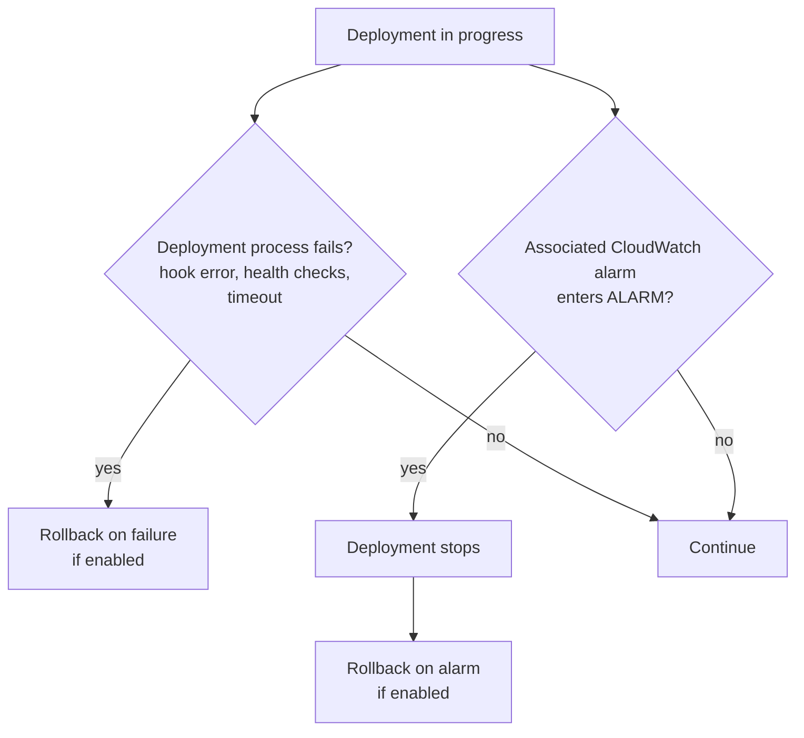

# 3.3.7 Configure automatic or manual rollback through services such as CloudFormation and CodeDeploy

**Domain 3 · Task 3.3 · Skill 3.3.7** · [Task overview](README.md) · Previous: [3.3.6 Deployment strategies](3.3.6-deployment-strategies.md) · Next: [3.3.8 Versions and releases](3.3.8-versions-and-releases.md)

## What the exam expects

Every deployment service on AWS has its own way to return to the last known good state, and its own trigger for doing it automatically. Questions describe a bad release ("errors spiked after deploy", "stack stuck in `UPDATE_ROLLBACK_FAILED`", "rollback didn't happen") and ask which setting rolls it back, why it did not, or how to undo it by hand.

You must be able to:

- Configure AWS CodeDeploy automatic rollback on deployment failure and on Amazon CloudWatch alarms, and explain why an alarm alone only stops a deployment.
- Explain AWS CloudFormation's default rollback, rollback triggers, and recovery from `UPDATE_ROLLBACK_FAILED`.
- Roll back AWS Lambda aliases, Amazon Elastic Container Service (Amazon ECS) services, Amazon API Gateway stages, AWS Elastic Beanstalk environments, and AWS CodePipeline stages.
- Choose between automatic rollback (alarm or failure driven) and manual rollback (redeploy a known good revision).
- Recognize what rollback does not undo: data changes and side effects of scripts.

## Key terms

| Term | Meaning |
|---|---|
| Rollback | Returning a workload to its last known good version. On most AWS services this is a new deployment of the old revision, not a restore. |
| Automatic rollback | A rollback the service starts by itself when a failure or alarm condition is met. |
| Manual rollback | A rollback you start: redeploy an earlier revision, repoint an alias, swap URLs back, or update a stack with the previous template. |
| Deployment-failure trigger | Rollback because the deployment process itself failed (a hook script exited non-zero, instances failed health checks). |
| Alarm trigger | Rollback because a CloudWatch alarm associated with the deployment entered `ALARM`. Catches "deployed fine, now failing in production". |
| Last known good revision | The most recent revision that deployed successfully. CodeDeploy redeploys it during a rollback. |
| Rollback trigger (CloudFormation) | A CloudWatch alarm that CloudFormation watches during a stack operation and for a monitoring period after it. |
| Monitoring time | The period after a CloudFormation stack operation during which rollback triggers are still watched (0 to 180 minutes). |
| Deployment circuit breaker | ECS rolling-update feature that marks a deployment `FAILED` when tasks repeatedly fail to start or pass health checks, and optionally rolls back. |
| Stage rollback | CodePipeline V2 feature that reruns a stage with the artifacts and variables of an earlier successful execution. |

## Two kinds of trigger



- A failure trigger catches a broken deployment process. It does not catch a release that deployed cleanly and then produced errors.
- An alarm trigger catches a healthy-looking deployment that hurts users. It works only if the alarm is attached to the deployment (deployment group, stack operation, ECS service, AppConfig environment) and watches the right metric.
- Both are configuration you add. When a scenario says "the new version was clearly broken but nothing rolled back", check whether an alarm was associated and whether rollback on alarm was enabled.

## CodeDeploy rollback

CodeDeploy rolls back by redeploying the last known good revision as a new deployment, with a new deployment ID. It does not restore the old deployment.

### Configuration

| Setting | Where | Effect |
|---|---|---|
| Alarms (up to 10 per deployment group) | Deployment group | If any alarm is activated, the deployment stops with status `Stopped`. The CodeDeploy service role needs CloudWatch permissions to read alarms. |
| Roll back when a deployment fails | Deployment group, or override per deployment | Redeploys the last known good revision after a failure |
| Roll back when alarm thresholds are met | Deployment group, or override per deployment | Redeploys the last known good revision after an alarm stops the deployment |
| Disable rollbacks | Deployment group | Temporarily turns rollback off without losing the settings |
| Ignore alarm configuration | Deployment group | Temporarily stops alarm monitoring |
| Continue deployments even if alarm status is unavailable | Deployment group | Proceeds if CodeDeploy cannot read alarm state (`ignorePollAlarmFailure`) |
| Amazon Simple Notification Service (Amazon SNS) triggers | Deployment group | Notify on events such as a rollback |

An alarm alone stops the deployment. It rolls back only if "roll back when alarm thresholds are met" is also enabled.

```bash
aws deploy update-deployment-group \
  --application-name orders-api \
  --current-deployment-group-name prod \
  --alarm-configuration 'enabled=true,alarms=[{name=orders-5xx-rate},{name=orders-p99-latency}]' \
  --auto-rollback-configuration 'enabled=true,events=DEPLOYMENT_FAILURE,DEPLOYMENT_STOP_ON_ALARM'

# Stop a running deployment and roll it back
aws deploy stop-deployment --deployment-id d-EXAMPLE111 --auto-rollback-enabled
```

The rollback events are `DEPLOYMENT_FAILURE`, `DEPLOYMENT_STOP_ON_ALARM`, and `DEPLOYMENT_STOP_ON_REQUEST`.

### How rollback behaves per platform

| Platform | What rollback does | Speed |
|---|---|---|
| Lambda | Moves the alias weight back to the original version | Seconds |
| ECS (CodeDeploy blue/green) | Reroutes the listener back to the original task set, if it has not been terminated | Seconds |
| Amazon Elastic Compute Cloud (Amazon EC2) blue/green | Reroutes the load balancer back to the original instances, if they were kept | Fast |
| EC2 in-place | Redeploys the old revision to every instance, running all lifecycle hooks again | As slow as a deployment |

For EC2 in-place rollbacks, CodeDeploy first removes the files the last successful deployment installed (it tracks them in a cleanup file). It does not undo what your scripts did, such as files they created or database changes they made. Write hook scripts so they can run again safely.

### Hooks and failures

- Lambda and ECS hook functions must call `PutLifecycleEventHookExecutionStatus` with `Succeeded` or `Failed`. A `Failed` status fails the deployment and triggers rollback on failure. No call within one hour also fails the deployment.
- A hook that runs its checks but never reports status makes a canary look stuck until that timeout.
- EC2 hook scripts have a `timeout` (default and maximum 3600 seconds per lifecycle event). A non-zero exit fails the deployment on that instance.
- A failing `ApplicationStop` script from the previous revision blocks new deployments and rollbacks. Deploy with `--ignore-application-stop-failures` to get past it.

```python
# Post-traffic hook (Lambda) that reports a result to CodeDeploy
import os
import urllib.request
import boto3

codedeploy = boto3.client("codedeploy")
HEALTH_URL = os.environ["HEALTH_URL"]  # endpoint served by the new version


def handler(event, context):
    status = "Succeeded"
    try:
        with urllib.request.urlopen(HEALTH_URL, timeout=5) as resp:
            if resp.status != 200:
                status = "Failed"
    except Exception:
        status = "Failed"

    codedeploy.put_lifecycle_event_hook_execution_status(
        deploymentId=event["DeploymentId"],
        lifecycleEventHookExecutionId=event["LifecycleEventHookExecutionId"],
        status=status,
    )
    return status
```

The hook function's execution role needs `codedeploy:PutLifecycleEventHookExecutionStatus`.

### Manual rollback

Create a new deployment that uses a previously deployed revision. Use this when automatic rollback was off, or when the application is in an unknown state and redeploying a known good revision is faster than troubleshooting.

### SAM gradual deployments

AWS Serverless Application Model (AWS SAM) `DeploymentPreference` creates the CodeDeploy deployment group for you. If a `PreTraffic` or `PostTraffic` hook fails, or an alarm in `Alarms` fires during the shift, CodeDeploy rolls the alias back to the previous version.

Pick alarms that see the new version. The SAM documentation example uses two: one on the alias's errors and one on the newest version's errors. Lambda publishes metrics by alias (the `Resource` dimension, `function:alias`) and by `ExecutedVersion`. An alarm on the whole function, with a threshold sized for full traffic, can miss errors from a 10% canary slice.

## CloudFormation rollback

### Default behavior

| Operation fails | Default result | Final state | What you do next |
|---|---|---|---|
| Stack creation | All created resources are deleted | `ROLLBACK_COMPLETE` | Read the stack events, fix the template, delete the stack, and create it again. A stack in `ROLLBACK_COMPLETE` can only be deleted. |
| Stack update | Resources return to the previous working state | `UPDATE_ROLLBACK_COMPLETE` | Fix the template and update again |
| Rollback of an update fails | Stack is stuck | `UPDATE_ROLLBACK_FAILED` | Fix the cause (often a resource changed outside CloudFormation), then run `continue-update-rollback`, optionally with `--resources-to-skip` |

```bash
aws cloudformation continue-update-rollback \
  --stack-name orders-stack \
  --resources-to-skip OrdersQueuePolicy

# Cancel an update that is still in progress; CloudFormation rolls it back
aws cloudformation cancel-update-stack --stack-name orders-stack
```

### Rollback triggers

Rollback triggers make CloudFormation roll back a create or update when a CloudWatch alarm fires, even if every resource deployed successfully.

- Up to 5 triggers, each a CloudWatch alarm or composite alarm Amazon Resource Name (ARN).
- Monitoring time from 0 (default for stack operations) to 180 minutes. CloudFormation watches the alarms during the operation and for this period after all resources deploy. During an update, old resources are cleaned up only after the monitoring period passes without an alarm.
- Only the `ALARM` state triggers rollback. To roll back on `INSUFFICIENT_DATA`, set the alarm to treat missing data as breaching.
- If a listed alarm does not exist, the whole operation fails and rolls back.
- Triggers are not watched while CloudFormation is already rolling back.

```bash
aws cloudformation update-stack --stack-name orders-stack \
  --use-previous-template \
  --rollback-configuration \
  "RollbackTriggers=[{Arn=arn:aws:cloudwatch:us-east-1:123456789012:alarm:orders-5xx,Type=AWS::CloudWatch::Alarm}],MonitoringTimeInMinutes=15"
```

### Pausing rollback to troubleshoot

The "preserve successfully provisioned resources" option (`--disable-rollback` on `create-stack`, `update-stack`, or `execute-change-set`; `--on-failure DO_NOTHING` on create) keeps successfully provisioned resources when the operation fails. The stack stops in `CREATE_FAILED` or `UPDATE_FAILED`. You can then:

- **Retry** after fixing something outside the template, such as a missing AWS Identity and Access Management (IAM) permission.
- **Update** with a corrected template.
- **Roll back** to the last stable state with `aws cloudformation rollback-stack`. If there is no stable state, this deletes the stack.

Preserving resources is not supported for updates that replace a resource (immutable updates). CloudFormation express mode disables rollback by default; set `disableRollback` to `false` in `--deployment-config` to turn it back on.

### Manual rollback and protection

- A manual rollback is a stack update with the previous template and parameters. Keep templates in source control so the previous version is one commit away. See [3.3.8 Versions and releases](3.3.8-versions-and-releases.md).
- `DeletionPolicy: Retain` or `Snapshot` keeps data when a rollback deletes a resource. `RetainExceptOnCreate` retains on stack deletion but deletes resources created during a create that rolled back.
- A stack policy blocks updates (including replacement) to protected resources such as a production database.

## Rollback on other services

| Service | Automatic | Manual |
|---|---|---|
| Lambda | Through CodeDeploy or SAM `DeploymentPreference` (alarms, hooks) | Point the alias back to the previous version. Instant, because versions are immutable |
| ECS rolling update | Deployment circuit breaker with `rollback=true`; CloudWatch alarms in `deploymentConfiguration` with `rollback=true` | `update-service --task-definition family:previous-revision` |
| ECS blue/green (built-in or CodeDeploy) | Lifecycle hook failure or alarm returns traffic to blue during the bake time | Stop the deployment while blue still exists |
| Amazon Elastic Kubernetes Service (Amazon EKS) | None by default in Kubernetes | `kubectl rollout undo deployment/orders [--to-revision=N]` |
| API Gateway | None | Turn off the canary, or point the stage at an earlier deployment ID |
| Elastic Beanstalk | Immutable and traffic splitting terminate new instances that fail health checks | Deploy an earlier application version; swap CNAMEs back; `abort-environment-update` during a deploy |
| CodePipeline (V2) | Stage `onFailure` result `ROLLBACK`; stage conditions with a `CloudWatchAlarm` rule and a `Rollback` result | `aws codepipeline rollback-stage` to an earlier successful execution |
| AppConfig | Alarm on the environment rolls the configuration back during the deployment or bake | Deploy the previous configuration version |

### ECS details

The circuit breaker works only with the rolling update (`ECS`) deployment controller. It counts tasks that fail to reach `RUNNING` and tasks replaced for failing load balancer, AWS Cloud Map, or container health checks. The default threshold is 50% of desired count, clamped to between 3 and 200 failures. On failure it rolls back to the most recent deployment in `COMPLETED` state; if none exists, the deployment stalls.

```bash
aws ecs update-service --cluster prod --service orders \
  --deployment-configuration \
  "deploymentCircuitBreaker={enable=true,rollback=true},alarms={alarmNames=[orders-5xx],enable=true,rollback=true}"
```

The circuit breaker needs no alarm. It reacts to tasks that never become healthy. Alarm-based rollback catches tasks that are healthy but return errors. If an alarm is already in `ALARM` when a deployment starts, ECS ignores the alarms for that deployment. ECS sends `SERVICE_DEPLOYMENT_FAILED` events to Amazon EventBridge.

### API Gateway details

```bash
# Repoint the prod stage at an earlier deployment
aws apigateway update-stage --rest-api-id a1b2c3 --stage-name prod \
  --patch-operations op=replace,path=/deploymentId,value=xyz789
```

### CodePipeline details

- Stage rollback requires a V2 pipeline. It creates a new execution of type rollback that uses the source revisions, artifacts, and variables from the target execution.
- You cannot roll back a source stage, roll back to an execution that was itself a rollback, or roll back to an execution from an earlier pipeline structure version.
- Automatic rollback works only after the stage has had at least one successful execution.

```bash
aws codepipeline rollback-stage --pipeline-name orders-pipeline \
  --stage-name DeployProd \
  --target-pipeline-execution-id 7b1d0c2e-EXAMPLE
```

```yaml
# CloudFormation: roll the stage back automatically when it fails
- Name: DeployProd
  Actions:
    - Name: Deploy
      ActionTypeId: { Category: Deploy, Owner: AWS, Provider: CodeDeploy, Version: "1" }
      Configuration: { ApplicationName: orders-api, DeploymentGroupName: prod }
      InputArtifacts: [{ Name: BuildOutput }]
  OnFailure:
    Result: ROLLBACK
```

A pipeline stage rollback reruns the stage's deploy actions with old artifacts. CodeDeploy's own rollback happens inside one deployment. They can be combined: CodeDeploy rolls back during the shift, the action fails, and the pipeline stops before promoting to the next environment.

## Choosing automatic or manual

| Situation | Choose |
|---|---|
| Errors must be caught within minutes without a human watching | Automatic, alarm-driven (CodeDeploy, SAM, ECS alarms, CloudFormation rollback triggers, AppConfig) |
| Deployment scripts or health checks can fail | Automatic on failure |
| Problem found hours later, or the system is in an unknown state | Manual: redeploy the last known good revision |
| Need to inspect failed resources before cleaning up | CloudFormation preserve successfully provisioned resources, then retry, update, or roll back |
| Release changed data or schema | Plan a forward fix or a compensating migration; rollback does not restore data |

## Exam triggers

| Scenario clue | Answer | Why the alternatives are wrong |
|---|---|---|
| "Automatically roll back when the error-rate alarm fires after a CodeDeploy deployment" | Add the alarm to the deployment group and enable rollback when alarm thresholds are met | An alarm alone only stops the deployment; rollback on failure misses healthy-looking bad releases |
| "Deployment succeeded, errors spiked, nothing rolled back" | No alarm was associated with the deployment group (or rollback on alarm was off) | Deployment-failure rollback only covers process failures |
| "Roll back a CloudFormation update if an alarm fires within 30 minutes" | Rollback trigger with `MonitoringTimeInMinutes` 30 | Default rollback only covers resource failures |
| "Stack stuck in `UPDATE_ROLLBACK_FAILED`" | Fix the resource, then `continue-update-rollback` (skip resources if needed) | Deleting and recreating loses the stack; retrying the update is not allowed in this state |
| "Stack in `ROLLBACK_COMPLETE` after a failed create" | Delete the stack and create it again | It cannot be updated |
| "Keep successfully created resources to debug a failed stack" | Preserve successfully provisioned resources (`--disable-rollback`) | Default rollback deletes them |
| "Instantly revert a bad Lambda release" | Point the alias at the previous version | Redeploying code takes longer and creates a new version |
| "Roll back ECS tasks that never become healthy, without alarms" | Deployment circuit breaker with rollback | CodeDeploy alarms need alarm setup and a `CODE_DEPLOY` controller |
| "Roll back an ECS rolling deployment when 5xx errors rise" | ECS deployment alarms with `rollback=true` | The circuit breaker does not see errors from healthy tasks |
| "Canary stuck at 10% until it fails after an hour" | The hook never called `PutLifecycleEventHookExecutionStatus` | Alarms are not the cause; CodeDeploy waits for the hook |
| "Deployment fails at `ApplicationStop` during rollback" | The previous revision's stop script is broken; use `--ignore-application-stop-failures` | Rolling back again runs the same script |
| "Return a pipeline's production stage to the last good release" | CodePipeline V2 stage rollback | Rerunning the pipeline builds the latest commit again |

## Common traps

- Believing a CodeDeploy rollback restores the old deployment. It is a new deployment of the old revision with a new ID.
- Attaching an alarm and expecting a rollback. The alarm stops the deployment; the rollback setting must also be on.
- Using an alarm that watches the whole function or service at full-traffic thresholds during a 10% canary.
- Assuming a rollback undoes data. Rollback reverts code and infrastructure, not rows written by the new version or side effects of hook scripts.
- Terminating the original instances or task set immediately after a blue/green shift, which removes the fast rollback path.
- Expecting CloudFormation rollback triggers to fire on `INSUFFICIENT_DATA` without changing the alarm's missing-data treatment.
- Trying to update a stack in `ROLLBACK_COMPLETE`.
- Expecting Kubernetes to roll back a failed EKS deployment by itself.
- Expecting stage rollback on a V1 pipeline, or on the source stage.

## Quick recall

- CodeDeploy rollback = redeploy last known good revision as a new deployment.
- CodeDeploy: up to 10 alarms per deployment group; alarm stops the deployment; rollback on alarm is a separate setting. Events: `DEPLOYMENT_FAILURE`, `DEPLOYMENT_STOP_ON_ALARM`, `DEPLOYMENT_STOP_ON_REQUEST`.
- Hooks must report within one hour; EC2 script timeout max 3600 seconds per event.
- CloudFormation rolls back failed creates and updates by default. `UPDATE_ROLLBACK_FAILED` → `continue-update-rollback`.
- CloudFormation rollback triggers: up to 5 alarms, monitoring 0 to 180 minutes, `ALARM` state only.
- Preserve successfully provisioned resources = `--disable-rollback`; then retry, update, or `rollback-stack`.
- Lambda manual rollback: repoint the alias. ECS: circuit breaker or alarms with `rollback=true`. EKS: `kubectl rollout undo`.
- API Gateway: turn off the canary or repoint the stage's deployment ID. Beanstalk: earlier version or Canonical Name (CNAME) swap back.
- CodePipeline V2: stage `OnFailure: ROLLBACK`, `rollback-stage`; not for source stages.

## Related skills

- [3.3.6 Deployment strategies](3.3.6-deployment-strategies.md): the strategies whose rollback speed differs.
- [3.3.3 Infrastructure as code deployment](3.3.3-infrastructure-as-code-deployment.md): change sets, stack updates, `DeletionPolicy`.
- [3.3.4 CodeDeploy](3.3.4-codedeploy.md): deployment groups, AppSpec, agent logs.
- [3.3.5 CodePipeline release promotion](3.3.5-codepipeline-release-promotion.md): stages, approvals, and promotion that rollback protects.
- [3.3.8 Versions and releases](3.3.8-versions-and-releases.md): keeping the known good revision identifiable.
- [4.1.4 Diagnosing deployment failures](../../domain-4-troubleshooting-and-optimization/task-4.1-root-cause-analysis/4.1.4-diagnosing-deployment-failures.md): reading the events and logs that explain a rollback.
- [4.2.3 Alerts and notifications](../../domain-4-troubleshooting-and-optimization/task-4.2-observability/4.2.3-alerts-and-notifications.md): building the alarms that drive rollback.

## Sources

- Merged from: `archive/dva-c03-study-notes/03-testing-deployment.md` (skill 3.3.7), `archive/dva-c03/domain-3-testing-deployment/README.md` (rollback mechanics), `archive/dva-c03/domain-3-testing-deployment/MASTER-CHUNK.md` (CloudFormation, CodeDeploy, SAM, ECS, AppConfig sections), `archive/dva-c03/domain-3-testing-deployment/blue-green-canary-linear-deployment-strategies.md` (troubleshooting), `archive/aws-dva-notes/Markdown Files/15. CloudFormation.md`, `archive/aws-dva-notes/Markdown Files/21. CICD - CodeCommit, CodePipeline, CodeBuild, CodeDeploy.md`, `archive/aws-dva-notes/Markdown Files/14. Elastic Beanstalk.md`, `archive/aws-dva-notes/Markdown Files/18. Serverless - Lambda.md`, `archive/aws-dva-notes/Markdown Files/30. AI Services & Security (DVA-C03).md`, `archive/dva-c03/exam-bank/bank-2.md` (traps only)
- AWS documentation: [Redeploy and roll back a deployment with CodeDeploy](https://docs.aws.amazon.com/codedeploy/latest/userguide/deployments-rollback-and-redeploy.html)
- AWS documentation: [Configure advanced options for a deployment group](https://docs.aws.amazon.com/codedeploy/latest/userguide/deployment-groups-configure-advanced-options.html), [Monitoring deployments with CloudWatch alarms in CodeDeploy](https://docs.aws.amazon.com/codedeploy/latest/userguide/monitoring-create-alarms.html)
- AWS documentation: [AppSpec "hooks" section](https://docs.aws.amazon.com/codedeploy/latest/userguide/reference-appspec-file-structure-hooks.html)
- AWS documentation: [Roll back your CloudFormation stack on alarm breach with rollback triggers](https://docs.aws.amazon.com/AWSCloudFormation/latest/UserGuide/using-cfn-rollback-triggers.html)
- AWS documentation: [Choose how to handle failures when provisioning resources](https://docs.aws.amazon.com/AWSCloudFormation/latest/UserGuide/stack-failure-options.html)
- AWS documentation: [How the Amazon ECS deployment circuit breaker detects failures](https://docs.aws.amazon.com/AmazonECS/latest/developerguide/deployment-circuit-breaker.html), [How CloudWatch alarms detect Amazon ECS deployment failures](https://docs.aws.amazon.com/AmazonECS/latest/developerguide/deployment-alarm-failure.html)
- AWS documentation: [Configuring stage rollback](https://docs.aws.amazon.com/codepipeline/latest/userguide/stage-rollback.html), [Configure a stage for automatic rollback](https://docs.aws.amazon.com/codepipeline/latest/userguide/stage-rollback-auto.html), [Configure conditions for a stage](https://docs.aws.amazon.com/codepipeline/latest/userguide/stage-conditions.html)
- AWS documentation: [Deploying serverless applications gradually with AWS SAM](https://docs.aws.amazon.com/serverless-application-model/latest/developerguide/automating-updates-to-serverless-apps.html)
- AWS documentation: [Elastic Beanstalk deployment policies and settings](https://docs.aws.amazon.com/elasticbeanstalk/latest/dg/using-features.rolling-version-deploy.html)
