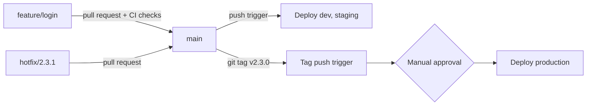

# 3.3.8 Manage versions and releases with source-control branches, labels, and related features

**Domain 3 · Task 3.3 · Skill 3.3.8** · [Task overview](README.md) · Previous: [3.3.7 Rollback](3.3.7-rollback.md) · Next: [3.3.9 AI-assisted deployment](3.3.9-ai-assisted-deployment.md)

## What the exam expects

A release is a specific, identifiable version of the code that you can deploy, promote, and roll back to. In Git, branches carry work in progress and tags (labels) mark releases. On AWS, the same idea appears as Lambda versions, container image tags, Elastic Beanstalk application versions, API Gateway deployments, and AWS AppConfig configuration versions. Questions ask how to start a pipeline only for releases, how to trace a running artifact back to a commit, and how to structure branches so the pipeline triggers correctly.

You must be able to:

- Use branches (main or trunk, feature, release, hotfix) and pull requests with checks to control what reaches the deployable branch.
- Mark releases with Git tags and semantic versions, and start an AWS CodePipeline V2 pipeline on tag pushes, branch pushes, pull requests, or file path changes.
- Carry the commit ID through the pipeline into image tags, Lambda version descriptions, and stack parameters.
- Map a Git release to the version features of each AWS service.
- Roll back from source control safely (revert, or rerun a known commit) without rewriting shared history.

## Key terms

| Term | Meaning |
|---|---|
| Branch | A movable pointer to a line of commits. `main` is usually the deployable branch. |
| Trunk-based development | Everyone merges small changes into `main` often; unfinished features hide behind feature flags. |
| GitFlow | Long-lived `develop` and `release/*` branches, each often mapped to an environment. |
| Pull request (PR) | A request to merge a branch, reviewed by people and checked by continuous integration (CI) before merge. |
| Branch protection | Repository rules that block direct pushes or merges without required reviews and passing status checks. |
| Tag (label) | A named, fixed pointer to one commit, used to mark a release such as `v2.3.0`. |
| Annotated tag | A tag stored as a Git object with author, date, and message. Preferred for releases. |
| Lightweight tag | A tag that is only a name for a commit, with no metadata. |
| Semantic versioning (SemVer) | `MAJOR.MINOR.PATCH`: major for breaking changes, minor for compatible features, patch for fixes. |
| Commit ID (SHA) | The hash that identifies a commit. The most precise link between an artifact and its source. |
| Immutable artifact | A build output that never changes after creation and is promoted unchanged between environments. |
| Source revision override | Starting a CodePipeline V2 execution with a specific commit, image digest, or Amazon S3 object version instead of the latest. |

## Branching strategies and pipeline triggers

| Model | Branches | Pipeline trigger | How unfinished work is hidden |
|---|---|---|---|
| Trunk-based | `main` plus short-lived feature branches | Every merge to `main` deploys to dev and staging; a tag (`v*`) or an approval promotes to production | Feature flags, for example AppConfig |
| GitFlow | `feature/*` → `develop` → `release/*` → `main`, plus `hotfix/*` | One trigger per long-lived branch, each mapped to an environment | Branch isolation |
| Release branches | `main` plus `release/x.y` cut for each release | Pushes to `release/**` build release candidates; tags on the release branch ship | Release branch freeze |



Trunk-based development triggers on every commit to `main`. Incomplete features ship dark behind flags, which is why it pairs with a feature-flag service such as AppConfig. GitFlow needs a trigger per long-lived branch and slows integration.

## Tags as release labels

```bash
git tag -a v2.3.0 -m "Release 2.3.0: order history API"
git push origin v2.3.0

git tag -l "v2.*"          # list release tags
git show v2.3.0            # tagger, date, message, and the commit it points to
```

- Use annotated tags for releases. They record who tagged, when, and why.
- Tags are not pushed by `git push` alone. Push them explicitly (`git push origin v2.3.0` or `--tags`).
- Never move a published release tag. If `v2.3.0` is broken, release `v2.3.1`.
- Use SemVer so consumers can tell a breaking release (`3.0.0`) from a fix (`2.3.1`).

## Starting pipelines from branches, tags, and pull requests

CodePipeline V2 pipelines support triggers with filters for Git sources connected through AWS CodeConnections (formerly AWS CodeStar Connections). V1 pipelines do not support Git tag or pull request triggers.

| Trigger type | Filter on | Commit used |
|---|---|---|
| Push | Branches, file paths, or Git tags | The commit on the branch pushed to, or the tagged commit |
| Pull request | Destination branches and file paths; events `OPEN`, `UPDATED`, `CLOSED` | The commit from the source branch |

Filters use glob patterns with include and exclude lists. If the same pattern is in both, exclude wins.

```yaml
# Release pipeline: production deploys only for release tags
pipeline:
  name: orders-release
  pipelineType: V2
  executionMode: QUEUED
  triggers:
    - providerType: CodeStarSourceConnection
      gitConfiguration:
        sourceActionName: Source
        push:
          - tags:
              includes: ["v*"]
              excludes: ["v*-rc*"]
```

```yaml
# CI pipeline in a monorepo: only build when this service's files change on main
  triggers:
    - providerType: CodeStarSourceConnection
      gitConfiguration:
        sourceActionName: Source
        push:
          - branches:
              includes: ["main"]
            filePaths:
              includes: ["services/orders/**"]
              excludes: ["**/README.md"]
        pullRequest:
          - events: ["OPEN", "UPDATED"]
            branches:
              includes: ["main"]
```

- The source action's `BranchName` is the default branch for manual starts. When branch filters are set, triggers decide which branches start the pipeline.
- A CodeConnections connection is created in `PENDING` status and must be completed in the console before use. The pipeline role needs permission to use the connection (`codeconnections:UseConnection`; older policies use the `codestar-connections` prefix).
- AWS CodeBuild webhooks offer the same filtering for builds outside a pipeline, for example a filter group with `EVENT` = `PUSH` and `HEAD_REF` = `^refs/tags/v.*`. Inside the build, `CODEBUILD_WEBHOOK_TRIGGER` shows what started it (such as `tag/v2.3.0` or `pr/42`) and `CODEBUILD_RESOLVED_SOURCE_VERSION` holds the commit ID.

Source stage setup, CodeConnections, and repository hygiene are covered in [3.1.3 Code repositories in deployment](../task-3.1-prepare-deployable-artifacts/3.1.3-code-repositories-in-deployment.md).

## Traceability: carry the commit ID through the pipeline

Give the source action a variable namespace, then reference its output variables in later actions.

```json
{
  "name": "Source",
  "namespace": "SourceVariables",
  "actionTypeId": { "category": "Source", "owner": "AWS", "provider": "CodeStarSourceConnection", "version": "1" },
  "configuration": {
    "ConnectionArn": "arn:aws:codeconnections:us-east-1:123456789012:connection/EXAMPLE",
    "FullRepositoryId": "example-org/orders",
    "BranchName": "main"
  },
  "outputArtifacts": [{ "name": "SourceOutput" }]
}
```

```json
{
  "name": "Build",
  "actionTypeId": { "category": "Build", "owner": "AWS", "provider": "CodeBuild", "version": "1" },
  "configuration": {
    "ProjectName": "orders-build",
    "EnvironmentVariables": "[{\"name\":\"COMMIT_ID\",\"value\":\"#{SourceVariables.CommitId}\",\"type\":\"PLAINTEXT\"}]"
  },
  "inputArtifacts": [{ "name": "SourceOutput" }]
}
```

```yaml
# buildspec.yml: tag the image with the commit, publish a Lambda version that names it
version: 0.2
phases:
  build:
    commands:
      - SHORT_SHA=$(echo "$COMMIT_ID" | cut -c1-7)
      # Container service: the image tag names the commit
      - docker build -t "$REPO_URI:$SHORT_SHA" .
      - docker push "$REPO_URI:$SHORT_SHA"
      # Lambda function: the version description names the commit
      - aws lambda update-function-code --function-name orders-api --s3-bucket "$ARTIFACT_BUCKET" --s3-key "orders/$SHORT_SHA.zip"
      - aws lambda wait function-updated --function-name orders-api
      - aws lambda publish-version --function-name orders-api --description "commit $COMMIT_ID"
```

With the commit ID in the image tag, the Lambda version description, a CloudFormation parameter, or an AppConfig version description, you can answer "what is running in production?" from the artifact alone.

## How a Git release maps to AWS version features

| Git concept | AWS feature | Mutable? | Release use |
|---|---|---|---|
| Commit | Amazon Elastic Container Registry (Amazon ECR) image digest (`sha256:...`) | No | Deploy by digest for exactness |
| Tag `v2.3.0` | ECR image tag with tag immutability enabled | No, once immutability is on | `v2.3.0` always means the same image |
| Tag `v2.3.0` | Lambda published version (with a description naming the commit) | No | The deployable unit; aliases point to it |
| Branch or environment pointer | Lambda alias (`dev`, `prod`) | Yes | Promote or roll back by moving the alias |
| Branch or environment pointer | ECR tag such as `prod` without immutability | Yes | Avoid for traceability; prefer version or SHA tags |
| Release | API Gateway deployment (snapshot) on a stage | Deployment: no. Stage: yes | Roll back by pointing the stage at an earlier deployment ID |
| Release | Elastic Beanstalk application version (version label plus source bundle in S3) | No | Deploy a label to an environment; redeploy an older label to roll back |
| Template in Git | CloudFormation stack, updated through change sets | Stack: yes | Manual rollback = update with the previous template from Git |
| Config release | AppConfig configuration version | No | Deploy a version with a strategy; roll back to the previous version |
| Library release | AWS CodeArtifact package version (status published, unlisted, archived, disposed) | Assets: no | Consumers pin versions; unlist or archive bad ones |

Details for the main ones:

- **Lambda.** `$LATEST` is the mutable working copy. `publish-version` creates an immutable numbered version with its own Amazon Resource Name (ARN). Aliases are mutable pointers with their own ARNs; triggers and application programming interface (API) integrations should target aliases. Full treatment in [3.2.4 Isolated test environments](../task-3.2-test-applications/3.2.4-isolated-test-environments.md).
- **ECR.** Tag with a version or commit SHA rather than only `latest`, enable tag immutability, and expire old images with lifecycle policies. Full treatment in [3.1.2 Container images and ECR](../task-3.1-prepare-deployable-artifacts/3.1.2-container-images-and-ecr.md).
- **Elastic Beanstalk.** Each upload creates an application version. Accounts have a quota on stored application versions per Region, shared across applications (the service notes give 1,000). When it is reached, new versions cannot be created, so deployments fail. Configure an application version lifecycle policy by age or count. It never deletes versions in use, can keep the source bundle in S3, and runs when a new version is created, so if you are already at the quota you must delete versions by hand first.
- **API Gateway.** A REST API change is not live until you create a deployment and associate it with a stage. Stage deployment history is the release history.

## Releasing and rolling back from source control

| Goal | Do | Avoid |
|---|---|---|
| Undo a bad merge on a shared branch | `git revert <commit>` and merge it; the pipeline deploys the revert like any change | `git reset` plus force push, which rewrites history others have pulled |
| Redeploy a known good release now | Start the pipeline with a source revision override for that commit | Re-tagging an old commit with a new name to trick the trigger |
| Restore the previous release of one stage | CodePipeline V2 stage rollback (see [3.3.7 Rollback](3.3.7-rollback.md)) | Rebuilding from the latest commit |
| Patch an old release line | Branch `hotfix/2.3.1` from tag `v2.3.0`, fix, tag `v2.3.1`, merge forward | Committing directly to the release tag's commit (tags do not move) |

```bash
# Run a specific commit through the pipeline (V2)
aws codepipeline start-pipeline-execution --name orders-release \
  --source-revisions actionName=Source,revisionType=COMMIT_ID,revisionValue=3f9c2ab1d4e5f60718293a4b5c6d7e8f90a1b2c3
```

Source revision types are `COMMIT_ID`, `IMAGE_DIGEST`, `S3_OBJECT_VERSION_ID`, and `S3_OBJECT_KEY`.

## Merge controls

- Protect `main`: require pull requests, a minimum number of approvals, and passing CI status checks (CodeBuild reports its status back to GitHub, GitLab, and Bitbucket for PR builds).
- Run unit tests, linting, and template validation on every pull request, before merge. A merge-time control stops unreviewed code before the pipeline ever sees it. A CodePipeline manual approval is a deploy-time control that stops a release before production. They solve different problems.
- Keep `buildspec.yml`, `appspec.yml`, and infrastructure as code (IaC) templates in the same repository as the code, so every release tag captures the full deployment definition.
- Never commit secrets. A commit stays in history even after a later commit deletes the file.

> **Not on the DVA-C03 service list.** AWS CodeCommit is a managed private Git service. AWS closed it to new customers in July 2024 and returned it to full general availability on November 24, 2025, but it is not on the DVA-C03 in-scope list. Features you may still see in older material: AWS Identity and Access Management (IAM)-controlled access (SSH keys or HTTPS Git credentials for IAM users, or the `git-remote-codecommit` helper with `codecommit::` URLs), cross-account access by assuming a role (never by sharing keys), approval rule templates that require N approvals before a pull request into `refs/heads/main` can merge, IAM conditions on `codecommit:References` to deny pushes to specific branches, and EventBridge `referenceUpdated` events when a branch or tag changes. CodePipeline can still use it as a source; moving to GitHub or GitLab through CodeConnections only changes the source stage.

```json
{
  "approvalRuleTemplateName": "require-two-approvals",
  "approvalRuleTemplateContent": "{\"Version\": \"2018-11-08\", \"DestinationReferences\": [\"refs/heads/main\"], \"Statements\": [{\"Type\": \"Approvers\", \"NumberOfApprovalsNeeded\": 2}]}"
}
```

## Exam triggers

| Scenario clue | Answer | Why the alternatives are wrong |
|---|---|---|
| "Deploy to production only when a release tag is pushed" | CodePipeline V2 push trigger with a Git tag filter (`v*`) | A branch trigger runs on every merge; V1 pipelines cannot filter tags |
| "Only run this service's pipeline when its folder changes in a monorepo" | V2 trigger with file path include filter | Separate repositories are not required; branch filters do not look at paths |
| "Run CI on every pull request into `main`" | V2 pull request trigger (or CodeBuild PR webhook) | A push trigger on `main` runs only after merge |
| "Identify which commit is running in production" | Tag images and Lambda versions with the commit SHA from `#{SourceVariables.CommitId}` | `latest` and `prod` tags move and lose history |
| "A released image tag must never point to a different image" | ECR tag immutability | Lifecycle policies delete; they do not protect tags |
| "Beanstalk deployments fail: too many application versions" | Application version lifecycle policy (delete old versions by hand first if already at the quota) | Creating a new environment does not reset an account-wide quota |
| "Hide unfinished features while everyone commits to `main`" | Trunk-based development with AppConfig feature flags | Long-lived branches delay integration |
| "Revert a bad change already merged and deployed" | `git revert` and let the pipeline deploy it | Force-pushing rewrites shared history |
| "Redeploy last week's release through the same pipeline" | Source revision override with that commit ID, or stage rollback | Manually building on a laptop skips the pipeline's checks |
| "Require two reviewers before code reaches `main`" | Branch protection (or a CodeCommit approval rule) | A CodePipeline manual approval acts after merge, before deployment |

## Common traps

- Confusing tags and branches. A branch moves with every commit; a tag stays on one commit.
- Forgetting to push tags, then wondering why the tag trigger never fired.
- Expecting Git tag or pull request triggers on a V1 pipeline.
- Moving a release tag to a new commit. Consumers and caches may already hold the old one.
- Relying on `latest` (ECR) or `$LATEST` (Lambda) as a release identifier.
- Treating a merge-time approval and a deploy-time approval as interchangeable.
- Rolling back with `git reset --hard` and a force push on a shared branch.
- Deleting Beanstalk application versions blindly. Versions in use are protected, but deleting the source bundle loses the ability to redeploy that release.
- Thinking CodeCommit is the required source for CodePipeline. GitHub, GitLab, and Bitbucket connect through CodeConnections; S3 and ECR are also sources.

## Quick recall

- Branches carry work; tags label releases. Use annotated tags and SemVer.
- CodePipeline V2 triggers: push (branches, file paths, tags) and pull request (branches, file paths; open, updated, closed). Exclude wins over include.
- Source revision override types: `COMMIT_ID`, `IMAGE_DIGEST`, `S3_OBJECT_VERSION_ID`, `S3_OBJECT_KEY`.
- Pass the commit with `#{SourceVariables.CommitId}`; in CodeBuild, `CODEBUILD_RESOLVED_SOURCE_VERSION`.
- Lambda: versions immutable, aliases mutable, `$LATEST` mutable working copy.
- ECR: version or SHA tags, tag immutability, digests for exact deploys.
- Beanstalk: application version quota per Region; lifecycle policy by age or count.
- Roll back shared history with `git revert`, not force push.
- Merge-time control (branch protection, approval rules) vs deploy-time control (CodePipeline manual approval).

## Related skills

- [3.1.3 Code repositories in deployment](../task-3.1-prepare-deployable-artifacts/3.1.3-code-repositories-in-deployment.md): connecting repositories to CodePipeline and CodeBuild.
- [3.1.2 Container images and ECR](../task-3.1-prepare-deployable-artifacts/3.1.2-container-images-and-ecr.md): image tags, immutability, lifecycle policies.
- [3.2.4 Isolated test environments](../task-3.2-test-applications/3.2.4-isolated-test-environments.md): Lambda aliases and image tags per environment.
- [3.3.5 CodePipeline release promotion](3.3.5-codepipeline-release-promotion.md): stages, approvals, and multi-environment promotion.
- [3.3.7 Rollback](3.3.7-rollback.md): using the versions identified here to roll back.
- [3.1.4 Environment-specific configuration](../task-3.1-prepare-deployable-artifacts/3.1.4-environment-specific-configuration.md): AppConfig feature flags for trunk-based development.

## Sources

- Merged from: `archive/dva-c03-study-notes/03-testing-deployment.md` (skills 3.1.3, 3.3.5, 3.3.8), `archive/dva-c03/domain-3-testing-deployment/MASTER-CHUNK.md` (CodeCommit, CodePipeline, ECR, ECS sections), `archive/dva-c03/domain-3-testing-deployment/README.md`, `archive/aws-dva-notes/Markdown Files/21. CICD - CodeCommit, CodePipeline, CodeBuild, CodeDeploy.md`, `archive/aws-dva-notes/Markdown Files/14. Elastic Beanstalk.md`, `archive/aws-dva-notes/Markdown Files/18. Serverless - Lambda.md`, `archive/aws-dva-notes/Markdown Files/15. CloudFormation.md`, `archive/aws-dva-notes/Markdown Files/30. AI Services & Security (DVA-C03).md`, `archive/dva-c03/exam-bank/bank-3.md` (branching traps only)
- AWS documentation: [What type of pipeline is right for me?](https://docs.aws.amazon.com/codepipeline/latest/userguide/pipeline-types-planning.html)
- AWS documentation: [Add trigger with code push or pull request event types](https://docs.aws.amazon.com/codepipeline/latest/userguide/pipelines-filter.html)
- AWS documentation: [Start a pipeline with a source revision override](https://docs.aws.amazon.com/codepipeline/latest/userguide/pipelines-trigger-source-overrides.html)
- AWS documentation: [Implement Lambda canary deployments using a weighted alias](https://docs.aws.amazon.com/lambda/latest/dg/configuring-alias-routing.html)
- AWS DevOps Blog: [AWS CodeCommit returns to general availability](https://aws.amazon.com/blogs/devops/aws-codecommit-returns-to-general-availability/)
