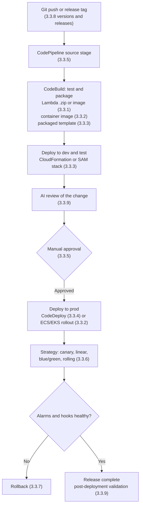

# Task 3.3: Deploy through AWS CI/CD services

**Domain 3 · Task 3.3** · [Domain overview](../README.md)

This task covers how a tested artifact reaches production on AWS. You package AWS Lambda functions and containers for Amazon Elastic Container Service (ECS) and Amazon Elastic Kubernetes Service (EKS), define infrastructure as code (IaC) with AWS CloudFormation and AWS Serverless Application Model (SAM) templates, roll out releases with AWS CodeDeploy to Amazon Elastic Compute Cloud (EC2), Lambda, and ECS, and connect everything with AWS CodePipeline and AWS CodeBuild, the continuous integration and continuous delivery (CI/CD) services. You also choose deployment strategies, configure rollback, manage versions with branches and tags, and use artificial intelligence (AI) tools to support approvals and validation. It builds on [Task 3.1](../task-3.1-prepare-deployable-artifacts/README.md) (artifacts and configuration) and [Task 3.2](../task-3.2-test-applications/README.md) (tests that run inside the pipeline), and it feeds Domain 4, where the same alarms and logs are used to troubleshoot deployments.

## Skills

| Skill | Note | Covers |
|---|---|---|
| 3.3.1 | [Lambda packaging](3.3.1-lambda-packaging.md) | .zip archives, layers, container images, size limits, packaging through CloudFormation, SAM, and the AWS Cloud Development Kit (CDK) |
| 3.3.2 | [Container deployments](3.3.2-container-deployments.md) | ECS task definitions and services, Fargate, rolling updates, circuit breaker, EKS manifests and rollouts |
| 3.3.3 | [Infrastructure as code deployment](3.3.3-infrastructure-as-code-deployment.md) | CloudFormation template sections, intrinsic functions, change sets, capabilities, resource protection, StackSets, SAM templates and command line interface (CLI), CDK summary |
| 3.3.4 | [CodeDeploy](3.3.4-codedeploy.md) | Applications, deployment groups, AppSpec files, lifecycle hooks, deployment configurations for EC2, Lambda, and ECS, troubleshooting |
| 3.3.5 | [CodePipeline release promotion](3.3.5-codepipeline-release-promotion.md) | Stages, actions, artifacts, CodeConnections sources, V2 triggers and execution modes, CodeBuild buildspec, deploy actions, approvals, cross-account promotion |
| 3.3.6 | [Deployment strategies](3.3.6-deployment-strategies.md) | Blue/green, canary, linear, rolling, and immutable deployments across AWS services |
| 3.3.7 | [Rollback](3.3.7-rollback.md) | Automatic and manual rollback in CloudFormation, CodeDeploy, ECS, Lambda, and CodePipeline |
| 3.3.8 | [Versions and releases](3.3.8-versions-and-releases.md) | Branches, tags, Lambda versions and aliases, and traceable releases |
| 3.3.9 | [AI-assisted deployment](3.3.9-ai-assisted-deployment.md) | AI support for deployment approvals, environment provisioning, and post-deployment validation |

## How the skills fit together

| Question in the scenario | Skill to use |
|---|---|
| How do I package this function, and which limit applies? | 3.3.1 |
| How do I ship a new container image without downtime? | 3.3.2 |
| Which template section, function, or capability do I need? | 3.3.3 |
| Which hook, AppSpec field, or deployment configuration? | 3.3.4 |
| How does the change get from the repository to prod, through which gates and accounts? | 3.3.5 |
| How fast and how much traffic should move at once? | 3.3.6 |
| What happens, automatically or manually, when the release is bad? | 3.3.7 |
| Which commit is running, and how do branches and tags trigger releases? | 3.3.8 |
| Where can an AI tool help, and where must a human still decide? | 3.3.9 |

| Artifact or file | Produced by | Consumed by |
|---|---|---|
| `buildspec.yml` | You, in the repository root | CodeBuild (3.3.5) |
| Lambda .zip, layer, or image | CodeBuild, `sam build`, `docker build` | Lambda, through CloudFormation or SAM (3.3.1, 3.3.3) |
| `packaged.yaml` | `sam deploy`, `aws cloudformation package` | CloudFormation deploy action (3.3.3, 3.3.5) |
| `imagedefinitions.json` | CodeBuild | CodePipeline ECS standard action (3.3.2) |
| `imageDetail.json`, `taskdef.json`, `appspec.yaml` | CodeBuild | CodePipeline ECS blue/green action through CodeDeploy (3.3.2, 3.3.4) |
| `appspec.yml` | You, in the revision bundle | CodeDeploy agent on EC2 and on-premises (3.3.4) |

## Study checklist

- [ ] 3.3.1 Choose .zip, layers, or a container image from the 50 MB, 250 MB, and 10 GB limits, and fix a function whose code never updated.
- [ ] 3.3.2 Deploy a new ECS task definition revision with safe `minimumHealthyPercent` and `maximumPercent` values, enable the circuit breaker, and roll back an EKS `Deployment`.
- [ ] 3.3.3 Read a CloudFormation template, pick `Ref` or `Fn::GetAtt`, use change sets and capabilities, and deploy a SAM app to dev and prod.
- [ ] 3.3.4 List the EC2 lifecycle hooks in order, write Lambda and ECS AppSpec files, and name the predefined deployment configurations.
- [ ] 3.3.5 Wire a GitHub source with CodeConnections, write a buildspec with secrets and caching, add a manual approval, and deploy across accounts.
- [ ] 3.3.6 Match blue/green, canary, linear, rolling, and immutable deployments to cost, speed, and risk requirements.
- [ ] 3.3.7 Configure automatic rollback on alarms and recover a stack stuck in `UPDATE_ROLLBACK_FAILED`.
- [ ] 3.3.8 Use branches, tags, versions, and aliases to trace and promote releases.
- [ ] 3.3.9 Place AI review and validation steps in a pipeline while keeping human approval for production.

## Labs and practice

- [Labs](labs.md): Lab 1 authors a Lambda AppSpec and canary deployment group; Lab 2 builds the CloudWatch alarm that drives CodeDeploy rollback; Lab 3 registers ECS task definition revisions and updates a Fargate service; Lab 4 compares CodeDeploy deployment configurations side by side.
- [Practice questions](practice-questions.md): 5 scenario questions (3 single-answer, 2 multiple-response "choose TWO") with explanations and why-wrong notes, tagged by skill (3.3.1, 3.3.4, 3.3.5, 3.3.6, 3.3.7, 3.3.9).
