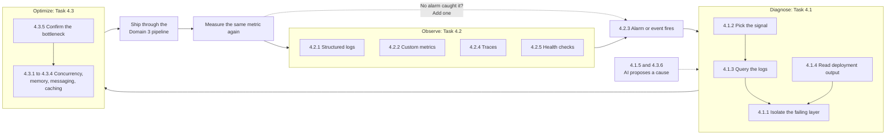

# Domain 4: Troubleshooting and Optimization (22%)

**Domain 4** · [Study guide home](../README.md) · Previous: [Domain 3: Testing and Deployment](../domain-3-testing-and-deployment/README.md)

Domain 4 starts after the code from Domains 1 to 3 is live and something is wrong: a request fails, a page is slow, or the bill grows. The exam tests whether you can find the cause from evidence instead of guessing, whether the application recorded that evidence before the incident, and whether you can tune the layer that is actually at fault. Most questions give a symptom and a few signals (an Amazon CloudWatch metric, a Lambda `REPORT` line, an AWS X-Ray trace, an AWS CloudTrail event) and ask which tool answers the question or which fix applies. The wrong answers usually fix the wrong layer, such as raising AWS Lambda memory when the time is spent waiting on Amazon DynamoDB.

The three tasks form one loop. [Task 4.2](task-4.2-observability/README.md) adds the signals ahead of time: structured logs, custom metrics, alarms, traces, and health checks. [Task 4.1](task-4.1-root-cause-analysis/README.md) reads those signals during an incident to find the root cause, including failed builds and deployments. [Task 4.3](task-4.3-optimize-applications/README.md) applies the fix (concurrency, memory, messaging, or caching) and measures the same metric again. Artificial intelligence (AI) tools appear in Tasks 4.1 and 4.3 as a way to propose a cause or an optimization, which you then verify against the raw telemetry.

## Tasks

| Task | Folder | Skills | Scope |
|---|---|---:|---|
| 4.1 Assist with root-cause analysis | [Task 4.1 overview](task-4.1-root-cause-analysis/README.md) | 5 | Debug code and integrations, read metrics, logs, and traces, query logs, diagnose failed deployments, and check AI-proposed causes |
| 4.2 Apply observability practices | [Task 4.2 overview](task-4.2-observability/README.md) | 5 | Emit structured logs and custom metrics, send alerts, instrument distributed tracing, and monitor health with checks and probes |
| 4.3 Optimize applications | [Task 4.3 overview](task-4.3-optimize-applications/README.md) | 6 | Tune concurrency, memory and compute, messaging, and caching; detect bottlenecks; use AI tools to find waste |

## Skill map

### Task 4.1: Assist with root-cause analysis

| Skill | Note | Summary |
|---|---|---|
| 4.1.1 | [Debugging code and integrations](task-4.1-root-cause-analysis/4.1.1-debugging-code-and-integrations.md) | Map an error code or exception to the layer that produced it, and use CloudTrail to find what changed |
| 4.1.2 | [Metrics, logs, and traces](task-4.1-root-cause-analysis/4.1.2-metrics-logs-and-traces.md) | Pick the right signal, read the `REPORT` line and `Init Duration`, and read X-Ray service maps and timelines |
| 4.1.3 | [Querying logs](task-4.1-root-cause-analysis/4.1.3-querying-logs.md) | Write CloudWatch Logs Insights queries that quantify, narrow, and read events, and fix queries that return nothing |
| 4.1.4 | [Diagnosing deployment failures](task-4.1-root-cause-analysis/4.1.4-diagnosing-deployment-failures.md) | Find the first failure in AWS CloudFormation stack events, CodeBuild logs, CodeDeploy hooks, and Amazon Elastic Container Service (ECS) stopped reasons |
| 4.1.5 | [AI-assisted error analysis](task-4.1-root-cause-analysis/4.1.5-ai-assisted-error-analysis.md) | Use Kiro, CloudWatch investigations, Logs Insights natural-language features, X-Ray Insights, and Amazon Bedrock, then verify the conclusion |

### Task 4.2: Apply observability practices

| Skill | Note | Summary |
|---|---|---|
| 4.2.1 | [Structured logging](task-4.2-observability/4.2.1-structured-logging.md) | JavaScript Object Notation (JSON) logs with a correlation ID, Lambda log levels, and keeping personally identifiable information (PII) out of logs |
| 4.2.2 | [Custom metrics](task-4.2-observability/4.2.2-custom-metrics.md) | Publish business metrics with `PutMetricData`, Embedded Metric Format (EMF), metric filters, or the CloudWatch agent, and control dimension cost |
| 4.2.3 | [Alerts and notifications](task-4.2-observability/4.2.3-alerts-and-notifications.md) | Configure CloudWatch alarms, quota and deployment alerts through Amazon EventBridge and Amazon Simple Notification Service (SNS), and automated remediation |
| 4.2.4 | [Distributed tracing](task-4.2-observability/4.2.4-distributed-tracing.md) | Enable X-Ray per service, add subsegments and annotations, set sampling, and move to OpenTelemetry |
| 4.2.5 | [Health checks and probes](task-4.2-observability/4.2.5-health-checks-and-probes.md) | Liveness versus readiness, load balancer, ECS, Kubernetes, and Amazon Route 53 health checks, and Synthetics canaries |

### Task 4.3: Optimize applications

| Skill | Note | Summary |
|---|---|---|
| 4.3.1 | [Concurrency controls](task-4.3-optimize-applications/4.3.1-concurrency-controls.md) | Lambda reserved and provisioned concurrency, SnapStart, Amazon Elastic Compute Cloud (EC2) Auto Scaling, thread pools, and connection pools with Amazon Relational Database Service (RDS) Proxy |
| 4.3.2 | [Memory and compute tuning](task-4.3-optimize-applications/4.3.2-memory-and-compute-tuning.md) | Lambda cost as memory times duration, Power Tuning, arm64, right-sizing, and DynamoDB capacity modes |
| 4.3.3 | [Messaging optimization](task-4.3-optimize-applications/4.3.3-messaging-optimization.md) | Amazon Simple Queue Service (SQS) long polling, batching, visibility timeout, event source mapping tuning, SNS filter policies, and Kinesis tuning |
| 4.3.4 | [Caching for performance](task-4.3-optimize-applications/4.3.4-caching-for-performance.md) | Amazon ElastiCache patterns, DynamoDB Accelerator (DAX) staleness, Amazon CloudFront cache keys and time to live (TTL) settings, and Amazon API Gateway caching |
| 4.3.5 | [Performance bottleneck detection](task-4.3-optimize-applications/4.3.5-performance-bottleneck-detection.md) | A measure-first method, key metrics per service, CloudWatch Insights features, and hot key versus under-provisioned capacity |
| 4.3.6 | [AI-assisted optimization](task-4.3-optimize-applications/4.3.6-ai-assisted-optimization.md) | Kiro code analysis, CloudWatch anomaly detection and investigations, Bedrock in internal tools, and the cost anomaly workflow |

## The observe, diagnose, optimize loop

Every scenario follows the same order: the trace shows where, the metrics show what and how much, CloudTrail shows what changed, then you fix the layer the evidence names, deploy the fix normally, and add the alarm that would have caught it sooner. The routing tables in each task overview give the same loop at task level.

## Symptom-to-tool lookup

The most common Domain 4 question pattern is "given this symptom, which tool or fix". The first four rows route most questions on their own ([4.1.2](task-4.1-root-cause-analysis/4.1.2-metrics-logs-and-traces.md) has the full signal table).

| Symptom or question | Tool or answer | Skill note |
|---|---|---|
| What exactly happened inside one function or request? | CloudWatch Logs | [4.1.2](task-4.1-root-cause-analysis/4.1.2-metrics-logs-and-traces.md) |
| Which hop in a multi-service chain adds the latency or error? | X-Ray trace map and trace timeline | [4.1.2](task-4.1-root-cause-analysis/4.1.2-metrics-logs-and-traces.md), [4.2.4](task-4.2-observability/4.2.4-distributed-tracing.md) |
| Who deleted or changed a resource, and when? | CloudTrail event history (90 days of management events, on by default); data events only if enabled beforehand | [4.1.1](task-4.1-root-cause-analysis/4.1.1-debugging-code-and-integrations.md) |
| Is an error rate or latency trending badly; should someone be paged? | CloudWatch metrics and alarms | [4.1.2](task-4.1-root-cause-analysis/4.1.2-metrics-logs-and-traces.md), [4.2.3](task-4.2-observability/4.2.3-alerts-and-notifications.md) |
| How often is it failing, on which path or customer? | Logs Insights `stats count() by` and `bin()` | [4.1.3](task-4.1-root-cause-analysis/4.1.3-querying-logs.md) |
| Rebuild one request's story across several log groups | Shared correlation ID in every JSON log line, queried across log groups | [4.2.1](task-4.2-observability/4.2.1-structured-logging.md), [4.1.3](task-4.1-root-cause-analysis/4.1.3-querying-logs.md) |
| Errors don't carry enough context to debug | Instrumentation gap: add structured fields before the next incident | [4.2.1](task-4.2-observability/4.2.1-structured-logging.md) |
| Failed requests with no matching trace | Sampling (default 1 request per second plus 5%); add a sampling rule | [4.2.4](task-4.2-observability/4.2.4-distributed-tracing.md) |
| Filter traces by customer ID versus attach debug detail | Annotation (indexed) versus metadata (not indexed) | [4.2.4](task-4.2-observability/4.2.4-distributed-tracing.md) |
| Stack rolled back or stuck in `UPDATE_ROLLBACK_FAILED` | Oldest failed stack event; `continue-update-rollback` | [4.1.4](task-4.1-root-cause-analysis/4.1.4-diagnosing-deployment-failures.md) |
| API Gateway 502 while the function logs success | Lambda proxy response `body` must be a string | [4.1.1](task-4.1-root-cause-analysis/4.1.1-debugging-code-and-integrations.md) |
| API Gateway 504 on long work | 29-second default integration timeout: go asynchronous, or request an increase for a Regional or private Representational State Transfer (REST) application programming interface (API) | [4.1.1](task-4.1-root-cause-analysis/4.1.1-debugging-code-and-integrations.md) |
| Client 429 or 403 errors with a healthy backend | Rejected in front of the backend: API Gateway throttling layers, usage plan, AWS WAF, or authorizer | [4.1.1](task-4.1-root-cause-analysis/4.1.1-debugging-code-and-integrations.md) |
| Some invocations slow, `Init Duration` on the slow `REPORT` lines | Cold start; SnapStart or provisioned concurrency | [4.1.2](task-4.1-root-cause-analysis/4.1.2-metrics-logs-and-traces.md), [4.3.1](task-4.3-optimize-applications/4.3.1-concurrency-controls.md) |
| High duration, central processing unit (CPU) near 100% or `Max Memory Used` near the limit | Raise memory (CPU scales with it), then re-measure cost | [4.3.2](task-4.3-optimize-applications/4.3.2-memory-and-compute-tuning.md) |
| High duration, low CPU and memory use | I/O-bound: trace the dependency; memory will not help | [4.3.5](task-4.3-optimize-applications/4.3.5-performance-bottleneck-detection.md) |
| Function pays for memory it never uses | Lower memory in steps and check that duration does not offset the saving | [4.3.2](task-4.3-optimize-applications/4.3.2-memory-and-compute-tuning.md) |
| DynamoDB throttling on one key versus across all keys | Hot key (key redesign, cache the item) versus capacity (auto scaling or on-demand) | [4.3.5](task-4.3-optimize-applications/4.3.5-performance-bottleneck-detection.md) |
| Repeated reads of the same DynamoDB items | DAX; writes do not update its query cache | [4.3.4](task-4.3-optimize-applications/4.3.4-caching-for-performance.md) |
| Repeated identical Amazon RDS queries | ElastiCache with cache-aside and a TTL | [4.3.4](task-4.3-optimize-applications/4.3.4-caching-for-performance.md) |
| Database connections at the maximum when Lambda scales | RDS Proxy; cap with reserved concurrency or queue the writes | [4.3.1](task-4.3-optimize-applications/4.3.1-concurrency-controls.md) |
| SQS age of oldest message rising, or many empty receives | Scale or batch consumers; long polling | [4.3.3](task-4.3-optimize-applications/4.3.3-messaging-optimization.md) |
| SQS messages processed twice | Visibility timeout longer than processing; idempotent consumers (first-in, first-out (FIFO) deduplication covers only a 5-minute send window) | [4.1.1](task-4.1-root-cause-analysis/4.1.1-debugging-code-and-integrations.md), [4.3.3](task-4.3-optimize-applications/4.3.3-messaging-optimization.md) |
| One chart of error rate across six functions | Dashboard with metric math | [4.2.2](task-4.2-observability/4.2.2-custom-metrics.md) |
| Warn before hitting a service quota | Alarm on the usage metric with `SERVICE_QUOTA()` | [4.2.3](task-4.2-observability/4.2.3-alerts-and-notifications.md) |
| Notify when a pipeline or deployment finishes or fails | Notification rule or EventBridge state-change rule to SNS | [4.2.3](task-4.2-observability/4.2.3-alerts-and-notifications.md) |
| Alarms existed but nobody noticed the outage | No alarm action, or the SNS subscription was never confirmed | [4.2.3](task-4.2-observability/4.2.3-alerts-and-notifications.md) |
| Apply the same fix automatically when a known failure recurs | Alarm to EventBridge to an AWS Systems Manager Automation runbook | [4.2.3](task-4.2-observability/4.2.3-alerts-and-notifications.md) |
| Traffic sent to containers that are still starting | Readiness probe, or an ECS health check grace period | [4.2.5](task-4.2-observability/4.2.5-health-checks-and-probes.md) |
| Auto Scaling group keeps instances whose app returns 500 | Elastic Load Balancing (ELB) health check type on the group | [4.2.5](task-4.2-observability/4.2.5-health-checks-and-probes.md) |
| An AI tool names a root cause | Treat it as a hypothesis; check the trace, `REPORT` lines, and CloudTrail first | [4.1.5](task-4.1-root-cause-analysis/4.1.5-ai-assisted-error-analysis.md) |
| Find inefficient code such as one call per item | Kiro code analysis, then measure before and after | [4.3.6](task-4.3-optimize-applications/4.3.6-ai-assisted-optimization.md) |

> **Not on the DVA-C03 service list.** Older material and practice questions also route these symptoms to services outside the in-scope list. "When did this resource drift from compliant" is AWS Config, paired with CloudTrail for which call made the change ([4.1.1](task-4.1-root-cause-analysis/4.1.1-debugging-code-and-integrations.md)). "Spend changed in a way that does not look like us, but never crossed a budget" is AWS Cost Anomaly Detection, followed by AWS Cost Explorer and CloudTrail. "Is this resource the right size" is AWS Compute Optimizer, "which resources are idle" is AWS Trusted Advisor, and "does the whole architecture follow best practices" is the AWS Well-Architected Tool ([4.3.6](task-4.3-optimize-applications/4.3.6-ai-assisted-optimization.md) compares them).

## Worked case studies

Each case crosses at least two tasks. The detail lives in the linked notes.

### Slow checkout after a deploy with no code change

**Symptom.** Checkout p99 latency rose from 200 ms to 4 seconds two days ago, right after a routine deploy. Some requests return 500, and cost crept up with flat traffic.

1. **Where is the time?** The X-Ray trace map puts the latency in the DynamoDB subsegment, not the Lambda segment ([4.1.2](task-4.1-root-cause-analysis/4.1.2-metrics-logs-and-traces.md)). The function is waiting, so raising its memory would cost more and fix nothing ([4.3.2](task-4.3-optimize-applications/4.3.2-memory-and-compute-tuning.md)).
2. **What is DynamoDB doing?** `ConsumedReadCapacityUnits` sits at the provisioned limit and `ThrottledRequests` is above 0. Table-level consumption pinned at the provisioned level points to under-provisioned capacity; a hot key usually throttles while table-level consumption stays well below the total ([4.3.5](task-4.3-optimize-applications/4.3.5-performance-bottleneck-detection.md)).
3. **What changed?** CloudTrail shows a CloudFormation stack update that switched the table from on-demand to provisioned capacity with a low read setting, a side effect of an unrelated template edit ([4.1.1](task-4.1-root-cause-analysis/4.1.1-debugging-code-and-integrations.md)).
4. **Fix the table.** Return it to on-demand, or right-size provisioned capacity with auto scaling. On-demand removes capacity planning but can still throttle on hot partitions or spikes far beyond the previous peak ([4.3.2](task-4.3-optimize-applications/4.3.2-memory-and-compute-tuning.md)).
5. **Optional cache.** Checkout rereads the same catalog items, so DAX can cut read load. Writes made through DAX do not refresh its query cache, so keep TTLs short for data that must be fresh ([4.3.4](task-4.3-optimize-applications/4.3.4-caching-for-performance.md)).
6. **Close the loop.** Review change sets for capacity-mode changes before deploy ([3.2.1](../domain-3-testing-and-deployment/task-3.2-test-applications/3.2.1-testing-with-sam-cdk-and-cloudformation.md)) and alarm on `ThrottledRequests` ([4.2.3](task-4.2-observability/4.2.3-alerts-and-notifications.md)).

### "The app is slow" and nobody changed anything

**Symptom.** A recommendation API's p50 `Duration` holds at 45 ms, but p99 jumped to 4,800 ms at 08:00. CloudTrail shows no change to the function.

1. A flat p50 with a high p99 means a small share of requests pays an extra cost. The slow `REPORT` lines carry `Init Duration: 3,912 ms`, which makes them cold starts ([4.1.2](task-4.1-root-cause-analysis/4.1.2-metrics-logs-and-traces.md)).
2. The X-Ray trace shows no downstream calls, so a dependency is ruled out ([4.2.4](task-4.2-observability/4.2.4-distributed-tracing.md)).
3. A Logs Insights count of cold starts per hour shows a sustained rate since 08:00, not a few outliers ([4.1.3](task-4.1-root-cause-analysis/4.1.3-querying-logs.md)). A marketing campaign started then and raised concurrency above anything the function had seen.
4. The fix is provisioned concurrency sized to the new baseline, scheduled ahead of future campaigns. SnapStart is the first thing to try on Java 11+, Python 3.12+, or .NET 8+ runtimes, and it cannot be combined with provisioned concurrency ([4.3.1](task-4.3-optimize-applications/4.3.1-concurrency-controls.md)). More memory would speed up the small handler time and leave the init time unchanged.

### One partner gets 429 errors while the backend looks healthy

**Symptom.** A partner reports intermittent 429 responses. The Lambda function shows no errors, no throttles, and normal duration.

1. A client error with no matching backend distress means the request was rejected before it reached the function ([4.1.1](task-4.1-root-cause-analysis/4.1.1-debugging-code-and-integrations.md)).
2. API Gateway checks account, stage or method, and usage-plan limits. Only this partner sees errors, so the account default is not the cause; their usage plan has a lower rate limit and their traffic is bursty ([4.3.5](task-4.3-optimize-applications/4.3.5-performance-bottleneck-detection.md)).
3. Fix the usage plan's rate or burst limit, or move the partner to another plan. AWS WAF rules and authorizer denials give the same pattern with 403s.

### Checkout slow on one path because a third party degraded

**Symptom.** Checkout has been slow for 40 minutes, and nobody knows whether it is one endpoint or everything.

1. Logs Insights percentiles by 5-minute bin show p50 flat and p99 up, so this is a tail problem ([4.1.3](task-4.1-root-cause-analysis/4.1.3-querying-logs.md)).
2. Grouping slow requests by path shows `/checkout/apply-discount` carries 94% of them. A shared infrastructure fault would hit every path.
3. The structured fields on those requests show `externalCallMs: 3900` against `ownCodeMs: 45`. Those fields exist only because the function logs them ([4.2.1](task-4.2-observability/4.2.1-structured-logging.md)).
4. The trace for one request ID confirms the time is in the subsegment calling the third-party discount API ([4.1.2](task-4.1-root-cause-analysis/4.1.2-metrics-logs-and-traces.md)), and CloudTrail shows no change on your side.
5. The fix is a tighter timeout and a circuit breaker on that call ([1.1.3](../domain-1-development-with-aws-services/task-1.1-build-application-code/1.1.3-resilience-retries-and-backoff.md)), not more memory.

### An AI summary blames the wrong dependency

**Symptom.** During an outage, an AI assistant summarizes the logs and blames a downstream payment API timeout, which appears on almost every failing request.

1. Treat the summary as a hypothesis. Summaries tend to pick the most frequent error, which is often a downstream symptom ([4.1.5](task-4.1-root-cause-analysis/4.1.5-ai-assisted-error-analysis.md)).
2. The trace timeline puts the time in the Lambda service segment, and the `REPORT` lines show large `Init Duration` values ([4.1.2](task-4.1-root-cause-analysis/4.1.2-metrics-logs-and-traces.md)). Cold starts after a traffic spike pushed requests past the API Gateway integration timeout, and the backlog then timed out downstream.
3. The fix is cold-start mitigation ([4.3.1](task-4.3-optimize-applications/4.3.1-concurrency-controls.md)), shipped through normal review. Raising the downstream timeout, as the assistant suggested, would not help.

### Lambda connections exhaust the database after a marketing email

**Symptom.** A Lambda-backed API returns errors under a burst, and RDS shows `DatabaseConnections` at the limit with high CPU.

1. Lambda scaled to hundreds of environments, each holding its own connection ([4.3.5](task-4.3-optimize-applications/4.3.5-performance-bottleneck-detection.md)).
2. Put RDS Proxy in front of the database. If the database still cannot take the load, cap the function with reserved concurrency, or send writes through an SQS queue with an event source mapping (ESM) maximum concurrency so excess work waits instead of failing ([4.3.1](task-4.3-optimize-applications/4.3.1-concurrency-controls.md), [4.3.3](task-4.3-optimize-applications/4.3.3-messaging-optimization.md)).
3. Alarm on connection count before it reaches the limit ([4.2.3](task-4.2-observability/4.2.3-alerts-and-notifications.md)).

### Weekend cost spike in a shared account

> **Not on the DVA-C03 service list.** AWS Cost Anomaly Detection and AWS Cost Explorer are outside the in-scope list, but practice material uses them for this scenario.
>
> **Symptom.** An anomaly alert reports about $340 of unexpected Amazon EC2 spend between Saturday and Monday. Finance wants to know which team.
>
> 1. The alert gives the service, window, and rough amount, never who. Cost Explorer grouped by usage type shows which instance type drove it ([4.3.6](task-4.3-optimize-applications/4.3.6-ai-assisted-optimization.md)).
> 2. CloudTrail `RunInstances` events in the same window name the principal ([4.1.1](task-4.1-root-cause-analysis/4.1.1-debugging-code-and-integrations.md)), and an activated cost allocation tag names the team.
> 3. Terminate the instances, then add a guardrail that did not exist, such as an alarm on long-running instances ([4.2.3](task-4.2-observability/4.2.3-alerts-and-notifications.md)).

The shared lesson: detection tools answer what and how much, and CloudTrail answers who made the call.

## Cross-domain scenarios

Harder questions combine Domain 4 with work from other domains. Domain 4 owns the parts in the second column.

| Scenario | Domain 4 part | Other domains |
|---|---|---|
| Flash-sale checkout that must absorb a 50x spike and never double-charge | Instrument traces, custom metrics, and alarms before the sale ([4.2.4](task-4.2-observability/4.2.4-distributed-tracing.md), [4.2.2](task-4.2-observability/4.2.2-custom-metrics.md), [4.2.3](task-4.2-observability/4.2.3-alerts-and-notifications.md)); size concurrency for the peak ([4.3.1](task-4.3-optimize-applications/4.3.1-concurrency-controls.md)) | Conditional writes ([1.3.4](../domain-1-development-with-aws-services/task-1.3-use-data-stores/1.3.4-dynamodb-design-and-operations.md)), least-privilege execution role ([2.1.6](../domain-2-security/task-2.1-authentication-and-authorization/2.1.6-least-privilege-permissions.md)), blue/green with alarm-based rollback ([3.3.6](../domain-3-testing-and-deployment/task-3.3-deploy-with-ci-cd/3.3.6-deployment-strategies.md), [3.3.7](../domain-3-testing-and-deployment/task-3.3-deploy-with-ci-cd/3.3.7-rollback.md)) |
| Multi-tenant support chatbot on Amazon Bedrock | Log what you need to debug without logging prompts or PII ([4.2.1](task-4.2-observability/4.2.1-structured-logging.md)) | Orchestrator Lambda calling Bedrock ([1.1.10](../domain-1-development-with-aws-services/task-1.1-build-application-code/1.1.10-managed-ai-service-integration.md)), sensitive data in AI logs ([2.3.5](../domain-2-security/task-2.3-secure-ai-services/2.3.5-ai-sensitive-data-in-logs.md)) |
| Regulated records API with a VPC-attached Lambda and an audit requirement | CloudTrail as the audit trail of who called which API ([4.1.1](task-4.1-root-cause-analysis/4.1.1-debugging-code-and-integrations.md)) | Lambda in a virtual private cloud (VPC) ([1.2.1](../domain-1-development-with-aws-services/task-1.2-develop-lambda-functions/1.2.1-lambda-vpc-access.md)), AWS Key Management Service (AWS KMS) keys ([2.2.4](../domain-2-security/task-2.2-encrypt-and-protect-sensitive-data/2.2.4-kms-key-management.md)), validated infrastructure as code (IaC) ([3.3.3](../domain-3-testing-and-deployment/task-3.3-deploy-with-ci-cd/3.3.3-infrastructure-as-code-deployment.md)) |
| Clickstream platform where an AI tool proposes the cause of an anomaly | CloudWatch anomaly detection and X-Ray Insights; verify before acting ([4.1.5](task-4.1-root-cause-analysis/4.1.5-ai-assisted-error-analysis.md), [4.3.6](task-4.3-optimize-applications/4.3.6-ai-assisted-optimization.md)); Kinesis consumer tuning ([4.3.3](task-4.3-optimize-applications/4.3.3-messaging-optimization.md)) | Streaming ingestion ([1.1.6](../domain-1-development-with-aws-services/task-1.1-build-application-code/1.1.6-streaming-data.md)) |
| First serverless feature in a legacy system, reaching a private RDS instance | Logging, metrics, and tracing on day one ([4.2.1](task-4.2-observability/4.2.1-structured-logging.md)); RDS Proxy for connections ([4.3.1](task-4.3-optimize-applications/4.3.1-concurrency-controls.md)) | VPC access ([1.2.1](../domain-1-development-with-aws-services/task-1.2-develop-lambda-functions/1.2.1-lambda-vpc-access.md)), externalized configuration ([3.1.4](../domain-3-testing-and-deployment/task-3.1-prepare-deployable-artifacts/3.1.4-environment-specific-configuration.md)) |
| Cutting a serverless bill without regressing latency | Memory times duration cost math and Power Tuning ([4.3.2](task-4.3-optimize-applications/4.3.2-memory-and-compute-tuning.md)) | Ship the memory change through the pipeline with rollback, not a console edit ([3.3.5](../domain-3-testing-and-deployment/task-3.3-deploy-with-ci-cd/3.3.5-codepipeline-release-promotion.md), [3.3.7](../domain-3-testing-and-deployment/task-3.3-deploy-with-ci-cd/3.3.7-rollback.md)) |

## DVA-C02 vs DVA-C03

From the [official comparison](https://docs.aws.amazon.com/aws-certification/latest/developer-associate-03/dva-03-comparison.html), summarized in [the exam guide](../00-foundations/exam-guide.md):

| Change | Detail | Where it lands |
|---|---|---|
| Weight | 18% in DVA-C02, 22% in DVA-C03 (+4 points, the only domain that grew) | Whole domain |
| New content | AI-assisted error analysis and troubleshooting suggestions | [4.1.5](task-4.1-root-cause-analysis/4.1.5-ai-assisted-error-analysis.md) |
| New content | AI-assisted detection of bottlenecks, resource waste, and inefficient code | [4.3.6](task-4.3-optimize-applications/4.3.6-ai-assisted-optimization.md) |
| Moved in | Lambda performance tuning, from Domain 1 Task 1.2 | [4.3.1](task-4.3-optimize-applications/4.3.1-concurrency-controls.md), [4.3.2](task-4.3-optimize-applications/4.3.2-memory-and-compute-tuning.md) |
| Consolidated | Eight observability skills became five broader skills | [Task 4.2](task-4.2-observability/README.md) |
| Consolidated | Nine optimization skills became six broader skills | [Task 4.3](task-4.3-optimize-applications/README.md) |

AWS states that consolidation did not remove material; a shorter skill list covers the same topics.

Two related changes come from the skill notes, not the exam comparison. First, the X-Ray software development kits (SDKs) and daemon entered maintenance mode on February 25, 2026; AWS recommends OpenTelemetry instrumentation such as AWS Distro for OpenTelemetry (ADOT). Trace concepts are unchanged, and questions may still name the SDK ([4.2.4](task-4.2-observability/4.2.4-distributed-tracing.md)).

> **Not on the DVA-C03 service list.** Second, Amazon Q Developer was the AI tool in DVA-C02 troubleshooting material. DVA-C03 names Kiro, and CloudWatch investigations cover incident analysis ([4.1.5](task-4.1-root-cause-analysis/4.1.5-ai-assisted-error-analysis.md)). If a question names Q Developer, answer from the capability.

## Labs and practice

| Task | Labs | Practice questions |
|---|---|---|
| 4.1 | [4 labs](task-4.1-root-cause-analysis/labs.md): a Logs Insights failure-rate query, correlating one failing request, proving a cold start from `REPORT` lines, and AWS Config paired with CloudTrail | [4 questions](task-4.1-root-cause-analysis/practice-questions.md), multiple choice with explanations |
| 4.2 | [2 labs](task-4.2-observability/labs.md): X-Ray active tracing on a Lambda function, and filtering traces by an annotation | [4 questions](task-4.2-observability/practice-questions.md), multiple choice with explanations |
| 4.3 | [3 labs](task-4.3-optimize-applications/labs.md): memory versus duration timing, cost across five memory sizes, and a cost-anomaly investigation | [3 questions](task-4.3-optimize-applications/practice-questions.md), two single-answer and one choose-two |

The labs run on Floci, a free local AWS emulator, so they cost nothing. For final review, the Domain 4 section of the [cheat sheet](../exam-prep/cheat-sheet.md) lists clue-to-answer pairs with links back to these skill notes.

## Sources

- Merged from: `archive/dva-c03/domain-4-troubleshooting-optimization/README.md` (symptom-to-tool map, case studies, common scenarios), `archive/dva-c03/README.md` (cross-domain scenarios), and the Domain 4 skill notes in this folder.
- Exam scope: [Official Domain 4 details](https://docs.aws.amazon.com/aws-certification/latest/developer-associate-03/developer-associate-03-domain4.html) and [DVA-C02 and DVA-C03 comparison](https://docs.aws.amazon.com/aws-certification/latest/developer-associate-03/dva-03-comparison.html), as summarized in [the exam guide](../00-foundations/exam-guide.md).
