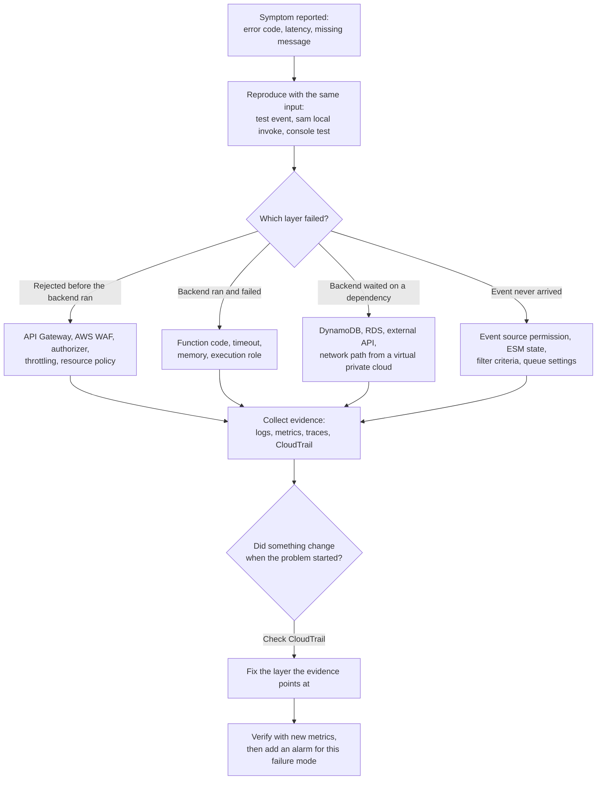
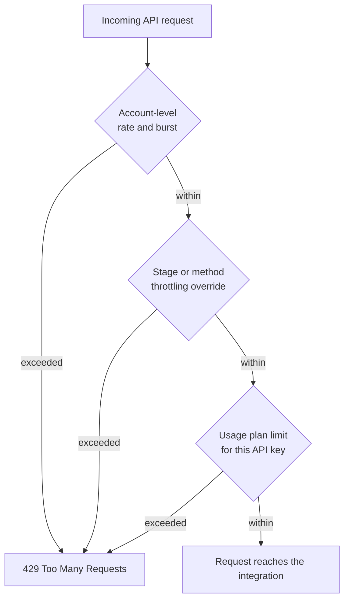
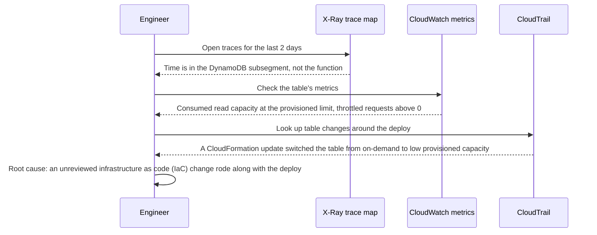

# 4.1.1 Debug application code and service integrations to identify defects

**Domain 4 · Task 4.1 · Skill 4.1.1** · [Task overview](README.md) · Previous: [3.3.9 AI-assisted deployment](../../domain-3-testing-and-deployment/task-3.3-deploy-with-ci-cd/3.3.9-ai-assisted-deployment.md) · Next: [4.1.2 Metrics, logs, and traces](4.1.2-metrics-logs-and-traces.md)

## What the exam expects

This skill tests whether you can take a symptom (an error code, a timeout, a message that never arrives) and find the layer that caused it. Most questions describe a failing request through Amazon API Gateway, AWS Lambda, Amazon DynamoDB, Amazon Simple Queue Service (SQS), or Amazon Simple Storage Service (S3) and ask for the cause or the fix. The wrong answers usually fix the wrong layer, such as raising Lambda memory when the time is spent in a downstream call, or blaming the backend when API Gateway rejected the request before it arrived.

You must be able to:

- Map an error code or message to the service and setting that produced it.
- Follow an evidence-driven workflow: reproduce, isolate the layer, collect evidence, confirm, fix, verify.
- Tell an application defect from a permissions, configuration, quota, or integration-contract defect.
- Use AWS CloudTrail to answer "what changed, and who changed it" when a failure starts without a code change.
- Use local and console tools (AWS Serverless Application Model [AWS SAM] local invoke, console test events, AWS Identity and Access Management (IAM) policy simulator, AWS Step Functions execution history) to reproduce a failure safely.

## Key terms

| Term | Meaning |
|---|---|
| Root cause | The first, causal defect. Later errors (timeouts, retries, backed-up queues) are often symptoms of it. |
| Integration contract | The exact request and response shape two services agree on, such as the Lambda proxy response format API Gateway expects. |
| Execution role | The IAM role a Lambda function assumes. It controls what the function code can call. |
| Resource-based policy | A policy on the function (or queue, topic, bucket) that controls who may invoke or use it. Event sources such as S3 and Amazon SNS need one to invoke Lambda. |
| Event source mapping (ESM) | A Lambda-managed poller that reads from SQS, Amazon Kinesis, DynamoDB Streams, and similar sources and invokes the function. |
| Poison message | A record that fails every time it is processed and blocks or loops without a failure destination. |
| Management event | A CloudTrail record of a control-plane API call, such as `PutRolePolicy` or `UpdateTable`. Logged by default. |
| Data event | A CloudTrail record of a high-volume data-plane call, such as S3 `GetObject` or Lambda `Invoke`. Off by default. |

## A debugging workflow that avoids guessing

Every Domain 4 scenario rewards the same order of work. The first error you see is often a downstream symptom, so confirm each hypothesis with a specific piece of evidence before changing anything.



1. **Reproduce.** Use the same payload that failed. Lambda console test events, `aws lambda invoke`, `sam local invoke -e event.json`, and the API Gateway console test all replay a request without waiting for a user. See [3.2.3 Test events and payloads](../../domain-3-testing-and-deployment/task-3.2-test-applications/3.2.3-test-events-and-payloads.md).
2. **Isolate the layer.** Invoke the function directly, then through API Gateway. If the direct invoke works and the API call fails, the defect is in the API configuration or the response contract, not the code.
3. **Collect evidence.** Logs show what one component did, metrics show trends, traces show where time went across components, and CloudTrail shows who changed what. [4.1.2](4.1.2-metrics-logs-and-traces.md) covers reading each one.
4. **Check for a change.** A failure that starts with no code change often has an infrastructure change behind it: an IAM policy edit, a capacity-mode change, a new layer version, a configuration-only deploy.
5. **Fix and verify.** Fix the layer the evidence names, confirm with new metrics, and add an alarm so the same failure pages someone next time ([4.2.3](../task-4.2-observability/4.2.3-alerts-and-notifications.md)).

## Common integration failures

| Symptom | Likely cause | Where to look and how to fix |
|---|---|---|
| API Gateway **502** Bad Gateway | Lambda proxy response is malformed (no `statusCode`, `body` not a string), the function threw an error, or an unhandled promise rejection | Lambda logs and API Gateway execution logs. Return `{"statusCode": 200, "body": json.dumps(result)}` |
| API Gateway **504** Gateway Timeout | The integration ran longer than the 29-second default integration timeout | Optimize the call, go asynchronous (SQS or Step Functions), stream the response, or request a higher timeout for a Regional or private Representational State Transfer (REST) API |
| API Gateway **403** | Missing or wrong authorizer, resource policy deny, AWS WAF block, private API called without its virtual private cloud (VPC) endpoint. `Missing Authentication Token` usually means the path or stage does not exist | Access logs, authorizer configuration, the exact invoke URL including stage |
| API Gateway **429** Too Many Requests | Throttling at the account, stage or method, or usage-plan level | Raise the limit that applies, retry with backoff, add caching |
| API Gateway **500** with a Lambda authorizer | The authorizer threw an error or returned a malformed policy document | Authorizer function logs |
| Lambda `Task timed out after N seconds` | Timeout too low, a slow downstream call, or a VPC-attached function with no network address translation (NAT) gateway or VPC endpoint hanging on an AWS API call | Raise the timeout, set software development kit (SDK) timeouts below the function timeout, add a VPC endpoint or NAT gateway |
| Lambda `Runtime exited` or out of memory (`Max Memory Used` equals `Memory Size`) | Memory too low or a leak | Raise memory, fix the leak |
| Lambda `TooManyRequestsException` (429) | Account or reserved concurrency limit reached | Request a quota increase, adjust reserved concurrency, buffer with SQS |
| Lambda `AccessDeniedException` calling another service | Execution role is missing the action, or the AWS Key Management Service (AWS KMS) key policy does not allow the role | IAM policy, KMS key policy, CloudTrail `errorCode` |
| Lambda `Runtime.HandlerNotFound` or `Runtime.ImportModuleError` | Handler string does not match file and function name, or a dependency was not packaged | Handler setting, deployment package contents ([4.1.4](4.1.4-diagnosing-deployment-failures.md)) |
| Event source does not trigger the function | Missing resource-based policy (S3, SNS, Amazon EventBridge), disabled ESM, filter criteria that never match, ESM role cannot read the source | Function permissions (`get-policy`), ESM state, filter criteria |
| SQS messages processed twice or ending up in the dead-letter queue (DLQ) | Visibility timeout shorter than processing time, function errors, a partial batch failure without partial batch responses | Visibility timeout at least 6 times the function timeout, `ReportBatchItemFailures`, idempotent processing |
| Kinesis or DynamoDB stream processing stuck, `IteratorAge` rising | A poison record retried until it expires | Bisect batch on error, maximum retry attempts and record age, on-failure destination |
| DynamoDB `ProvisionedThroughputExceededException` | Hot partition key, capacity too low, or a throttled global secondary index (GSI) | Better key design, auto scaling or on-demand, retry with backoff ([1.3.4](../../domain-1-development-with-aws-services/task-1.3-use-data-stores/1.3.4-dynamodb-design-and-operations.md)) |
| DynamoDB `ValidationException` | Reserved word without `ExpressionAttributeNames`, wrong key type, missing key attribute, item over 400 KB | Fix the expression or item |
| DynamoDB `ConditionalCheckFailedException` | The condition expression evaluated false. Expected with optimistic locking | Re-read the item and retry, or report the conflict |
| S3 `AccessDenied` on `GetObject` | IAM or bucket policy, KMS key permission, object owned by another account, expired presigned URL or expired credentials | Policies, KMS key policy, S3 Object Ownership |
| S3 `SignatureDoesNotMatch` | Wrong secret key, clock skew, or a URL or header changed after signing | Sync the clock, sign again |
| Cross-Origin Resource Sharing (CORS) error in the browser | `Access-Control-Allow-*` headers missing (a Lambda proxy integration must return them itself), `OPTIONS` not handled, S3 bucket CORS not configured | CORS configuration on the API or bucket, headers in the function response |
| Step Functions `States.TaskFailed` or `States.Timeout` | Task error, state machine role missing a permission, task timeout | Execution event history, `Retry` and `Catch` |
| Amazon Cognito `NotAuthorizedException` | Wrong password, expired refresh token, app client settings | Token handling and app client configuration |
| Amazon Bedrock `ThrottlingException`, `ValidationException`, or `AccessDeniedException` | Token or request quota reached; wrong request body or model ID; IAM permission missing or the model not available to the account | Retry with backoff, check the model ID and Region, check IAM |

Detail on these contracts lives in the skills that build them: [1.1.4 APIs](../../domain-1-development-with-aws-services/task-1.1-build-application-code/1.1.4-apis-transformation-and-validation.md) for API Gateway responses and CORS, [1.2.3](../../domain-1-development-with-aws-services/task-1.2-develop-lambda-functions/1.2.3-lambda-invocation-lifecycle-and-failures.md) for retries, destinations, and DLQs, and [1.2.4](../../domain-1-development-with-aws-services/task-1.2-develop-lambda-functions/1.2.4-lambda-service-integrations.md) for event source mappings.

### The 502 that the function logs as a success

The most common integration defect on the exam: a Lambda proxy function returns a dictionary as `body`. The function log shows a clean return, and API Gateway returns 502 because it cannot build a Hypertext Transfer Protocol (HTTP) response from it.

```python
import json

def handler(event, context):
    result = {"orderId": "o-4471", "status": "PLACED"}
    # Wrong: "body": result  -> API Gateway returns 502
    return {
        "statusCode": 200,
        "headers": {"Content-Type": "application/json",
                    "Access-Control-Allow-Origin": "https://app.example.com"},
        "body": json.dumps(result),
    }
```

## Rejections in front of the backend

When a client sees errors and every backend metric looks healthy, the request was probably rejected before it reached the backend. API Gateway checks several throttling layers, and a request needs to break only one of them to get a 429.



**Worked case: one partner gets 429s.** A partner reports intermittent 429 errors. Your Lambda function shows no errors, no throttles, and normal duration. A 429 with a healthy backend means API Gateway rejected the request before invoking anything. The partner's API key is on a usage plan with a lower rate limit than other partners, and their traffic is bursty. The fix is the usage plan's rate or burst limit, not the function. AWS WAF rules and authorizer denials produce the same "client errors, quiet backend" pattern with 403s.

## Is the function slow, or waiting?

Lambda allocates central processing unit (CPU) power in proportion to memory, so "raise memory" is a common answer. It only helps when the function is compute-bound.

| Evidence | Meaning | Next step |
|---|---|---|
| High `Duration`, `Max Memory Used` close to `Memory Size` | Memory or CPU constrained | Raise memory, then re-measure duration and cost ([4.3.2](../task-4.3-optimize-applications/4.3.2-memory-and-compute-tuning.md)) |
| High `Duration`, low memory use, low CPU | I/O-bound: the function is waiting on a dependency | Find the slow call with an AWS X-Ray trace; memory will not help |
| High latency only on some invocations, `Init Duration` present | Cold start | See [4.1.2](4.1.2-metrics-logs-and-traces.md#cold-start-or-slow-code) |
| Timeouts only from a VPC-attached function calling AWS APIs | No route to the service | Add a VPC endpoint or NAT gateway ([1.2.1](../../domain-1-development-with-aws-services/task-1.2-develop-lambda-functions/1.2.1-lambda-vpc-access.md)) |

## Finding what changed with CloudTrail

CloudTrail records API calls made through the console, AWS Command Line Interface (AWS CLI), SDKs, and AWS services. It answers "who did what, and when", which no log or trace can.

- **Event history** is on by default and free: the past 90 days of management events in one Region, searchable by one attribute plus a time range (`aws cloudtrail lookup-events`).
- **Trails** deliver events to S3 (and optionally CloudWatch Logs) for longer retention. Query them with Amazon Athena, or use a CloudTrail Lake event data store to query across attributes, Regions, and accounts.
- **Data events** (S3 object reads and writes, Lambda `Invoke`) are off by default. "Who downloaded this object?" has no answer unless data events were enabled before the download.
- A failed call shows `errorCode` (for example `AccessDenied`) and `errorMessage`, which tells you exactly which action and resource the caller lacked.

```bash
# Who changed IAM policies on the function's role in the last day?
aws cloudtrail lookup-events \
  --lookup-attributes AttributeKey=ResourceName,AttributeValue=order-fn-role \
  --start-time "$(date -u -v-1d +%Y-%m-%dT%H:%M:%SZ)" \
  --query 'Events[].{time:EventTime,name:EventName,user:Username}'
```

> **Not on the DVA-C03 service list.** AWS Config records each resource's configuration over time and evaluates it against rules. It pairs with CloudTrail during an investigation: Config shows *what* a resource looked like and *when* it drifted from compliant, and CloudTrail shows *which API call and principal* made the change. Lab 4 in [labs.md](labs.md) runs both against the same security group change.

### Worked case: latency after a deploy with no code change

**Symptom.** Checkout p99 latency rose from 200 ms to 4 seconds after a routine deploy two days ago, and some requests return 500. Nobody changed application code.



- **Fix:** return the table to on-demand (or right-size provisioned capacity with auto scaling). On-demand removes capacity planning, but it can still throttle on hot partitions or sudden spikes beyond the previous peak.
- **Not the fix:** raising Lambda memory. The trace showed the time was in DynamoDB.
- **Prevent recurrence:** review change sets for capacity-mode changes ([3.2.1](../../domain-3-testing-and-deployment/task-3.2-test-applications/3.2.1-testing-with-sam-cdk-and-cloudformation.md)) and alarm on throttled requests ([4.2.3](../task-4.2-observability/4.2.3-alerts-and-notifications.md)).

The shape of this investigation applies to most scenario questions: the trace shows where, the metrics show what, CloudTrail shows what changed, then you fix the right layer and add the missing alarm.

## Debugging tools and techniques

| Tool | Use it to |
|---|---|
| `sam local invoke -e event.json` | Run a function locally in a Lambda-like container with a saved event. `-d <port>` attaches a debugger. |
| `sam local start-api` | Run the API locally and call it with `curl` |
| Lambda console test events | Replay a failing payload against the deployed function |
| API Gateway console test | Send a request through the integration and see the full execution log, including the mapping and the backend response |
| `aws lambda invoke --log-type Tail` | Get the last 4 KB of the invocation log, base64-encoded, with the response |
| IAM policy simulator | Test whether a role allows an action before deploying |
| CloudTrail `errorCode` | Find the exact denied action and resource |
| Step Functions execution event history | See every state's input, output, and `Error`/`Cause` for a failed execution, without re-running it. **Redrive** restarts a failed Standard execution from the failed state. |
| EventBridge sandbox | Test an event pattern against a sample event |
| DLQ or on-failure destination | Inspect the exact records that failed, with error metadata |
| Structured logs with a request ID | Follow one request through every log line ([4.1.3](4.1.3-querying-logs.md)) |

## Exam triggers

| Scenario clue | Answer | Why the alternatives are wrong |
|---|---|---|
| API Gateway 502, function logs show success | Fix the Lambda proxy response format (`body` must be a string) | Raising the timeout or memory does not change the response shape |
| API Gateway 504 on a long report | Asynchronous pattern (SQS or Step Functions), or a timeout increase for a Regional or private REST API | Raising the Lambda timeout alone leaves the 29-second integration default in place |
| `Missing Authentication Token` | Wrong path or stage in the URL | It is rarely an IAM problem |
| 429 for one customer, backend healthy | That customer's usage plan limit | The account default would hit every customer |
| Function works when invoked directly, fails through S3 events | Missing resource-based policy allowing `s3.amazonaws.com` | The execution role controls what the function calls, not who calls it |
| SQS messages processed more than once | Visibility timeout shorter than processing time; make processing idempotent | First-in, first-out (FIFO) deduplication covers a 5-minute window for sends, not slow consumers |
| One bad record stalls a Kinesis shard | Bisect on error, retry limits, on-failure destination | Raising batch size makes the stall worse |
| Errors started with no code change | CloudTrail for configuration and IAM changes around the start time | CloudWatch Logs show the symptom, not who changed the setting |
| "Who deleted this table at 2 AM?" | CloudTrail event history | X-Ray and CloudWatch do not record management-plane identity |
| High duration, low memory use | I/O-bound; trace the dependency | More memory does not speed up waiting |

## Common traps

- Fixing the most frequent error instead of the first one. A downstream timeout repeated on every request can be the result of an earlier failure.
- Confusing the execution role (what the function may call) with the resource-based policy (who may invoke the function).
- Treating a 429 or 403 with a healthy backend as a Lambda problem.
- Assuming DynamoDB on-demand cannot throttle. Hot partitions and spikes beyond the previous peak still throttle.
- Expecting CloudTrail to show S3 object reads without data events enabled, or more than 90 days of history without a trail.
- Raising memory for a function that is waiting on a network call.
- Forgetting that a VPC-attached Lambda function has no internet or AWS API path without a NAT gateway or VPC endpoint, which shows up as timeouts, not errors.

## Quick recall

- 502 = bad proxy response or function error. 504 = integration exceeded the 29-second default. 429 = throttling. 403 = auth, policy, WAF, or wrong path.
- `Max Memory Used` near `Memory Size` means memory-bound. High duration with low memory use means I/O wait.
- Event sources need a resource-based policy on the function; the function needs an execution role for what it calls.
- SQS visibility timeout at least 6 times the function timeout; use `ReportBatchItemFailures` for partial batches.
- Stream stuck: bisect, retry limits, on-failure destination, watch `IteratorAge`.
- CloudTrail event history: 90 days, management events, one Region. Data events are off by default.
- Step Functions execution history shows every state's input, output, and error; redrive restarts from the failed state.
- Investigation order: trace for where, metrics for what, CloudTrail for what changed, then fix the right layer and add an alarm.

## Related skills

- [4.1.2 Metrics, logs, and traces](4.1.2-metrics-logs-and-traces.md): reading the evidence this workflow collects.
- [4.1.3 Querying logs](4.1.3-querying-logs.md): isolating the failing request in CloudWatch Logs.
- [1.2.3 Lambda invocation lifecycle and failures](../../domain-1-development-with-aws-services/task-1.2-develop-lambda-functions/1.2.3-lambda-invocation-lifecycle-and-failures.md): retries, destinations, and DLQs that capture failed events.
- [1.2.4 Lambda service integrations](../../domain-1-development-with-aws-services/task-1.2-develop-lambda-functions/1.2.4-lambda-service-integrations.md): event source mappings and API Gateway contracts.
- [1.1.3 Resilience, retries, and backoff](../../domain-1-development-with-aws-services/task-1.1-build-application-code/1.1.3-resilience-retries-and-backoff.md): handling throttling and timeouts in code.
- [2.1.6 Least-privilege permissions](../../domain-2-security/task-2.1-authentication-and-authorization/2.1.6-least-privilege-permissions.md): fixing `AccessDenied` without over-granting.
- [4.2.3 Alerts and notifications](../task-4.2-observability/4.2.3-alerts-and-notifications.md): closing the loop so the failure pages someone next time.

## Sources

- Merged from: `archive/dva-c03-study-notes/04-troubleshooting-optimization.md` (skill 4.1.1 table and techniques), `archive/dva-c03/domain-4-troubleshooting-optimization/README.md` (investigation flow, checkout and API Gateway case studies, use cases), `archive/dva-c03/domain-4-troubleshooting-optimization/MASTER-CHUNK.md` (CloudTrail, API Gateway throttling layers), `archive/aws-dva-notes/Markdown Files/17. Monitoring, Troubleshooting & Audit.md` (CloudTrail events and retention), `archive/dva-c03/exam-bank/bank-3.md` (Step Functions execution history scenario)
- AWS documentation: [Working with CloudTrail event history](https://docs.aws.amazon.com/awscloudtrail/latest/userguide/view-cloudtrail-events.html)
- AWS documentation: [Lambda quotas](https://docs.aws.amazon.com/lambda/latest/dg/gettingstarted-limits.html)
