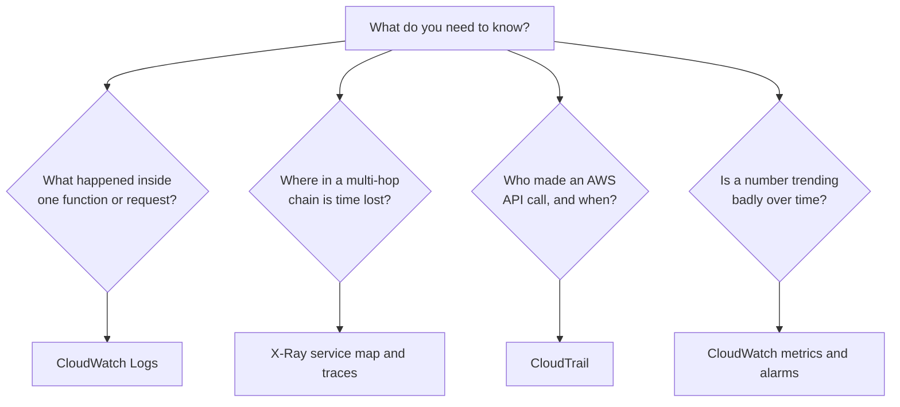
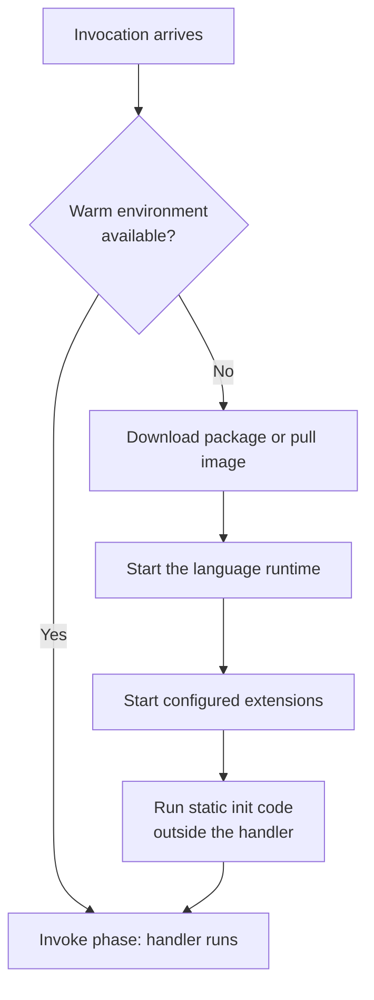
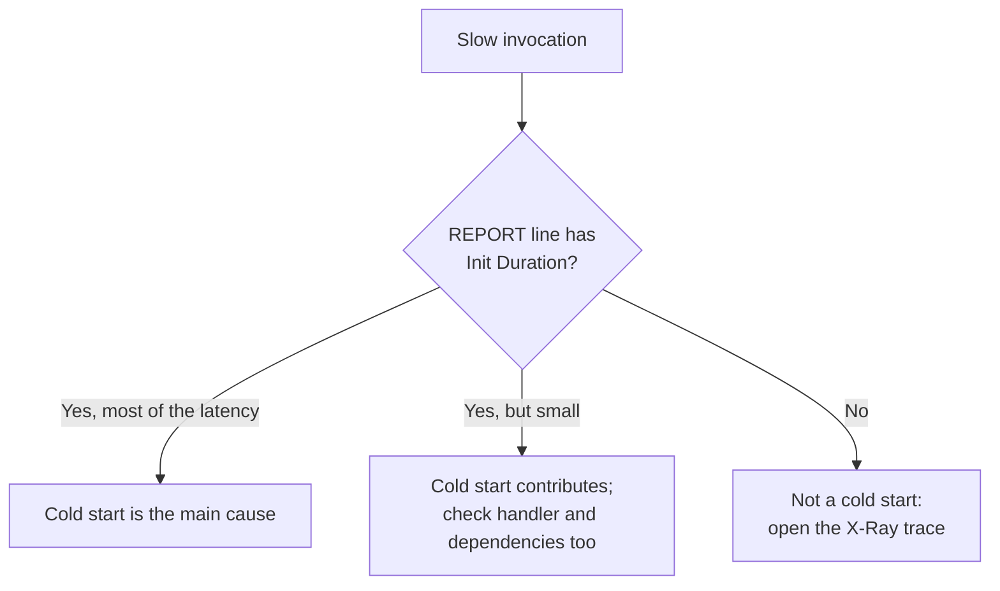

# 4.1.2 Interpret metrics, logs, and distributed traces

**Domain 4 · Task 4.1 · Skill 4.1.2** · [Task overview](README.md) · Previous: [4.1.1 Debugging code and integrations](4.1.1-debugging-code-and-integrations.md) · Next: [4.1.3 Querying logs](4.1.3-querying-logs.md)

## What the exam expects

This skill tests whether you can read the evidence in front of you: a Lambda `REPORT` line, a pair of Amazon API Gateway latency metrics, an AWS X-Ray service map, or a trace timeline. Questions usually hand you two or three pieces of telemetry and ask what they prove. The most common pattern is routing a symptom to the right signal: Amazon CloudWatch Logs for what happened inside one component, CloudWatch metrics for trends, X-Ray for where time went across components, and AWS CloudTrail for who changed what.

You must be able to:

- Choose the right signal (log, metric, trace, audit event) for a question.
- Read every field of a Lambda `REPORT` line and prove or rule out a cold start with `Init Duration`.
- Interpret the key metrics for Lambda, API Gateway, Amazon SQS, Amazon DynamoDB, and Application Load Balancer (ALB), including percentiles.
- Read an X-Ray service map and trace timeline: segments, subsegments, annotations, metadata, errors, faults, and throttles.
- Explain why a trace is missing or broken: sampling, missing permissions, tracing not enabled on a hop, or trace context not propagated.

## Key terms

| Term | Meaning |
|---|---|
| Metric | A time-ordered numeric series in a namespace, with up to 30 dimensions. Good for trends and alarms. |
| Log event | One timestamped line in a log stream inside a log group. Good for detail about one request. |
| Trace | The end-to-end record of one request across services, built from segments. |
| Segment | The work one service did for a traced request. |
| Subsegment | A finer timing inside a segment, such as one DynamoDB call or Hypertext Transfer Protocol (HTTP) request. |
| Annotation | An indexed key-value pair on a segment. You can filter traces by it. |
| Metadata | A non-indexed key-value pair on a segment. Visible on a trace you already found; not searchable. |
| Sampling | Recording only some requests to control cost. X-Ray's default is the first request each second plus 5% of the rest. |
| Percentile (p50, p99) | The value below which that share of data points fall. p99 shows the slowest 1% that averages hide. |
| Cold start | An invocation that had to create a new execution environment before running the handler. |

## Pick the signal that answers the question

| Question | Signal | Service |
|---|---|---|
| What exactly happened inside this one invocation (stack trace, custom log lines)? | Logs | CloudWatch Logs |
| Is error rate or latency trending up? Should someone be paged? | Metrics and alarms | CloudWatch metrics |
| Which hop in a multi-service chain adds the latency or the error? | Traces | X-Ray (CloudWatch trace map) |
| Who changed this resource or policy, and when? | Audit events | CloudTrail |



## Reading the Lambda REPORT line

Lambda writes `START`, `END`, and `REPORT` lines for every invocation to the function's log group (`/aws/lambda/<function-name>` by default).

```
START RequestId: 8f507cfc-xmpl-4697-b07a-ac58fc914c95 Version: $LATEST
END RequestId: 8f507cfc-xmpl-4697-b07a-ac58fc914c95
REPORT RequestId: 8f507cfc-xmpl-4697-b07a-ac58fc914c95  Duration: 15.74 ms  Billed Duration: 147 ms Memory Size: 128 MB Max Memory Used: 56 MB  Init Duration: 130.49 ms
XRAY TraceId: 1-5e34a614-10bdxmplf1fb44f07bc535a1   SegmentId: 07f5xmpl2d1f6f85 Sampled: true
```

| Field | Meaning | What it tells you |
|---|---|---|
| `RequestId` | Unique ID for the invocation | Join this line to the function's own log lines |
| `Duration` | Time the handler spent processing the event | Handler performance |
| `Billed Duration` | Time billed. In the AWS example above, it includes the `Init Duration` of the cold start | Cost per invocation |
| `Memory Size` | Configured memory | The ceiling |
| `Max Memory Used` | Peak memory. When invocations share an environment, it is the maximum across them | Close to `Memory Size` means memory-constrained; far below means look elsewhere |
| `Init Duration` | Present only on the first request an environment serves: time to load the code and run initialization outside the handler | Proof of a cold start |
| `XRAY TraceId`, `SegmentId`, `Sampled` | Present for traced requests | Pivot from the log to the trace |

### Cold start or slow code?


*Source: [Understanding the Lambda execution environment lifecycle](https://docs.aws.amazon.com/lambda/latest/dg/lambda-runtime-environment.html), AWS Lambda Developer Guide. A cold start downloads the code or image, starts the runtime and any extensions, and runs your static initialization code before the handler runs.*



Use this sequence when a scenario says "the function is sometimes slow":

1. **Pull the `REPORT` line for a slow invocation.** If `Init Duration` is present, that invocation was a cold start.
2. **Compare `Init Duration` with the warm `Duration`.** If a slow invocation shows `Init Duration: 3,912 ms` against a typical warm duration of 45 ms, the cold path is the latency.
3. **Measure the frequency, not one data point.** Count cold starts per hour with a Logs Insights query ([4.1.3](4.1.3-querying-logs.md#lambda-queries)). Rare cold starts may be acceptable; a sustained high rate is a traffic-shape problem.
4. **If `Init Duration` is absent and the invocation is still slow, it is not a cold start.** Open the X-Ray trace and look for a slow subsegment.
5. **Check timing.** A burst of cold starts right after a deployment or a quiet period is expected: a new version starts with no warm environments.



A flat p50 with a high p99 is itself a cold-start hint: most requests are fast and a small share pays an extra cost. Mitigations belong to Task 4.3: trim the package and init work, Lambda SnapStart (Java 11+, Python 3.12+, .NET 8+ managed runtimes), and provisioned concurrency, scheduled ahead of known peaks ([4.3.1](../task-4.3-optimize-applications/4.3.1-concurrency-controls.md), [4.3.2](../task-4.3-optimize-applications/4.3.2-memory-and-compute-tuning.md)). Traffic above the provisioned amount still cold-starts, which is expected behavior.

| Runtime | Typical cold-start shape | First thing to try |
|---|---|---|
| Python, Node.js | Tens to a few hundred milliseconds; grows with package size | Trim dependencies, lazy-load rarely used modules |
| Go and other compiled binaries | Usually under 100 ms | Rarely needs mitigation |
| Java | Several hundred milliseconds to seconds (Java virtual machine start, class loading) | SnapStart |
| .NET | Between Python and Java | Trim, ahead-of-time compilation, SnapStart |
| Container image (any runtime) | Adds image pull and unpack time | Smaller base image, fewer layers |

**Worked case: "nobody changed the code".** A recommendation API's p50 `Duration` is steady at 45 ms, but p99 jumped to 4,800 ms at 08:00. Slow `REPORT` lines show `Init Duration: 3,912 ms`. The X-Ray trace shows no downstream calls, which rules out a dependency. CloudTrail shows no change to the function. A marketing campaign started at 08:00 and drove higher sustained concurrency, so Lambda keeps creating new environments. The fix is provisioned concurrency sized to the new baseline (scheduled if the campaign recurs). More memory would speed up the already small handler time and leave the cold path unchanged.

## Key metrics by service

**Lambda**

| Metric | Read it as |
|---|---|
| `Invocations`, `Errors`, `Throttles` | Volume, function errors, rejected invocations (concurrency) |
| `Duration` (use p99) | Handler time; tail latency shows cold starts and slow dependencies |
| `ConcurrentExecutions`, `UnreservedConcurrentExecutions` | How close you are to account or reserved limits |
| `ProvisionedConcurrencySpilloverInvocations` | Traffic exceeded provisioned concurrency and ran on-demand (possible cold starts) |
| `IteratorAge` | Stream consumer lag for Kinesis or DynamoDB Streams |
| `AsyncEventAge`, `AsyncEventsDropped` | Asynchronous queue delay and events dropped after retries or age limits |
| `DeadLetterErrors`, `DestinationDeliveryFailures` | Failed events could not be delivered to the dead-letter queue (DLQ) or destination |
| `RecursiveInvocationsDropped` | Lambda stopped a detected recursive loop |

**API Gateway**

| Metric | Read it as |
|---|---|
| `Count`, `4XXError`, `5XXError` | Volume, client errors, server errors |
| `Latency` | End to end, from request received to response returned |
| `IntegrationLatency` | Backend time only |
| `CacheHitCount`, `CacheMissCount` | API cache effectiveness (REST APIs) |

If `Latency` is much larger than `IntegrationLatency`, the overhead is inside API Gateway: a slow or cold Lambda authorizer, mapping templates, or throttling. If they are close, the backend is slow.

**Other services**

| Service | Metrics to know |
|---|---|
| SQS | `ApproximateAgeOfOldestMessage` (consumers falling behind), `ApproximateNumberOfMessagesVisible` and `NotVisible` (backlog and in flight), `NumberOfEmptyReceives` (switch to long polling) |
| DynamoDB | `ConsumedReadCapacityUnits` and `ConsumedWriteCapacityUnits`, `ThrottledRequests`, `ReadThrottleEvents` and `WriteThrottleEvents`, `SuccessfulRequestLatency`, `SystemErrors`, `UserErrors`. CloudWatch Contributor Insights finds hot keys. |
| ALB | `TargetResponseTime`, `HTTPCode_Target_5XX_Count` (your application) versus `HTTPCode_ELB_5XX_Count` (the load balancer, often no healthy targets), `UnHealthyHostCount` |
| Amazon ECS and Amazon EKS | CloudWatch Container Insights collects central processing unit (CPU), memory, network, and storage per cluster, service, and task (including AWS Fargate) without a custom agent in each container |
| Amazon EC2 | CPU, network, and disk by default. Memory and disk-space use need the CloudWatch agent. Basic monitoring is 5-minute; detailed monitoring is 1-minute. |

**Reading percentiles.** If p50 is flat and p99 spikes, a subset of requests is slow (cold starts, one endpoint, one tenant, retries). If p50 and p99 rise together, something affects every request (a slow shared dependency, CPU saturation). Averages hide both patterns.

## Reading X-Ray traces


*Source: [Visualize Lambda function invocations using AWS X-Ray](https://docs.aws.amazon.com/lambda/latest/dg/services-xray.html), AWS Lambda Developer Guide. A traced Lambda invocation produces two nodes: the Lambda service and the function's own code.*

### Service map

- Nodes are services; edges are calls between them, annotated with latency and request rate.
- Node colors: green for success, yellow for client **errors** (4xx), red for server **faults** (5xx), purple for **throttles** (429).
- A red node localizes "which service" in seconds. Open its traces to find "which request, and why".
- The CloudWatch console shows the same data as the trace map, alongside the node's metrics, logs, and alarms (formerly ServiceLens). CloudWatch Application Signals adds per-service latency, error, and availability dashboards with service level objectives (SLOs).

### Trace timeline

The timeline lists each segment and subsegment as a bar on a time axis. The widest bar answers "why was this request slow". If most of the time is in a subsegment for a third-party HTTP call, the function's own code is not the bottleneck.

**Lambda produces two segments per traced invocation.** The `AWS::Lambda` service segment covers platform work, including initialization on a cold start. The `AWS::Lambda::Function` segment covers your code. High time in the service segment with a fast function segment points at a cold start, which `Init Duration` confirms more cheaply.

### Annotations versus metadata

| | Annotations | Metadata |
|---|---|---|
| Indexed | Yes | No |
| Use in filter expressions | Yes, `annotation.customer_tier = "gold"` | No |
| Value types | Strings, numbers, Booleans | Any object, including nested |
| Use for | Grouping and searching traces (tenant, tier, order ID) | Extra debug context on a trace you already found |

Filter expression examples:

```
service("checkout-api") AND responsetime > 2
annotation.customer_tier = "premium" AND fault = true
http.status = 429
```

**Worked case: "premium customers feel slower".** First check whether segments carry a `customerTier` annotation. If the tier is only in metadata, or absent, the claim cannot be tested with a filter. That is an instrumentation gap ([4.2.4](../task-4.2-observability/4.2.4-distributed-tracing.md)), not yet a root-cause question. With the annotation, compare `annotation.customerTier = "premium"` against `"standard"`, open a slow premium trace, and find the widest bar, here a personalization API called only for premium users. Before concluding, check the sample size: low-volume premium traffic may have few sampled traces, so widen the window or add a sampling rule for that path.

### Why traces go missing

| Symptom | Cause |
|---|---|
| Errors in CloudWatch metrics have no matching trace | Sampling. Default is 1 request per second (reservoir) plus 5% (rate). Add a custom sampling rule for paths that need more coverage; no redeploy needed. |
| Active tracing is on, but no traces appear from Lambda | The execution role lacks `xray:PutTraceSegments` and `xray:PutTelemetryRecords` (`AWSXRayDaemonWriteAccess`) |
| No traces from Amazon EC2 or ECS on EC2 | The X-Ray daemon or CloudWatch agent / OpenTelemetry collector is not running, or the instance or task role lacks permissions. On Fargate, run it as a sidecar. |
| The trace starts at Lambda, without the API Gateway hop | Tracing is not enabled on the API Gateway stage |
| A downstream service appears as a separate, orphaned trace | The caller did not propagate trace context (`X-Amzn-Trace-Id` header) to it, for example an uninstrumented HTTP client |
| The trace ends at a third-party call | The outbound HTTP client was not instrumented, so no subsegment and no header were sent |

**How one trace survives several hops.** The first instrumented hop (API Gateway, a load balancer, or the first function) creates the trace ID and passes it in the `X-Amzn-Trace-Id` header. Each later hop reads it and reports its own segment with the same ID. Propagation between AWS services is automatic once tracing is enabled on each hop. Calls to non-AWS HTTP endpoints need an instrumented HTTP client to carry the header. Segments are sent asynchronously, so a trace can take a few seconds to fill in after the response returns.

### Built-in anomaly views

- **X-Ray Insights** learns a baseline fault rate per service and opens an insight when the current rate exceeds it, with the affected service, start and end time, and example trace IDs.
- **CloudWatch anomaly detection** builds a band of expected values for a metric and alarms outside it.
- **CloudWatch Logs pattern analysis and anomaly detection** group similar log lines and flag new or spiking patterns ([4.1.3](4.1.3-querying-logs.md)).

AI-assisted investigation across all of these is covered in [4.1.5](4.1.5-ai-assisted-error-analysis.md).

> **DVA-C02 vs DVA-C03.** The X-Ray software development kits (SDKs) and daemon entered maintenance mode on February 25, 2026 (security fixes only). AWS now recommends OpenTelemetry instrumentation, such as AWS Distro for OpenTelemetry (ADOT), with the CloudWatch agent or OpenTelemetry collector in place of the daemon. The X-Ray console and trace concepts are unchanged, and exam questions may still name the SDK and daemon. Instrumentation is covered in [4.2.4](../task-4.2-observability/4.2.4-distributed-tracing.md).

## Exam triggers

| Scenario clue | Answer | Why the alternatives are wrong |
|---|---|---|
| "Which of five services adds the latency?" | X-Ray service map and trace timeline | Logs need manual timestamp correlation across log groups |
| "Lambda is slow on the first call after idle" | `Init Duration` in the `REPORT` line proves a cold start | More memory targets handler time, not the cold path |
| "API is slow, Lambda duration is normal" | Compare `Latency` with `IntegrationLatency`; check the authorizer | The backend is not where the time is |
| "Filter traces by customer ID" | Store it as an annotation | Metadata is not indexed |
| "Some failed requests have no trace" | Sampling; adjust the sampling rule | Tracing is not broken |
| "Tracing enabled but nothing appears" | Execution role X-Ray write permissions | Tracing configuration is already on |
| "One service shows as a separate trace" | Trace header not propagated by the caller | X-Ray has no hop limit |
| "Purple node on the service map" | Throttling (429) at that resource | Not a code fault |
| "SQS backlog keeps growing" | `ApproximateAgeOfOldestMessage`; scale consumers | `NumberOfEmptyReceives` measures idle polling |
| "ALB 5xx but app logs are clean" | `HTTPCode_ELB_5XX_Count` and `UnHealthyHostCount` | Target metrics would show application errors |
| "Function memory near the limit, duration high" | Raise memory | Increasing the timeout only lets it fail later |

## Common traps

- Assuming every slow invocation is a cold start. Check `Init Duration` first.
- Reading averages instead of p99 for latency questions.
- Treating missing traces as a bug before considering sampling.
- Expecting X-Ray to answer identity questions. Who changed a resource is CloudTrail.
- Forgetting that EC2 memory is not a default metric.
- Confusing `HTTPCode_Target_5XX_Count` (application) with `HTTPCode_ELB_5XX_Count` (load balancer).
- Assuming provisioned concurrency is broken when spillover traffic cold-starts.
- Thinking an X-Ray trace ID appears in your own log lines automatically. Lambda adds it to the `REPORT` line; your structured logs need it written explicitly ([4.2.1](../task-4.2-observability/4.2.1-structured-logging.md)).

## Quick recall

- Logs: what happened. Metrics: is it trending. Traces: where across services. CloudTrail: who changed it.
- `Init Duration` appears only on cold starts. `Max Memory Used` near `Memory Size` means raise memory.
- `Latency` minus `IntegrationLatency` is API Gateway overhead.
- Annotations are indexed and filterable; metadata is not.
- Default sampling: first request each second plus 5%.
- Lambda traces show two nodes: the Lambda service and your function.
- Service map colors: yellow errors (4xx), red faults (5xx), purple throttles (429).
- Lambda tracing needs active tracing plus `AWSXRayDaemonWriteAccess`; EC2 and ECS need a daemon or collector; Fargate uses a sidecar.
- Flat p50 with high p99 means a subset of requests is slow.

## Related skills

- [4.1.1 Debugging code and integrations](4.1.1-debugging-code-and-integrations.md): the workflow this evidence feeds.
- [4.1.3 Querying logs](4.1.3-querying-logs.md): computing cold-start counts and percentiles from logs.
- [4.2.2 Custom metrics](../task-4.2-observability/4.2.2-custom-metrics.md): emitting the business metrics that default metrics lack.
- [4.2.4 Distributed tracing](../task-4.2-observability/4.2.4-distributed-tracing.md): instrumenting code with X-Ray or OpenTelemetry, annotations, and sampling rules.
- [4.3.1 Concurrency controls](../task-4.3-optimize-applications/4.3.1-concurrency-controls.md): provisioned and reserved concurrency for cold starts and throttles.
- [4.3.5 Performance bottleneck detection](../task-4.3-optimize-applications/4.3.5-performance-bottleneck-detection.md): Lambda Insights, Container Insights, and Contributor Insights.

## Sources

- Merged from: `archive/dva-c03-study-notes/04-troubleshooting-optimization.md` (skill 4.1.2 metrics and X-Ray), `archive/dva-c03/domain-4-troubleshooting-optimization/lambda-cold-start-diagnosis.md`, `archive/dva-c03/domain-4-troubleshooting-optimization/observability-instrumentation.md` (sampling, Insights, trace map, Lambda segments, premium-tier scenario, exam scenarios), `archive/dva-c03/domain-4-troubleshooting-optimization/README.md` (trace propagation, symptom-to-tool diagram, second case study), `archive/aws-dva-notes/Markdown Files/17. Monitoring, Troubleshooting & Audit.md` (X-Ray concepts, troubleshooting, ECS options, CloudWatch metrics), `archive/dva-c03/exam-bank/bank-1.md`, `bank-2.md`, `bank-3.md` (annotation, propagation, Container Insights, two-node scenarios)
- AWS documentation: [Log and monitor Python Lambda functions](https://docs.aws.amazon.com/lambda/latest/dg/python-logging.html) (`REPORT` line fields)
- AWS documentation: [Improving startup performance with Lambda SnapStart](https://docs.aws.amazon.com/lambda/latest/dg/snapstart.html) (supported runtimes)
- AWS documentation: [Migrating from X-Ray instrumentation to OpenTelemetry instrumentation](https://docs.aws.amazon.com/xray/latest/devguide/xray-sdk-migration.html) (maintenance mode date)
- AWS documentation: [Visualize Lambda function invocations using AWS X-Ray](https://docs.aws.amazon.com/lambda/latest/dg/services-xray.html)
