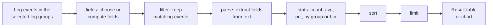
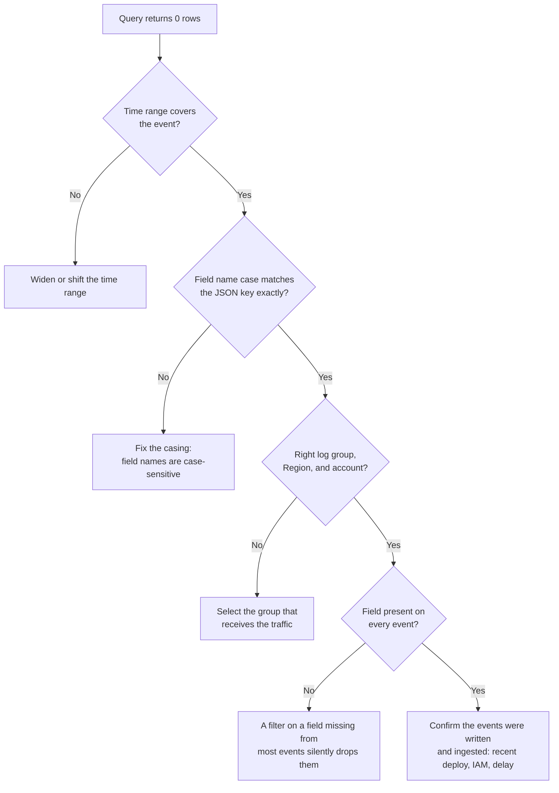

# 4.1.3 Query logs to isolate relevant events and evidence

**Domain 4 · Task 4.1 · Skill 4.1.3** · [Task overview](README.md) · Previous: [4.1.2 Metrics, logs, and traces](4.1.2-metrics-logs-and-traces.md) · Next: [4.1.4 Diagnosing deployment failures](4.1.4-diagnosing-deployment-failures.md)

## What the exam expects

This skill tests whether you can turn "errors spiked" into specific, counted evidence with Amazon CloudWatch Logs Insights, and whether you know when a different log feature fits better. Expect to read a short query and say what it returns, pick the right command (`filter`, `parse`, `stats`), and choose between Logs Insights, metric filters, subscription filters, export to Amazon S3, and Live Tail.

You must be able to:

- Read and write a Logs Insights pipeline: `fields`, `filter`, `parse`, `stats`, `sort`, `limit`, `dedup`.
- Query structured JavaScript Object Notation (JSON) fields by name and parse unstructured text.
- Query AWS Lambda `REPORT` fields such as `@duration`, `@maxMemoryUsed`, and `@initDuration`.
- Query across several log groups, and follow one request by its request ID or correlation ID.
- Diagnose a query that returns nothing.
- Choose query-on-demand (Logs Insights) versus continuous processing (metric filters, subscriptions).

## Key terms

| Term | Meaning |
|---|---|
| Log group | A container for log streams, usually one per application or function. Retention is set here (1 day to 10 years, or never expire). |
| Log stream | A sequence of events from one source, such as one Lambda execution environment or one container. |
| Logs Insights | An on-demand query engine over CloudWatch Logs, billed per GB of uncompressed data scanned. |
| Discovered field | A field Logs Insights extracts automatically, such as `@timestamp`, `@message`, `@logStream`, or JSON keys. Generated fields start with `@`. |
| Filter pattern | The match syntax used by `filter-log-events`, metric filters, and subscription filters. Different from the Logs Insights query language. |
| Metric filter | Turns matching log events into a CloudWatch metric that an alarm can watch. Not retroactive. |
| Subscription filter | Streams matching log events in near real time to AWS Lambda, Amazon Kinesis Data Streams, or Amazon Data Firehose. |
| Correlation ID | An ID written into every log line for one request, across services, so a query can reassemble the request. |

## How a Logs Insights query works

A query is a pipeline. Each command, separated by `|`, receives the output of the one before it.



| Command | Purpose | Example |
|---|---|---|
| `fields` | Select or compute fields | `fields @timestamp, @message, @requestId` |
| `filter` | Keep matching events: `=`, `!=`, `<`, `>`, `like /regex/`, `not like`, `in [...]`, `ispresent(field)` | `filter level = "ERROR" and latencyMs > 2000` |
| `parse` | Extract fields from text with a glob (`*`) or regex | `parse @message "user=* action=* duration=*ms" as user, action, durationMs` |
| `stats` | Aggregate: `count()`, `sum()`, `avg()`, `min()`, `max()`, `pct(field, 99)`, grouped `by` a field or `bin(5m)` | `stats count() by bin(5m)` |
| `sort` | Order results | `sort @timestamp desc` |
| `limit` | Cap rows returned | `limit 20` |
| `dedup` | Keep one row per value | `dedup @requestId` |
| `display` | Choose which fields appear in the output | `display @timestamp, orderId` |
| `unmask` | Show data masked by a data protection policy (needs `logs:Unmask`) | `fields @timestamp, unmask(@message)` |
| `filterIndex` | Use a field index to skip events that lack the field | `filterIndex requestId = "abc"` |

**Structured versus unstructured logs.** For JSON log events, Logs Insights discovers keys automatically and you reference nested keys with dot notation (`filter detail.status = "FAILED"`). For plain text, use `parse`. In Lambda logs, discovery covers only the first JSON fragment in each event; parse the rest if a line holds more than one. Field names are case-sensitive.

**Three query languages.** Logs Insights supports its own query language (Logs Insights QL), OpenSearch Piped Processing Language (PPL), and OpenSearch Structured Query Language (SQL). SQL allows joins across log groups and subqueries. Exam questions use Logs Insights QL. In PPL and SQL, enclose fields with special characters, such as `@message`, in backticks.

## Query patterns by goal

**Count errors over time.**

```
fields @timestamp, @message
| filter @message like /ERROR/
| stats count() as errorCount by bin(5m)
```

**Rank error types.**

```
fields @timestamp, errorCode, customerId
| filter level = "ERROR"
| stats count() as errorCount by errorCode
| sort errorCount desc
| limit 10
```

**Find which customers are hit hardest.**

```
filter level = "ERROR"
| stats count() as errors by customerId
| sort errors desc
| limit 15
```

**Reassemble one request across streams and log groups.**

```
fields @timestamp, @log, @logStream, @message
| filter correlationId = "order-9981-trace"
| sort @timestamp asc
```

Run it with every service's log group selected. `@log` and `@logStream` show which service and which environment or container wrote each line, which matters for retried or load-balanced requests. This works only if every service writes the same ID into its log lines; Lambda adds the request ID to its own lines, but nothing copies your correlation ID or the X-Ray trace ID into your logs for you ([4.2.1](../task-4.2-observability/4.2.1-structured-logging.md)).

**Search many functions for one error.**

```
fields @timestamp, @log, @requestId, @message
| filter @message like /PaymentGatewayTimeout/ and @message like /ERROR/
| sort @timestamp desc
```

Select every relevant log group (or a log group name prefix) in one query instead of opening each group.

**Latency percentiles.**

```
fields latencyMs
| stats pct(latencyMs, 50) as p50, pct(latencyMs, 90) as p90, pct(latencyMs, 99) as p99 by bin(5m)
```

**Parse a legacy access log.**

```
parse @message '* - - [*] "* * *" * *' as clientIp, ts, method, path, protocol, status, bytes
| filter status >= 500
| stats count() by path
```

## Lambda queries

Logs Insights discovers these fields in Lambda logs: `@timestamp`, `@logStream`, `@message`, `@requestId`, `@duration`, `@billedDuration`, `@type`, `@maxMemoryUsed`, `@memorySize`, and, on traced lines, `@xrayTraceId` and `@xraySegmentId`. `REPORT` lines have `@type = "REPORT"`. Memory fields are in bytes. Cold-start `REPORT` lines also expose `@initDuration`, which the source notes and common AWS examples use, although the AWS discovered-fields table does not list it (verify).

```
# Latency report
filter @type = "REPORT"
| stats avg(@duration), max(@duration), pct(@duration, 99) by bin(5m)
```

```
# Cold starts per hour
filter @type = "REPORT" and ispresent(@initDuration)
| stats count() as coldStarts, avg(@initDuration) as avgInitMs by bin(1h)
```

```
# Over-provisioned memory (from the AWS sample queries)
filter @type = "REPORT"
| stats max(@memorySize / 1000 / 1000) as provisionedMB,
        max(@maxMemoryUsed / 1000 / 1000) as maxUsedMB,
        provisionedMB - maxUsedMB as overProvisionedMB
```

```
# Slowest invocations, without duplicates from retries
fields @timestamp, @requestId, @duration, @logStream
| filter @type = "REPORT" and @duration > 1000
| sort @timestamp desc
| dedup @requestId
| limit 20
```

## Worked investigation: "the checkout API is slow"

Customers say checkout has been slow for about 40 minutes. The team does not know whether it is one endpoint, one customer, or everything.

1. **Quantify.** Percentiles by 5-minute bin show p50 flat at 80 ms and p99 jumping from 300 ms to 4,200 ms 40 minutes ago. This is a tail regression affecting a subset of requests, not a broad slowdown.
2. **Narrow by dimension.**

   ```
   filter latencyMs > 2000
   | stats count() as slowCount by path
   | sort slowCount desc
   ```

   `/checkout/apply-discount` accounts for 94% of slow requests. A shared infrastructure problem would hit every path.
3. **Read the narrowed events.**

   ```
   fields @timestamp, requestId, latencyMs, externalCallMs, ownCodeMs
   | filter path = "/checkout/apply-discount" and latencyMs > 2000
   | sort @timestamp desc
   | limit 20
   ```

   Every slow request shows `externalCallMs: 3900` and `ownCodeMs: 45`. The function is waiting on an outbound call, so more memory would not help.
4. **Cross-check with a trace.** The AWS X-Ray trace for one of those request IDs shows the time in a subsegment calling a third-party discount API ([4.1.2](4.1.2-metrics-logs-and-traces.md)).
5. **Check for a change.** AWS CloudTrail shows no change around the start time, so the third-party API itself degraded. The fix is a tighter timeout and a circuit breaker on that call ([1.1.3](../../domain-1-development-with-aws-services/task-1.1-build-application-code/1.1.3-resilience-retries-and-backoff.md)).

Logs Insights did the first three steps: quantify, narrow, and read the evidence.

## When a query returns nothing



1. **Time range.** The most common cause, especially after investigating an earlier incident.
2. **Case sensitivity.** `filter Level = "ERROR"` does not match a key named `level`.
3. **Wrong log group.** After a rename or redeploy, traffic may land in a new group. Also check the Region and account.
4. **Inconsistent schema.** Filtering on `errorCode` drops every success line that lacks it. This returns fewer rows than expected, not always zero.
5. **Data not there.** A deploy may have changed logging, or ingestion may be blocked. Logs Insights cannot read events with timestamps before the log group was created, and automatic field discovery works only for log groups in the Standard log class.

## Cost and limits

- **Billed per GB scanned**, not per row returned. A narrow time range and an early `filter` are the biggest cost levers. Field indexes (`filterIndex`) let the query skip events that lack the field.
- Queries time out after 60 minutes. Results are kept for 7 days.
- Up to 100 concurrent Logs Insights QL queries per account, including dashboard queries; 15 concurrent PPL or SQL queries.
- A monitoring account in CloudWatch cross-account observability can query log groups in linked source accounts.
- Other features: saved and parameterized queries, adding results to dashboards, the Patterns tab (groups similar lines), comparison with a previous period, surrounding log lines (5 to 100 lines around a result), natural-language query generation, and natural-language summaries of results ([4.1.5](4.1.5-ai-assisted-error-analysis.md)).

## Choosing a log feature

| Need | Use | Notes |
|---|---|---|
| Ad hoc question about what already happened | Logs Insights | Query on demand; not an alerting engine |
| Alert when a log pattern occurs more than N times | Metric filter plus CloudWatch alarm | Counts only events after the filter exists. Up to 3 dimensions per filter. |
| Process or forward logs in near real time | Subscription filter to Lambda, Kinesis Data Streams, or Firehose | Cross-account: a destination in the receiving account with a destination policy |
| Archive logs to S3 | `CreateExportTask` | Not real time; data can take up to 12 hours to be exportable |
| Watch logs as they arrive during a test | Live Tail, or `sam logs --tail` | Interactive streaming |
| Query logs already in S3 (ALB access logs, CloudTrail trails, Amazon VPC Flow Logs) | Amazon Athena | SQL over S3 |
| Query CloudTrail across attributes, Regions, and accounts | CloudTrail Lake | SQL over an event data store |

**Filter pattern syntax** (metric filters, subscription filters, `aws logs filter-log-events`) differs from the query language:

```bash
# Term match
aws logs filter-log-events --log-group-name /aws/lambda/orders --filter-pattern "ERROR"
# JSON match
aws logs filter-log-events --log-group-name /aws/lambda/orders \
  --filter-pattern '{ $.level = "ERROR" && $.latencyMs > 500 }'
```

```bash
# Run a Logs Insights query from the CLI, then fetch the results
QID=$(aws logs start-query \
  --log-group-names /aws/lambda/orders /aws/lambda/payments \
  --start-time $(($(date +%s) - 3600)) --end-time $(date +%s) \
  --query-string 'filter level = "ERROR" | stats count() by errorCode' \
  --query queryId --output text)
aws logs get-query-results --query-id "$QID"
```

## Exam triggers

| Scenario clue | Answer | Why the alternatives are wrong |
|---|---|---|
| "Which error messages occurred, and how often, in the last hour?" | Logs Insights `stats count() by <message field>` scoped to the window | A metric filter only counts future events |
| "Search dozens of Lambda log groups for one error" | One Logs Insights query across the selected groups | Opening each group is slow; AWS Config and VPC Flow Logs do not hold application logs |
| "Find every log line for order 123 across services" | Filter on a structured correlation ID across log groups | Works only if every service logs the ID |
| "p99 duration of a Lambda function" | `pct(@duration, 99)` on `REPORT` lines | `avg` hides the tail |
| "Logs are plain text, need the status code" | `parse` | `fields` cannot split text |
| "Alert on a log pattern going forward" | Metric filter plus alarm | Logs Insights is query on demand |
| "Process log events in real time" | Subscription filter to Lambda or Kinesis | Export to S3 is delayed by hours |
| "Centralize logs from 15 accounts" | Cross-account subscription to a destination backed by Kinesis or Firehose | CloudTrail does not carry application logs |
| "Query cost is high" | Narrow the time range, filter early, use field indexes | Cost depends on data scanned, not rows returned |
| "Query returns nothing but errors happened" | Check time range, field casing, log group | Logs Insights is not missing data |

## Common traps

- Expecting a new metric filter to count past events. It is not retroactive.
- Using Logs Insights for continuous alerting.
- Confusing the filter pattern syntax (`{ $.level = "ERROR" }`) with the query language (`filter level = "ERROR"`).
- Forgetting that field names are case-sensitive.
- Filtering on a field that only some events contain and reading the smaller result as the whole picture.
- Assuming export to S3 is real time.
- Assuming the X-Ray trace ID or your correlation ID appears in your own log lines without writing it there.

## Quick recall

- Pipeline: `fields | filter | parse | stats | sort | limit`.
- JSON keys are discovered automatically; `parse` handles text; names are case-sensitive.
- Lambda fields: `@type = "REPORT"`, `@duration`, `@billedDuration`, `@maxMemoryUsed`, `@memorySize`, `@initDuration`, `@requestId`.
- `stats count() by bin(5m)` for trends; `pct(field, 99)` for tails.
- Billed per GB scanned. 60-minute query timeout. Results kept 7 days.
- Three languages: Logs Insights QL, OpenSearch PPL, OpenSearch SQL.
- Metric filters: not retroactive. Subscriptions: real time. `CreateExportTask`: up to 12 hours delay.
- Zero results: time range first, then casing, then log group.

## Related skills

- [4.1.2 Metrics, logs, and traces](4.1.2-metrics-logs-and-traces.md): reading `REPORT` fields and pivoting to traces.
- [4.2.1 Structured logging](../task-4.2-observability/4.2.1-structured-logging.md): JSON logs and correlation IDs that make these queries possible.
- [4.2.2 Custom metrics](../task-4.2-observability/4.2.2-custom-metrics.md): metric filters and the Embedded Metric Format.
- [4.2.3 Alerts and notifications](../task-4.2-observability/4.2.3-alerts-and-notifications.md): alarms on metric filters.
- [1.3.1 Data lifecycle management](../../domain-1-development-with-aws-services/task-1.3-use-data-stores/1.3.1-data-lifecycle-management.md): log group retention.
- [2.3.5 AI sensitive data in logs](../../domain-2-security/task-2.3-secure-ai-services/2.3.5-ai-sensitive-data-in-logs.md): data protection policies and `logs:Unmask`.

## Sources

- Merged from: `archive/dva-c03/domain-4-troubleshooting-optimization/cloudwatch-logs-insights-debugging.md` (pipeline, worked investigation, zero-results diagnosis, cost), `archive/dva-c03-study-notes/04-troubleshooting-optimization.md` (skill 4.1.3 commands and filter patterns), `archive/aws-dva-notes/Markdown Files/17. Monitoring, Troubleshooting & Audit.md` (log groups, export, subscriptions, metric filters), `archive/dva-c03/domain-4-troubleshooting-optimization/README.md` (correlation queries), `archive/dva-c03/exam-bank/bank-2.md` and `bank-3.md` (multi-group and cross-account scenarios)
- AWS documentation: [Analyzing log data with CloudWatch Logs Insights](https://docs.aws.amazon.com/AmazonCloudWatch/latest/logs/AnalyzingLogData.html) (query languages, limits, timeout, retention of results, features)
- AWS documentation: [Supported logs and discovered fields](https://docs.aws.amazon.com/AmazonCloudWatch/latest/logs/CWL_AnalyzeLogData-discoverable-fields.html) (Lambda fields, first JSON fragment, Standard log class)
- AWS documentation: [Sample queries](https://docs.aws.amazon.com/AmazonCloudWatch/latest/logs/CWL_QuerySyntax-examples.html) (Lambda memory and latency queries)
