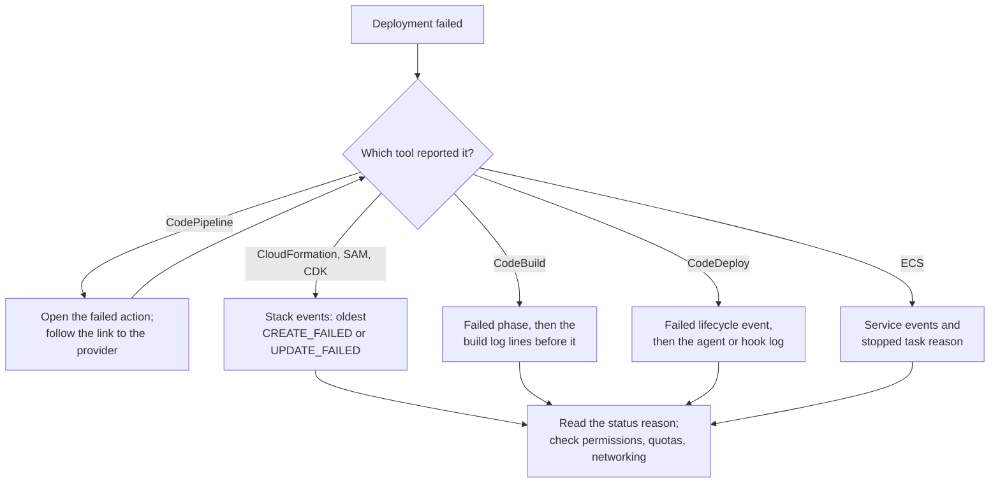

# 4.1.4 Diagnose deployment failures from build and deployment output logs

**Domain 4 · Task 4.1 · Skill 4.1.4** · [Task overview](README.md) · Previous: [4.1.3 Querying logs](4.1.3-querying-logs.md) · Next: [4.1.5 AI-assisted error analysis](4.1.5-ai-assisted-error-analysis.md)

## What the exam expects

This skill tests whether you know where each AWS deployment tool writes its failure output and how to read the first real error. Questions name a symptom (a stack rolled back, a build failed at `docker build`, Amazon ECS tasks keep stopping, a CodeDeploy hook timed out) and ask for the cause or the next step. The common thread: find the first failure, not the last, and check permissions and networking before code.

You must be able to:

- Find failure output for AWS CloudFormation, AWS SAM, AWS Cloud Development Kit (AWS CDK), AWS CodeBuild, AWS CodeDeploy, AWS CodePipeline, Amazon ECS, AWS Elastic Beanstalk, AWS Lambda deployments, and AWS Amplify.
- Read CloudFormation stack events and recover from `UPDATE_ROLLBACK_FAILED`.
- Recognize common CodeBuild errors, including Docker builds without privileged mode.
- Map a CodeDeploy failure to its lifecycle hook and the agent log.
- Read an ECS stopped-task reason.

## Key terms

| Term | Meaning |
|---|---|
| Stack events | CloudFormation's ordered log of every resource operation in a stack, with a status reason on each failure. |
| Status reason | The text on a failed stack event that explains why that resource failed. |
| Build phase | A CodeBuild step: `SUBMITTED`, `QUEUED`, `PROVISIONING`, `DOWNLOAD_SOURCE`, `INSTALL`, `PRE_BUILD`, `BUILD`, `POST_BUILD`, `UPLOAD_ARTIFACTS`, `FINALIZING`. |
| Lifecycle event hook | A CodeDeploy step that runs your script or function, such as `BeforeInstall` or `ValidateService`. |
| Stopped reason | The text ECS records when a task stops, such as `CannotPullContainerError`. |
| Service role | The AWS Identity and Access Management (IAM) role a deployment service assumes to act for you (CloudFormation, CodeBuild, CodePipeline, CodeDeploy). Missing permissions here cause many failures. |

## Where each tool writes its failure output

| Tool | Where to look | Typical failures |
|---|---|---|
| **CloudFormation, AWS SAM, AWS CDK** | Stack **events** (first `CREATE_FAILED` or `UPDATE_FAILED` status reason), `sam deploy` or `cdk deploy` output, AWS CloudTrail | Missing capabilities, missing IAM permissions or `iam:PassRole`, resource name collisions, invalid property values, quotas, custom resource timeouts, CDK environment not bootstrapped, artifact bucket access |
| **CodeBuild** | Build logs in Amazon CloudWatch Logs and/or Amazon S3; phase details in the console | Command exits non-zero, missing permissions (Amazon Elastic Container Registry [Amazon ECR] push, S3, Secrets Manager), Docker without privileged mode, virtual private cloud (VPC) build with no network address translation (NAT) gateway, wrong `runtime-versions`, buildspec YAML (YAML Ain't Markup Language) errors, timeouts |
| **CodeDeploy** | Deployment events per lifecycle hook in the console; on instances, `/opt/codedeploy-agent/deployment-root/deployment-logs/codedeploy-agent-deployments.log` and `/var/log/aws/codedeploy-agent/codedeploy-agent.log`; Lambda hook function logs | Agent not running, instance profile cannot read the revision, hook script error or timeout, health checks failing, `ApplicationStop` failing from the old revision, alarm-triggered rollback |
| **CodePipeline** | Action execution details, with links to the provider's logs | Service role permissions, source connection permissions, artifact bucket or AWS Key Management Service (AWS KMS) key access, cross-account role problems |
| **Amazon ECS** | Service **events** tab, stopped task **stopped reason**, container logs | Image pull failures, secrets or log configuration failures, essential container exits, out of memory, failing load balancer health checks, deployment circuit breaker rollback |
| **Elastic Beanstalk** | Environment **events**, `eb logs` (`/var/log/eb-engine.log`, `/var/log/web.stdout.log`), health dashboard | `.ebextensions` command failures, dependency install failures, wrong health check path, deployment timeouts |
| **Lambda deployment** | AWS Command Line Interface (AWS CLI) or API error, then the first invocation's log | Package too large, wrong handler, image not in Amazon ECR or architecture mismatch, code storage quota |
| **Amplify** | Build logs per phase in the Amplify console | `amplify.yml` errors, missing environment variables |



## CloudFormation, AWS SAM, and AWS CDK

Every SAM and CDK deployment is a CloudFormation stack, so stack events are the source of truth for all three.

- **Read the first failure.** After one resource fails, CloudFormation cancels others and rolls back, producing many `Resource creation cancelled` events. The oldest `CREATE_FAILED` or `UPDATE_FAILED` event carries the real reason.

  ```bash
  aws cloudformation describe-stack-events --stack-name orders-prod \
    --query "StackEvents[?contains(ResourceStatus, 'FAILED')].[Timestamp,LogicalResourceId,ResourceStatusReason]" \
    --output table
  ```

- **Rollback behavior.** A failed create rolls back and deletes what it made (`ROLLBACK_COMPLETE`; delete the stack before retrying). A failed update rolls back to the last working state (`UPDATE_ROLLBACK_COMPLETE`). Disable rollback (`--disable-rollback` or `--on-failure DO_NOTHING`) to keep failed resources for debugging, for example to read `/var/log/cfn-init.log` on an instance that never sent `cfn-signal`.
- **`UPDATE_ROLLBACK_FAILED`.** A resource could not return to its original state, often because it was changed or deleted outside CloudFormation. Fix the cause (recreate the resource, send missing signals with `signal-resource`, add permissions, or wait for a resource to stabilize), then run `continue-update-rollback`. If that still fails, skip the resources with `--resources-to-skip`; skipped resources are marked `UPDATE_COMPLETE` and must be brought back in line with the template before the next update.

| Status reason or error | Cause | Fix |
|---|---|---|
| `InsufficientCapabilitiesException` / `Requires capabilities : [CAPABILITY_IAM]` | Template creates IAM resources | `--capabilities CAPABILITY_IAM`, or `CAPABILITY_NAMED_IAM` for named IAM resources |
| `Requires capabilities : [CAPABILITY_AUTO_EXPAND]` | Template uses macros or the SAM transform with nested applications | Add `CAPABILITY_AUTO_EXPAND` |
| `not authorized to perform: iam:PassRole` | The caller hands a service role to CloudFormation (or another service) without permission | Grant `iam:PassRole` on that role |
| `... already exists` | Hard-coded physical name collides with an existing resource | Let CloudFormation generate names, or remove the conflict |
| Invalid property value, resource not found | Wrong parameter (key pair, VPC ID) for this account or Region | Use AWS-specific parameter types; fix the value |
| Quota exceeded | Account quota reached; a replacement creates the new resource before deleting the old | Delete unused resources or request an increase |
| Resource failed to stabilize | Operation exceeded the timeout or the service was interrupted | Retry; use a service role for long operations |
| Custom resource timed out | The backing Lambda function never sent a response to the presigned URL | Make the function always respond, including on errors |
| CDK: `SSM parameter /cdk-bootstrap/... not found` or `This stack uses assets, so the toolkit stack must be deployed` | Environment not bootstrapped | `cdk bootstrap aws://<account>/<region>` |

Rollback strategy itself (rollback triggers, CodeDeploy alarms) is in [3.3.7 Rollback](../../domain-3-testing-and-deployment/task-3.3-deploy-with-ci-cd/3.3.7-rollback.md).

## CodeBuild

CodeBuild runs `buildspec.yml` (at the root of the source unless you override the path) in a container and streams output to CloudWatch Logs and/or S3. The console shows which phase failed; the log lines just before it show why.

| Symptom in the log | Cause | Fix |
|---|---|---|
| `Cannot connect to the Docker daemon at unix:/var/run/docker.sock` | Privileged mode is off | Enable privileged mode on the project environment |
| `YAML_FILE_ERROR` or buildspec not found | Buildspec missing at the root, wrong path, or invalid YAML | Fix the location or syntax |
| `BUILD_CONTAINER_UNABLE_TO_PULL_IMAGE` | Custom image too large for the compute type, no ECR pull permission, image in another Region, or a private registry in a VPC without internet access | Larger compute type or smaller image, ECR repository policy, same-Region image |
| `toomanyrequests` pulling from Docker Hub | Docker Hub pull rate limit | Pull from Amazon ECR, or authenticate to Docker Hub |
| Command `exit status 1` in `BUILD` | Tests or compile failed | Fix the code; run the build locally with the CodeBuild agent |
| `AccessDenied` pushing to ECR or reading a secret | Service role lacks `ecr:*` push actions, `secretsmanager:GetSecretValue`, or `ssm:GetParameters` | Add the permission to the CodeBuild service role |
| Timeouts reaching the internet or AWS APIs in a VPC build | Private subnet without NAT gateway or VPC endpoints | Add NAT or endpoints |
| `CodeBuild is not authorized to perform: sts:AssumeRole` | Service role missing, misspelled (role names are case-sensitive), or trust policy does not trust CodeBuild | Fix the role and trust policy |
| Cache never used | First build after enabling cache, or role lacks `s3:GetObject`/`s3:PutObject` on the cache bucket | Expected once; otherwise fix permissions |
| Build stopped at the timeout | Build ran longer than the project timeout (default 60 minutes; 5 to 2,160 minutes allowed) | Raise the timeout or speed up the build |

## CodeDeploy

Deployment events show which lifecycle event failed on which instance. On EC2 and on-premises targets, the order is `ApplicationStop`, `DownloadBundle`, `BeforeInstall`, `Install`, `AfterInstall`, `ApplicationStart`, `ValidateService`. Lambda and ECS deployments use `BeforeAllowTraffic` and `AfterAllowTraffic` hook functions, whose logs are in their own log groups.

| Symptom | Likely cause |
|---|---|
| Fails immediately on every instance | Agent not installed or not running |
| Fails at `DownloadBundle` | Instance profile cannot read the S3 revision, or lacks `kms:Decrypt` |
| Fails at `ApplicationStop` after a bad release | The previous revision's stop script is broken; fix it or deploy with `--ignore-application-stop-failures` |
| Fails at a hook | Script exits non-zero, wrong path or permissions, wrong `runas` user, or exceeded its `timeout` |
| Stuck in progress | Hook hangs, or a Lambda or ECS hook never calls `PutLifecycleEventHookExecutionStatus` |
| Rolled back without a script error | A CloudWatch alarm on the deployment group went into ALARM |

The full troubleshooting table and fixes are in [3.3.4 CodeDeploy](../../domain-3-testing-and-deployment/task-3.3-deploy-with-ci-cd/3.3.4-codedeploy.md#troubleshooting).

## CodePipeline

- A failed action stops the pipeline at that stage. The action's details link to the CodeBuild log, CloudFormation stack, or CodeDeploy deployment, which holds the actual error.
- "Access denied" on an action usually means the **pipeline service role** lacks permission for that provider, or a cross-account action cannot use the artifact bucket's AWS KMS key.
- Use Amazon EventBridge rules on pipeline, stage, and action state changes (or notification rules) to alert on failures ([4.2.3](../task-4.2-observability/4.2.3-alerts-and-notifications.md)).

## Amazon ECS

Start with the service's **Events** tab ("unable to place a task", "task failed Elastic Load Balancing (ELB) health checks"), then a stopped task's **stopped reason**.

| Stopped reason | Cause | Fix |
|---|---|---|
| `CannotPullContainerError` | Task execution role cannot pull from ECR, or no network path (private subnet without NAT gateway or ECR and S3 endpoints), or wrong image tag | Execution role permissions, VPC endpoints or NAT, correct image uniform resource identifier (URI) |
| `ResourceInitializationError` | Cannot retrieve secrets or registry auth, or cannot create the log stream | Execution role access to Secrets Manager, Parameter Store, KMS, and CloudWatch Logs; network path |
| `Essential container in task exited` | The application crashed at startup | Container logs |
| `OutOfMemoryError: Container killed due to memory usage` | Container exceeded its hard memory limit | Raise memory or fix the leak |
| Task failed ELB health checks | App not listening, wrong health check path or port, or the grace period is too short for startup | Fix the health check or `healthCheckGracePeriodSeconds` ([4.2.5](../task-4.2-observability/4.2.5-health-checks-and-probes.md)) |
| Unable to place a task | Not enough central processing unit (CPU) or memory in the cluster, or placement constraints cannot be met | Add capacity or use Fargate |

With the deployment circuit breaker enabled, ECS rolls back automatically when new tasks keep failing to reach a steady state. Deployment mechanics are in [3.3.2 Container deployments](../../domain-3-testing-and-deployment/task-3.3-deploy-with-ci-cd/3.3.2-container-deployments.md).

## Lambda deployment errors

| Error | Cause | Fix |
|---|---|---|
| `RequestEntityTooLargeException` | Direct .zip upload over 50 MB | Upload through S3 |
| Unzipped size over 250 MB | Package plus layers exceed the unzipped limit | Trim dependencies or use a container image (up to 10 GB) |
| `CodeStorageExceededException` | Lambda-managed code storage per Region is full (300 GB in current documentation; older material says 75 GB). Every published version and layer version counts | Delete unused versions and layer versions, or use self-managed S3 code storage |
| `Runtime.HandlerNotFound` at first invoke | Handler string does not match `file.function` | Fix the handler setting |
| `Runtime.ImportModuleError` | Dependency not in the package or built for the wrong platform | Package dependencies for Amazon Linux and the function's architecture |
| `exec format error` from a container image | Image architecture (`arm64` or `x86_64`) does not match the function | Build for the configured architecture |

Packaging choices are in [3.3.1 Lambda packaging](../../domain-3-testing-and-deployment/task-3.3-deploy-with-ci-cd/3.3.1-lambda-packaging.md).

## Elastic Beanstalk and Amplify

- **Elastic Beanstalk:** environment events show the failing step. `eb logs` (or "Request logs" in the console) pulls instance logs, including `/var/log/eb-engine.log` for deployment steps and `/var/log/web.stdout.log` for the application. Common causes: an `.ebextensions` command that fails, a dependency that will not install, a health check path that returns errors.
- **Amplify:** each build phase (provision, build, deploy) has its own log in the console. Check `amplify.yml` and branch environment variables.

## When the deploy succeeded but the application broke

A green deployment that is followed by errors often carries an infrastructure change the team did not review. Check AWS CloudTrail for configuration changes around the deploy time ([4.1.1](4.1.1-debugging-code-and-integrations.md#finding-what-changed-with-cloudtrail)), compare the deployed revision or task definition with the previous one, and check whether the deployment's alarms were configured to roll back.

## Exam triggers

| Scenario clue | Answer | Why the alternatives are wrong |
|---|---|---|
| "Stack rolled back; find why" | Oldest `CREATE_FAILED`/`UPDATE_FAILED` event's status reason | Later events are cancellations |
| "Stack stuck in `UPDATE_ROLLBACK_FAILED`" | Fix the resource, then `continue-update-rollback` (skip resources if needed) | Deleting and recreating the stack loses data and is not required |
| `InsufficientCapabilitiesException` | Add `CAPABILITY_IAM` or `CAPABILITY_NAMED_IAM` | It is not a permissions error on the caller |
| "CodeBuild fails at `docker build`" | Enable privileged mode | The service role is not the issue for the daemon error |
| "CodeBuild cannot find build instructions" | `buildspec.yml` at the source root or set the path | Not a CodePipeline problem |
| "ECS tasks stop with `CannotPullContainerError`" | Task execution role, ECR endpoints or NAT, image URI | The task role is for the application's AWS calls |
| "CodeDeploy fails at once on every EC2 instance" | Agent not running, or instance profile cannot read the bundle | The appspec cannot run without the agent |
| "Lambda deploy fails: code storage limit" | Delete old versions and layer versions | Raising memory does not affect storage |
| "Pipeline action fails with access denied" | Pipeline service role permissions | The developer's own permissions are not used by the pipeline |

## Common traps

- Reading the last stack event instead of the first failure.
- Confusing the ECS task execution role (pull images, fetch secrets, write logs) with the task role (application calls).
- Confusing the CodeBuild service role with the developer's IAM permissions.
- Forgetting that a failed stack create leaves `ROLLBACK_COMPLETE`, which must be deleted before re-creating.
- Assuming CodeDeploy rollback restores the old deployment. It redeploys the last good revision as a new deployment.
- Missing that a VPC-attached build or task needs NAT or VPC endpoints to reach ECR, S3, and other AWS APIs.

## Quick recall

- CloudFormation: stack events, first failure. `UPDATE_ROLLBACK_FAILED` means fix, then `continue-update-rollback`.
- Capabilities: `CAPABILITY_IAM`, `CAPABILITY_NAMED_IAM`, `CAPABILITY_AUTO_EXPAND`.
- CodeBuild: logs in CloudWatch Logs and/or S3; Docker needs privileged mode; timeout 5 to 2,160 minutes.
- CodeDeploy agent log: `/opt/codedeploy-agent/deployment-root/deployment-logs/codedeploy-agent-deployments.log`.
- EC2 hook order: `ApplicationStop`, `DownloadBundle`, `BeforeInstall`, `Install`, `AfterInstall`, `ApplicationStart`, `ValidateService`.
- ECS: service events plus stopped reason. `CannotPullContainerError` is usually the execution role or the network path.
- Lambda limits: 50 MB zipped direct upload, 250 MB unzipped, 10 GB image, 300 GB code storage per Region.
- Beanstalk: `eb logs`, `/var/log/eb-engine.log`.

## Related skills

- [3.3.3 Infrastructure as code deployment](../../domain-3-testing-and-deployment/task-3.3-deploy-with-ci-cd/3.3.3-infrastructure-as-code-deployment.md): capabilities, service roles, and stack updates.
- [3.3.4 CodeDeploy](../../domain-3-testing-and-deployment/task-3.3-deploy-with-ci-cd/3.3.4-codedeploy.md): appspec files, hooks, and the full troubleshooting table.
- [3.3.5 CodePipeline release promotion](../../domain-3-testing-and-deployment/task-3.3-deploy-with-ci-cd/3.3.5-codepipeline-release-promotion.md): stages, actions, and artifacts.
- [3.3.7 Rollback](../../domain-3-testing-and-deployment/task-3.3-deploy-with-ci-cd/3.3.7-rollback.md): automatic and manual rollback.
- [3.1.2 Container images and ECR](../../domain-3-testing-and-deployment/task-3.1-prepare-deployable-artifacts/3.1.2-container-images-and-ecr.md): image tags and pull permissions.
- [4.1.5 AI-assisted error analysis](4.1.5-ai-assisted-error-analysis.md): summarizing long build logs with AI.

## Sources

- Merged from: `archive/dva-c03-study-notes/04-troubleshooting-optimization.md` (skill 4.1.4 tool table), `archive/dva-c03-study-notes/03-testing-deployment.md` (CodeBuild environment, CodeDeploy troubleshooting, rollback), `archive/aws-dva-notes/Markdown Files/21. CICD - CodeCommit, CodePipeline, CodeBuild, CodeDeploy.md` (buildspec, hooks, pipeline troubleshooting, agent), `archive/aws-dva-notes/Markdown Files/15. CloudFormation.md` (rollbacks, capabilities, `iam:PassRole`), `archive/dva-c03/domain-3-testing-deployment/MASTER-CHUNK.md` (`UPDATE_ROLLBACK_FAILED`)
- AWS documentation: [Troubleshooting CloudFormation](https://docs.aws.amazon.com/AWSCloudFormation/latest/UserGuide/troubleshooting.html) (update rollback failed, resources to skip, quotas, stabilization)
- AWS documentation: [Troubleshooting AWS CodeBuild](https://docs.aws.amazon.com/codebuild/latest/userguide/troubleshooting.html) (privileged mode, image pull, `sts:AssumeRole`, cache)
- AWS documentation: [Quotas for AWS CodeBuild](https://docs.aws.amazon.com/codebuild/latest/userguide/limits.html) (build timeout 5 to 2,160 minutes)
- AWS documentation: [Lambda quotas](https://docs.aws.amazon.com/lambda/latest/dg/gettingstarted-limits.html) (package sizes, 300 GB code storage)
