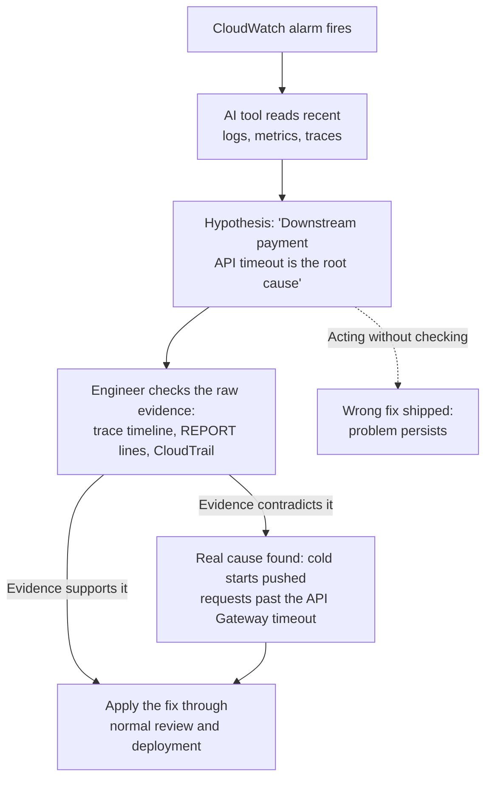

# 4.1.5 Use AWS AI tools to analyze errors and propose troubleshooting steps

**Domain 4 · Task 4.1 · Skill 4.1.5** · [Task overview](README.md) · Previous: [4.1.4 Diagnosing deployment failures](4.1.4-diagnosing-deployment-failures.md) · Next: [4.2.1 Structured logging](../task-4.2-observability/4.2.1-structured-logging.md)

## What the exam expects

This skill is new in the AWS Certified Developer - Associate (DVA-C03) exam. It tests whether you know which AWS artificial intelligence (AI) feature helps with which troubleshooting job, and whether you treat its output as a hypothesis to check against the real telemetry. Questions name a need (explain a stack trace and propose a fix, investigate an alarm across many resources, write a log query from a plain-English question) and ask for the tool, or describe an AI conclusion and ask what to do next. Wrong answers let an AI tool apply a fix to production with no review, or send secrets to it.

You must be able to:

- Match a troubleshooting need to Kiro, Amazon CloudWatch investigations, CloudWatch Logs Insights natural-language features, AWS X-Ray Insights, or Amazon Bedrock in your own tooling.
- Verify an AI-proposed root cause against logs, metrics, traces, and AWS CloudTrail before acting.
- Keep secrets and personal data out of what you send to an AI tool.
- Keep a human approval step before any remediation the AI proposes.

## Key terms

| Term | Meaning |
|---|---|
| Hypothesis | A proposed root cause that still needs evidence. Every AI root cause starts as one. |
| CloudWatch investigations | A generative AI feature in CloudWatch that scans telemetry related to an alarm, metric, or Logs Insights query and proposes observations and root-cause hypotheses. |
| Investigation group | The account-level configuration that turns on the fuller investigation experience (saved findings, cross-account data, runbook suggestions, reports). |
| Bugfix spec | A Kiro spec (`bugfix.md`, `design.md`, `tasks.md`) that records current, expected, and unchanged behavior and the root cause before the fix is written. |
| MCP | Model Context Protocol: an open standard that connects an AI agent to tools and data, such as AWS documentation or CloudWatch. |
| Hallucination | Confident output that is wrong, such as a root cause the data does not support. |

## Which tool for which job

| Need | Tool | What it does |
|---|---|---|
| Explain a stack trace or failing test and propose a code fix with tests | **Kiro** | Reads the error, the code, and terminal output; traces the error to the code; proposes a diff or a bugfix spec; runs tests to confirm |
| Investigate an alarm or incident across many resources | **CloudWatch investigations** | Surfaces related metrics, logs, deployment events, AWS Health events, CloudTrail change events, and X-Ray data, and proposes root-cause hypotheses with visualizations |
| Write a Logs Insights query from a plain-English question | **Logs Insights query generation** | Generates the query and a line-by-line explanation |
| Summarize a large result set | **Logs Insights results summary** | Natural-language summary of query results |
| Find unusual or new log lines | **Logs pattern analysis and anomaly detection** | Groups similar lines and flags new or spiking patterns |
| Get told when a service's fault rate departs from normal | **X-Ray Insights** | Opens an insight with the affected service, timeline, and example traces |
| Build your own analysis step, for example summarizing CodeBuild failures on each pull request | **Amazon Bedrock** called from AWS Lambda or a pipeline | You control the prompt, the data sent, and where the answer goes |

> **Not on the DVA-C03 service list.** AWS DevOps Agent is an AI agent for production operations. It starts investigating when an alert or ticket arrives, correlates telemetry, code, and deployment data to find a root cause, proposes mitigation steps (including reverting a change), and can hand code-fix instructions to a coding agent such as Kiro. The CloudWatch investigations page now points to it for an improved investigation experience. It reviews code changes too ([3.3.9](../../domain-3-testing-and-deployment/task-3.3-deploy-with-ci-cd/3.3.9-ai-assisted-deployment.md)).

> **Not on the DVA-C03 service list.** Amazon Q Developer was the AI developer assistant in DVA-C02 material, including "explain this error" and console troubleshooting help. DVA-C03 names Kiro. If a question mentions Q Developer, answer from the capability and apply the same review rules.

## Kiro for code-level errors

- **Paste or point.** Give Kiro the stack trace, or let the agent read the failing test output and the files involved. It explains the error, finds the line that causes it, and proposes a fix.
- **Bugfix specs.** For non-trivial defects, a bugfix spec writes down the current behavior, the expected behavior, the behavior that must not change, and the root cause before any code changes. The tasks then include a regression test.
- **MCP servers.** Connecting MCP servers for AWS documentation or CloudWatch lets the agent read the real logs and metrics instead of guessing from a pasted fragment.
- **Hooks.** A hook can run tests after each save and ask the agent to analyze failures, so error analysis happens as part of the edit loop.
- **Headless mode.** The Kiro command line interface (CLI) can run in a continuous integration (CI) job to triage a failed build and post findings on the pull request.
- **Guardrails.** Use `.kiroignore` for secret files, scope the agent's permissions, and review every diff. Feature details are in [1.1.9](../../domain-1-development-with-aws-services/task-1.1-build-application-code/1.1.9-ai-assisted-development-tools.md).

## CloudWatch investigations for incidents

- **Start points:** a CloudWatch alarm, a metric, or a Logs Insights query in the console.
- **What it surfaces:** metrics, logs, deployment events, AWS Health events, CloudTrail change events, X-Ray trace data, and Logs Insights queries that may relate to the issue, plus root-cause hypotheses with visual maps when several resources are involved.
- **Permissions:** without extra setup, an investigation uses the signed-in user's permissions, creates no resources, and every action it takes is logged in CloudTrail.
- **With an investigation group configured:** accept or discard each suggestion so it refines toward a root cause, pull data from other accounts through CloudWatch cross-account observability, add CloudTrail, X-Ray, CloudWatch Application Signals, and Amazon EKS as sources, share investigations with the team, run suggested AWS Systems Manager Automation runbooks, and generate an incident report.
- **Limits:** one investigation group per account, up to 2 concurrent active investigations, and up to 150 enhanced investigations per account per month.

## Verify before acting

An AI summary of logs tends to latch onto the most frequent error in the window, which is often a downstream symptom. The first, causal error can be rarer.



**Worked case.** During an outage, an assistant summarizes CloudWatch Logs and states that a downstream payment API timeout caused the incident. The timeout appears on almost every failing request. The X-Ray trace timeline shows the time is in the Lambda service segment, and the `REPORT` lines show large `Init Duration` values: cold starts after a traffic spike pushed requests past the API Gateway integration timeout, and the backed-up requests then timed out downstream. Raising the downstream timeout, the AI's suggestion, would not fix it. The checks that settle it are in [4.1.2](4.1.2-metrics-logs-and-traces.md).

How to check an AI conclusion:

1. Find the evidence it cites and open it yourself: the log lines, the trace, the metric graph.
2. Check timing. The root cause should start at or before the first symptom.
3. Check CloudTrail for a change near the start time that the AI did not mention.
4. Test the fix in a lower environment, or reproduce the failure first.
5. Ship the fix through the normal pipeline with review. Approve any suggested runbook before it runs.

Output quality depends on input. An assistant that was not told about a known dependency outage, your idempotency convention, or a recent deploy cannot account for it. Confident wording is not evidence.

## Bedrock in your own troubleshooting tooling

A common pattern: an Amazon EventBridge rule matches a failed CodeBuild build, a Lambda function fetches the end of the build log, removes secrets, asks a Bedrock model for a likely cause and next steps, and posts the answer to the pull request or chat channel for a human.

```python
import re
import boto3

logs = boto3.client("logs")
bedrock = boto3.client("bedrock-runtime")

SECRET = re.compile(r"(AKIA[0-9A-Z]{16}|password=\S+|Bearer \S+)")

def handler(event, context):
    detail = event["detail"]["additional-information"]["logs"]
    out = logs.get_log_events(
        logGroupName=detail["group-name"],
        logStreamName=detail["stream-name"],
        startFromHead=False, limit=200,
    )
    text = "\n".join(e["message"] for e in out["events"])
    text = SECRET.sub("[REDACTED]", text)          # never send secrets to a model
    resp = bedrock.converse(
        modelId="amazon.nova-pro-v1:0",
        messages=[{"role": "user", "content": [{"text":
            "This CodeBuild log ends in a failure. Name the first real error, "
            "the likely cause, and 3 next steps. Say if the log is insufficient.\n\n" + text}]}],
    )
    return resp["output"]["message"]["content"][0]["text"]  # posted for human review
```

The function's execution role needs `logs:GetLogEvents` on the build log group and `bedrock:InvokeModel` on that model only. Bedrock errors (`ThrottlingException`, `AccessDeniedException`) are handled like any other AWS API error ([4.1.1](4.1.1-debugging-code-and-integrations.md#common-integration-failures)). Calling Bedrock from code is covered in [1.1.10](../../domain-1-development-with-aws-services/task-1.1-build-application-code/1.1.10-managed-ai-service-integration.md).

## Safe use

| Rule | Why |
|---|---|
| Scrub secrets and personal data before sending logs or stack traces | Stack traces can contain connection strings and tokens; prompts may be stored |
| Give AI tools least-privilege, read-mostly access | An investigation should read telemetry, not change resources |
| Keep a human approval before remediation | AI output can be wrong; runbooks and rollbacks change production |
| Prefer tools that read the raw telemetry over pasted fragments | A fragment hides the first error and the timeline |
| Keep the AI step out of the critical path of the deploy | Deterministic checks (alarms, tests, rollback) decide; AI explains |

Protecting prompts and responses that land in logs is covered in [2.3.5](../../domain-2-security/task-2.3-secure-ai-services/2.3.5-ai-sensitive-data-in-logs.md).

## Exam triggers

| Scenario clue | Answer | Why the alternatives are wrong |
|---|---|---|
| "Help a developer understand an exception and generate a fix with tests" | Kiro (bugfix spec or chat with the code and error) | CloudWatch investigations works on telemetry, not source code |
| "Speed up root-cause analysis of a production alarm across many resources" | CloudWatch investigations | Manually switching consoles is the slow path it replaces |
| "Write a Logs Insights query from a plain-English question" | Logs Insights natural-language query generation | No separate service is needed |
| "AI says the root cause is X; what next?" | Treat it as a hypothesis and verify against logs, traces, and metrics | Applying it at once risks the wrong fix; refusing AI help entirely is not the expected practice |
| "Automatically summarize build failures on every pull request" | EventBridge on CodeBuild failure, Lambda, Bedrock, post the result | Auto-committing a model's fix skips review |
| "Developer wants to paste a stack trace into an assistant" | Remove credentials and personal data first | Stack traces often contain them |
| "AI suggests a remediation runbook" | Human approves before it runs | Unreviewed changes to production are the wrong-answer pattern |
| "Flag a cluster of failing traces automatically" | X-Ray Insights | The service map needs you to notice the anomaly |

## Common traps

- Accepting the most frequent error in an AI summary as the root cause.
- Letting AI output reach production without a human checkpoint.
- Sending logs with secrets or personal data to an assistant.
- Picking a source-code tool for an operations question, or the reverse.
- Treating Amazon Q Developer or AWS DevOps Agent as DVA-C03 in-scope services. Answer from the capability.
- Believing AI analysis removes the need for structured logs, metrics, and traces. It reads the same telemetry; with poor instrumentation it has little to work with.

## Quick recall

- Kiro: code-level errors, bugfix specs, MCP for real telemetry, hooks for test failures, headless CLI in CI.
- CloudWatch investigations: starts from an alarm, metric, or Logs Insights query; proposes hypotheses from metrics, logs, deployments, Health, CloudTrail, and X-Ray.
- Investigations use the signed-in user's permissions and log their actions in CloudTrail.
- Logs Insights: natural-language query generation, results summary, pattern analysis.
- X-Ray Insights: automatic fault-rate anomaly detection.
- Bedrock: your own analysis step; scrub input, least-privilege role, human review of output.
- Every AI root cause is a hypothesis until the evidence confirms it.

## Related skills

- [1.1.9 AI-assisted development tools](../../domain-1-development-with-aws-services/task-1.1-build-application-code/1.1.9-ai-assisted-development-tools.md): Kiro features and responsible use.
- [3.2.5 AI-assisted testing](../../domain-3-testing-and-deployment/task-3.2-test-applications/3.2.5-ai-assisted-testing.md): analyzing test failures with AI.
- [3.3.9 AI-assisted deployment](../../domain-3-testing-and-deployment/task-3.3-deploy-with-ci-cd/3.3.9-ai-assisted-deployment.md): AI in post-deployment validation.
- [4.1.2 Metrics, logs, and traces](4.1.2-metrics-logs-and-traces.md): the evidence used to verify an AI conclusion.
- [4.3.6 AI-assisted optimization](../task-4.3-optimize-applications/4.3.6-ai-assisted-optimization.md): the same tools applied to performance and cost.
- [2.3.5 AI sensitive data in logs](../../domain-2-security/task-2.3-secure-ai-services/2.3.5-ai-sensitive-data-in-logs.md): keeping prompts and responses out of logs.

## Sources

- Merged from: `archive/dva-c03-study-notes/04-troubleshooting-optimization.md` (skill 4.1.5 tools and triggers), `archive/dva-c03/domain-1-development/ai-assisted-development.md` (verification pattern, failure modes, worked error-analysis scenario, limits), `archive/aws-dva-notes/Markdown Files/30. AI Services & Security (DVA-C03).md` (Kiro features, Bedrock API, C03 service list changes), `archive/dva-c03/domain-4-troubleshooting-optimization/observability-instrumentation.md` (X-Ray Insights), `archive/dva-c03/domain-4-troubleshooting-optimization/README.md` (AI use case)
- AWS documentation: [CloudWatch investigations](https://docs.aws.amazon.com/AmazonCloudWatch/latest/monitoring/Investigations.html) (data sources, permissions, investigation group, limits)
- AWS documentation: [Analyzing log data with CloudWatch Logs Insights](https://docs.aws.amazon.com/AmazonCloudWatch/latest/logs/AnalyzingLogData.html) (natural-language query generation, results summary, pattern analysis)
- AWS documentation: [About AWS DevOps Agent](https://docs.aws.amazon.com/devopsagent/latest/userguide/about-aws-devops-agent.html)
