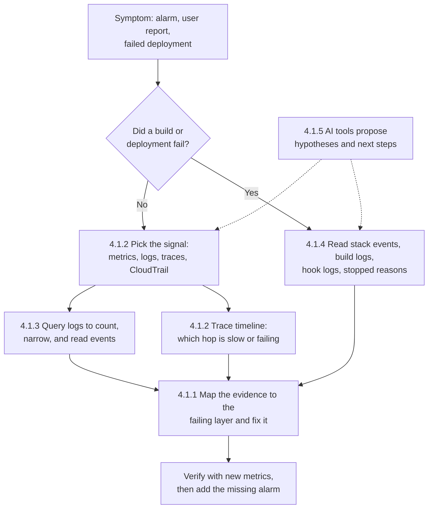

# Task 4.1: Assist with root-cause analysis

**Domain 4 · Task 4.1** · [Domain overview](../README.md)

This task covers finding out why something deployed in Domains 1 to 3 is failing or slow. It starts with debugging code and service integrations, then reading the evidence (Amazon CloudWatch metrics and logs, AWS X-Ray traces, AWS CloudTrail audit events), querying logs with CloudWatch Logs Insights, reading the output of failed builds and deployments, and using AWS artificial intelligence (AI) tools to propose a root cause that you then verify. It depends on [Task 4.2](../task-4.2-observability/README.md): root-cause analysis works only when structured logs, custom metrics, and traces exist before the incident. Once the cause is known, [Task 4.3](../task-4.3-optimize-applications/README.md) applies the tuning fix.

> **DVA-C02 vs DVA-C03.** Domain 4 grows from 18% to 22% of the exam. Task 4.1 adds skill 4.1.5, AI-assisted error analysis and troubleshooting suggestions. Amazon Q Developer, used for error explanations in DVA-C02 material, is not on the DVA-C03 service list; Kiro and CloudWatch investigations are the tools to know.

## Skills

| Skill | Note | Covers |
|---|---|---|
| 4.1.1 | [Debugging code and integrations](4.1.1-debugging-code-and-integrations.md) | Evidence-driven debugging workflow, Amazon API Gateway 4xx and 5xx codes, Lambda timeout, memory, throttle, and permission errors, event source and queue failures, Amazon DynamoDB and Amazon S3 errors, cross-origin resource sharing (CORS), rejections in front of the backend, CloudTrail for "what changed", local and console debugging tools |
| 4.1.2 | [Metrics, logs, and traces](4.1.2-metrics-logs-and-traces.md) | Choosing the signal, the Lambda `REPORT` line, cold-start diagnosis with `Init Duration`, key metrics for Lambda, API Gateway, Amazon SQS, DynamoDB, and Application Load Balancer (ALB), percentiles, X-Ray service maps, timelines, annotations versus metadata, sampling, missing and broken traces |
| 4.1.3 | [Querying logs](4.1.3-querying-logs.md) | Logs Insights pipeline and commands, JavaScript Object Notation (JSON) and `parse`, Lambda queries, cross-log-group correlation, a worked investigation, empty results, cost and limits, metric filters versus subscriptions versus export |
| 4.1.4 | [Diagnosing deployment failures](4.1.4-diagnosing-deployment-failures.md) | Where AWS CloudFormation, AWS Serverless Application Model (AWS SAM), AWS Cloud Development Kit (AWS CDK), CodeBuild, CodeDeploy, CodePipeline, Amazon ECS, Elastic Beanstalk, Lambda, and Amplify write failure output; stack events and `UPDATE_ROLLBACK_FAILED`; CodeBuild errors; ECS stopped reasons; Lambda package limits |
| 4.1.5 | [AI-assisted error analysis](4.1.5-ai-assisted-error-analysis.md) | Kiro for code errors, CloudWatch investigations, Logs Insights natural-language features, X-Ray Insights, Bedrock in custom tooling, verifying AI conclusions, safe use |

## How the skills fit together

Route a scenario with this table:

| The question is about | Go to |
|---|---|
| An error code or exception from API Gateway, Lambda, SQS, streams, DynamoDB, S3, Step Functions, Cognito, or Bedrock; "who changed it" | [4.1.1](4.1.1-debugging-code-and-integrations.md) |
| What a metric, `REPORT` line, percentile, service map, or trace proves; cold starts; missing traces | [4.1.2](4.1.2-metrics-logs-and-traces.md) |
| Writing or reading a Logs Insights query; queries that return nothing; metric filters, subscriptions, export | [4.1.3](4.1.3-querying-logs.md) |
| A stack, build, pipeline, CodeDeploy deployment, ECS service, Beanstalk environment, or Lambda upload that failed | [4.1.4](4.1.4-diagnosing-deployment-failures.md) |
| An AI tool explaining an error, investigating an alarm, writing a query, or proposing a fix | [4.1.5](4.1.5-ai-assisted-error-analysis.md) |

## Study checklist

- [ ] 4.1.1 Walk the debugging workflow: reproduce, isolate the layer, collect evidence, check for a change, fix, verify.
- [ ] 4.1.1 Map API Gateway 502, 504, 403, 429, and 500 to their causes, and name the fix for a malformed Lambda proxy response.
- [ ] 4.1.1 Tell an execution role problem from a resource-based policy problem, and diagnose SQS duplicates and stuck streams.
- [ ] 4.1.1 Use CloudTrail event history, trails, and data events to answer "who changed what", and know the 90-day limit.
- [ ] 4.1.2 Route a symptom to CloudWatch Logs, CloudWatch metrics, X-Ray, or CloudTrail.
- [ ] 4.1.2 Read every `REPORT` field and prove or rule out a cold start with `Init Duration`.
- [ ] 4.1.2 Interpret `Latency` versus `IntegrationLatency`, SQS age of oldest message, DynamoDB throttles, and ALB target versus Elastic Load Balancing (ELB) 5xx counts.
- [ ] 4.1.2 Read a service map and trace timeline; explain annotations versus metadata and the default sampling rule; diagnose a missing or orphaned trace.
- [ ] 4.1.3 Write Logs Insights queries with `filter`, `parse`, `stats ... by bin()`, `pct()`, and `dedup`, including Lambda `REPORT` queries.
- [ ] 4.1.3 Diagnose a query that returns nothing, and explain what drives query cost.
- [ ] 4.1.3 Choose Logs Insights, a metric filter, a subscription filter, export to S3, or Live Tail for a scenario.
- [ ] 4.1.4 Find the first failure in stack events and recover from `UPDATE_ROLLBACK_FAILED`.
- [ ] 4.1.4 Diagnose CodeBuild privileged mode, buildspec, image pull, and virtual private cloud (VPC) errors; map CodeDeploy failures to hooks and agent logs.
- [ ] 4.1.4 Read ECS stopped reasons and Lambda deployment limit errors.
- [ ] 4.1.5 Match a troubleshooting need to Kiro, CloudWatch investigations, Logs Insights natural-language features, X-Ray Insights, or Bedrock.
- [ ] 4.1.5 Verify an AI root cause against raw telemetry and keep a human approval before remediation.

## Labs and practice

- [Labs](labs.md):
  - Lab 1: quantify a failure rate with a Logs Insights query over generated Lambda logs.
  - Lab 2: reconstruct one failing request from correlated log lines.
  - Lab 3: compare cold and warm `REPORT` lines to prove a cold start.
  - Lab 4: pair AWS Config and CloudTrail on the same security group change.
- [Practice questions](practice-questions.md): 4 multiple-choice questions with explanations for every option.
