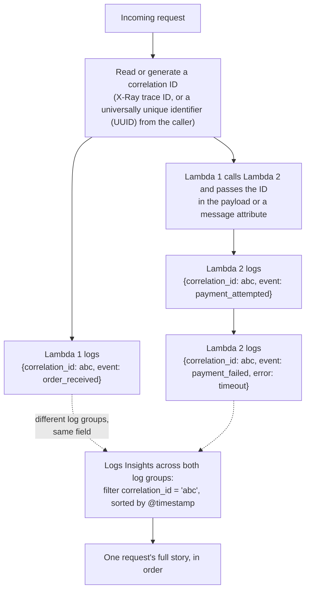

# 4.2.1 Implement structured logging that records application behavior, state, events, and user actions

**Domain 4 · Task 4.2 · Skill 4.2.1** · [Task overview](README.md) · Previous: [4.1.5 AI-assisted error analysis](../task-4.1-root-cause-analysis/4.1.5-ai-assisted-error-analysis.md) · Next: [4.2.2 Custom metrics](4.2.2-custom-metrics.md)

## What the exam expects

This skill tests whether you write logs that someone can search and correlate during an incident. Free-text `print("error")` lines are the anti-pattern. JSON log lines with consistent fields, a correlation ID, and the right log level are the answer. Questions also check that you know where each compute service sends its logs, how to change Lambda's log format and level without touching code, and what must never go into a log.

You must be able to:

- Emit JSON logs with a consistent field set, including a request or correlation ID.
- Propagate one ID across services so a single query rebuilds one request's story.
- Configure Lambda's JSON log format and application and system log levels.
- Use Powertools for AWS Lambda `Logger` for structured logs, context injection, and debug sampling.
- Send logs from Lambda, Amazon Elastic Container Service (ECS), Amazon Elastic Compute Cloud (EC2), and Amazon API Gateway to Amazon CloudWatch Logs.
- Separate audit records of user actions from debug output, and keep secrets and personal data out of logs.
- Set retention and choose a log class to control cost.

## Key terms

| Term | Meaning |
|---|---|
| Structured log | A log event written as a machine-readable object (usually JSON, JavaScript Object Notation) with named fields, instead of free text. |
| Log group | A CloudWatch Logs container for log streams that share retention, encryption, and access settings. Usually one per application or function (`/aws/lambda/<function-name>`). |
| Log stream | A sequence of events from one source inside a log group: one Lambda execution environment, one container, one instance file. |
| Correlation ID | An identifier written into every log line that belongs to one logical request, across every service it touches. |
| Request ID | Lambda's per-invocation ID (`context.aws_request_id`). Unique per invocation, not per end-to-end request. |
| Trace ID | The AWS X-Ray ID carried in the `X-Amzn-Trace-Id` header. A good choice of correlation ID because it links logs to traces. |
| Log level | Severity tag (TRACE, DEBUG, INFO, WARN, ERROR, FATAL) used to filter what gets written or kept. |
| Audit log | A record of who did what to which resource and when. Kept separately from debug output, often with longer retention. |
| Retention | How long CloudWatch Logs keeps events: never expire, or from 1 day to 10 years. |

## Why structure matters

During an incident you need answers such as "every log line for order 123 across four functions, in order" or "count of payment failures per minute". Free text makes both questions a regex hunt across log groups. JSON makes both a one-line query, because CloudWatch Logs Insights discovers JSON fields automatically and metric filters can match on JSON paths.

| Free text | Structured JSON |
|---|---|
| `Error processing order` | `{"level":"ERROR","service":"checkout","correlation_id":"1-5759e988-bd862e3fe1be46a994272793","order_id":"123","action":"charge_card","error":"GatewayTimeout","duration_ms":3012}` |
| Needs `parse` or regex in every query | `filter order_id = "123"` works directly |
| No link to other services | `correlation_id` joins it to every other service's lines |
| Can't drive a metric filter cleanly | `{ $.error = "GatewayTimeout" }` metric filter becomes an alarmable metric |

A useful field set:

| Field | Why |
|---|---|
| `timestamp` | Ordering across services. Use UTC (Coordinated Universal Time) and ISO 8601 or epoch milliseconds. |
| `level` | Filtering and log-level controls. |
| `service`, `function_name`, `version` | Which component and which deployment wrote it. |
| `message` | Short, stable description of the event (`"order received"`), not a sentence that changes per request. |
| `correlation_id` / `trace_id` | Cross-service correlation. |
| `request_id` | Lambda or API Gateway per-request ID. |
| `user_id` or `tenant_id` | Who acted. Use an opaque ID, not an email address or name. |
| `action`, `resource`, `outcome` | What happened, to what, and whether it worked. This is how you record user actions and state changes. |
| `duration_ms` | Timing for slow-path analysis. |
| `error.type`, `error.message`, `error.stack` | Failure detail on ERROR lines only. |

## Correlation across services

AWS propagates the X-Ray trace header between instrumented services, but it does not write that ID into your own log lines. Your code must read it and include it. The recommended practice is to reuse the X-Ray trace ID as the correlation ID, so one value lets you move between the trace timeline and every log line for that request.



Rules that make correlation work:

- Generate the ID once, at the edge (API Gateway, the first function, or the client), and pass it on. Never mint a new ID mid-flow for the same request.
- Pass it explicitly where no header exists: in the event payload, an Amazon Simple Queue Service (SQS) message attribute, or an Amazon EventBridge event detail field.
- Use the same field name in every service. `correlationId` in one service and `corr_id` in another defeats the query.
- Lambda's request ID changes on every invocation, including retries of the same event. It identifies an invocation, not an end-to-end request.

The query side of this pattern is covered in [4.1.3 Querying logs](../task-4.1-root-cause-analysis/4.1.3-querying-logs.md).

## Where logs come from

| Source | How logs reach CloudWatch Logs | Notes |
|---|---|---|
| Lambda | Automatic. Anything written to stdout or stderr goes to `/aws/lambda/<function-name>` by default. | The execution role needs `logs:CreateLogGroup`, `logs:CreateLogStream`, and `logs:PutLogEvents` (the `AWSLambdaBasicExecutionRole` managed policy). You can choose a custom log group. Logging works from a function in a virtual private cloud (VPC) without a network address translation (NAT) gateway or endpoint. |
| ECS and AWS Fargate | `awslogs` log driver in the task definition, or FireLens (Fluent Bit) for routing to other destinations. | Log to stdout and stderr in the container. The task execution role writes the logs. |
| Amazon Elastic Kubernetes Service (EKS) | Fluent Bit daemon set, CloudWatch Container Insights. | Same stdout and stderr rule. |
| EC2 and on-premises | The CloudWatch agent (unified agent) tails the files you configure. | No EC2 logs reach CloudWatch by default. The instance role needs write permissions. |
| API Gateway | Execution logs (log level ERROR or INFO, optional full request and response data) and access logs (one line per request in a format you define). | Enable per stage. REST APIs need an account-level role with the `AmazonAPIGatewayPushToCloudWatchLogs` policy. HTTP APIs support access logs only. Access logs can include `$context.requestId`, `$context.extendedRequestId`, and `$context.xrayTraceId` for correlation. |
| AWS Elastic Beanstalk | Instance log streaming to CloudWatch Logs as an environment option. | `eb logs` pulls recent logs. |
| AWS Step Functions | Execution logging to CloudWatch Logs (required for Express workflows, which have no execution history). | Choose the log level: ALL, ERROR, FATAL, or OFF. |

## Lambda logging controls

Lambda has built-in settings, sometimes called advanced logging controls, that change log output without code changes.

| Setting | Values | Default | What it does |
|---|---|---|---|
| Log format | `Text` or `JSON` | Text (Lambda Managed Instances are always JSON) | JSON wraps system logs as `{"time","type","record"}` objects. For supported runtimes and built-in loggers, application logs also become JSON with the request ID added. |
| Application log level | TRACE, DEBUG, INFO, WARN, ERROR, FATAL | INFO | Lambda drops application log lines below the chosen level. Requires JSON format. |
| System log level | DEBUG, INFO, WARN | INFO | Controls platform lines such as `START` and `REPORT`. Requires JSON format. |
| Log group | Any log group name | `/aws/lambda/<function-name>` | Lets several functions share one log group. |

```bash
aws lambda update-function-configuration \
  --function-name checkout \
  --logging-config LogFormat=JSON,ApplicationLogLevel=DEBUG,SystemLogLevel=INFO
```

Supported runtimes for JSON application logs with built-in loggers (per the Lambda docs): Python 3.8 and later (`logging` module), Node.js 16 and later (`console` methods), Java (`LambdaLogger` or Log4j2), .NET 8 and later (`ILambdaLogger`), and Ruby (`Logger`). Other runtimes still get JSON system logs, and you can produce JSON application logs with Powertools.

Details that show up in questions:

- Log-level filtering only works with JSON format. With plain text there is nothing for Lambda to filter on.
- A log level set in code (for example Python `logger.setLevel()`) takes precedence over the function configuration. If changing the console setting has no effect, check the code.
- Lines without a level are treated as INFO.
- For runtimes or loggers Lambda does not parse, print JSON with a `"level"` key to stdout and Lambda filters on it.
- Changing the log level is a configuration update. It does not require a new code package, which is why it answers "turn on debug logs in production temporarily without redeploying code".

## Code: structured logging in Python

Without any library, using the standard `logging` module and a JSON formatter:

```python
import json
import logging
import os
import time

logger = logging.getLogger()
logger.setLevel(os.environ.get("LOG_LEVEL", "INFO"))

def log(level, message, **fields):
    logger.log(level, json.dumps({"level": logging.getLevelName(level), "message": message, **fields}))

def handler(event, context):
    # Reuse the X-Ray trace ID as the correlation ID when tracing is on
    trace_id = os.environ.get("_X_AMZN_TRACE_ID", "").split(";")[0].replace("Root=", "")
    order_id = json.loads(event["body"])["orderId"]
    start = time.time()
    try:
        # ... business logic ...
        log(logging.INFO, "order placed",
            correlation_id=trace_id, request_id=context.aws_request_id,
            order_id=order_id, action="place_order", outcome="success",
            duration_ms=int((time.time() - start) * 1000))
        return {"statusCode": 200, "body": json.dumps({"orderId": order_id})}
    except Exception as exc:
        log(logging.ERROR, "order failed",
            correlation_id=trace_id, request_id=context.aws_request_id,
            order_id=order_id, action="place_order", outcome="failure",
            error={"type": type(exc).__name__, "message": str(exc)})
        raise
```

With Powertools for AWS Lambda (Python), which handles the JSON formatting, Lambda context fields, correlation ID extraction, and debug sampling:

```python
from aws_lambda_powertools import Logger
from aws_lambda_powertools.logging import correlation_paths

logger = Logger(service="checkout")  # also reads POWERTOOLS_SERVICE_NAME, POWERTOOLS_LOG_LEVEL

@logger.inject_lambda_context(correlation_id_path=correlation_paths.API_GATEWAY_REST)
def handler(event, context):
    order_id = event["pathParameters"]["orderId"]
    logger.append_keys(order_id=order_id)          # added to every later line in this invocation
    logger.info("order received")                  # includes cold_start, function_request_id, correlation_id
    logger.info({"action": "charge_card", "outcome": "success", "amount_cents": 4200})
    return {"statusCode": 200}
```

Powertools `Logger` adds `cold_start`, `function_name`, `function_request_id`, and `xray_trace_id` (when tracing is active) to each line. Setting `sample_rate` (or the `POWERTOOLS_LOGGER_SAMPLE_RATE` environment variable) turns on DEBUG for a percentage of invocations, which gives you detailed logs on a slice of traffic without paying for DEBUG on all of it. Powertools also exists for TypeScript, Java, and .NET, and ships `Metrics` ([4.2.2](4.2.2-custom-metrics.md)) and `Tracer` ([4.2.4](4.2.4-distributed-tracing.md)) in the same library.

## Recording behavior, state, events, and user actions

The official skill wording names four things to record. Map each to a log event shape:

| What to record | Example event | Notes |
|---|---|---|
| Application behavior | `{"message":"cache miss","key_type":"product"}` | Decisions the code made and why. |
| State changes | `{"message":"order state changed","order_id":"123","from":"PAID","to":"SHIPPED"}` | Before and after values make a later investigation possible. |
| Events | `{"message":"message received","source":"sqs","message_id":"..."}` | Inputs and outputs at integration boundaries. |
| User actions | `{"message":"user action","user_id":"u-81f2","action":"delete_address","resource":"address/42","outcome":"success","source_ip":"203.0.113.10"}` | Audit trail. Use opaque IDs. Consider a separate log group with longer retention and tighter access. |

Application audit logs complement AWS CloudTrail. CloudTrail records AWS application programming interface (API) calls (who called `DeleteTable`). Your audit log records business actions inside your application (who deleted a customer's address). Neither replaces the other.

## Keep sensitive data out

- Never log secrets, tokens, passwords, full card numbers, or raw authorization headers.
- Log identifiers, not content: user ID rather than email, order ID rather than the whole order, model ID and token counts rather than the full prompt.
- Apply a CloudWatch Logs data protection policy to detect and mask personally identifiable information (PII) in a log group. Only principals with `logs:Unmask` see the original values. Full treatment: [2.2.6 Sensitive data detection and masking](../../domain-2-security/task-2.2-encrypt-and-protect-sensitive-data/2.2.6-sensitive-data-detection-and-masking.md) and, for prompts and model responses, [2.3.5 AI sensitive data in logs](../../domain-2-security/task-2.3-secure-ai-services/2.3.5-ai-sensitive-data-in-logs.md).
- Encrypt log groups with an AWS Key Management Service (AWS KMS) key when policy requires it (`aws logs associate-kms-key`). Logs are encrypted at rest by default.

## Cost and retention

- New log groups default to "never expire". Set a retention period (1 day to 10 years) on every log group, ideally in infrastructure as code.
- Use log levels so DEBUG lines are not written in production by default. Use sampling when you need some DEBUG.
- The CloudWatch Logs Infrequent Access log class costs less per GB ingested and suits logs you keep for audit or rare investigation, at the cost of some features. Check the current feature list before choosing it.
- For long, cheap archival, export to Amazon Simple Storage Service (Amazon S3) (`CreateExportTask`, can take up to 12 hours) and apply S3 Lifecycle rules. For real-time processing, use a subscription filter to Lambda, Amazon Kinesis Data Streams, or Amazon Data Firehose.

## Exam triggers

| Scenario clue | Answer | Why the alternatives are wrong |
|---|---|---|
| Logs can't be searched by order ID across services | JSON logs with a shared correlation ID, queried in Logs Insights across log groups | More log volume or more memory adds nothing searchable; X-Ray alone does not put the ID in log lines. |
| Turn on DEBUG in production temporarily without redeploying code | Lambda application log level (JSON format), or the Powertools `POWERTOOLS_LOG_LEVEL` environment variable | Editing code and redeploying is exactly what the question rules out. |
| Console log-level change has no effect | The code sets its own level, which takes precedence | The setting is not broken; the code overrides it. |
| Errors don't show enough context to debug | Instrumentation gap: add structured fields (IDs, inputs, error detail) before the next incident | Waiting until the next incident leaves that incident just as hard to debug. |
| Need DEBUG detail on a fraction of traffic | Powertools `Logger` sampling (`sample_rate`) | Full DEBUG on all traffic is expensive; no DEBUG gives no detail. |
| Record which user changed which record | Structured audit events with user ID, action, resource, outcome | CloudTrail only sees AWS API calls, not in-app business actions. |
| Logs contain customer PII | Stop logging the fields; add a CloudWatch Logs data protection policy to mask | Deleting all logging removes the ability to debug. |
| Container logs missing from CloudWatch | `awslogs` driver or FireLens in the task definition, execution role permissions, log to stdout | Writing to a file inside the container does not ship it anywhere. |
| EC2 application logs missing | Install and configure the CloudWatch agent with an instance role | EC2 sends no logs by default. |

## Common traps

- Lambda's default log format is plain text. Log-level filtering needs JSON format.
- Lambda request ID is per invocation. A retried event gets a new request ID, so it cannot act as an end-to-end correlation ID.
- X-Ray propagates the trace ID in headers, not in your log lines. Writing it into logs is your job.
- Inconsistent field names across services break cross-service queries as badly as free text does.
- Logging the full event payload "for debugging" is a common way PII and tokens leak into logs.
- New log groups keep data forever unless you set retention.
- `print()` of a Python dict writes a repr (single quotes), not JSON. Use `json.dumps`.

## Quick recall

- Structured logging = JSON with consistent fields; Logs Insights auto-discovers JSON fields.
- Always include a correlation ID; reuse the X-Ray trace ID where possible.
- Lambda: logs to `/aws/lambda/<name>` automatically; needs `AWSLambdaBasicExecutionRole` permissions.
- Lambda log format Text or JSON; application levels TRACE to FATAL, system levels DEBUG/INFO/WARN; both need JSON.
- Code-set log level wins over the function configuration.
- Powertools `Logger`: JSON, Lambda context, correlation ID path, `append_keys`, debug sampling.
- Containers log to stdout/stderr with `awslogs` or FireLens; EC2 needs the CloudWatch agent.
- API Gateway access logs can include `$context.requestId` and `$context.xrayTraceId`.
- Never log secrets or raw PII; mask with a data protection policy (`logs:Unmask` to view).
- Set retention on every log group; export to S3 for cheap archival.

## Related skills

- [4.2.2 Custom metrics](4.2.2-custom-metrics.md): Embedded Metric Format and metric filters turn structured log lines into metrics.
- [4.2.4 Distributed tracing](4.2.4-distributed-tracing.md): the trace ID you reuse as a correlation ID.
- [4.1.3 Querying logs](../task-4.1-root-cause-analysis/4.1.3-querying-logs.md): Logs Insights queries and filter patterns that read these logs.
- [4.1.2 Metrics, logs, and traces](../task-4.1-root-cause-analysis/4.1.2-metrics-logs-and-traces.md): reading Lambda `REPORT` lines and other platform output.
- [1.2.2 Lambda configuration](../../domain-1-development-with-aws-services/task-1.2-develop-lambda-functions/1.2.2-lambda-configuration.md): where the logging configuration sits among other function settings.
- [2.2.6 Sensitive data detection and masking](../../domain-2-security/task-2.2-encrypt-and-protect-sensitive-data/2.2.6-sensitive-data-detection-and-masking.md): data protection policies for log groups.
- [2.3.5 AI sensitive data in logs](../../domain-2-security/task-2.3-secure-ai-services/2.3.5-ai-sensitive-data-in-logs.md): prompts and model responses in logs.

## Sources

- Merged from: `archive/dva-c03-study-notes/04-troubleshooting-optimization.md` (skill 4.2.1), `archive/dva-c03/domain-4-troubleshooting-optimization/observability-instrumentation.md`, `archive/dva-c03/domain-4-troubleshooting-optimization/README.md` (log correlation section), `archive/aws-dva-notes/Markdown Files/17. Monitoring, Troubleshooting & Audit.md` (CloudWatch Logs), `archive/aws-dva-notes/Markdown Files/18. Serverless - Lambda.md`, `archive/aws-dva-notes/Markdown Files/20. Serverless - API Gateway.md`, `archive/aws-dva-notes/Markdown Files/30. AI Services & Security (DVA-C03).md` (section 7), `archive/aws-dva-notes/Markdown Files/31. Exam Day Cheat Sheet.md`.
- AWS documentation: [Configuring JSON and plain text log formats](https://docs.aws.amazon.com/lambda/latest/dg/monitoring-cloudwatchlogs-logformat.html)
- AWS documentation: [Log-level filtering](https://docs.aws.amazon.com/lambda/latest/dg/monitoring-cloudwatchlogs-log-level.html)
- AWS documentation: [Set up CloudWatch logging for REST APIs in API Gateway](https://docs.aws.amazon.com/apigateway/latest/developerguide/set-up-logging.html)
