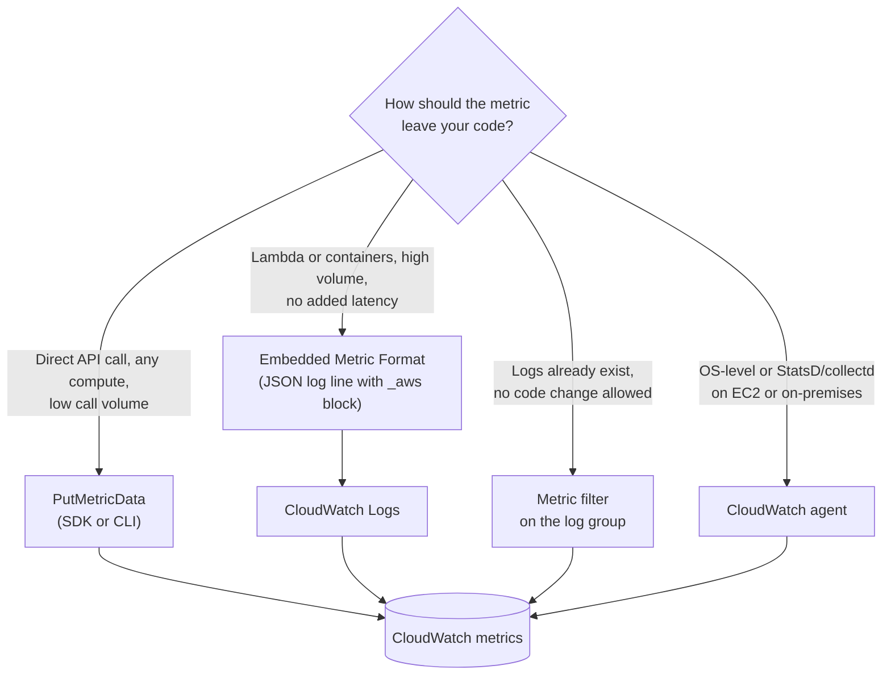

# 4.2.2 Write application code that emits useful custom metrics

**Domain 4 · Task 4.2 · Skill 4.2.2** · [Task overview](README.md) · Previous: [4.2.1 Structured logging](4.2.1-structured-logging.md) · Next: [4.2.3 Alerts and notifications](4.2.3-alerts-and-notifications.md)

## What the exam expects

AWS services publish their own metrics to Amazon CloudWatch automatically, but they know nothing about your business. Lambda reports invocations and duration, not "orders that failed validation". This skill tests how to publish your own metrics from code, which of the three mechanisms fits a scenario, and how to avoid the cost and latency mistakes that come with each.

You must be able to:

- Explain namespaces, metric names, dimensions, units, timestamps, and resolution.
- Publish metrics with the `PutMetricData` application programming interface (API) and know its limits.
- Publish metrics from Lambda or containers with the Embedded Metric Format (EMF), with no extra API calls.
- Create metrics from existing logs with metric filters, and know they are not retroactive.
- Collect memory, disk, and StatsD or collectd metrics with the CloudWatch agent.
- Pick dimensions that are useful without exploding cost (cardinality).
- Combine metrics with metric math for dashboards.

## Key terms

| Term | Meaning |
|---|---|
| Namespace | Container for metrics, such as `AWS/Lambda` for AWS metrics or `CheckoutApp` for yours. Custom namespaces must not start with `AWS/`. |
| Metric | A named time series of data points, such as `OrdersPlaced`. |
| Dimension | A name and value pair that is part of a metric's identity, such as `Environment=prod`. Up to 30 per metric. Each unique combination of dimension values is a separate metric. |
| Unit | `Count`, `Milliseconds`, `Bytes`, `Percent`, and so on. Defaults to `None`. |
| Resolution | Standard (60 seconds) or high resolution (1 second, set `StorageResolution=1`). |
| Statistic set | Pre-aggregated `SampleCount`, `Sum`, `Minimum`, `Maximum` sent instead of raw values. |
| Cardinality | Number of distinct values a field can take. `Environment` is low; `requestId` or `customerId` is high. |
| Embedded Metric Format (EMF) | A JSON log structure with an `_aws` block. CloudWatch Logs extracts metrics from it asynchronously. |
| Metric filter | A pattern on a log group that turns matching log events into metric data points. |
| Metric math | Expressions that combine metrics (`errors / invocations * 100`) for graphs and alarms. |

## Three ways to publish a custom metric



| Mechanism | Code change | Latency added to the request | Extra API cost | Notes |
|---|---|---|---|---|
| `PutMetricData` (through an AWS SDK, software development kit, or the AWS CLI, command line interface) | Yes | A network call per publish (batch to reduce) | Yes, per request | Needs `cloudwatch:PutMetricData`. Can be throttled at high call rates. |
| EMF | Yes (or a library) | Effectively none: a log write | No metric API calls; you pay log ingestion and custom metrics | Needs only log-writing permissions. Raw log line also kept for queries. |
| Metric filter | No | None | No | Only counts events after the filter exists. Up to 3 dimensions per filter. |
| CloudWatch agent | Agent config, optionally StatsD/collectd in code | None in request path | No | Required for EC2 memory and disk-space metrics. |

## PutMetricData

```python
import boto3

cloudwatch = boto3.client("cloudwatch")  # create once, outside the handler

def record_order(order_value_cents: int, environment: str):
    cloudwatch.put_metric_data(
        Namespace="CheckoutApp",
        MetricData=[
            {
                "MetricName": "OrdersPlaced",
                "Dimensions": [{"Name": "Environment", "Value": environment}],
                "Value": 1,
                "Unit": "Count",
            },
            {
                "MetricName": "OrderValue",
                "Dimensions": [{"Name": "Environment", "Value": environment}],
                "Value": order_value_cents,
                "Unit": "None",
                "StorageResolution": 1,  # high resolution: 1-second granularity
            },
        ],
    )
```

```bash
aws cloudwatch put-metric-data \
  --namespace CheckoutApp \
  --metric-name LoggedInUsers \
  --dimensions Environment=prod \
  --value 42 \
  --storage-resolution 1
```

Limits and behavior (from the `PutMetricData` API reference):

| Item | Value |
|---|---|
| Metrics per request | Up to 1,000 different metrics |
| Request size | 1 MB for HTTP (Hypertext Transfer Protocol) POST (gzip allowed) |
| Dimensions per metric | Up to 30 |
| `Values` and `Counts` arrays | Up to 150 values per metric per request; supports percentile statistics |
| Timestamps accepted | Up to two weeks in the past and two hours in the future. Keep the host clock correct. |
| First appearance | A new metric can take up to 15 minutes to show in `ListMetrics`. |
| Values rejected | `NaN`, infinity, and numbers outside the -2^360 to 2^360 range |

Batch several data points per call, publish asynchronously or at the end of a unit of work, and prefer EMF in Lambda where each synchronous call adds to billed duration.

## Embedded Metric Format

EMF is a JSON log event with an `_aws` metadata block that tells CloudWatch Logs which fields are metrics and which are dimensions. CloudWatch extracts the metrics asynchronously. The function only writes a log line, so it adds no network round trip and no `PutMetricData` permission.

```python
import json
import time

def handler(event, context):
    order_id = "ord-9f2c"
    print(json.dumps({
        "_aws": {
            "Timestamp": int(time.time() * 1000),
            "CloudWatchMetrics": [{
                "Namespace": "CheckoutApp",
                "Dimensions": [["Environment", "PaymentMethod"]],
                "Metrics": [
                    {"Name": "OrdersPlaced", "Unit": "Count"},
                    {"Name": "OrderLatency", "Unit": "Milliseconds", "StorageResolution": 60},
                ],
            }],
        },
        "Environment": "prod",          # dimension (low cardinality)
        "PaymentMethod": "card",        # dimension (low cardinality)
        "OrdersPlaced": 1,              # metric value
        "OrderLatency": 182,            # metric value
        "orderId": order_id,            # plain property: searchable in Logs Insights, NOT a dimension
        "requestId": context.aws_request_id,
    }))
```

Specification points worth knowing:

- `_aws.CloudWatchMetrics` is an array of metric directives, each with `Namespace`, `Dimensions` (an array of dimension sets, up to 30 keys each), and `Metrics`.
- Metric and dimension values must be top-level members of the JSON object, not nested.
- One log event can define at most 100 metrics. Event size limit is 1 MB, the normal CloudWatch Logs limit.
- `StorageResolution: 1` makes a high-resolution metric. Anything other than exactly `1` is treated as 60.
- The timestamp must be within 14 days in the past and 2 hours in the future.
- EMF guarantees at-least-once delivery, so occasional duplicate data points are possible.
- CloudWatch publishes EMF processing errors as metrics in the `AWS/Logs` namespace, which helps when "my EMF metrics don't appear".

With Powertools for AWS Lambda (Python), the `Metrics` utility writes the EMF for you and flushes once per invocation:

```python
from aws_lambda_powertools import Metrics
from aws_lambda_powertools.metrics import MetricUnit

metrics = Metrics(namespace="CheckoutApp", service="checkout")

@metrics.log_metrics(capture_cold_start_metric=True)
def handler(event, context):
    metrics.add_dimension(name="Environment", value="prod")
    metrics.add_metric(name="OrdersPlaced", unit=MetricUnit.Count, value=1)
    metrics.add_metadata(key="orderId", value=event["orderId"])  # high-cardinality: metadata, not a dimension
    return {"statusCode": 200}
```

The open-source `aws-embedded-metrics` libraries do the same outside Powertools. In containers or on EC2, the CloudWatch agent can receive EMF over TCP or UDP (Transmission Control Protocol or User Datagram Protocol) and forward it.

## Metric filters

A metric filter watches a log group and publishes a data point for each matching event. Use it when the logs already contain the signal and you cannot or do not want to change code.

```bash
aws logs put-metric-filter \
  --log-group-name /aws/lambda/checkout \
  --filter-name PaymentTimeouts \
  --filter-pattern '{ $.error = "GatewayTimeout" }' \
  --metric-transformations \
      metricName=PaymentTimeouts,metricNamespace=CheckoutApp,metricValue=1,defaultValue=0
```

- Filter patterns can match terms (`ERROR`), JSON paths (`{ $.latency_ms > 500 }`), or space-delimited fields. Structured JSON logs make filters simple and reliable.
- The metric value can be a constant (count occurrences) or a field from the log (`$.latency_ms`) to publish a measurement.
- Not retroactive. A filter created today does not count yesterday's errors. For historical counts, query with Logs Insights ([4.1.3](../task-4.1-root-cause-analysis/4.1.3-querying-logs.md)).
- Up to 3 dimensions per metric filter.
- The usual flow: log event → metric filter → metric → alarm → Amazon Simple Notification Service (SNS) topic ([4.2.3](4.2.3-alerts-and-notifications.md)).

## The CloudWatch agent

- EC2's default metrics cover central processing unit (CPU), network, disk I/O, and status checks. They do not include memory (random access memory, RAM) use or disk-space use, because those are visible only inside the guest operating system (OS).
- Install the CloudWatch agent (the unified agent, which replaced the older Logs agent) to collect memory, disk space, swap, processes, and netstat metrics, plus log files. Store its configuration centrally in AWS Systems Manager Parameter Store.
- The agent also accepts custom application metrics over StatsD and collectd, so existing instrumentation can publish to CloudWatch.
- EC2 basic monitoring publishes every 5 minutes. Detailed monitoring (extra cost) publishes every 1 minute.

## OpenTelemetry and Lambda Insights

- AWS Distro for OpenTelemetry (ADOT) and the OpenTelemetry SDKs can emit metrics as well as traces, exported to CloudWatch or Amazon Managed Service for Prometheus. This is AWS's recommended direction for new instrumentation ([4.2.4](4.2.4-distributed-tracing.md)).
- CloudWatch Lambda Insights, enabled through a Lambda extension layer, collects system-level metrics (CPU time, memory, network, cold starts) per function. It is a monitoring feature you turn on, not a custom metric you write. It is covered with bottleneck detection in [4.3.5](../task-4.3-optimize-applications/4.3.5-performance-bottleneck-detection.md).

## Designing useful metrics

What to measure:

- Business key performance indicators (KPIs): orders placed, payments declined, sign-ups, documents processed.
- Outcomes split by result: `PaymentSucceeded` and `PaymentFailed`, or one metric with an `Outcome` dimension.
- Latency of the operations you own, as raw values so CloudWatch can compute percentiles (p50, p90, p99). Averages hide tail latency.
- Signals that drive scaling: queue depth or in-flight jobs often reflect load better than CPU for I/O-bound workers. Auto Scaling can target any custom metric.

Dimension rules:

- Each unique combination of dimension values becomes a separate, billable metric. `customerId` or `requestId` as a dimension can create millions of metrics.
- Keep high-cardinality identifiers as EMF properties or log fields. You can still find them with Logs Insights, and the metric stays affordable.
- Every dimension set in an EMF directive also creates its own metrics, so `[["Environment"], ["Environment", "PaymentMethod"]]` doubles the count.
- To alarm on a metric you must query it with the exact dimension set it was published with. A metric published with `Environment` and `PaymentMethod` is not the same metric as one with only `Environment`.

Resolution:

- Standard resolution (60 s) suits most metrics.
- High resolution (1 s) costs more and is for sub-minute reaction, such as fast scaling or short-lived spikes. High-resolution alarms can evaluate at 10 s or 30 s periods.

## Combining metrics: metric math and dashboards

Metric math builds derived series from existing metrics, with no new data published:

```text
m1 = SUM of AWS/Lambda Errors for functions A to F
m2 = SUM of AWS/Lambda Invocations for functions A to F
e1 = 100 * m1 / m2                          -> error rate across the whole service
e2 = IF(m2 > 100, e1, 0)                    -> ignore the rate when volume is too low to mean anything
```

- A single CloudWatch dashboard widget with a metric math expression across six functions answers "overall error rate and latency for this service" better than six per-function dashboards.
- `SEARCH()` expressions pick up metrics by pattern, so new functions appear on the graph automatically.
- Alarms can evaluate metric math expressions ([4.2.3](4.2.3-alerts-and-notifications.md)).
- CloudWatch cross-account observability lets one monitoring account build dashboards over metrics from several source accounts.

## Exam triggers

| Scenario clue | Answer | Why the alternatives are wrong |
|---|---|---|
| Publish business metrics from Lambda without slowing it down | EMF (directly or through Powertools `Metrics`) | `PutMetricData` adds a network call per publish; X-Ray annotations are not metrics. |
| Track something AWS doesn't measure (orders, logged-in users) | Custom metric via `PutMetricData` or EMF | Default service metrics don't know your business events. |
| Need 1-second granularity | High-resolution metric, `StorageResolution=1` | Standard resolution aggregates to 60 s. |
| Count `ERROR` lines in existing logs without code changes | Metric filter on the log group | Code changes are ruled out; Logs Insights is on-demand, not a continuous metric. |
| New metric filter shows zero for last week's errors | Metric filters are not retroactive | Nothing is broken; query history with Logs Insights. |
| EC2 memory or disk-space use | CloudWatch agent | EC2 does not publish memory metrics by default; detailed monitoring only changes frequency. |
| Custom metric bill exploded after adding `customerId` dimension | High-cardinality dimension created a metric per customer; move it to a property or log field | More dimensions never reduce cost. |
| Existing StatsD instrumentation on EC2 | CloudWatch agent StatsD listener | Rewriting all instrumentation to `PutMetricData` is unnecessary. |
| One chart of error rate across six functions | Dashboard with metric math | Six separate dashboards don't aggregate. |
| `PutMetricData` calls throttled under load | Batch up to 1,000 metrics per call, or switch to EMF | Retrying every single call harder makes throttling worse. |

## Common traps

- Custom metrics do not appear by themselves. Code, the agent, or a metric filter must publish them.
- Dimensions are part of the metric identity. Querying with a different dimension set returns nothing.
- EMF metric values and dimensions must be top-level JSON fields. Nested values are ignored.
- EMF `StorageResolution` of `1.0` or `10` is not high resolution; only exactly `1` is.
- A metric filter's `defaultValue` matters: without it, periods with no matching events have no data, which affects alarms that treat missing data specially.
- An average latency metric can look fine while p99 is terrible. Publish raw values and alarm on percentiles for latency.

## Quick recall

- `PutMetricData`: up to 1,000 metrics per call, 30 dimensions per metric, timestamps from two weeks back to two hours ahead.
- Standard resolution 60 s; high resolution 1 s with `StorageResolution=1`.
- EMF = JSON log line with `_aws.CloudWatchMetrics`; metrics extracted asynchronously; no API call; at-least-once.
- Up to 100 metrics per EMF event; values must be top-level fields.
- Metric filters: no code change, not retroactive, up to 3 dimensions.
- EC2 memory and disk space need the CloudWatch agent.
- Every dimension combination is a separate billable metric; keep IDs out of dimensions.
- Powertools `Metrics` writes EMF and can add a cold-start metric.
- Metric math aggregates across resources for dashboards and alarms.

## Related skills

- [4.2.1 Structured logging](4.2.1-structured-logging.md): JSON logs are what EMF and metric filters build on.
- [4.2.3 Alerts and notifications](4.2.3-alerts-and-notifications.md): alarms on the metrics you publish.
- [4.1.2 Metrics, logs, and traces](../task-4.1-root-cause-analysis/4.1.2-metrics-logs-and-traces.md): interpreting AWS service metrics such as `Duration`, `IteratorAge`, and `IntegrationLatency`.
- [4.3.5 Performance bottleneck detection](../task-4.3-optimize-applications/4.3.5-performance-bottleneck-detection.md): Lambda Insights, Container Insights, Contributor Insights, and Metrics Insights.
- [4.3.1 Concurrency controls](../task-4.3-optimize-applications/4.3.1-concurrency-controls.md): scaling on custom metrics such as queue depth.

## Sources

- Merged from: `archive/dva-c03-study-notes/04-troubleshooting-optimization.md` (skill 4.2.2), `archive/dva-c03/domain-4-troubleshooting-optimization/observability-instrumentation.md`, `archive/dva-c03/domain-4-troubleshooting-optimization/MASTER-CHUNK.md` (CloudWatch section), `archive/dva-c03/domain-4-troubleshooting-optimization/README.md` (use case 4), `archive/aws-dva-notes/Markdown Files/17. Monitoring, Troubleshooting & Audit.md` (custom metrics, agent, metric filters), `archive/aws-dva-notes/Markdown Files/31. Exam Day Cheat Sheet.md`, `archive/dva-c03/exam-bank/bank-1.md` and `bank-2.md` (metric math and EMF traps).
- AWS documentation: [PutMetricData API reference](https://docs.aws.amazon.com/AmazonCloudWatch/latest/APIReference/API_PutMetricData.html)
- AWS documentation: [Specification: Embedded metric format](https://docs.aws.amazon.com/AmazonCloudWatch/latest/monitoring/CloudWatch_Embedded_Metric_Format_Specification.html)
