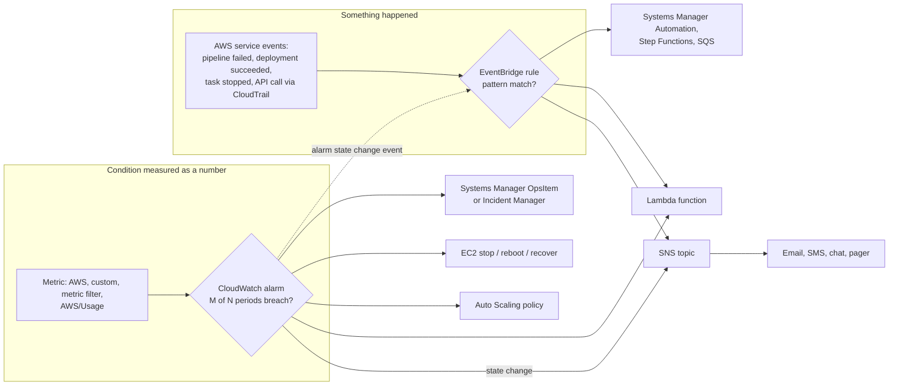
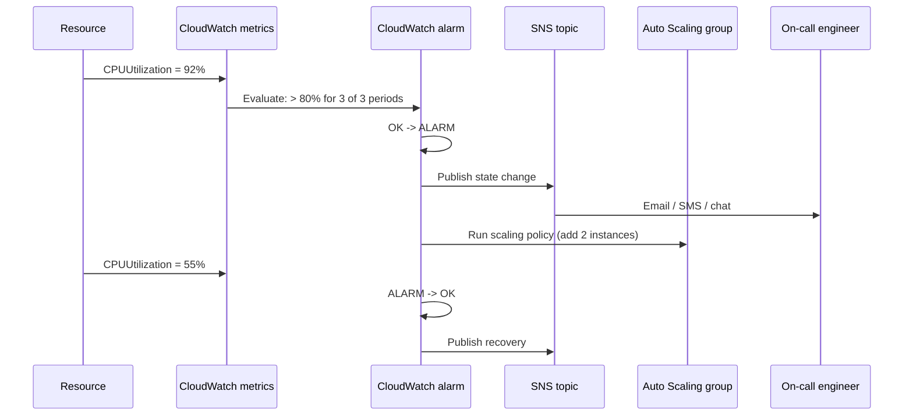
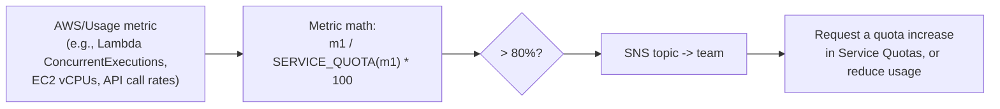
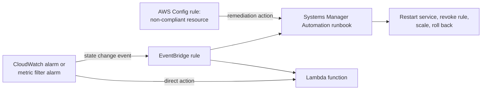

# 4.2.3 Send alerts for conditions such as quota thresholds and completed deployments

**Domain 4 · Task 4.2 · Skill 4.2.3** · [Task overview](README.md) · Previous: [4.2.2 Custom metrics](4.2.2-custom-metrics.md) · Next: [4.2.4 Distributed tracing](4.2.4-distributed-tracing.md)

## What the exam expects

Metrics and logs help only if someone, or something, reacts to them. This skill tests the two alerting paths on AWS: Amazon CloudWatch alarms for conditions measured as numbers, and Amazon EventBridge rules for things that happen as events. The exam guide names two examples, quota thresholds and deployment completions, so expect questions on Service Quotas usage alarms and on CodePipeline, CodeBuild, and CodeDeploy notifications.

You must be able to:

- Build a CloudWatch alarm: metric, statistic, period, threshold, evaluation periods, datapoints to alarm, and missing-data treatment.
- Choose static thresholds, anomaly detection, metric math, or composite alarms.
- Route alarms to Amazon Simple Notification Service (SNS), AWS Lambda, Auto Scaling, Amazon Elastic Compute Cloud (EC2) actions, or AWS Systems Manager.
- Alert before an account hits a service quota.
- Notify a team when a pipeline, build, or deployment succeeds or fails.
- React to AWS application programming interface (API) calls and other AWS events with EventBridge.
- Test the alert path without waiting for a real incident.

## Key terms

| Term | Meaning |
|---|---|
| Alarm states | `OK`, `ALARM`, `INSUFFICIENT_DATA`. |
| Period | Length of each evaluation window in seconds. 60 s or a multiple for standard metrics; high-resolution metrics also allow 10 s and 30 s (at higher cost). |
| Evaluation periods (N) | How many recent periods the alarm looks at. |
| Datapoints to alarm (M) | How many of those N periods must breach. "M out of N" alarms ignore single spikes. |
| Missing data treatment | `missing`, `notBreaching`, `breaching`, or `ignore`. Decides what an empty period means. |
| Composite alarm | An alarm whose rule combines the states of other alarms with `AND`, `OR`, and `NOT`. |
| Anomaly detection alarm | Alarm against a band that a model learns from the metric's history, instead of a fixed number. |
| SNS topic | Fan-out point for notifications: email, SMS (text message), HTTPS endpoints, Amazon Simple Queue Service (SQS), Lambda, chat tools. |
| EventBridge rule | Matches events on an event bus by pattern and sends them to targets. |
| Notification rule | Developer Tools console feature (API: AWS CodeStar Notifications) that subscribes SNS topics to CodePipeline, CodeBuild, CodeDeploy, and CodeCommit events. |
| `SERVICE_QUOTA()` | Metric math function that returns the applied quota for an `AWS/Usage` metric. |

## Two alerting paths



Use an alarm when you can express the condition as "metric X crosses Y". Use an EventBridge rule when the condition is a discrete event, such as "deployment finished" or "someone called `DeleteTable`".

## CloudWatch alarms



Settings that decide when an alarm fires:

| Setting | Use it to |
|---|---|
| Statistic | Choose `Sum` for counts, `Average` or a percentile (`p99`) for latency, `Maximum` for peaks. |
| Period | Match how fast you need to react. Shorter periods react faster and cost more for high resolution. |
| M out of N | Ignore one-off spikes. `3 out of 5` fires on a sustained problem without waiting for 5 straight breaches. |
| Missing data | `notBreaching` for sparse error metrics that only publish when something fails; `breaching` when silence itself is a failure (a heartbeat metric stopped). |
| Threshold type | Static number, or an anomaly detection band for metrics with daily or weekly patterns. |

Alarm actions (per the CloudWatch alarm actions page):

| Action | Notes |
|---|---|
| SNS topic | Most common. Subscribers can be people or applications. |
| Lambda function | Invoke a function directly on a state change, for custom automation. |
| EC2 actions | Stop, terminate, reboot, or recover an instance. Only for alarms on EC2 metrics. `StatusCheckFailed_System` plus the recover action keeps the instance ID, IP (internet protocol) addresses, and metadata. |
| Auto Scaling | EC2 Auto Scaling or Application Auto Scaling policies. |
| Systems Manager | Create an OpsCenter OpsItem or an Incident Manager incident (on `ALARM` only). |
| CloudWatch investigations | Start an AI-assisted investigation when the alarm enters `ALARM`. See [4.1.5](../task-4.1-root-cause-analysis/4.1.5-ai-assisted-error-analysis.md). |

- Actions run on state transitions, not repeatedly while the alarm stays in `ALARM`. Auto Scaling actions are the exception and keep evaluating.
- Every alarm state change is also an EventBridge event, so you can route alarms with rules instead of direct actions.
- Alarm mute rules silence actions during planned maintenance windows and unmute automatically. `DisableAlarmActions` turns actions off until you turn them back on.

### Alarm types for noisy or complex conditions

| Need | Use | Example |
|---|---|---|
| Fixed limit | Static threshold | `Errors > 10` for 3 of 3 one-minute periods |
| Metric with daily or weekly cycles | Anomaly detection | Lunchtime traffic spikes stop paging; an unusual spike at 3 AM still fires |
| Ratio or gated condition | Metric math alarm | `IF(invocations > 100, 100 * errors / invocations, 0) > 5` |
| Page only when several symptoms agree | Composite alarm | `ALARM(HighLatency) AND ALARM(High5xx)` |
| Condition in log text | Metric filter, then alarm on its metric | `{ $.error = "GatewayTimeout" }` count > 0 |

Composite alarms reduce alert noise: child alarms can have no actions, and only the composite pages. Composite alarms cannot trigger Auto Scaling actions.

### Test the alert path

```bash
aws cloudwatch set-alarm-state \
  --alarm-name "checkout-5xx" \
  --state-value ALARM \
  --state-reason "Testing SNS notification path"
```

The alarm returns to its real state at the next evaluation. This proves the SNS topic, subscription, and permissions work. Email subscriptions must be confirmed by the recipient before they receive anything.

## Alerting on quota thresholds

Service quotas (formerly limits) cap things such as Lambda concurrent executions, API Gateway requests per second, and DynamoDB table capacity. Hitting one causes throttling (`TooManyRequestsException`, HTTP 429) that looks like an outage.



How to set it up:

- In the Service Quotas console, open a quota that has a utilization metric and create a CloudWatch alarm on it. The console builds the `AWS/Usage` metric and the `SERVICE_QUOTA()` expression for you.
- In CloudWatch, graph the usage metric, add the expression `m1/SERVICE_QUOTA(m1)*100` (some per-second API rate quotas divide by 60 first, as in `m1/60/SERVICE_QUOTA(m1)*100`), and alarm when it exceeds a percentage such as 80.
- AWS Trusted Advisor service limit checks also flag quotas approaching their limits and can feed EventBridge.

Related service metrics to alarm on before a hard quota hits:

| Service | Metric |
|---|---|
| Lambda | `ConcurrentExecutions` against the account quota, `UnreservedConcurrentExecutions`, `Throttles` |
| API Gateway | `Count` against stage or account throttling, `4XXError` (429s) |
| DynamoDB | `ThrottledRequests`, `ReadThrottleEvents`, `WriteThrottleEvents`, consumed versus provisioned capacity |
| Amazon SQS | `ApproximateAgeOfOldestMessage` (consumers falling behind) |
| Amazon Bedrock | Throttling and invocation metrics against tokens-per-minute and requests-per-minute quotas |

Concurrency and throughput tuning that follows from these alerts is in [4.3.1 Concurrency controls](../task-4.3-optimize-applications/4.3.1-concurrency-controls.md).

## Alerting on deployment completion and failure

Two ways to notify a team about CI/CD (continuous integration and continuous delivery) events:

| Option | How | Best for |
|---|---|---|
| Notification rules (Developer Tools console, AWS CodeStar Notifications API) | Pick a pipeline, build project, or CodeDeploy application, choose event types (succeeded, failed, started, manual approval needed), choose an SNS topic or chat client target | Quick human notifications with no custom code. The feature creates an EventBridge rule behind the scenes. |
| EventBridge rule | Match the service's state-change event and send it to SNS, Lambda, Step Functions, or another target | Filtering on specific fields, transforming the message, or triggering automation |

Common EventBridge detail types:

| Service | `detail-type` | Useful `detail` fields |
|---|---|---|
| CodePipeline | `CodePipeline Pipeline Execution State Change` (also stage and action variants) | `state`: `STARTED`, `SUCCEEDED`, `FAILED`, `CANCELED` |
| CodeBuild | `CodeBuild Build State Change` | `build-status`: `IN_PROGRESS`, `SUCCEEDED`, `FAILED`, `STOPPED` |
| CodeDeploy | `CodeDeploy Deployment State-change Notification` | `state`: `START`, `SUCCESS`, `FAILURE` |
| Amazon Elastic Container Service (ECS) | `ECS Deployment State Change`, `ECS Task State Change` | Deployment completed or failed; task stopped with a reason |
| AWS CloudFormation | `CloudFormation Stack Status Change` | Stack reached `CREATE_COMPLETE`, `UPDATE_ROLLBACK_COMPLETE`, and so on |

```json
{
  "source": ["aws.codepipeline"],
  "detail-type": ["CodePipeline Pipeline Execution State Change"],
  "detail": {
    "pipeline": ["checkout-prod"],
    "state": ["SUCCEEDED", "FAILED"]
  }
}
```

Other deployment notification hooks:

- A CodePipeline manual approval action can name an SNS topic (`NotificationArn`) so approvers are notified when the pipeline reaches the approval step.
- CodeDeploy deployment groups support triggers that publish deployment and instance events to SNS, and alarms that stop and roll back a deployment. Rollback itself is covered in [3.3.7 Rollback](../../domain-3-testing-and-deployment/task-3.3-deploy-with-ci-cd/3.3.7-rollback.md).
- CodeBuild publishes build metrics to CloudWatch, so you can also alarm on a failed-build count.

> **Not on the DVA-C03 service list.** Notification rules can deliver to Slack, Microsoft Teams, and Amazon Chime through Amazon Q Developer in chat applications (formerly AWS Chatbot). Exam answers usually stop at the SNS topic.

## Alerting on other AWS events

| Event | How to alert |
|---|---|
| A specific AWS API call (for example DynamoDB `DeleteTable`, AWS Identity and Access Management (IAM) `AttachRolePolicy`, security group ingress changes) | AWS CloudTrail records the call → EventBridge rule on `AWS API Call via CloudTrail` → SNS |
| Root user sign-in | EventBridge rule on the sign-in event → SNS |
| AWS Health events (service issues, scheduled maintenance affecting your resources) | EventBridge rule on `aws.health` |
| Certificate nearing expiry | AWS Certificate Manager (ACM) expiry events in EventBridge, or an alarm on the `DaysToExpiry` metric |
| Spend over budget | AWS Budgets alert → email or SNS |
| Canary failure | CloudWatch Synthetics `SuccessPercent` alarm ([4.2.5](4.2.5-health-checks-and-probes.md)) |
| X-Ray detects an anomaly | X-Ray Insights notifications through EventBridge ([4.2.4](4.2.4-distributed-tracing.md)) |

## From alert to automated remediation

When a failure is well understood and recurs, let the alert run the fix instead of paging someone to run it by hand.



- Systems Manager Automation runbooks run predefined, tested steps (restart a process across a fleet, revoke an open security group rule).
- Trigger from an alarm state change through EventBridge, or from an AWS Config rule's remediation action.
- Keep a human notification on the same alarm so someone knows the automation ran.

## Exam triggers

| Scenario clue | Answer | Why the alternatives are wrong |
|---|---|---|
| Notify the team when a pipeline fails | Notification rule on the pipeline, or EventBridge rule on `CodePipeline Pipeline Execution State Change` → SNS | CloudTrail is an audit log, not a notifier; polling the console is manual. |
| Tell approvers a manual approval is waiting | SNS topic on the approval action (`NotificationArn`) | A separate custom poller is unnecessary. |
| Alert before reaching the Lambda concurrency quota | CloudWatch alarm on the usage metric with `SERVICE_QUOTA()` at, say, 80% | Waiting for `Throttles` means users already see errors. |
| Alarm fires on every lunchtime spike | Anomaly detection band instead of a static threshold | Raising the static threshold hides real problems at quiet times. |
| Page only when both latency and errors are high | Composite alarm with `AND` | Two independent alarms page separately. |
| Error-rate alarm fires when there are 2 requests and 1 error | Metric math gated on invocation volume | A raw `Errors` count ignores volume. |
| Alarm stuck in `INSUFFICIENT_DATA` on a metric that only reports failures | Treat missing data as `notBreaching` | The metric isn't broken; it has no data in healthy periods. |
| Verify the SNS notification works | `aws cloudwatch set-alarm-state` | Waiting for a real breach is slow and risky. |
| Alert when someone deletes a DynamoDB table | CloudTrail → EventBridge rule on `DeleteTable` → SNS | CloudWatch metrics don't record API callers. |
| Automatically restart a stuck worker when a known log pattern appears | Metric filter → alarm → EventBridge → Systems Manager Automation | GuardDuty, Config, and CloudTrail don't run application remediation from log patterns. |
| Alarms existed but nobody noticed the outage | Alarm had no action, or the SNS subscription was never confirmed | The metric was fine; the notification path was missing. |

## Common traps

- An alarm with no action changes state silently.
- SNS email subscriptions stay pending until the recipient confirms.
- Composite alarms cannot run Auto Scaling actions. Use a metric alarm for scaling.
- EC2 actions only work on alarms whose metric is an EC2 per-instance metric.
- High-resolution periods (10 s, 30 s) need a high-resolution metric underneath.
- EventBridge only sees CloudTrail management events through `AWS API Call via CloudTrail`; data events such as Amazon Simple Storage Service (Amazon S3) object reads must be enabled in a trail first.
- A notification rule needs the SNS topic's access policy to allow the notifications service to publish. The console sets this when it creates the topic.

## Quick recall

- Alarm states: `OK`, `ALARM`, `INSUFFICIENT_DATA`; actions fire on transitions.
- M out of N datapoints to alarm prevents flapping; choose missing-data treatment on purpose.
- Alarm targets: SNS, Lambda, EC2 actions, Auto Scaling, Systems Manager, CloudWatch investigations.
- Composite alarms combine alarm states with `AND`/`OR`/`NOT` to cut noise; no Auto Scaling actions.
- Anomaly detection for cyclic metrics; metric math for ratios and gating.
- Quota alerts: `AWS/Usage` metric with `m1/SERVICE_QUOTA(m1)*100`, created from Service Quotas or CloudWatch.
- Deployment alerts: notification rules, or EventBridge rules on CodePipeline, CodeBuild, CodeDeploy, ECS, and CloudFormation state-change events → SNS.
- API-call alerts: CloudTrail → EventBridge → SNS.
- Test with `set-alarm-state`.

## Related skills

- [4.2.2 Custom metrics](4.2.2-custom-metrics.md): the metrics and metric filters you alarm on.
- [4.2.5 Health checks and probes](4.2.5-health-checks-and-probes.md): canary and health check alarms.
- [3.3.5 CodePipeline release promotion](../../domain-3-testing-and-deployment/task-3.3-deploy-with-ci-cd/3.3.5-codepipeline-release-promotion.md): manual approval actions and pipeline stages.
- [3.3.7 Rollback](../../domain-3-testing-and-deployment/task-3.3-deploy-with-ci-cd/3.3.7-rollback.md): alarms that roll back CodeDeploy deployments.
- [1.1.8 Event-driven applications](../../domain-1-development-with-aws-services/task-1.1-build-application-code/1.1.8-event-driven-applications.md): EventBridge rules, patterns, and targets in depth.
- [4.3.1 Concurrency controls](../task-4.3-optimize-applications/4.3.1-concurrency-controls.md): what to change after a quota alert.

## Sources

- Merged from: `archive/dva-c03-study-notes/04-troubleshooting-optimization.md` (skill 4.2.3), `archive/dva-c03/domain-4-troubleshooting-optimization/MASTER-CHUNK.md` (CloudWatch alarm diagram), `archive/dva-c03/domain-4-troubleshooting-optimization/README.md` (automated remediation, alarms without notification), `archive/aws-dva-notes/Markdown Files/17. Monitoring, Troubleshooting & Audit.md` (alarms, composite alarms, EventBridge, CloudTrail + EventBridge), `archive/aws-dva-notes/Markdown Files/21. CICD - CodeCommit, CodePipeline, CodeBuild, CodeDeploy.md`, `archive/aws-dva-notes/Markdown Files/16. Messaging - SQS, SNS & Kinesis.md`, `archive/dva-c03/exam-bank/bank-1.md`, `bank-2.md`, and `archive/dva-c03/practice-questions/full-exams/exam-1-questions.md` (metric math, composite, anomaly detection, approval notification traps).
- AWS documentation: [Alarm actions](https://docs.aws.amazon.com/AmazonCloudWatch/latest/monitoring/alarm-actions.html)
- AWS documentation: [Visualizing your service quotas and setting alarms](https://docs.aws.amazon.com/AmazonCloudWatch/latest/monitoring/CloudWatch-Quotas-Visualize-Alarms.html)
- AWS documentation: [What are notifications? (Developer Tools console)](https://docs.aws.amazon.com/dtconsole/latest/userguide/welcome.html)
