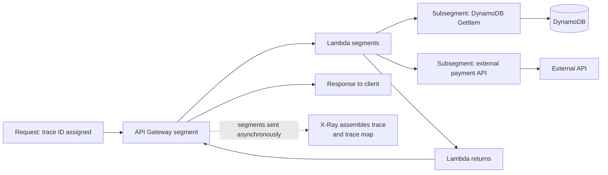
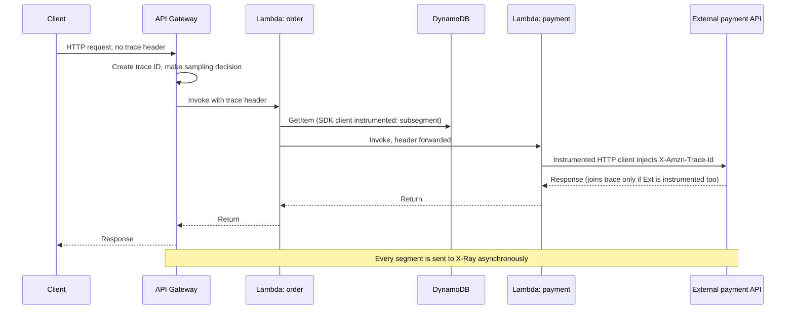
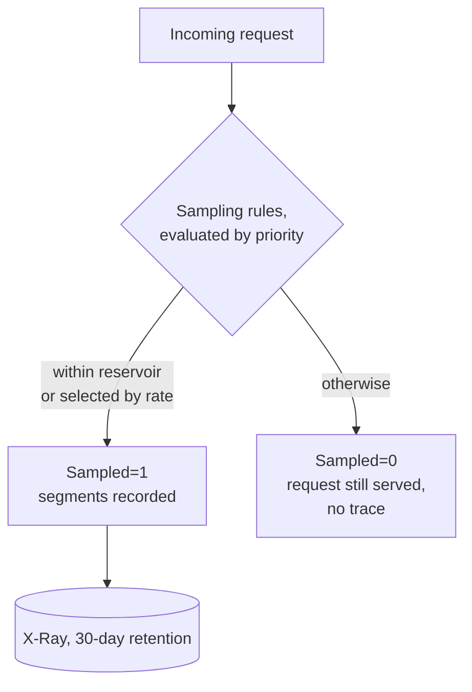

# 4.2.4 Instrument distributed tracing with AWS services and tools

**Domain 4 · Task 4.2 · Skill 4.2.4** · [Task overview](README.md) · Previous: [4.2.3 Alerts and notifications](4.2.3-alerts-and-notifications.md) · Next: [4.2.5 Health checks and probes](4.2.5-health-checks-and-probes.md)

## What the exam expects

A request that crosses Amazon API Gateway, two AWS Lambda functions, Amazon DynamoDB, and an external application programming interface (API) has no single log file. AWS X-Ray follows that request with one trace ID and shows how long each hop took. This skill is about turning tracing on correctly and adding your own detail. Reading traces during an incident belongs to [4.1.2](../task-4.1-root-cause-analysis/4.1.2-metrics-logs-and-traces.md); here the focus is making sure the traces exist and are useful.

You must be able to:

- Enable tracing on Lambda, API Gateway, AWS Step Functions, Amazon Elastic Compute Cloud (EC2), Amazon Elastic Container Service (ECS), AWS Fargate, and AWS Elastic Beanstalk, with the right permissions.
- Instrument code to create subsegments for AWS SDK (software development kit) calls, HTTP (Hypertext Transfer Protocol) calls, and your own logic.
- Choose annotations (indexed, filterable) or metadata (not indexed).
- Explain trace header propagation and why traces have gaps.
- Explain sampling, the default rule, and where you can and cannot change it.
- Know the OpenTelemetry direction: AWS Distro for OpenTelemetry (ADOT), the CloudWatch agent, and the X-Ray SDK maintenance notice.
- Know the console views: trace map (service map), trace timeline, X-Ray Insights, CloudWatch Application Signals, and Transaction Search.

## Key terms

| Term | Meaning |
|---|---|
| Trace | All segments for one request, joined by one trace ID. Retained for 30 days. |
| Segment | One service's record of its work on the request: name, start and end time, HTTP data, errors. |
| Subsegment | Finer detail inside a segment, such as a DynamoDB `GetItem`, an HTTP call, a SQL (Structured Query Language) query, or a block of your own code. |
| Trace header | `X-Amzn-Trace-Id: Root=1-5759e988-bd862e3fe1be46a994272793;Parent=53995c3f42cd8ad8;Sampled=1`. Carries the trace ID, parent segment ID, and sampling decision. |
| Annotation | Indexed key-value pair (string, number, or Boolean). Usable in filter expressions and groups. |
| Metadata | Non-indexed key-value data of any type, including objects. Visible on the trace, not searchable. |
| Sampling rule | Reservoir (fixed traces per second) plus rate (percentage beyond the reservoir), matched by service, host, method, and URL (uniform resource locator) path. |
| X-Ray daemon | Process that receives segments from the SDK on User Datagram Protocol (UDP) port 2000 and uploads them in batches. Lambda and other managed services run it for you. |
| Active tracing | Lambda mode where Lambda samples and records segments itself. The other mode, `PassThrough`, only propagates the header. |
| Trace map (service map) | Graph of services built from traces, colored by health. |

## How a trace is built



The first instrumented hop creates the trace ID, or accepts one from the caller. Every instrumented service after it adds a segment with the same trace ID and its own timing, plus subsegments for the calls it makes. Segments travel to X-Ray separately from the request, so tracing does not slow the response, and a trace can take a few seconds to fill in.

## Trace propagation and why traces have gaps



- The trace ID is created once and carried in the `X-Amzn-Trace-Id` header. Nothing downstream should create a new ID for the same request.
- Between AWS services with tracing enabled, propagation is automatic. Application Load Balancer (ALB) adds the header too. Messages through Amazon Simple Queue Service (SQS), Amazon Simple Notification Service (SNS), and EventBridge carry the context, and SQS-triggered Lambda traces are linked to the producer's trace.
- For outbound HTTP calls, the SDK's HTTP instrumentation injects the header (`patch_all()` in Python, `captureHTTPsGlobal` in Node.js). A raw socket or an unpatched HTTP client sends no header and creates no subsegment.
- A downstream service appears in the trace only if it is instrumented, or at least is an AWS service X-Ray records on the caller's side.

| Gap in the trace | Likely cause |
|---|---|
| API Gateway hop missing, Lambda present | Tracing not enabled on the API Gateway stage, or the API is an HTTP API (X-Ray supports REST, or representational state transfer, APIs only) |
| Lambda present, no DynamoDB or HTTP subsegments | SDK or HTTP client not instrumented (`patch_all()` or `captureAWSv3Client` missing) |
| Service B missing between A and C | B is not instrumented or does not forward the header |
| Third-party API missing | Expected unless its call is wrapped; wrap the client so at least the outbound subsegment appears |
| Some requests have no trace at all | Sampling, not a fault |
| No traces from a function at all | Active tracing off, or the execution role lacks X-Ray write permissions |

## Enabling tracing per service

| Service | How to enable | Permissions and notes |
|---|---|---|
| Lambda | `TracingConfig: Mode=Active` (console: "Lambda service traces") | Execution role needs `xray:PutTraceSegments` and `xray:PutTelemetryRecords` (`AWSXRayDaemonWriteAccess`). The console adds them when you enable tracing there; infrastructure as code (IaC) must add them explicitly. Lambda runs the daemon. Not supported for Amazon MSK, self-managed Kafka, Amazon MQ, or DocumentDB event source mappings. |
| API Gateway | Enable X-Ray tracing on the REST API stage | REST APIs only (all endpoint types). HTTP APIs do not support X-Ray. API Gateway makes the sampling decision and honors your sampling rules. |
| Step Functions | Enable X-Ray tracing on the state machine | Shows each state and the Lambda or service calls it makes. |
| EC2 and on-premises | Install and run the X-Ray daemon (or the CloudWatch agent with trace collection), usually from user data | Instance profile role needs `AWSXRayDaemonWriteAccess`. |
| ECS on EC2 | Daemon container per instance, or a sidecar per task | Containers send to the daemon address in `AWS_XRAY_DAEMON_ADDRESS`; task role needs write permissions. |
| Fargate | Sidecar container in each task | No instance to host a shared daemon, so the sidecar is the only option. |
| Elastic Beanstalk | Console option or `.ebextensions/xray-daemon.config` with `XRayEnabled: true` | Instance profile needs permissions. Daemon is not provided on the multicontainer Docker platform. |
| ALB | Nothing to enable | Adds or forwards the `X-Amzn-Trace-Id` header; it does not send segments itself. |

```yaml
# AWS SAM: tracing on for every function and the REST API
Globals:
  Function:
    Tracing: Active
  Api:
    TracingEnabled: true
```

Lambda environment variables involved in tracing:

| Variable | Purpose |
|---|---|
| `_X_AMZN_TRACE_ID` | The current trace header, set by Lambda per invocation |
| `AWS_XRAY_CONTEXT_MISSING` | What the SDK does when there is no active segment (default `LOG_ERROR`; older SDKs threw) |
| `AWS_XRAY_DAEMON_ADDRESS` | Host and port of the daemon (`IP:2000`) |

### Lambda's two segments

Lambda records two segments per traced invocation, which appear as two nodes on the trace map:

- `AWS::Lambda` covers the Lambda service preparing the execution environment: scheduling, creating or unfreezing it, and downloading code and layers.
- `AWS::Lambda::Function` covers your function's work. It contains initialization, invocation, and overhead detail (plus a restore subsegment with SnapStart).

An error on `AWS::Lambda` points to the service; an error on `AWS::Lambda::Function` points to your code. Time spent in initialization rather than invocation points to a cold start, which the `Init Duration` field in the `REPORT` log line confirms ([4.1.2](../task-4.1-root-cause-analysis/4.1.2-metrics-logs-and-traces.md)).

Your code cannot modify the function segment Lambda creates. The SDK gives you a placeholder (a facade segment). Add annotations and metadata to subsegments you create inside the handler.

## Instrumenting code

What each instrumentation step gives you:

| Step | Result |
|---|---|
| Enable tracing on the service | One segment per service, timings, faults |
| Wrap AWS SDK clients | A subsegment per AWS call (`aws` namespace), with table names, queue URLs, and retries |
| Wrap HTTP clients | A subsegment per outbound call (`remote` namespace) and header injection |
| Custom subsegments | Named timing for your own steps ("validate input", "price cart") |
| Annotations | Filter traces by business fields (`customerId`, `tier`, `deploymentVersion`) |
| Metadata | Attach larger context (a request summary, a config snapshot) for viewing only |

### Python with the X-Ray SDK

```python
import json
import boto3
from aws_xray_sdk.core import xray_recorder, patch_all

patch_all()  # instruments boto3, requests, and other supported libraries

ddb = boto3.client("dynamodb")

def handler(event, context):
    body = json.loads(event["body"])
    order_id = body["orderId"]

    # Custom subsegment around your own logic; annotate it, not Lambda's function segment
    with xray_recorder.in_subsegment("validate_order") as subsegment:
        subsegment.put_annotation("orderId", order_id)            # indexed: filterable
        subsegment.put_annotation("customerTier", body.get("tier", "standard"))
        subsegment.put_metadata("requestSummary", {"items": len(body.get("items", []))})  # not indexed
        validate(body)

    ddb.get_item(TableName="Orders", Key={"orderId": {"S": order_id}})  # automatic subsegment
    return {"statusCode": 200, "body": json.dumps({"orderId": order_id})}

def validate(body):
    if not body.get("items"):
        raise ValueError("empty order")
```

### Node.js with the X-Ray SDK and AWS SDK for JavaScript v3

```javascript
const AWSXRay = require('aws-xray-sdk-core');
const { DynamoDBClient, GetItemCommand } = require('@aws-sdk/client-dynamodb');

AWSXRay.captureHTTPsGlobal(require('https'));                     // outbound HTTPS subsegments + header
const ddb = AWSXRay.captureAWSv3Client(new DynamoDBClient({}));   // AWS SDK v3 subsegments

exports.handler = async (event) => {
  const { orderId, tier = 'standard' } = JSON.parse(event.body);

  const subsegment = AWSXRay.getSegment().addNewSubsegment('validate_order');
  try {
    subsegment.addAnnotation('orderId', orderId);       // indexed: filterable
    subsegment.addAnnotation('customerTier', tier);
    subsegment.addMetadata('rawBody', event.body);      // not indexed
    // ... validation logic ...
  } catch (err) {
    subsegment.addError(err);
    throw err;
  } finally {
    subsegment.close();
  }

  await ddb.send(new GetItemCommand({ TableName: 'Orders', Key: { orderId: { S: orderId } } }));
  return { statusCode: 200, body: JSON.stringify({ orderId }) };
};
```

### Powertools for AWS Lambda `Tracer`

```python
from aws_lambda_powertools import Tracer

tracer = Tracer(service="checkout")  # patches boto3 and supported libraries

@tracer.capture_lambda_handler
def handler(event, context):
    tracer.put_annotation(key="orderId", value=event["orderId"])
    return price_cart(event)

@tracer.capture_method          # creates a subsegment named after the function
def price_cart(event):
    return {"statusCode": 200}
```

`Tracer` adds a `ColdStart` annotation and a `Service` annotation automatically and records responses and exceptions as metadata. Disable response capture for functions that return sensitive data.

### Annotations versus metadata

| | Annotation | Metadata |
|---|---|---|
| Indexed | Yes | No |
| Filter expressions and groups | Yes: `annotation.customerTier = "premium"` | No |
| Value types | String, number, Boolean | Any JSON (JavaScript Object Notation) serializable value, including objects and arrays |
| Use for | Fields you will search by: customer ID, tenant, order ID, feature flag, deployment version | Context you only read after finding the trace: request summary, debug state |

If a scenario says "filter", "search", "group", or "find all traces for", the field must be an annotation. Don't put personal data or secrets in either; both are visible to anyone with trace read access.

## Sampling

X-Ray records a sample of requests to control cost and volume. The default rule records the first request each second (the reservoir) and 5 percent of additional requests (the rate). Requests that are not sampled still run normally and still appear in CloudWatch metrics and logs.



- Custom sampling rules match on service name, service type, host, HTTP method, URL path, and resource ARN (Amazon Resource Name), with their own reservoir and rate. Changing them needs no code change or redeploy; SDKs and the daemon fetch rules from X-Ray (`GetSamplingRules`).
- Use a higher rate for a critical or low-volume path, a lower rate for a noisy health-check path.
- Lambda does not let you configure the sampling rate for a function. Lambda applies 1 request per second plus 5 percent, or follows the sampling decision in the incoming trace header. To trace more Lambda requests behind API Gateway, change the sampling rule that API Gateway evaluates.
- Sampling is a cost lever: more sampling means more recorded and scanned traces, which X-Ray bills for.

## Console views and related features


*Source: [AWS documentation, Using the X-Ray trace map](https://docs.aws.amazon.com/xray/latest/devguide/xray-console-servicemap.html). Scenario questions often describe node colors instead of numbers.*

| View | What it gives you |
|---|---|
| Trace map (service map) | Nodes per service with latency and request counts. Colors: green OK, yellow client errors (4xx), red faults (5xx), purple throttling (429). |
| Trace timeline | Waterfall of one trace's segments and subsegments. The widest bar is usually the answer to "why was this slow". |
| Filter expressions | `service("checkout") AND responsetime > 2`, `annotation.customerTier = "premium"`, `http.status = 500`. |
| Groups | Saved filter expressions with their own trace map and CloudWatch metrics. |
| X-Ray Insights | Learns a baseline fault rate and opens an insight when faults exceed it, with affected services, timeline, and example traces. Notifications go through EventBridge. |
| CloudWatch trace map (formerly ServiceLens) | Traces, metrics, logs, and alarms for a node in one place in the CloudWatch console. |
| CloudWatch Application Signals | Automatic service dashboards (latency, errors, availability) and service level objectives (SLOs) from OpenTelemetry-based instrumentation, including for Lambda. |
| Transaction Search | Collects all spans as structured logs in CloudWatch Logs so you can search every transaction, not only sampled traces. |

X-Ray APIs worth recognizing:

| API | Purpose |
|---|---|
| `PutTraceSegments` | Upload segment documents (what the daemon or agent calls) |
| `PutTelemetryRecords` | Upload daemon telemetry |
| `GetSamplingRules`, `GetSamplingTargets` | Fetch sampling rules and quotas |
| `GetTraceSummaries` | Trace IDs and annotations for a time range, with an optional filter expression |
| `BatchGetTraces` | Full traces by ID (feed it IDs from `GetTraceSummaries`) |
| `GetServiceGraph`, `GetTraceGraph` | Trace map data for a time range or specific traces |

## OpenTelemetry and the X-Ray SDK maintenance notice

On February 25, 2026, the X-Ray SDKs and daemon entered maintenance mode: AWS releases only security fixes for them, with no new features. AWS recommends OpenTelemetry for new instrumentation. Existing X-Ray SDK setups keep working, the X-Ray service and console keep accepting and showing traces, and exam questions may still describe the SDK and daemon.

| X-Ray piece | OpenTelemetry replacement |
|---|---|
| X-Ray SDK in code | OpenTelemetry SDK or auto-instrumentation agent, through AWS Distro for OpenTelemetry (ADOT) |
| X-Ray daemon | CloudWatch agent or OpenTelemetry Collector (ADOT Collector) |
| Segment and subsegment | Span |
| Annotation | Span attribute configured for indexing |

ADOT is AWS's supported OpenTelemetry distribution. It collects traces and metrics, can auto-instrument without code changes, runs on EC2, ECS, Amazon Elastic Kubernetes Service (EKS), Fargate, Lambda (as a layer), and on premises, and exports to X-Ray, CloudWatch, Amazon Managed Service for Prometheus, and partner tools at the same time. Choose it when a scenario wants vendor-neutral APIs or traces sent to more than one backend.

## Tracing versus other signals

| Question | Tool |
|---|---|
| Where in a multi-service request is time lost or an error raised? | X-Ray traces and trace map |
| What exactly happened inside one function? | CloudWatch Logs |
| Is a metric trending, and should someone be paged? | CloudWatch metrics and alarms |
| Who called which AWS API, and when? | AWS CloudTrail |
| Which line of code burns CPU (central processing unit) time inside one process? | A profiler, not X-Ray |

X-Ray is not an audit tool. A question about who deleted or changed a resource is CloudTrail, even if it mentions requests or calls.

Tie traces to logs by writing the trace ID into every structured log line ([4.2.1](4.2.1-structured-logging.md)). Powertools `Logger` adds `xray_trace_id` automatically when tracing is active.

## Worked scenario: "premium customers say search is slow"

1. Can the claim be checked? Only if the code records `customerTier` as an annotation. If tier lives in metadata or nowhere, you cannot filter traces by it, and the first fix is instrumentation.
2. Filter `annotation.customerTier = "premium"` and compare latency with `"standard"` over the same window.
3. Open a slow premium trace. Suppose the widest bar is a subsegment calling an external personalization API that only premium requests use.
4. Check sample size. Premium traffic may be small, and 1 per second plus 5 percent may give few traces. Widen the window, or add a sampling rule with a higher rate for the search path if API Gateway is the entry point.
5. Conclusion: the latency is the extra personalization call, now measured. Cache or speed up that call, or document the trade-off. Without the annotation, this would have stayed an unverifiable complaint.

## Exam triggers

| Scenario clue | Answer | Why the alternatives are wrong |
|---|---|---|
| Find which service in a chain adds latency | X-Ray tracing on every hop, read the trace map | Logs need manual timestamp correlation across log groups. |
| Lambda has tracing on but no traces appear | Execution role lacks `xray:PutTraceSegments` (`AWSXRayDaemonWriteAccess`) | Memory and concurrency don't affect trace delivery. |
| Works locally, no traces from EC2 | Daemon not running, or instance role lacks X-Ray permissions | Code changes won't help without the daemon. |
| Traces from Fargate tasks | X-Ray daemon (or ADOT/CloudWatch agent) as a sidecar container, task role permissions | Fargate has no host to run a shared daemon. |
| Filter or group traces by customer ID | Annotation | Metadata is not indexed. |
| Named timing for internal steps such as validation | Custom subsegments | Splitting the code into more functions adds cost and latency for no reason. |
| Some failed requests have no trace | Sampling (1/s + 5% by default) | Not a bug; adjust sampling rules where configurable. |
| Reduce trace cost for a high-traffic service | Custom sampling rule with lower rate | Disabling tracing loses all visibility. |
| API Gateway hop missing from traces | Enable tracing on the REST API stage; HTTP APIs don't support X-Ray | Lambda tracing alone covers only Lambda. |
| Trace ends at a third-party call | Wrap the HTTP client; the third party appears only if it is instrumented | X-Ray cannot trace a hop that never reports. |
| Standardize on open-source tracing, send to X-Ray and another tool | ADOT / OpenTelemetry | The X-Ray SDK sends only to X-Ray and is in maintenance mode. |
| Automatically flag a cluster of failing traces | X-Ray Insights | The trace map needs someone to notice. |
| Logs, metrics, and traces for one service in one view | CloudWatch trace map (ServiceLens) or Application Signals | The X-Ray trace map alone doesn't show the node's logs. |
| `AWS::Lambda` segment slow, function segment fast | Environment preparation or cold start, not handler code | Optimizing the handler won't help. |

## Common traps

- Tracing on Lambda is off by default and needs the AWS Identity and Access Management (IAM) permissions; enabling it through IaC does not add them for you.
- X-Ray tracing is REST API only on API Gateway.
- Annotations are for searching; metadata is not searchable.
- You cannot add annotations to Lambda's function segment. Create a subsegment.
- Lambda's sampling rate is not configurable per function.
- Missing traces under load are usually sampling.
- The daemon listens on UDP 2000, not TCP.
- Trace data is kept for 30 days. Export or rely on logs carrying the trace ID for longer retention needs.
- X-Ray answers "where and how long", never "who changed this resource".

## Quick recall

- Trace = segments + subsegments sharing one trace ID in `X-Amzn-Trace-Id`.
- Lambda: `Mode=Active` + `AWSXRayDaemonWriteAccess`; two segments, `AWS::Lambda` and `AWS::Lambda::Function`.
- EC2: daemon + instance role. ECS: daemon or sidecar. Fargate: sidecar only. Beanstalk: `XRayEnabled: true`.
- API Gateway: enable on the REST API stage; HTTP APIs not supported.
- Wrap SDK and HTTP clients for automatic subsegments; add custom subsegments for your own logic.
- Annotations indexed and filterable; metadata not.
- Default sampling: 1 request/second + 5%; custom rules need no redeploy; not configurable on Lambda itself.
- Trace map colors: green OK, yellow 4xx, red 5xx, purple 429.
- X-Ray SDK and daemon in maintenance mode since February 25, 2026; use ADOT / OpenTelemetry and the CloudWatch agent going forward.
- X-Ray Insights = automatic anomaly detection on fault rates.

## Related skills

- [4.1.2 Metrics, logs, and traces](../task-4.1-root-cause-analysis/4.1.2-metrics-logs-and-traces.md): reading trace timelines, segments, and faults during an incident.
- [4.2.1 Structured logging](4.2.1-structured-logging.md): put the trace ID in every log line.
- [4.3.5 Performance bottleneck detection](../task-4.3-optimize-applications/4.3.5-performance-bottleneck-detection.md): using traces to find the slow component.
- [1.2.2 Lambda configuration](../../domain-1-development-with-aws-services/task-1.2-develop-lambda-functions/1.2.2-lambda-configuration.md): tracing mode among other function settings.
- [2.1.6 Least-privilege permissions](../../domain-2-security/task-2.1-authentication-and-authorization/2.1.6-least-privilege-permissions.md): granting only the X-Ray write actions needed.

## Sources

- Merged from: `archive/dva-c03/domain-4-troubleshooting-optimization/observability-instrumentation.md` (primary), `archive/dva-c03-study-notes/04-troubleshooting-optimization.md` (skill 4.2.4), `archive/dva-c03/domain-4-troubleshooting-optimization/README.md` (trace propagation section), `archive/dva-c03/domain-4-troubleshooting-optimization/MASTER-CHUNK.md` (X-Ray section), `archive/aws-dva-notes/Markdown Files/17. Monitoring, Troubleshooting & Audit.md` (X-Ray and ADOT), `archive/aws-dva-notes/Markdown Files/18. Serverless - Lambda.md`, `archive/aws-dva-notes/Markdown Files/20. Serverless - API Gateway.md`, `archive/aws-dva-notes/Markdown Files/13. Containers on AWS.md`, `archive/aws-dva-notes/Markdown Files/31. Exam Day Cheat Sheet.md`, `archive/dva-c03/exam-bank/bank-1.md`, `bank-2.md`, `bank-3.md` (trace map colors, sampling, propagation, Lambda segments).
- AWS documentation: [Visualize Lambda function invocations using AWS X-Ray](https://docs.aws.amazon.com/lambda/latest/dg/services-xray.html)
- AWS documentation: [Amazon API Gateway active tracing support for AWS X-Ray](https://docs.aws.amazon.com/xray/latest/devguide/xray-services-apigateway.html)
- AWS documentation: [Migrating from X-Ray instrumentation to OpenTelemetry instrumentation](https://docs.aws.amazon.com/xray/latest/devguide/xray-sdk-migration.html)
- AWS documentation: [X-Ray SDK and Daemon support timeline](https://docs.aws.amazon.com/xray/latest/devguide/xray-sdk-daemon-timeline.html)
- AWS documentation: [Using the X-Ray trace map](https://docs.aws.amazon.com/xray/latest/devguide/xray-console-servicemap.html)
