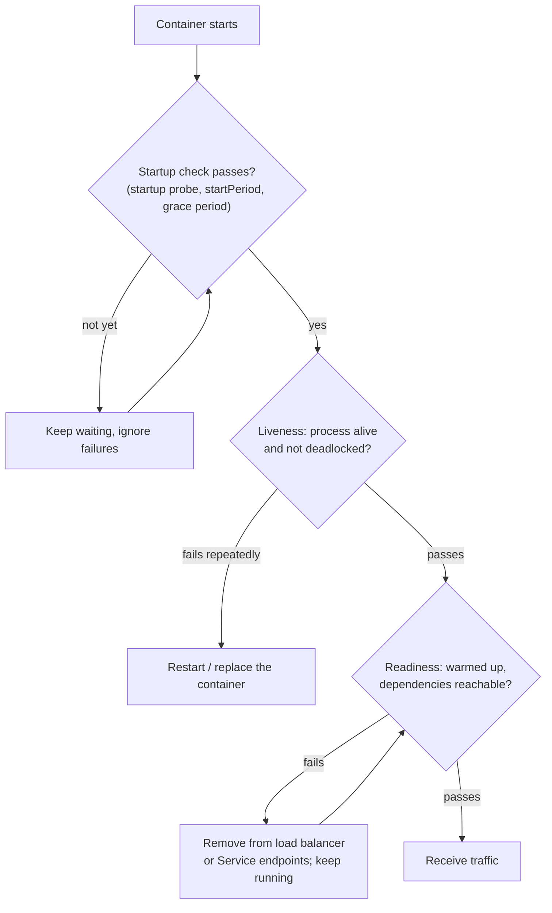

# 4.2.5 Monitor workload health through application health checks and container liveness and readiness probes

**Domain 4 · Task 4.2 · Skill 4.2.5** · [Task overview](README.md) · Previous: [4.2.4 Distributed tracing](4.2.4-distributed-tracing.md) · Next: [4.3.1 Concurrency controls](../task-4.3-optimize-applications/4.3.1-concurrency-controls.md)

## What the exam expects

A health check is a question a platform asks your application on a schedule: are you alive, and can you take traffic? The answer decides whether a load balancer routes to a target, whether an orchestrator restarts a container, and whether DNS (Domain Name System) fails over to another Region. This skill tests what to expose in your code (`/health`, `/ready`), how each AWS service checks it, and which probe answers which symptom.

You must be able to:

- Design liveness and readiness endpoints, and keep liveness shallow.
- Configure Elastic Load Balancing (ELB) target group health checks and know their defaults.
- Configure Amazon Elastic Container Service (ECS) container health checks, the service health check grace period, and know how they interact with deployments.
- Configure Kubernetes liveness, readiness, and startup probes on Amazon Elastic Kubernetes Service (EKS).
- Use Amazon Route 53 health checks for DNS failover, including for private resources.
- Use Amazon CloudWatch Synthetics canaries for scripted outside-in checks.
- Monitor Lambda health without a health endpoint.

> **DVA-C02 vs DVA-C03.** The official comparison does not list health checks as new content. DVA-C03 folds eight DVA-C02 observability skills into five broader ones, and this skill groups application health checks with container liveness and readiness probes. Container deployment on ECS, EKS, and Fargate is new in Task 3.3, which makes the container probes more likely to appear in scenarios.

## Key terms

| Term | Meaning |
|---|---|
| Liveness | Is the process running and able to make progress? Failure means restart it. |
| Readiness | Can it serve traffic right now (finished start-up, dependencies reachable)? Failure means stop sending it traffic, but don't restart it. |
| Startup probe | Kubernetes probe that holds off liveness and readiness checks until a slow-starting container has started. |
| Shallow check | Tests only the process itself (returns 200 if the web server answers). |
| Deep check | Also tests dependencies (database, cache, downstream APIs). |
| Target group health check | ELB's periodic request to each registered target. Unhealthy targets get no new requests. |
| Container health check | Command in the ECS task definition that Docker runs inside the container. |
| Health check grace period | Time after a task or Amazon Elastic Compute Cloud (EC2) instance starts during which failed health checks are ignored. |
| Canary | A scheduled script that exercises an endpoint or user flow the way a customer would. |

## Liveness versus readiness



| Probe | Question | Action on failure | Should check |
|---|---|---|---|
| Liveness | Is it stuck? | Restart | The process responds; event loop or worker threads not deadlocked |
| Readiness | Can it serve now? | Stop routing traffic until it passes again | Start-up finished, caches loaded, required dependencies reachable |
| Startup | Has it finished starting? | Keep liveness and readiness from running until it passes | The same endpoint as liveness, with a long failure threshold |

Keep liveness checks shallow. If liveness fails whenever the database is down, a database outage restarts every container at once, which turns a dependency problem into a full outage and a restart storm. Put dependency checks in readiness, or report degraded status in the response body while still returning success, and pair it with graceful degradation ([1.1.3](../../domain-1-development-with-aws-services/task-1.1-build-application-code/1.1.3-resilience-retries-and-backoff.md)).

## Health endpoints in code

```python
# Flask example: shallow liveness, deeper readiness
import time
from flask import Flask, jsonify

app = Flask(__name__)
STARTED_AT = time.time()
warmed_up = False          # set True after caches and connections are ready

@app.get("/health")        # liveness: is this process alive?
def health():
    return jsonify(status="ok"), 200

@app.get("/ready")         # readiness: can it take traffic?
def ready():
    checks = {"warmed_up": warmed_up, "db": db_ping(timeout_s=0.5)}
    healthy = all(checks.values())
    return jsonify(status="ready" if healthy else "not_ready", checks=checks), (200 if healthy else 503)

def db_ping(timeout_s: float) -> bool:
    try:
        # e.g., SELECT 1 through the connection pool, with a short timeout
        return True
    except Exception:
        return False
```

Endpoint rules:

- Return quickly, well under the checker's timeout. A slow health endpoint fails checks under load and removes healthy targets.
- Use short timeouts on any dependency calls inside a readiness check.
- Do not require authentication on the health path, or allow the checker through.
- Do not expose internal details (versions, hostnames, stack traces) on a public health endpoint.
- Exclude health-check paths from tracing and noisy access logging, or sample them at a low rate ([4.2.4](4.2.4-distributed-tracing.md)).

## Elastic Load Balancing target group health checks

Application Load Balancer (ALB) target group settings (API names and defaults from the ALB documentation):

| Setting | Default | Range or notes |
|---|---|---|
| `HealthCheckProtocol` | HTTP | HTTP or HTTPS |
| `HealthCheckPort` | Traffic port | Any port |
| `HealthCheckPath` | `/` | Set it to your health endpoint, such as `/health` |
| `HealthCheckIntervalSeconds` | 30 (35 for Lambda targets) | 5 to 300 |
| `HealthCheckTimeoutSeconds` | 5 (30 for Lambda targets) | 2 to 120 |
| `HealthyThresholdCount` | 5 | 2 to 10 consecutive successes |
| `UnhealthyThresholdCount` | 2 | 2 to 10 consecutive failures |
| `Matcher` (success codes) | 200 | Any of 200 to 499, such as `200-299` |

- Health checks are configured per target group. Each load balancer node checks each target.
- A new target must pass a health check before it gets traffic.
- If every target in a target group is unhealthy, the ALB fails open and routes to all of them. Health checks protect against a few bad targets, not against all of them failing.
- Reason codes such as `Target.ResponseCodeMismatch`, `Target.Timeout`, and `Target.FailedHealthChecks` tell you why a target is unhealthy. Health check logs can be stored in Amazon Simple Storage Service (Amazon S3).
- Security groups must allow the load balancer to reach the health check port.
- Network Load Balancer (NLB) health checks support TCP (Transmission Control Protocol), HTTP, and HTTPS.
- CloudWatch metrics: `HealthyHostCount`, `UnHealthyHostCount`, and `HTTPCode_ELB_5XX_Count` (often "no healthy targets") versus `HTTPCode_Target_5XX_Count` (your application's errors).

### EC2 Auto Scaling health checks

- By default an Auto Scaling group (ASG) uses EC2 status checks only, so an instance whose application is broken but whose operating system is fine stays "healthy".
- Turn on the ELB health check type for the ASG so instances that fail the target group check are terminated and replaced.
- Set a health check grace period so new instances are not replaced while they boot.
- Deregistration delay (connection draining, 1 to 3,600 seconds, default 300) lets in-flight requests finish before a target is removed.

## Amazon ECS health

ECS has three separate health signals. Know which one acts on what.

| Signal | Configured in | What happens on failure |
|---|---|---|
| Container health check | Task definition `healthCheck` | Container reported `UNHEALTHY`. If it is an essential container, ECS stops the task and the service replaces it. |
| Load balancer health check | Target group | Task is deregistered from the target group, and the service replaces it. |
| Deployment circuit breaker | Service deployment configuration | A deployment whose tasks keep failing to reach steady state is marked failed and can roll back automatically. |

```json
{
  "containerDefinitions": [
    {
      "name": "web",
      "image": "123456789012.dkr.ecr.us-east-1.amazonaws.com/web:1.4.2",
      "essential": true,
      "portMappings": [{ "containerPort": 8080 }],
      "healthCheck": {
        "command": ["CMD-SHELL", "curl -f http://localhost:8080/health || exit 1"],
        "interval": 30,
        "timeout": 5,
        "retries": 3,
        "startPeriod": 60
      }
    }
  ]
}
```

| Parameter | Default | Range |
|---|---|---|
| `command` | Required | Starts with `CMD` (run directly) or `CMD-SHELL` (run in the container's shell). Exit code 0 means healthy. |
| `interval` | 30 s | 5 to 300 s |
| `timeout` | 5 s | 2 to 60 s |
| `retries` | 3 | 1 to 10 |
| `startPeriod` | Off | 0 to 300 s. Failures during this period don't count toward retries; a success during it marks the container healthy. |

- The command runs inside the container, so the image must contain the tool (`curl`, `wget`, or a small health binary). A missing `curl` in a slim image is a classic cause of every task failing its health check.
- Container health checks need ECS agent 1.17.0 or later, and Fargate platform version 1.1.0 or later. They are not supported for services that use a Classic Load Balancer.
- The service's `healthCheckGracePeriodSeconds` tells ECS to ignore load balancer health check failures for that long after a task starts. Set it when start-up takes longer than the target group's unhealthy threshold.
- `minimumHealthyPercent` and `maximumPercent` decide how many healthy tasks must stay up during a rolling update. Details are in [3.3.2 Container deployments](../../domain-3-testing-and-deployment/task-3.3-deploy-with-ci-cd/3.3.2-container-deployments.md).
- A stopped task's stopped reason (for example "Task failed container health checks" or "failed ELB health checks") is the first place to look when tasks cycle ([4.1.4](../task-4.1-root-cause-analysis/4.1.4-diagnosing-deployment-failures.md)).

## Kubernetes probes on Amazon EKS

```yaml
apiVersion: apps/v1
kind: Deployment
metadata:
  name: web
spec:
  replicas: 3
  selector:
    matchLabels: { app: web }
  template:
    metadata:
      labels: { app: web }
    spec:
      containers:
        - name: web
          image: 123456789012.dkr.ecr.us-east-1.amazonaws.com/web:1.4.2
          ports:
            - containerPort: 8080
          startupProbe:            # protects slow starters: up to 30 x 5 s = 150 s to start
            httpGet: { path: /health, port: 8080 }
            periodSeconds: 5
            failureThreshold: 30
          livenessProbe:           # restart the container if it hangs
            httpGet: { path: /health, port: 8080 }
            periodSeconds: 10
            failureThreshold: 3
          readinessProbe:          # remove the pod from Service endpoints until ready
            httpGet: { path: /ready, port: 8080 }
            periodSeconds: 5
            failureThreshold: 2
```

| Field | Meaning | Kubernetes default |
|---|---|---|
| `httpGet`, `tcpSocket`, `exec`, `grpc` | Probe mechanism. HTTP passes on status 200 to 399. | n/a |
| `initialDelaySeconds` | Wait before the first probe | 0 |
| `periodSeconds` | Time between probes | 10 |
| `timeoutSeconds` | Time before a probe counts as failed | 1 |
| `failureThreshold` | Consecutive failures before acting | 3 |
| `successThreshold` | Consecutive successes to be considered passing again | 1 (must be 1 for liveness and startup) |

- A failing readiness probe removes the pod from the Service's endpoints and, through the AWS Load Balancer Controller, from the ALB target group. It does not restart the pod.
- A failing liveness probe makes the kubelet restart the container. A liveness probe that is too aggressive on a slow starter causes a restart loop (`CrashLoopBackOff`); add a startup probe.
- Rolling updates (`maxSurge`, `maxUnavailable`) only count pods as available once readiness passes, so readiness probes also make deployments safe.
- CloudWatch Container Insights collects EKS and ECS cluster, service, and pod metrics and restart counts.

## Route 53 health checks

| Type | What it monitors |
|---|---|
| Endpoint | About 15 global checkers call an IP (internet protocol) address or domain over HTTP, HTTPS, or TCP |
| Calculated | Combines up to 255 child health checks with AND, OR, or a minimum number healthy |
| CloudWatch alarm | Health follows the state of a CloudWatch alarm |

- Endpoint checks: default interval 30 s (10 s costs more), failure threshold 3, healthy when more than 18 percent of checkers report healthy. HTTP and HTTPS checks pass on 2xx and 3xx, and can also match text in the first 5,120 bytes of the response.
- Allow the Route 53 health checker IP ranges in security groups and firewalls.
- Checkers run on the public internet and cannot reach private resources. To health-check a private endpoint, publish a CloudWatch metric, create an alarm on it, and create a Route 53 health check that monitors the alarm.
- Health checks drive failover, latency, weighted, geolocation, and multivalue answer routing, so unhealthy records stop being returned.

## Outside-in and platform health

| Tool | Use |
|---|---|
| CloudWatch Synthetics canaries | Scheduled Node.js or Python scripts (headless browser available) that test APIs and user flows: heartbeat, API canary, broken link checker, visual monitoring, recorder, GUI (graphical user interface) workflow blueprints. Alarm on `SuccessPercent` or `Duration`. Finds problems before customers do. |
| CloudWatch RUM (real user monitoring) | Performance and errors from real browsers. |
| CloudWatch Application Signals | Service-level dashboards and service level objectives (SLOs) for availability and latency. |
| AWS Elastic Beanstalk enhanced health | Health color and causes per instance, based on requests, latency, and instance metrics. `eb health` shows it. |
| AWS CodeDeploy `ValidateService` hook | Runs your health check script after a deployment and fails the deployment if it fails ([3.3.4](../../domain-3-testing-and-deployment/task-3.3-deploy-with-ci-cd/3.3.4-codedeploy.md)). |
| EC2 status checks | System status (host hardware) and instance status (guest operating system). Alarm on `StatusCheckFailed_System` with the recover action. |

A canary that fails can drive an alarm, which can drive a Route 53 health check, which fails DNS over to another Region.

## Lambda health

Lambda functions have no health endpoint and no probes; the service manages the execution environments. Monitor health through metrics and alarms instead:

- `Errors` and error rate (metric math on `Errors / Invocations`), `Throttles`, `Duration` percentiles.
- Asynchronous delivery: `AsyncEventsDropped`, `DeadLetterErrors`, `DestinationDeliveryFailures`, dead-letter queue depth.
- Stream consumers: `IteratorAge`.
- A canary or synthetic request against the API that fronts the function, for an end-to-end check.

## Exam triggers

| Scenario clue | Answer | Why the alternatives are wrong |
|---|---|---|
| Pods receive traffic before they finish starting | Readiness probe | Liveness restarts pods; it doesn't hold traffic. |
| Container process is alive but hung | Liveness probe (EKS) or container `healthCheck` (ECS) | Readiness only removes it from traffic; it stays hung. |
| Slow-starting app keeps getting restarted during start-up | Startup probe, ECS `startPeriod`, or service `healthCheckGracePeriodSeconds` | Raising liveness thresholds forever slows real failure detection. |
| Database outage restarts every container | Liveness check is too deep; move dependency checks to readiness | Deep liveness checks turn dependency failures into restart storms. |
| ALB keeps marking healthy instances unhealthy | Wrong path or port, success code mismatch, timeout too short, or security group blocks the check | The application may be fine; check reason codes. |
| ASG keeps instances whose app returns 500 | Use the ELB health check type on the ASG | EC2 status checks only see the OS and hardware. |
| Every ECS task fails its container health check after an image change | The slim image lacks `curl`, or the command or port is wrong | The task definition's command runs inside the container. |
| Fail over DNS when the primary Region's app is unhealthy | Route 53 failover routing with a health check | Load balancer health checks don't change DNS. |
| Health-check a private resource from Route 53 | CloudWatch alarm on a metric, Route 53 health check on the alarm | Route 53 checkers can't reach private IPs. |
| Test the login flow every 5 minutes from outside | CloudWatch Synthetics canary | Health endpoints don't exercise user flows. |
| Roll back an ECS deployment whose new tasks keep failing | Deployment circuit breaker with rollback | Manual monitoring is slow. |
| Run a health check after CodeDeploy installs the app | `ValidateService` hook | `BeforeInstall` runs before the files exist. |

## Common traps

- Liveness and readiness are different. Liveness failure restarts; readiness failure removes from traffic.
- ALB default success code is 200 only. An endpoint that returns 204 or a redirect fails until you change the matcher.
- ALB fails open when all targets are unhealthy.
- An ASG without the ELB health check type never replaces an instance whose application is broken.
- ECS container health status and ALB target health are independent checks; either can cause task replacement.
- Route 53 HTTP health checks work only for publicly reachable endpoints.
- Health endpoints that call every dependency with long timeouts fail under load and remove healthy capacity.
- Lambda has no liveness or readiness probe. Use metrics and alarms.

## Quick recall

- Liveness = restart if stuck; readiness = no traffic until ready; startup = protect slow starters.
- Keep liveness shallow; put dependency checks in readiness.
- ALB defaults: path `/`, interval 30 s, timeout 5 s, healthy 5, unhealthy 2, success code 200.
- ASG: switch on the ELB health check type to replace instances with a broken app.
- ECS `healthCheck`: `CMD` or `CMD-SHELL`, interval 30, timeout 5, retries 3, `startPeriod` 0 to 300.
- ECS `healthCheckGracePeriodSeconds` ignores load balancer failures right after start.
- Kubernetes probes: `httpGet`, `tcpSocket`, `exec`, `grpc`; defaults period 10 s, timeout 1 s, failure threshold 3.
- Route 53: about 15 checkers, more than 18% healthy, 2xx/3xx pass; private resources via a CloudWatch alarm.
- Synthetics canaries for scheduled user-flow checks; alarm on `SuccessPercent`.
- Lambda health = `Errors`, `Throttles`, `Duration`, async and stream metrics.

## Related skills

- [3.3.2 Container deployments](../../domain-3-testing-and-deployment/task-3.3-deploy-with-ci-cd/3.3.2-container-deployments.md): rolling updates, minimum healthy percent, and the circuit breaker.
- [3.3.4 CodeDeploy](../../domain-3-testing-and-deployment/task-3.3-deploy-with-ci-cd/3.3.4-codedeploy.md): `ValidateService` and traffic hooks as deployment health checks.
- [4.2.3 Alerts and notifications](4.2.3-alerts-and-notifications.md): alarms on canaries, unhealthy host counts, and status checks.
- [4.1.4 Diagnosing deployment failures](../task-4.1-root-cause-analysis/4.1.4-diagnosing-deployment-failures.md): reading ECS stopped reasons and service events.
- [1.1.3 Resilience, retries, and backoff](../../domain-1-development-with-aws-services/task-1.1-build-application-code/1.1.3-resilience-retries-and-backoff.md): graceful degradation when a dependency is down.

## Sources

- Merged from: `archive/dva-c03-study-notes/04-troubleshooting-optimization.md` (skill 4.2.5), `archive/dva-c03-study-notes/00-developer-basics.md` (health checks, liveness and readiness), `archive/dva-c03-study-notes/03-testing-deployment.md` (EKS manifests), `archive/aws-dva-notes/Markdown Files/4. High Availability & Scalability.md` (load balancer health checks, ASG, connection draining), `archive/aws-dva-notes/Markdown Files/13. Containers on AWS.md` (ECS, EKS, rolling updates), `archive/aws-dva-notes/Markdown Files/30. AI Services & Security (DVA-C03).md` (section 9, health probes), `archive/aws-dva-notes/Markdown Files/6. Route 53.md` (section 7), `archive/aws-dva-notes/Markdown Files/17. Monitoring, Troubleshooting & Audit.md` (Synthetics, EC2 recovery), `archive/aws-dva-notes/Markdown Files/21. CICD - CodeCommit, CodePipeline, CodeBuild, CodeDeploy.md` (`ValidateService`), `archive/aws-dva-notes/Markdown Files/31. Exam Day Cheat Sheet.md`.
- AWS documentation: [Health checks for Application Load Balancer target groups](https://docs.aws.amazon.com/elasticloadbalancing/latest/application/target-group-health-checks.html)
- AWS documentation: [HealthCheck (Amazon ECS API reference)](https://docs.aws.amazon.com/AmazonECS/latest/APIReference/API_HealthCheck.html)
- Kubernetes documentation: [Configure liveness, readiness and startup probes](https://kubernetes.io/docs/tasks/configure-pod-container/configure-liveness-readiness-startup-probes/)
