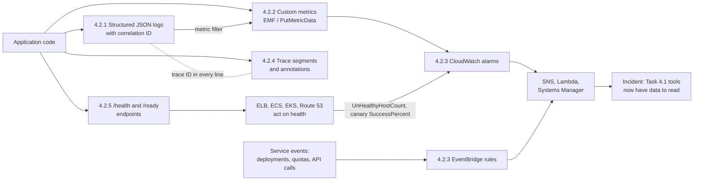

# Task 4.2: Apply observability practices

**Domain 4 · Task 4.2** · [Domain overview](../README.md)

This task covers the instrumentation you add before anything breaks: structured logs, custom metrics, alerts, distributed traces, and health checks. [Task 4.1](../task-4.1-root-cause-analysis/README.md) uses these signals to find a root cause, and [Task 4.3](../task-4.3-optimize-applications/README.md) uses them to find bottlenecks. Both fail if the signals were never recorded. Most questions describe a team that "couldn't tell what happened" and ask which signal should have existed and how to emit it. The main services are Amazon CloudWatch (Logs, metrics, alarms, Synthetics), AWS X-Ray and AWS Distro for OpenTelemetry (ADOT), Amazon EventBridge and Amazon Simple Notification Service (SNS) for alerts, and the health check features of Elastic Load Balancing (ELB), Amazon Elastic Container Service (ECS), Amazon Elastic Kubernetes Service (EKS), and Amazon Route 53.

> **DVA-C02 vs DVA-C03.** AWS consolidated eight DVA-C02 observability skills into these five broader skills. The material did not shrink. Domain 4 as a whole rose from 18% to 22% of the exam.

## Skills

| Skill | Note | Covers |
|---|---|---|
| 4.2.1 | [Structured logging](4.2.1-structured-logging.md) | JSON log fields, correlation IDs, Lambda log format and log levels, Powertools `Logger`, log sources for Lambda, ECS, Amazon Elastic Compute Cloud (EC2), and API Gateway, audit events, keeping personally identifiable information (PII) out, retention |
| 4.2.2 | [Custom metrics](4.2.2-custom-metrics.md) | Namespaces and dimensions, `PutMetricData` limits, Embedded Metric Format (EMF), Powertools `Metrics`, metric filters, CloudWatch agent, cardinality and cost, high resolution, metric math dashboards |
| 4.2.3 | [Alerts and notifications](4.2.3-alerts-and-notifications.md) | CloudWatch alarm settings and actions, anomaly detection, metric math and composite alarms, Service Quotas usage alarms, deployment notifications (notification rules, EventBridge state-change events), CloudTrail API-call alerts, automated remediation |
| 4.2.4 | [Distributed tracing](4.2.4-distributed-tracing.md) | X-Ray segments, subsegments, annotations, metadata, header propagation and gaps, enabling tracing per service, sampling, trace map, X-Ray Insights, Application Signals, OpenTelemetry and the X-Ray software development kit (SDK) maintenance notice |
| 4.2.5 | [Health checks and probes](4.2.5-health-checks-and-probes.md) | Liveness versus readiness, Application Load Balancer (ALB) target group health checks, Auto Scaling health check types, ECS container health checks and grace periods, Kubernetes probes, Route 53 health checks, Synthetics canaries, Lambda health metrics |

## How the skills fit together

Use this table to route a scenario to the right note:

| The question is about | Go to |
|---|---|
| Logs that can't be searched or correlated, Lambda log format or level, debug logs in production, PII in logs, container or EC2 logs missing | [4.2.1](4.2.1-structured-logging.md) |
| Business metrics, metrics from Lambda without latency, EC2 memory, metrics from existing logs, high resolution, dimension cost, one chart across many functions | [4.2.2](4.2.2-custom-metrics.md) |
| Paging the team, noisy alarms, quota warnings, pipeline or deployment notifications, alerting on an API call, automatic remediation | [4.2.3](4.2.3-alerts-and-notifications.md) |
| Which hop is slow, enabling X-Ray, missing traces, annotations versus metadata, sampling, OpenTelemetry | [4.2.4](4.2.4-distributed-tracing.md) |
| Traffic sent to unready containers, hung containers, unhealthy targets, DNS failover, synthetic user-flow checks | [4.2.5](4.2.5-health-checks-and-probes.md) |

Signal-to-question map:

| Signal | Answers | Emitted by |
|---|---|---|
| Logs | What exactly happened in this request? | Your code (4.2.1) |
| Metrics | How often, how fast, trending which way? | AWS services automatically; your code for business metrics (4.2.2) |
| Alarms and events | Who needs to know, and what should run? | CloudWatch and EventBridge (4.2.3) |
| Traces | Where in the chain did time or errors go? | X-Ray or OpenTelemetry instrumentation (4.2.4) |
| Health checks | Should this target get traffic, or be restarted? | Your endpoints, checked by the platform (4.2.5) |
| CloudTrail events | Who called which AWS API? | AWS, automatically (used by 4.2.3 alerts; covered in Task 4.1) |

## Study checklist

- [ ] 4.2.1 Write a JSON log line with the fields you would need to rebuild one request's story across services.
- [ ] 4.2.1 Set a Lambda function to JSON format with DEBUG application logs using the AWS Command Line Interface (CLI), and explain why a code-set level can override it.
- [ ] 4.2.1 Name where Lambda, ECS, EC2, and API Gateway send logs and what each needs to do so.
- [ ] 4.2.2 Write an EMF log line by hand, and say which fields are metrics, dimensions, and plain properties.
- [ ] 4.2.2 Choose between `PutMetricData`, EMF, a metric filter, and the CloudWatch agent for a given scenario.
- [ ] 4.2.2 Explain why `customerId` should not be a metric dimension.
- [ ] 4.2.3 Configure an alarm with M out of N datapoints and the right missing-data treatment.
- [ ] 4.2.3 Build a quota alarm with `SERVICE_QUOTA()` and a pipeline-failure alert with an EventBridge rule.
- [ ] 4.2.3 Know when to use anomaly detection, metric math, and composite alarms.
- [ ] 4.2.4 Enable tracing for Lambda, API Gateway (REST), EC2, ECS, and Fargate with the right permissions.
- [ ] 4.2.4 Add a custom subsegment with an annotation in a Lambda handler.
- [ ] 4.2.4 Explain the default sampling rule and why some requests have no trace.
- [ ] 4.2.4 State what the X-Ray SDK maintenance notice means and what replaces the SDK and daemon.
- [ ] 4.2.5 Explain liveness, readiness, and startup probes and why liveness stays shallow.
- [ ] 4.2.5 Recite ALB and ECS health check defaults, and fix an Auto Scaling group (ASG) that keeps broken instances.
- [ ] 4.2.5 Health-check a private resource with Route 53.

## Labs and practice

- [Labs](labs.md): Lab 1 enables X-Ray active tracing on a Lambda function and pulls the traces; Lab 2 records an annotation and metadata on a subsegment and filters traces by the annotation.
- [Practice questions](practice-questions.md): 4 multiple-choice questions with explanations, covering structured logging, custom subsegments, metric math dashboards, and automated remediation.
