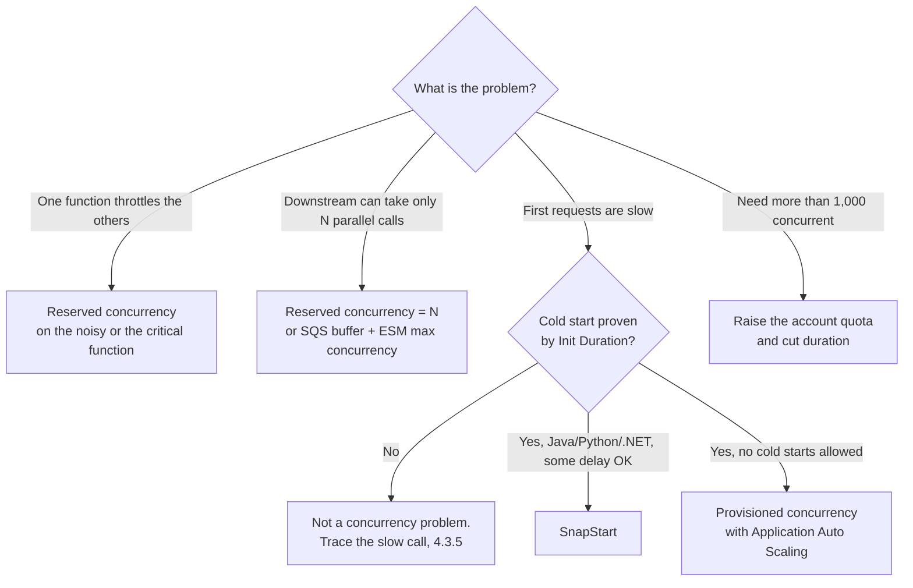
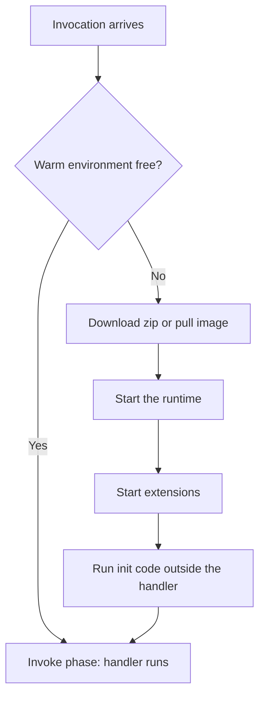
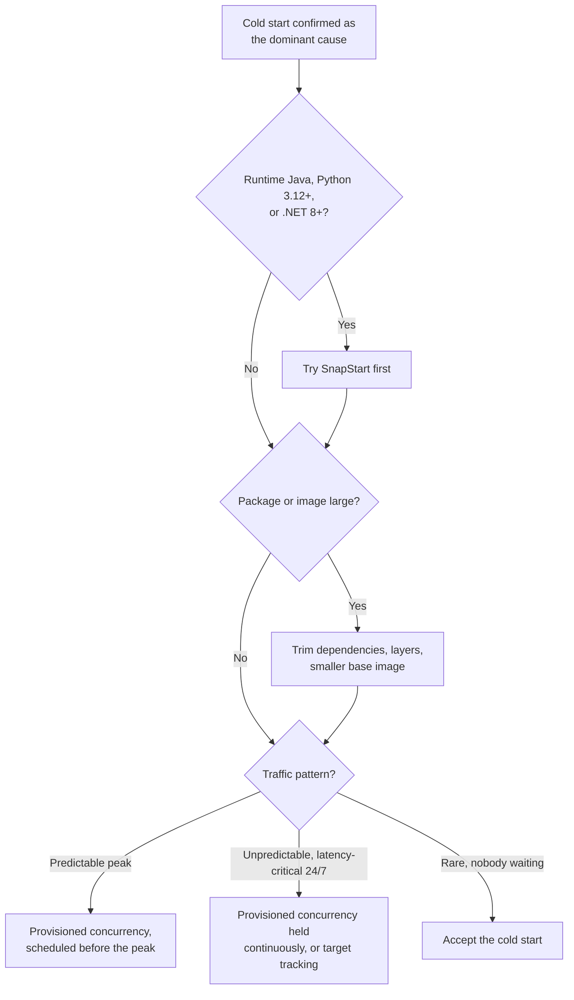
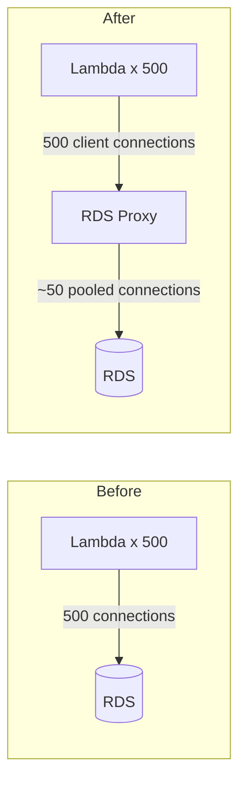

# 4.3.1 Apply concurrency controls such as Lambda provisioned concurrency, EC2 Auto Scaling, thread pools, and connection pools

**Domain 4 · Task 4.3 · Skill 4.3.1** · [Task overview](README.md) · Previous: [4.2.5 Health checks and probes](../task-4.2-observability/4.2.5-health-checks-and-probes.md) · Next: [4.3.2 Memory and compute tuning](4.3.2-memory-and-compute-tuning.md)

## What the exam expects

This skill tests whether you can size and shape how much work an application does at the same time, and protect the things behind it. Questions give a traffic number, a latency symptom, or a downstream that is falling over (database connections, a partner API), and ask which control fixes it: AWS Lambda reserved or provisioned concurrency, SnapStart, Amazon Elastic Compute Cloud (EC2) Auto Scaling policies, a bounded thread pool, client reuse, or Amazon Relational Database Service (RDS) Proxy. Wrong answers usually pick a control that does something adjacent, such as reserved concurrency to remove cold starts, or more memory to fix connection exhaustion.

You must be able to:

- Compute required Lambda concurrency from requests per second and duration.
- Choose between reserved concurrency, provisioned concurrency, SnapStart, and the event source mapping (ESM) maximum concurrency setting.
- Prove a latency spike is a cold start before mitigating it, then pick the cheapest mitigation that fits the cause.
- Choose an EC2 Auto Scaling policy (target tracking, step, scheduled, predictive) and a metric to scale on.
- Size thread pools and connection pools to downstream limits, and know why Lambda plus a relational database needs RDS Proxy.

Lambda configuration syntax (the `put-function-concurrency` call, SnapStart prerequisites, limits) is in [1.2.2 Lambda configuration](../../domain-1-development-with-aws-services/task-1.2-develop-lambda-functions/1.2.2-lambda-configuration.md#concurrency). This note covers using those controls to tune a running application.

> **DVA-C02 vs DVA-C03.** Lambda performance tuning moved from Domain 1 (Task 1.2) in DVA-C02 to Domain 4 (Task 4.3) in DVA-C03. The material did not change; where AWS classifies it did.

## Key terms

| Term | Meaning |
|---|---|
| Concurrency | The number of requests being processed at the same moment. In Lambda, one execution environment handles one request at a time. |
| Execution environment | The isolated runtime Lambda creates for a function. It runs the init code once, then handles invocations one after another while it stays warm. |
| Cold start | The extra latency when Lambda must create a new execution environment: download code, start the runtime, start extensions, and run init code. |
| Unreserved concurrency | The shared account pool (1,000 per Region by default) that functions without reservations draw from. |
| Reserved concurrency | A slice of the account pool set aside for one function. It is both a guarantee and a hard cap. Free. |
| Provisioned concurrency | A number of execution environments kept initialized on a published version or alias so requests skip the cold start. Billed while configured. |
| SnapStart | Lambda snapshots the initialized environment when you publish a version, then resumes new environments from the snapshot instead of running init again. |
| ESM maximum concurrency | A cap (2 to 1,000) on how many concurrent invocations one Amazon Simple Queue Service (SQS) event source mapping can drive. |
| Target tracking | An Auto Scaling policy that adds or removes capacity to keep a metric near a target value, such as 50% central processing unit (CPU). |
| Thread pool | A fixed set of worker threads that take tasks from a queue. It limits how much work runs at once inside one process. |
| Connection pool | A set of open connections that requests borrow and return, instead of opening a new connection per request. |
| Back-pressure | Slowing or rejecting new work when a downstream is saturated, instead of piling up requests. |
| RDS Proxy | A managed database proxy for Amazon Relational Database Service (RDS) and Amazon Aurora that pools and shares connections. |

## Concurrency math

Concurrency is throughput multiplied by time in the system (Little's law). For Lambda:

```
Concurrent executions ≈ requests per second × average duration in seconds
```

| Scenario | Calculation | Concurrency needed |
|---|---|---|
| 200 requests per second, 0.5 s each | 200 × 0.5 | 100 |
| 1,000 requests per second, 2 s each | 1,000 × 2 | 2,000 (above the 1,000 default account limit) |
| Same 1,000 requests per second after tuning to 0.4 s | 1,000 × 0.4 | 400 |

The third row is the point to remember: making each request faster (more memory for CPU-bound code, caching, a faster downstream) also cuts the concurrency you need and the throttling you see. Duration and concurrency are linked.

Lambda scaling facts that limit how fast you can get there:

- Account limit: 1,000 concurrent executions per Region by default, shared by all functions, raisable through Service Quotas.
- Scaling rate: each function can add up to 1,000 execution environments every 10 seconds.
- Above the available concurrency, requests are throttled. Synchronous callers get `TooManyRequestsException` (HTTP 429); asynchronous events are retried for up to 6 hours. See [1.2.3](../../domain-1-development-with-aws-services/task-1.2-develop-lambda-functions/1.2.3-lambda-invocation-lifecycle-and-failures.md#throttling-by-invocation-type).

## Lambda concurrency controls

| Control | What it does | Cost | Use it when |
|---|---|---|---|
| Reserved concurrency | Guarantees and caps a function's share of the account pool. Setting 0 stops all invocations. | Free | One busy function starves others; a downstream (database, partner API) can only take N parallel calls |
| Provisioned concurrency | Keeps N environments initialized on a version or alias. Traffic above N spills over to on-demand environments, which can cold-start. | Billed per hour configured, plus invocations | Latency-sensitive synchronous application programming interfaces (APIs) with a strict tail-latency requirement |
| SnapStart | Resumes new environments from a snapshot taken after init | No extra charge for Java; caching and restore charges for Python and .NET | Slow init (Java frameworks, large Python or .NET dependency trees) where some cold start is acceptable |
| ESM maximum concurrency | Caps concurrency driven by one SQS queue | Free | Several queues share a function, or a queue must not flood a downstream |
| ESM provisioned mode | Dedicated SQS pollers with a minimum and maximum, faster scaling | Extra charge for pollers | Spiky queues that need low, steady processing latency |



### Reserved concurrency arithmetic

With the default 1,000 limit, reserving 150 for each of five functions leaves 250 for every other function in the account. Each of the five can never exceed 150, even when the rest of the pool is idle. Reserved concurrency never pre-warms anything; it only partitions the pool.

### Reserved concurrency and the SQS maximum concurrency setting

The two settings are independent. If the function's reserved concurrency is lower than the total maximum concurrency of all its SQS sources, Lambda throttles the extra invocations, messages return to the queue, and they can land in the dead-letter queue (DLQ) without ever failing in your code. Set reserved concurrency greater than or equal to the sum of the ESM maximums. Maximum concurrency and provisioned mode cannot be used on the same SQS ESM. Messaging tuning is in [4.3.3](4.3.3-messaging-optimization.md#lambda-and-sqs-event-source-mapping-tuning).

### One request per environment, threads for parallel I/O

A Lambda execution environment processes one invocation at a time. Adding threads inside a handler does not let it serve more requests. Threads or async I/O help only when a single invocation has several independent waits, such as fetching ten S3 objects. Above 1,769 MB a function gets more than one virtual CPU (vCPU), and CPU-bound code needs multiple threads or processes to use them (see [4.3.2](4.3.2-memory-and-compute-tuning.md)).

## Cold starts: prove it, then mitigate


*Source: [AWS Documentation, Understanding the Lambda execution environment lifecycle](https://docs.aws.amazon.com/lambda/latest/dg/lambda-runtime-environment.html). Every cold start pays for code download, runtime start, and your init code before the handler runs. Each mitigation below targets one of these stages.*

### The cold path, stage by stage



| Stage | Driven by | Lever |
|---|---|---|
| Download or pull | Package or image size | Trim dependencies, share code through layers, use a small base image ([3.3.1](../../domain-3-testing-and-deployment/task-3.3-deploy-with-ci-cd/3.3.1-lambda-packaging.md)). Free. |
| Runtime start | Language | Python, Node.js, and Go start fast; the Java Virtual Machine (JVM) is slowest because of class loading and just-in-time (JIT) warm-up. SnapStart targets this. |
| Extensions | Configured extensions | Remove extensions you do not use |
| Init code | Your code outside the handler | Keep one-time setup there (so warm calls reuse it) but keep it lean; lazy-load rarely used modules |
| Invoke | Handler code | Not a cold-start cost. Ordinary performance tuning. |

### Diagnosis in brief

The `REPORT` log line of a cold invocation has an `Init Duration` field; a warm invocation's line does not. A flat p50 with a high p99 is the typical shape. If `Init Duration` is absent, the slowness is in the handler or a downstream call, and no cold-start fix will help. Reading the evidence is covered in [4.1.2 Metrics, logs, and traces](../task-4.1-root-cause-analysis/4.1.2-metrics-logs-and-traces.md), and the Logs Insights query that counts cold starts per hour is in [4.3.5](4.3.5-performance-bottleneck-detection.md#cloudwatch-logs-insights-for-performance).

```
REPORT RequestId: abc-123  Duration: 842.11 ms  Billed Duration: 843 ms
Memory Size: 512 MB  Max Memory Used: 210 MB  Init Duration: 611.47 ms
```

Expected cold-start bursts are not a problem to fix: right after a deployment (every environment for the new version starts cold) and after a quiet period. A sustained high cold-start rate is.

### Mitigation decision tree



### SnapStart

- Supported on Java 11 and later, Python 3.12 and later, and .NET 8 and later managed runtimes, for zip and container images built on AWS base images. Other runtimes such as Node.js are not supported.
- Works only on published versions and aliases that point to them, never `$LATEST`.
- Not compatible with provisioned concurrency, Amazon Elastic File System (EFS), or ephemeral storage above 512 MB.
- Pricing: no additional cost for Java. Python and .NET pay a snapshot caching charge (minimum 3 hours, for as long as the version is active) and a charge per restore.
- Because many environments resume from one snapshot, anything unique created during init (random seeds, unique IDs, temporary credentials, open network connections) must be refreshed after restore, using runtime hooks. Connections created by an AWS software development kit (SDK) usually resume on their own.
- AWS recommends provisioned concurrency instead when cold-start requirements are too strict for SnapStart.

### Provisioned concurrency

- Configured on a published version or alias, not `$LATEST`.
- Requests up to the provisioned number skip the cold start. Requests above it spill over to on-demand environments, which can cold-start, up to the reserved or account limit. A question saying "provisioned concurrency is not eliminating all cold starts during a spike" is describing this expected spillover.
- Application Auto Scaling manages it on an alias, with a scheduled action (raise before a known peak, lower after) or target tracking on utilization.
- Size it from the `ConcurrentExecutions` metric, not a guess. Watch `ProvisionedConcurrencySpilloverInvocations` to see overflow.

```bash
# Static: pre-warm 20 environments on the prod alias
aws lambda put-provisioned-concurrency-config --function-name checkout \
  --qualifier prod --provisioned-concurrent-executions 20

# Register the alias with Application Auto Scaling
aws application-autoscaling register-scalable-target \
  --service-namespace lambda \
  --resource-id function:checkout:prod \
  --scalable-dimension lambda:function:ProvisionedConcurrency \
  --min-capacity 20 --max-capacity 100

# Raise to 80 every night at 01:50 UTC before a 02:00 batch window
aws application-autoscaling put-scheduled-action \
  --service-namespace lambda \
  --resource-id function:checkout:prod \
  --scalable-dimension lambda:function:ProvisionedConcurrency \
  --scheduled-action-name nightly-batch \
  --schedule "cron(50 1 * * ? *)" \
  --scalable-target-action MinCapacity=80,MaxCapacity=100
```

A matching scheduled action after the window lowers `MinCapacity` back to 20.

### Worked cost tradeoff: provisioned concurrency is not free insurance

Illustrative us-east-1 numbers from the source material: a function at 1,024 MB serving 10 million requests a month at about 300 ms average costs roughly $52 a month on demand. Holding 5 provisioned environments at 1 GB for a 30-day month adds about 5 × 2,592,000 s × 1 GB × $0.0000041667 ≈ $54, nearly doubling the bill. Invocations served by provisioned environments are billed at a lower duration rate, so the real net increase is somewhat smaller (check the [Lambda pricing page](https://aws.amazon.com/lambda/pricing/)). The lesson holds either way: scope provisioned concurrency to the functions on the latency-critical path, schedule it to the hours that need it, and prefer SnapStart or package trimming when either is enough.

### Cold starts by runtime

| Runtime | Typical `Init Duration` | Dominant cause | First mitigation |
|---|---|---|---|
| Python, Node.js | Tens to a few hundred ms | Package size and imports | Trim the package, lazy-load imports; SnapStart for Python 3.12+ |
| Go, Rust (on an operating system-only runtime) | Very low | Compiled binary | Rarely needed |
| Java | Several hundred ms to several seconds | JVM start, class loading, JIT | SnapStart |
| .NET | Moderate | Common Language Runtime (CLR) start, assembly loading | SnapStart for .NET 8+, ahead-of-time compilation, trimming |
| Container image (any runtime) | Adds image pull time | Image size and layers | Smaller base image, fewer layers, no build tools in the final image |

virtual private cloud (VPC) attachment adds much less cold-start time than it did before 2019, because Lambda now uses shared Hyperplane elastic network interfaces. Do not blame a cold start on the VPC without checking `Init Duration` (see [1.2.1](../../domain-1-development-with-aws-services/task-1.2-develop-lambda-functions/1.2.1-lambda-vpc-access.md)).

## EC2 Auto Scaling

An Auto Scaling group (ASG) keeps a minimum, desired, and maximum number of instances, replaces unhealthy ones, and registers new ones with the load balancer. ASGs are free; you pay for the instances. Capacity comes from a launch template (launch configurations are deprecated).

| Policy | How it works | Pick it when |
|---|---|---|
| Target tracking | Keeps a metric near a target, such as average CPU at 50% or `ALBRequestCountPerTarget` at 1,000 | Default choice; simplest to run |
| Step scaling | CloudWatch alarm thresholds map to step sizes (CPU above 70% adds 2, above 90% adds 4) | You need different responses at different breach sizes |
| Simple scaling | One alarm, one action, then wait for the cooldown | Legacy; prefer step or target tracking |
| Scheduled | Change min, max, or desired at a time | Known patterns, such as "raise minimum to 10 at 17:00 on Fridays" |
| Predictive | Forecasts load from history (machine learning) and scales ahead of it | Recurring daily or weekly cycles where reactive scaling is too slow |

Metrics to scale on: `CPUUtilization`, `RequestCountPerTarget`, average network in and out, or any custom metric. For queue workers, scale on backlog per instance (`ApproximateNumberOfMessagesVisible` divided by running instances) rather than raw queue length, so the target stays meaningful as the group grows (see [1.1.1](../../domain-1-development-with-aws-services/task-1.1-build-application-code/1.1.1-coupling-and-decoupling.md#scaling-consumers-on-queue-depth)).

Speeding up scale-out:

- Default cooldown is 300 seconds; during it a simple scaling policy launches or terminates nothing more. Target tracking and step policies use an instance warm-up time instead.
- Bake software into the Amazon Machine Image (AMI) so new instances serve traffic sooner, then shorten the warm-up.
- Warm pools keep pre-initialized instances stopped or running so scale-out skips slow boot steps.
- Enable EC2 detailed monitoring (1-minute metrics instead of 5-minute) so alarms react faster.

Amazon Elastic Container Service (ECS) uses service auto scaling (Application Auto Scaling on task count) with the same target tracking, step, and scheduled policies, driven by `ECSServiceAverageCPUUtilization`, memory, or request count per target. Container deployment is in [3.3.2](../../domain-3-testing-and-deployment/task-3.3-deploy-with-ci-cd/3.3.2-container-deployments.md).

## Thread pools

Inside a long-running process (an EC2 or container service, or one Lambda invocation that fans out I/O), a thread pool caps how much runs at once.

- **Size to the downstream, not to the CPU alone.** If the database allows 50 connections and you run 5 instances, each instance's pool should stay at or below 10.
- **CPU-bound work:** about one thread per core. More threads only add context switching.
- **I/O-bound work:** more threads than cores, roughly cores × (1 + wait time ÷ compute time), capped by downstream limits.
- **Use a bounded queue** in front of the pool and reject or slow callers when it is full (back-pressure). An unbounded queue hides overload until memory runs out.
- **Prefer async I/O** (Node.js event loop, Python `asyncio`) for many concurrent network calls; avoid blocking calls on the event loop.
- **Always set timeouts** on pooled work so one slow dependency does not hold every worker (see [1.1.3](../../domain-1-development-with-aws-services/task-1.1-build-application-code/1.1.3-resilience-retries-and-backoff.md)).

Parallel S3 reads inside one Lambda invocation, with a bounded pool and a client created once:

```python
import boto3
from concurrent.futures import ThreadPoolExecutor

s3 = boto3.client("s3")  # init scope: created once per execution environment

def fetch(key):
    return s3.get_object(Bucket="reports", Key=key)["Body"].read()

def handler(event, context):
    keys = event["keys"]
    # Bounded: never more than 8 requests in flight, whatever the input size
    with ThreadPoolExecutor(max_workers=8) as pool:
        bodies = list(pool.map(fetch, keys))
    return {"count": len(bodies)}
```

boto3 clients are thread-safe; boto3 resources and sessions are not, so share a client across threads.

## Connection pooling

Opening a connection costs a Transmission Control Protocol (TCP) handshake, a Transport Layer Security (TLS) handshake, and for databases an authentication round trip. Reuse is the fix.

### SDK and HTTP clients

Create SDK clients and Hypertext Transfer Protocol (HTTP) clients once, outside the handler (or once per process), so warm invocations reuse the open, kept-alive connection. Creating the client inside the handler pays the TLS handshake on every call. More memory and SnapStart do not fix this; moving the client does.

```python
import os, boto3

table = boto3.resource("dynamodb").Table(os.environ["TABLE_NAME"])  # once per environment

def handler(event, context):
    # Reuses the connection pool held by the client above
    return table.get_item(Key={"id": event["id"]}).get("Item")
```

Recent AWS SDK versions keep HTTP connections alive by default (verify for your SDK and version; older AWS SDK for JavaScript v2 code set `AWS_NODEJS_CONNECTION_REUSE_ENABLED=1`).

### Database connections from Lambda

Each Lambda execution environment holds its own connections. At 500 concurrent environments with one connection each, the database sees 500 connections, and a burst can exceed `max_connections` or exhaust memory on the database.

- In Lambda, keep a pool size of 1 per environment (one request at a time means one connection is enough) and open it in init scope.
- Validate or reconnect on error. Environments are frozen between invocations; while frozen, the database or a load balancer may close an idle connection, so the first request after a long idle period can hit "connection closed" or "broken pipe". Catch the error and reconnect instead of assuming the init-time connection lives forever.
- Put **RDS Proxy** between Lambda and the database.

### RDS Proxy

- Fully managed, serverless, highly available proxy for RDS (MySQL, PostgreSQL, MariaDB, SQL Server) and Aurora (MySQL, PostgreSQL).
- Pools and multiplexes many client connections over fewer database connections, cutting CPU and memory pressure on the database.
- Reduces failover time for Aurora and RDS (AWS cites up to 66%) because clients stay connected to the proxy while it reconnects to the new writer.
- Can enforce Identity and Access Management (IAM) authentication and reads database credentials from AWS Secrets Manager (see [2.2.7](../../domain-2-security/task-2.2-encrypt-and-protect-sensitive-data/2.2.7-secrets-management.md)).
- Reachable only from inside the VPC; never public.
- Usually needs no code change beyond pointing the connection string at the proxy endpoint.
- It is not a cache and does not route queries to separate compute. Read scaling is read replicas; caching is [4.3.4](4.3.4-caching-for-performance.md).



Long-running apps on EC2 or containers use an in-process pool (HikariCP for Java, SQLAlchemy's pool for Python) sized as described under thread pools. Amazon DynamoDB needs no connection pool at all because it is an HTTP API, which is one reason serverless designs pair Lambda with DynamoDB. Amazon ElastiCache clients should also be created once and reused.

## Worked scenarios

**9 AM cold starts.** A Java order API is fast all day but slow for the first minutes after 09:00, and `REPORT` lines in that window carry `Init Duration` of about 3 seconds. Try SnapStart first (free for Java). If the business still requires no cold starts, add provisioned concurrency on the `prod` alias with a scheduled action at 08:50 that raises it to the measured 09:00 `ConcurrentExecutions`, and another at 11:00 that lowers it. Reserved concurrency would not help; it does not pre-warm.

**Database connection exhaustion.** After a marketing email, a Lambda-backed API returns errors and RDS shows `DatabaseConnections` at the limit and high CPU. Lambda scaled to 800 environments, each with its own connection. Put RDS Proxy in front of the database and connect through it. If the database still cannot take the load, cap the function with reserved concurrency or move writes through an SQS queue with an ESM maximum concurrency, so excess work waits in the queue instead of failing.

**Noisy neighbor.** A reporting function behind an Application Load Balancer (ALB) uses most of the account's 1,000 concurrency and the checkout function starts returning 429s. Set reserved concurrency on checkout to guarantee its capacity, or on the reporting function to cap it.

**Nightly batch spike.** Provisioned concurrency is a static 20 sized for daytime, and a nightly job needs about 80 for 30 minutes, so 60 invocations cold-start every night. Use Application Auto Scaling scheduled actions on the alias, as in the example above.

## Exam triggers

| Scenario clue | Answer | Why the alternatives are wrong |
|---|---|---|
| "How many concurrent executions are needed?" | Requests per second × average duration | Requests per second alone ignores how long each one holds an environment |
| "Eliminate cold starts", "consistent low latency" | Provisioned concurrency on an alias | Reserved concurrency only caps and guarantees; it never pre-warms |
| Java function, slow first requests, minimize cost | SnapStart | Provisioned concurrency also works but bills continuously |
| "Predictable daily peak, avoid paying for peak all day" | Provisioned concurrency with Application Auto Scaling scheduled actions | A static value either overpays off-peak or under-covers the peak |
| "One function is throttling the others" | Reserved concurrency | Raising the account limit just moves the ceiling |
| "Lambda functions exhaust database connections" | RDS Proxy, connections opened in init scope | More memory or a bigger timeout adds nothing; a read replica does not pool connections |
| "TLS handshake on every invocation" | Create the client outside the handler | SnapStart only affects init; more memory does not remove per-call setup |
| "Protect a downstream that can take only 10 parallel calls" | Reserved concurrency 10, or SQS with ESM maximum concurrency 10 | Unbounded scaling will overwhelm it |
| "SQS messages land in the DLQ without errors in the logs" | Reserved concurrency below ESM maximum concurrency causes throttling | Increasing `maxReceiveCount` hides the cause |
| "Keep average CPU around 50%" | Target tracking policy | Step scaling needs hand-set thresholds |
| "Traffic rises every weekday at 08:00" | Scheduled or predictive scaling | Reactive policies lag the ramp |
| "New instances take too long to serve traffic" | Pre-baked AMI, warm pools, shorter warm-up | A longer cooldown makes it worse |

## Common traps

- Confusing reserved and provisioned concurrency. Reserved is free and caps or guarantees; provisioned costs money and pre-warms.
- Expecting provisioned concurrency on `$LATEST`. It needs a version or alias. SnapStart has the same rule.
- Combining SnapStart with provisioned concurrency. They cannot be used together on the same version.
- Treating every slow invocation as a cold start. No `Init Duration` field means no cold start.
- Raising memory to fix a cold start. Memory speeds up CPU-bound handler code and slightly speeds init, but download and runtime start are driven by package size and language.
- Assuming threads let one Lambda environment serve more requests. It serves one at a time.
- Sizing a thread or connection pool to CPU count while ignoring the database's connection limit.
- Believing an init-scope connection stays valid forever. Freeze and thaw can leave it closed.
- Expecting RDS Proxy to cache results or speed up slow queries. It pools connections.
- Forgetting that spillover above provisioned concurrency is normal.

## Quick recall

- Concurrency = requests per second × duration. 200 × 0.5 s = 100.
- Default account limit 1,000 per Region; each function scales by up to 1,000 environments per 10 seconds.
- Reserved = free guarantee plus cap; 0 stops the function.
- Provisioned = pre-warmed, version or alias only, billed while configured, scaled by Application Auto Scaling.
- SnapStart = Java 11+, Python 3.12+, .NET 8+; free for Java; no provisioned concurrency, EFS, or ephemeral storage above 512 MB.
- `Init Duration` in `REPORT` proves a cold start.
- ESM maximum concurrency 2 to 1,000; keep reserved concurrency at or above the sum.
- Target tracking is the default ASG policy; scheduled and predictive for known cycles; cooldown default 300 s.
- Size pools to downstream limits; bound the queue; set timeouts.
- Clients and connections go outside the handler; RDS Proxy for Lambda plus RDS or Aurora.

## Related skills

- [1.2.2 Lambda configuration](../../domain-1-development-with-aws-services/task-1.2-develop-lambda-functions/1.2.2-lambda-configuration.md): where concurrency, SnapStart, and init code are configured.
- [1.2.3 Lambda invocation lifecycle and failures](../../domain-1-development-with-aws-services/task-1.2-develop-lambda-functions/1.2.3-lambda-invocation-lifecycle-and-failures.md): what throttling does per invocation type.
- [1.1.3 Resilience, retries, and backoff](../../domain-1-development-with-aws-services/task-1.1-build-application-code/1.1.3-resilience-retries-and-backoff.md): timeouts and backoff around pooled work.
- [3.3.1 Lambda packaging](../../domain-3-testing-and-deployment/task-3.3-deploy-with-ci-cd/3.3.1-lambda-packaging.md): package size, the free cold-start lever.
- [4.1.2 Metrics, logs, and traces](../task-4.1-root-cause-analysis/4.1.2-metrics-logs-and-traces.md): reading `Init Duration` and concurrency metrics.
- [4.3.2 Memory and compute tuning](4.3.2-memory-and-compute-tuning.md): shorter duration means less concurrency.
- [4.3.3 Messaging optimization](4.3.3-messaging-optimization.md): queues as a concurrency buffer.
- [4.3.5 Performance bottleneck detection](4.3.5-performance-bottleneck-detection.md): finding throttles and connection limits.

## Sources

- Merged from: `archive/dva-c03-study-notes/04-troubleshooting-optimization.md` (skill 4.3.1), `archive/dva-c03/domain-4-troubleshooting-optimization/lambda-cold-start-diagnosis.md` (timeline, mitigation tree, cost tradeoff, runtime table), `archive/dva-c03/domain-4-troubleshooting-optimization/README.md` (second case study), `archive/dva-c03/domain-4-troubleshooting-optimization/MASTER-CHUNK.md` (section 6 Lambda), `archive/aws-dva-notes/Markdown Files/4. High Availability & Scalability.md` (sections 12 and 13 ASG), `archive/aws-dva-notes/Markdown Files/5. RDS, Aurora, & ElastiCache.md` (section 9 RDS Proxy), `archive/aws-dva-notes/Markdown Files/18. Serverless - Lambda.md` (sections 13 and 15), `archive/aws-dva-notes/Markdown Files/30. AI Services & Security (DVA-C03).md` (section 10 thread and connection pools), `archive/dva-c03/exam-bank/bank-2.md` and `bank-3.md` (RDS Proxy, client reuse, freeze and thaw, scheduled provisioned concurrency scenarios)
- AWS documentation: [Improving startup performance with Lambda SnapStart](https://docs.aws.amazon.com/lambda/latest/dg/snapstart.html) (runtimes, incompatibilities, pricing)
- AWS documentation: [Configuring scaling behavior for SQS event source mappings](https://docs.aws.amazon.com/lambda/latest/dg/services-sqs-scaling.html) (maximum concurrency and reserved concurrency interaction)
- AWS documentation: [Understanding the Lambda execution environment lifecycle](https://docs.aws.amazon.com/lambda/latest/dg/lambda-runtime-environment.html)
- AWS documentation: [Configure Lambda function memory](https://docs.aws.amazon.com/lambda/latest/dg/configuration-memory.html) (1,769 MB = one vCPU)
