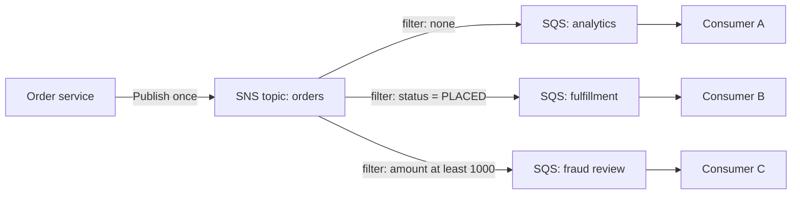

# 4.3.3 Optimize messaging with SQS queues, SNS fan-out, and suitable delivery patterns

**Domain 4 · Task 4.3 · Skill 4.3.3** · [Task overview](README.md) · Previous: [4.3.2 Memory and compute tuning](4.3.2-memory-and-compute-tuning.md) · Next: [4.3.4 Caching for performance](4.3.4-caching-for-performance.md)

## What the exam expects

This skill is about making a working message flow cheaper, faster, and safer under load. Domain 1 covers choosing Amazon Simple Queue Service (SQS), Amazon Simple Notification Service (SNS), Amazon EventBridge, or Amazon Kinesis; here you tune them. Questions describe too many empty receives, duplicate processing, a consumer that falls behind, a downstream that gets flooded, or subscribers doing work they throw away, and ask for the setting that fixes it.

You must be able to:

- Cut SQS application programming interface (API) calls and cost with long polling and batch APIs.
- Set the visibility timeout, dead-letter queue (DLQ), and message size handling correctly.
- Tune an AWS Lambda event source mapping (ESM) for SQS: batch size, batching window, maximum concurrency, provisioned mode, and partial batch responses.
- Use SNS fan-out with subscription filter policies and raw message delivery so each subscriber gets only what it needs.
- Get ordering and throughput together with FIFO message groups.
- Use batching, aggregation, and enhanced fan-out for Kinesis Data Streams.

Background on queues and topics is in [1.1.1 Coupling and decoupling](../../domain-1-development-with-aws-services/task-1.1-build-application-code/1.1.1-coupling-and-decoupling.md#amazon-sqs-the-default-buffer) and [1.1.8 Event-driven applications](../../domain-1-development-with-aws-services/task-1.1-build-application-code/1.1.8-event-driven-applications.md#amazon-sns).

## Key terms

| Term | Meaning |
|---|---|
| Short polling | `ReceiveMessage` returns immediately, querying only a subset of SQS servers, so it can return empty even when messages exist. |
| Long polling | `ReceiveMessage` waits up to 20 seconds for a message, querying all servers. Fewer empty responses and lower cost. |
| Visibility timeout | How long a received message stays hidden from other consumers before it reappears. Default 30 seconds. |
| `maxReceiveCount` | Number of receives after which SQS moves a message to the DLQ (set in the redrive policy). |
| Batching window | `MaximumBatchingWindowInSeconds` on an ESM: how long Lambda waits to fill a batch (0 to 300 seconds). |
| Partial batch response | The function returns only the failed message IDs (`batchItemFailures`) so successful messages are not retried. |
| Fan-out | One publish delivered to many independent subscribers. |
| Filter policy | A JavaScript Object Notation (JSON) policy on an SNS subscription that decides which messages that subscription receives. |
| Raw message delivery | SNS delivers the original message body without the SNS JSON envelope. |
| Message group ID | FIFO ordering key. Order is kept within a group; different groups process in parallel. |
| Enhanced fan-out | Kinesis feature giving each registered consumer its own 2 MB/s per shard, pushed over HTTP/2 (Hypertext Transfer Protocol version 2). |

## SQS optimizations

### Long polling

Enable it on the queue (`ReceiveMessageWaitTimeSeconds` 1 to 20) or per call (`WaitTimeSeconds`). 20 seconds is the usual choice. Lambda ESMs already use long polling.

```python
import boto3
sqs = boto3.client("sqs")

resp = sqs.receive_message(
    QueueUrl=queue_url,
    MaxNumberOfMessages=10,   # default 1, maximum 10
    WaitTimeSeconds=20,       # long polling
)
```

"Too many empty `ReceiveMessage` responses", "reduce SQS API cost", and "consumers burn central processing unit (CPU) polling an empty queue" all point here.

### Batch APIs

`SendMessageBatch`, `DeleteMessageBatch`, and `ChangeMessageVisibilityBatch` handle up to 10 messages per call. `ReceiveMessage` returns up to 10 with `MaxNumberOfMessages`. SQS bills per request (each 64 KB chunk of payload counts as one request), so batching ten small messages into one call cuts request cost roughly tenfold. Check the `Failed` list in a batch response and retry only those entries.

```python
entries = [{"Id": str(i), "MessageBody": json.dumps(o)} for i, o in enumerate(orders[:10])]
resp = sqs.send_message_batch(QueueUrl=queue_url, Entries=entries)
for f in resp.get("Failed", []):
    retry(f["Id"])   # partial failure: retry only these
```

### Visibility timeout

- Set it longer than the time a consumer needs to process and delete a message. Too short causes duplicates; too long delays retries after a crash.
- A slow consumer can extend one message with `ChangeMessageVisibility` (a heartbeat) instead of raising the queue default for everything.
- For a Lambda ESM, set the queue's visibility timeout to at least 6 times the function timeout, so retries of throttled or failed batches do not reappear while still in flight.
- "Messages processed more than once" usually means the visibility timeout is shorter than processing time, or the consumer never calls `DeleteMessage`.

### Dead-letter queues

- A redrive policy with `maxReceiveCount` moves poison messages to a DLQ after N failed receives, so they stop blocking and looping.
- The DLQ type must match the source (FIFO with FIFO, standard with standard). Set its retention to the 14-day maximum so you have time to inspect messages.
- After fixing the bug, use DLQ redrive to move messages back to the source queue without custom code.
- For a Lambda SQS trigger, configure the DLQ on the queue, not on the function. A function DLQ applies only to asynchronous invocations.

### Message size

The maximum SQS message size is 1 MiB (raised from 256 KiB in 2025, for standard and FIFO). Older questions may still say 256 KB. For larger payloads, use the Amazon SQS Extended Client Library, which stores the body in Amazon S3 and sends a pointer (payloads up to 2 GB). Smaller messages also mean fewer billed 64 KB chunks, so sending an S3 reference can be cheaper even below the limit.

### Delay queues

A delay queue (`DelaySeconds` 0 to 900, set per queue or per message on standard queues) hides a message before its first delivery. That differs from the visibility timeout, which hides it after a receive. Use a delay to give a dependency time to become consistent, or to schedule short waits without a timer.

### SQS as a buffer

Putting a queue between a spiky producer and a slow consumer (a database, a partner API) turns traffic spikes into backlog instead of errors. The consumer processes at its own safe rate. Control that rate with ESM maximum concurrency (Lambda) or the Auto Scaling group's maximum (EC2), and scale on backlog per instance ([4.3.1](4.3.1-concurrency-controls.md#ec2-auto-scaling)).

### FIFO throughput and ordering

- Default FIFO throughput is 300 API calls per second per action, or 3,000 messages per second with batching of 10.
- High throughput mode raises this to tens of thousands of transactions per second in the largest Regions (the source cites up to 70,000 non-batched in us-east-1, us-west-2, and eu-west-1; verify current quotas).
- Parallelism comes from message groups. One group ID for everything gives strict global order but one consumer at a time. A group ID per customer or per order keeps per-entity order while many groups process in parallel. A Lambda consumer scales up to the number of active message groups.
- FIFO deduplicates within a 5-minute window, using a deduplication ID or content-based hashing. That prevents duplicate sends; consumers still need idempotent processing because a message can be received again after a visibility timeout or a failed delete.
- Use FIFO only when ordering or deduplication is a requirement. Standard queues have nearly unlimited throughput.

| | Standard | FIFO |
|---|---|---|
| Throughput | Nearly unlimited | 300 calls/s per action (3,000 msg/s batched) by default; higher with high throughput mode |
| Ordering | Best effort | Per message group |
| Duplicates | At-least-once delivery | Deduplicated within 5 minutes; consumers still idempotent |
| Parallelism | Any number of consumers | One in-flight batch per group; scale with more groups |

## Lambda and SQS event source mapping tuning


*Source: [AWS Documentation, How Lambda processes records from stream and queue-based event sources](https://docs.aws.amazon.com/lambda/latest/dg/invocation-eventsourcemapping.html). Lambda invokes the function when the batching window ends, the batch size is reached, or the payload reaches 6 MB, whichever comes first.*

| Setting | Values | Effect |
|---|---|---|
| `BatchSize` | Default 10. Standard queues up to 10,000; FIFO up to 10 (10,000 in provisioned mode) | Larger batches spread invoke overhead over more messages and cut invocations |
| `MaximumBatchingWindowInSeconds` | 0 to 300 seconds (default 0). For FIFO, a window requires provisioned mode | Waits to fill bigger batches; adds latency |
| Maximum concurrency | 2 to 1,000 per SQS ESM | Caps how many concurrent invocations this queue drives; protects downstreams and other queues |
| Provisioned mode | Minimum and maximum event pollers (minimum 2 to 200, maximum 2 to 10,000) | About 3 times faster scaling and up to 16 times more capacity, up to 100,000 concurrent invocations; extra charge. Cannot be combined with maximum concurrency |
| `ReportBatchItemFailures` | On or off | Enables partial batch responses |
| Filter criteria | Event patterns on message body or attributes | Lambda drops non-matching messages before invoking, so you do not pay to discard them |

Default scaling for standard queues: Lambda starts with five concurrent batches, adds up to 300 concurrent invocations per minute while messages remain, and reaches at most 1,250 concurrent invocations per ESM. Older material says "60 more per minute, up to 1,000"; that is outdated. Use provisioned mode when that ramp is too slow. Details on ESM behavior are in [1.2.4](../../domain-1-development-with-aws-services/task-1.2-develop-lambda-functions/1.2.4-lambda-service-integrations.md#event-source-mappings-in-depth).

Larger batches trade latency for cost. If one message in a batch of 100 fails without partial batch responses, all 100 return to the queue and are reprocessed. Turn on `ReportBatchItemFailures` and return only the failures:

```python
def handler(event, context):
    failures = []
    for record in event["Records"]:
        try:
            process(record["body"])
        except Exception:
            failures.append({"itemIdentifier": record["messageId"]})
    return {"batchItemFailures": failures}   # empty list = whole batch succeeded
```

Full failure handling, including FIFO behavior when a message fails, is in [1.2.3](../../domain-1-development-with-aws-services/task-1.2-develop-lambda-functions/1.2.3-lambda-invocation-lifecycle-and-failures.md#partial-batch-response).

Messages can be delivered more than once even without errors, so make the handler idempotent.

## SNS fan-out

Publishing once to a topic and subscribing several SQS queues gives each consumer its own durable copy, its own retries, its own DLQ, and its own scaling. The producer does not change when consumers are added.



Optimizations:

- **Filter policies** stop irrelevant messages at SNS. Without them, every subscriber receives everything and throws most of it away, paying for receives and invocations. A subscription without a filter policy gets all messages. Policies match message attributes by default; set `FilterPolicyScope` to `MessageBody` to match on the payload. They support exact values, prefixes, numeric ranges, `anything-but`, and `exists`.

  ```json
  { "status": ["PLACED"], "amount": [{ "numeric": [">=", 1000] }] }
  ```

- **Raw message delivery** on SQS, HTTP/S, and Amazon Data Firehose subscriptions removes the SNS JSON envelope, so consumers parse less and messages are smaller.
- **`PublishBatch`** sends up to 10 messages per call.
- **FIFO topics** with SQS FIFO subscribers give fan-out plus ordering plus deduplication, at FIFO throughput.
- **The queue access policy** must allow the topic to call `sqs:SendMessage`, or deliveries fail silently from the producer's point of view.
- **S3 events to many consumers:** S3 allows only one event notification rule per event type and prefix, so route S3 to an SNS topic (or to EventBridge) and fan out from there.
- **Cross-Region:** SNS can deliver to SQS queues in other Regions.

Filter policy syntax and SNS-versus-EventBridge selection are in [1.1.8](../../domain-1-development-with-aws-services/task-1.1-build-application-code/1.1.8-event-driven-applications.md#filter-policies). Rule of thumb: SNS for high-throughput, low-latency fan-out; EventBridge for content-based routing across many sources and AWS service events, with archive and replay.

## Kinesis Data Streams optimizations

Kinesis basics are in [1.1.6 Streaming data](../../domain-1-development-with-aws-services/task-1.1-build-application-code/1.1.6-streaming-data.md).

| Problem | Fix |
|---|---|
| Many small `PutRecord` calls | `PutRecords` (up to 500 records per call), or Kinesis Producer Library (KPL) aggregation to pack small records together |
| `ProvisionedThroughputExceededException` on one shard | A higher-cardinality partition key (hot shard), more shards, or on-demand mode; retry with exponential backoff |
| Many consumers share 2 MB/s per shard and fall behind | Enhanced fan-out: 2 MB/s per shard per registered consumer |
| Lambda consumer lags (`IteratorAge` rising) | Raise the parallelization factor (1 to 10 concurrent batches per shard), increase batch size, add shards, speed up the function |
| One bad record blocks a shard | `BisectBatchOnFunctionError`, maximum retry attempts, maximum record age, and an on-failure destination |

Each shard accepts 1 MB/s or 1,000 records per second in and serves 2 MB/s out in provisioned mode.

## Choosing a delivery pattern for performance

| Requirement | Pattern | Why |
|---|---|---|
| Absorb spikes in front of a slow consumer | Producer → SQS → consumers with capped concurrency | Backlog instead of errors |
| Same event to several independent services | SNS → one SQS queue per service | Independent retries and scaling |
| Each subscriber needs only some events | SNS filter policies, or EventBridge rules | No wasted deliveries |
| Per-customer order with parallelism | FIFO queue or topic with message group ID = customer ID | Order within a group, parallel across groups |
| Ordered stream, replay, many readers | Kinesis Data Streams with enhanced fan-out | Retention and dedicated throughput per consumer |
| Synchronous response not required | Return 202 and process asynchronously through a queue | Short request time; work continues past API timeouts |

## Metrics that show messaging problems

| Metric | Meaning |
|---|---|
| SQS `ApproximateAgeOfOldestMessage` | Consumers are falling behind; scale consumers or speed them up |
| SQS `ApproximateNumberOfMessagesVisible` | Backlog size; basis for scaling |
| SQS `NumberOfEmptyReceives` | High value means short polling or over-polling; enable long polling |
| DLQ `ApproximateNumberOfMessagesVisible` above 0 | Poison messages; alarm on it |
| SNS `NumberOfNotificationsFailed`, `NumberOfNotificationsFilteredOut` | Delivery failures; filter policies working |
| Kinesis `GetRecords.IteratorAgeMilliseconds`, Lambda `IteratorAge` | Stream consumer lag |
| Kinesis `WriteProvisionedThroughputExceeded` | Hot shard or too few shards |

Using these in an investigation is in [4.3.5](4.3.5-performance-bottleneck-detection.md); alarms on them are in [4.2.3](../task-4.2-observability/4.2.3-alerts-and-notifications.md).

## Exam triggers

| Scenario clue | Answer | Why the alternatives are wrong |
|---|---|---|
| Too many empty `ReceiveMessage` calls; reduce SQS cost | Long polling, `WaitTimeSeconds=20` | Short polling with more consumers adds calls; a delay queue only postpones delivery |
| Reduce API calls when sending many messages | `SendMessageBatch` (10 per call) | More producers multiply calls |
| Messages processed twice | Visibility timeout longer than processing time; delete after success | A bigger `maxReceiveCount` makes retries more likely |
| One slow message needs more time | `ChangeMessageVisibility` heartbeat | Raising the queue default delays every retry |
| Poison message keeps reappearing | DLQ with `maxReceiveCount`, then redrive after the fix | A Lambda function DLQ does not apply to SQS triggers |
| Payload larger than 1 MiB | SQS Extended Client Library with S3 | Compressing alone may not fit; splitting breaks atomicity |
| Three services each need every order event | SNS fan-out to three SQS queues | One shared queue delivers each message to one consumer |
| Each consumer needs only some messages | SNS subscription filter policies | Separate topics per type couple the producer to consumers |
| A failing message forces the whole batch to retry | `ReportBatchItemFailures` and return `batchItemFailures` | Batch size 1 kills throughput |
| Queue must not overwhelm the database | ESM maximum concurrency (or reserved concurrency) | Unbounded scaling floods the database |
| Queue backlog grows during spikes, need faster scale-up | ESM provisioned mode | Maximum concurrency caps, it does not speed up |
| Per-customer order with high throughput | FIFO with message group ID per customer | One group ID serializes everything |
| Many Kinesis consumers starve each other | Enhanced fan-out | Adding shards alone does not give each consumer dedicated throughput |
| Lambda Kinesis consumer lags | Parallelization factor, batch size, more shards | Raising memory helps only if the function is CPU-bound |

## Common traps

- Quoting 256 KB as the SQS maximum. It is 1 MiB now; use S3 through the Extended Client for more.
- Calling FIFO "exactly-once processing". It deduplicates sends within 5 minutes; consumers still need idempotency.
- Putting the DLQ on the Lambda function for an SQS trigger.
- Forgetting the 6x visibility timeout rule for Lambda ESMs.
- Setting ESM maximum concurrency above the function's reserved concurrency, which throttles messages back to the queue.
- Using one message group ID and expecting parallel consumers.
- Using a delay queue to fix duplicates; that is the visibility timeout's job.
- Fanning out without filter policies, then filtering inside every consumer.
- Forgetting the SQS access policy that lets SNS deliver.

## Quick recall

- Long polling: 1 to 20 seconds; use 20.
- Batch APIs: 10 messages per call; `ReceiveMessage` up to 10.
- Visibility timeout default 30 s; at least 6x the function timeout for Lambda ESMs.
- Message maximum 1 MiB; Extended Client with S3 up to 2 GB.
- Delay queue up to 15 minutes; retention default 4 days, maximum 14.
- ESM: batch size up to 10,000 (standard), window up to 300 s, maximum concurrency 2 to 1,000, default scaling +300 per minute to 1,250.
- `ReportBatchItemFailures` returns only failed IDs.
- FIFO: 300 per second (3,000 batched) by default; parallelism by message group; 5-minute dedup.
- SNS: filter policies (attributes or body), raw delivery, `PublishBatch` 10, FIFO topics.
- Kinesis: `PutRecords` 500, KPL aggregation, enhanced fan-out 2 MB/s per consumer per shard, parallelization factor up to 10.

## Related skills

- [1.1.1 Coupling and decoupling](../../domain-1-development-with-aws-services/task-1.1-build-application-code/1.1.1-coupling-and-decoupling.md): SQS fundamentals and settings.
- [1.1.6 Streaming data](../../domain-1-development-with-aws-services/task-1.1-build-application-code/1.1.6-streaming-data.md): Kinesis capacity and consumers.
- [1.1.8 Event-driven applications](../../domain-1-development-with-aws-services/task-1.1-build-application-code/1.1.8-event-driven-applications.md): SNS, EventBridge, and fan-out patterns.
- [1.2.3 Lambda invocation lifecycle and failures](../../domain-1-development-with-aws-services/task-1.2-develop-lambda-functions/1.2.3-lambda-invocation-lifecycle-and-failures.md): partial batch responses and ESM failures.
- [1.2.4 Lambda service integrations](../../domain-1-development-with-aws-services/task-1.2-develop-lambda-functions/1.2.4-lambda-service-integrations.md): event source mapping configuration.
- [4.3.1 Concurrency controls](4.3.1-concurrency-controls.md): reserved concurrency and consumer scaling.
- [4.3.5 Performance bottleneck detection](4.3.5-performance-bottleneck-detection.md): reading queue and stream metrics.

## Sources

- Merged from: `archive/dva-c03-study-notes/04-troubleshooting-optimization.md` (skill 4.3.3), `archive/aws-dva-notes/Markdown Files/16. Messaging - SQS, SNS & Kinesis.md` (sections 2 to 15), `archive/aws-dva-notes/Markdown Files/18. Serverless - Lambda.md` (section 6 SQS and ESM scaling), `archive/dva-c03/exam-bank/bank-1.md` (SNS filter policy, SNS FIFO fan-out, enhanced fan-out scenarios)
- AWS documentation: [Configuring scaling behavior for SQS event source mappings](https://docs.aws.amazon.com/lambda/latest/dg/services-sqs-scaling.html) (five batches, +300 per minute, 1,250 maximum, maximum concurrency 2 to 1,000, provisioned mode up to 100,000)
- AWS documentation: [How Lambda processes records from stream and queue-based event sources](https://docs.aws.amazon.com/lambda/latest/dg/invocation-eventsourcemapping.html) (batching window 0 to 300 s, FIFO window requires provisioned mode, poller limits)
- AWS documentation: [CreateEventSourceMapping](https://docs.aws.amazon.com/lambda/latest/api/API_CreateEventSourceMapping.html) (batch size limits per source)
