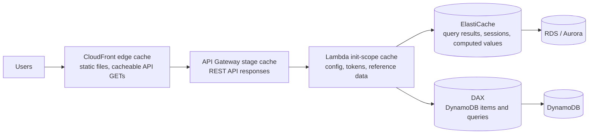

# 4.3.4 Implement caching with ElastiCache, DynamoDB Accelerator (DAX), and CloudFront

**Domain 4 · Task 4.3 · Skill 4.3.4** · [Task overview](README.md) · Previous: [4.3.3 Messaging optimization](4.3.3-messaging-optimization.md) · Next: [4.3.5 Performance bottleneck detection](4.3.5-performance-bottleneck-detection.md)

## What the exam expects

This skill tests whether you can put a cache in the right layer, configure it so it actually gets hits, and keep its staleness within what the application tolerates. Questions describe a database under repeated read load, global users waiting on the same responses, a CloudFront distribution with a poor hit ratio, or users seeing old content after a deploy, and ask for the cache and the setting. Choosing a strategy (lazy loading versus write-through, which cache for which store) is covered in [1.3.3 Caching strategies](../../domain-1-development-with-aws-services/task-1.3-use-data-stores/1.3.3-caching-strategies.md); this note covers implementing and tuning.

You must be able to:

- Write cache-aside and write-through code against Amazon ElastiCache, with time to live (TTL) values.
- Add DynamoDB Accelerator (DAX) to a DynamoDB application and predict where it serves stale data.
- Configure Amazon CloudFront cache policies, origin request policies, TTLs, invalidations, and cache behaviors for a high hit ratio.
- Enable Amazon application programming interface (API) Gateway caching on a REST API stage.
- Cache inside an AWS Lambda execution environment.
- Read hit, miss, and eviction metrics and act on them.

## Key terms

| Term | Meaning |
|---|---|
| Cache hit ratio | Hits ÷ (hits + misses). The main measure of whether a cache is working. |
| Cache key | What identifies a cached entry. In CloudFront, the host and path plus any headers, cookies, and query strings in the cache policy. |
| TTL | Time to live: how long an entry stays valid before the next read goes to the source. |
| Eviction | Removal of an entry before or at expiry, usually least recently used (LRU) when memory is full. |
| Cache stampede | Many requests miss at once (for example when a hot key expires) and all hit the database together. |
| Item cache / query cache | DAX's two independent caches: `GetItem`/`BatchGetItem` results and `Query`/`Scan` result sets. |
| Origin request policy | CloudFront setting that forwards headers, cookies, or query strings to the origin without adding them to the cache key. |
| Invalidation | Forcing CloudFront to drop cached objects before their TTL. |
| Origin Shield | An extra regional CloudFront caching layer in front of the origin that collapses requests from many edge locations. |

## Where to cache



The closer to the user, the more load a hit removes, but the coarser the control over freshness.

| Requirement | Cache | Code change |
|---|---|---|
| DynamoDB read-heavy, microsecond reads, minimal code change | DAX | Swap the client |
| Repeated relational queries, computed aggregates, sessions, leaderboards | ElastiCache (Valkey or Redis OSS, or Memcached) | Application implements the strategy |
| Static assets or the same API responses for global users | CloudFront | Configuration only |
| Same REST API GET responses, per-stage control | API Gateway caching | Configuration only |
| Configuration or secrets read on every invocation | Lambda global variables, Parameters and Secrets Lambda Extension | Small |

Measure first. A cache is extra cost, infrastructure, and invalidation logic for a problem you might not have.

## Strategies in brief

Full treatment is in [1.3.3](../../domain-1-development-with-aws-services/task-1.3-use-data-stores/1.3.3-caching-strategies.md#population-strategies).

| Strategy | Pros | Cons |
|---|---|---|
| Lazy loading (cache-aside) | Caches only requested data; a cache failure is not fatal | Miss penalty of three trips (read cache, read database, write cache); stale until TTL |
| Write-through | Reads after a write usually see fresh data | Write penalty (two writes); caches data nobody reads; still stale if a write path bypasses the cache or a cache write fails or arrives out of order |
| Both, plus a TTL | Fresh after writes, self-healing on misses, bounded staleness | More code |

Write-through reduces staleness but does not guarantee freshness. Any writer that skips the cache, a failed cache update after a successful database write, or two writes applied in the wrong order leaves a stale entry until its TTL or the next write. Keep a TTL on write-through entries for that reason.

## Amazon ElastiCache

ElastiCache is a managed in-memory store running Valkey, Redis OSS, or Memcached, offered as ElastiCache Serverless (no node sizing; scales automatically) or as node-based clusters you size. It needs application code: the app decides what to read, write, and expire.


*Source: [AWS ElastiCache Developer Guide, Components and features](https://docs.aws.amazon.com/AmazonElastiCache/latest/dg/WhatIs.Components.html). Each shard has a primary that takes writes and replicas that serve reads and stand by for failover.*

### Cache-aside with a TTL

```python
import json, os, random
import redis   # redis-py works with Valkey and Redis OSS

cache = redis.Redis(host=os.environ["CACHE_HOST"], port=6379, ssl=True)   # created once

def get_product(product_id):
    key = f"product:{product_id}"
    cached = cache.get(key)
    if cached is not None:                       # hit
        return json.loads(cached)
    product = db_get_product(product_id)         # miss: read the source of truth
    ttl = 300 + random.randint(0, 60)            # jitter so hot keys do not expire together
    cache.set(key, json.dumps(product), ex=ttl)
    return product
```

### Write-through with invalidation fallback

```python
def update_price(product_id, price):
    product = db_update_price(product_id, price)            # write the database first
    try:
        cache.set(f"product:{product_id}", json.dumps(product), ex=3600)
    except redis.RedisError:
        cache.delete(f"product:{product_id}")                # if the set fails, at least try to drop the old value
    return product
```

Write the database first; the cache is a copy. If the cache is unreachable, the application should still work from the database (graceful degradation, see [1.1.3](../../domain-1-development-with-aws-services/task-1.1-build-application-code/1.1.3-resilience-retries-and-backoff.md)).

### Tuning ElastiCache

- **TTL on almost every key.** It bounds staleness and lets unused data age out.
- **Jitter TTLs** so many hot keys do not expire in the same second (a stampede). For very hot keys, let one request refresh while others serve the old value, or refresh ahead of expiry.
- **Evictions:** when memory fills, keys are evicted according to the eviction policy (for example `allkeys-lru` or `volatile-lru`). A rising `Evictions` metric means scale up (bigger nodes) or out (more shards), or cache less.
- **Read scaling:** add replicas (Valkey and Redis OSS) and read from them. Write scaling and larger datasets: cluster mode with more shards.
- **Connections:** create the client once and reuse it; watch `CurrConnections` and `NewConnections`.
- **Data structures do the work:** hashes for objects, sorted sets (`ZADD`, `ZREVRANGE`) for leaderboards, atomic `INCR` with `EXPIRE` for counters and rate limits, `SET key value NX EX ttl` for short-lived locks.
- **Session store:** keep sessions in ElastiCache so any instance can serve any user and the app tier stays stateless.
- **Engine choice:** Valkey or Redis OSS for replication, Multi-AZ failover, persistence, backups, and rich data types; Memcached for a simple, multi-threaded, sharded cache with no replication. Details in [1.3.3](../../domain-1-development-with-aws-services/task-1.3-use-data-stores/1.3.3-caching-strategies.md#elasticache-engines).

| ElastiCache metric | Signal |
|---|---|
| `CacheHits`, `CacheMisses`, `CacheHitRate` | Is the cache useful? A low hit rate means poor keys, short TTLs, or data that is rarely reread |
| `Evictions` | Memory pressure; scale or shorten TTLs |
| `EngineCPUUtilization` | Engine thread saturation (Valkey and Redis OSS) |
| `DatabaseMemoryUsagePercentage` | How full the cache is |
| `CurrConnections` | Connection leaks or missing reuse |
| `ReplicationLag` | Replica reads may be behind |

> **Not on the DVA-C03 service list.** Amazon MemoryDB is a Valkey- and Redis OSS-compatible durable in-memory database with a Multi-AZ transaction log. Pick it when the data store itself must be in-memory and durable (a primary database), not a cache in front of another database.

## DynamoDB Accelerator (DAX)

DAX is an in-memory, write-through cache for DynamoDB that returns cached reads in microseconds. Its client is API-compatible with DynamoDB, so adding it is a client swap plus a cluster.

```python
# Before: client = boto3.client("dynamodb")
from amazondax import AmazonDaxClient            # pip install amazon-dax-client
client = AmazonDaxClient(endpoint_url=os.environ["DAX_ENDPOINT"])   # dax://my-cluster...
resp = client.get_item(TableName="Products", Key={"id": {"S": "p-101"}})
```

How it behaves:

| Operation | DAX behavior |
|---|---|
| `GetItem`, `BatchGetItem` (eventually consistent) | Served from the item cache; misses read DynamoDB and fill the cache |
| `Query`, `Scan` (eventually consistent) | Served from the query cache, keyed by the request parameters |
| Strongly consistent reads, `TransactGetItems` | Passed through to DynamoDB and not cached |
| `PutItem`, `UpdateItem`, `DeleteItem`, `BatchWriteItem` | Written to DynamoDB first, then to the item cache (write-through) |
| `CreateTable`, `UpdateTable`, other control-plane calls | Not supported; call DynamoDB directly |

Staleness traps, straight from the DAX consistency documentation:

- **Writes do not touch the query cache.** A `Query` cached before a `PutItem` returns the old result set until the query cache TTL expires.
- **Writers that bypass DAX** (another service using the plain DynamoDB client) leave the item cache stale until TTL or eviction.
- **Replication between DAX nodes** is eventually consistent, usually under a second, so two clients can briefly read different values.
- **Negative caching:** "item not found" is cached too, until TTL or a write through DAX.
- Item cache and query cache TTLs default to 5 minutes and are set per cluster. A TTL of 0 on the query cache disables query caching.

Configuration facts:

- Runs inside your virtual private cloud (VPC); clients connect on port 8111 (or 9111 with encryption in transit).
- Up to 11 nodes per cluster (one primary, up to ten read replicas); at least three nodes across Availability Zones for production.
- Scale out with more nodes for read throughput; scale up with larger nodes for a bigger working set. DAX returns `ThrottlingException` when a node is overloaded (`ThrottledRequestCount` metric).
- You pay for node-hours, and the base table's capacity is still billed. DAX reduces read units consumed for cache hits; it does not remove the table's provisioned capacity charge.

When DAX is the wrong answer: write-heavy tables, workloads that need strongly consistent reads, reads that rarely repeat, caching computed aggregates (use ElastiCache), or applications that cannot run in the VPC. DAX also absorbs hot-key reads, which helps when one item gets most of the reads ([4.3.5](4.3.5-performance-bottleneck-detection.md#dynamodb-throttling-hot-key-or-capacity)), but it does not help hot writes.

## Amazon CloudFront

CloudFront caches at edge locations worldwide. A request that hits the edge cache never reaches the origin.

### Cache key and policies

By default the cache key is the distribution's host name plus the uniform resource locator (URL) path. Every header, cookie, or query string added to the cache key creates more variants of the same object and lowers the hit ratio.

| | Cache policy | Origin request policy |
|---|---|---|
| Purpose | Defines the cache key and TTLs | Forwards extra values to the origin |
| Affects hit ratio | Yes | No |
| Example | Vary by `Accept-Language` | Forward `User-Agent`, a `session_id` cookie, a tracking query string |

- Values in the cache key are automatically forwarded to the origin. If the origin needs a value that does not change the response, put it in the origin request policy instead.
- Use AWS managed policies (for example `CachingOptimized` for static content, `CachingDisabled` for pass-through APIs) unless you need custom ones.
- Cache policies can enable Gzip and Brotli compression, which also normalizes `Accept-Encoding` in the key.

Worked case: a distribution in front of S3 has a low hit ratio, and most requests go to the origin. The URLs carry a unique `sessionToken` query string that does not change the file, and the cache policy includes all query strings. Every request is a unique cache key. Exclude `sessionToken` from the cache key (include only the query strings that change the response); if the origin needs it, forward it through an origin request policy.

### TTLs

| Setting | Behavior |
|---|---|
| Minimum TTL | Floor. If above 0, CloudFront caches for at least this long even when the origin sends `no-cache`, `no-store`, or `private` |
| Default TTL | Used when the origin sends no `Cache-Control` or `Expires` header |
| Maximum TTL | Ceiling on what the origin's `max-age`, `s-maxage`, or `Expires` can request |

- Without a cache policy (legacy settings), the default TTL is 24 hours.
- `Cache-Control: max-age` sets browser and CloudFront caching; `s-maxage` overrides it for CloudFront only. `max-age` wins over `Expires` when both are present.
- Setting minimum, default, and maximum TTL all to 0 disables caching.
- `stale-while-revalidate` serves the expired object while CloudFront refreshes it in the background; `stale-if-error` serves the stale object when the origin returns 5xx or is unreachable.
- A viewer cannot force CloudFront to bypass the cache with `Cache-Control` or `Pragma` request headers.

### Refreshing content

- **Invalidation:** `CreateInvalidation` on paths such as `/index.html` or `/images/*` (or `/*`) removes objects before TTL. Use it for urgent fixes.
- **Versioned file names** (`app.3f9a1c.js`, `/v2/logo.png`): the preferred approach for deploys. New names are new cache keys, old ones expire on their own, and there is no invalidation cost or delay.

```bash
aws cloudfront create-invalidation --distribution-id E1234567890ABC \
  --paths "/index.html" "/images/*"
```

"Users still see the old version after uploading new files to S3" points to an invalidation or versioned names.

### Other performance settings

- **Cache behaviors per path pattern:** `/static/*` to S3 with long TTLs and no headers in the key; `/api/*` to an Application Load Balancer (ALB) or API Gateway with short TTLs and only the needed headers. The default behavior `/*` is evaluated last.
- **Origin Shield:** an extra caching layer in one Region close to the origin. It raises the overall hit ratio and cuts origin load when many edge locations request the same objects. It is a caching feature, not a firewall.
- **Origin groups:** primary and secondary origins with failover on error status codes (availability, not caching).
- **Price classes:** Price Class 100 or 200 restricts edge locations to cheaper Regions to lower cost, at some latency for users elsewhere.
- **Caching API responses:** GET and HEAD responses can be cached; cache them only when they are the same for every user who shares the cache key.
- Private content uses signed URLs or signed cookies ([2.1.4](../../domain-2-security/task-2.1-authentication-and-authorization/2.1.4-time-limited-access.md)).

| CloudFront metric | Signal |
|---|---|
| `CacheHitRate` (additional metrics, enable on the distribution) | Hit ratio; low means the cache key is too broad or TTLs too short |
| `OriginLatency` (additional metrics) | Time spent at the origin on misses |
| `4xxErrorRate`, `5xxErrorRate` | Errors at the edge or from the origin |

## API Gateway caching

- REST APIs only (not Hypertext Transfer Protocol (HTTP) APIs). Enabled per stage, with per-method overrides.
- Cache capacity from 0.5 GB to 237 GB, billed per hour while enabled.
- TTL default 300 seconds, maximum 3,600 seconds; 0 disables caching for a method.
- The cache key is built from method request parameters you mark as cache keys (path, query string, headers).
- Clients can send `Cache-Control: max-age=0` to bypass and refresh an entry. Require authorization for that (the `execute-api:InvalidateCache` permission) or anyone can force origin calls; choose whether unauthorized requests are ignored, rejected, or allowed with a warning.
- Optional encryption of cached data. Flush the whole stage cache from the console or API after a deploy if needed.
- Metrics: `CacheHitCount` and `CacheMissCount` per stage or method.

Stage configuration is covered in [3.1.5](../../domain-3-testing-and-deployment/task-3.1-prepare-deployable-artifacts/3.1.5-api-gateway-stages-and-endpoints.md).

## In-function caching in Lambda

Anything stored in a global variable, or written to `/tmp`, survives across warm invocations of the same execution environment. It is lost on a cold start and is not shared between environments.

```python
import time, boto3
ssm = boto3.client("ssm")
_config, _loaded_at = None, 0

def get_config():
    global _config, _loaded_at
    if _config is None or time.time() - _loaded_at > 300:     # refresh every 5 minutes
        _config = ssm.get_parameter(Name="/app/config")["Parameter"]["Value"]
        _loaded_at = time.time()
    return _config
```

- Good candidates: configuration, feature flags, reference data, authentication tokens until they expire.
- The AWS Parameters and Secrets Lambda Extension caches AWS Systems Manager Parameter Store and AWS Secrets Manager values locally with a configurable TTL, so functions do not call those services on every invocation. Prefer it (or the software development kit (SDK) caching libraries) over putting secrets in environment variables ([2.2.7](../../domain-2-security/task-2.2-encrypt-and-protect-sensitive-data/2.2.7-secrets-management.md)).
- Do not use per-environment caches for data that must be consistent across users right after a write.

## Exam triggers

| Scenario clue | Answer | Why the alternatives are wrong |
|---|---|---|
| DynamoDB read-heavy, microsecond latency, minimal code change | DAX | ElastiCache needs custom cache code; more capacity does not reach microseconds |
| Reduce Relational Database Service (RDS) load from repeated identical queries | ElastiCache with lazy loading and TTL | A read replica still runs every query; RDS Proxy pools connections, it does not cache |
| Cache an expensive aggregate computed by the app | ElastiCache | DAX caches DynamoDB items and query results only |
| Data must reflect writes right away on reads | Write-through, plus a TTL as a safety net | Lazy loading alone serves stale data until TTL |
| Query results stale after `PutItem` through DAX | Query cache is not updated by writes; lower the query cache TTL or read the item | Raising the item cache TTL makes it worse |
| Need strongly consistent reads with DAX | DAX passes them through uncached | DAX cannot serve strongly consistent reads |
| Global users fetch the same static files or API responses | CloudFront | Cross-Region replication copies data, it does not cache at the edge |
| CloudFront hit ratio low, unique query string per request | Remove it from the cache key in the cache policy | Changing the origin type does not change the cache key |
| Origin needs a header that should not split the cache | Origin request policy | Adding it to the cache policy fragments the cache |
| Users see old files after deploy | Invalidation, or versioned file names | Waiting for TTL may take 24 hours |
| Many edge locations hammer the origin | Origin Shield | A larger origin treats the symptom |
| Same REST API GET responses, per-stage TTL | API Gateway caching | HTTP APIs have no built-in cache |
| Clients bypass the API cache to overload the backend | Require authorization for cache invalidation | Disabling the cache removes the benefit |
| Config read from Parameter Store on every invocation | Init-scope cache or the Parameters and Secrets extension | Environment variables for secrets are a weaker practice |
| Many cache evictions | Scale up or out, or reduce cached data and TTLs | Shorter TTLs alone may not relieve memory pressure |

## Common traps

- Saying write-through caches are never stale. Bypassing writers, failed cache writes, and reordered writes still leave stale entries.
- Expecting DAX writes to refresh the query cache.
- Putting DAX in front of a write-heavy table, or using it for strongly consistent reads.
- Assuming DAX removes the DynamoDB table's capacity charges.
- Adding every header, cookie, and query string to a CloudFront cache key "to be safe".
- Using invalidations for every deploy instead of versioned file names.
- Enabling API Gateway caching on an HTTP API, which does not support it.
- Allowing unauthenticated `Cache-Control: max-age=0` on an API cache.
- Treating Lambda global variables as a shared cache across all environments.
- Adding a cache before measuring that reads are the bottleneck.

## Quick recall

- Cache-aside: get, miss, read DB, set with TTL. Write-through: write DB, then cache; keep a TTL anyway.
- Jitter TTLs to avoid stampedes; rising `Evictions` means scale or cache less.
- ElastiCache: Valkey or Redis OSS for replication and data structures; Memcached for simple multi-threaded caching.
- DAX: microseconds, client swap, item cache plus query cache, default TTL 5 minutes, eventually consistent reads only, writes skip the query cache, up to 11 nodes, VPC only.
- CloudFront: fewer cache key values = higher hit ratio; origin request policy forwards without fragmenting; default TTL 24 hours without a policy; versioned names over invalidations; Origin Shield cuts origin load.
- API Gateway cache: REST only, 0.5 to 237 GB, TTL 300 s default, 3,600 s maximum; protect invalidation with authorization.
- Lambda: global variables and `/tmp` survive warm invocations; Parameters and Secrets extension caches configuration and secrets.

## Related skills

- [1.3.3 Caching strategies](../../domain-1-development-with-aws-services/task-1.3-use-data-stores/1.3.3-caching-strategies.md): choosing the cache and the strategy.
- [1.3.4 DynamoDB design and operations](../../domain-1-development-with-aws-services/task-1.3-use-data-stores/1.3.4-dynamodb-design-and-operations.md): read consistency and hot keys.
- [2.1.4 Time-limited access](../../domain-2-security/task-2.1-authentication-and-authorization/2.1.4-time-limited-access.md): CloudFront signed URLs and cookies.
- [2.2.7 Secrets management](../../domain-2-security/task-2.2-encrypt-and-protect-sensitive-data/2.2.7-secrets-management.md): caching secrets safely.
- [3.1.5 API Gateway stages and endpoints](../../domain-3-testing-and-deployment/task-3.1-prepare-deployable-artifacts/3.1.5-api-gateway-stages-and-endpoints.md): stage-level cache settings.
- [4.3.5 Performance bottleneck detection](4.3.5-performance-bottleneck-detection.md): proving reads are the bottleneck before caching.

## Sources

- Merged from: `archive/dva-c03-study-notes/04-troubleshooting-optimization.md` (skill 4.3.4), `archive/dva-c03/domain-4-troubleshooting-optimization/MASTER-CHUNK.md` (section 12 DynamoDB use cases, section 13 ElastiCache), `archive/dva-c03/domain-4-troubleshooting-optimization/README.md` (use case 5, DAX scenarios), `archive/aws-dva-notes/Markdown Files/5. RDS, Aurora, & ElastiCache.md` (sections 10 to 14), `archive/aws-dva-notes/Markdown Files/12. CloudFront.md` (sections 4 to 8, 12, 13), `archive/aws-dva-notes/Markdown Files/19. Serverless - DynamoDB.md` (section 15 DAX), `archive/dva-c03/exam-bank/bank-1.md` (DAX billing), `archive/dva-c03/exam-bank/bank-2.md` (Origin Shield), `archive/dva-c03/exam-bank/bank-3.md` (CloudFront cache key, DAX client swap)
- AWS documentation: [DAX and DynamoDB consistency models](https://docs.aws.amazon.com/amazondynamodb/latest/developerguide/DAX.consistency.html) (query cache not invalidated by writes, bypassing writers, negative caching)
- AWS documentation: [DAX: How it works](https://docs.aws.amazon.com/amazondynamodb/latest/developerguide/DAX.concepts.html) (item and query caches, 5-minute default TTL, pass-through reads)
- AWS documentation: [Understand cache policies](https://docs.aws.amazon.com/AmazonCloudFront/latest/DeveloperGuide/cache-key-understand-cache-policy.html) and [Manage how long content stays in the cache](https://docs.aws.amazon.com/AmazonCloudFront/latest/DeveloperGuide/Expiration.html) (TTL rules, 24-hour legacy default, stale directives)
- AWS documentation: [What is Amazon ElastiCache?](https://docs.aws.amazon.com/AmazonElastiCache/latest/dg/WhatIs.html)
