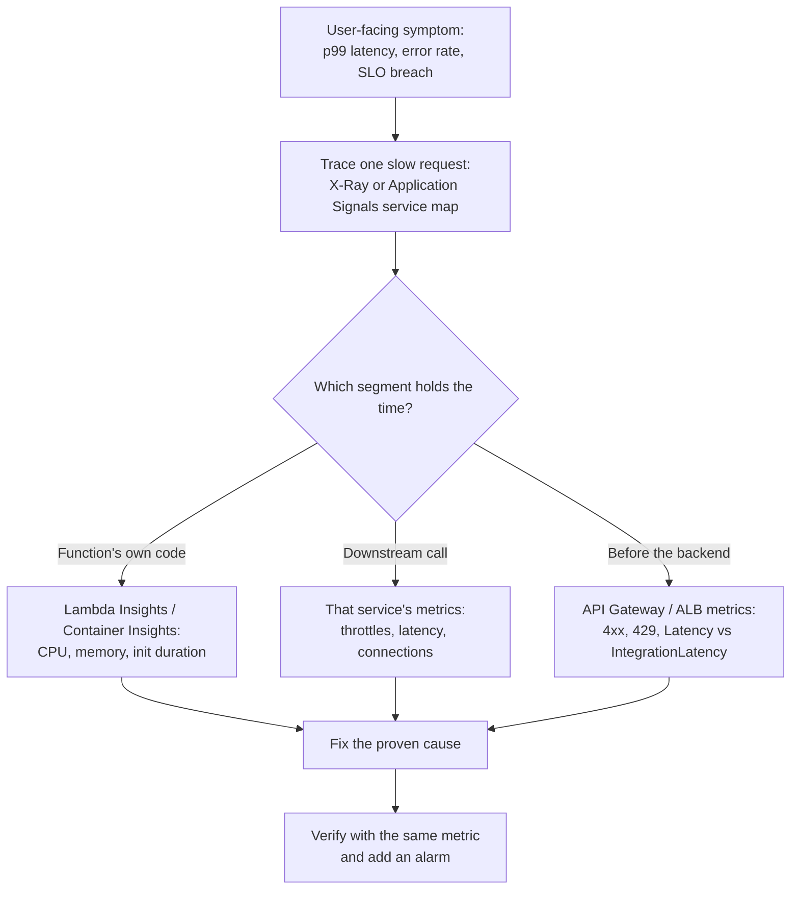

# 4.3.5 Detect performance bottlenecks with services such as CloudWatch

**Domain 4 · Task 4.3 · Skill 4.3.5** · [Task overview](README.md) · Previous: [4.3.4 Caching for performance](4.3.4-caching-for-performance.md) · Next: [4.3.6 AI-assisted optimization](4.3.6-ai-assisted-optimization.md)

## What the exam expects

Before you tune anything (memory, concurrency, a cache, a queue), you need evidence of where the time goes. This skill tests whether you can pick the Amazon CloudWatch metric or feature that exposes a bottleneck, read it correctly, and send the fix to the right layer. Questions describe a slow application programming interface (API), a growing queue, throttled reads, or rising cost, and the wrong answers usually tune the layer that is easiest to change rather than the one the evidence points to.

You must be able to:

- Follow a method: start at the user-facing symptom, find the slow component, drill into its metrics and logs, fix, and verify.
- Know the key performance metric for each common service, and the difference between averages and percentiles.
- Use CloudWatch Lambda Insights, Container Insights, Application Signals, Contributor Insights, Metrics Insights, Logs Insights, anomaly detection, Synthetics, and real user monitoring (RUM), and AWS X-Ray traces.
- Tell a DynamoDB hot key apart from under-provisioned capacity.
- Recognize when the bottleneck sits in front of the backend (API Gateway throttling) rather than inside it.

How to read metrics, logs, and traces during an incident is in [4.1.2](../task-4.1-root-cause-analysis/4.1.2-metrics-logs-and-traces.md); writing Logs Insights queries is in [4.1.3](../task-4.1-root-cause-analysis/4.1.3-querying-logs.md); instrumenting traces is in [4.2.4](../task-4.2-observability/4.2.4-distributed-tracing.md). This note is about performance specifically.

## Key terms

| Term | Meaning |
|---|---|
| Bottleneck | The component whose capacity or latency limits the whole request path. |
| p50, p90, p99 | Percentiles. p99 is the latency that 99% of requests beat; it shows the slow tail an average hides. |
| Saturation | How close a resource is to its limit: central processing unit (CPU), memory, connections, concurrency, throughput. |
| Throttling | A service rejecting requests above a rate or concurrency limit. |
| Hot key / hot partition | One partition key value receiving a disproportionate share of traffic. |
| Lambda Insights | CloudWatch feature, enabled with a Lambda extension layer, that reports CPU, memory, network, disk, and init metrics per function. |
| Container Insights | CloudWatch feature that collects CPU, memory, network, and restart metrics for Elastic Container Service (ECS), Elastic Kubernetes Service (EKS), and Fargate clusters, services, tasks, and pods. |
| Application Signals | CloudWatch application performance monitoring: per-service latency, errors, and request volume, service maps, and service level objectives (SLOs). |
| Contributor Insights | Ranks the top contributors (keys, IPs, callers) in log data or DynamoDB traffic. |
| Metrics Insights | Queries in a Structured Query Language (SQL) dialect over CloudWatch metrics, for example the top 10 functions by duration. |
| Anomaly detection | A machine learning model that learns a metric's expected band and alarms when it leaves it. |

## A method that avoids guessing



1. Start with the metric users feel (p99 latency, error rate, an Application Signals SLO), not with the component you suspect.
2. Use a trace to find the slow hop. A service map shows per-hop latency without correlating timestamps across log groups by hand.
3. Drill into that component's saturation and throttling metrics, then its logs.
4. Check what changed (AWS CloudTrail, deployments) if the regression started at a point in time ([4.1.1](../task-4.1-root-cause-analysis/4.1.1-debugging-code-and-integrations.md#finding-what-changed-with-cloudtrail)).
5. Fix the layer the evidence points to: capacity, caching, query or index, concurrency, or code.
6. Confirm with the same metric and add an alarm for that failure mode ([4.2.3](../task-4.2-observability/4.2.3-alerts-and-notifications.md)).

### Averages hide the problem

Use percentiles for latency. A function with p50 steady at 45 ms and p99 at 4,800 ms has a tail problem (often cold starts or one slow dependency) that an average of a few hundred milliseconds would hide. CloudWatch supports percentile statistics (`p99`, `p90`) on latency metrics such as Lambda `Duration` and API Gateway `Latency`.

## Key metrics by service

| Service | Metric | What it reveals |
|---|---|---|
| AWS Lambda | `Duration` (p99) | Slow invocations |
| | `Throttles`, `ConcurrentExecutions` | Concurrency limit reached |
| | `Init Duration` (in `REPORT` logs; Lambda Insights `init_duration`) | Cold starts |
| | `IteratorAge` | Stream consumer falling behind |
| | `ProvisionedConcurrencySpilloverInvocations` | Traffic above provisioned concurrency |
| Amazon API Gateway | `Latency` vs `IntegrationLatency` | `Latency` minus `IntegrationLatency` is API Gateway overhead (authorizers, transformations); a large `IntegrationLatency` puts the time in the backend |
| | `4XXError`, `5XXError`, `CacheHitCount`, `CacheMissCount` | Rejections, backend failures, cache effectiveness |
| Amazon DynamoDB | `ThrottledRequests`, `ReadThrottleEvents`, `WriteThrottleEvents` | Capacity or hot partition |
| | `SuccessfulRequestLatency` | Server-side latency per operation |
| | `ConsumedReadCapacityUnits` vs provisioned | Headroom |
| Amazon Simple Queue Service (SQS) | `ApproximateAgeOfOldestMessage`, `ApproximateNumberOfMessagesVisible` | Consumers falling behind |
| Amazon Relational Database Service (RDS) / Aurora | `CPUUtilization`, `DatabaseConnections`, `ReadLatency`, `WriteLatency`, `FreeableMemory` | Database saturation, connection exhaustion |
| Application Load Balancer | `TargetResponseTime`, `HTTPCode_Target_5XX_Count`, `RequestCountPerTarget` | Backend latency and load per target |
| Amazon ElastiCache | `CacheHitRate`, `Evictions`, `EngineCPUUtilization` | Cache effectiveness and pressure |
| Amazon CloudFront | `CacheHitRate`, `OriginLatency` (additional metrics) | Edge cache effectiveness |
| Amazon ECS / EKS | CPU and memory utilization per service, task, or pod (Container Insights) | Under-sized tasks, noisy neighbors, restarts |
| Amazon Elastic Compute Cloud (EC2) | `CPUUtilization`, `CPUCreditBalance`, network; memory only with the CloudWatch agent | Saturation, burstable credit exhaustion |

## Symptom to bottleneck

| Evidence | Bottleneck | Fix |
|---|---|---|
| High duration, CPU near 100%, memory fine | CPU-bound function | More memory ([4.3.2](4.3.2-memory-and-compute-tuning.md)) |
| `Max Memory Used` near the limit | Memory-bound function | More memory; look for leaks |
| High duration, low CPU and memory | Waiting on a dependency | Trace it; fix the dependency, cache, or parallelize calls |
| p50 flat, p99 high, `Init Duration` on slow requests | Cold starts | SnapStart or provisioned concurrency ([4.3.1](4.3.1-concurrency-controls.md#cold-starts-prove-it-then-mitigate)) |
| Lambda `Throttles` above 0, `ConcurrentExecutions` at a ceiling | Concurrency limit | Reserved concurrency review, quota increase, shorter duration |
| `DatabaseConnections` at maximum, errors under burst | Connection exhaustion | RDS Proxy, connection reuse ([4.3.1](4.3.1-concurrency-controls.md#connection-pooling)) |
| DynamoDB throttles on one key | Hot partition | Key redesign, write sharding, DynamoDB Accelerator (DAX) for reads |
| DynamoDB throttles across keys, consumed at provisioned | Under-provisioned capacity | Auto scaling, more capacity, or on-demand |
| SQS age of oldest message rising | Consumers too slow or too few | Scale consumers, batch, speed up the handler ([4.3.3](4.3.3-messaging-optimization.md)) |
| Client 429s, backend metrics healthy | Throttling in front of the backend | API Gateway account, stage or method, or usage plan limits |
| `Latency` high but `IntegrationLatency` low | API Gateway overhead | Authorizer caching, simpler mapping templates |
| CloudFront `CacheHitRate` low | Cache key too broad, short TTLs | Cache policy, versioned names ([4.3.4](4.3.4-caching-for-performance.md#amazon-cloudfront)) |

## CloudWatch features for bottlenecks

### Lambda Insights

Add the Lambda Insights extension layer (and the `CloudWatchLambdaInsightsExecutionRolePolicy` permissions) to a function. It publishes system-level metrics to the `LambdaInsights` namespace, including `memory_utilization`, `cpu_total_time`, `init_duration`, `rx_bytes` and `tx_bytes`, and `tmp_used`, plus per-invocation performance log events. Use it to answer "is this function CPU-bound, memory-bound, or waiting?" with data, and to compare versions. It adds a small cost and slight init overhead from the extension.

### Container Insights

Collects cluster, service, task, and pod CPU, memory, network, and restart counts for Amazon ECS (EC2 and Fargate) and Amazon EKS. Use it to find under-sized tasks, memory limits causing restarts, and uneven placement. Enhanced observability adds more granular container-level detail.

### Application Signals

Instruments services (through the CloudWatch agent and AWS Distro for OpenTelemetry) and shows request volume, latency, faults, and errors per service and operation, with a dependency map. You define SLOs, such as "99% of checkout requests under 500 ms", and see which dependency burns the error budget. It builds on X-Ray traces, which show per-segment timing ([4.2.4](../task-4.2-observability/4.2.4-distributed-tracing.md)).

### Contributor Insights

- **For DynamoDB:** enable per table or index to see the most-accessed and most-throttled partition keys. This is the direct answer to "which keys are hot?"
- **For log groups:** rules over structured logs rank top contributors, such as the API callers or IP addresses generating the most errors or the slowest requests.

### Database Insights and Performance Insights

For RDS and Aurora, these show database load as average active sessions, sliced by SQL statement, wait event, host, or user. Use them when `CPUUtilization` is high and you need the specific slow query. A plain CloudWatch CPU metric cannot break load down by query.

### Metrics Insights

SQL-like queries across many metrics at once, useful for fleets:

```sql
SELECT MAX(Duration)
FROM SCHEMA("AWS/Lambda", FunctionName)
GROUP BY FunctionName
ORDER BY MAX() DESC
LIMIT 10
```

### Anomaly detection, Synthetics, and RUM

- **Anomaly detection** learns a metric's normal band (including daily and weekly patterns) and alarms when it leaves the band. It suits latency or traffic that has no single good static threshold ([4.3.6](4.3.6-ai-assisted-optimization.md)).
- **Synthetics canaries** run scripted checks against endpoints and user flows on a schedule, so you see latency regressions before users do.
- **CloudWatch RUM** (real user monitoring) collects page load, JavaScript errors, and web vitals from real browsers, for front-end bottlenecks.

## CloudWatch Logs Insights for performance

Cold starts per hour and their average init time:

```sql
filter @type = "REPORT"
| stats count(*) as invocations,
        count(@initDuration) as coldStarts,
        avg(@initDuration) as avgInitMs,
        pct(@duration, 99) as p99Ms
  by bin(1h)
```

The slowest invocations, with memory headroom:

```sql
filter @type = "REPORT"
| fields @requestId, @duration, @maxMemoryUsed / 1000000 as maxMemMB, @memorySize / 1000000 as memMB
| sort @duration desc
| limit 20
```

Memory over-provisioning check across a function:

```sql
filter @type = "REPORT"
| stats max(@memorySize / 1000000) as provisionedMB,
        max(@maxMemoryUsed / 1000000) as peakMB,
        avg(@maxMemoryUsed / 1000000) as avgMB
```

If `peakMB` is far below `provisionedMB`, test a lower setting ([4.3.2](4.3.2-memory-and-compute-tuning.md)). If `count(@initDuration)` is a large share of invocations for hours, cold starts are a sustained problem; a short burst right after a deploy is expected.

## DynamoDB throttling: hot key or capacity

Same symptom, different fixes.


*Source: [AWS DynamoDB Developer Guide, Partitions and data distribution](https://docs.aws.amazon.com/amazondynamodb/latest/developerguide/HowItWorks.Partitions.html). The hash of the partition key decides placement. Every request for one key value lands on the same partition, however many partitions the table has.*

| Question | Hot key | Under-provisioned capacity |
|---|---|---|
| Where are the throttles? | Concentrated on one or a few keys (Contributor Insights) | Spread across many keys |
| Table-level consumed vs provisioned | Often well below the table's total | At or near the provisioned limit |
| Does raising table capacity fix it? | Little: the hot key stays bounded by its partition's limit | Yes |
| Does on-demand fix it? | No. On-demand can still throttle a hot partition | Usually; on-demand can still throttle spikes far above the previous peak |
| Fix | Higher-cardinality key, write sharding (random or calculated suffix), DAX or ElastiCache for hot reads | Auto scaling, more provisioned capacity, or on-demand |

Other throttling causes to check: an under-provisioned global secondary index (GSI) throttles writes to the base table even when the table has capacity, and very large items consume more units per request. Key design is in [1.3.4](../../domain-1-development-with-aws-services/task-1.3-use-data-stores/1.3.4-dynamodb-design-and-operations.md#primary-keys-and-partition-design).

## Worked case studies

**Slow checkout after a deploy.** p99 latency jumped from 200 ms to 4 s two days ago, with some 500 errors, and cost crept up. The X-Ray service map shows the latency in the DynamoDB subsegment, not the Lambda segment. CloudWatch shows `ConsumedReadCapacityUnits` pinned at the provisioned level and `ThrottledRequests` above 0. CloudTrail shows a CloudFormation stack update that switched the table from on-demand to provisioned with low read capacity as a side effect. Fix: restore on-demand (or right-sized auto scaling), optionally add DAX for repeated catalog reads, add a pre-deployment check that flags capacity-mode changes, and alarm on `ThrottledRequests`. Raising Lambda memory would have been the wrong layer.

**"The app is slow" with no code change.** A recommendation API's `Duration` p50 is steady at 45 ms but p99 spiked to 4,800 ms at 08:00. Slow `REPORT` lines carry `Init Duration` of about 3,900 ms. X-Ray shows the function makes no downstream calls, so a dependency is ruled out. CloudTrail shows no configuration changes. A Logs Insights count shows cold starts sustained since 08:00, when a marketing campaign raised concurrency above anything the function had seen, so new environments keep being created. Fix: provisioned concurrency sized to the new baseline (scheduled if campaigns recur). More memory would speed up the already small handler time, not the init.

**429s with a healthy backend.** A partner gets intermittent 429s while the Lambda function shows no errors, no throttles, and normal duration. The request never reached the function: the partner's usage plan has a lower rate limit and their traffic is bursty. Fix the usage plan, not the function. AWS WAF rules and authorizer denials give the same "client errors, quiet backend" pattern with 403s. Details are in [4.1.1](../task-4.1-root-cause-analysis/4.1.1-debugging-code-and-integrations.md#rejections-in-front-of-the-backend).

**Throttled reads on a featured item.** `ProvisionedThroughputExceededException` appears under load, and Contributor Insights shows one "featured" item ID receiving most reads while other keys are barely touched. This is a hot key. Raising table capacity mostly adds capacity to cold keys. Cache the hot item (DAX or ElastiCache) or shard the key.

## Exam triggers

| Scenario clue | Answer | Why the alternatives are wrong |
|---|---|---|
| Identify which DynamoDB keys are hot | CloudWatch Contributor Insights for DynamoDB | Table-level metrics show totals, not keys |
| Per-function CPU and memory detail | Lambda Insights | Standard Lambda metrics have no CPU or memory utilization |
| Which microservice in a five-hop chain adds latency | X-Ray service map or Application Signals | Logs from one function show only that function |
| ECS task memory and CPU per task | Container Insights | EC2 metrics do not see inside tasks |
| Which SQL statement loads the database | Performance Insights or Database Insights | `CPUUtilization` has no per-query breakdown |
| Queue backlog growing | `ApproximateAgeOfOldestMessage`; scale or speed up consumers | Longer retention hides the backlog |
| Latency high, `IntegrationLatency` low | API Gateway overhead (authorizer, mapping) | The backend is not the slow part |
| Client 429s, backend metrics healthy | API Gateway throttling or usage plan | Tuning Lambda changes nothing |
| Latency regression with no fixed threshold | CloudWatch anomaly detection alarm | Static thresholds miss daily patterns |
| Top 10 slowest functions across the account | Metrics Insights query | Opening each function's dashboard does not scale |
| Detect regressions before users report them | Synthetics canaries | Waiting for RUM data means users already saw it |
| Throttling on one key despite plenty of table capacity | Hot partition: redesign the key or cache | More capacity or on-demand does not lift the per-partition limit |
| Writes throttled though the table has capacity | Under-provisioned GSI | The table's capacity is not the limit |

## Common traps

- Tuning the most convenient knob (Lambda memory) before tracing where the time goes.
- Reading averages instead of p99 for latency.
- Believing on-demand DynamoDB cannot throttle.
- Treating a healthy backend plus client errors as a backend bug.
- Expecting standard Lambda metrics to show CPU or memory utilization; that needs Lambda Insights or the `REPORT` lines.
- Expecting EC2 memory metrics without the CloudWatch agent.
- Chasing a cold-start burst right after a deploy; it is expected and self-resolving.
- Fixing without verifying the same metric afterward, and without adding an alarm.

## Quick recall

- Method: symptom → trace → drill into the slow component → fix → verify → alarm.
- Percentiles (p99) for latency, not averages.
- API Gateway `Latency` minus `IntegrationLatency` = API Gateway overhead.
- Lambda Insights = CPU, memory, init per function through an extension layer.
- Container Insights = ECS, EKS, Fargate task and pod metrics.
- Application Signals = per-service latency, errors, SLOs.
- Contributor Insights = hot DynamoDB keys and top log contributors.
- Performance Insights and Database Insights = slow SQL by average active sessions.
- `ApproximateAgeOfOldestMessage` = consumers behind; `IteratorAge` = stream consumers behind.
- Hot key: throttles on one key; fix the key or cache. Capacity: throttles everywhere at the limit; add capacity.

## Related skills

- [4.1.1 Debugging code and integrations](../task-4.1-root-cause-analysis/4.1.1-debugging-code-and-integrations.md): the general debugging workflow and CloudTrail.
- [4.1.2 Metrics, logs, and traces](../task-4.1-root-cause-analysis/4.1.2-metrics-logs-and-traces.md): reading the evidence during an incident.
- [4.1.3 Querying logs](../task-4.1-root-cause-analysis/4.1.3-querying-logs.md): Logs Insights syntax.
- [4.2.2 Custom metrics](../task-4.2-observability/4.2.2-custom-metrics.md): emitting the business and latency metrics you need here.
- [4.2.4 Distributed tracing](../task-4.2-observability/4.2.4-distributed-tracing.md): X-Ray and OpenTelemetry instrumentation.
- [1.3.4 DynamoDB design and operations](../../domain-1-development-with-aws-services/task-1.3-use-data-stores/1.3.4-dynamodb-design-and-operations.md): partition key design and write sharding.
- [4.3.6 AI-assisted optimization](4.3.6-ai-assisted-optimization.md): artificial intelligence (AI) and machine learning tools that surface bottlenecks.

## Sources

- Merged from: `archive/dva-c03-study-notes/04-troubleshooting-optimization.md` (skill 4.3.5, gotchas), `archive/dva-c03/domain-4-troubleshooting-optimization/README.md` (three worked case studies, use cases 1, 3, 4, common exam scenarios), `archive/dva-c03/domain-4-troubleshooting-optimization/MASTER-CHUNK.md` (section 12 DynamoDB partitions, closing lookup table), `archive/dva-c03/domain-4-troubleshooting-optimization/lambda-cold-start-diagnosis.md` (Logs Insights cold-start query), `archive/aws-dva-notes/Markdown Files/19. Serverless - DynamoDB.md` (sections 7 and 13 throttling), `archive/aws-dva-notes/Markdown Files/17. Monitoring, Troubleshooting & Audit.md` (CloudWatch metrics, Synthetics), `archive/aws-dva-notes/Markdown Files/31. Exam Day Cheat Sheet.md` (tool lookup), `archive/dva-c03/practice-questions/domain-4-questions.md` (hot partition scenario), `archive/dva-c03/exam-bank/bank-1.md` (Performance Insights), `archive/dva-c03/exam-bank/bank-2.md` (Contributor Insights)
- AWS documentation: [CloudWatch Lambda Insights](https://docs.aws.amazon.com/AmazonCloudWatch/latest/monitoring/Lambda-Insights.html) and [Metrics collected by Lambda Insights](https://docs.aws.amazon.com/AmazonCloudWatch/latest/monitoring/Lambda-Insights-metrics-lambda-functions.html)
- AWS documentation: [Partitions and data distribution in DynamoDB](https://docs.aws.amazon.com/amazondynamodb/latest/developerguide/HowItWorks.Partitions.html)
