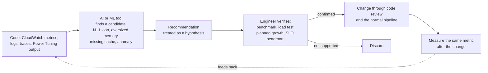
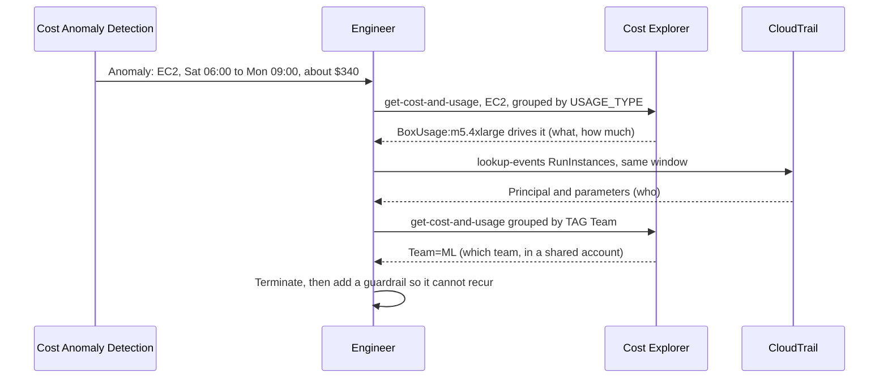

# 4.3.6 Use AWS AI tools to find bottlenecks, inefficient code, and resource optimization opportunities

**Domain 4 · Task 4.3 · Skill 4.3.6** · [Task overview](README.md) · Previous: [4.3.5 Performance bottleneck detection](4.3.5-performance-bottleneck-detection.md)

## What the exam expects

This skill is new in the AWS Certified Developer - Associate (DVA-C03) exam. It tests whether you can use artificial intelligence (AI) and machine learning (ML) tools to find performance bottlenecks, wasted resources, and inefficient code, and then verify the suggestions before changing production. The in-scope AI tools are Kiro, Amazon Bedrock, and the AI features built into Amazon CloudWatch. Questions describe a slow or expensive application and ask which tool surfaces the problem, or what must happen before an AI recommendation is applied. Wrong answers apply recommendations automatically to production, or trust an AI summary over the metrics.

You must be able to:

- Use Kiro to analyze code for inefficiencies (N+1 calls, unbounded scans, synchronous chains) and propose refactors, benchmarks, and right-sized infrastructure as code (IaC).
- Use CloudWatch anomaly detection and CloudWatch investigations to surface performance regressions.
- Use Amazon Bedrock inside your own tooling to summarize profiling data, logs, or recommendations.
- Recognize ML-based right-sizing and cost tools (AWS Compute Optimizer, AWS Cost Anomaly Detection, AWS Trusted Advisor) and what each answers.
- Verify every AI or ML recommendation against real metrics, tests, and planned load before acting.

> **DVA-C02 vs DVA-C03.** AWS lists "AI-assisted detection of bottlenecks, resource waste, and inefficient code" as content added to Task 4.3. The same AI pattern appears in [1.1.9](../../domain-1-development-with-aws-services/task-1.1-build-application-code/1.1.9-ai-assisted-development-tools.md) (development), [3.2.5](../../domain-3-testing-and-deployment/task-3.2-test-applications/3.2.5-ai-assisted-testing.md) (testing), [3.3.9](../../domain-3-testing-and-deployment/task-3.3-deploy-with-ci-cd/3.3.9-ai-assisted-deployment.md) (deployment), and [4.1.5](../task-4.1-root-cause-analysis/4.1.5-ai-assisted-error-analysis.md) (error analysis).

## Key terms

| Term | Meaning |
|---|---|
| Steering file | A Markdown file in `.kiro/steering/` holding project rules the Kiro agent always follows, such as performance standards. |
| Hook | A Kiro automation that runs a command or agent prompt on an event, such as a file save. |
| MCP server | A Model Context Protocol (MCP) server that gives an AI agent access to external tools and data, such as AWS application programming interfaces (APIs) or CloudWatch metrics. |
| Anomaly detection band | The expected range CloudWatch's ML model learns for a metric, including daily and weekly patterns. |
| CloudWatch investigations | A generative AI feature in CloudWatch that scans telemetry during an incident and suggests related observations and hypotheses. |
| Rightsizing recommendation | A suggestion to change a resource's size (memory, instance type) based on observed use. |
| Hallucination | Confident AI output that is wrong, such as an API that does not exist or a cause the data does not support. |

## The pattern: AI proposes, metrics decide



Every tool in this note produces candidates. The engineer confirms them against real data, checks factors the tool cannot see (a sale next month, burst headroom, an SLO), approves specific changes, and measures afterward.

## Kiro for code and configuration efficiency

Kiro is AWS's agentic AI development tool, available as an integrated development environment (IDE), a command line interface (CLI), and a headless mode for continuous integration (CI) pipelines. Its building blocks are described in [1.1.9](../../domain-1-development-with-aws-services/task-1.1-build-application-code/1.1.9-ai-assisted-development-tools.md#kiro). For optimization, use it to:

| Task | Example request | What you still verify |
|---|---|---|
| Find inefficient code | "Find N+1 DynamoDB calls, unbounded `Scan` operations, and software development kit (SDK) clients created inside handlers in `src/`" | Each finding is real and the fix keeps behavior |
| Propose refactors | Batch reads, move clients to init scope, parallelize independent calls, add a cache-aside layer | Tests pass; idempotency and error handling are kept |
| Right-size IaC | "Set memory from these Power Tuning results and switch to arm64 where dependencies allow" | Native dependencies support arm64; cost and latency after the change |
| Write benchmarks | Generate a load test or a Power Tuning input payload that represents production | The payload is realistic |
| Explain a profile | Summarize Lambda Insights or `REPORT`-line statistics and point to the slowest path | Numbers in the summary match the raw data |

Before and after: an AI review flags a loop that calls `GetItem` once per order line.

```python
# Before: one network round trip per item (N+1)
items = [table.get_item(Key={"sku": sku})["Item"] for sku in skus]

# After: one BatchGetItem per 100 keys, retrying UnprocessedKeys
def batch_get(skus):
    out, keys = [], [{"sku": s} for s in skus]
    for i in range(0, len(keys), 100):
        req = {"Products": {"Keys": keys[i:i + 100]}}
        while req:
            resp = dynamodb.batch_get_item(RequestItems=req)
            out.extend(resp["Responses"]["Products"])
            req = resp.get("UnprocessedKeys") or None   # add backoff in real code
    return out
```

Make the standards persistent with steering, and checks automatic with hooks:

```markdown
<!-- .kiro/steering/performance.md -->
- Create AWS SDK clients and database connections outside Lambda handlers.
- Never use DynamoDB Scan on request paths; use Query on a key or GSI.
- Batch DynamoDB, SQS, and Kinesis writes where the API allows it.
- Every Lambda function declares MemorySize and Architecture explicitly in the template.
- Cache Parameter Store and Secrets Manager reads; do not read them on every invocation.
```

A hook on file save can run a linter or a micro-benchmark and ask the agent to explain any regression. An MCP server for AWS can let the agent read CloudWatch metrics, so suggestions start from production data instead of code alone. Give that agent read-only permissions when it only analyzes.

## CloudWatch AI and ML features

These are part of Amazon CloudWatch, which is in scope.

### Anomaly detection

- Creates a band of expected values from a metric's history, including hourly, daily, and weekly patterns, and alarms when the metric goes outside it.
- Use it for latency, duration, error counts, or traffic where a static threshold is either too noisy at peak or too loose overnight.
- Applies to custom metrics too ([4.2.2](../task-4.2-observability/4.2.2-custom-metrics.md)).
- The model needs history to learn the band; a brand-new metric produces a poor band at first.

```bash
aws cloudwatch put-metric-alarm --alarm-name checkout-p99-anomaly \
  --evaluation-periods 3 --comparison-operator GreaterThanUpperThreshold \
  --threshold-metric-id ad1 \
  --metrics '[{"Id":"m1","MetricStat":{"Metric":{"Namespace":"AWS/Lambda","MetricName":"Duration","Dimensions":[{"Name":"FunctionName","Value":"checkout"}]},"Period":300,"Stat":"p99"}},{"Id":"ad1","Expression":"ANOMALY_DETECTION_BAND(m1, 2)"}]'
```

### CloudWatch investigations

A generative AI assistant (in the AI Operations area of the CloudWatch console) that starts from an alarm, a metric, or a manual request, scans related telemetry, and lists observations and hypotheses for the cause. You accept or discard each finding, and it can suggest AWS Systems Manager Automation runbooks for remediation. For optimization, it helps connect a latency regression to the change or dependency behind it. Treat hypotheses as leads to confirm in the raw metrics and traces; its incident use is covered in [4.1.5](../task-4.1-root-cause-analysis/4.1.5-ai-assisted-error-analysis.md).

### Other CloudWatch features that point to waste

- **Logs Insights `pattern` command and log anomaly detection** group similar log lines and flag new or spiking patterns, which can reveal a retry storm or a hot error path burning compute.
- **Application Signals** ranks operations by latency and fault rate against service level objectives (SLOs), a short list of where optimization pays off ([4.3.5](4.3.5-performance-bottleneck-detection.md#application-signals)).

## Amazon Bedrock in your own tooling

When a team has many recommendations to review, a small internal tool can call a foundation model to summarize and rank them. The model works on data you give it; it does not measure anything.

```python
import boto3, json
bedrock = boto3.client("bedrock-runtime")

def summarize(report):
    prompt = ("You review AWS Lambda tuning data. For each function, state whether it is "
              "CPU-bound, memory-bound, or I/O-bound and suggest one change, citing the numbers. "
              "Do not invent numbers.\n\n" + json.dumps(report))
    resp = bedrock.converse(
        modelId="anthropic.claude-3-haiku-20240307-v1:0",   # use a model enabled in your account
        messages=[{"role": "user", "content": [{"text": prompt}]}],
        inferenceConfig={"maxTokens": 800, "temperature": 0},
    )
    return resp["output"]["message"]["content"][0]["text"]
```

Feed it `REPORT`-line statistics, Lambda Power Tuning results, or Compute Optimizer exports, and route its output to an engineer for approval. Keep sensitive data out of prompts, and grant the tool only `bedrock:InvokeModel` on the model it needs ([2.3.1](../../domain-2-security/task-2.3-secure-ai-services/2.3.1-ai-service-access-control.md)). Calling Bedrock from code is covered in [1.1.10](../../domain-1-development-with-aws-services/task-1.1-build-application-code/1.1.10-managed-ai-service-integration.md).

## Resource and cost optimization tools outside the service list

> **Not on the DVA-C03 service list.** AWS Compute Optimizer, AWS DevOps Agent, AWS Trusted Advisor, AWS Cost Explorer, AWS Budgets, AWS Cost Anomaly Detection, and the AWS Well-Architected Tool are not named in the DVA-C03 in-scope list, which AWS describes as non-exhaustive. Study material and practice questions still use them for "find wasted resources" and "is there a cheaper architecture" scenarios, so know what each one answers. Everything in this section is that out-of-list material.

### AWS Compute Optimizer

- Uses ML over CloudWatch utilization history to recommend Lambda memory sizes, Elastic Compute Cloud (EC2) instance types, Auto Scaling group configurations, Amazon Elastic Block Store (EBS) volumes, and Amazon Elastic Container Service (ECS) services on Fargate.
- Findings: under-provisioned, over-provisioned, or optimized, with estimated cost and performance impact. Functions without enough history show as unavailable.
- EC2 memory-based recommendations need the CloudWatch agent publishing memory.
- Caveat: recommendations reflect the lookback window only. They cannot see planned growth, seasonal peaks outside the window, or headroom kept on purpose. Review before applying; never auto-apply to production.

### AWS DevOps Agent

An AI agent for operations that investigates incidents from alarms or tickets by correlating telemetry, code, and deployment data, and analyzes incident history to recommend improvements in four areas: observability, infrastructure optimization, deployment pipelines, and application resilience. Recommendations go through the same human review.

### Tools compared

| Tool | Answers | Method |
|---|---|---|
| CloudWatch metrics and dashboards (in scope) | "Is this metric bad right now?" | Real-time telemetry |
| Compute Optimizer | "Is this resource the right size?" | ML on utilization history |
| Trusted Advisor | "Which resources are idle or misconfigured?" (cost, performance, security, fault tolerance, service limits, operational excellence) | Fixed best-practice checks. Full check set needs Business support or higher; no auto-remediation |
| Cost Explorer | "Where did the money go, by service, usage type, or tag?" | Historical billing data, with forecasts |
| Budgets | "Will we cross $X?" | Thresholds on actual or forecast spend; Budget Actions can apply a restrictive Identity and Access Management (IAM) policy |
| Cost Anomaly Detection | "Did spending change in a way that does not look like us?" | ML on spend history; free |
| Well-Architected Tool | "Does this workload's architecture follow best practices?" | Human-answered review across six pillars (operational excellence, security, reliability, performance efficiency, cost optimization, sustainability); free |

### Cost anomaly investigation workflow


*Source: AWS Documentation, Amazon CloudWatch User Guide (Cost Explorer view). After an anomaly alert, this usage-type breakdown is where you confirm what drove the cost and how much. It never shows who launched the resource.*

Cost Anomaly Detection learns an account's normal spending (including weekday and weekend patterns) and flags significant deviations with the service, time window, and estimated impact, through Amazon Simple Notification Service (SNS) or email. It catches what a static Budget misses: a spike inside an otherwise normal month, a new expensive usage type, or a gradual climb that never crosses a daily threshold. It does not say who caused the anomaly, and it has no remediation action.



1. **Alert:** what service, when, about how much. Not who.
2. **Quantify with Cost Explorer**, filtered to the service and window and grouped by usage type:

   ```bash
   aws ce get-cost-and-usage --time-period Start=2026-11-15,End=2026-11-17 \
     --granularity DAILY --metrics UnblendedCost \
     --filter '{"Dimensions":{"Key":"SERVICE","Values":["Amazon Elastic Compute Cloud - Compute"]}}' \
     --group-by Type=DIMENSION,Key=USAGE_TYPE
   ```

3. **Attribute with CloudTrail**, using the action the usage type implies:

   ```bash
   aws cloudtrail lookup-events \
     --lookup-attributes AttributeKey=EventName,AttributeValue=RunInstances \
     --start-time 2026-11-15T00:00:00Z --end-time 2026-11-16T00:00:00Z
   ```

4. **Attribute to a team** with Cost Explorer grouped by an activated cost allocation tag (`Type=TAG,Key=Team`). Tags must be activated in the Billing console before the spend occurs to appear in reports.
5. **Remediate and prevent:** terminating stops future cost; charges already incurred stay on the bill. Add a guardrail that did not exist before: an auto-shutdown schedule, an alarm on idle or long-running instances, or a service control policy restricting large instance types.

The structural lesson recurs across Domain 4: detection tools (Cost Anomaly Detection, Cost Explorer, AWS Config, CloudWatch) answer what and how much; CloudTrail answers who made the call.

**Gradual anomaly.** Over six weeks an Auto Scaling group crept from 4 to 11 instances because a misconfigured scale-in setting never fired. No single day crossed the $5,000 daily Budget. Cost Anomaly Detection flags the sustained deviation from the learned baseline; Cost Explorer by instance type shows the climb; CloudTrail `UpdateAutoScalingGroup` and scaling-policy calls weeks earlier show when the change was made.

**Scope matters.** One account-wide monitor on a $200,000-a-month account will not notice a small DynamoDB table tripling from $40 to $120 a month; the change is too small against the whole. Create monitors per service, per linked account, or per cost allocation tag so each has its own baseline. A new account or service has no baseline yet and gives noisy or no results at first.

**Structured architecture review.** When cost grew after a traffic increase and leadership asks whether a cheaper architecture meets the same requirements, do not guess or terminate instances blindly. Combine Trusted Advisor and Cost Explorer findings (idle resources, exact dollars) with a Well-Architected Tool review of the cost optimization and performance efficiency pillars, then evaluate right-sizing, Graviton, Spot Instances, or moving parts to serverless.

> **Not on the DVA-C03 service list.** Amazon Q Developer and Amazon CodeGuru Profiler appear in older optimization material. Q Developer was the AI developer tool for DVA-C02; DVA-C03 names Kiro, and new Q Developer sign-ups stopped in May 2026. CodeGuru Profiler profiled central processing unit (CPU) hot spots in running Java and Python code. If an older question names either one, map it to the same capability (Kiro for code analysis, Lambda Insights and X-Ray for runtime evidence) and apply the same review rules.

## Verifying AI recommendations

| Recommendation | Verify with |
|---|---|
| "Lower this function's memory from 1,024 MB to 512 MB" | Lambda Power Tuning or a test at both settings: total cost and p99 duration ([4.3.2](4.3.2-memory-and-compute-tuning.md)) |
| "Downsize this instance" | Peak utilization over a window that includes known peaks; upcoming launches; burst headroom |
| "Add a cache here" | Hit-ratio potential (how often the same keys repeat) and staleness tolerance ([4.3.4](4.3.4-caching-for-performance.md)) |
| "This query causes the slowdown" | The trace and the database's Performance Insights view |
| "Batch these calls" | Unit tests for partial failure handling (`UnprocessedItems`, `Failed`) |
| Any change | Code review, the normal pipeline, and the same metric after deployment; Cost Explorer before and after for savings |

## Exam triggers

| Scenario clue | Answer | Why the alternatives are wrong |
|---|---|---|
| AI suggestions to make a slow function faster and cheaper | Kiro code analysis plus measured tuning (Power Tuning; Compute Optimizer if offered) | Guessing a memory value ignores duration |
| Find N+1 calls and unbounded scans across a codebase | Kiro analysis guided by steering rules | Manual review of every file does not scale |
| Enforce performance standards on AI-generated code | Kiro steering file | A one-off prompt is forgotten next session |
| Detect performance anomalies automatically, no fixed threshold | CloudWatch anomaly detection alarm | A static threshold misfires on daily patterns |
| AI assistant to correlate telemetry during a regression | CloudWatch investigations | It suggests hypotheses; verify them in metrics |
| Summarize dozens of tuning reports for engineers | Amazon Bedrock in an internal tool, with human approval | Auto-applying model output is unsafe |
| AI-synthesized rightsizing for many resources | Engineer reviews against real requirements and approves specific changes | Auto-applying everything, or ignoring AI analysis entirely, are both wrong |
| Spend rose gradually but never crossed a Budget | Cost Anomaly Detection | A static Budget fires only on crossing a number |
| Who launched the resource behind a cost spike | CloudTrail | Cost tools answer what and how much |
| Idle load balancers and unattached EBS volumes | Trusted Advisor | Compute Optimizer focuses on sizing, not idle resources |
| Structured review of whether the architecture is cost-efficient | Well-Architected Tool cost optimization and performance efficiency pillars | Trusted Advisor checks resources, not design |

## Common traps

- Applying AI or ML recommendations to production without review.
- Trusting an AI summary that cites numbers not present in the data.
- Treating Compute Optimizer recommendations as safe regardless of planned growth.
- Expecting Cost Anomaly Detection to name the responsible principal, or to remediate.
- Using Cost Anomaly Detection as a hard spending cap; that is a Budget with a Budget Action.
- Expecting useful anomaly results on a new account or a new metric with no history.
- Sending secrets, customer data, or proprietary code you may not share to an AI tool.
- Answering a DVA-C03 question with Amazon Q Developer when Kiro is offered.

## Quick recall

- Pattern: AI proposes, engineer verifies with metrics and tests, change goes through review, measure afterward.
- Kiro: finds N+1 calls, scans, clients in handlers; proposes batching, caching, init-scope clients, right-sized IaC; steering keeps standards; hooks automate checks.
- CloudWatch anomaly detection: ML band, alarm outside it, needs history.
- CloudWatch investigations: generative AI hypotheses from telemetry; confirm them.
- Bedrock: summarize and rank tuning data in your own tools; grant only the model you need.
- Compute Optimizer (not on the list): ML rightsizing for Lambda, EC2, Auto Scaling group (ASG), EBS, ECS on Fargate; historical only.
- Cost Anomaly Detection (not on the list): free, ML on spend, what and how much, never who.
- Workflow: anomaly → Cost Explorer by usage type → CloudTrail → cost allocation tag → guardrail.

## Related skills

- [1.1.9 AI-assisted development tools](../../domain-1-development-with-aws-services/task-1.1-build-application-code/1.1.9-ai-assisted-development-tools.md): Kiro features and responsible use.
- [1.1.10 Managed AI service integration](../../domain-1-development-with-aws-services/task-1.1-build-application-code/1.1.10-managed-ai-service-integration.md): calling Bedrock from application code.
- [2.3.1 AI service access control](../../domain-2-security/task-2.3-secure-ai-services/2.3.1-ai-service-access-control.md): least privilege for AI tools.
- [4.1.5 AI-assisted error analysis](../task-4.1-root-cause-analysis/4.1.5-ai-assisted-error-analysis.md): the same tools applied to incidents.
- [4.3.2 Memory and compute tuning](4.3.2-memory-and-compute-tuning.md): verifying memory and instance recommendations.
- [4.3.5 Performance bottleneck detection](4.3.5-performance-bottleneck-detection.md): the metrics every recommendation is checked against.

## Sources

- Merged from: `archive/dva-c03-study-notes/04-troubleshooting-optimization.md` (skill 4.3.6), `archive/dva-c03/domain-4-troubleshooting-optimization/cost-anomaly-detection-workflow.md` (full workflow, scoping, gradual anomaly, exam tips), `archive/dva-c03/domain-4-troubleshooting-optimization/README.md` (cost/performance tooling comparison, Cost Explorer screen, use cases 10 and 11, AI cross-link), `archive/dva-c03/domain-4-troubleshooting-optimization/MASTER-CHUNK.md` (sections 9 to 11 cost tools, Trusted Advisor, Well-Architected Tool; closing scenario bank), `archive/aws-dva-notes/Markdown Files/30. AI Services & Security (DVA-C03).md` (section 8 AI developer tools), `archive/aws-dva-notes/Markdown Files/31. Exam Day Cheat Sheet.md` (Q Developer and CodeGuru scope notes), `archive/dva-c03/practice-questions/full-exams/exam-2-questions.md` (AI rightsizing review scenario), `archive/dva-c03/exam-bank/bank-3.md` (Compute Optimizer caveat)
- AWS documentation: [DVA-C02 and DVA-C03 comparison](https://docs.aws.amazon.com/aws-certification/latest/developer-associate-03/dva-03-comparison.html) and [In-scope AWS services](https://docs.aws.amazon.com/aws-certification/latest/developer-associate-03/dva-03-in-scope-services.html)
- AWS documentation: [CloudWatch investigations](https://docs.aws.amazon.com/AmazonCloudWatch/latest/monitoring/Investigations.html)
- AWS documentation: [About AWS DevOps Agent](https://docs.aws.amazon.com/devopsagent/latest/userguide/devops-agent-getting-started.html) and the [AWS DevOps Agent product page](https://aws.amazon.com/devops-agent) (four recommendation areas)
- AWS documentation: [Viewing Lambda function recommendations](https://docs.aws.amazon.com/compute-optimizer/latest/ug/view-lambda-recommendations.html) (Compute Optimizer)
