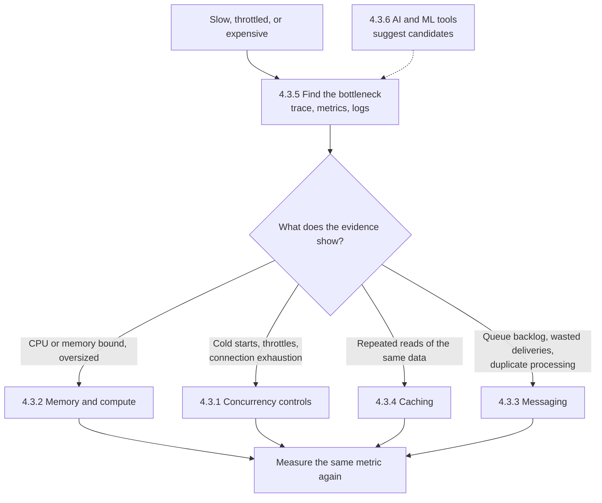

# Task 4.3: Optimize applications

**Domain 4 · Task 4.3** · [Domain overview](../README.md)

Task 4.3 covers making a working application faster and cheaper with AWS services and features: how much runs at once (concurrency), how much memory and compute each unit gets, how messages flow, where results are cached, how bottlenecks are found, and how artificial intelligence (AI) tools help find waste. It builds on Task 4.1 (finding the cause) and Task 4.2 (having the metrics, logs, and traces in place), and it reuses services from Domain 1 (AWS Lambda, Amazon Simple Queue Service (SQS), Amazon Simple Notification Service (SNS), Amazon DynamoDB, Amazon ElastiCache) from a tuning angle. The common thread is matching the fix to the proven cause: measure, change the right layer, and measure again. In DVA-C03, Lambda performance tuning moved here from Domain 1, and AI-assisted optimization is new.

## Skills

| Skill | Note | Covers |
|---|---|---|
| 4.3.1 | [Concurrency controls](4.3.1-concurrency-controls.md) | Lambda concurrency math, reserved and provisioned concurrency, SnapStart, cold-start mitigation, Elastic Compute Cloud (EC2) Auto Scaling policies, thread pools, connection pools, Relational Database Service (RDS) Proxy |
| 4.3.2 | [Memory and compute tuning](4.3.2-memory-and-compute-tuning.md) | Lambda memory and central processing unit (CPU), cost as memory × duration, Lambda Power Tuning, arm64, EC2 and Fargate right-sizing, DynamoDB capacity modes, code-level efficiency |
| 4.3.3 | [Messaging optimization](4.3.3-messaging-optimization.md) | SQS long polling, batching, visibility timeout, DLQs, FIFO throughput, Lambda SQS event source mapping tuning, SNS fan-out and filter policies, Kinesis tuning |
| 4.3.4 | [Caching for performance](4.3.4-caching-for-performance.md) | ElastiCache cache-aside and write-through code, DynamoDB Accelerator (DAX) behavior and staleness, CloudFront cache keys and TTLs, API Gateway caching, in-function caching |
| 4.3.5 | [Performance bottleneck detection](4.3.5-performance-bottleneck-detection.md) | Investigation method, key metrics per service, Lambda Insights, Container Insights, Application Signals, Contributor Insights, Logs Insights queries, hot key versus capacity |
| 4.3.6 | [AI-assisted optimization](4.3.6-ai-assisted-optimization.md) | Kiro code analysis, CloudWatch anomaly detection and investigations, Bedrock in internal tools, Compute Optimizer and cost tools (outside the service list), cost anomaly workflow |

## How the skills fit together

Detection (4.3.5, helped by 4.3.6) tells you which tuning skill applies.

| Evidence | Skill | Typical fix |
|---|---|---|
| `Init Duration` on slow requests, p99 far above p50 | 4.3.1 | SnapStart, provisioned concurrency |
| `Throttles`, connection count at maximum | 4.3.1 | Reserved concurrency, RDS Proxy, queue buffer |
| High duration with high CPU, or `Max Memory Used` near the limit | 4.3.2 | More memory, Power Tuning |
| Memory far below configured, duration flat when lowered | 4.3.2 | Less memory, arm64 |
| Same keys or responses read repeatedly | 4.3.4 | DAX, ElastiCache, CloudFront, API Gateway cache |
| Empty receives, growing `ApproximateAgeOfOldestMessage`, whole batches retried | 4.3.3 | Long polling, batching, partial batch responses, consumer scaling |
| Throttling on one DynamoDB key | 4.3.5, 4.3.4 | Key redesign, cache the hot item |
| Unexplained regression or cost growth | 4.3.6 | Anomaly detection, AI-assisted analysis, cost tools |

## Study checklist

- [ ] 4.3.1 Compute required concurrency (requests per second × duration), tell reserved from provisioned concurrency, prove a cold start with `Init Duration`, pick SnapStart or provisioned concurrency, choose an Auto Scaling policy, and explain why Lambda plus RDS needs RDS Proxy.
- [ ] 4.3.2 Compute Lambda cost as memory × duration, read a `REPORT` line, use Power Tuning or Compute Optimizer, and know when arm64 applies.
- [ ] 4.3.3 Apply long polling, batch application programming interfaces (APIs), visibility timeout, DLQs, event source mapping (ESM) batch size, batching window, maximum concurrency, partial batch responses, SNS filter policies, and FIFO message groups.
- [ ] 4.3.4 Write cache-aside and write-through code with TTLs, predict DAX staleness, configure CloudFront cache and origin request policies, and enable API Gateway caching.
- [ ] 4.3.5 Follow the symptom-to-fix method, name the key metric per service, and tell a hot key from under-provisioned capacity.
- [ ] 4.3.6 Use Kiro, CloudWatch anomaly detection and investigations, and Bedrock to find optimization candidates, and verify every recommendation before acting; walk through the cost anomaly workflow.

## Labs and practice

- [Labs](labs.md): Lab 1 times a CPU-bound Lambda function at two memory settings; Lab 2 measures cost across five memory sizes; Lab 3 reproduces a cost-anomaly investigation with Cost Explorer, CloudTrail, and cost allocation tags. All run on the Floci local emulator.
- [Practice questions](practice-questions.md): 3 scenario questions (two single-answer, one choose-two) with explanations of every option.
