# DVA-C03 — Complete Study Guide

> **One file, every domain, every service, every concept.** This is the single-file version of this repo's entire DVA-C03 coverage — every service tagged to this cert, with its definition, a plain-English analogy, when to use it / when NOT to, concrete use cases, diagrams explained, real AWS screenshots discussed, and exam tips, all in reading order by domain weight. Built by merging each domain's `MASTER-CHUNK.md`.

> **This file is long on purpose.** It exists so you never have to jump between files to remember what something does — read top to bottom once, then use it as a flip-reference. For even MORE depth on any single service (full pricing tables, troubleshooting runbooks, limits/quotas), the `services/` doc linked at the top of each entry goes deeper still.

> ⚠️ Internal `#anchor` links (same-page jump links) may occasionally point to the wrong section if two domains share an identical heading name — a known tradeoff of merging 4 large standalone files into one. File-to-file links (to `services/`, other domain docs, etc.) are all verified correct.

## Table of Contents

1. [Domain 1: Development with AWS Services (30%)](#part-1--domain-1-development)
2. [Domain 2: Security (26%)](#part-2--domain-2-security)
3. [Domain 3: Testing and Deployment (22%)](#part-3--domain-3-testing-deployment)
4. [Domain 4: Troubleshooting and Optimization (22%)](#part-4--domain-4-troubleshooting-optimization)

Plus: [Full Exam-Readiness Checklist](#full-exam-readiness-checklist) at the end.

---

# Part 1 — Domain 1: Development with AWS Services (30%)

*Full domain guide with task-statement mapping: [`domain-1-development/README.md`](domain-1-development/README.md). This section is domain-1-development's MASTER-CHUNK, reproduced in full below.*

> **What this file is.** A single, self-contained reference covering every service tested in
> Domain 1 (Development with AWS Services, 30% of DVA-C03) — Amplify, AppSync, CodeDeploy,
> CodePipeline, IAM, Lambda, STS & Role Switching, Step Functions, API Gateway, Aurora, Bedrock,
> CloudWatch, Data Firehose, DynamoDB, ElastiCache, ECR, EventBridge, Kinesis Family, Amazon Q,
> RDS, S3, SNS, SQS, VPC, the Database Selection Guide, and the Messaging Patterns Overview. Each
> entry gives you Definition, plain-English Analogy, Purpose, When to Use, When NOT to Use, 4-6 Use
> Cases, Why Important, a Mermaid diagram with explanation, a real curl-verified AWS documentation
> image with discussion, a code/CLI snippet where relevant, and 2-3 Exam Tips. You should be able to
> study from this one file without opening anything else — every cross-reference to a deeper
> `services/*.md` doc is optional further reading, not a requirement to understand this file.
>
> **How to use it.** Read front to back for full-domain review, or jump to one service via the
> table of contents below. Pair it with [`README.md`](domain-1-development/README.md) for the task-statement mapping and
> worked case studies, and with the three companion deep-dive docs
> ([`idempotency-and-retry-patterns.md`](domain-1-development/idempotency-and-retry-patterns.md),
> [`aws-sdk-credential-resolution-chain.md`](domain-1-development/aws-sdk-credential-resolution-chain.md),
> [`lambda-event-source-mapping-deep-dive.md`](domain-1-development/lambda-event-source-mapping-deep-dive.md)) for the
> subtopics that warrant more depth than fits cleanly into one service entry here.

## Table of contents

1. [AWS Amplify](#1-aws-amplify)
2. [AWS AppSync](#2-aws-appsync)
3. [AWS CodeDeploy](#3-aws-codedeploy)
4. [AWS CodePipeline](#4-aws-codepipeline)
5. [AWS IAM](#5-aws-iam)
6. [AWS Lambda](#6-aws-lambda)
7. [AWS STS & Role Switching](#7-aws-sts--role-switching)
8. [AWS Step Functions](#8-aws-step-functions)
9. [Amazon API Gateway](#9-amazon-api-gateway)
10. [Amazon Aurora](#10-amazon-aurora)
11. [Amazon Bedrock](#11-amazon-bedrock)
12. [Amazon CloudWatch](#12-amazon-cloudwatch)
13. [Amazon Data Firehose](#13-amazon-data-firehose)
14. [Amazon DynamoDB](#14-amazon-dynamodb)
15. [Amazon ElastiCache](#15-amazon-elasticache)
16. [Amazon ECR](#16-amazon-ecr)
17. [Amazon EventBridge](#17-amazon-eventbridge)
18. [Amazon Kinesis Family](#18-amazon-kinesis-family)
19. [Amazon Q](#19-amazon-q)
20. [Amazon RDS](#20-amazon-rds)
21. [Amazon S3](#21-amazon-s3)
22. [Amazon SNS](#22-amazon-sns)
23. [Amazon SQS](#23-amazon-sqs)
24. [Amazon VPC](#24-amazon-vpc)
25. [Database Selection Guide](#25-database-selection-guide)
26. [Messaging Patterns Overview](#26-messaging-patterns-overview)

---

## 1. AWS Amplify

### Definition
AWS Amplify is a set of tools and services (a CLI, client libraries, and a hosting service) for
building and deploying full-stack web and mobile applications fast, by provisioning real,
individually addressable AWS backend resources (Cognito, AppSync or API Gateway, DynamoDB, S3,
Lambda) behind simple commands and config files — rather than hand-wiring each service yourself.

### Plain-English Analogy
Amplify is a general contractor for your app's backend. You tell it "I need auth, an API, and file
storage," and it pulls the right licensed subcontractors (Cognito for auth, AppSync/API Gateway for
the API, S3 for storage) onto the job and wires the plumbing between them — you still own the
finished house (the underlying resources are real, inspectable, individually-billed AWS resources
in your account), you just didn't have to personally negotiate with each subcontractor.

### Purpose
Standing up a production-grade auth + API + storage + hosting stack by hand means correctly wiring
Cognito user pools to an API authorizer, an API to a database, a frontend build to a CDN, and CI/CD
for all of it — real, repetitive, error-prone work for a shape that's extremely common. Amplify
exists to collapse that recurring assembly into CLI commands and a managed hosting pipeline, so a
small team's time goes to the application's actual logic, not backend plumbing.

### When to Use It
- Standing up a new full-stack app's auth/API/storage/hosting quickly, especially for small teams
  without dedicated DevOps capacity.
- Front-end-heavy teams (mobile or web) who want a backend without becoming infrastructure experts.
- Prototyping or MVPs where iteration speed matters more than bespoke infrastructure control.

### When NOT to Use It
- Large, complex enterprise backends with intricate custom infrastructure requirements are often
  better served by CDK/CloudFormation directly, where you're not working through Amplify's
  opinionated abstractions.
- If your team already has mature, bespoke CI/CD and IaC practices, adopting Amplify on top adds a
  second paradigm to maintain rather than simplifying anything.
- Deep, service-specific tuning (e.g., unusual DynamoDB access patterns, custom VPC topologies) can
  be fought against Amplify's abstractions rather than helped by them.

### Use Cases
1. A startup's mobile app needs auth, a GraphQL API, and image storage live in days, not months.
2. A static marketing site needs Git-push CI/CD hosting with preview URLs per branch/PR.
3. A hackathon or student project needs a working full-stack app without a dedicated backend engineer.
4. A web app needs offline-first data sync (Amplify DataStore) against an AppSync API automatically.
5. A team wants environment-per-branch (dev/staging/prod) backend provisioning without hand-rolling
   three separate CloudFormation stacks.
6. An enterprise team wants to prototype quickly, then "eject" specific resources into hand-managed
   CDK once a part of the stack needs bespoke tuning.

### Why Important
Domain 1 tests recognizing when "stand up an app's backend fast, without manually provisioning each
underlying service" is the scenario — Amplify is the correct answer precisely because it *does*
provision real Cognito/AppSync/DynamoDB/S3 resources (not a black box), just behind a higher-level
interface, and the exam wants you to know both that abstraction exists and that the underlying
resources are still ordinary, inspectable AWS resources you can reach directly if needed.

### How It Works

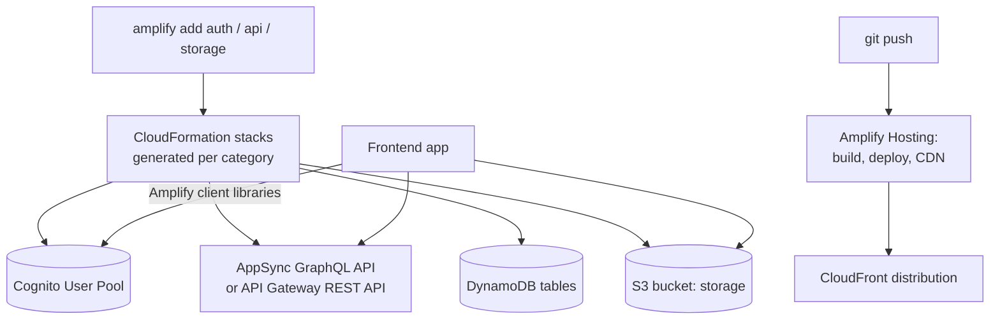

Each `amplify add <category>` command generates and deploys its own CloudFormation stack for that
category, wiring IAM roles and resource references between them automatically (e.g., the generated
AppSync API's resolvers already know the DynamoDB table ARN Amplify just created). Amplify Hosting
separately handles the frontend: a `git push` triggers a build and deploy to a CloudFront-backed
hosting environment, with branch-based environments for preview deployments.

### Real AWS image


*Source: [AWS Reference Architecture Diagrams — Modern Serverless Mobile/Web Application](https://docs.aws.amazon.com/reference-architecture-diagrams/latest/modern-serverless-mobile-web/modern-serverless-mobile-web.html)
(curl-verified 200). This is exactly the shape Amplify provisions behind its CLI commands: Cognito
for identity, AppSync for the API layer, Lambda/DynamoDB for business logic and data, with
CloudFront fronting the static frontend. The point worth internalizing: Amplify isn't a different
architecture from what a team would otherwise hand-build — it's this same reference architecture,
generated and wired for you.*

### Code Example
```bash
# Scaffolding an Amplify project's backend categories
amplify init
amplify add auth        # provisions a Cognito User Pool + Identity Pool
amplify add api          # choose GraphQL (AppSync) or REST (API Gateway)
amplify add storage      # provisions an S3 bucket with per-user access rules
amplify push              # deploys all configured categories as CloudFormation stacks
```
```javascript
// Frontend: using the generated config to call the provisioned backend, no manual endpoint wiring
import { Amplify } from 'aws-amplify';
import { generateClient } from 'aws-amplify/api';
import config from './amplifyconfiguration.json';
Amplify.configure(config);

const client = generateClient();
const todos = await client.graphql({ query: listTodos });
```

### Pricing Note
Amplify Hosting bills for build minutes and data served; the underlying provisioned resources (Cognito, AppSync/API Gateway, DynamoDB, S3) are billed separately at their own normal rates — Amplify itself adds no extra per-resource markup, it's a provisioning/CI convenience layer on top of standard service pricing.

### Common Exam Scenarios
- *"A two-person startup needs auth, a GraphQL API, and file storage live in days, with Git-push CI/CD, and doesn't want to provision each service by hand"* → Amplify.
- *"An enterprise team needs bespoke, fine-grained control over every underlying resource's configuration"* → hand-rolled CDK/CloudFormation, not Amplify's opinionated abstraction.
- *"A mobile app needs offline-first data sync against a managed backend"* → Amplify DataStore on top of an AppSync API.

### Exam Tips
- Recognize "stand up auth + API + storage fast with Git-push CI/CD, without directly provisioning
  each service" as the Amplify signature wording.
- Amplify provisions **real** underlying AWS resources (Cognito, AppSync/API Gateway, DynamoDB,
  S3) — it is not a separate proprietary backend; those resources are addressable and billable
  independently.
- Don't confuse Amplify (full-stack app tooling) with CDK/CloudFormation (general-purpose IaC) —
  Amplify is opinionated and app-shaped; CDK/CloudFormation is general-purpose and unopinionated.

---

## 2. AWS AppSync

### Definition
AWS AppSync is a fully managed service for building **GraphQL APIs** (and, more recently, real-time
Events APIs) that connect a single API endpoint to multiple backend data sources — DynamoDB,
Lambda, RDS, OpenSearch, or any HTTP endpoint — through per-field **resolvers**, with built-in
real-time subscriptions and offline data sync support.

### Plain-English Analogy
A REST API is like ordering from a fixed menu — you get exactly the dish as plated, extra sides or
not. GraphQL (what AppSync serves) is like a buffet with a single serving counter: you tell the
counter exactly which items you want from however many stations (data sources) are behind it, and
you get back one plate with just those items — no more, no less, in a single trip.

### Purpose
REST APIs typically need either many endpoints (one per resource shape) or over-fetching (one
endpoint that returns more data than a given client needs). GraphQL lets a client request exactly
the fields it needs from potentially many different backend sources in a single round trip.
AppSync exists so you don't have to build and operate a GraphQL server yourself — schema,
resolvers, real-time subscriptions, and caching are all managed.

### When to Use It
- Mobile/web clients that want to fetch exactly the fields they need, from multiple sources, in one
  request (reducing both over-fetching and the number of round trips).
- Real-time, live-updating UIs (chat apps, dashboards, collaborative editors) via GraphQL
  subscriptions pushed over WebSockets.
- Combining multiple backend data sources (DynamoDB + Lambda + an existing REST API) behind one
  unified API surface.

### When NOT to Use It
- Simple CRUD APIs with no multi-source aggregation need are often simpler and cheaper to build as
  a plain REST API via API Gateway + Lambda — GraphQL's flexibility is overhead you don't need.
- Teams unfamiliar with GraphQL's schema/resolver model take on a real learning curve; a small
  internal tool doesn't always justify that investment.
- File/binary transfer (large uploads/downloads) isn't GraphQL's strength — pair AppSync with
  direct S3 presigned URLs rather than trying to push binary data through a GraphQL mutation.

### Use Cases
1. A social app needs a single API call to return a post, its author's profile, and its comment
   count — three different data sources, one GraphQL query.
2. A collaborative whiteboard app needs every connected client to see other users' changes in
   real time via subscriptions.
3. A mobile app needs offline-first support, syncing local writes back to the cloud once
   connectivity returns (Amplify DataStore sits on top of AppSync for exactly this).
4. An enterprise wants to expose an existing legacy REST API and a new DynamoDB table behind one
   unified GraphQL schema for a new frontend, without rewriting the legacy system.
5. A dashboard needs live-updating metrics pushed to connected clients instead of polling.
6. A team wants fine-grained, per-field authorization (some fields visible to admins only) that a
   REST endpoint's all-or-nothing response shape makes awkward.

### Why Important
Task 1.1 explicitly calls out GraphQL as an alternative to REST/HTTP APIs — the exam expects you
to recognize AppSync as the managed-GraphQL answer when a scenario emphasizes flexible field
selection, multi-source aggregation, or real-time subscriptions, instead of defaulting to API
Gateway + Lambda for every API scenario.

### How It Works

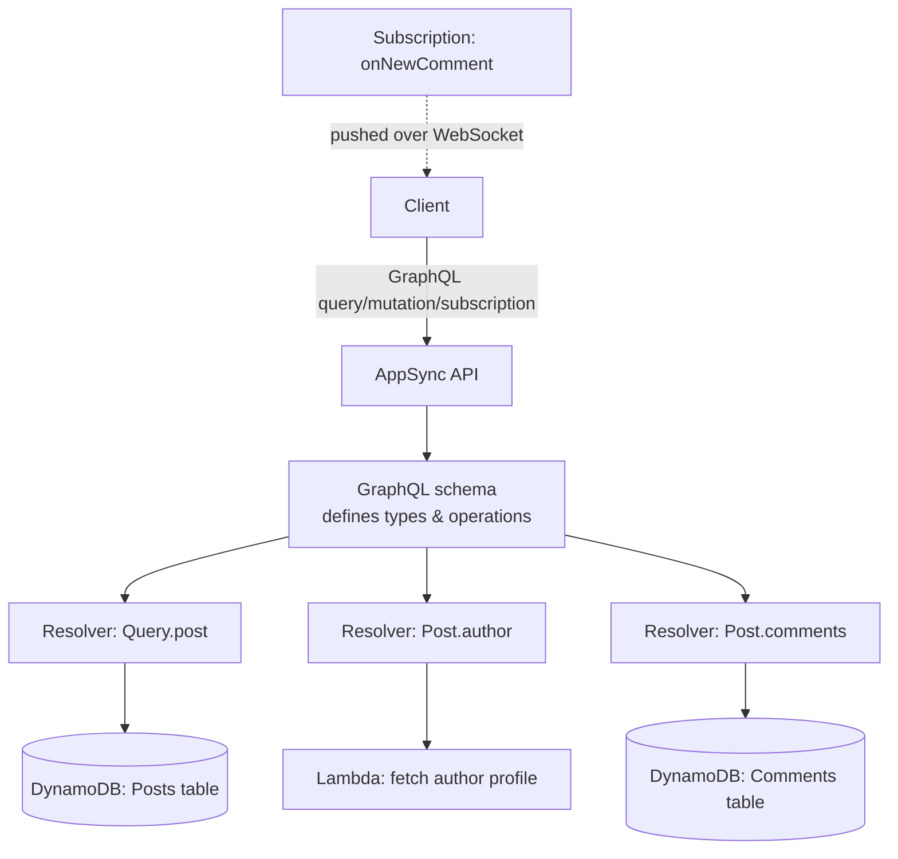

A single client query can trigger multiple independent resolvers — one per requested field — each
hitting its own data source, and AppSync assembles all the results into one JSON response shaped
exactly like the client's query. Subscriptions work by having AppSync push a message over a
WebSocket connection whenever a specified mutation occurs, without the client ever polling.

### Real AWS image


*Source: [AWS AppSync Developer Guide — What is AWS AppSync?](https://docs.aws.amazon.com/appsync/latest/devguide/what-is-appsync.html)
(curl-verified 200). The schema sits in the middle as the single contract clients talk to;
resolvers are the translation layer between each schema field and its actual backend data source.
Exam-relevant detail visible here: a single API's resolvers can point at *different kinds* of data
sources simultaneously — this diagram is the visual proof that AppSync isn't "GraphQL in front of
one database," it's a genuine aggregation layer.*

### Code Example
```graphql
# Schema: one query touching two different underlying data sources transparently to the client
type Post {
  id: ID!
  title: String!
  author: Author!       # resolved via a Lambda data source
  comments: [Comment!]!  # resolved via a separate DynamoDB table
}
type Query {
  getPost(id: ID!): Post
}
type Subscription {
  onNewComment(postId: ID!): Comment
    @aws_subscribe(mutations: ["addComment"])
}
```
```javascript
// Client: requesting exactly the fields needed, one round trip, two data sources
const query = `query { getPost(id: "p1") { title author { name } comments { text } } }`;
const resp = await client.graphql({ query });
```

### Pricing Note
Billed per million GraphQL requests resolved and per real-time subscription minute/message — a query touching five fields through five separate resolvers is billed as resolver executions, so schema design (fewer, more efficient resolvers) has a direct cost impact, not just a performance one.

### Common Exam Scenarios
- *"A mobile client wants to fetch exactly the fields it needs from three different backend sources in one round trip"* → AppSync/GraphQL, not three separate REST calls.
- *"A collaborative app needs every connected client to see other users' changes live"* → AppSync subscriptions over WebSockets.
- *"A simple CRUD API with no multi-source aggregation need"* → plain REST via API Gateway + Lambda is simpler than standing up a GraphQL schema for no benefit.

### Exam Tips
- "Managed GraphQL API with real-time subscriptions" → AppSync, not API Gateway + Lambda for each
  field individually.
- AppSync resolvers can target DynamoDB, Lambda, RDS (via Data API), OpenSearch, and HTTP
  endpoints — know it's a genuine multi-source aggregator, not DynamoDB-only.
- Subscriptions are pushed over WebSockets automatically when a specified mutation fires — no
  client-side polling loop required.

---

## 3. AWS CodeDeploy

### Definition
AWS CodeDeploy automates application deployments to EC2 instances, on-premises servers, Lambda
functions, or ECS services, using a configurable deployment strategy (in-place, blue/green,
canary, linear) with built-in health checks and automatic rollback on failure.

### Plain-English Analogy
CodeDeploy is a theater's stage manager during a cast change between performances. Instead of
pulling every actor off stage simultaneously and risking an empty stage if the new cast isn't
ready (a risky all-at-once swap), the stage manager can swap actors in gradually, watch the
audience's reaction (health checks) after each swap, and immediately put the old actor back if
something goes wrong — all according to a rehearsed plan (the deployment configuration), not
improvised on the spot.

### Purpose
Deploying new application code safely at scale is risky if done as an uncoordinated, all-at-once
replacement — a bad deployment can take an entire fleet down simultaneously with no automatic way
back. CodeDeploy exists to make deployments a controlled, observable, reversible process instead of
a one-shot gamble, with the deployment strategy itself (how fast, how much traffic shifts at once)
as an explicit, reusable configuration.

### When to Use It
- Deploying new application revisions to a fleet of EC2 instances or an on-premises server fleet
  with an automated rollout strategy.
- Shifting Lambda traffic gradually between function versions (linear/canary) for safer releases.
- Blue/green deployments to ECS, swapping an entire new task set in behind a load balancer with an
  automatic rollback path if health checks fail.

### When NOT to Use It
- CloudFormation/CDK stack updates for infrastructure changes are a different concern
  (infrastructure state) from CodeDeploy's concern (application code rollout) — don't reach for
  CodeDeploy to manage infrastructure provisioning itself.
- A single-instance, low-stakes internal tool rarely needs the operational overhead of a
  deployment-configuration strategy; a simple scripted deploy may be sufficient.
- Simple S3 static site deployments don't need CodeDeploy at all — a plain `s3 sync` or Amplify
  Hosting handles that case more directly.

### Use Cases
1. Rolling out a new application version across a fleet of EC2 instances with automatic rollback if
   health checks fail mid-rollout.
2. Shifting 10% of Lambda traffic to a new version every few minutes (canary) before going to 100%.
3. Blue/green ECS deployment: a whole new task set is stood up, validated, then traffic is cut over
   at the load balancer, with the old task set kept briefly for instant rollback.
4. Hybrid on-premises + EC2 fleets needing the same coordinated deployment process across both.
5. Deployment gated by a `BeforeAllowTraffic` validation Lambda hook that must pass before any real
   traffic is routed to the new revision.
6. Coordinating application deployment as one stage inside a larger CodePipeline CI/CD pipeline.

### Why Important
Task 3.3 (Domain 3) leans on CodeDeploy heavily, but Domain 1 needs to recognize it as the
deployment-automation counterpart to the code you've written in this domain — a correctly-written
Lambda function or containerized app still needs a safe rollout mechanism, and CodeDeploy is that
mechanism, distinct from CodePipeline (which orchestrates the stages *around* a CodeDeploy action).

### How It Works

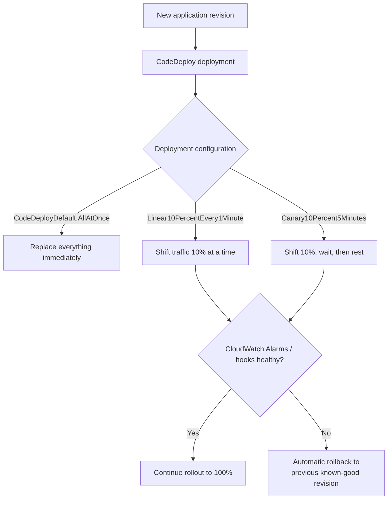

A deployment configuration determines the pace and shape of the rollout; CodeDeploy continuously
checks configured health signals (CloudWatch alarms, or lifecycle hook Lambda functions like
`BeforeAllowTraffic`/`AfterAllowTraffic`) between increments, and automatically rolls the whole
deployment back to the last known-good revision the moment a configured health signal goes bad —
this automatic, built-in rollback is the single biggest reason to use CodeDeploy over a hand-rolled
deployment script.

### Real AWS image


*Source: [AWS CodeDeploy User Guide — How CodeDeploy Works](https://docs.aws.amazon.com/codedeploy/latest/userguide/welcome.html)
(curl-verified 200). This shows the EC2/on-premises deployment lifecycle: revision stored (S3 or
GitHub), deployment group targets a set of instances, and the CodeDeploy agent on each instance
pulls and installs the new revision according to the `appspec.yml`'s lifecycle hooks. The
equivalent diagram for ECS (`deployment-process-ecs.png`, same user guide) shows the blue/green task
set swap instead — same orchestrating service, genuinely different mechanics per compute target.*

### Code Example
```yaml
# appspec.yml — defines lifecycle hooks CodeDeploy calls during an EC2 deployment
version: 0.0
os: linux
files:
  - source: /
    destination: /var/www/html
hooks:
  BeforeInstall:
    - location: scripts/stop_server.sh
  AfterInstall:
    - location: scripts/install_dependencies.sh
  ApplicationStart:
    - location: scripts/start_server.sh
  ValidateService:
    - location: scripts/health_check.sh
```
```bash
aws deploy create-deployment \
  --application-name my-app \
  --deployment-group-name production-fleet \
  --deployment-config-name CodeDeployDefault.LambdaLinear10PercentEvery3Minutes \
  --s3-location bucket=my-deploy-bucket,bundleType=zip,key=revision.zip
```

### Pricing Note
No charge for deployments to EC2/on-premises/Lambda/ECS — CodeDeploy itself is free; you pay only for the compute resources being deployed to. This is worth remembering specifically because it removes 'CodeDeploy costs more at scale' as a legitimate design objection.

### Common Exam Scenarios
- *"A deployment should automatically revert if a health check fails partway through the rollout"* → CodeDeploy's automatic rollback, not a manually scripted deploy.
- *"Traffic should shift gradually to a new Lambda version, verified in small increments before going to 100%"* → canary/linear deployment configuration.
- *"An ECS service needs a full new task set validated before any real traffic reaches it"* → blue/green deployment, old task set kept briefly for instant rollback.

### Exam Tips
- Automatic rollback on a failed health check is CodeDeploy's headline feature — a scenario
  describing "automatically revert a bad deployment" points here.
- Know the three deployment shapes by name: all-at-once, linear, canary — and that blue/green is
  the ECS/Lambda-specific pattern of standing up the new version fully before cutting over traffic.
- CodeDeploy automates the *deployment itself*; CodePipeline automates the *pipeline of stages*
  around it (source → build → deploy) — don't conflate the two services.

---

## 4. AWS CodePipeline

### Definition
AWS CodePipeline is a fully managed continuous delivery service that models and automates the
stages of a software release process — source, build, test, deploy, and any manual approval gates
— as a single pipeline that runs automatically whenever a configured source change triggers it.

### Plain-English Analogy
CodePipeline is an assembly line's conveyor belt and station sequence. Each station
(source-checkout, build, test, deploy) does its one job and passes the work along only once it's
done; if a station rejects the piece (a build fails, a test fails), the whole line stops right
there instead of continuing to assemble on top of a known-bad part. An optional "quality inspector"
station (manual approval) can require a human sign-off before the piece continues toward shipping.

### Purpose
Manually re-running a build, then a test suite, then a deployment script in the right order every
time code changes is tedious and error-prone at team scale. CodePipeline exists to make that
sequence a defined, automatically-triggered, consistently-ordered set of stages — removing "did
someone forget to run the tests before deploying" as a possible failure mode entirely.

### When to Use It
- Any team wanting source-change-triggered CI/CD instead of manually running each release step.
- Coordinating multiple distinct tools (CodeBuild for build/test, CodeDeploy or CloudFormation for
  deploy) into one observable, auditable pipeline.
- Requiring a manual human approval gate before a specific environment (commonly production)
  receives a deployment.

### When NOT to Use It
- A single-developer side project with infrequent, low-stakes deploys may not need a full managed
  pipeline's overhead — a simple script can suffice.
- If your organization is already standardized on a different CI/CD platform (Jenkins, GitHub
  Actions, GitLab CI) end-to-end, introducing CodePipeline alongside it is often redundant rather
  than complementary unless there's a specific AWS-native integration reason to add it.

### Use Cases
1. Git push to main triggers source → build (CodeBuild) → test → deploy (CodeDeploy) automatically.
2. A pipeline deploys to a `dev` stage automatically, then requires manual approval before
   promoting the exact same build artifact to `prod`.
3. A CloudFormation/CDK-based infrastructure pipeline that builds and deploys stack changes through
   dev/staging/prod environments sequentially.
4. A pipeline with a parallel build stage producing both a Docker image (pushed to ECR) and a set
   of static assets (pushed to S3) before a combined deploy stage.
5. An AI-assisted deployment-risk summary attached as context to a manual approval action (see
   [`ai-assisted-development.md`](domain-1-development/ai-assisted-development.md)) before production promotion.
6. A pipeline that triggers a Lambda-based custom action for a non-standard validation step not
   covered by a built-in action type.

### Why Important
Domain 1 code only matters once it ships — CodePipeline is the mechanism that turns the SDK/Lambda
code you write into a running, correctly-promoted deployment, and the exam tests whether you
recognize it as the orchestration layer (stages, triggers, approvals) distinct from the build tool
(CodeBuild) or deployment tool (CodeDeploy) it coordinates.

### How It Works

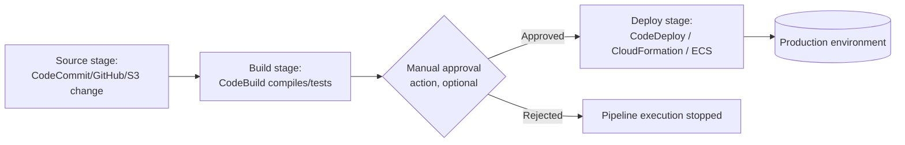

Each stage contains one or more actions; a stage only begins once the previous stage's actions all
succeed. A manual approval action pauses the pipeline entirely until a human (or an automated
system acting on a human's behalf through the API) approves or rejects it — nothing downstream runs
until that decision is made.

### Real AWS image


*Source: [AWS Reference Architecture Diagrams — Database DevOps](https://docs.aws.amazon.com/reference-architecture-diagrams/latest/data-analytics/database-devops.html)
(curl-verified 200). Shows a release manager's change entering through source control, flowing
through CodeBuild, and promoting automatically through to an RDS deployment target — a reminder
that CodePipeline's deploy stage isn't limited to EC2/Lambda; a database schema migration pipeline
is an equally valid pipeline shape.*

### Code Example
```json
{
  "pipeline": {
    "name": "orders-api-pipeline",
    "stages": [
      { "name": "Source", "actions": [{ "actionTypeId": {"category": "Source", "provider": "CodeStarSourceConnection"} }] },
      { "name": "Build", "actions": [{ "actionTypeId": {"category": "Build", "provider": "CodeBuild"} }] },
      { "name": "ApproveProd", "actions": [{ "actionTypeId": {"category": "Approval", "provider": "Manual"} }] },
      { "name": "DeployProd", "actions": [{ "actionTypeId": {"category": "Deploy", "provider": "CodeDeployToECS"} }] }
    ]
  }
}
```
```bash
# Approving a pending manual-approval action via CLI (the exact gate an AI risk-summary feeds into)
aws codepipeline put-approval-result \
  --pipeline-name orders-api-pipeline --stage-name ApproveProd --action-name ManualApproval \
  --result summary="Reviewed diff, no destructive changes",status=Approved --token <approval-token>
```

### Pricing Note
Billed per active pipeline per month (a flat fee), plus the cost of whatever actions it invokes (CodeBuild compute minutes, etc.) — a pipeline that sits idle between infrequent releases still accrues its monthly charge, which is worth knowing when comparing pipeline consolidation strategies.

### Common Exam Scenarios
- *"A source change should automatically flow through build, test, and deploy without manual intervention"* → CodePipeline orchestrating CodeBuild/CodeDeploy stages.
- *"Production must never receive a deployment without a documented human sign-off, even if an AI tool says the change looks safe"* → a manual approval action, with the AI summary as context only.
- *"The same tested build artifact must be the one that reaches every environment, not a rebuild per environment"* → CodePipeline promotes one artifact through stages.

### Exam Tips
- CodePipeline orchestrates *stages*; it doesn't build code itself (CodeBuild) or deploy it itself
  (CodeDeploy/CloudFormation) — know the division of labor among the three.
- A manual approval action is the correct mechanism for "require human sign-off before production,"
  even when an AI tool also summarizes the change for the approver's benefit.
- A pipeline promotes the *same build artifact* through environments (dev → staging → prod) rather
  than rebuilding per environment — this is what guarantees "what you tested is what you shipped."

---

## 5. AWS IAM

### Definition
AWS Identity and Access Management (IAM) is the service that controls **who** (which principal —
user, role, or federated identity) can do **what** (which actions) on **which** AWS resources,
under **what** conditions, evaluated on every single AWS API call.

### Plain-English Analogy
IAM is a building's badge-access system. Every badge (identity) has a list of doors it can open
(permissions policy); some doors additionally require a specific badge *type* to even approach them
(a resource-based policy or trust policy); a company-wide security rule can override every
individual badge ("no one opens the server room after 10pm," regardless of what their own badge
says — a Deny always wins, same as an explicit `Deny` statement always overrides an `Allow`
anywhere else in the evaluation).

### Purpose
Every AWS API call needs an answer to "is this allowed?" — IAM exists as the single, universal
authorization layer every service defers to, so permissions aren't reinvented per service. It also
replaces static, shareable credentials with fine-grained, revocable, auditable permission grants —
the foundation every other security control in AWS (SCPs, permission boundaries, resource policies)
builds on top of.

### When to Use It
- Every single AWS interaction, always — there's no scenario in which IAM is optional; the only
  question is *which* IAM construct (user, role, group, policy type) fits a given need.
- Granting an application (Lambda, EC2, ECS task) exactly the permissions its code needs, via an
  execution/task role, not a shared static credential.
- Cross-account or federated access, via roles assumed through STS rather than distributing
  account-specific IAM users.

### When NOT to Use It
- IAM users with long-lived access keys should essentially never be the answer on this exam for
  application/service access — roles (assumed via STS) are correct in every case a role can cover.
- IAM is not a network-layer control — don't reach for an IAM policy to solve a problem that's
  actually about security groups/NACLs (network reachability) or KMS (encryption), even though all
  four are security controls in the same general family.

### Use Cases
1. Granting a Lambda function's execution role exactly `dynamodb:PutItem` on one specific table
   ARN, nothing broader.
2. Federating a third-party partner's access via `AssumeRole` + `ExternalId`, avoiding any shared
   static credential.
3. Using a permission boundary to cap what a delegated team can grant themselves, even via policies
   they create themselves.
4. Attaching a resource-based (bucket) policy to an S3 bucket to allow cross-account read access
   without creating an IAM user in your account for the other account to use.
5. Requiring MFA via a policy condition (`aws:MultiFactorAuthPresent`) before allowing a sensitive
   action like deleting a production table.
6. Using IAM Access Analyzer to detect a resource policy that unintentionally grants external
   access.

### Why Important
Every Domain 1 code example that calls an AWS API depends on IAM getting it right — a correctly
written SDK call still fails with `AccessDenied` if the underlying identity's policy doesn't allow
the specific action/resource/condition combination, making IAM the invisible prerequisite behind
essentially every other service in this file.

### How It Works

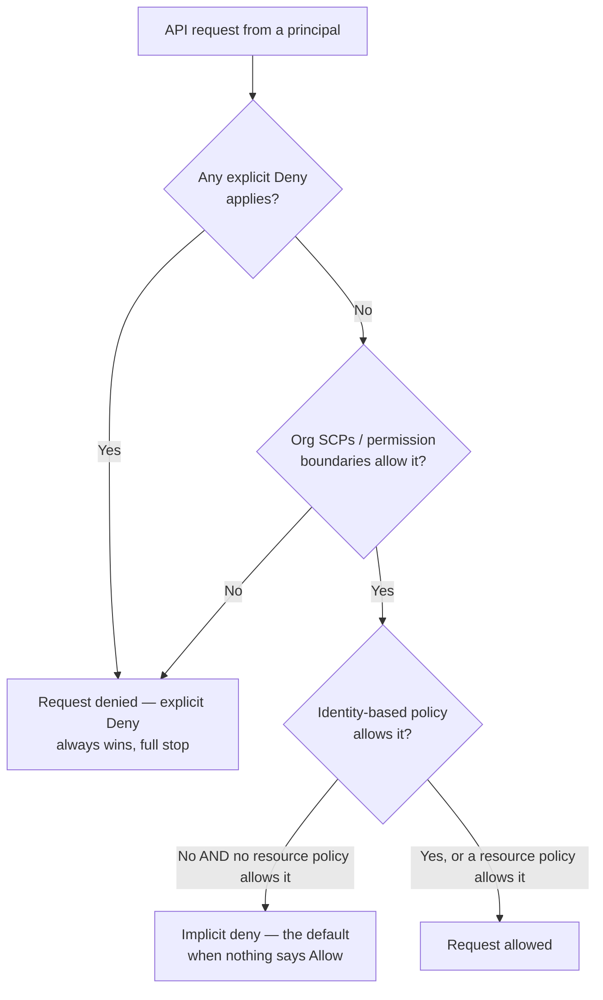

Every evaluation starts from an implicit deny (nothing is allowed unless something explicitly says
so), checks for any explicit `Deny` first (which always wins regardless of any `Allow` elsewhere),
then checks organization-level ceilings (SCPs, permission boundaries) before finally checking
whether an identity-based or resource-based policy actually grants an `Allow`.

### Real AWS image


*Source: [AWS IAM User Guide — Policy evaluation logic](https://docs.aws.amazon.com/IAM/latest/UserGuide/reference_policies_evaluation-logic.html)
(curl-verified 200). This is the exact flow diagrammed above, straight from AWS's own
documentation — worth memorizing the shape (explicit deny first, ceilings next, identity/resource
union last) because nearly every "why was this request denied" exam question is really asking you
to walk this chart correctly.*

### Code Example
```json
{
  "Version": "2012-10-17",
  "Statement": [
    {
      "Effect": "Allow",
      "Action": ["dynamodb:PutItem", "dynamodb:GetItem"],
      "Resource": "arn:aws:dynamodb:us-east-1:123456789012:table/Orders",
      "Condition": { "Bool": { "aws:SecureTransport": "true" } }
    }
  ]
}
```
```bash
aws iam simulate-principal-policy \
  --policy-source-arn arn:aws:iam::123456789012:role/OrdersLambdaRole \
  --action-names dynamodb:Scan --resource-arns arn:aws:dynamodb:us-east-1:123456789012:table/Orders
```

### Pricing Note
IAM itself has no charge — creating users, roles, and policies, and every policy evaluation on every API call, is free. The cost always lives in the resources those permissions grant access to, never in IAM's own usage.

### Common Exam Scenarios
- *"A Lambda function gets AccessDenied even though its code looks correct"* → check the execution role's permissions policy first, not the code.
- *"A policy's effect is ambiguous because multiple statements seem to conflict"* → an explicit Deny always wins over any Allow, full stop.
- *"A third-party vendor needs scoped, revocable access without a shared static credential"* → a role with a trust policy, not an IAM user with an access key.

### Exam Tips
- An explicit `Deny` always wins — no `Allow` anywhere else overrides it; this single fact resolves
  a large share of "which access actually applies" exam questions.
- Least privilege (narrowest action + resource + condition that still lets the code work) is the
  exam's default correct instinct whenever a policy's scope is in question.
- Don't confuse a role's **trust policy** (who may assume it) with its **permissions policy** (what
  it can do once assumed) — see the STS entry below for the mechanism that uses both.

---

## 6. AWS Lambda

### Definition
AWS Lambda is a serverless compute service that runs your code in response to events — HTTP
requests, file uploads, queue messages, scheduled times — without you provisioning or managing any
servers, billed per invocation and per millisecond of execution time.

### Plain-English Analogy
Lambda is a light switch wired to a motion sensor, not a light left running all night. The light
(your code) only draws power (cost) while something is actually happening in the room (an
invocation), and the instant nobody's there, it's off — no idle capacity sitting around, but also
a brief moment to "warm up" (a cold start) the first time it's switched on after being off a while.

### Purpose
Running a server continuously to handle request bursts that arrive unpredictably wastes money on
idle capacity, and capacity-planning for every possible scenario is its own ongoing burden. Lambda
exists to let you write and ship only the business logic, with AWS handling all provisioning,
patching, and automatic scaling — turning "run this code when X happens" into the entire
operational concern.

### When to Use It
- Event-driven processing (file uploads, queue messages, scheduled jobs) where execution is
  bursty, infrequent, or hard to predict in advance.
- Backing a REST/GraphQL API's business logic behind API Gateway/AppSync.
- Short-lived tasks (well under 15 minutes) that don't need a persistently running process.

### When NOT to Use It
- Long-running processes (hours, continuous streaming) exceed Lambda's 15-minute maximum — use
  ECS/Fargate or EC2 instead.
- Extremely latency-sensitive workloads that can't tolerate any cold-start variance, without paying
  for provisioned concurrency to offset it, may be better served by an always-on compute option.
- Workloads needing specialized hardware (GPUs at scale, for example) beyond what Lambda supports.

### Use Cases
1. Processing an uploaded image (resize, scan) the moment it lands in S3.
2. Backing a REST API's business logic, invoked synchronously by API Gateway per request.
3. Polling and processing batches off an SQS queue or Kinesis stream via an event source mapping.
4. Running a nightly scheduled cleanup job via an EventBridge scheduled rule.
5. Validating and transforming records inside a Kinesis Data Firehose delivery stream.
6. Acting as a Step Functions task, performing one discrete step in a larger orchestrated workflow.

### Why Important
Lambda is the computational center of gravity for nearly every Domain 1 scenario — Task 1.2 is
entirely about Lambda specifically (VPC access, layers, concurrency, triggers), and Tasks 1.1/1.3
assume Lambda as the place SDK calls to other services (DynamoDB, S3, EventBridge) actually happen.

### How It Works

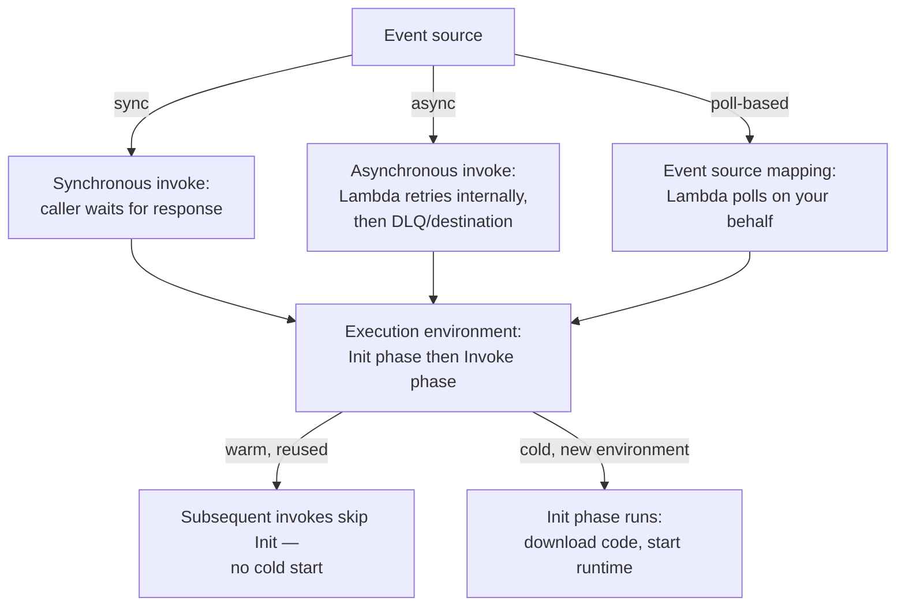

The three invocation models (synchronous, asynchronous, poll-based) determine who's responsible for
retries and how failures surface — see [`README.md`](domain-1-development/README.md#lambda-triggers-three-invocation-models-one-function)
and [`lambda-event-source-mapping-deep-dive.md`](domain-1-development/lambda-event-source-mapping-deep-dive.md) for the
full depth on each. A cold start only happens when a new execution environment is created; a warm
environment reused for a subsequent invocation skips the Init phase entirely.

### Real AWS image


*Source: [AWS Lambda Developer Guide — Lambda execution environment](https://docs.aws.amazon.com/lambda/latest/dg/lambda-runtime-environment.html)
(curl-verified 200). Init only runs once per new execution environment — everything declared
*outside* your handler function (SDK client construction, a database connection) runs during Init
and is reused across every subsequent warm Invoke, which is exactly why "initialize your SDK client
outside the handler" is the standard cold-start/performance tip: code inside Init amortizes its cost
across potentially thousands of invocations on the same warm environment.*

### Code Example
```python
import boto3, json
ddb = boto3.client("dynamodb")   # Init phase — runs once per environment, reused across warm invokes

def handler(event, context):     # Invoke phase — runs every single invocation
    body = json.loads(event["body"])
    ddb.put_item(TableName="Orders", Item={"orderId": {"S": body["orderId"]}})
    return {"statusCode": 200, "body": json.dumps({"status": "ok"})}
```
```bash
aws lambda put-function-concurrency --function-name create-order --reserved-concurrent-executions 20
aws lambda put-provisioned-concurrency-config --function-name create-order \
  --qualifier prod --provisioned-concurrent-executions 5
```

### Pricing Note
Billed per request and per GB-second of memory × duration, with a perpetual free tier — provisioned concurrency is billed separately for the time it's enabled, whether or not it's actually invoked, which is exactly why it's reserved for traffic patterns predictable enough to justify paying for idle warm capacity.

### Common Exam Scenarios
- *"Cold-start latency is hurting a latency-sensitive API's p99"* → provisioned concurrency, not reserved concurrency (which only caps/guarantees capacity, it doesn't pre-warm).
- *"One noisy function is starving the rest of the account's concurrency pool"* → reserved concurrency on that one function.
- *"A function needs to reach a private RDS instance in a VPC with no public endpoint"* → attach the function to that VPC; don't attach it if it only calls public AWS APIs.

### Exam Tips
- Reserved concurrency caps/guarantees capacity; only provisioned concurrency actually pre-warms
  environments and fixes cold starts — a very common wrong-answer trap.
- Know which invocation model (sync/async/poll-based) a given trigger uses before reasoning about
  its error-handling behavior — the three models fail completely differently.
- Code placed outside the handler runs once per cold environment (Init), not once per invocation —
  this is the mechanism behind the standard "initialize SDK clients globally" performance advice.

---

## 7. AWS STS & Role Switching

### Definition
AWS Security Token Service (STS) issues short-lived, temporary security credentials — an access
key, secret key, and session token that expire automatically — allowing a principal to temporarily
"become" a different IAM role (role switching) instead of using permanent, static credentials.

### Plain-English Analogy
STS is a hotel's keycard system that reissues a fresh, time-limited card for your exact stay
instead of handing you a master key that works forever. Your reservation (the role's trust policy)
determines whether the front desk will issue you a card at all; the card itself (the temporary
credentials) simply stops working at checkout time (expiry) — nobody has to manually deactivate it.

### Purpose
Long-lived credentials are a standing liability: leaked, they work indefinitely until someone
notices and manually revokes them. STS exists so that almost nothing in AWS — EC2 instances,
Lambda executions, cross-account access, federated logins — ever needs a permanent secret; every
one of those gets credentials that expire on their own, usually within an hour, shrinking the blast
radius of any leak automatically.

### When to Use It
- Any Lambda/EC2/ECS compute identity (handled automatically via an execution/instance/task role).
- Cross-account access, using `AssumeRole` with an `ExternalId` for third-party integrations.
- Federated human access (SSO, SAML, web identity) exchanging an external token for temporary AWS
  credentials.

### When NOT to Use It
- Don't reach for a brand-new IAM user with a static key when a role assumable via STS already
  solves the access need — this is nearly always the wrong-answer pattern on the exam.
- `GetSessionToken` (simple MFA-protected temporary creds, same identity) is the wrong tool when the
  actual need is to *change* identity (assume a different role) — know the two are different STS
  operations for different purposes.

### Use Cases
1. A Lambda function's execution role credentials, injected automatically before the handler runs.
2. A third-party SaaS vendor assuming a role in your account via `ExternalId`, defeating the
   confused-deputy problem.
3. A developer using `aws sso login` to get temporary credentials instead of a static access key.
4. Role chaining: a user assumes Role A, then from that session assumes Role B, capped at a 1-hour
   session duration.
5. EKS pods assuming an IAM role via IRSA (web identity federation) without any node-level static
   credentials.
6. A CI/CD pipeline assuming a deployment role scoped only to the specific resources it needs to
   touch, instead of using a long-lived pipeline IAM user.

### Why Important
STS is the mechanism underneath "where do my SDK's credentials actually come from" in every
non-trivial scenario — see
[`aws-sdk-credential-resolution-chain.md`](domain-1-development/aws-sdk-credential-resolution-chain.md) for how the SDK
finds these credentials, and this entry for how they were minted in the first place.

### How It Works

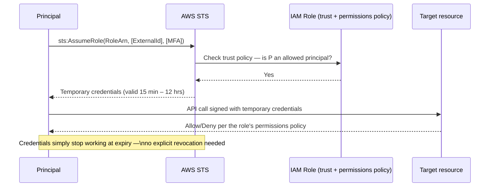

### Real AWS image


*Source: [AWS IAM User Guide — Federating AWS identities across partitions](https://docs.aws.amazon.com/IAM/latest/UserGuide/id_roles_providers_outbound_cross_partition.html)
(curl-verified 200). Illustrates the general trust-token exchange every `AssumeRoleWith*` variant
follows: a token minted by one trust anchor (SAML IdP, OIDC provider, source STS) is validated
against the issuer's public signing keys and exchanged for scoped temporary credentials.*

### Code Example
```python
import boto3
sts = boto3.client("sts")
resp = sts.assume_role(
    RoleArn="arn:aws:iam::222233334444:role/CrossAccountReadOnly",
    RoleSessionName="partner-integration",
    ExternalId="partner-secret-abc123",
)
creds = resp["Credentials"]
s3 = boto3.client("s3", aws_access_key_id=creds["AccessKeyId"],
                   aws_secret_access_key=creds["SecretAccessKey"], aws_session_token=creds["SessionToken"])
```

### Pricing Note
STS API calls (AssumeRole, GetSessionToken, etc.) carry no additional charge beyond standard request pricing where applicable — the cost lives entirely in what the resulting temporary credentials are then used to do, not in the act of assuming a role itself.

### Common Exam Scenarios
- *"A third-party SaaS vendor serving many customers must not be trickable into accessing a different customer's resources via a shared integration"* → ExternalId, the confused-deputy defense.
- *"A user can't even start assuming a role"* → check the role's trust policy, not its permissions policy.
- *"A session is assumed through two roles in sequence"* → role chaining caps the resulting session at 1 hour regardless of either role's configured max.

### Exam Tips
- `ExternalId` defends specifically against the confused-deputy problem in cross-account role
  assumption — know this term by name.
- Role chaining (assuming a role from within an already-assumed role's session) caps the resulting
  session at a maximum of 1 hour, regardless of either role's own configured max session duration.
- A role's trust policy (who can assume it) and permissions policy (what it can do) are two
  separate documents — a symptom of "can't assume the role at all" points at the trust policy; "can
  assume it but every call is denied" points at the permissions policy.

---

## 8. AWS Step Functions

### Definition
AWS Step Functions is a serverless orchestration service for coordinating multiple AWS services
(primarily Lambda, but also direct service integrations with DynamoDB, SQS, SNS, ECS, and more)
into visual, durable workflows called **state machines**, defined declaratively in Amazon States
Language (ASL/JSON), with built-in retry, error-catching, and parallel/branching execution.

### Plain-English Analogy
Step Functions is a flowchart brought to life — each box in the flowchart (a `State`) is an actual
step that runs, and the arrows are the actual control flow the system follows, including "if this
step fails three times, follow this other arrow instead" logic built right into the diagram, not
bolted on as separate retry code scattered through every step.

### Purpose
Coordinating a multi-step process by hand — calling one Lambda, waiting for it, calling the next,
handling partial failures, tracking which step a long-running process is currently on — quickly
turns into fragile glue code with the orchestration logic scattered across functions. Step Functions
exists to make that orchestration an explicit, visual, durable definition instead of implicit code
spread across multiple Lambda functions.

### When to Use It
- Multi-step workflows with explicit sequencing, branching, parallel execution, or wait states.
- Any workflow needing differentiated retry/catch behavior per step (see
  [`idempotency-and-retry-patterns.md`](domain-1-development/idempotency-and-retry-patterns.md#worked-exam-scenario-step-functions-retrycatch-on-a-side-effecting-task)).
- Long-running processes (up to a full year for Standard workflows) that need to survive well
  beyond any single Lambda invocation's 15-minute maximum.

### When NOT to Use It
- A single Lambda function handling one atomic unit of work doesn't need an orchestrator wrapped
  around it — that's unnecessary complexity for no coordination benefit.
- Extremely high-throughput, low-latency, short-lived event processing is often better served by
  Express workflows specifically (or no Step Functions at all) rather than Standard workflows, which
  are priced and designed for durability over raw throughput.

### Use Cases
1. An order-processing workflow: validate → charge payment (with retry/catch) → update inventory →
   notify, each a discrete state with its own error handling.
2. A human-approval gate inside a data pipeline, using a Wait-for-callback (`.waitForTaskToken`)
   task that pauses until an external system calls back.
3. Fan-out parallel processing: resize an uploaded image into five different sizes simultaneously
   using a `Parallel` or `Map` state.
4. A long-running ML training/inference pipeline coordinating Bedrock/SageMaker calls, each too
   slow for a single Lambda's 15-minute cap.
5. Saga-pattern distributed transactions: a multi-step booking process that explicitly undoes
   earlier steps (cancels a reservation) if a later step fails.
6. CI/CD-adjacent orchestration: an AI-assisted deployment-risk check feeding a Step Functions
   manual-approval task before a pipeline continues.

### Why Important
Task 1.1's event-driven, multi-service orchestration scenarios frequently resolve to Step Functions
once more than a couple of steps with differentiated error handling are involved — recognizing when
a scenario has outgrown "just chain some Lambda calls together" into "this needs an explicit state
machine" is a recurring exam judgment call.

### How It Works

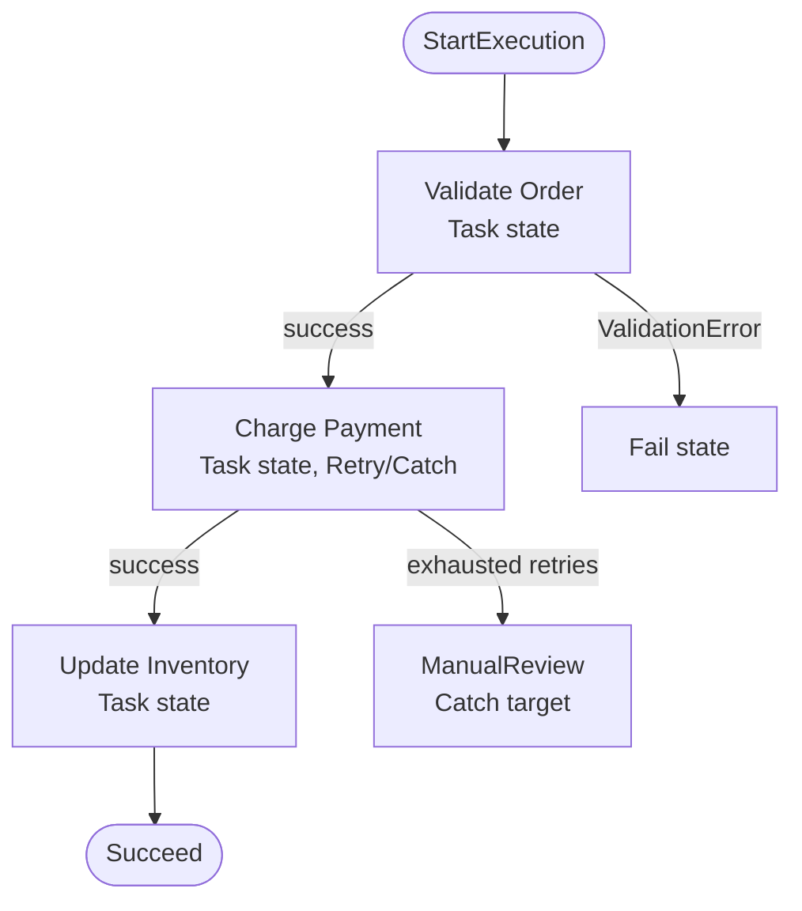

### Real AWS image


*Source: [AWS Step Functions Developer Guide — What is AWS Step Functions?](https://docs.aws.amazon.com/step-functions/latest/dg/welcome.html)
(curl-verified 200). This console-rendered visual workflow is a genuine operational tool, not just
documentation: during an incident, seeing exactly which state an in-flight execution is stuck on —
rendered visually, state by state — is dramatically faster triage than reading disjointed Lambda
logs across several functions trying to reconstruct the same sequence mentally.*

### Code Example
```json
{
  "StartAt": "ValidateOrder",
  "States": {
    "ValidateOrder": { "Type": "Task", "Resource": "arn:aws:lambda:...:ValidateOrder", "Next": "ChargePayment" },
    "ChargePayment": {
      "Type": "Task", "Resource": "arn:aws:lambda:...:ChargePayment",
      "Retry": [{ "ErrorEquals": ["States.Timeout"], "MaxAttempts": 3, "BackoffRate": 2.0 }],
      "Catch": [{ "ErrorEquals": ["States.ALL"], "Next": "ManualReview" }],
      "Next": "UpdateInventory"
    },
    "UpdateInventory": { "Type": "Task", "Resource": "arn:aws:lambda:...:UpdateInventory", "End": true },
    "ManualReview": { "Type": "Succeed" }
  }
}
```

### Pricing Note
Standard workflows bill per state transition; Express workflows bill per execution duration and memory, similar in spirit to Lambda's pricing model — a long-running Standard workflow with many steps costs differently than a high-volume, short-lived Express workflow, which is itself a reason to pick the right workflow type for the traffic shape, not just the durability need.

### Common Exam Scenarios
- *"A payment charge step should retry automatically on a transient AWS-side timeout, but never retry (and instead route to manual review) on a definitive card-declined error"* → differentiated Retry/Catch blocks matching specific error names.
- *"A workflow must survive well beyond Lambda's 15-minute maximum, coordinating steps over hours or days"* → Step Functions Standard workflow, not a single long-running Lambda.
- *"An execution started twice with the same business key by mistake should not create two parallel runs"* → the name parameter on StartExecution deduplicates natively.

### Exam Tips
- `Retry`/`Catch` on individual states is the headline Task 1.1/1.3 testable mechanism — know that
  each can match specific error names, not just a blanket "retry everything."
- Standard workflows support executions up to a year and exactly-once semantics; Express workflows
  trade that durability for higher throughput and at-least-once semantics — pick based on the
  stated duration/throughput requirement.
- A `name` passed to `StartExecution` deduplicates executions natively — recognize this as built-in
  idempotency, not something you need to hand-build with a separate table.

---

## 9. Amazon API Gateway

### Definition
Amazon API Gateway is a fully managed service for creating, publishing, securing, and monitoring
REST, HTTP, and WebSocket APIs at any scale, acting as the "front door" for applications to access
backend logic running on Lambda, EC2, ECS, or any publicly reachable HTTP endpoint.

### Plain-English Analogy
API Gateway is the reception desk of an office building. Visitors (clients) never walk directly
into any department (Lambda function, EC2 fleet); they check in at reception first, where their
credentials are verified (authorization), they're told how many visitors per minute the building
allows (throttling), and they're pointed to the correct department (routing/integration) — the
departments themselves never have to handle visitor intake logic.

### Purpose
Exposing backend compute directly to the internet means every function/service has to handle its
own TLS termination, authentication, rate limiting, and request validation — duplicated effort
across every endpoint. API Gateway exists to centralize all of that at one front door, so backend
code (Lambda handlers, in this domain) only has to handle business logic.

### When to Use It
- Fronting a Lambda-based or container-based backend with a managed, authenticated, throttled API
  surface.
- Needing multiple deployment stages (dev/test/prod) with independent configuration, promoted
  through a controlled deployment process.
- WebSocket APIs for persistent, bidirectional client connections (chat, live updates) without
  managing your own connection-handling infrastructure.

### When NOT to Use It
- Extremely simple internal-only service-to-service calls within a VPC may not need a public API
  Gateway layer at all — a direct internal ALB or VPC Lattice setup can be simpler.
- If a GraphQL aggregation model fits better (multiple sources, client-selected fields), AppSync is
  the more natural fit than forcing a REST shape onto a multi-source aggregation need.

### Use Cases
1. A REST API backed by Lambda functions, with a Cognito authorizer enforcing authenticated access.
2. Promoting the same deployment through `dev` and `prod` stages with different stage variables
   pointing at different Lambda aliases.
3. A WebSocket API for a real-time multiplayer game's state updates.
4. Request validation at the gateway (reject malformed JSON before it ever reaches Lambda),
   reducing wasted invocations.
5. Usage plans and API keys to throttle and meter different third-party API consumers separately.
6. An HTTP API (the lighter-weight, lower-latency alternative to REST API) proxying straight to an
   ALB fronting a containerized backend.

### Why Important
Task 1.1 explicitly calls out "use API Gateway stages correctly" — stage variables, throttling,
and deployment promotion are concrete, testable mechanics, and nearly every Domain 1 synchronous
request-flow scenario (see [`README.md`](domain-1-development/README.md#how-it-fits-together-a-lambda--api-gateway--dynamodb-request))
starts here.

### How It Works

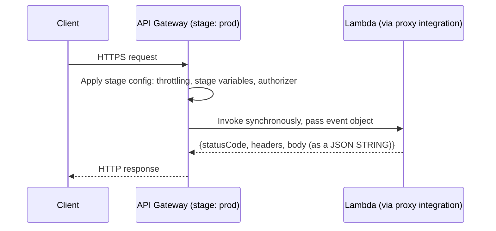

A **stage** is a named, independently configured snapshot of a deployed API — the same API
definition can have `dev` and `prod` stages with different throttle limits and different stage
variables (commonly which Lambda alias/version to invoke), letting you promote a tested deployment
from one stage to another without redefining the API.

### Real AWS image


*Source: [AWS API Gateway Developer Guide — What is Amazon API Gateway?](https://docs.aws.amazon.com/apigateway/latest/developerguide/welcome.html)
(curl-verified 200). Shows API Gateway as the single front door fanning out to Lambda, EC2, and any
other web application — a reminder this service is not Lambda-exclusive, even though this domain's
scenarios lean heavily on the Lambda integration.*

### Code Example
```bash
aws apigateway create-deployment --rest-api-id abc123 --stage-name prod
aws apigateway update-stage --rest-api-id abc123 --stage-name prod \
  --patch-operations op=replace,path=/throttle/rateLimit,value=500
```
```python
# Lambda proxy integration response — the exact shape API Gateway requires
import json
def handler(event, context):
    return {"statusCode": 200, "headers": {"Content-Type": "application/json"},
            "body": json.dumps({"orderId": "abc-123"})}  # body MUST be a string
```

### Pricing Note
Billed per million API calls (REST/HTTP APIs) or per connection-minute plus messages (WebSocket APIs) — HTTP APIs are meaningfully cheaper per call than REST APIs for simple Lambda-proxy use cases, a real cost lever worth knowing when a scenario doesn't need REST-API-only features like usage plans or request validation.

### Common Exam Scenarios
- *"A Lambda function logs a clean successful run but the client still sees a 502"* → the proxy integration response's body isn't a JSON string.
- *"The same API needs different throttle limits and backend targets per environment, promoted in sequence"* → stages with distinct stage variables.
- *"A real-time, persistent, bidirectional client connection is needed, not request/response"* → a WebSocket API.

### Exam Tips
- `body` in a Lambda proxy integration response must be a JSON string, not a raw object — missing
  this is the single most common "502 despite successful function logs" exam/real bug.
- Stage variables let one API definition point at different backend targets (Lambda aliases) per
  stage — this is the concrete mechanic behind "promote through environments."
- Request validation and usage plans/API keys both live at the gateway layer, reducing backend load
  from malformed or unauthorized requests before they ever reach your code.

---

## 10. Amazon Aurora

### Definition
Amazon Aurora is a MySQL- and PostgreSQL-compatible relational database engine built for the
cloud, using a distributed, auto-scaling, multi-AZ-replicated shared storage layer decoupled from
compute, delivering higher throughput and faster failover than standard RDS on the same engines.

### Plain-English Analogy
Standard RDS is like each database instance having its own private water tank it fills and drains
independently; Aurora is a shared municipal water system underneath every instance connected to
it — a new "instance" (a reader) doesn't need its own tank refilled from scratch, it just gets a
new pipe connected to the same already-full reservoir, which is why adding an Aurora read replica
is so much faster than provisioning a brand-new standard RDS replica from a fresh snapshot.

### Purpose
Standard relational databases replicate data between instances over the network, which caps
throughput and slows failover. Aurora's storage layer is itself distributed and replicated six ways
across three Availability Zones *before* any compute instance even attaches to it — compute
instances (writer and readers) all point at the same shared, self-healing storage, which is why
Aurora failover is typically under 30 seconds and adding read capacity is fast.

### When to Use It
- Relational (SQL, ACID, multi-table joins) workloads needing higher throughput or faster failover
  than standard RDS on the same engine, at a similar operational model.
- Unpredictable or highly variable relational workloads, using Aurora Serverless v2 to scale
  capacity automatically without manual instance resizing.
- Global applications needing cross-Region read replicas with low replication lag (Aurora Global
  Database).

### When NOT to Use It
- Workloads needing simple key-value access at extreme scale with no joins are typically a
  DynamoDB fit, not Aurora — don't force a NoSQL access pattern into a relational engine just
  because Aurora "could" technically hold the data.
- Teams specifically needing Oracle/SQL Server compatibility should use standard RDS (or RDS
  Custom) — Aurora only supports MySQL- and PostgreSQL-compatible engines.

### Use Cases
1. An e-commerce platform's order/invoice system needing ACID transactions across normalized
   tables.
2. A SaaS product with unpredictable traffic using Aurora Serverless v2 to scale capacity units
   automatically instead of manually resizing instances.
3. A globally distributed application using Aurora Global Database for low-latency reads in
   multiple Regions, with a single write Region.
4. A read-heavy reporting workload adding Aurora read replicas quickly, without a lengthy
   replica-provisioning process.
5. A disaster-recovery requirement needing sub-30-second automatic failover to a reader promoted
   to writer.
6. A legacy MySQL/PostgreSQL application migrating to AWS wanting higher throughput with minimal
   application code changes, since Aurora is wire-compatible with both engines.

### Why Important
Task 1.3's "choose and use RDS/Aurora correctly" and the ACID-transaction decision point in the
Database Selection Guide both hinge on recognizing Aurora as the answer whenever a scenario needs
relational guarantees *and* higher scale/availability than a standard RDS instance alone provides.

### How It Works

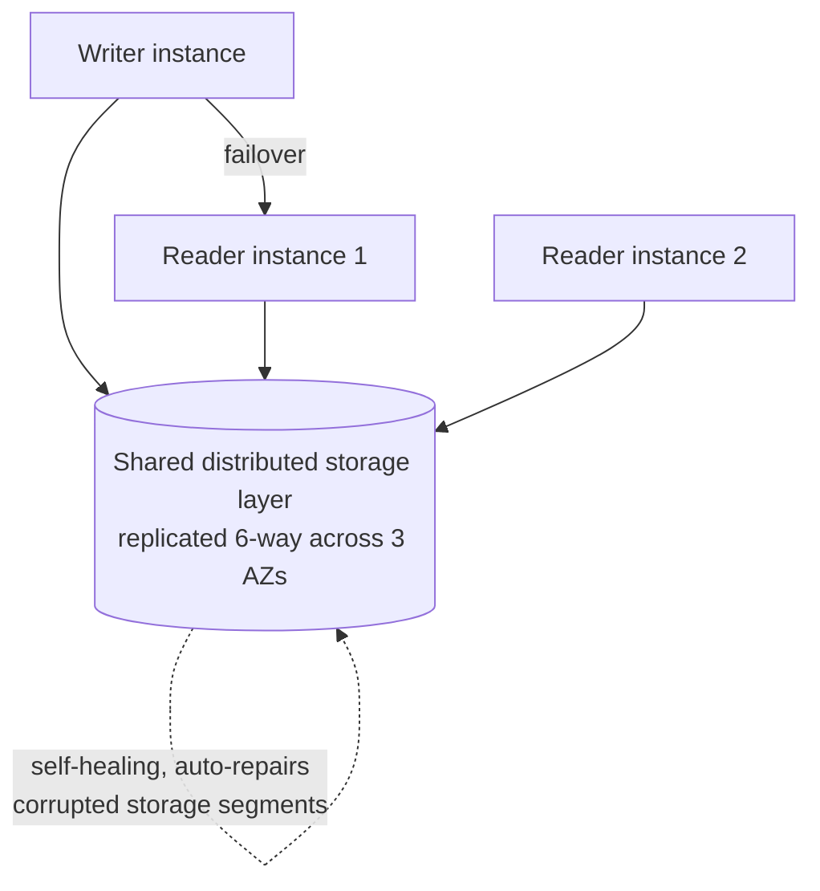

All instances (one writer, zero or more readers) attach to the *same* shared storage volume —
writes from the writer are visible to readers within single-digit milliseconds of replication lag,
and promoting a reader to writer on failover doesn't require re-copying any data, since the reader
was already attached to the exact same storage.

### Real AWS image


*Source: [Amazon Aurora User Guide — Aurora DB clusters](https://docs.aws.amazon.com/AmazonRDS/latest/AuroraUserGuide/Aurora.Overview.html)
(curl-verified 200). The shared storage layer is the entire architectural story here — every
instance in the diagram is a compute attachment point to the same underlying storage, which is the
concrete reason Aurora failover and read-replica provisioning are both dramatically faster than
standard RDS's independent-storage-per-instance model.*

### Code Example
```python
import boto3
rds = boto3.client("rds")
rds.create_db_cluster(
    DBClusterIdentifier="orders-cluster", Engine="aurora-postgresql",
    MasterUsername="admin", MasterUserPassword="***", ServerlessV2ScalingConfiguration={"MinCapacity": 0.5, "MaxCapacity": 8},
)
```
```sql
-- Application code uses the SAME SQL as standard PostgreSQL — wire-compatible
BEGIN;
INSERT INTO invoices (customer_id, total) VALUES (42, 199.99);
INSERT INTO invoice_items (invoice_id, product, amount) VALUES (currval('invoices_id_seq'), 'widget', 199.99);
COMMIT;
```

### Pricing Note
Billed per instance-hour (or per ACU-hour for Serverless v2) plus storage consumed and I/O requests — Aurora's storage auto-scales and bills for actual usage, removing the need to pre-provision a fixed volume size the way some other engines require.

### Common Exam Scenarios
- *"A relational workload needs higher throughput and faster failover than a standard RDS instance on the same engine provides"* → Aurora, not a resharded NoSQL redesign.
- *"Read capacity needs to scale up quickly without a lengthy replica-provisioning process"* → Aurora read replicas attach to the same shared storage almost immediately.
- *"Traffic is highly unpredictable and manual instance resizing would always be reactive"* → Aurora Serverless v2.

### Exam Tips
- "Need joins/ACID transactions at higher throughput/faster failover than a single RDS instance" →
  Aurora, not a resharded DynamoDB design.
- Aurora Serverless v2 scales capacity automatically within configured min/max — the answer for
  unpredictable relational workloads where manual instance resizing would be reactive and slow.
- Aurora Global Database replicates across Regions with typically sub-second lag — a distinct
  feature from standard RDS cross-Region read replicas (which Aurora also supports, but Global
  Database is purpose-built and faster).

---

## 11. Amazon Bedrock

### Definition
Amazon Bedrock is AWS's fully managed service for accessing and customizing foundation models
(large pre-trained generative AI models) from multiple providers through one consistent API,
without provisioning or managing any GPU infrastructure yourself.

### Plain-English Analogy
Bedrock is a utility company for electricity, except the "electricity" is AI model inference. You
don't build a power plant (train/host a model) to turn on a light (get an AI-generated answer) —
you just plug into the grid (call the API) and get metered, pay-per-use access to power generated
by someone else's enormous, expensive infrastructure.

### Purpose
Training or self-hosting a foundation model requires ML expertise and infrastructure most
application teams don't have. Bedrock exists so an ordinary application team can integrate
generative AI (chat, summarization, embeddings, RAG, agents) via API calls, with AWS handling model
hosting, scaling, and keeping customer prompts/data out of model retraining.

### When to Use It
- Adding generative AI features (chat, summarization, content generation) to an application without
  hosting a model yourself.
- Building a RAG (Retrieval-Augmented Generation) application grounded in your own private
  documents, using a Bedrock Knowledge Base.
- Building an autonomous or semi-autonomous agent that can call your own APIs/Lambda functions in
  response to natural-language requests (Bedrock Agents).

### When NOT to Use It
- Deterministic, rules-based logic (exact calculations, strict validation) doesn't belong in a
  foundation model call — use ordinary application code for anything that needs a guaranteed,
  reproducible answer rather than a generated one.
- Teams needing a finished, pre-built internal chatbot product rather than building custom AI
  features from primitives are better served by Amazon Q Business, which is built on top of Bedrock
  but packages the RAG/indexing work for you.

### Use Cases
1. A customer support app summarizing a long support ticket thread into a short triage summary.
2. A RAG chatbot grounded in a company's internal wiki, reducing hallucination versus an
   ungrounded model.
3. An agent that can check order status and issue refunds by calling your own Lambda functions in
   response to natural-language customer requests.
4. Generating product description drafts from structured catalog data, with a human editor
   reviewing before publish.
5. Content moderation: classifying user-submitted text/images against policy categories using a
   foundation model instead of hand-written rules.
6. Extracting structured fields (dates, amounts, parties) from unstructured contract text for
   downstream processing.

### Why Important
DVA-C03 added Bedrock/generative-AI awareness as new exam content — Domain 1 needs to recognize
when a scenario calls for a managed foundation-model API versus a classic deterministic service,
and know the core vocabulary (prompt, context window, RAG, embeddings, agents) well enough to
reason about which Bedrock feature addresses which requirement.

### How It Works

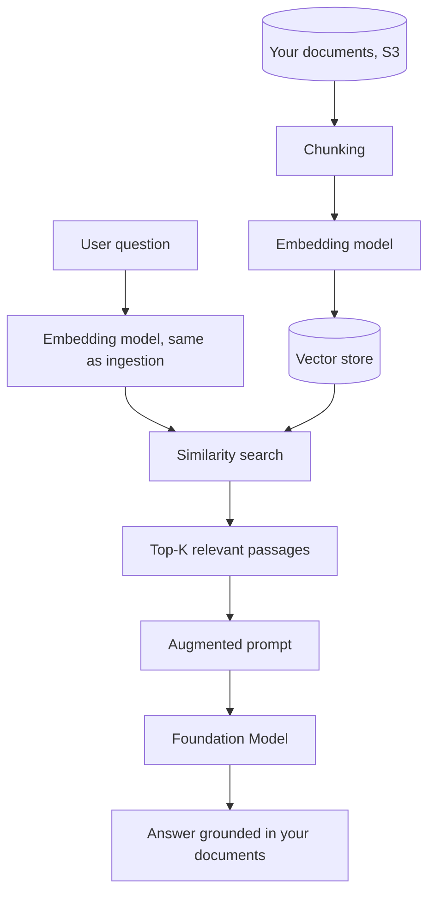

RAG grounds a model's answer in your own retrieved documents rather than relying purely on what it
memorized during training — dramatically reducing hallucination for knowledge the model was never
trained on, while keeping your proprietary data out of any model retraining process.

### Real AWS image


*Source: [AWS Machine Learning Blog — Bedrock Knowledge Bases RAG architecture](https://aws.amazon.com/blogs/machine-learning/)
(curl-verified 200). Notice the familiar Domain 1 building blocks doing the orchestration work:
S3 for document storage, Lambda for ingestion triggering, API Gateway fronting the chat API — RAG
applications reuse this domain's ordinary primitives around the genuinely new piece (the vector
store and the foundation model call itself).*

### Code Example
```python
import boto3, json
bedrock = boto3.client("bedrock-runtime")
resp = bedrock.invoke_model(
    modelId="anthropic.claude-3-sonnet-20240229-v1:0",
    body=json.dumps({"anthropic_version": "bedrock-2023-05-31", "max_tokens": 200,
                      "messages": [{"role": "user", "content": "Summarize this ticket: ..."}]}),
)
print(json.loads(resp["body"].read())["content"][0]["text"])
```

### Pricing Note
Billed per token (input and output separately, and input tokens are usually cheaper than output tokens) for on-demand model invocation, or per provisioned throughput if reserving dedicated capacity for predictable high-volume workloads — Knowledge Base and Agent features add their own usage-based charges on top of the underlying model calls.

### Common Exam Scenarios
- *"An application needs to answer questions grounded in a company's own private documents, with reduced hallucination"* → a Bedrock Knowledge Base (RAG), not an ungrounded raw model call.
- *"Certain topics or PII must never appear in a model's output regardless of what a user asks"* → Guardrails, a policy layer distinct from the model call itself.
- *"An agent needs to actually take actions (check order status, issue a refund) in response to natural language"* → Bedrock Agents calling your own Lambda functions/APIs.

### Exam Tips
- RAG exists specifically to reduce hallucination by grounding answers in retrieved real documents
  — recognize this as the answer whenever a scenario needs answers based on private/internal data.
- Guardrails filter both input and output content regardless of what the model generates — a
  distinct layer from the model call itself, and the right answer for "block certain topics/PII."
- Bedrock keeps customer prompts/data out of model retraining by default — a key differentiator
  versus calling an external, non-AWS-native AI API directly for data-sensitive use cases.

---

## 12. Amazon CloudWatch

### Definition
Amazon CloudWatch is AWS's native observability service — collecting metrics, logs, and alarms
from virtually every AWS resource and custom application code, giving you dashboards, alerting, and
log search/analysis in one place.

### Plain-English Analogy
CloudWatch is a hospital's central monitoring station: every patient (resource) is wired to
sensors reporting vital signs (metrics) continuously to one shared monitor wall; a threshold
breach (an alarm) pages a nurse automatically instead of requiring someone to watch every single
screen manually, and every patient's chart (logs) is available for review when something needs
investigating after the fact.

### Purpose
Operating any non-trivial application without visibility into its health is operating blind —
CloudWatch exists to centralize that visibility across every AWS service uniformly, so you don't
need a different monitoring tool per service, and so automated action (an alarm triggering an Auto
Scaling action or an SNS notification) can happen without a human watching a dashboard in real time.

### When to Use It
- Monitoring any AWS resource's health/performance metrics (Lambda duration/errors, DynamoDB
  throttles, EC2 CPU) with automatic alerting on thresholds.
- Centralizing application logs (Lambda automatically ships logs here) for searching and debugging.
- Building custom metrics/dashboards for business-specific signals (orders per minute, queue depth)
  alongside AWS's own built-in metrics.

### When NOT to Use It
- Deep distributed-tracing across many microservices is X-Ray's specialty, not CloudWatch's
  (though the two integrate closely) — don't expect CloudWatch alone to reconstruct a multi-service
  request's full timeline.
- Long-term log retention at very large scale/low cost is sometimes better served by exporting logs
  to S3 rather than keeping everything in CloudWatch Logs indefinitely at its storage pricing.

### Use Cases
1. An alarm on a Lambda function's `Errors` metric triggers an SNS notification to an on-call
   engineer.
2. CloudWatch Logs Insights queries searching millions of log lines for a specific error pattern
   during an incident.
3. A custom business metric (checkout conversion rate) published from application code and
   graphed on a dashboard alongside infrastructure metrics.
4. An alarm on DynamoDB `ThrottledRequests` triggering an automatic capacity adjustment.
5. CloudWatch Logs subscription filters streaming log data into a Firehose delivery stream for
   long-term analysis in S3/OpenSearch.
6. Composite alarms combining multiple metric conditions (high latency AND high error rate) before
   paging, reducing noisy single-metric false alarms.

### Why Important
Nearly every troubleshooting scenario across all four exam domains starts with "what does
CloudWatch show" — Domain 1 specifically needs it for confirming whether application code is
actually erroring (Lambda logs/metrics) versus failing at the integration layer (API Gateway
metrics), the exact distinction the README's 502-debugging worked scenario exercises.

### How It Works

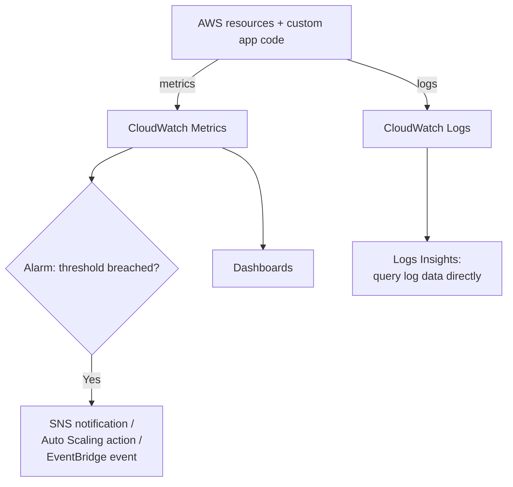

### Real AWS image


*Source: [Amazon CloudWatch User Guide — What is Amazon CloudWatch?](https://docs.aws.amazon.com/AmazonCloudWatch/latest/monitoring/WhatIsCloudWatch.html)
(curl-verified 200). The default dashboard aggregates alarm state across every monitored service in
one view — the exam-relevant habit this encourages is checking CloudWatch *first* during any
"what's wrong" scenario, before diving into any one service's own console.*

### Code Example
```python
import boto3
cw = boto3.client("cloudwatch")
cw.put_metric_data(Namespace="OrdersApp", MetricData=[
    {"MetricName": "CheckoutConversionRate", "Value": 0.42, "Unit": "Percent"}
])
cw.put_metric_alarm(
    AlarmName="LambdaHighErrorRate", MetricName="Errors", Namespace="AWS/Lambda",
    Statistic="Sum", Period=60, EvaluationPeriods=2, Threshold=5, ComparisonOperator="GreaterThanThreshold",
    AlarmActions=["arn:aws:sns:us-east-1:123456789012:oncall-alerts"],
)
```

### Pricing Note
Billed per custom metric, per log ingestion/storage GB, per alarm, and per dashboard — ingesting extremely verbose application logs at high volume is a frequently underestimated real cost driver, worth right-sizing log verbosity for in production rather than leaving debug-level logging on indefinitely.

### Common Exam Scenarios
- *"Too many noisy single-metric alerts are paging on-call unnecessarily"* → a composite alarm requiring multiple conditions together.
- *"An incident needs a pattern found across millions of log lines quickly"* → CloudWatch Logs Insights, not manually scrolling raw log streams.
- *"A custom business metric needs to appear on a dashboard alongside built-in AWS metrics"* → an explicit put_metric_data call; AWS service metrics publish automatically, custom ones don't.

### Exam Tips
- Lambda, API Gateway, and DynamoDB all publish metrics to CloudWatch automatically with zero
  extra code — custom business metrics require an explicit `put_metric_data` call.
- CloudWatch Logs Insights is the tool for *searching* log content at scale; raw log streaming is
  not the same capability as a scenario describing "query across millions of log lines for a
  pattern."
- Composite alarms reduce false-positive paging by requiring multiple conditions together — know
  this as the answer to "too many noisy single-metric alerts."

---

## 13. Amazon Data Firehose

### Definition
Amazon Data Firehose (formerly Kinesis Data Firehose) is a fully managed service that captures
streaming data and automatically delivers it — buffered, optionally transformed, and batched — to a
destination like S3, Redshift, OpenSearch, Splunk, Snowflake, or Apache Iceberg tables, with zero
consumer code to write or operate.

### Plain-English Analogy
Firehose is an always-running conveyor belt loading dock: items arrive continuously, accumulate
into a crate once it's full enough (or enough time has passed), and the crate is automatically
shipped to its destination — no one drives a forklift; you configure the destination once and the
belt just keeps running.

### Purpose
Getting streaming data to land somewhere durable and queryable is usually a *delivery* problem, not
a *compute* problem — Firehose exists so "just deliver it reliably, near real time, zero ops" is a
configuration choice, the delivery counterpart to Kinesis Data Streams' write-your-own-consumer model.

### When to Use It
- Streaming data needs to land in S3/Redshift/OpenSearch/Splunk with no custom consumer application.
- Format conversion (JSON → Parquet/ORC) and partitioning are needed at delivery time, declaratively.
- An existing Kinesis Data Stream or MSK topic needs a zero-code delivery path to a destination
  alongside (or instead of) a custom consumer application.

### When NOT to Use It
- Any scenario needing custom, stateful, multi-step processing logic per record belongs to a real
  consumer application (Kinesis Data Streams + your own code), not Firehose's simple transform hook.
- Sub-second delivery latency requirements don't fit Firehose's buffering model well — it's near
  real time, not a replacement for a synchronous, low-latency call path.

### Use Cases
1. IoT sensor data delivered continuously to S3, partitioned by hour, converted to Parquet.
2. Application logs streamed to OpenSearch for near-real-time search, with a parallel S3 backup.
3. Clickstream events delivered to Redshift for analytics, with Firehose handling the S3-staging
   and `COPY` command automatically.
4. CloudWatch Logs subscription filters streaming directly into Firehose with zero custom glue code.
5. A Lambda transform enriching/filtering each record before it's written to the destination.
6. Dynamic partitioning routing records to different S3 prefixes based on a field in the data itself.

### Why Important
Task 1.1's "work with streaming data" bullet has two correct answers depending on wording: Kinesis
Data Streams when the scenario implies you write the consumer; Firehose when it implies "deliver
with no consumer code" — recognizing which is being asked is the entire exam-relevant skill here.

### How It Works

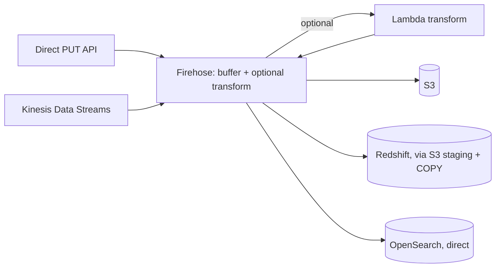

### Real AWS image


*Source: [AWS Data Firehose Developer Guide](https://docs.aws.amazon.com/firehose/latest/dev/what-is-this-service.html)
(curl-verified 200). The optional backup bucket for pre-transformation source data is the detail
worth remembering: a bug in a transformation Lambda never destroys your ability to recover the
original, untransformed records.*

### Code Example
```python
import boto3
firehose = boto3.client("firehose")
firehose.put_record(DeliveryStreamName="clickstream-to-s3",
                     Record={"Data": b'{"event":"page_view","page":"/home"}\n'})
```

### Pricing Note
Billed per GB of data ingested, with additional charges for format conversion and any invoked Lambda transformation — no charge for the delivery infrastructure itself beyond the data volume processed, consistent with its zero-ops positioning.

### Common Exam Scenarios
- *"Streaming data must land in S3/Redshift/OpenSearch with zero consumer code to write or operate"* → Firehose, not a hand-written Kinesis Data Streams consumer.
- *"Format conversion to Parquet and partitioning by a field in the data are both needed at delivery time"* → Firehose's built-in transform/partitioning, not a custom Lambda pipeline.
- *"Data seems to be missing at the destination after a transformation Lambda was added"* → check the error output S3 prefix before assuming data loss.

### Exam Tips
- "No consumer code to write or operate, deliver to S3/Redshift/OpenSearch/Splunk" → Firehose, not
  a hand-written Kinesis Data Streams consumer.
- S3 is either the final destination, a mandatory staging stop (Redshift), or an optional parallel
  backup (OpenSearch) — know Firehose's relationship to S3 differs by destination.
- Buffer size/interval trade latency against cost/file-count efficiency — a smaller buffer delivers
  faster but produces more, smaller files.

---

## 14. Amazon DynamoDB

### Definition
Amazon DynamoDB is a fully managed, serverless NoSQL key-value and document database delivering
single-digit-millisecond performance at any scale, with data automatically partitioned across
servers based on a partition key.

### Plain-English Analogy
DynamoDB is a vast wall of labeled lockers (partitions), where the locker you go to is determined
instantly by hashing your key — you never search the whole wall, you compute which locker and walk
straight there, which is why lookups stay fast no matter how many lockers exist, but it's also why
poor key design (everyone wanting the same locker) creates a bottleneck at that one locker.

### Purpose
Relational databases struggle to scale horizontally for simple key-based access patterns at
extreme scale — connection pools and joins add overhead that a pure "fetch by key" pattern doesn't
need. DynamoDB exists to serve exactly that access shape at effectively unlimited, predictable-
latency scale, trading SQL joins and transactions-across-many-items for that scalability.

### When to Use It
- Access pattern is simple key lookups (by partition key, optionally + sort key) at large or bursty
  scale, needing predictable low-latency performance.
- Serverless application backends where operational overhead (patching, capacity planning) should
  be minimal to zero.
- Workloads needing microsecond reads on hot items, layered with DAX.

### When NOT to Use It
- Workloads needing SQL joins across normalized tables or ad hoc query flexibility are an RDS/Aurora
  fit, not DynamoDB — forcing joins into DynamoDB means expensive application-side stitching.
- Analytical, scan-heavy, ad hoc reporting queries are a poor fit — DynamoDB rewards access patterns
  designed in advance, not arbitrary queries after the fact.

### Use Cases
1. A flash-sale order system needing extreme burst scale with simple key-based reads/writes.
2. A session-store backing a web application, keyed by session ID.
3. A mobile app's user profile store, read by user ID on every app launch.
4. An IoT device-state table, keyed by device ID, updated at high frequency.
5. An idempotency-key table enforcing exactly-once order creation via conditional writes.
6. A gaming leaderboard using a sort key for score-ordered queries within a partition.

### Why Important
Task 1.3 centers on DynamoDB access patterns and consistency choices — knowing when
`ConsistentRead=true` is worth its doubled cost, and how partition key design avoids hot
partitions, is tested directly and repeatedly.

### How It Works

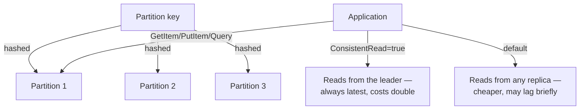

### Real AWS image


*Source: [Amazon DynamoDB Developer Guide — Partitions and data distribution](https://docs.aws.amazon.com/amazondynamodb/latest/developerguide/HowItWorks.Partitions.html)
(curl-verified 200). Every item lands in exactly one partition determined purely by its partition
key's hash — the entire reason partition key design (spreading keys evenly) is a first-class exam
topic, not an implementation detail.*

### Code Example
```python
import boto3
ddb = boto3.client("dynamodb")
ddb.put_item(TableName="Orders", Item={"orderId": {"S": "abc-123"}, "item": {"S": "widget"}},
             ConditionExpression="attribute_not_exists(orderId)")
resp = ddb.get_item(TableName="Orders", Key={"orderId": {"S": "abc-123"}}, ConsistentRead=True)
```

### Pricing Note
On-demand mode bills per read/write request unit consumed; provisioned mode bills per hour of reserved throughput regardless of actual usage — on-demand suits unpredictable/bursty traffic (like the flash-sale case study), while provisioned with auto scaling suits steady, forecastable load at a lower unit cost.

### Common Exam Scenarios
- *"An item must be readable immediately after being written, reflecting the very latest value, every single time"* → ConsistentRead=true, at double the read-capacity cost.
- *"Write throughput throttles on one specific key even though overall table capacity looks fine"* → a hot partition key, fixable by better key design, not by raising table-wide capacity alone.
- *"The same POST request might arrive twice due to a client retry and must not create two records"* → ConditionExpression=attribute_not_exists(pk).

### Exam Tips
- `ConsistentRead=true` guarantees the latest write is visible, at double the read-capacity cost —
  apply it only on the specific access pattern that needs it, not globally.
- A hot partition key (uneven key distribution) throttles that one partition regardless of overall
  table capacity — the same lesson Kinesis's partition key design teaches, reused here.
- `ConditionExpression=attribute_not_exists(pk)` is the standard idempotent-write mechanism on this
  exam — see [`idempotency-and-retry-patterns.md`](domain-1-development/idempotency-and-retry-patterns.md).

---

## 15. Amazon ElastiCache

### Definition
Amazon ElastiCache is a fully managed in-memory data store and cache service, supporting
Redis OSS/Valkey and Memcached engines, used to reduce load on a primary database and serve
extremely low-latency reads for frequently accessed data.

### Plain-English Analogy
ElastiCache is a sticky note on your desk with an answer you looked up five minutes ago, instead of
walking back to the filing cabinet (the primary database) every single time you need that same
answer again — much faster to check the sticky note, as long as you remember to update it when the
real answer changes.

### Purpose
Repeatedly querying a primary database for the same, rarely-changing data wastes database capacity
and adds latency that an in-memory lookup wouldn't have. ElastiCache exists to sit in front of (or
alongside) a primary data store, absorbing read traffic for hot data and serving it at microsecond
latency instead of round-tripping to the database every time.

### When to Use It
- Caching expensive or frequently repeated database query results to reduce primary-database load.
- Session storage needing extremely fast read/write access shared across a fleet of application
  servers.
- Real-time leaderboards, counters, or rate-limiting logic needing atomic in-memory operations.

### When NOT to Use It
- Data that must always be perfectly fresh/consistent and rarely repeated access shouldn't be
  cached at all — caching adds a staleness window that isn't worth it for data read only once.
- Don't use ElastiCache as a system of record — a cache can be flushed or evicted; the primary data
  store (RDS/DynamoDB) remains the durable source of truth.

### Use Cases
1. Caching a product catalog's frequently-read pages to absorb traffic spikes without scaling RDS.
2. Storing web session data shared across a horizontally scaled application tier.
3. A real-time gaming leaderboard using Redis sorted sets for atomic score updates and ranking.
4. Rate-limiting API requests per user using Redis atomic increment/expire operations.
5. Caching the results of an expensive aggregation query, refreshed on a schedule.
6. Pub/Sub messaging between application components using Redis's built-in pub/sub feature.

### Why Important
Task 1.3 explicitly calls out layering a cache in front of a data store — recognizing when a
scenario's "reduce database load" or "sub-millisecond repeated reads" requirement points at
ElastiCache (general-purpose cache) versus DAX (DynamoDB-specific cache) is a frequently tested
distinction.

### How It Works

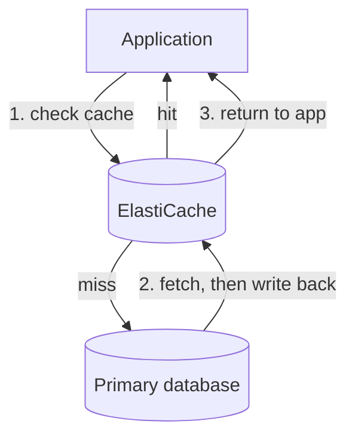

The **cache-aside** pattern shown here is the most common shape: the application checks the cache
first, and only on a miss does it query the primary database, writing the result back to the cache
for next time.

### Real AWS image


*Source: [Amazon ElastiCache User Guide — Redis OSS/Valkey clusters](https://docs.aws.amazon.com/AmazonElastiCache/latest/dg/WhatIs.html)
(curl-verified 200). Nodes grouped into shards, each with its own replicas — the architectural
basis for both read scaling (route reads to replicas) and high availability (automatic failover to
a replica if the primary node fails).*

### Code Example
```python
import redis
r = redis.Redis(host="my-cluster.xxxxx.cache.amazonaws.com", port=6379)
cached = r.get("product:123")
if cached is None:
    product = fetch_from_rds(123)       # cache miss — query the primary database
    r.setex("product:123", 300, json.dumps(product))  # cache for 5 minutes
else:
    product = json.loads(cached)
```

### Pricing Note
Billed per node-hour based on node type, plus data transfer — unlike DynamoDB there's no request-based pricing tier; you pay for the cluster's provisioned capacity whether or not it's being heavily used, which is the trade-off for its always-warm, predictable-latency performance.

### Common Exam Scenarios
- *"Repeated reads of the same data are overloading a primary database"* → ElastiCache cache-aside, not scaling the database itself first.
- *"Microsecond reads are needed specifically on top of an existing DynamoDB table's hot items"* → DAX, a DynamoDB-specific cache, not general-purpose ElastiCache.
- *"A scenario implies data loss on cache eviction would be unacceptable"* → that's a sign the cache is being treated as a system of record, which is a design mistake.

### Exam Tips
- "Reduce load on the primary database for frequently repeated reads" → ElastiCache (general
  purpose); "microsecond reads specifically in front of DynamoDB" → DAX instead.
- Cache-aside (check cache, fall back to DB on miss, write back) is the default pattern to
  recognize in a code snippet or scenario.
- A cache is never the durable system of record — a scenario implying data loss on cache eviction
  being unacceptable signals a design mistake, not an ElastiCache limitation.

---

## 16. Amazon ECR

### Definition
Amazon Elastic Container Registry (ECR) is a fully managed Docker/OCI container image registry,
tightly integrated with IAM for access control and with ECS/EKS/Lambda for pulling images directly
into running workloads.

### Plain-English Analogy
ECR is a secure, access-controlled warehouse for shipping containers (container images) — you
build the container once, store it in the warehouse, and any authorized truck (ECS task, EKS pod,
Lambda container-image function) can pull the exact same container off the shelf whenever it needs
to run, instead of rebuilding it from scratch each time.

### Purpose
Running containerized workloads needs a secure, available place to store and version container
images, with fine-grained access control over who can push/pull. ECR exists so that storage is
IAM-integrated by default (no separate registry credentials to manage) and natively close to the
compute services (ECS, EKS, Lambda) that actually run the images.

### When to Use It
- Storing and versioning Docker/OCI images for ECS, EKS, or container-image Lambda functions.
- Needing fine-grained IAM-based push/pull permissions instead of a separate registry credential
  system.
- Automating image lifecycle (expiring untagged or old images) to control storage cost.

### When NOT to Use It
- A zip-based Lambda deployment package doesn't need ECR at all — only container-image Lambda
  packaging uses it.
- Public, widely-shared open-source images are often better hosted on a public registry (or ECR
  Public specifically) rather than a private registry meant for your own internal workloads.

### Use Cases
1. Storing a microservice's Docker image, pulled by ECS Fargate tasks on every deployment.
2. A Lambda function packaged as a container image (useful for larger dependencies exceeding the
   zip deployment package size limits), pulled from ECR at invocation.
3. A CI/CD pipeline building and pushing a new image tag to ECR as part of a CodePipeline build stage.
4. A lifecycle policy automatically expiring untagged images older than 14 days to control costs.
5. Cross-account image sharing via an ECR repository policy, without duplicating the image per account.
6. Image vulnerability scanning on push, blocking a deployment pipeline if critical CVEs are found.

### Why Important
Task 1.2 notes container-image packaging as an alternative to zip-based Lambda deployment — ECR is
the registry half of that pattern, and Domain 3 builds further on ECR for CI/CD image promotion.

### How It Works

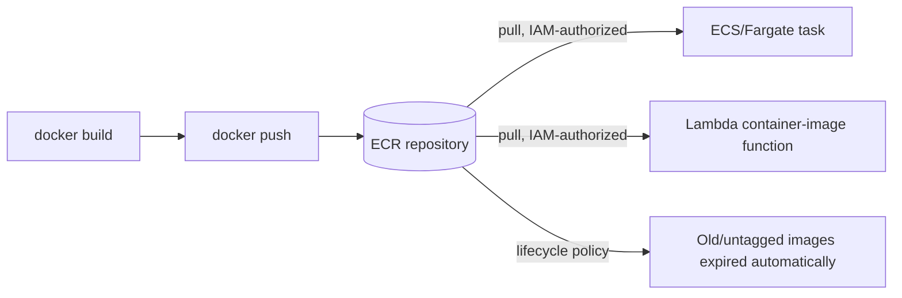

### Real AWS image


*Source: [Amazon ECR User Guide — Lifecycle policies](https://docs.aws.amazon.com/AmazonECR/latest/userguide/LifecyclePolicies.html)
(curl-verified 200). Lifecycle rules are evaluated in priority order against the repository's
images, expiring whatever matches first — the mechanism that keeps a long-lived repository from
accumulating unbounded storage cost from every historical build.*

### Code Example
```bash
aws ecr get-login-password --region us-east-1 | docker login --username AWS --password-stdin 123456789012.dkr.ecr.us-east-1.amazonaws.com
docker build -t orders-service .
docker tag orders-service:latest 123456789012.dkr.ecr.us-east-1.amazonaws.com/orders-service:latest
docker push 123456789012.dkr.ecr.us-east-1.amazonaws.com/orders-service:latest
```

### Pricing Note
Billed per GB-month of image storage and per GB of data transfer out of the region — a lifecycle policy that prunes old/untagged images directly controls this storage cost over time, the exact mechanism the earlier Exam Tips call out.

### Common Exam Scenarios
- *"A Lambda function's dependencies are too large for a zip deployment package"* → package it as a container image, pulled from ECR.
- *"Old, untagged container images are accumulating unnecessary storage cost"* → a lifecycle policy, not manual periodic cleanup.
- *"A CI/CD pipeline needs to build and push a new image tag as part of its build stage"* → CodeBuild pushing to ECR, authenticated via IAM, not a separate registry credential.

### Exam Tips
- ECR authentication flows through IAM (`get-login-password`), not a separate registry account —
  know this as the "no separate credential system" selling point.
- Container-image Lambda functions pull directly from ECR at invocation — a distinct packaging
  path from the zip-based deployment this domain otherwise emphasizes.
- Lifecycle policies are the answer to "control storage cost from accumulating old/untagged
  images" without manual cleanup.

---

## 17. Amazon EventBridge

### Definition
Amazon EventBridge is a serverless event bus service for building event-driven architectures,
routing events from AWS services, custom applications, or SaaS partners to multiple targets based
on **rules** that match an event's content.

### Plain-English Analogy
EventBridge is a smart mail-sorting facility: every incoming letter (event) is inspected against a
set of sorting rules ("anything addressed to Finance goes to bin A, anything mentioning 'urgent'
also goes to bin C"), and a single letter can land in multiple bins simultaneously if it matches
multiple rules — the sender never needs to know which bins exist or how many there are.

### Purpose
Direct point-to-point integration between every producer and every consumer of events creates a
tangled, tightly coupled mesh that's hard to extend. EventBridge exists to decouple producers from
consumers entirely: producers publish events without knowing who (if anyone) is listening, and
consumers subscribe via content-based rules without the producer ever being modified to add a new
consumer.

### When to Use It
- Routing events to different targets based on event *content*, not just a blanket fan-out to every
  subscriber.
- Building a central event bus across many decoupled microservices or AWS accounts.
- Integrating third-party SaaS events (via EventBridge's SaaS partner event sources) alongside your
  own application events on one bus.

### When NOT to Use It
- Simple "every subscriber gets every message" fan-out is often simpler and cheaper via SNS, if no
  content-based routing is actually needed.
- Strict message ordering/exactly-once-style guarantees within a single queue are better served by
  SQS FIFO directly, not routed through an event bus first.

### Use Cases
1. An S3 upload event routed to different Lambda functions depending on the object's key prefix.
2. A scheduled rule (cron-like) triggering a nightly Lambda cleanup job, with no producer code at all.
3. Cross-account event routing: a central security-tooling account receiving GuardDuty findings
   from every member account via EventBridge.
4. A SaaS partner's event source (e.g. a payment provider) delivered straight onto your event bus.
5. An order-placed event routed to both a fraud-check pipeline and a standard fulfillment pipeline
   based on the order's amount field.
6. Archiving every matched event for later replay, using EventBridge's built-in archive/replay feature.

### Why Important
Task 1.1 explicitly names EventBridge for event-driven applications and S3 event notifications —
recognizing it as the content-based router (versus SNS's blanket fan-out, versus SQS's point-to-
point queue) is one of the most frequently tested "same category, different right answer" splits.

### How It Works

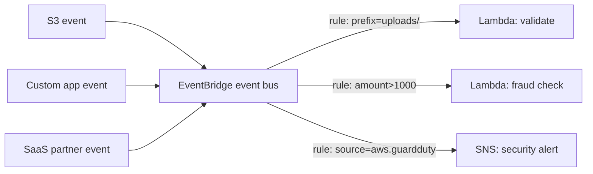

### Real AWS image


*Source: [Amazon EventBridge User Guide — Rules](https://docs.aws.amazon.com/eventbridge/latest/userguide/eb-rules.html)
(curl-verified 200). This "match or silently drop" mental model is the key behavior to internalize:
an event that matches zero rules simply goes nowhere — there's no default catch-all target unless
you explicitly create a rule broad enough to match everything.*

### Code Example
```python
import boto3
events = boto3.client("events")
events.put_rule(Name="high-value-orders",
                 EventPattern='{"source":["orders"],"detail":{"amount":[{"numeric":[">","1000"]}]}}')
events.put_targets(Rule="high-value-orders",
                    Targets=[{"Id": "1", "Arn": "arn:aws:lambda:us-east-1:123456789012:function:FraudCheck"}])
```

### Pricing Note
Billed per million events published to a custom event bus (events on the default bus matching AWS service-generated events are free) — archive/replay and schema discovery features carry their own separate charges on top of base event publishing.

### Common Exam Scenarios
- *"Events need to route to different targets depending on their content, not just a blanket fan-out"* → EventBridge rules, not SNS.
- *"A scheduled job needs to run nightly with no producer code triggering it"* → an EventBridge scheduled rule.
- *"Security findings need to flow from every member account to a central security-tooling account"* → cross-account EventBridge routing.

### Exam Tips
- Content-based routing via rules is EventBridge's defining feature versus SNS's blanket fan-out —
  a scenario emphasizing "route differently based on event content" points here.
- An event matching zero rules is simply dropped, silently — there's no implicit default target.
- EventBridge, S3, and SNS are all at-least-once delivery — downstream consumers must be idempotent
  regardless of which of the three delivered the event (see
  [`idempotency-and-retry-patterns.md`](domain-1-development/idempotency-and-retry-patterns.md)).

---

## 18. Amazon Kinesis Family

### Definition
The Kinesis family is AWS's suite of real-time streaming data services: **Kinesis Data Streams**
(you write producers and consumers against ordered, partitioned shards), **Managed Service for
Apache Flink** (managed stream processing/analytics), and historically Kinesis Data Firehose (now
branded separately as Amazon Data Firehose, covered as its own entry above).

### Plain-English Analogy
Kinesis Data Streams is a multi-lane highway with numbered lanes (shards): cars (records) with the
same license plate prefix (partition key) always merge into the same lane, keeping their relative
order, and multiple independent toll booths (consumers) can each watch the same highway
simultaneously at their own pace, without interfering with each other.

### Purpose
Ingesting and processing high-throughput, ordered streaming data (clickstreams, IoT telemetry,
log aggregation) at scale needs a durable, replayable, multi-consumer-capable stream — not a
single-consumer queue. Kinesis Data Streams exists to give you that durable, ordered, horizontally
scalable stream, with you writing the producer/consumer logic for full control.

### When to Use It
- Multiple independent consumers each need to read the *same* stream of events at their own pace.
- Strict per-key ordering is required (same entity's events must process in the order they
  occurred).
- Custom, stateful stream processing logic beyond what a managed delivery service (Firehose) offers.

### When NOT to Use It
- A single consumer with no ordering requirement is usually simpler and cheaper on SQS — don't reach
  for Kinesis's shard model when a plain queue would do.
- Zero-code delivery to S3/Redshift/OpenSearch with no custom processing is Amazon Data Firehose's
  job specifically, not a hand-rolled Kinesis Data Streams consumer.

### Use Cases
1. Ride-hailing driver location updates, partitioned by driver ID, consumed by a dispatch service.
2. Clickstream analytics feeding three independent consumers (dashboard, fraud model, data lake)
   at their own pace from the same stream.
3. Log aggregation across a large fleet, ingested into a stream for real-time processing before
   long-term storage.
4. IoT telemetry at massive scale, partitioned by device ID to preserve per-device event order.
5. A Lambda event source mapping consuming shard batches for near-real-time processing (see
   [`lambda-event-source-mapping-deep-dive.md`](domain-1-development/lambda-event-source-mapping-deep-dive.md)).
6. Managed Service for Apache Flink performing windowed aggregations directly over a Kinesis stream.

### Why Important
Task 1.1's "work with streaming data" bullet is most directly Kinesis Data Streams when a scenario
implies you write the producer/consumer code yourself — the partition key design lesson here (even
distribution avoids hot shards) repeats the same principle DynamoDB partition keys teach.

### How It Works

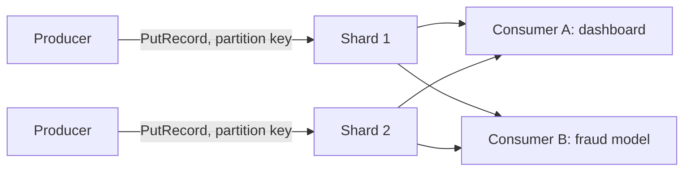

### Real AWS image


*Source: [AWS Kinesis Data Streams Developer Guide — Key Concepts](https://docs.aws.amazon.com/streams/latest/dev/key-concepts.html)
(curl-verified 200). Multiple independent consumer applications can read the same stream at their
own pace — the single biggest differentiator from SQS, where a message is typically consumed once
and gone.*

### Code Example
```python
import boto3
kinesis = boto3.client("kinesis")
kinesis.put_record(StreamName="driver-locations", Data=b'{"lat":37.7,"lng":-122.4}',
                    PartitionKey="driver-42")  # same driver always lands on the same shard
```

### Pricing Note
Kinesis Data Streams bills per shard-hour plus PUT payload units; on-demand mode bills per stream based on throughput instead of a fixed shard count — on-demand removes the need to manually calculate required shard count up front, at a different unit cost than provisioned shards.

### Common Exam Scenarios
- *"Three independent downstream systems each need to consume every event at their own pace"* → Kinesis Data Streams, not SQS (where a message is typically consumed once).
- *"Per-key event order must be preserved even under high throughput"* → a well-distributed partition key design, same lesson as DynamoDB.
- *"Streaming data just needs to land in S3 with zero consumer code"* → that's Amazon Data Firehose, not a hand-rolled Kinesis Data Streams consumer.

### Exam Tips
- Multiple independent consumers reading the same stream at their own pace → Kinesis Data Streams,
  not SQS (where a message is normally consumed once).
- A hot partition key overloads one shard regardless of overall stream capacity — spread keys
  evenly, the same lesson as DynamoDB partition key design.
- Firehose vs. Data Streams: "deliver with zero consumer code" is Firehose; "I write the
  consumer/processing logic myself" is Data Streams.

---

## 19. Amazon Q

### Definition
Amazon Q is AWS's family of generative-AI assistants built on Bedrock: **Amazon Q Developer**
(coding/AWS assistance in IDEs, CLI, console) and **Amazon Q Business** (an enterprise assistant
answering questions grounded in a company's own internal data sources).

### Plain-English Analogy
Amazon Q Developer is a senior engineer sitting next to you who already knows AWS cold and can see
your code; Amazon Q Business is a new hire who's already read your entire company wiki and can
answer "where's the PTO policy" without you building them a search tool first.

### Purpose
Building a good coding assistant or internal company chatbot from Bedrock's raw building blocks
(models, RAG, agents) is still real engineering work. Amazon Q exists as the finished product on
top of those building blocks, pre-integrated with AWS development tooling and enterprise data
connectors respectively.

### When to Use It
- Developers wanting inline code suggestions, chat, and security scanning integrated into their IDE
  or CLI, aware of AWS services specifically.
- Businesses wanting an internal assistant answering questions from existing enterprise data
  sources (SharePoint, Slack, S3) without building a custom RAG pipeline.
- Troubleshooting AWS resources/costs directly via natural-language questions in the console.

### When NOT to Use It
- Building a fully custom AI application with bespoke prompt/retrieval logic calls for raw Bedrock,
  not Amazon Q's pre-packaged product shape.
- Don't treat Q's suggestions (code or chat answers) as unreviewed ground truth — see
  [`ai-assisted-development.md`](domain-1-development/ai-assisted-development.md) for the full "AI proposes, human
  verifies" pattern this exam tests repeatedly.

### Use Cases
1. A developer gets inline Lambda handler code suggestions directly in their IDE.
2. A security team uses Q Developer's automated scan to flag a hardcoded secret before merge.
3. An employee asks Q Business "what's our current PTO policy" and gets a cited answer from the
   indexed HR SharePoint site.
4. An engineer asks Q directly in the AWS console why a specific EC2 instance's cost spiked.
5. A support team uses Q Business connected to Slack/Zendesk history to answer a recurring customer
   question instantly.
6. A new hire uses Q Developer's codebase Q&A to get oriented on an unfamiliar Lambda-based service.

### Why Important
DVA-C03 tests recognizing Amazon Q Developer as the Task 1.1 AI-assisted-development example by
name, and distinguishing it from raw Bedrock (toolkit) and from Amazon Q Business (a different
audience/use case) — see [`ai-assisted-development.md`](domain-1-development/ai-assisted-development.md) for the full
cross-domain pattern this service exemplifies.

### How It Works

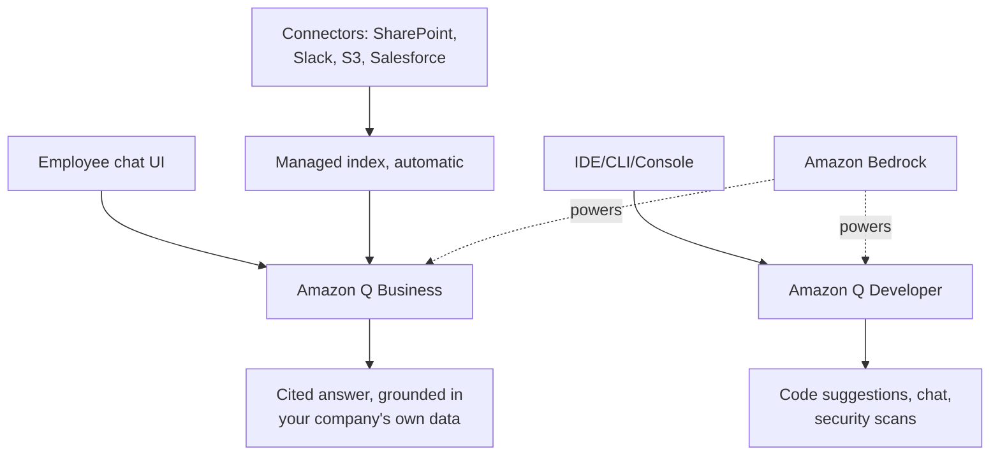

### Real AWS image


*Source: [AWS Machine Learning Blog — Accelerate enterprise AI implementations with Amazon Q Business](https://aws.amazon.com/blogs/machine-learning/)
(curl-verified 200). Note IAM Identity Center sits at the authentication layer — Q Business
respects existing access controls of connected data sources, so an employee only ever sees answers
sourced from documents they could already access directly.*

### Code Example
```bash
# Q Developer in the CLI — natural-language AWS troubleshooting
q chat "why did my Lambda function's cost increase this month?"
```

### Pricing Note
Amazon Q Developer has a free tier and a paid Pro tier with higher usage limits and enterprise features; Amazon Q Business bills per active user per month — cost isn't the primary testable angle for either product on this exam, usage pattern recognition is.

### Common Exam Scenarios
- *"A developer gets inline code suggestions and a PR-level security scan inside their existing IDE/workflow"* → Amazon Q Developer, mapped to Task 1.1's AI-assisted-development pattern.
- *"An employee asks a chat tool a question and expects an answer grounded in the company's own SharePoint/Slack history, with citations"* → Amazon Q Business, not a custom-built RAG pipeline.
- *"A question offers 'the AI auto-merges its own suggested fix with no review' as an option"* → always wrong, regardless of which Q product is named.

### Exam Tips
- Q Developer maps to Task 1.1 (code generation/review); the same "AI proposes, human verifies"
  rule applies to its suggestions as any other assistant.
- Q Business is permissions-aware — it never bypasses a connected source's existing access
  controls, a frequently tested safety property.
- Both products run on Bedrock's foundation models underneath — Q is the finished product, Bedrock
  is the toolkit it's built from.

---

## 20. Amazon RDS

### Definition
Amazon Relational Database Service (RDS) is a managed relational database service supporting
MySQL, PostgreSQL, MariaDB, Oracle, and SQL Server engines, handling patching, backups, and
Multi-AZ high availability without you managing the underlying database server yourself.

### Plain-English Analogy
RDS is a fully serviced rental car: you still drive it exactly like you'd drive your own car (same
SQL, same engine behavior), but the oil changes, tire rotations, and roadside-assistance tow (a
Multi-AZ failover) are all handled by someone else automatically, instead of you doing it yourself
or hiring your own mechanic.

### Purpose
Operating a relational database yourself means patching the OS/engine, configuring backups,
building failover automation, and monitoring capacity — recurring operational work unrelated to
your actual application. RDS exists to hand that operational burden to AWS, while your application
keeps using the exact same SQL/engine behavior as a self-managed database.

### When to Use It
- Relational (SQL, ACID, multi-table joins) workloads on a standard engine you don't want to
  operate yourself.
- Needing automated backups, patching, and Multi-AZ failover without building that automation
  yourself.
- Workloads needing a specific engine Aurora doesn't support (Oracle, SQL Server).

### When NOT to Use It
- Extreme-scale, bursty key-value access patterns are a DynamoDB fit, not RDS — connection-pool
  limits become the bottleneck under that kind of load.
- If you're already on MySQL/PostgreSQL and want higher throughput/faster failover at similar
  operational simplicity, Aurora is usually the better fit than standard RDS on the same engine.

### Use Cases
1. A SaaS product's relational backend needing ACID transactions and multi-table joins.
2. A Multi-AZ deployment for automatic failover during an AZ outage, with zero manual intervention.
3. A legacy application requiring Oracle or SQL Server specifically, migrated to managed RDS.
4. Read replicas offloading reporting queries from the primary instance.
5. Automated backups with point-in-time recovery for compliance requirements.
6. Cross-Region read replicas serving read traffic closer to a geographically distributed user base.

### Why Important
Task 1.3's RDS/Aurora access-pattern and ACID-transaction testing starts here — RDS is the baseline
relational option, and knowing when it's preferred over Aurora (specific engine needs) or over
DynamoDB (relational requirements) is the core decision this entry supports.

### How It Works

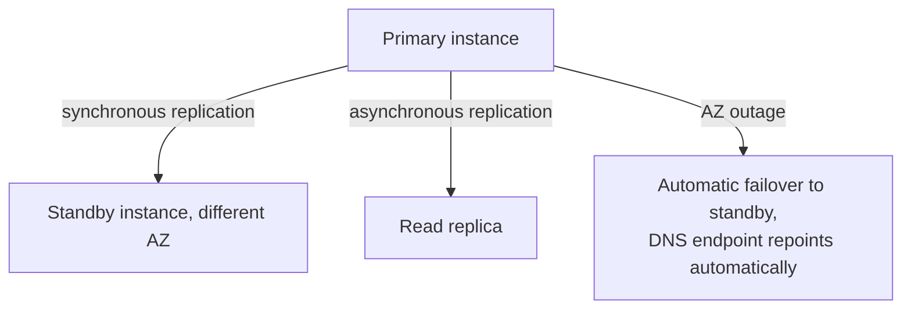

Multi-AZ failover repoints the same DNS endpoint applications already use at the newly promoted
standby — application code doesn't need to change connection strings, just reconnect.

### Real AWS image


*Source: [Amazon RDS User Guide — Multi-AZ deployments](https://docs.aws.amazon.com/AmazonRDS/latest/UserGuide/Concepts.MultiAZ.html)
(curl-verified 200). Synchronous replication to the standby (not asynchronous, unlike a read
replica) is the detail that makes Multi-AZ failover safe for high availability — no data loss
window the way an asynchronous replica promotion could have.*

### Code Example
```python
import boto3
rds = boto3.client("rds")
rds.create_db_instance(DBInstanceIdentifier="orders-db", Engine="postgres",
                        DBInstanceClass="db.t3.medium", MultiAZ=True,
                        MasterUsername="admin", MasterUserPassword="***", AllocatedStorage=100)
```

### Pricing Note
Billed per instance-hour based on instance class and engine, plus storage and I/O — Multi-AZ roughly doubles the compute cost (a second standby instance is always running) compared to a single-AZ deployment, a concrete trade-off worth weighing against the availability requirement actually stated.

### Common Exam Scenarios
- *"An application specifically needs Oracle or SQL Server"* → RDS, since Aurora only supports MySQL-/PostgreSQL-compatible engines.
- *"An AZ outage must not take the database down, with automatic failover and no application code changes"* → Multi-AZ, synchronous replication to a standby, same endpoint after failover.
- *"Reporting queries are slowing down the primary instance"* → a read replica (asynchronous), offloading read traffic — not the same mechanism as Multi-AZ.

### Exam Tips
- Multi-AZ standby replication is synchronous (for safe automatic failover); read replica
  replication is asynchronous (for read scaling, not HA by itself) — don't conflate the two.
- "Need Oracle/SQL Server specifically" → RDS, not Aurora (Aurora is MySQL/PostgreSQL-compatible
  only).
- Application code reconnects to the same endpoint after a Multi-AZ failover — no connection-string
  change required, though a brief reconnection window is expected.

---

## 21. Amazon S3

### Definition
Amazon Simple Storage Service (S3) is a fully managed, durable object storage service, storing any
amount of data as key-value objects in buckets, with 11 nines of durability and strong read-after-
write consistency for all operations.

### Plain-English Analogy
S3 is a vast, infinitely expandable warehouse of labeled, sealed boxes (objects) — you don't rent a
specific-sized room (a fixed volume) the way a traditional filesystem might; you just drop boxes
off under whatever label (key) you choose, retrieve any box instantly by its exact label, and the
warehouse itself never runs out of room.

### When to Use It
- Storing files/blobs (images, backups, logs, data lake files) rather than structured query-able
  records.
- Static website hosting, or as the origin for a CloudFront distribution.
- Event-driven processing triggered the moment an object is created (`s3:ObjectCreated`).

### When NOT to Use It
- Structured data needing indexed queries, joins, or transactional updates belongs in a database
  (DynamoDB or RDS/Aurora), not S3 directly.
- Extremely low-latency, high-frequency small reads/writes (session data, counters) are better
  served by DynamoDB or ElastiCache than S3's per-request latency profile.

### Use Cases
1. Storing uploaded user files (images, documents) referenced by a database record.
2. A data lake's raw and processed zones, queried by Athena/Redshift Spectrum directly on S3.
3. Hosting a static website/SPA, served through CloudFront.
4. Triggering a Lambda function the instant an object is uploaded, for validation/processing.
5. Storing application logs/backups with lifecycle policies transitioning older data to cheaper
   storage classes automatically.
6. Serving large media files via presigned URLs, avoiding proxying binary data through application
   compute.

### Why Important
Task 1.3 names S3 directly for application code — object operations, consistency behavior, and
multipart upload are concretely testable, and S3 event notifications are one of Task 1.1's named
event-driven building blocks.

### Purpose
Storing arbitrary amounts of unstructured data durably, cheaply, and accessibly from anywhere, with
no capacity planning, is a near-universal application need — S3 exists to be that default durable
store any other service can read from or write to.

### How It Works

```mermaid
flowchart TD
    APP[Application] -->|PutObject| S3[(S3 bucket)]
    S3 -->|s3:ObjectCreated event| EB[EventBridge / Lambda / SQS / SNS]
    OTHER[Second client] -->|GetObject, immediately after| S3
    S3 -->|strongly consistent — always returns the latest write| OTHER
```

S3 provides **strong read-after-write consistency** for all operations (PUTs and DELETEs) as of
December 2020 — a read immediately following a write is guaranteed to reflect that write, no
"eventual consistency" caveat to design around, unlike some other distributed stores.

### Real AWS image


*Source: [Amazon S3 User Guide — Amazon S3 data consistency model](https://docs.aws.amazon.com/AmazonS3/latest/userguide/Welcome.html)
(curl-verified 200). Every client sees the same, latest value immediately after a write completes
— a detail worth knowing cold, since it contrasts directly with DynamoDB's optional eventual
consistency, a distinction the exam likes to probe by swapping the two services in the same
scenario wording.*

### Code Example
```python
import boto3
s3 = boto3.client("s3")
s3.put_object(Bucket="uploads-bucket", Key="images/photo.jpg", Body=data)
url = s3.generate_presigned_url("get_object", Params={"Bucket": "uploads-bucket", "Key": "images/photo.jpg"}, ExpiresIn=3600)
```

### Pricing Note
Billed per GB stored per month (varying by storage class), per request, and per GB transferred out — storage class selection (Standard vs. Infrequent Access vs. Glacier tiers) is the single biggest lever for controlling long-term storage cost on data accessed at different frequencies.

### Common Exam Scenarios
- *"An object must be readable immediately after being written, with no staleness window"* → S3's strong read-after-write consistency, by default, on every operation.
- *"An application needs to process a file the moment it's uploaded"* → an s3:ObjectCreated event notification, routed through EventBridge for multi-consumer fan-out if needed.
- *"A very large file upload needs to be resumable and parallelized"* → multipart upload.

### Exam Tips
- S3 gives strong read-after-write consistency on every operation — don't treat it as eventually
  consistent the way some NoSQL stores are.
- `s3:ObjectCreated` event notifications are the standard Task 1.1 event-driven trigger — route
  through EventBridge for multi-consumer fan-out with content-based rules.
- Multipart upload is the correct mechanism for large object uploads, allowing parallel part
  uploads and resumability on failure.

---

## 22. Amazon SNS

### Definition
Amazon Simple Notification Service (SNS) is a fully managed pub/sub messaging service that fans a
single published message out to multiple independent subscribers — SQS queues, Lambda functions,
HTTP/S endpoints, email, or SMS — simultaneously.

### Plain-English Analogy
SNS is a radio broadcast tower: the station (publisher) sends one signal, and every tuned-in radio
(subscriber) receives its own independent copy simultaneously — the station never knows or cares
how many radios are listening, and adding a new listener requires no change at the tower.

### Purpose
Notifying multiple independent systems about the same event without the publisher knowing or
caring who's listening (or how many) is a recurring need — SNS exists to decouple "something
happened" from "everyone who cares about it," with the publisher doing exactly one publish call
regardless of subscriber count.

### When to Use It
- Every subscriber needs its own independent copy of every published message (true fan-out).
- Simple topic-based pub/sub without needing content-based routing logic.
- Sending notifications across heterogeneous channels (email, SMS, push, SQS, Lambda) from one topic.

### When NOT to Use It
- Content-based routing to different targets depending on message fields is EventBridge's job, not
  a plain SNS fan-out (SNS filter policies exist but are more limited than EventBridge's rule engine).
- A single logical queue where messages should be consumed once by a competing worker pool is SQS's
  job, not SNS's broadcast model.

### Use Cases
1. An order-placed event fanned out simultaneously to an email confirmation Lambda, an SQS queue
   for fulfillment, and an analytics SQS queue.
2. A CloudWatch alarm publishing to an SNS topic that emails the on-call engineer.
3. Mobile push notifications sent to iOS/Android devices via SNS's mobile push support.
4. A multi-region failover notification system alerting several independent downstream teams
   simultaneously.
5. SMS alerts for critical infrastructure events, alongside a parallel SQS subscription for
   automated remediation.
6. Filter policies on subscriptions, so only a subset of a topic's messages reach a specific
   subscriber based on message attributes.

### Why Important
Domain 1's messaging-pattern questions repeatedly test SNS's fan-out shape against SQS's
competing-consumer shape and EventBridge's content-routing shape — correctly identifying which of
the three a scenario needs is one of the highest-frequency "same category" decision points on the
exam.

### How It Works

```mermaid
flowchart LR
    PUB[Publisher] -->|Publish, once| TOPIC[SNS Topic]
    TOPIC --> SQS1[(SQS Queue: fulfillment)]
    TOPIC --> LAMBDA[Lambda: send email]
    TOPIC --> SQS2[(SQS Queue: analytics)]
```

### Real AWS image


*Source: [AWS SNS Developer Guide — Fanout scenario](https://docs.aws.amazon.com/sns/latest/dg/sns-common-scenarios.html)
(curl-verified 200). One publish call, multiple independently-durable SQS queues receiving their
own full copy — the architectural pattern to recognize whenever a scenario says "every downstream
system must receive every event."*

### Code Example
```python
import boto3
sns = boto3.client("sns")
sns.publish(TopicArn="arn:aws:sns:us-east-1:123456789012:order-events",
            Message='{"orderId":"abc-123","status":"placed"}')
```

### Pricing Note
Billed per million publishes and per delivery attempt per protocol (SQS/Lambda deliveries are typically cheaper per-message than SMS/email) — a fan-out to many protocol types multiplies the delivery-side cost per published message, not just the publish call itself.

### Common Exam Scenarios
- *"Every one of several independent downstream systems must receive its own copy of every event"* → SNS fan-out, typically to multiple SQS queues.
- *"Messages should route differently depending on their content, not just broadcast to every subscriber"* → that's EventBridge's rule engine, a more powerful fit than an SNS filter policy.
- *"Notifications must reach heterogeneous channels (email, SMS, Lambda, SQS) from one publish call"* → SNS's multi-protocol subscription model.

### Exam Tips
- "Every subscriber needs its own copy of every message" → SNS fan-out, not EventBridge or SQS alone.
- SNS → SQS fan-out (an SQS queue as an SNS subscriber) is the standard pattern for durable,
  independently-consumable copies per downstream system.
- Filter policies narrow which messages a specific subscription receives, but EventBridge's rule
  engine is the more powerful choice when genuinely complex content-based routing is the actual need.

---

## 23. Amazon SQS

### Definition
Amazon Simple Queue Service (SQS) is a fully managed message queuing service, decoupling producers
from consumers via a durable queue, supporting both Standard (at-least-once, best-effort ordering)
and FIFO (exactly-once processing, strict per-group ordering) queue types.

### Plain-English Analogy
SQS is a ticket-dispenser deli counter: customers (producers) take a number and the ticket sits in
the queue until a free server (consumer) calls it; the ticket is only torn up (deleted) once
service is actually complete, so if a server walks away mid-service without finishing, that ticket
reappears in the queue for the next available server to pick up.

### Purpose
Direct, synchronous producer-to-consumer calls couple the two tightly — a slow or down consumer
directly stalls the producer. SQS exists to buffer work between them: producers enqueue and move
on immediately, and any number of consumers can drain the queue at their own pace, absorbing
traffic spikes without either side needing to match the other's throughput in real time.

### When to Use It
- Decoupling a producer from a consumer so a traffic spike or consumer slowdown doesn't propagate
  back to the producer.
- A worker pool competing for individual messages, each message processed exactly by one worker.
- FIFO ordering with exactly-once processing within a specific message group.

### When NOT to Use It
- Multiple independent consumers each needing their *own* full copy of every message is SNS's
  (fan-out) job, or Kinesis's (multi-reader stream) job — not a single SQS queue's competing-
  consumer model.
- Extremely low-latency synchronous request/response doesn't fit a queue's inherently asynchronous
  model.

### Use Cases
1. A worker fleet processing image-resize jobs off a queue, scaling worker count with queue depth.
2. A dead-letter queue catching messages that fail processing repeatedly, for manual inspection.
3. FIFO queue ensuring a specific customer's order events process in the exact order they occurred.
4. Buffering a traffic spike between a web tier and a slower backend processing tier.
5. A Lambda event source mapping polling SQS, scaling concurrent Lambda invocations with backlog
   depth (see [`lambda-event-source-mapping-deep-dive.md`](domain-1-development/lambda-event-source-mapping-deep-dive.md)).
6. Rate-limiting downstream calls to a legacy system by controlling how fast a queue is drained.

### Why Important
Task 1.1's messaging/decoupling pattern and Task 1.2's poll-based Lambda trigger both center on
SQS — visibility timeout, DLQs, and FIFO vs. standard semantics are concretely, repeatedly tested.

### How It Works

```mermaid
flowchart TD
    P[Producer] -->|SendMessage| Q[(SQS Queue)]
    C1[Consumer] -->|ReceiveMessage| Q
    Q -->|message invisible during processing| C1
    C1 -->|DeleteMessage, on success| Q
    C1 -.fails to delete before visibility timeout.-> Q
    Q -->|message becomes visible again| C2[Another consumer]
```

### Real AWS image


*Source: [AWS SQS Developer Guide — Visibility timeout](https://docs.aws.amazon.com/AWSSimpleQueueService/latest/SQSDeveloperGuide/sqs-visibility-timeout.html)
(curl-verified 200). This is SQS's at-least-once delivery contract made visible — a message not
deleted before its visibility timeout expires reappears for redelivery, which is exactly why
consumer logic must be idempotent regardless of how reliable the consumer code otherwise is.*

### Code Example
```python
import boto3
sqs = boto3.client("sqs")
sqs.send_message(QueueUrl="https://sqs.us-east-1.amazonaws.com/123456789012/orders", MessageBody='{"orderId":"abc"}')
msgs = sqs.receive_message(QueueUrl="...", MaxNumberOfMessages=10, VisibilityTimeout=30)
for m in msgs.get("Messages", []):
    process(m["Body"])
    sqs.delete_message(QueueUrl="...", ReceiptHandle=m["ReceiptHandle"])
```

### Pricing Note
Billed per million requests (SendMessage, ReceiveMessage, DeleteMessage each count) — long-polling (setting a non-zero ReceiveMessageWaitTimeSeconds) reduces the number of empty-receive requests compared to aggressive short-polling, a direct, often-overlooked cost and efficiency lever.

### Common Exam Scenarios
- *"The same message appears to be processed twice by different consumers concurrently"* → the visibility timeout is too short relative to actual processing time (should be ≥ 6x the consumer's timeout).
- *"One malformed message is causing an entire batch to retry forever"* → ReportBatchItemFailures isn't enabled, or the handler doesn't return the right shape.
- *"A specific customer's messages must process in strict order, but different customers can process in parallel"* → SQS FIFO with a per-customer MessageGroupId.

### Exam Tips
- Visibility timeout should be at least 6x the consumer's processing time, per AWS's own guidance —
  too short causes duplicate concurrent processing of the same message.
- Standard queues offer no ordering guarantee and at-least-once delivery; FIFO queues guarantee
  order within a message group and effectively-once processing within a 5-minute dedup window.
- A DLQ catches messages that fail processing repeatedly — configure a `maxReceiveCount` so
  messages route there instead of retrying forever.

---

## 24. Amazon VPC

### Definition
Amazon Virtual Private Cloud (VPC) is a logically isolated virtual network within AWS where you
launch resources, with full control over IP addressing, subnets, route tables, and network
gateways.

### Plain-English Analogy
A VPC is your own private plot of land inside a shared city (an AWS Region) — you decide the
street layout (subnets), which roads connect to the outside world (internet/NAT gateways), and
which doors are locked to whom (security groups/NACLs) — your neighbors (other accounts' VPCs)
can't just wander onto your property unless you explicitly build a bridge (peering/Transit Gateway)
to them.

### Purpose
Running cloud resources without network isolation and control would mean every resource is equally
reachable with no boundary — VPC exists to give you a private, configurable network boundary,
letting you decide exactly what's public, what's private, and how traffic flows between them.

### When to Use It
- Essentially every non-trivial AWS workload uses a VPC, by default — the real question is how to
  configure subnets/routing/security for a given requirement, not whether to use one.
- A Lambda function needing to reach a private resource (RDS in a private subnet) must be attached
  to that VPC.
- Isolating sensitive workloads in private subnets with no direct internet route.

### When NOT to Use It
- Lambda functions that only call other AWS service APIs (not private VPC resources) are *better
  off* not being attached to a VPC at all — VPC attachment adds ENI provisioning overhead and
  requires a NAT gateway for any internet-bound calls, with zero benefit if nothing private is
  being reached.
- Public-facing static content doesn't need VPC-level network controls at all — that's S3/CloudFront's job.

### Use Cases
1. A Lambda function attached to a VPC to reach a private RDS instance with no public endpoint.
2. Public subnets hosting an internet-facing load balancer; private subnets hosting application/database tiers.
3. A NAT gateway letting private-subnet resources reach the internet (for patches/updates) without
   being directly reachable from it.
4. VPC peering or Transit Gateway connecting multiple VPCs/accounts for internal service-to-service traffic.
5. VPC endpoints (PrivateLink) letting private-subnet resources reach S3/DynamoDB without routing
   through the public internet at all.
6. Security groups and NACLs layered together to control exactly which traffic reaches a given resource.

### Why Important
Task 1.2 explicitly names "configure Lambda to access resources inside a VPC" — knowing when VPC
attachment is required (private resource access) versus actively harmful (unnecessary latency/NAT
cost for pure AWS-API-only functions) is a frequently tested judgment call.

### How It Works

```mermaid
flowchart TD
    IGW[Internet Gateway] --> PUBSUB[Public subnet: ALB]
    PUBSUB --> PRIVSUB[Private subnet: app/DB tier]
    PRIVSUB -->|outbound only| NATGW[NAT Gateway, in public subnet]
    NATGW --> IGW
    LAMBDA[Lambda, VPC-attached] -->|ENI in private subnet| PRIVSUB
    PRIVSUB -->|VPC endpoint, no internet route| S3EP[S3 via PrivateLink]
```

### Real AWS image


*Source: [Amazon VPC User Guide — How Amazon VPC works](https://docs.aws.amazon.com/vpc/latest/userguide/how-it-works.html)
(curl-verified 200). Subnets spanning multiple Availability Zones is the foundation of
high-availability design — a single-AZ subnet layout is a common exam distractor whenever a
scenario requires resilience to an AZ outage.*

### Code Example
```bash
aws lambda update-function-configuration --function-name create-order \
  --vpc-config SubnetIds=subnet-abc123,subnet-def456,SecurityGroupIds=sg-0123456789
```

### Pricing Note
The VPC construct itself is free; NAT gateways bill per hour plus per GB processed, and VPC endpoints (interface type) bill per hour plus per GB — a Lambda function attached to a VPC purely to reach public AWS APIs is a recurring NAT-gateway cost for zero functional benefit, reinforcing the earlier 'don't attach unnecessarily' exam tip.

### Common Exam Scenarios
- *"A Lambda function needs to reach a private RDS instance with no public endpoint"* → attach it to that VPC, with a security group allowing the DB port.
- *"A Lambda function that only calls public AWS service APIs is attached to a VPC unnecessarily"* → remove the attachment; it adds ENI/NAT overhead with zero benefit for that function.
- *"Private-subnet resources need to reach S3/DynamoDB without any route to the public internet"* → a VPC endpoint (Gateway or Interface/PrivateLink), not a NAT gateway.

### Exam Tips
- Attach Lambda to a VPC only when it must reach a private resource — attaching for no reason adds
  ENI provisioning latency and NAT cost with zero benefit.
- A NAT gateway lives in a *public* subnet and provides outbound-only internet access for private-
  subnet resources — know this directionality (outbound initiated from inside, not inbound from outside).
- VPC endpoints (PrivateLink/Gateway endpoints) let private-subnet resources reach AWS services
  like S3/DynamoDB without any NAT gateway or internet route at all.

---

## 25. Database Selection Guide

### Definition
The Database Selection Guide is not a single AWS service but the decision framework Task 1.3 tests
directly: given a scenario's access pattern and consistency/transaction requirements, choosing
correctly among DynamoDB, RDS/Aurora, S3, and a cache layer (ElastiCache/DAX).

### Plain-English Analogy
Choosing a database is choosing a filing system for a specific kind of paperwork: a phone book
(DynamoDB) is unbeatable for "look up by exact name," but useless for "find everyone who owes more
than $500 across three different ledgers" — that cross-referencing need is what a relational filing
cabinet with cross-indexed folders (RDS/Aurora) is actually built for.

### Purpose
Every exam scenario in this family gives you requirements, not a service name — the testable skill
is translating "needs joins," "needs microsecond key lookups at huge scale," or "storing files, not
records" into the one correct service, instead of defaulting to whichever database you personally
know best.

### When to Use Each
- **DynamoDB**: simple key lookups at massive, bursty scale, with low and predictable latency; no
  multi-table joins needed.
- **RDS/Aurora**: ACID transactions, multi-table SQL joins, normalized relational schema.
- **S3**: storing files/blobs, not structured query-able records.
- **DynamoDB + DAX**: DynamoDB's access pattern, but needing microsecond reads on hot, repeated keys.
- **ElastiCache**: general-purpose caching in front of any primary store, not DynamoDB-specific.

### When NOT to force a fit
- Don't force relational joins into DynamoDB by denormalizing everything and stitching results in
  application code when the actual requirement is genuinely relational — that's a sign RDS/Aurora
  was the right call from the start.
- Don't force a DynamoDB access pattern into RDS "because it's already there" when the real
  requirement is unbounded bursty scale — a connection-pool ceiling will eventually become the
  bottleneck.

### Use Cases
1. A flash-sale checkout needing extreme burst scale with simple key lookups → DynamoDB on-demand.
2. A SaaS invoicing system needing an ACID transaction across an invoice header and its line items → Aurora.
3. A photo-sharing app storing the actual image bytes → S3, with metadata in DynamoDB.
4. A leaderboard needing microsecond reads on the same few "top player" keys repeatedly → DynamoDB + DAX.
5. A reporting dashboard needing ad hoc analytical queries across normalized data → RDS/Aurora (or
   Redshift for truly large-scale analytics).
6. A session store needing extremely fast, ephemeral reads/writes shared across a fleet → ElastiCache.

### Why Important
This is arguably the single highest-value decision framework on all of DVA-C03's Domain 1 — nearly
every "which data store" question reduces to walking this same decision tree correctly.

### How It Works

```mermaid
flowchart TD
    Q1{Need ACID transactions /\nmulti-table SQL joins?} -->|Yes| RDS[RDS / Aurora]
    Q1 -->|No| Q2{Storing files/blobs,\nnot structured records?}
    Q2 -->|Yes| S3DS[Amazon S3]
    Q2 -->|No| Q3{Simple key lookups at\nmassive, bursty scale?}
    Q3 -->|Yes| Q4{Need microsecond reads\non the same hot keys?}
    Q4 -->|Yes| DAX[DynamoDB + DAX]
    Q4 -->|No| DDBDS[DynamoDB]
    Q3 -->|No, relational + occasional\nheavy analytics| AuroraDS[Aurora read replicas /\nAurora Serverless v2]
```

### Real AWS image


*Source: [Amazon RDS User Guide — Multi-AZ deployments](https://docs.aws.amazon.com/AmazonRDS/latest/UserGuide/Concepts.MultiAZ.html)
(curl-verified 200). Representative of the OLTP (relational, transactional) half of this decision
tree — pair conceptually against DynamoDB's partition-key diagram in entry 14 above to hold both
shapes in mind simultaneously when a scenario's requirements are ambiguous at first read.*

### Code Example
```python
# The SAME requirement, two different correct implementations depending on the OTHER requirement
# Requirement: "look up an order by ID, at massive bursty scale" -> DynamoDB
ddb.get_item(TableName="Orders", Key={"orderId": {"S": "abc-123"}})

# Requirement: "generate an invoice joining a subscription row with every usage line item,
# atomically" -> Aurora/RDS, a SQL join + transaction, not a DynamoDB access pattern
# BEGIN; SELECT ... FROM subscriptions JOIN usage_items ...; INSERT INTO invoices ...; COMMIT;
```

### Pricing Note
Pricing shape differs fundamentally by model: DynamoDB and S3 are usage-based (pay for what you actually read/write/store), while RDS/Aurora instances bill per running hour regardless of query volume — a scenario emphasizing unpredictable, bursty access patterns often favors the usage-based pricing model as much as the access-pattern fit itself.

### Common Exam Scenarios
- *"A scenario emphasizes joins across normalized tables and strict referential integrity"* → relational (RDS/Aurora), no matter how the NoSQL alternative is framed as "possible."
- *"A scenario emphasizes unbounded, bursty scale with simple key lookups and predictable low latency"* → DynamoDB, not a scaled-up relational instance.
- *"A scenario is about storing and serving files/blobs, not structured records"* → S3, even if a database could technically hold binary data.

### Exam Tips
- Scenario says "joins" or "ACID transaction across multiple related tables" → relational, full stop.
- Scenario says "unbounded scale, simple key lookup, low predictable latency" → DynamoDB, full stop.
- Scenario says "storing files, not records" → S3, even if a database could technically hold binary
  blobs — it's never the efficient or intended choice for that shape of data.

---

## 26. Messaging Patterns Overview

### Definition
The Messaging Patterns Overview isn't a single service either — it's the conceptual map of *why*
SNS, SQS, EventBridge, and Kinesis exist as separate services solving genuinely different
decoupling problems, rather than four interchangeable ways to "send a message."

### Plain-English Analogy
Four different delivery methods for four different needs: a broadcast radio station (SNS) for
"everyone subscribed gets a copy"; a ticket-number deli queue (SQS) for "one worker handles each
ticket, workers compete for tickets"; a smart mail sorter (EventBridge) for "route based on
content, not just who's subscribed"; and a multi-lane highway with independent toll-watchers
(Kinesis) for "many independent readers replay the same ordered sequence of events."

### Purpose
Every messaging scenario on the exam is really asking "which of these four decoupling shapes does
this requirement actually describe" — the services' individual feature sets matter less than
correctly identifying which *shape* a scenario is describing before picking a service name.

### When to Use Each
- **SNS**: blanket fan-out, every subscriber gets every message, simple pub/sub.
- **SQS**: point-to-point, competing consumers, each message processed once.
- **EventBridge**: content-based routing to different targets via rules, decoupled schema-aware
  event bus, cross-account/SaaS integration.
- **Kinesis Data Streams**: multiple independent consumers replaying the same ordered stream at
  their own pace, strict per-key ordering.

### When NOT to combine unnecessarily
- Don't route every single event through all four services "just in case" — each adds its own
  latency and cost; pick the one shape the actual requirement calls for.
- Don't use EventBridge's content-based routing where a plain SNS fan-out with no routing logic
  would already satisfy the requirement — unnecessary complexity for no benefit.

### Use Cases
1. SNS → multiple SQS queues: durable fan-out where each downstream system gets its own
   independently-processed copy.
2. SQS alone: a single worker pool competing for jobs off one queue, scaling with backlog depth.
3. EventBridge rules: routing an order event to a fraud pipeline *only* if its amount exceeds a
   threshold, otherwise to standard fulfillment.
4. Kinesis Data Streams: three independent consumers (dashboard, ML model, data lake) reading the
   same clickstream at their own pace.
5. SNS + SQS + Lambda combined: a single publish fanning out to an email Lambda and a durable SQS
   queue for later analytics, in one architecture.
6. EventBridge Scheduler combined with SQS: a nightly scheduled rule enqueuing a batch job for a
   worker pool to process at its own pace.

### Why Important
This overview is the connective tissue across Tasks 1.1/1.3 — nearly every event-driven scenario
in this domain is secretly a "which messaging shape" question wearing a different service-specific
costume.

### How It Works

```mermaid
flowchart TD
    REQ{What does the requirement\nactually describe?}
    REQ -->|Everyone needs a copy| SNS_P[SNS fan-out]
    REQ -->|One worker handles each item,\ncompeting consumers| SQS_P[SQS queue]
    REQ -->|Route differently based\non event content| EB_P[EventBridge rules]
    REQ -->|Many independent readers,\nreplay the same ordered sequence| KIN_P[Kinesis Data Streams]
```

### Real AWS image


*Source: [AWS Lambda Developer Guide — Understanding event-driven architectures](https://docs.aws.amazon.com/lambda/latest/dg/concepts-event-driven-architectures.html)
(curl-verified 200). The core idea every messaging pattern in this domain shares: replacing a
direct, synchronous, tightly-coupled call with an intermediary that lets producer and consumer
scale, fail, and evolve independently of each other.*

### Code Example
```python
# The decision in code form — same event, routed differently depending on the ACTUAL shape needed
# Fan-out (SNS): sns.publish(TopicArn=..., Message=event_json)
# Competing consumers (SQS): sqs.send_message(QueueUrl=..., MessageBody=event_json)
# Content-based routing (EventBridge): events.put_events(Entries=[{"Source": "orders", "DetailType": "OrderPlaced", "Detail": event_json}])
```

### Pricing Note
All four messaging services (SNS, SQS, EventBridge, Kinesis) are usage-based with no fixed hourly instance cost — the cost lever across all of them is message/event *volume*, not idle capacity, which is part of why they fit bursty, unpredictable event-driven workloads so well architecturally and economically.

### Common Exam Scenarios
- *"Every subscriber needs its own full copy of every event"* → SNS fan-out.
- *"Workers compete for individual jobs off a shared backlog, each processed once"* → SQS.
- *"Routing must depend on event content, and/or the architecture spans accounts or ingests SaaS partner events"* → EventBridge, not a plain SNS topic.

### Exam Tips
- Before picking a service name, restate the scenario as one of the four shapes (fan-out,
  competing-consumer, content-routed, multi-reader-stream) — the right service almost always falls
  out immediately once the shape is identified.
- All of SNS, SQS, EventBridge, and Kinesis are at-least-once in their standard configurations —
  idempotent consumers are the universal requirement, not a per-service concern.
- A single real architecture frequently combines more than one of these shapes (e.g., SNS fan-out
  into two separate SQS queues) — know that combining them is normal, not a sign you picked wrong.

---

# Part 2 — Domain 2: Security (26%)

*Full domain guide with task-statement mapping: [`domain-2-security/README.md`](domain-2-security/README.md). This section is domain-2-security's MASTER-CHUNK, reproduced in full below.*

**Standalone reference.** This single file covers all 23 services/topics in DVA-C03 Domain 2 at
full depth — Definition, plain-English Analogy, Purpose, When to Use, When NOT to Use, 4-6 Use
Cases, Why Important, at least one explained Mermaid diagram, at least one real curl-verified AWS
documentation image with discussion, an IAM policy JSON example where relevant, and 2-3 Exam Tips,
for every topic. You should be able to read this file with nothing else open and walk out knowing
Domain 2 cold. For narrower/condensed treatment, see [`README.md`](domain-2-security/README.md); for the newest exam
task statement specifically, see [`ai-service-security-risks.md`](domain-2-security/ai-service-security-risks.md)
and [`prompt-injection-and-genai-security-deep-dive.md`](domain-2-security/prompt-injection-and-genai-security-deep-dive.md);
for the hardest IAM reasoning skill, see [`iam-policy-evaluation-logic.md`](domain-2-security/iam-policy-evaluation-logic.md).

## Table of Contents

1. [ACM & Private CA](#1-acm--private-ca)
2. [CloudTrail](#2-cloudtrail)
3. [IAM Identity Center (SSO)](#3-iam-identity-center-sso)
4. [IAM](#4-iam)
5. [KMS](#5-kms)
6. [Lambda (security angle)](#6-lambda-security-angle)
7. [Organizations & SCPs](#7-organizations--scps)
8. [AI Services Overview](#8-ai-services-overview)
9. [STS & Role Switching](#9-sts--role-switching)
10. [Secrets Manager vs. Parameter Store](#10-secrets-manager-vs-parameter-store)
11. [Security Hub & Inspector](#11-security-hub--inspector)
12. [Shield](#12-shield)
13. [WAF](#13-waf)
14. [Bedrock](#14-bedrock)
15. [CloudWatch (security angle)](#15-cloudwatch-security-angle)
16. [Cognito](#16-cognito)
17. [DynamoDB (security angle)](#17-dynamodb-security-angle)
18. [GuardDuty](#18-guardduty)
19. [Macie](#19-macie)
20. [Amazon Q](#20-amazon-q)
21. [S3 (security angle)](#21-s3-security-angle)
22. [Shared Responsibility Model Deep Dive](#22-shared-responsibility-model-deep-dive)
23. [VPC Endpoints & PrivateLink](#23-vpc-endpoints--privatelink)
24. [Appendix: Worked Scenarios Per Topic](#appendix-one-additional-worked-exam-scenario-per-topic)
25. [Mega Case Study: Multi-Account SaaS Platform](#mega-case-study-a-complete-secure-multi-account-saas-platform)
26. [Quick Reference: Symptom → Service](#quick-reference-which-service-given-this-one-line-symptom)
27. [Pricing Model Quick Reference](#pricing-model-quick-reference)
28. [Common Confusions](#common-confusions-services-the-exam-loves-to-pair-as-distractors)
29. [Second Mega Case Study: Regulated Healthcare API](#second-mega-case-study-a-regulated-healthcare-records-api)
30. [Exam-Day Checklist](#exam-day-checklist)
31. [Glossary of Recurring Acronyms and Terms](#glossary-of-recurring-acronyms-and-terms)

---

## 1. ACM & Private CA

### Definition
**AWS Certificate Manager (ACM)** provisions, manages, and auto-renews free public TLS/SSL
certificates for use with AWS services (CloudFront, ALB, API Gateway custom domains). **ACM
Private CA** is a managed private certificate authority that issues certificates trusted only
within an organization's own trust chain, for internal service-to-service TLS where a publicly
trusted certificate is unnecessary or undesirable.

### Analogy
Public ACM is like a notary whose stamp every bank, airport, and government office already
recognizes on sight — great for anything the public interacts with. Private CA is like your
company printing its own employee ID badges: every door inside the building recognizes them, but
a badge means nothing outside, and nobody outside ever even learns the badge numbering scheme
exists. You wouldn't use a public notary stamp for an internal badge system (overkill, and it
would publicly broadcast internal details); you wouldn't use an internal badge at the airport
(nobody outside trusts it).

### Purpose
Remove the operational burden (and common security failure mode) of manually generating,
installing, and renewing TLS certificates — ACM automates issuance and renewal for public-facing
endpoints; Private CA extends the same automation to an internal trust hierarchy you control.

### When to Use
- Public ACM: any internet-facing endpoint needing TLS — a CloudFront distribution, an ALB, an
  API Gateway custom domain.
- Private CA: internal service-to-service TLS, internal hostnames, IoT device certificates, or
  any case where a publicly trusted cert would leak internal naming via Certificate Transparency
  logs.

### When NOT to Use
- Don't use Private CA for anything public-facing — clients outside your trust chain (e.g. a
  customer's browser) will reject the certificate with no recognized root.
- Don't use public ACM for internal-only hostnames that must never appear in a public CT log —
  every publicly issued certificate's hostname is logged publicly, which can itself be an
  information leak for internal naming conventions.

### Use Cases
1. HTTPS termination on a CloudFront distribution serving a public website — public ACM, free,
   auto-renewing.
2. mTLS between two internal microservices that should never be reachable from outside the VPC —
   Private CA issuing certs trusted only by the internal services configured to trust the CA.
3. IoT fleet device identity certificates issued and rotated at scale — Private CA integrated
   with IoT Core.
4. A regulated internal API gateway requiring client certificate authentication from known
   internal callers only — Private CA-issued client certs.
5. A multi-account internal mesh where a central Private CA issues certs consumed across
   accounts via AWS RAM-shared CA access.
6. Replacing an expensive, manually-renewed, self-hosted internal CA with a managed equivalent
   that auto-renews and audits issuance via CloudTrail.

### Why Important
TLS misconfiguration (expired certs, manual renewal failures, weak internal trust setups) remains
one of the most common causes of both outages and security incidents. ACM/Private CA remove the
two most error-prone manual steps (renewal timing, trust chain management) entirely.

### Diagram

```mermaid
flowchart LR
    CLIENT[Client] -->|TLS handshake,\npresents ACM-issued cert| ALB[ALB / CloudFront / API Gateway\ncustom domain]
    ALB -->|TLS terminates here| BACKEND[Backend: Lambda / ECS / EC2]
    BACKEND -.optional: re-encrypt to backend\nwith a second cert.-> BACKEND2[Internal service]
    ACM[AWS Certificate Manager] -.issues + auto-renews.-> ALB
    PCA[ACM Private CA] -.issues certs trusted only\nwithin your org, not publicly.-> BACKEND2
```
Public ACM certs sit at the internet-facing edge (CloudFront/ALB/API Gateway); Private CA certs
sit on the internal hop behind it, where a publicly-trusted cert would be unnecessary exposure.
The two services solve the same mechanical problem (issue + auto-renew a cert) at two different
trust boundaries — recognizing which boundary a scenario describes is the entire decision.

### Real AWS Image


*Source: [AWS Documentation — ACM Private CA certificate validity](https://docs.aws.amazon.com/privateca/latest/userguide/PcaValidity.html). This nested-validity rule is the one Private CA-specific gotcha worth knowing cold: a subordinate CA or end-entity cert can never outlive its parent — renewing a leaf certificate without also checking the CA hierarchy's remaining validity is a common real-world outage cause unique to running your own CA hierarchy, which public ACM never exposes you to since AWS manages that hierarchy for you.*

### IAM Policy Example
```json
{
  "Version": "2012-10-17",
  "Statement": [{
    "Effect": "Allow",
    "Action": ["acm-pca:IssueCertificate", "acm-pca:GetCertificate"],
    "Resource": "arn:aws:acm-pca:us-east-1:111122223333:certificate-authority/abcd1234-ef56-7890-ab12-cd34ef567890"
  }]
}
```
Scoped to one specific CA ARN — a service that can issue certificates on your behalf should never
hold `acm-pca:*` on `Resource: "*"`, since that would let it mint certificates from any CA in the
account, including ones outside its intended scope.

### Exam Tips
- "Internal-only hostnames that should never appear in a public certificate transparency log"
  always points to Private CA, not public ACM.
- ACM certificates cannot be exported/used outside the AWS services they're attached to (ALB,
  CloudFront, API Gateway, etc.) — if a scenario needs the private key itself for use outside AWS,
  that's a signal something else (or Private CA with exportable keys) is needed.
- Public ACM renewal is fully automatic as long as DNS/email validation stays correctly
  configured — a renewal failure almost always traces back to a changed DNS validation record, not
  an ACM bug.

---

## 2. CloudTrail

### Definition
**AWS CloudTrail** records every API call made within an AWS account — who called it, when, from
where, and with what parameters/result — as an immutable, queryable audit log. It is the
account's "who did what" system of record, distinct from CloudWatch Logs' "what did the
application do" role.

### Analogy
If your AWS account were a building, CloudTrail is the building's complete access-badge swipe
log: every door opened, by which badge, at what time — not what anyone did once inside their
office (that's CloudWatch's job), just the fact that they got in and which door they used.
Security investigations always start by pulling the badge log, not by searching every office's
internal notes.

### Purpose
Provide an immutable, comprehensive record of account activity for security investigation,
compliance audit, and operational troubleshooting — "did someone call this API, and if so, who
and when" is a CloudTrail question, full stop, regardless of which AWS service was involved.

### When to Use
- Any security investigation needing to know who called a specific API (`DeleteBucket`,
  `AssumeRole`, `InvokeModel`) and when.
- Compliance requirements mandating an audit trail of administrative/API actions.
- Detecting configuration drift or unauthorized changes (paired with Config/Security Hub).

### When NOT to Use
- Don't use CloudTrail for application-level debugging ("why did my function return the wrong
  value") — that's CloudWatch Logs' job; CloudTrail only records the fact an AWS API was called,
  not your application's internal logic.
- Don't expect CloudTrail to capture data-plane events (e.g. individual S3 object reads) unless
  **data events** are explicitly enabled — management-plane events are on by default, data events
  are opt-in and billed separately.

### Use Cases
1. Investigating who disabled a security group rule right before an incident.
2. Confirming which IAM principal invoked a specific Bedrock model, for an AI-service audit
   requirement (Task 2.3's overlap with CloudTrail).
3. Compliance evidence that MFA was required and used for every console login over a quarter.
4. Detecting a compromised credential by reviewing a sudden burst of unfamiliar API calls from an
   unfamiliar source IP/region.
5. Feeding CloudTrail Lake or Security Hub with normalized event data for organization-wide
   detection.
6. Proving to an auditor that a specific S3 object was never read by any principal other than the
   intended service role (requires S3 data events enabled).

### Why Important
Almost every "who did this" Domain 2/4 exam question and every real post-incident review depends
on CloudTrail existing and being correctly configured (multi-region trail, log file integrity
validation, data events where needed) *before* the incident — it cannot retroactively capture
activity that happened before it was turned on or scoped correctly.

### Diagram

```mermaid
sequenceDiagram
    participant Principal as IAM principal (user/role/session)
    participant API as AWS API (any service)
    participant CT as CloudTrail
    participant S3 as S3 bucket (trail destination)
    participant CW as CloudWatch Logs (optional)

    Principal->>API: Call (e.g. s3:DeleteBucket, bedrock:InvokeModel)
    API->>CT: Event recorded: who, when, source IP, parameters, result
    CT->>S3: Delivered as a log file (batched, ~5 min)
    CT->>CW: Optionally streamed near-real-time for alerting
    Note over CT,S3: Management events: ON by default.\nData events (S3 object-level, Lambda invoke): OPT-IN, billed separately.
```
The two-destination fan-out (S3 for durable/queryable storage, CloudWatch Logs for near-real-time
alerting) is the detail most scenario questions hinge on: "near real-time alerting on a specific
API call" needs the CloudWatch Logs integration plus a metric filter/alarm, not just the default
S3 delivery, which batches with several minutes of delay.

### Real AWS Image


*Source: [AWS Documentation — Viewing CloudTrail events](https://docs.aws.amazon.com/awscloudtrail/latest/userguide/view-cloudtrail-events.html). Event history gives you 90 days of management events for free with no trail configuration at all — useful to know because a scenario asking for "a quick look at recent account activity" doesn't necessarily require a configured trail, while anything needing longer retention, data events, or multi-region aggregation does.*

### IAM Policy Example
```json
{
  "Version": "2012-10-17",
  "Statement": [{
    "Effect": "Deny",
    "Action": ["cloudtrail:StopLogging", "cloudtrail:DeleteTrail", "cloudtrail:UpdateTrail"],
    "Resource": "*",
    "Condition": { "StringNotEquals": { "aws:PrincipalArn": "arn:aws:iam::111122223333:role/SecurityAdmin" } }
  }]
}
```
This is commonly implemented as an **SCP**, not a plain IAM policy, precisely because the point is
to prevent even an account administrator from disabling the audit trail — see
[`iam-policy-evaluation-logic.md`](domain-2-security/iam-policy-evaluation-logic.md) for why an SCP is the structural
mechanism that makes this unbypassable from within the account.

### Exam Tips
- CloudTrail answers "who called this API and when"; CloudWatch Logs answers "what did the
  application do" — a question combining both symptoms needs both tools, each for its own half.
- Data events (S3 object-level reads/writes, Lambda invocations) are NOT captured by default — if
  a scenario needs object-level audit granularity, data events must be explicitly enabled and are
  billed separately from management events.
- "Even an administrator shouldn't be able to disable logging" is an SCP use case, not an IAM
  policy use case — see the Organizations & SCPs section.

---

## 3. IAM Identity Center (SSO)

### Definition
**IAM Identity Center** (formerly AWS SSO) is the managed service for workforce identity: it lets
employees sign in once and get scoped console/CLI access across many AWS accounts in an
Organization, brokered from an existing identity source (its own built-in directory, Active
Directory via AD Connector, or an external IdP via SAML/SCIM).

### Analogy
A large company with 40 buildings (AWS accounts) could issue every employee 40 separate keys
(an IAM user in each account) — unworkable at scale and a nightmare to revoke. IAM Identity
Center is the single master keycard system: one login, synced from HR's existing employee
directory, that opens exactly the buildings/floors (accounts/permission sets) each employee is
assigned to, and revoking one employee's access everywhere is a single action at the source.

### Purpose
Eliminate per-account IAM users for a human workforce, centralize authentication against an
existing identity source, and manage fine-grained account/role access assignments from one place
— AWS's prescribed pattern for any Organization with more than a handful of accounts.

### When to Use
- Employees/contractors needing console or CLI access across multiple AWS accounts in an
  Organization.
- An existing corporate directory (Active Directory, Okta, Entra ID) should be the single source
  of truth for who can log in and with what permissions.
- Centralizing permission-set management (a role template) applied consistently across many
  accounts.

### When NOT to Use
- Application end-users (customers of your product) — that's Cognito's job entirely; Identity
  Center has no concept of "my app's sign-up form."
- A single-account setup with only a couple of IAM users — the overhead of setting up Identity
  Center isn't justified until multi-account access management becomes the actual pain point.

### Use Cases
1. Onboarding a new engineer with access to dev/staging/prod accounts, scoped differently per
   account, from one directory-synced login.
2. Offboarding an employee instantly across all 40 accounts by disabling one directory account.
3. Federating an external IdP (Okta/Entra ID) via SAML so AWS access inherits the company's
   existing MFA/conditional access policies.
4. Auditors getting read-only cross-account access via a dedicated permission set, without a
   single IAM user being created anywhere.
5. CLI access for engineers via `aws sso login`, issuing short-lived credentials instead of
   long-lived IAM user access keys.
6. Enforcing a consistent "break-glass" emergency-access permission set across every account in
   the Organization from one definition.

### Why Important
Per-account IAM users for a human workforce is both an operational burden and a security
liability (long-lived credentials, inconsistent revocation, no central audit of "who can access
what across the whole org") — Identity Center is AWS's answer to exactly this problem, and the
exam treats it as the default-correct choice whenever the scenario says "workforce," "employees,"
or "multiple accounts," as opposed to "application users."

### Diagram

```mermaid
flowchart TD
    AD[Active Directory /\nexternal IdP] <-->|two-way trust / SAML| IC[IAM Identity Center]
    IC -->|permission set A| ACCT1[Account: Dev]
    IC -->|permission set B| ACCT2[Account: Staging]
    IC -->|permission set C| ACCT3[Account: Prod]
    EMP[Employee] -->|one login| IC
    IC -->|short-lived federated credentials,\nscoped per account| EMP
```
One identity, one login event, fanning out to short-lived, differently-scoped credentials per
account via **permission sets** (reusable role templates) — this is the structural reason
revocation is instant and centralized: disable the identity once at the source, and every
account's access derived from it stops working, because none of it was ever a standing IAM user
credential in any individual account.

### Real AWS Image


*Source: [AWS Documentation — AWS Security Reference Architecture, Identity Management](https://docs.aws.amazon.com/prescriptive-guidance/latest/security-reference-architecture-identity-management/welcome.html). "Without caching them in the cloud" is the specific detail worth remembering: AD Connector is a proxy/trust relationship, not a directory sync that copies your on-prem users into AWS — on-prem AD remains the single source of truth, and a disabled on-prem account is immediately reflected, not eventually-consistent-synced.*

### Exam Tips
- "Workforce/employees need access across multiple AWS accounts" is IAM Identity Center; "my
  application's customers need to sign up/sign in" is Cognito — this single distinction resolves
  nearly every exam question mentioning both services as options.
- Permission sets are reusable role templates assigned per account/group — not the same thing as
  an IAM policy attached directly to a user, and they're what makes centralized revocation
  possible.
- AD Connector proxies/trusts an existing on-prem directory rather than copying it — identity
  stays authoritative on-prem, which matters for "how fast does a disabled on-prem account lose
  AWS access" style questions.

---

## 4. IAM

### Definition
**AWS Identity and Access Management (IAM)** is the foundational service controlling who
(principal) can do what (action) to which resource, under what conditions, across every other
AWS service. Users, groups, roles, and policies are IAM's core objects; every other access-control
mechanism in this file (SCPs, resource policies, STS, Identity Center, Cognito) ultimately
produces or constrains an IAM-evaluated decision.

### Analogy
IAM is the building's entire security rulebook and badge system combined — not one door's lock,
but the complete set of rules determining which badges (identities) open which doors (resources)
under which circumstances (conditions), enforced identically no matter which door someone's
standing at. Every other service in Domain 2 either issues a badge (STS, Cognito, Identity
Center), manages what's behind a door (KMS, Secrets Manager), or adds an extra rule on top (SCPs,
permission boundaries) — IAM is the rulebook all of them ultimately defer to.

### When to Use
- Any access-control decision inside a single AWS account for any service.
- Defining what an application's compute (Lambda execution role, EC2 instance profile, ECS task
  role) is allowed to do.
- Scoping human or machine access with least privilege, via users (discouraged for humans now),
  roles (preferred for both humans via federation and machine workloads), and policies.

### When NOT to Use
- Account-wide, unbypassable guardrails spanning many accounts — that's SCPs/RCPs at the
  Organizations layer, not IAM policy, which can never restrict a more broadly permissioned
  principal in the same account.
- Application end-user authentication — IAM identities are for AWS access, not for your product's
  customer accounts (that's Cognito).

### Use Cases
1. A Lambda execution role scoped to exactly the DynamoDB table and S3 prefix it needs, nothing
   more.
2. A permission boundary capping what roles a delegated team lead can create, without that team
   lead being able to grant more than the boundary allows.
3. A cross-account role with a trust policy naming a specific external account/role, assumed via
   STS for partner integrations.
4. A policy condition restricting console access to only MFA-authenticated sessions
   (`aws:MultiFactorAuthPresent`).
5. A tag-based access-control policy letting each team only touch resources tagged with their own
   team name, via a single reusable policy with a `${aws:PrincipalTag/...}` variable.
6. An IAM Access Analyzer scan confirming no S3 bucket or IAM role is unintentionally shared
   outside the account/org.

### Why Important
IAM is tested throughout every domain of the exam, not just Domain 2 — nearly every scenario
involving "can this call succeed" ultimately comes down to IAM policy evaluation, and
misunderstanding it is both the most common real-world AWS security incident root cause and the
most heavily tested reasoning skill on this exam.

### Diagram

```mermaid
flowchart TD
    REQ[Request: principal + action + resource] --> SCP{Any applicable SCP?}
    SCP -->|explicit/implicit deny| DENY[DENIED]
    SCP -->|allowed or no SCP| RESOURCE{Explicit DENY in any\nidentity or resource policy?}
    RESOURCE -->|yes| DENY
    RESOURCE -->|no| PERM{Explicit ALLOW in an\nidentity or resource policy?}
    PERM -->|yes| ALLOW[ALLOWED]
    PERM -->|no| DENY2[DENIED — default implicit deny]
```
This is the condensed version of the full algorithm in
[`iam-policy-evaluation-logic.md`](domain-2-security/iam-policy-evaluation-logic.md) — explicit deny always wins,
nothing is allowed by default, and SCPs/boundaries/session policies only ever narrow what a
combination of identity+resource policy could otherwise grant.

### Real AWS Image


*Source: [AWS Documentation — IAM policy evaluation logic](https://docs.aws.amazon.com/IAM/latest/UserGuide/reference_policies_evaluation-logic.html). The official AWS flowchart this doc's diagram simplifies — note it shows the ceiling checks (SCP, permission boundary, session policy) as distinct, ordered steps before the final Allow/Deny determination, which is the detail most memorized three-rule summaries compress away.*

### IAM Policy Example
```json
{
  "Version": "2012-10-17",
  "Statement": [
    { "Effect": "Allow", "Action": "s3:*", "Resource": "*" },
    { "Effect": "Deny", "Action": "s3:DeleteObject", "Resource": "arn:aws:s3:::prod-data/*" }
  ]
}
```
A policy that *looks* fully permissive but is completely blocked from deleting objects in
`prod-data` by the second statement — explicit deny always wins regardless of how broad the Allow
looks, the single most-tested IAM reasoning trap.

### Exam Tips
- Explicit deny always wins; nothing is allowed by default; SCPs/boundaries/session policies only
  ever narrow, never grant — three rules that resolve most "will this call succeed" questions.
- IAM role trust policies and KMS key policies are the two resource types where an identity-based
  policy's Allow is never independently sufficient — the resource itself must explicitly grant it.
- For deep combination-reasoning questions (multiple policy types stacked), see
  [`iam-policy-evaluation-logic.md`](domain-2-security/iam-policy-evaluation-logic.md) rather than relying on the
  three-rule summary alone.

---

## 5. KMS

### Definition
**AWS Key Management Service (KMS)** creates and manages cryptographic keys and performs
encryption/decryption/signing operations, either directly (small payloads) or via **envelope
encryption** (large payloads), with every key's usage governed by a key policy and fully audited
through CloudTrail.

### Analogy
KMS is a bank vault that never lets the master key itself leave the vault — instead, every time
you need to lock something up, the vault hands you a brand-new, single-use lockbox key (the data
key), lets you lock your item with it yourself outside the vault, then asks for the lockbox key
back encrypted. The vault never touches your actual valuables directly; it only ever handles
small lockbox keys, which is exactly why it can "protect" an arbitrarily large warehouse of goods
despite the vault door itself being too small to fit any of them through.

### Purpose
Provide centralized, auditable, access-controlled encryption key management so that "encrypt this
data" and "control exactly who can decrypt it" are separate, independently governable decisions —
distinct from simply "the data is scrambled somehow."

### When to Use
- Encryption at rest for any AWS storage service (S3 SSE-KMS, EBS, RDS, DynamoDB) where a security
  team needs audit control over who can decrypt, beyond the default AWS-managed key.
- Encrypting large payloads via envelope encryption (`GenerateDataKey` + local encryption).
- Signing/verifying data with asymmetric KMS keys for workloads needing non-repudiation.

### When NOT to Use
- Don't call `kms:Encrypt`/`kms:Decrypt` directly on payloads over 4KB — use envelope encryption
  instead; KMS's direct API calls are meant for keys, not bulk data.
- Don't reach for a customer-managed key when the AWS-managed default key already satisfies the
  requirement (no audit/control need) — the extra cost and key-policy management overhead isn't
  justified without a specific reason.

### Use Cases
1. A healthcare records API encrypting patient data at rest with a CMK whose key policy the
   security team tightly controls and audits via CloudTrail.
2. Envelope-encrypting a 10GB file: `GenerateDataKey` once, encrypt locally with the plaintext
   data key, discard it, store only the ciphertext + encrypted data key.
3. Cross-account encrypted data sharing where the KMS key policy explicitly grants a partner
   account's role `kms:Decrypt`.
4. Scheduled automatic key rotation for a CMK, with old key material retained internally so
   previously encrypted data stays decryptable.
5. Signing a document with an asymmetric KMS key for a workflow requiring verifiable origin.
6. Encrypting Lambda environment-variable values client-side ("encryption helpers") using a
   CMK, distinct from the default at-rest encryption Lambda already provides.

### Why Important
Encryption at rest is a Task 2.2 cornerstone, and envelope encryption specifically explains a
recurring "why doesn't this work" exam pattern (trying to directly KMS-encrypt something large) —
understanding the mechanism, not just the vocabulary, is what separates a correct answer from a
guess here.

### Diagram

```mermaid
sequenceDiagram
    participant App as Application
    participant KMS as AWS KMS
    participant Store as DynamoDB / S3 / EBS

    App->>KMS: GenerateDataKey (using a KMS key / CMK)
    KMS-->>App: Plaintext data key + Encrypted data key
    App->>App: Encrypt actual data with the PLAINTEXT data key (locally, fast)
    App->>App: Discard the plaintext data key from memory
    App->>Store: Store ciphertext + the ENCRYPTED data key alongside it
```
KMS only ever touches the small data key, never the bulk payload — this is why KMS can protect
data far larger than its own 4KB-per-call `Encrypt`/`Decrypt` limit, and it's the single mechanism
every KMS-integrated AWS storage service (S3 SSE-KMS, EBS, DynamoDB) implements transparently on
your behalf.

### Real AWS Image


*Source: [AWS Documentation — AWS KMS cryptographic details](https://docs.aws.amazon.com/kms/latest/developerguide/concepts.html). Root keys never leave AWS's HSMs and are never used to encrypt your data directly — this three-tier hierarchy is why automatic key rotation doesn't require re-encrypting existing data: only how NEW data keys get wrapped changes, while old wrapped data keys remain decryptable against retained prior key material.*

### IAM Policy Example
```json
{
  "Version": "2012-10-17",
  "Statement": [{
    "Effect": "Allow",
    "Action": ["kms:Decrypt", "kms:GenerateDataKey"],
    "Resource": "arn:aws:kms:us-east-1:111122223333:key/abcd1234-ef56-7890-ab12-cd34ef567890",
    "Condition": { "StringEquals": { "kms:ViaService": "s3.us-east-1.amazonaws.com" } }
  }]
}
```
Scoped to one key ARN and restricted to only apply when routed through S3 specifically — remember
that an IAM policy alone is never sufficient for KMS; the key's own **key policy** must
independently grant the calling principal access too.

### Exam Tips
- KMS `Encrypt`/`Decrypt` is capped at 4KB per call — anything larger needs envelope encryption
  (`GenerateDataKey` + local encryption), not a direct API call.
- A KMS key policy must independently grant access — an IAM policy's Allow alone is never
  sufficient for a KMS key, unlike most other resource types.
- Automatic key rotation doesn't require re-encrypting existing data — only future data-key
  wrapping changes; previously encrypted data remains decryptable.

---

## 6. Lambda (Security Angle)

### Definition
From a Domain 2 lens, **Lambda** is the compute service whose identity (its **execution role**)
is the IAM principal nearly every Domain 2 scenario in this exam's application-layer questions
ultimately traces back to — every control discussed elsewhere in this file (secrets, KMS, VPC
endpoints, Bedrock access) is typically being *applied to* a Lambda function's execution role.

### Analogy
If the AWS account is the building, a Lambda function is a specific employee's desk, and its
execution role is that employee's actual badge — every door they can open, every filing cabinet
they can access, traces back to what's printed on that one badge, not to anything about the desk
itself. Changing what the function "is allowed to do" means editing the badge (the IAM role), not
the desk.

### When to Use
- Any serverless compute needing a tightly scoped, auditable AWS identity for the specific
  resources it touches.
- Workloads needing per-function least-privilege, as opposed to a shared, broad role across many
  unrelated functions.

### When NOT to Use (security angle)
- Don't share one broad execution role across many functions with different actual needs "to
  simplify management" — it defeats least privilege and makes a single function's compromise a
  blast radius for everything else sharing that role.
- Don't put secret values directly as plain environment variable values without the
  reference-plus-Secrets-Manager pattern — see
  [`securing-lambda-environment-variables-and-secrets.md`](domain-2-security/securing-lambda-environment-variables-and-secrets.md).

### Use Cases
1. A function's execution role scoped to `dynamodb:GetItem`/`PutItem` on exactly one table, not
   `dynamodb:*` on `Resource: "*"`.
2. Fetching a database password from Secrets Manager via the AWS Parameters and Secrets Lambda
   Extension at runtime, rather than a hardcoded or plain-env-var credential.
3. A function running inside a VPC with no NAT/IGW route, reaching Bedrock only via a
   `bedrock-runtime` VPC interface endpoint, for a data-privacy requirement.
4. Encrypting specific environment variable values client-side with a customer-managed KMS key
   ("encryption helpers") so even someone with console read access can't see the plaintext.
5. A function's resource-based policy granting a specific other account's EventBridge rule
   permission to invoke it, without the invoking account needing any IAM policy change on its own
   side.
6. CloudTrail-auditing every `UpdateFunctionConfiguration` call to detect unauthorized changes to
   a function's environment variables or role.

### Why Important
Lambda is the de facto default compute service this exam assumes for "backend code," and its
execution role is the concrete object every abstract Domain 2 "least privilege" discussion
actually gets implemented against — understanding Lambda-specific security mechanics (env var
encryption layers, VPC networking for private AI-service access, resource-based policies) is
assumed background for a large share of Domain 2 and Domain 2/2.3 overlap questions.

### Diagram

```mermaid
flowchart TD
    DEV[Developer sets env var value] --> ATREST{Encryption at rest}
    ATREST -->|always on, no opt-out| DEFAULTKEY[AWS managed key aws/lambda\nor a customer-specified CMK]
    DEFAULTKEY --> STORED[Stored encrypted in Lambda's\nconfiguration backend]
    STORED -->|at invoke time| RUNTIME[Lambda decrypts at rest automatically,\nhands plaintext to your function via os.environ]
```
At-rest encryption of environment variables is automatic and free; it protects the stored
configuration from anyone without AWS API access at all. It does **not** protect a secret's value
from someone who legitimately has `lambda:GetFunctionConfiguration` — that requires the separate,
opt-in **encryption-in-transit helpers**, detailed fully in
[`securing-lambda-environment-variables-and-secrets.md`](domain-2-security/securing-lambda-environment-variables-and-secrets.md).

### Real AWS Image


*Source: [AWS Documentation — Lambda execution environment lifecycle](https://docs.aws.amazon.com/lambda/latest/dg/lambda-runtime-environment.html). The Init phase is specifically where a function fetches and caches a secret (via the Secrets Lambda Extension) if following the recommended pattern — it only runs once per execution environment, not once per invocation, which is the mechanical reason a warm invocation doesn't re-pay the Secrets Manager API round trip.*

### IAM Policy Example
```json
{
  "Version": "2012-10-17",
  "Statement": [{
    "Effect": "Allow",
    "Action": ["dynamodb:GetItem", "dynamodb:PutItem"],
    "Resource": "arn:aws:dynamodb:us-east-1:111122223333:table/orders"
  }]
}
```
A correctly scoped execution-role policy — one table, two specific actions, never `dynamodb:*` on
`Resource: "*"` for a runtime application role.

### Exam Tips
- A function's AWS permissions come from its execution role, not from any calling user's
  identity — unless a Cognito Identity Pool exchange deliberately issues user-scoped credentials
  instead.
- Env var encryption-at-rest is automatic; encryption-in-transit helpers are opt-in and require
  your code to call `kms:Decrypt` explicitly — know which layer a described gap is missing.
- "No NAT/IGW route plus a VPC interface endpoint" is the strongest version of "never touches the
  public internet," applicable to any service a Lambda function calls, including Bedrock.

---

## 7. Organizations & SCPs

### Definition
**AWS Organizations** centrally manages multiple AWS accounts under one management account,
enabling consolidated billing, organizational units (OUs), and **Service Control Policies
(SCPs)** — account-wide guardrails that define the maximum permissions any identity in an
account/OU can ever have, regardless of what its own IAM policy grants.

### Analogy
If IAM policies are each employee's personal permission list, an SCP is a building-wide fire code
posted at the main entrance that applies to literally everyone inside, including the building
manager — no employee's personal permission list, however generous, can ever override the fire
code, because the fire code isn't a permission grant at all; it's an outer boundary on what any
permission grant inside the building can possibly mean.

### Purpose
Provide an unbypassable, account-wide (or OU-wide) ceiling on what's possible — guardrails that
hold even against a fully compromised or maximally-privileged identity inside the governed
account, which no identity-based IAM policy can structurally achieve on its own.

### When to Use
- Preventing even administrators from disabling CloudTrail, leaving the Organization, or
  operating outside approved regions.
- Enforcing org-wide guardrails like "no account may ever create a publicly readable S3 bucket."
- Delegating account-level administration to teams while capping the blast radius of mistakes or
  malice at the org level.

### When NOT to Use
- Don't use an SCP to *grant* permissions — it structurally cannot; it only ever narrows what an
  identity-based policy inside the account could otherwise allow.
- Don't use an SCP for fine-grained, per-resource access control within a single team's normal
  workflow — that's IAM policy's job; SCPs are coarse, account/OU-wide guardrails.

### Use Cases
1. An SCP denying `cloudtrail:StopLogging`/`DeleteTrail` org-wide, so no account's administrator
   can disable the audit trail.
2. Restricting all accounts in a "Sandbox" OU to a small set of approved, low-cost services.
3. Denying any API call outside a company's two approved AWS regions, for data-residency
   compliance.
4. Preventing member accounts from leaving the Organization without management-account approval.
5. A **Resource Control Policy (RCP)**, the resource-side mirror of an SCP, denying any S3 bucket
   in the org from ever being made public, regardless of what a bucket policy tries to grant.
6. Requiring MFA for any IAM/root action across every account in the Organization as a single
   enforced rule.

### Why Important
SCPs are the structural answer to "even an administrator can't do X" — a phrase the exam uses
specifically to signal an SCP/RCP answer, never an IAM policy answer, because IAM policies by
definition cannot restrict a broader grant on the same principal within the same account.

### Diagram

```mermaid
flowchart TD
    MGMT[Management account] -->|attaches SCP| OU[Organizational Unit]
    OU -->|SCP applies down the tree| ACCT1[Member Account A]
    OU -->|SCP applies down the tree| ACCT2[Member Account B]
    ACCT1 -->|even AdministratorAccess\ncan't exceed the SCP ceiling| ADMIN1[Account A admin]
    SCP[SCP: Deny cloudtrail:StopLogging] -.enforced ABOVE\nany in-account identity policy.-> ACCT1
    SCP -.-> ACCT2
```
The SCP is enforced from a structural layer **above** any account's own identity policies — this
is why it's unbypassable from inside the account: no identity policy, however broad, operates at
a layer that could reach up and modify an SCP it's subject to.

### Real AWS Image


*Source: [AWS Documentation — AWS Security Reference Architecture](https://docs.aws.amazon.com/prescriptive-guidance/latest/security-reference-architecture/welcome.html). The management account's position at the top of this diagram is the whole reason SCPs are unbypassable from any account below it — only someone with access to the management account itself (a highly restricted role in any well-run org) can change an SCP.*

### IAM Policy Example
```json
{
  "Version": "2012-10-17",
  "Statement": [{
    "Effect": "Deny",
    "Action": "organizations:LeaveOrganization",
    "Resource": "*"
  }]
}
```
This is an SCP statement, not an IAM policy statement, applied at the OU/account level — the
distinction matters because the same JSON shape means something structurally different depending
on which layer it's attached at.

### Exam Tips
- "Even an administrator cannot do X" is always an SCP/RCP signal, never an IAM policy.
- SCPs can only narrow, never grant — a generous SCP doesn't give anyone anything; it just fails
  to remove possibilities an identity policy already grants.
- RCPs are the newer, resource-side mirror of SCPs — know that both exist and that they answer
  "principal-side ceiling" vs. "resource-side ceiling" respectively.

---

## 8. AI Services Overview

### Definition
AWS's **AI Services** are managed, pre-trained (or fine-tunable) services for common AI tasks
without building/training your own model — Rekognition (vision), Transcribe/Polly (speech),
Comprehend (NLP), Textract (document extraction), Translate, and others — distinct from Bedrock
(foundation-model access) and SageMaker (custom ML model building).

### Analogy
If Bedrock is a general-purpose, highly capable contractor you give instructions to in plain
language, and SageMaker is hiring and training your own specialist from scratch, the AI Services
are off-the-shelf power tools — a drill is just a drill, pre-built for exactly one job
(extracting text from a document, transcribing audio), requiring no training and very little
configuration, and you reach for it specifically because your job matches what it already does
well.

### When to Use
- A well-defined, common task (extract text from a scanned form, moderate uploaded images,
  translate text, transcribe a call) that an existing AI service already does out of the box.
- When you don't need or want the flexibility (and operational overhead) of prompting a general
  foundation model for a narrow, structured task.

### When NOT to Use
- Open-ended generative tasks (chatbots, summarization in arbitrary domains, agents) — that's
  Bedrock's territory, not a narrow AI Service.
- Highly custom model requirements no pre-built service covers — that's SageMaker.

### Use Cases
1. Textract extracting structured fields from scanned insurance claim forms.
2. Rekognition content-moderation flagging inappropriate images in user uploads before publish.
3. Comprehend detecting PII entities in free-text customer support tickets.
4. Transcribe converting call-center audio to text for downstream analytics.
5. Translate localizing user-generated content in near real time.
6. A combined content-moderation-and-compliance pipeline: Transcribe/Rekognition process
   video/audio, Comprehend performs NLP analysis, Textract extracts document content, with human
   review via Amazon A2I for anything flagged uncertain.

### Why Important
Task 2.3 explicitly calls out securing "AI services," and the exam expects you to apply the same
access-control, data-privacy (VPC endpoints), and training opt-out discipline to these
narrower services as it does to Bedrock — the risk framework doesn't change just because the
service is task-specific rather than general-purpose.

### Diagram

```mermaid
flowchart TD
    VID[Video/audio streams] --> TR[Transcribe / Rekognition]
    DOC[Documents] --> TXT[Textract]
    TR --> COMP[Comprehend: NLP analysis]
    TXT --> COMP
    COMP --> FLAG{Confidence below threshold?}
    FLAG -->|yes| A2I[Amazon A2I: human review]
    FLAG -->|no| AUTO[Automated decision]
    A2I --> AUTO
```
Human review (A2I) sits specifically at the *uncertain* branch, not on every single item — this
is the same cost/throughput-vs-safety tradeoff pattern seen in Bedrock Agent human-approval gates:
full automation where confidence is high, a human backstop only where it's genuinely needed.

### Real AWS Image


*Source: [AWS Documentation — Content moderation and compliance reference architecture](https://docs.aws.amazon.com/reference-architecture-diagrams/latest/content-moderation-compliance/content-moderation-compliance.html). This is a genuine multi-service AI pipeline, not a single-service call — a scenario mentioning several of these services together (not just Bedrock) is often describing exactly this kind of composed AI Services pipeline rather than a single foundation-model call.*

### IAM Policy Example
```json
{
  "Version": "2012-10-17",
  "Statement": [{
    "Effect": "Allow",
    "Action": ["textract:AnalyzeDocument", "comprehend:DetectPiiEntities"],
    "Resource": "*"
  }]
}
```
Most AI Services (Textract, Comprehend, Rekognition) don't support resource-level ARN scoping the
way Bedrock model ARNs do — the least-privilege lever here is scoping the **action list** tightly
rather than the resource, since `Resource: "*"` is often the only option these APIs support.

### Exam Tips
- AI Services are task-specific and pre-trained; Bedrock is general-purpose foundation-model
  access; SageMaker is custom model building — matching the described task to the right tier is
  the core decision.
- Task 2.3's access-control, data-privacy, and training-opt-out concerns apply to AI Services
  too, not just Bedrock — don't assume the exam only tests the newer, flashier service.
- A pipeline combining several AI Services with a human-review step (A2I) at the low-confidence
  branch is a recognizable, recurring architecture pattern, not a one-off.

---

## 9. STS & Role Switching

### Definition
**AWS Security Token Service (STS)** issues short-lived temporary security credentials —
primarily via `AssumeRole` — enabling cross-account access, federation, and scoped, time-limited
permissions without ever distributing long-lived access keys.

### Analogy
A long-lived IAM user access key is a spare house key you mail to a contractor and hope they
return (or destroy) when the job's done — if they don't, you have to re-key the whole house. STS
`AssumeRole` is a smart lock that generates a brand-new, auto-expiring code for each specific
visit, tied to exactly the rooms that visit is allowed to touch, expiring on its own with nothing
further for you to do — losing one code is a non-event, not a re-keying emergency.

### Purpose
Eliminate the operational and security burden of long-lived credentials for any access pattern
that's inherently temporary or cross-boundary — cross-account access, federated human login,
service-to-service delegation.

### When to Use
- Cross-account access: a role in Account A assuming a role in Account B.
- Federated human access (via IAM Identity Center or a SAML IdP) resulting in temporary console/
  CLI credentials, never a standing IAM user.
- Scoping a specific CI/CD run's credentials narrower than the underlying role it assumes, via a
  session policy.

### When NOT to Use
- Don't use STS where a resource-based policy alone already solves the access need without an
  explicit `AssumeRole` step (e.g. an S3 bucket policy granting a specific external role direct
  access) — simpler is better when it's sufficient.
- Don't treat `AssumeRole` succeeding as proof the resulting credentials can do everything the
  target role's policy allows — a session policy or permission boundary can still narrow it
  further.

### Use Cases
1. A partner's Lambda (Account A) reading an S3 bucket in your account (Account B) via a
   cross-account role, revocable by removing the trust statement, not rotating a shared key.
2. A CI/CD pipeline assuming a broad `DeployerRole` but passing a session policy scoping one run
   to only the stack it's deploying.
3. Multi-tenant SaaS isolation: assuming a role with a tenant-ID session tag, combined with a
   session policy restricting access to that tenant's data prefix only.
4. Workload identity federation: an external workload (e.g. a GitHub Actions run) exchanging an
   OIDC token for temporary AWS credentials with no stored AWS secret at all.
5. A federated console user (via Identity Center) getting time-limited credentials instead of a
   permanent IAM user.
6. `GetFederationToken` issuing temporary credentials for a custom federation broker use case.

### Why Important
Task 2.1 explicitly calls out "temporary credentials and cross-account/cross-service role
assumption" — STS is the mechanism underneath nearly every cross-account and federation scenario
on the exam, and the trust-policy-vs-permissions-policy confusion it enables is one of Domain 2's
most repeated traps.

### Diagram

```mermaid
sequenceDiagram
    participant Caller as Principal in Account A
    participant STS as AWS STS
    participant TrustPolicy as Target role's trust policy (Account B)
    participant Resource as Resource in Account B

    Caller->>STS: AssumeRole(RoleArn=arn:aws:iam::B:role/CrossAccountRole)
    STS->>TrustPolicy: Does the trust policy allow Account A's principal?
    TrustPolicy-->>STS: Yes
    STS-->>Caller: Temporary credentials — expire in 15min-12h
    Caller->>Resource: Call the resource using the TEMPORARY credentials
    Resource->>Resource: Evaluate against the ASSUMED ROLE's permissions policy, not Account A's
```
Two separate documents govern this and mixing them up is the single most common Domain 2 trap:
the **trust policy** answers "who can assume me"; the **permissions policy** answers "what can
someone who assumed me actually do" — a failure can be either one being wrong, even though the
`AssumeRole` call itself succeeds either way if only the permissions policy is the problem.

### Real AWS Image


*Source: [AWS Documentation — IAM Roles Anywhere / cross-partition workload identity](https://docs.aws.amazon.com/IAM/latest/UserGuide/id_roles_providers.html). This is the OIDC-federation flavor of "get temporary AWS credentials without a stored secret" — the same `AssumeRole`-family mechanism underlies workload identity federation (e.g. GitHub Actions to AWS) as underlies plain cross-account role assumption; only the trust-establishing identity source differs.*

### IAM Policy Example
```json
{
  "Version": "2012-10-17",
  "Statement": [{
    "Effect": "Allow",
    "Principal": { "AWS": "arn:aws:iam::111122223333:role/ReportingRole" },
    "Action": "sts:AssumeRole",
    "Condition": { "StringEquals": { "sts:ExternalId": "unique-partner-id-9f3a" } }
  }]
}
```
A trust policy scoped to one specific principal **and** requiring a matching `ExternalId` —
standard defense against the "confused deputy" problem in third-party cross-account access
patterns.

### Exam Tips
- Trust policy answers "who can assume me"; permissions policy answers "what can they do once
  assumed" — a failure in cross-account access is almost always one of these two, diagnosed
  separately.
- Temporary credentials expire (15 min to 12 hours) and never need manual rotation — this is the
  entire point, as opposed to a long-lived IAM user access key.
- A session policy passed at `AssumeRole` time narrows the resulting credentials below what the
  target role's own permissions policy allows — it can never broaden it.

---

## 10. Secrets Manager vs. Parameter Store

### Definition
**AWS Secrets Manager** stores and manages secrets (API keys, database credentials) with native,
scheduled rotation support (including built-in Lambda rotation functions for RDS/Aurora/Redshift/
DocumentDB). **AWS Systems Manager Parameter Store** stores configuration values and secrets
(SecureString type) with no native rotation, at a lower (often free) cost for the Standard tier.

### Analogy
Secrets Manager is a bank safe-deposit box service that automatically swaps your box's lock for a
new one on a schedule, handing you the new combination each time, with a fee per box. Parameter
Store is a locked filing cabinet drawer in your own office — perfectly secure for what you put in
it, free to use, but if you want the lock changed, you're doing it yourself; nobody's coming by on
a schedule to do it for you.

### When to Use
- Secrets Manager: a database password, API key, or OAuth secret that must rotate automatically
  on a schedule with zero application downtime during rotation.
- Parameter Store: non-secret configuration (log level, feature flags, endpoint URLs) or a
  SecureString secret that doesn't need native rotation, cost-consciously.

### When NOT to Use
- Don't use Secrets Manager for simple, non-sensitive config values — it's needless extra cost
  for no benefit over free Parameter Store Standard parameters.
- Don't use Parameter Store for anything requiring scheduled rotation with zero application
  downtime — it has no native rotation mechanism to provide that.

### Use Cases
1. An RDS database password rotating automatically every 30 days via Secrets Manager's built-in
   RDS rotation Lambda, with zero app downtime via staged version labels.
2. A non-secret log-level flag stored in Parameter Store Standard, free, read at Lambda cold
   start.
3. A third-party API key needing periodic manual rotation, stored as a Parameter Store
   SecureString (KMS-encrypted) when native rotation isn't a hard requirement.
4. Cross-account secret sharing via a Secrets Manager resource policy, for a partner integration.
5. A Lambda function's environment variable holding a Secrets Manager ARN reference, fetched and
   cached at runtime via the Secrets Lambda Extension.
6. Hierarchical configuration management using Parameter Store's path-based naming
   (`/prod/app/db-host`) for an entire application's non-secret settings tree.

### Why Important
This is one of Domain 2's most repeatedly tested service-choice decisions, almost always phrased
as a scenario ("the secret rotates automatically...") rather than naming the service directly —
rotation support is the single most-tested differentiator, not "it's a secret" alone.

### Diagram

```mermaid
sequenceDiagram
    participant App as Application
    participant SM as Secrets Manager
    participant RDS as RDS database

    SM->>RDS: Scheduled rotation Lambda creates a NEW password
    SM->>SM: New version labeled AWSPENDING
    SM->>RDS: Test the new credential
    SM->>SM: Promote AWSPENDING to AWSCURRENT, old becomes AWSPREVIOUS
    App->>SM: GetSecretValue (always gets AWSCURRENT)
    Note over App,SM: Zero application downtime — old credential still valid\nuntil rotation fully completes and is promoted
```
The staged version-label mechanism (`AWSCURRENT`/`AWSPENDING`/`AWSPREVIOUS`) is specifically what
makes zero-downtime rotation possible — Parameter Store has no equivalent staging mechanism at
all, which is the concrete, mechanical reason it can't offer the same zero-downtime rotation
guarantee.

### Real AWS Image


*Source: [AWS Documentation — How rotation works](https://docs.aws.amazon.com/secretsmanager/latest/userguide/rotate-secrets_how-rotation-works.html). This "alternating users" rotation strategy (two database users, A and B, swapping which is AWSCURRENT each rotation) is specifically designed so a long-running connection using the just-rotated-away credential doesn't break mid-transaction — the old user still exists and is valid, just not the one newly issued credentials point to.*

### IAM Policy Example
```json
{
  "Version": "2012-10-17",
  "Statement": [{
    "Effect": "Allow",
    "Action": "secretsmanager:GetSecretValue",
    "Resource": "arn:aws:secretsmanager:us-east-1:111122223333:secret:prod/db-AbCdEf"
  }]
}
```
Scoped to the exact secret ARN — see
[`securing-lambda-environment-variables-and-secrets.md`](domain-2-security/securing-lambda-environment-variables-and-secrets.md)
for the paired `kms:Decrypt` grant needed when the secret uses a customer-managed key.

### Exam Tips
- "The secret rotates automatically on a schedule with zero downtime" is Secrets Manager, full
  stop — this phrasing is the exam's standard signal, more reliable than looking for the word
  "secret" itself.
- "Store a non-secret config value, cost-consciously" is Parameter Store Standard — free, no
  rotation needed or offered.
- Both support KMS encryption at rest — encryption isn't the differentiator between them; rotation
  support and cost are.

---

## 11. Security Hub & Inspector

### Definition
**Amazon Inspector** continuously scans EC2 instances, container images (ECR), and Lambda
functions for known software vulnerabilities (CVEs) and network reachability issues. **AWS
Security Hub** aggregates and normalizes findings from Inspector, GuardDuty, Macie, and other
sources into one dashboard, mapped against compliance standards (CIS, PCI-DSS, etc.).

### Analogy
Inspector is a building inspector checking every room for a specific, known list of code
violations (a cracked pipe, an expired fire extinguisher) — thorough, but only for things already
on the known-issue checklist. Security Hub is the single master binder the fire marshal, the
building inspector, and the security guard all file their separate reports into, so leadership
reviews one binder instead of three separate clipboards — it doesn't inspect anything itself; it
just makes everyone else's findings readable together.

### When to Use
- Inspector: continuous vulnerability scanning for EC2/ECR/Lambda against known CVEs.
- Security Hub: a single, aggregated, compliance-mapped view of findings from multiple detective
  services across many accounts.

### When NOT to Use
- Don't expect Security Hub to generate its own vulnerability or threat findings — it aggregates
  and normalizes what Inspector/GuardDuty/Macie/etc. already produced.
- Don't use Inspector for runtime threat/anomaly detection (unusual API call patterns) — that's
  GuardDuty's job; Inspector is about known vulnerabilities in artifacts, not behavioral anomalies.

### Use Cases
1. Continuous Inspector scanning flags an EC2 fleet running a package with a newly disclosed CVE.
2. Security Hub aggregates Inspector + GuardDuty + Macie findings from 40 accounts into one
   delegated-admin dashboard.
3. Security Hub's CIS AWS Foundations Benchmark check flags an account missing root MFA.
4. Inspector's network reachability analysis flags an EC2 instance unexpectedly reachable from
   the public internet.
5. Automated remediation triggered from a Security Hub finding via EventBridge + a remediation
   Lambda.
6. Inspector scanning a container image in ECR before it's deployed, as a CI/CD gate.

### Why Important
"Where should a security team look for a consolidated view across many accounts and many
detective services" is a recurring exam framing, and the answer structure (centralize via
delegated admin, aggregate via Security Hub) is tested independently of which specific underlying
finding type is described.

### Diagram

```mermaid
flowchart LR
    subgraph ACCOUNTS["Member accounts"]
        EC2[EC2 instances / ECR images / Lambda] --> INS[Inspector: vulnerability scanning]
        LOGS[CloudTrail, VPC Flow Logs, DNS logs] --> GD[GuardDuty: threat detection]
        S3B[S3 buckets] --> MAC[Macie: sensitive-data discovery]
    end
    INS -->|findings| SH[Security Hub: aggregated,\nnormalized findings + compliance checks]
    GD -->|findings| SH
    MAC -->|findings| SH
    SH -->|single pane of glass| SECTEAM[Centralized security team]
```
Each service answers a distinct question (vulnerability, anomaly, sensitive data); Security Hub
answers none of those directly — it's purely the normalization/aggregation/compliance-mapping
layer on top.

### Real AWS Image


*Source: [AWS Documentation — AWS Security Reference Architecture](https://docs.aws.amazon.com/prescriptive-guidance/latest/security-reference-architecture/welcome.html). "Delegated administrator" is the specific term worth remembering — all four services support designating one account (typically a dedicated Security Tooling account, as pictured) to view/manage findings across every account in the org, without that account needing direct access into each member account individually.*

### IAM Policy Example
```json
{
  "Version": "2012-10-17",
  "Statement": [{
    "Effect": "Allow",
    "Action": ["securityhub:GetFindings", "securityhub:BatchUpdateFindings"],
    "Resource": "*"
  }]
}
```
Security Hub findings don't support fine-grained resource ARNs the way Bedrock models do — the
least-privilege lever here is the action list (e.g. read-only `GetFindings` for an analyst role vs.
`BatchUpdateFindings` reserved for an automated remediation role).

### Exam Tips
- Security Hub aggregates; it doesn't detect anything on its own — a question asking "which
  service actually found X" is never Security Hub if X is a vulnerability, anomaly, or sensitive
  data finding specifically.
- Inspector = known vulnerabilities (CVE-based); GuardDuty = behavioral/threat anomalies; Macie =
  sensitive data discovery — three different questions, three different services.
- "Delegated administrator" + "centralized Security Tooling account" is the standard pattern for
  org-wide visibility across all four of these services.

---

## 12. Shield

### Definition
**AWS Shield** provides DDoS protection. **Shield Standard** is free and automatic for every AWS
customer, covering common network/transport-layer (L3/L4) attacks. **Shield Advanced** is a paid
tier adding larger-scale attack protection, a 24/7 Shield Response Team, and cost protection for
scaling charges incurred during an attack.

### Analogy
Shield Standard is the building's standard fire-suppression sprinkler system — installed
everywhere automatically, no extra cost, handles the common case. Shield Advanced is a premium
fire-insurance-plus-dedicated-fire-marshal-on-call package: for the rare, large, or unusual
emergency, you get a 24/7 expert team and your insurance even covers the extra water bill from the
sprinklers running — but it costs a monthly premium most buildings don't need.

### When to Use
- Shield Standard: every AWS workload automatically gets this — no decision required.
- Shield Advanced: internet-facing applications where DDoS resilience is a business-critical
  requirement, needing larger-attack coverage, expert response, and cost protection.

### When NOT to Use
- Don't pay for Shield Advanced if the workload has no specific large-scale-DDoS business
  requirement — Standard's free, automatic coverage is sufficient for most cases.
- Don't treat Shield as a substitute for WAF — Shield operates at the network/transport layer;
  it doesn't inspect HTTP request content for SQLi/XSS at all.

### Use Cases
1. A public website automatically protected against common volumetric attacks via Shield
   Standard, with zero configuration.
2. An e-commerce platform during a known high-traffic event (e.g. a major sale) opting into
   Shield Advanced for the 24/7 response team and cost protection against attack-driven
   autoscaling charges.
3. A financial services company requiring contractual DDoS SLAs that only Shield Advanced
   provides.
4. Combining Shield Advanced with WAF and CloudFront for a layered perimeter defense
   architecture.
5. Shield Advanced's cost protection crediting back unexpected scaling charges proven to result
   from a DDoS event.
6. Proactive engagement with the Shield Response Team ahead of a planned high-visibility event
   expected to attract attacker attention.

### Why Important
DDoS resilience questions test whether you know the free/automatic baseline (Standard) versus
when the business case justifies the paid tier (Advanced) — and that Shield and WAF are stacked,
complementary layers, not competing choices.

### Diagram

```mermaid
flowchart LR
    ATTACKER[Attacker: volumetric DDoS] -.absorbed at the edge.-> SHIELD[AWS Shield Standard\nfree, automatic, always on]
    ATTACKER2[Attacker: SQLi/XSS payloads] --> WAF[AWS WAF: Web ACL]
    SHIELD --> CF[CloudFront / Route 53 / ALB]
    CF --> WAF
    WAF -->|clean requests only| ORIGIN[Origin: ALB → EC2/ECS]
    SHIELDADV[Shield Advanced: paid] -.adds.-> DRT[24/7 DDoS Response Team\n+ cost protection]
```
Shield absorbs volumetric/network-layer attacks before traffic even reaches the application
layer; WAF then inspects whatever got through for malicious *content* — the two are stacked, not
alternatives.

### Real AWS Image


*Source: [AWS Documentation — AWS Shield resilient web application architecture](https://docs.aws.amazon.com/waf/latest/developerguide/ddos-attack-protection-availability.html). Notice WAF sits structurally INSIDE the perimeter Shield already protects — this ordering (Shield at the edge, WAF one layer in) is the recurring architecture the exam expects you to recognize, not just recall as a fact.*

### IAM Policy Example
```json
{
  "Version": "2012-10-17",
  "Statement": [{
    "Effect": "Allow",
    "Action": ["shield:DescribeProtection", "shield:GetSubscriptionState"],
    "Resource": "*"
  }]
}
```
Read-only visibility into Shield Advanced protection status — a security team's monitoring role
typically needs only `Describe*`/`Get*` actions, not `shield:CreateProtection` or billing-related
actions.

### Exam Tips
- Shield Standard is free and automatic for everyone — no configuration decision exists for it.
- Shield Advanced's cost protection (crediting scaling charges from an attack) is a frequently
  tested, easy-to-forget specific feature, distinct from just "more DDoS protection."
- Shield operates at L3/L4; WAF operates at L7 (HTTP content) — a scenario needing both volumetric
  and application-layer-payload protection needs both services together.

---

## 13. WAF

### Definition
**AWS WAF** is a layer-7 web application firewall — a Web ACL of rules (custom or AWS Managed
Rules) inspecting HTTP(S) request content for malicious patterns (SQL injection, XSS, bad bots)
before allowing a request to reach CloudFront, ALB, API Gateway, or AppSync.

### Analogy
If Shield is the building's perimeter fence keeping out a stampede, WAF is the front-desk security
guard who still lets visitors in through the gate but checks everyone's bag content on the way —
catching the person who got past the fence carrying something they shouldn't, which the fence
itself was never designed to check for.

### When to Use
- Any internet-facing HTTP(S) endpoint needing protection against SQLi/XSS/bad-bot/rate-based
  attacks at the request-content level.
- Virtual patching: blocking exploitation of a known application vulnerability via a WAF rule
  while a real code fix is still in progress.

### When NOT to Use
- Don't rely on WAF for network/transport-layer DDoS protection — that's Shield's job; WAF
  inspects content, not raw traffic volume.
- Don't use WAF as a substitute for actual application-level input validation/sanitization in
  code — it's a defense-in-depth layer, not a replacement for secure coding practices.

### Use Cases
1. Blocking common SQL injection attempts in query parameters via AWS Managed Rules' SQLi rule
   group.
2. Rate-based rules throttling a single IP making an abnormal number of login attempts
   (credential-stuffing mitigation).
3. Geographic match rules blocking traffic from regions the business doesn't operate in.
4. Virtual patching a known CVE in a third-party library the application depends on, via a custom
   WAF rule, while the real patch is scheduled.
5. Bot Control managed rule group distinguishing legitimate crawlers from scraping bots.
6. Protecting a GraphQL API behind AppSync from malicious query-complexity-based denial-of-service
   patterns.

### Why Important
WAF is the exam's standard answer for any "malicious HTTP request content" scenario, and
recognizing it as a layer-7, content-inspecting control (distinct from Shield's layer-3/4 role) is
the specific distinction tested repeatedly.

### Diagram

```mermaid
flowchart LR
    REQ[Incoming HTTP(S) request] --> WACL[WAF Web ACL]
    WACL --> RULES{Rules: AWS Managed Rules\n+ custom rules}
    RULES -->|match: SQLi/XSS/bad bot| BLOCK[Block / CAPTCHA / Count]
    RULES -->|no match| ALLOW[Forward to CloudFront/ALB/API Gateway origin]
```
A Web ACL's rules are evaluated in priority order, and each rule's action (Block/Allow/Count/
CAPTCHA) is independently configurable — "Count" mode is specifically useful for testing a new
rule's effect on real traffic before switching it to Block, a detail worth knowing for a
"how do I safely roll out a new WAF rule" scenario.

### Real AWS Image


*Source: [AWS Documentation — aws-wafwebacl-cloudfront AWS Solutions Construct](https://docs.aws.amazon.com/solutions/latest/constructs/aws-wafwebacl-cloudfront.html). The Web ACL sits in front of CloudFront specifically, inspecting every request before it reaches the distribution — placing it at the edge (vs. at the origin ALB) catches malicious requests as early as possible and reduces load on everything downstream.*

### IAM Policy Example
```json
{
  "Version": "2012-10-17",
  "Statement": [{
    "Effect": "Allow",
    "Action": ["wafv2:GetWebACL", "wafv2:UpdateWebACL"],
    "Resource": "arn:aws:wafv2:us-east-1:111122223333:regional/webacl/my-web-acl/abcd1234"
  }]
}
```
Scoped to one specific Web ACL ARN — a team managing one application's WAF rules shouldn't need
`wafv2:*` across every Web ACL in the account.

### Exam Tips
- WAF is layer 7 (request content); Shield is layer 3/4 (network/transport volume) — they're
  stacked, not competing.
- AWS Managed Rules (SQLi, XSS, bad bot, account takeover prevention) cover common cases without
  writing custom rules — know they exist before assuming every rule must be hand-written.
- "Count" mode lets you observe a new rule's match rate on real traffic before switching it to
  "Block" — the safe rollout pattern for a new WAF rule.

---

## 14. Bedrock

### Definition
**Amazon Bedrock** provides API access to foundation models (Anthropic Claude, Meta Llama, Amazon
Titan/Nova, and others) for generative AI applications — text, chat, image, and agentic
workflows — without hosting or managing the underlying model infrastructure yourself.

### Analogy
Bedrock is like subscribing to electricity from the grid instead of building your own power
plant — you get the capability (a very capable language model) on demand, pay for what you use,
and never touch the generator itself; your job is wiring it safely into your building (IAM
scoping, VPC endpoints, Guardrails), not generating the electricity.

### When to Use
- Any generative AI feature (chatbot, summarizer, content generator, autonomous agent) needing
  foundation-model capability without hosting your own model.
- RAG applications combining a foundation model with your own retrieval layer (Knowledge Bases)
  over proprietary data.
- Fine-tuning a foundation model on your own data while keeping that training data under your own
  control, not shared across other customers.

### When NOT to Use
- A narrow, well-defined task an existing AI Service already does (don't reach for a general
  foundation model to extract text from a form when Textract already does exactly that, more
  cheaply and predictably).
- Don't put secrets or sensitive instructions directly in a system prompt as if automatically
  protected — see
  [`prompt-injection-and-genai-security-deep-dive.md`](domain-2-security/prompt-injection-and-genai-security-deep-dive.md).

### Use Cases
1. A customer-support chatbot using a Knowledge Base (RAG) over the company's own support
   documentation.
2. A document-summarization feature for internal legal/compliance teams.
3. A Bedrock Agent with scoped tool access automating multi-step customer-service workflows,
   gated by human approval for irreversible actions.
4. Fine-tuning a model on proprietary support-ticket data for domain-specific accuracy, with the
   training data staying within the customer's own control.
5. A multi-tenant SaaS chatbot isolating each tenant's RAG data via session-tag-scoped STS
   credentials and tenant-filtered retrieval.
6. Invoking Bedrock exclusively through a VPC interface endpoint for a compliance requirement that
   no AI traffic touch the public internet.

### Why Important
Bedrock is the concrete service behind nearly every Task 2.3 scenario — access control, VPC
endpoints, training opt-out, Guardrails, prompt injection, and agent security are all discussed
*in terms of* Bedrock specifically, even when the underlying principle generalizes to other AI
services.

### Diagram

```mermaid
flowchart TD
    DEV[Application] -->|1 invoke| IAM[IAM policy: who can call Bedrock?]
    IAM -->|allowed| VPCE[VPC Endpoint / PrivateLink]
    VPCE -->|private path| BR[Bedrock Model/Agent]
    USERIN[End-user input] -->|2 passes through| GR[Guardrails: content filter + prompt-injection checks]
    GR -->|clean| BR
    BR -->|3 agent with tool access| AGENT[Bedrock Agent]
    AGENT -->|scoped IAM role| ACTIONS[Allowed actions ONLY]
    BR -->|4 response + metadata| LOGS[CloudWatch Logs, redacted]
```
Every numbered step maps directly to one of Task 2.3's six risk areas — this single diagram is
the whole task statement compressed into one picture, repeated and expanded throughout
[`ai-service-security-risks.md`](domain-2-security/ai-service-security-risks.md).

### Real AWS Image


*Source: [AWS Documentation — Amazon Bedrock AgentCore Runtime](https://docs.aws.amazon.com/bedrock-agentcore/latest/devguide/runtime-service-contract.html). Each agent session's isolated microVM is a security property distinct from IAM scoping — a compromised or prompt-injected session is contained to its own session's resources, not the host or other sessions, which matters most in exactly the multi-tenant scenarios Task 2.3 describes.*

### IAM Policy Example
```json
{
  "Version": "2012-10-17",
  "Statement": [
    {
      "Effect": "Allow",
      "Action": ["bedrock:InvokeModel", "bedrock:InvokeModelWithResponseStream"],
      "Resource": "arn:aws:bedrock:us-east-1::foundation-model/anthropic.claude-*"
    },
    {
      "Effect": "Allow",
      "Action": "bedrock:ApplyGuardrail",
      "Resource": "arn:aws:bedrock:us-east-1:111122223333:guardrail/abcd1234"
    }
  ]
}
```
Scoped to one model family and one specific guardrail — never `bedrock:*` on `Resource: "*"` for
a runtime application role.

### Exam Tips
- Bedrock does not use customer prompts/completions to train the underlying foundation models by
  default — a contractual guarantee, but verify/confirm it per service rather than assuming it's
  universal.
- VPC endpoints for `bedrock-runtime` (and `bedrock-agent-runtime` for agents) keep traffic off
  the public internet — pair with no NAT/IGW route for the strongest version of "never touches
  the public internet."
- Scope both the action list AND the resource ARN on a Bedrock IAM policy — a resource-scoped
  policy with `bedrock:*` as the action is still over-permissioned.

---

## 15. CloudWatch (Security Angle)

### Definition
**Amazon CloudWatch** collects metrics, logs, and alarms for AWS resources and applications. From
a Domain 2 lens, CloudWatch Logs is the "what did the application do" system of record — distinct
from CloudTrail's "who called which AWS API" — and is where sensitive-data-in-logs risks
(including the AI-specific version in Task 2.3) actually manifest.

### Analogy
If CloudTrail is the building's badge-swipe log (who entered which door), CloudWatch Logs is each
employee's own desk diary of what they did once inside — useful for understanding behavior and
debugging problems, but it's also exactly where an employee might accidentally jot down something
sensitive they shouldn't have, like a customer's SSN copied straight out of a support ticket.

### When to Use
- Application-level debugging and troubleshooting ("why did my function return the wrong value").
- Alerting on operational or security-relevant application behavior via metric filters and
  alarms.
- Centralizing log retention and access-controlled review across a fleet of resources.

### When NOT to Use
- Don't rely on CloudWatch Logs to answer "who called this AWS API" — that's CloudTrail's job;
  CloudWatch only sees what your own application chose to log.
- Don't log full raw request/response payloads to/from sensitive systems (databases, AI
  services) by default — redact/mask before writing, not after.

### Use Cases
1. A metric filter and alarm on `ERROR`-level log lines triggering a PagerDuty notification.
2. Redacting PII/secrets from a Lambda function's logs before writing, specifically to prevent
   the Task 2.3 "sensitive data in logs" failure mode for an AI-service integration.
3. CloudWatch Logs Insights querying across millions of log lines to find every occurrence of a
   failed authentication attempt.
4. Centralized log aggregation from multiple accounts into one logging account for audit
   purposes.
5. A dashboard combining metrics from GuardDuty findings volume and Security Hub compliance score
   for an executive security posture view.
6. Setting log group retention policies to satisfy a compliance requirement without manual
   per-log-group management.

### Why Important
"PII appeared in CloudWatch Logs because it was part of a prompt sent to Bedrock" is one of this
exam's most repeated Task 2.3 symptom descriptions, and the correct diagnostic order (check the
log-writing code path first, since logging often happens before any safety layer ever runs) is a
specific, testable skill distinct from the service itself.

### Diagram

```mermaid
flowchart TD
    APP[Application code] -->|constructs log line| DECISION{Does the log line include\nraw sensitive content?}
    DECISION -->|yes, unredacted| LEAK[PII/secret lands in CloudWatch Logs\neven if a downstream filter would have caught it]
    DECISION -->|no, redacted BEFORE writing| CW[CloudWatch Logs: safe to review broadly]
    LEAK -.the actual root cause is almost\nalways HERE, not a downstream filter failing.-> FIX[Fix: redact at the log-writing\nstep itself, not after]
```
The recurring real-world and exam lesson: a security control (Guardrails, a WAF rule, an IAM
policy) existing *somewhere* in the system doesn't help if the leak happens at a point the control
never sees — logging raw input before it passes through any filtering layer is the single most
common root cause behind "sensitive data showed up in logs" incidents.

### Real AWS Image


*Source: [AWS Documentation — CloudWatch automatic dashboard](https://docs.aws.amazon.com/AmazonCloudWatch/latest/monitoring/CloudWatch_Automatic_Dashboards.html). The default dashboard aggregates alarm states across services with zero manual setup — useful to know for "fastest way to get a basic operational health view" scenarios, where building a custom dashboard isn't actually necessary.*

### IAM Policy Example
```json
{
  "Version": "2012-10-17",
  "Statement": [{
    "Effect": "Allow",
    "Action": ["logs:GetLogEvents", "logs:FilterLogEvents"],
    "Resource": "arn:aws:logs:us-east-1:111122223333:log-group:/aws/lambda/payments-fn:*"
  }]
}
```
Scoped to one function's log group — a support/debugging role reviewing logs shouldn't have
`logs:*` across every log group in the account, especially if some log groups contain more
sensitive application data than others.

### Exam Tips
- CloudTrail answers "who called which AWS API"; CloudWatch Logs answers "what did the
  application do" — a combined-symptom question needs both tools, each for its own half.
- When PII/secrets appear in logs, check the log-writing code path first — the most common root
  cause is that logging happened before any filtering/redaction layer ran, not that the filter
  itself failed.
- Guardrails' own trace/diagnostic output can itself contain fragments of the sensitive content it
  caught — don't assume a security feature's diagnostic output is automatically safe to log
  verbatim.

---

## 16. Cognito

### Definition
**Amazon Cognito** provides authentication and authorization for an *application's end users* —
**User Pools** handle sign-up/sign-in (including social/SAML IdPs and MFA), issuing JWTs; **Identity
Pools** exchange those JWTs for temporary, user-scoped AWS credentials via STS.

### Analogy
Cognito is your product's own front-desk registration system — issuing visitor badges (JWTs) to
your customers specifically, checking ID at sign-up, and optionally handing a visitor a
temporary internal access card (via Identity Pools + STS) if they need to reach something inside
the building directly, like grabbing a locker themselves instead of asking staff. It has nothing
to do with your own employees' building access — that's Identity Center.

### When to Use
- Any application needing its own customers to sign up/sign in (email/password, social login,
  SAML).
- A mobile/web client needing direct, user-scoped temporary AWS credentials without a backend
  intermediary (via Identity Pools).

### When NOT to Use
- Workforce/employee access to AWS accounts — that's IAM Identity Center, not Cognito.
- A backend-only architecture where the user never needs direct AWS credentials (the backend's
  Lambda execution role handles all AWS access) — a User Pool alone (no Identity Pool) is
  sufficient; don't add the Identity Pool exchange complexity unnecessarily.

### Use Cases
1. A consumer mobile app's users signing up with email/password or Google/Facebook login via a
   User Pool.
2. A mobile client writing workout data directly to DynamoDB without a backend, using Identity
   Pool-issued, user-scoped temporary credentials.
3. API Gateway validating a Cognito User Pool JWT (the access token specifically) via a Cognito
   authorizer before invoking a backend Lambda.
4. Enforcing MFA for a consumer-facing banking app's User Pool sign-in.
5. Federating an enterprise customer's own SAML IdP into a B2B SaaS product's Cognito User Pool
   for "login with your company account."
6. Issuing a refresh token so a mobile app can silently obtain new short-lived tokens without
   forcing the user to re-enter credentials.

### Why Important
The Cognito-vs-IAM-Identity-Center confusion, and the User-Pool-vs-Identity-Pool confusion, are
two of Domain 2's most repeated distinctions — both resolved by the same question: "whose identity
is this, and what does it need to do."

### Diagram

```mermaid
flowchart TD
    subgraph USER_CHAIN["Application user identity"]
        U2[End user credentials] --> CUP[Cognito User Pool]
        CUP --> JWT[JWT: identity + access tokens]
        JWT --> CIP[Cognito Identity Pool — optional]
        CIP -->|exchanges JWT for| STSUSER[STS temporary AWS credentials,\nscoped to THIS user]
    end
    subgraph SERVICE_CHAIN["AWS service identity"]
        LAMBDAROLE[Lambda execution role] --> IAMPOLICY[IAM policy]
        IAMPOLICY --> SDK[SDK calls signed with role credentials]
    end
    JWT -.validated by API Gateway authorizer,\ndoes NOT become the Lambda's AWS identity.-> LAMBDAROLE
```
Two separate identity chains that meet at API Gateway but never merge — a function's AWS
permissions almost always come from its own execution role, not from the calling user's Cognito
identity, unless an Identity Pool exchange was deliberately built for direct client-side AWS
access.

### Real AWS Image


*Source: [AWS Documentation — Identity pools (federated identities)](https://docs.aws.amazon.com/cognito/latest/developerguide/identity-pools.html). The User Pool → Identity Pool → STS chain is specifically the "mobile app needs temporary AWS credentials scoped to each user" pattern — recognize it as THREE distinct services cooperating, not one Cognito feature doing everything.*

### IAM Policy Example
```json
{
  "Version": "2012-10-17",
  "Statement": [{
    "Effect": "Allow",
    "Action": "s3:GetObject",
    "Resource": "arn:aws:s3:::user-uploads-bucket/${cognito-identity.amazonaws.com:sub}/*"
  }]
}
```
A policy variable (`${cognito-identity.amazonaws.com:sub}`) scoping an Identity-Pool-issued
role's permissions to only the calling user's own prefix — one reusable role serving every user,
each scoped to only their own data via the variable.

### Exam Tips
- Cognito is for *application end-users*; IAM Identity Center is for *workforce* access to AWS
  accounts — this single distinction resolves nearly every exam question mentioning both.
- An API Gateway Cognito authorizer validates the **access token**, not the ID token — know which
  of the three JWTs (ID, access, refresh) is actually checked on each request.
- User Pools alone (no Identity Pool) are sufficient when the user never needs direct AWS
  credentials — don't assume every Cognito scenario requires the Identity Pool exchange.

---

## 17. DynamoDB (Security Angle)

### Definition
From a Domain 2 lens, **DynamoDB** is the NoSQL data store whose Task 2.2 relevance is entirely
about how it's secured once chosen as the data layer — encryption at rest (KMS-backed, on by
default), fine-grained access control via IAM policy conditions scoped to specific
items/attributes, and VPC endpoint access for private connectivity.

### Analogy
If choosing DynamoDB as your data store is choosing which warehouse to rent, Domain 2's DynamoDB
content is entirely about the locks you put on that warehouse once you've rented it — who has a
key to which specific shelf (fine-grained IAM conditions), whether the walls themselves are
soundproofed (encryption at rest), and whether deliveries arrive via the public street or a
private loading dock (VPC endpoint).

### When to Use
- Any DynamoDB table where a security requirement (encryption key control, fine-grained
  per-item/attribute access, private network access) needs to be reasoned about explicitly rather
  than assumed as "handled."

### When NOT to Use
- Don't assume DynamoDB's at-rest encryption needs explicit enabling — it's on by default with an
  AWS-owned key; a customer-managed key is an *additional* control layer, not a baseline
  requirement.
- Don't grant a Lambda function's execution role table-wide `dynamodb:*` when the application only
  ever needs specific items/attributes for the calling user — fine-grained conditions exist
  specifically to avoid this over-grant.

### Use Cases
1. A table encrypted at rest with a customer-managed KMS key for a security team requiring
   independent audit/revocation control over the encryption key.
2. A `dynamodb:LeadingKeys` condition restricting a Cognito-Identity-Pool-scoped role to only
   items whose partition key matches the calling user's own identity.
3. A VPC gateway endpoint for DynamoDB, keeping table access off the public internet for a
   Lambda function with no NAT/IGW route.
4. Fine-grained access control limiting a specific IAM role to only certain attributes within an
   item via `dynamodb:Attributes` conditions.
5. CloudTrail-logging every `UpdateItem`/`DeleteItem` call on a sensitive table for audit
   purposes (via data events, since table-level API calls like these are management-plane events
   already captured by default, but item-level granularity requires deliberate design).
6. Point-in-time recovery and on-demand backups as a data-integrity control complementing (not
   replacing) encryption and access control.

### Why Important
DynamoDB recurs across the exam as the default "data store" in architecture scenarios, and
Domain 2 specifically tests whether you can reason about *securing* it (encryption key choice,
fine-grained access, private connectivity) rather than just how to query it.

### Diagram

```mermaid
flowchart TD
    USER[End user, via Cognito Identity Pool] -->|user-scoped temp credentials| DDB[(DynamoDB table)]
    POLICY[IAM policy with dynamodb:LeadingKeys\ncondition = user's own identity] -.scopes.-> DDB
    DDB -->|encrypted at rest| KMS[KMS key: AWS-owned default\nor customer-managed CMK]
    LAMBDA[Lambda, no NAT/IGW route] -->|private path| VPCE[VPC Gateway Endpoint: DynamoDB]
    VPCE --> DDB
```
Three independent security layers stacked on the same table: fine-grained access control (who can
touch which item), encryption at rest (what protects the data on disk), and private connectivity
(how traffic reaches the table) — each answers a different "what could go wrong" question.

### Real AWS Image


*Source: [AWS Documentation — DynamoDB partitions and data distribution](https://docs.aws.amazon.com/amazondynamodb/latest/developerguide/HowItWorks.CoreComponents.html). This partitioning detail matters for the `dynamodb:LeadingKeys` fine-grained access pattern above: scoping a policy to a user's own partition key works cleanly specifically because DynamoDB's own data model already organizes items by partition key — the access-control mechanism rides on the same structural concept as the data model.*

### IAM Policy Example
```json
{
  "Version": "2012-10-17",
  "Statement": [{
    "Effect": "Allow",
    "Action": ["dynamodb:GetItem", "dynamodb:Query"],
    "Resource": "arn:aws:dynamodb:us-east-1:111122223333:table/user-profiles",
    "Condition": {
      "ForAllValues:StringEquals": { "dynamodb:LeadingKeys": ["${cognito-identity.amazonaws.com:sub}"] }
    }
  }]
}
```
One reusable policy, attached to a single Identity-Pool-issued role, correctly scoping every
user's access to only their own partition-key items.

### Exam Tips
- Encryption at rest is on by default with an AWS-owned key — a customer-managed key is an
  *additional* audit/control layer, not something you must explicitly enable to get baseline
  encryption.
- `dynamodb:LeadingKeys` conditions are the standard fine-grained-access mechanism for
  Cognito-Identity-Pool-scoped, per-user table access.
- A VPC gateway endpoint (like S3's) keeps DynamoDB traffic off the public internet for workloads
  with no NAT/IGW route — the same PrivateLink-family mechanism discussed for Bedrock elsewhere in
  this file.

---

## 18. GuardDuty

### Definition
**Amazon GuardDuty** is a continuous, agent-less threat-detection service analyzing CloudTrail
events, VPC Flow Logs, DNS logs, and (optionally) EKS audit logs / S3 data events / runtime
monitoring to flag anomalous or malicious activity — compromised credentials, reconnaissance,
cryptomining, data exfiltration patterns.

### Analogy
GuardDuty is a security guard who doesn't check IDs at any door (that's IAM's job) and doesn't
inspect anyone's bag (that's WAF/Inspector's job) — instead, they watch the building's overall
behavior patterns and notice when something's off: a badge that normally swipes in at 9am
suddenly swiping in at 3am from a city it's never been in before. It requires no agent installed
anywhere because it's watching logs the building already generates, not standing physically at
any one door.

### When to Use
- Continuous, account-wide threat detection without deploying any agent.
- Detecting compromised credentials via anomalous API call patterns (unusual region, unusual API
  sequence, known malicious IP).
- Detecting cryptomining or data-exfiltration behavior from compute resources.

### When NOT to Use
- Don't expect GuardDuty to find known software vulnerabilities in an EC2 instance's installed
  packages — that's Inspector's job, a fundamentally different (CVE-based, not anomaly-based)
  detection method.
- Don't rely on GuardDuty alone for compliance-standard mapping — that's Security Hub's
  aggregation role.

### Use Cases
1. Detecting an EC2 instance suddenly communicating with a known cryptomining pool IP.
2. Flagging an IAM user's credentials being used from an impossible-travel location pattern.
3. Detecting an S3 bucket's data being accessed in a pattern consistent with exfiltration (with
   S3 protection enabled).
4. Delegated-administrator aggregation of GuardDuty findings across every account in an
   Organization into one security account.
5. Automated response: a GuardDuty finding triggering an EventBridge rule that isolates a
   compromised EC2 instance's security group automatically.
6. EKS protection flagging anomalous Kubernetes audit log activity in a managed cluster.

### Why Important
"Unusual API call pattern suggesting compromised credentials" is one of this exam's most reliable
one-line signals for GuardDuty specifically, and distinguishing it from Inspector (vulnerabilities)
and Macie (sensitive data) by *what kind of question it answers* is a core Domain 2 detective-
controls skill.

### Diagram

```mermaid
flowchart TD
    CT[CloudTrail: API call history] --> GD[GuardDuty analysis engine]
    FLOW[VPC Flow Logs] --> GD
    DNS[DNS query logs] --> GD
    GD -->|anomaly detected| FINDING[Finding: e.g. UnauthorizedAccess:IAMUser/InstanceCredentialExfiltration]
    FINDING --> EB[EventBridge rule]
    EB --> REMEDIATE[Automated remediation Lambda:\ne.g. revoke session, isolate instance]
    FINDING --> SH[Security Hub: aggregated view]
```
GuardDuty requires no agent and no additional data collection setup — it analyzes logs the
account is already generating, which is the mechanical reason it's described as "continuous" and
"agent-less" rather than something you deploy onto compute resources.

### Real AWS Image


*Source: [AWS Documentation — GuardDuty threat detection example](https://docs.aws.amazon.com/sap/latest/general/security-services.html). This picture captures the layered detection chain precisely: CloudTrail records the raw API call (the IAM permission change itself), and GuardDuty is the analysis layer that recognizes the PATTERN of that change as suspicious — CloudTrail alone would just be a neutral log entry; GuardDuty is what turns it into an actionable finding.*

### IAM Policy Example
```json
{
  "Version": "2012-10-17",
  "Statement": [{
    "Effect": "Allow",
    "Action": ["guardduty:GetFindings", "guardduty:ListFindings"],
    "Resource": "*"
  }]
}
```
Read-only finding access for a security analyst role — administrative actions like
`guardduty:CreateDetector` or `guardduty:DisassociateFromMasterAccount` should be reserved for a
separate, more tightly scoped administrative role.

### Exam Tips
- GuardDuty = behavioral anomaly/threat detection; Inspector = known CVE vulnerability scanning;
  Macie = sensitive data discovery — three different detection methods, three different symptoms.
- GuardDuty requires no agent — it analyzes existing CloudTrail/VPC Flow Log/DNS log data, which
  is why it's "continuous" with no deployment step onto compute resources.
- Delegated-administrator aggregation across an Organization is the standard pattern for org-wide
  GuardDuty visibility, the same pattern used for Security Hub, Macie, and Inspector.

---

## 19. Macie

### Definition
**Amazon Macie** continuously scans S3 buckets using machine learning and pattern matching to
discover and classify sensitive data (PII, financial data, credentials) at rest, generating
findings about what's there and where — a purely **detective** control, not a preventive one.

### Analogy
Macie is an auditor who walks through every filing cabinet in the warehouse (S3 buckets) with a
checklist, flagging any drawer that contains something it shouldn't (an unredacted SSN, a
credential left in a text file) — the auditor doesn't lock any drawer or stop anyone from putting
sensitive papers in next time; they just tell you what's already there so you can decide what to
do about it.

### When to Use
- Discovering whether sensitive data (PII, credentials, financial data) already exists
  unencrypted/unclassified somewhere in S3, especially after a migration or data-lake
  consolidation.
- Ongoing, scheduled scanning to catch newly written sensitive data landing in buckets it
  shouldn't.
- Compliance evidence that sensitive-data discovery scanning is actively running.

### When NOT to Use
- Don't use Macie as a preventive control — it never blocks a write or encrypts anything; pair it
  with a preventive control (bucket policy, KMS, Access Analyzer) for actual prevention.
- Don't use Macie for data stores other than S3 — it's S3-specific; it has no equivalent for
  DynamoDB or RDS.

### Use Cases
1. A one-time Macie scan after a data-lake migration, confirming whether any unredacted customer
   SSNs landed in a shared analytics bucket.
2. Ongoing scheduled jobs flagging any new object containing credit card numbers written to a
   bucket that should only ever contain anonymized data.
3. Feeding Macie findings into Security Hub for a consolidated compliance-posture view alongside
   GuardDuty and Inspector findings.
4. Confirming, as part of an incident investigation, exactly which objects in a bucket contained
   sensitive data before a suspected exposure.
5. Scoping Macie's scan to specific buckets/prefixes to control cost on a very large data lake,
   rather than scanning everything indiscriminately.
6. Using Macie's findings to prioritize which buckets need a bucket-policy tightening or
   encryption-key upgrade first.

### Why Important
"A company wants to find out if PII already exists unencrypted in an S3 bucket, not prevent it
going forward" is the exam's standard Macie signal — the preventive-vs-detective distinction is
the entire reasoning skill being tested, since Macie's name alone doesn't make its role obvious.

### Diagram

```mermaid
flowchart TD
    S3B[(S3 bucket: data lake)] --> MAC[Macie: ML + pattern-matching scan]
    MAC -->|finding: SSNs detected,\nunencrypted, in object X| REPORT[Finding delivered]
    REPORT --> SH[Security Hub: aggregated view]
    REPORT --> HUMAN[Security team decides remediation:\nencrypt, delete, restrict access]
    MAC -.does NOT itself encrypt,\ndelete, or restrict anything.-> S3B
```
The dotted line is the entire exam-relevant point: Macie's output is information, not action —
every remediation step following a Macie finding is a separate, deliberate decision made by a
human or an automated response built on top of the finding, not something Macie does on its own.

### Real AWS Image


*Source: [AWS Documentation — Macie sensitive data discovery example](https://docs.aws.amazon.com/sap/latest/general/security-services.html). "Continuously analyzing" is the operative phrase — Macie can run as an ongoing scheduled job, not just a one-time audit, which matters for "catch new sensitive data as it lands" requirements distinct from a one-time post-migration check.*

### IAM Policy Example
```json
{
  "Version": "2012-10-17",
  "Statement": [{
    "Effect": "Allow",
    "Action": ["macie2:GetFindings", "macie2:ListFindings"],
    "Resource": "*"
  }]
}
```
Read-only finding access — `macie2:CreateClassificationJob` (starting a new scan, which incurs
cost based on data scanned) should be reserved for a more deliberately scoped administrative or
automated role.

### Exam Tips
- Macie is detective, not preventive — it never encrypts, blocks, or restricts anything itself;
  pair it with a preventive control for actual prevention.
- "Find out if PII already exists" (past/existing data) is Macie; "stop new PII from being
  written unencrypted" (going forward) is a preventive control like a bucket policy or KMS — don't
  conflate the two halves of a combined requirement.
- Macie is S3-specific — it has no equivalent scanning capability for DynamoDB, RDS, or other data
  stores.

---

## 20. Amazon Q

### Definition
**Amazon Q** is AWS's generative-AI assistant family: **Amazon Q Developer** assists with code
generation, review, and AWS troubleshooting inside IDEs/the console; **Amazon Q Business** is an
enterprise assistant that answers questions grounded in a company's own indexed data sources
(documents, wikis, SaaS tools), typically authenticated via IAM Identity Center.

### Analogy
Amazon Q Developer is a pair-programmer embedded directly in your IDE who already knows AWS
cold. Amazon Q Business is a knowledgeable new hire who, on day one, has already read every
internal wiki page, support ticket, and shared drive document your company has access-controlled
them to see — and (critically) only answers using exactly what that specific employee's own
permissions already allow them to see, not everything in the index indiscriminately.

### When to Use
- Q Developer: accelerating code-writing, debugging, and AWS-specific troubleshooting inside a
  developer's existing workflow.
- Q Business: an enterprise search/Q&A assistant grounded in a company's own indexed content,
  respecting each user's existing access permissions.

### When NOT to Use
- Don't use Q Business as a substitute for Bedrock if you need low-level model control, custom
  fine-tuning, or a fully custom application — Q Business is a packaged, opinionated assistant
  product, not a general foundation-model API.
- Don't assume Q Business bypasses a user's existing document permissions — if anything, the
  exam tests whether you know it specifically *respects* them via connector-level access-control
  mapping.

### Use Cases
1. A developer using Q Developer inside their IDE to generate boilerplate and get inline
   AWS-service-specific suggestions.
2. An internal engineering-docs search assistant built on Q Business, indexing Confluence/
   SharePoint/S3-stored documentation with access control preserved per source system.
3. Q Developer explaining a confusing CloudFormation error directly inside the console.
4. Q Business answering an HR policy question, sourced only from documents the asking employee
   already has permission to view in the underlying SaaS tool.
5. Custom plugins extending Q Business to take action (not just answer questions) via connected
   Bedrock agents, scoped the same way any agent's action group would be.
6. IAM Identity Center-authenticated access ensuring Q Business inherits the company's existing
   workforce identity and permission model rather than a separate login system.

### Why Important
Amazon Q sits at the overlap of Domain 1 (AI-assisted development) and Domain 2/Task 2.3
(securing an AI service your organization uses) — recognizing which side of that line a scenario
is testing (helping you write code vs. securing an AI feature your business exposes) is itself an
exam skill.

### Diagram

```mermaid
flowchart TD
    EMP[Employee, authenticated via\nIAM Identity Center] --> QB[Amazon Q Business]
    QB -->|query| CONN[Connectors: Confluence,\nSharePoint, S3, Salesforce, etc.]
    CONN -->|respects SOURCE SYSTEM'S\nexisting access control| INDEX[(Indexed content)]
    INDEX -->|only documents THIS employee\nalready has permission to see| QB
    QB -->|grounded answer| EMP
```
The access-control-preservation detail is the single most exam-relevant fact about Q Business:
indexing a document doesn't widen who can see its content through Q — the connector maps and
enforces the *source system's* existing permissions, so Q Business never becomes an accidental
permission-bypass mechanism.

### Real AWS Image


*Source: [AWS Machine Learning Blog — Amazon Q Business reference architecture](https://aws.amazon.com/blogs/machine-learning/). IAM Identity Center sits at the authentication layer here, not Cognito — Q Business is a workforce-facing tool (employees asking internal questions), reinforcing the same Identity-Center-vs-Cognito distinction tested throughout this file.*

### IAM Policy Example
```json
{
  "Version": "2012-10-17",
  "Statement": [{
    "Effect": "Allow",
    "Action": ["qbusiness:ChatSync", "qbusiness:GetApplication"],
    "Resource": "arn:aws:qbusiness:us-east-1:111122223333:application/abcd1234"
  }]
}
```
Scoped to one specific Q Business application — administrative actions (creating/deleting a data
source connector) should be a separate, more restricted role than the one granted to end users
simply chatting with the assistant.

### Exam Tips
- Q Business respects the *source system's* existing access control via connectors — indexing a
  document for Q doesn't grant broader visibility than the user already had in the original tool.
- Q Business typically authenticates via IAM Identity Center (workforce identity), not Cognito —
  consistent with the broader workforce-vs-customer identity distinction.
- Distinguish Q Developer (helping *you* write code, a Domain 1 topic) from securing an AI service
  *your application* exposes to others (Domain 2/Task 2.3) — they're different sides of "AI and
  development," tested separately.

---

## 21. S3 (Security Angle)

### Definition
From a Domain 2 lens, **Amazon S3**'s relevance is entirely about securing object storage:
encryption at rest (SSE-S3, SSE-KMS, SSE-C), access control (bucket policies, ACLs, Block Public
Access), and VPC endpoint access for private connectivity — the same three-layer pattern as
DynamoDB, applied to object storage instead of a NoSQL table.

### Analogy
If DynamoDB's security story is about locking individual shelves in a warehouse, S3's is about
securing an entire storage facility with many separate units — each unit (bucket) has its own
lock combination (bucket policy), the building has a master "no units may ever be rented to the
public" switch that overrides any individual unit's settings (Block Public Access), and deliveries
can come through the public loading dock or a private tunnel (VPC endpoint).

### When to Use
- Any S3 bucket holding data with encryption-at-rest, access-control, or network-path
  requirements that need to be reasoned about explicitly.
- Enforcing org-wide "no public buckets" guardrails via Block Public Access and/or an RCP.

### When NOT to Use
- Don't rely on bucket-level Block Public Access settings alone if an org-wide guarantee is
  required — a determined or mistaken account-level change could still occur; an RCP at the
  Organizations layer is the structurally unbypassable version of this requirement.
- Don't assume default encryption settings satisfy every compliance requirement — a security team
  needing audit control over the decryption key specifically needs a customer-managed KMS key, not
  the default AWS-managed option.

### Use Cases
1. Default bucket encryption (SSE-S3 or SSE-KMS) ensuring every new object is encrypted at rest
   without per-upload configuration.
2. Account-wide S3 Block Public Access preventing any bucket from ever being made public, even by
   a future bucket policy mistake.
3. A bucket policy granting a specific cross-account role read access, evaluated independently of
   that role's own identity-based policy (the resource-based-policy pattern from the IAM section).
4. A VPC gateway endpoint for S3, keeping bucket access off the public internet for workloads with
   no NAT/IGW route.
5. S3 Object Lock enforcing WORM (write-once-read-many) retention for compliance-mandated
   immutability.
6. Macie scanning a bucket's contents for sensitive data as the detective-control complement to
   these preventive controls.

### Why Important
S3 recurs as the default "object storage" answer across nearly every domain of this exam, and
Domain 2 specifically tests the encryption/access-control/network-path triad that applies anytime
S3 holds anything sensitive — the same reasoning pattern as DynamoDB, intentionally, since both
sections of this file use the same three-layer security model.

### Diagram

```mermaid
flowchart TD
    CLIENT[Client / cross-account role] -->|request| BPA{Block Public Access\nenabled account/bucket-wide?}
    BPA -->|yes| DENY[Public access requests denied,\nregardless of bucket policy]
    BPA -->|no| POLICY[Bucket policy + IAM policy\nevaluated together, union logic]
    POLICY --> S3B[(S3 bucket)]
    S3B -->|encrypted at rest| KMS[KMS: default SSE-S3\nor customer-managed SSE-KMS]
    LAMBDA[Lambda, no NAT/IGW route] -->|private path| VPCE[VPC Gateway Endpoint: S3]
    VPCE --> S3B
```
Block Public Access is evaluated *before* the bucket policy even matters — it's an account/
bucket-level override that can make an otherwise-public-granting bucket policy a complete no-op,
which is the exam's standard "why isn't this bucket public even though the policy says it should
be" answer.

### Real AWS Image


*Source: [AWS Documentation — Amazon S3 strong consistency](https://docs.aws.amazon.com/AmazonS3/latest/userguide/Welcome.html#ConsistencyModel). Not a security feature directly, but relevant to a Task 2.3 overlap: S3's strong read-after-write consistency means a RAG pipeline's just-updated document is immediately reflected in the next retrieval — no eventual-consistency window where a security-relevant document update (e.g. removing a poisoned file) might not yet be visible to a retrieval call.*

### IAM Policy Example
```json
{
  "Version": "2012-10-17",
  "Statement": [{
    "Sid": "DenyUnencryptedUploads",
    "Effect": "Deny",
    "Principal": "*",
    "Action": "s3:PutObject",
    "Resource": "arn:aws:s3:::prod-data/*",
    "Condition": { "StringNotEquals": { "s3:x-amz-server-side-encryption": "aws:kms" } }
  }]
}
```
A bucket policy (resource-based) denying any upload that doesn't specify KMS encryption — a
preventive control ensuring every new object is encrypted the way the security team requires,
independent of what any individual uploader's IAM policy allows.

### Exam Tips
- Block Public Access is evaluated before the bucket policy and can make an otherwise-public-
  granting policy a no-op — the standard answer for "why isn't this bucket actually public."
- A VPC gateway endpoint (the same PrivateLink-family mechanism as DynamoDB/Bedrock) keeps S3
  traffic off the public internet for workloads with no NAT/IGW route.
- Default encryption settings satisfy "data is encrypted at rest" generally, but a security team
  needing independent audit/revocation control over the key specifically needs a customer-managed
  KMS key, not the AWS-managed default.

---

## 22. Shared Responsibility Model Deep Dive

### Definition
The **Shared Responsibility Model** divides security obligations between AWS ("security **of**
the cloud" — physical infrastructure, hardware, the managed services' own software) and the
customer ("security **in** the cloud" — data, IAM configuration, OS/network configuration where
applicable, encryption choices) — the exact split shifting depending on the service's
abstraction level (IaaS vs. PaaS vs. SaaS-like managed services).

### Analogy
Renting an apartment: the landlord (AWS) is responsible for the building's structural integrity,
the foundation, the exterior walls, the physical locks on the main entrance — things you could
never realistically fix yourself. You (the customer) are responsible for locking your own
apartment door, deciding who gets a key, and not leaving your windows open — things only you can
control because only you know who should have access. A fully-furnished serviced apartment
(a SaaS-like managed service) shifts more of the "what's inside" responsibility to the landlord
than a bare unfurnished unit (raw EC2/IaaS) does — the split moves, but there's always a
line, and you're always responsible for *something* on your side of it.

### When to Use This Reasoning
- Any question asking "whose responsibility is X" for a specific control (patching, encryption,
  physical security, IAM configuration).
- Distinguishing what shifts between EC2 (customer patches the guest OS) and a fully managed
  service like Lambda or DynamoDB (AWS patches everything up to the application code/data layer).

### When NOT to Use It
- Don't use it to answer "how do I implement X" — it's a responsibility-attribution framework, not
  an implementation guide; pair it with the specific service's actual security mechanics.

### Use Cases
1. Confirming that AWS, not the customer, is responsible for patching the underlying hypervisor
   and physical hardware for any EC2 instance.
2. Confirming that the customer, not AWS, is responsible for the guest OS patching on an EC2
   instance — but NOT on Lambda, where AWS manages the entire runtime.
3. Clarifying that encryption-at-rest *configuration* (which KMS key, whether it's enabled) is
   always the customer's responsibility, even though AWS provides and operates the underlying KMS
   infrastructure.
4. Explaining to a compliance auditor why a security certification (e.g. SOC 2) covers AWS's
   "of the cloud" responsibilities but the customer still needs their own audit evidence for their
   "in the cloud" configuration.
5. Recognizing that for a fully managed service like DynamoDB, AWS's responsibility line extends
   further (no OS to patch at all) than for EC2, while the customer's IAM/data/encryption
   responsibilities remain constant across both.
6. Explaining why a misconfigured S3 bucket made public is always a customer responsibility
   failure, never an AWS infrastructure failure — the bucket policy is squarely "in the cloud."

### Why Important
This model is the conceptual foundation every other Domain 2 topic in this file sits on top of —
every control discussed (IAM, KMS, Secrets Manager, VPC endpoints) is something the model places
squarely on the **customer's** side of the line; recognizing that AWS will never configure these
for you, no matter how "managed" a service feels, is the single idea the whole domain assumes you
already understand.

### Diagram

```mermaid
flowchart TD
    subgraph CUSTOMER["Customer: Security IN the cloud"]
        DATA[Customer data]
        IAM[IAM configuration]
        OSCONFIG[Guest OS / network / firewall\nconfiguration — IaaS only]
        ENCCHOICE[Encryption choices: which key,\nwhether SSE is enabled]
    end
    subgraph AWS_SIDE["AWS: Security OF the cloud"]
        HW[Physical hardware]
        HYPER[Hypervisor / virtualization layer]
        REGIONS[Regions, AZs, edge locations]
        MANAGEDSVC[Managed services' own software\ne.g. DynamoDB/Lambda runtime internals]
    end
    CUSTOMER -.sits ON TOP OF.-> AWS_SIDE
```
The line shifts based on abstraction level — for EC2 (IaaS), the customer's box extends down to
guest OS configuration; for Lambda/DynamoDB (fully managed), AWS's box extends up to cover
everything except data, IAM configuration, and encryption choices, since there's no OS for the
customer to touch at all. The *existence* of a line, and the fact that IAM/data/encryption always
sit on the customer's side regardless of abstraction level, never changes.

### Real AWS Image


*Source: [AWS Documentation — Shared responsibility model](https://docs.aws.amazon.com/waf/latest/developerguide/ddos-shared-responsibility.html). This is AWS's own canonical framing, worth memorizing as a picture — "customer responsibility for security IN the cloud" always sits on top (visible, closer to the application), "AWS responsibility for security OF the cloud" always sits underneath (infrastructure, invisible to the customer) — a mnemonic matching the diagram's own visual layout.*

### IAM Policy Example
Not directly applicable — the Shared Responsibility Model is an attribution framework, not an
access-control mechanism with its own policy syntax. Every IAM policy example elsewhere in this
file is itself an exercise of the customer's "security in the cloud" responsibility.

### Exam Tips
- Physical security, hardware, and the hypervisor are always AWS's responsibility, regardless of
  which service or abstraction level is being discussed.
- Guest OS patching is a customer responsibility on EC2 (IaaS) but doesn't exist as a concept at
  all for Lambda/DynamoDB (fully managed) — the line shifts with abstraction level, but IAM
  configuration, data, and encryption choices are ALWAYS on the customer's side.
- A compliance certification covering AWS's infrastructure doesn't cover the customer's own
  misconfiguration — a public S3 bucket or an over-permissioned IAM role is always a customer-side
  failure, never an AWS infrastructure failure.

---

## 23. VPC Endpoints & PrivateLink

### Definition
**VPC Endpoints** let resources inside a VPC reach AWS services without traversing the public
internet. **Gateway endpoints** (S3, DynamoDB only) work via route-table entries; **Interface
endpoints**, built on **AWS PrivateLink**, create ENIs inside your VPC's private subnets for
nearly every other AWS service (including `bedrock-runtime`, Secrets Manager, KMS).

### Analogy
Calling an AWS service over the public internet (even via TLS) is like driving from your office
to a vendor's office using public city streets — safe enough with your windows up (TLS), but
still visible traffic on a road anyone could be watching. A VPC endpoint is a private, dedicated
tunnel directly from your building's basement to the vendor's basement — the delivery never
appears on any public street at all, which matters not because the TLS-protected cargo was
unsafe, but because some contracts/regulations require "never even touches the public road," not
just "the cargo was locked."

### When to Use
- Any compliance requirement stating AI/sensitive-service traffic must never traverse the public
  internet, not merely "must be encrypted."
- Keeping a VPC-resident workload's calls to S3/DynamoDB/Bedrock/Secrets Manager/KMS entirely on
  the AWS private network backbone.
- Reducing NAT Gateway data-processing costs for high-volume traffic to AWS services that support
  endpoints (traffic through an endpoint doesn't need to traverse a NAT Gateway at all).

### When NOT to Use
- Don't add a VPC endpoint when the workload isn't VPC-resident at all (e.g. a Lambda function not
  configured to run inside a VPC) — there's no private network boundary for the endpoint to
  attach to.
- Don't assume an endpoint alone achieves full isolation — pair it with removing the NAT/IGW route
  entirely for the strongest "never touches the public internet" guarantee, and add an endpoint
  policy/security group for principal and network-level scoping.

### Use Cases
1. A compliance-mandated VPC interface endpoint for `bedrock-runtime`, ensuring Bedrock calls
   never leave the AWS private network.
2. An S3 gateway endpoint eliminating NAT Gateway data-processing charges for a high-volume
   data-pipeline Lambda.
3. A DynamoDB gateway endpoint for a VPC-resident application needing table access with no
   internet route at all.
4. An endpoint policy scoping which principals/actions are permitted through a shared VPC
   endpoint, when multiple workloads in one VPC shouldn't all have equal access.
5. A security group on an interface endpoint's ENIs, restricting which subnets/security groups
   can even reach the endpoint at the network layer.
6. A Secrets Manager interface endpoint, keeping a Lambda function's secret retrieval entirely
   off the public internet alongside its KMS decrypt calls.

### Why Important
Task 2.3's "data privacy — VPC endpoints for private connectivity" bullet makes this the specific
AWS-mechanism answer for nearly every "keep AI-service traffic off the public internet" scenario,
and it's the identical mechanism (PrivateLink) used for every other private-connectivity
requirement across the whole exam — one concept, many services.

### Diagram

```mermaid
flowchart TD
    subgraph VPC["Customer VPC"]
        LAMBDA[Lambda function, no internet route] --> ENI[Interface endpoint ENIs\nin private subnets]
    end
    ENI -->|AWS PrivateLink, stays on AWS backbone| SVC[com.amazonaws.region.bedrock-runtime]
    SVC --> BR[Bedrock service]
    POLICY[Endpoint policy] -.restricts which principals/actions\ncan use this endpoint.-> ENI
    SG[Security group on the endpoint ENIs] -.restricts which\nsubnets/SGs can reach it.-> ENI
```
Three independent layers restrict who can actually use the private path: **no internet route at
all** (the strongest guarantee — the workload literally cannot reach the public endpoint even if
it tried), **endpoint policy** (a resource-policy-like scope on the endpoint itself), and
**security group on the endpoint's ENIs** (network-layer scoping of which subnets/SGs can reach
it) — each answers a different "why doesn't this work" or "how do I further restrict this"
question.

### Real AWS Image


*Source: [AWS Documentation — Access AWS services through AWS PrivateLink](https://docs.aws.amazon.com/vpc/latest/privatelink/concepts.html). Even traffic leaving through an internet gateway stays on the AWS network backbone for many services — but a VPC endpoint is still the stronger, explicit guarantee for a compliance requirement, because it removes any dependency on an internet gateway existing or being correctly configured at all.*

### IAM Policy Example
```json
{
  "Version": "2012-10-17",
  "Statement": [{
    "Effect": "Allow",
    "Principal": { "AWS": "arn:aws:iam::111122223333:role/ChatbotRuntimeRole" },
    "Action": "bedrock:InvokeModel",
    "Resource": "*",
    "Condition": { "StringEquals": { "aws:SourceVpce": "vpce-0abcd1234efgh5678" } }
  }]
}
```
An endpoint policy (or a resource policy with an `aws:SourceVpce` condition) scoping access to
only requests arriving through this specific VPC endpoint — useful when multiple workloads share
a VPC but only one should be allowed to call Bedrock through the shared private path.

### Exam Tips
- Gateway endpoints exist only for S3 and DynamoDB; every other service (including Bedrock,
  Secrets Manager, KMS) uses interface endpoints via PrivateLink — know which type a given
  service uses.
- "No internet route at all" + a VPC endpoint is the strongest satisfaction of "never touches the
  public internet," stronger than TLS alone and stronger than an endpoint without also removing
  the NAT/IGW route.
- An endpoint policy and a security group on the endpoint's ENIs are two *different* scoping
  layers (principal/action vs. network source) — "it's configured right but still doesn't work"
  troubleshooting often means the security group, a networking construct, was overlooked while
  focus stayed on the IAM/endpoint-policy side.

---

## Appendix: One Additional Worked Exam Scenario Per Topic

Each topic above already includes Use Cases and Exam Tips; this appendix adds one more
fully-worked, scenario-style question per topic — the style the real exam uses most, where you
have to infer the right service from a situation description rather than a direct name-the-service
prompt.

**ACM & Private CA.** *A fintech's internal payment-processing microservices communicate over
mTLS using certificates issued by a self-managed internal CA hierarchy. A renewal script updates
leaf certificates automatically, but every ~2 years connections start failing right after a
renewal, even though the leaf certs are freshly issued and valid.* Diagnosis: the intermediate/
subordinate CA certificate itself is approaching its own expiration, and a renewed leaf
certificate can never have a validity period extending past its issuing CA's remaining validity —
this is exactly the nested-validity constraint shown in the Private CA image above. Fix: migrate
to ACM Private CA, which manages and tracks the full CA hierarchy's validity automatically, rather
than relying on a renewal script that only watches leaf certificates.

**CloudTrail.** *A security team investigating an incident in `eu-west-1` finds no relevant
CloudTrail events, even though the team is certain the activity occurred there, and a trail
exists and is actively logging in `us-east-1`.* Diagnosis: the trail was created as a
single-region trail in `us-east-1` and never configured as multi-region. Fix: CloudTrail trails
should be configured for all regions by default for any real security posture — a single-region
trail is a recurring exam trap testing whether you remember multi-region is a deliberate setting,
not automatic.

**IAM Identity Center (SSO).** *A contractor's engagement ends on a Friday. The security team
needs their access to every one of the 12 AWS accounts they could reach revoked by end of day,
with zero per-account manual IAM user deletion.* Diagnosis/solution: because the contractor was
provisioned through IAM Identity Center (ideally federated from the company's own identity
source), disabling or removing their single Identity Center user immediately invalidates every
permission-set-derived session across all 12 accounts — no per-account cleanup needed, which is
the entire point of centralizing workforce identity instead of provisioning 12 separate IAM users.

**IAM.** *A role's identity-based policy grants `s3:*` on `Resource: "*"`. The role also has a
permission boundary limiting it to `s3:GetObject` on one bucket, and an SCP at the OU level denies
all S3 access in this specific account entirely.* Diagnosis: despite the broad identity policy
and the merely-narrowing boundary, the SCP's explicit deny at the Organizations layer makes **all**
S3 calls fail — SCPs are evaluated first and an explicit deny there is never reachable by a lower
layer's Allow, no matter how the boundary and identity policy combine.

**KMS.** *A Lambda function's execution role has `kms:Decrypt` granted via IAM policy on a
specific CMK's ARN. Every invocation still fails with `AccessDeniedException` on the Decrypt
call.* Diagnosis: the CMK's own key policy never grants that execution role (or doesn't grant it
via the default key policy's `IAM User Permissions` statement being removed/edited) — KMS is one
of the two resource types (alongside IAM role trust policies) where an identity-based policy's
Allow is never independently sufficient; the key policy must also explicitly allow it.

**Lambda (security angle).** *A VPC-resident Lambda function that previously called Bedrock
successfully over the internet via a NAT Gateway now fails after the team removes the NAT Gateway
for a cost-reduction initiative, without adding a replacement.* Diagnosis: removing the NAT
Gateway removed the function's only path to the public internet, and no VPC interface endpoint
for `bedrock-runtime` was ever created as a replacement private path. Fix: add the VPC interface
endpoint — this simultaneously satisfies a cost-reduction goal (no more NAT Gateway data-processing
charges for this traffic) and a Task 2.3 data-privacy improvement (the traffic never touches the
public internet at all going forward).

**Organizations & SCPs.** *A security team wants to guarantee no account in the Organization,
including the management account's own delegated admins, can ever launch EC2 instances outside
two approved regions — a requirement that must hold even if a future administrator account is
compromised.* Diagnosis/solution: an SCP with a `Deny` on `ec2:RunInstances` (and similar
region-sensitive actions) conditioned on `aws:RequestedRegion` not being one of the two approved
regions, attached at the root of the Organization — this is the only mechanism that holds even
against a compromised administrator, since no identity-based policy inside any account can
override an Organizations-level SCP.

**AI Services Overview.** *An application pipeline uses Rekognition for image moderation,
Comprehend for sentiment analysis, and Textract for document extraction, all invoked from one
Lambda function's execution role. A security review flags the role as over-permissioned.*
Diagnosis: the role likely holds broad `rekognition:*`, `comprehend:*`, and `textract:*` actions
rather than the narrow, specific operations each pipeline stage actually calls (e.g.
`rekognition:DetectModerationLabels` specifically, not the full action namespace) — since most AI
Services don't support fine-grained resource ARNs, the only available least-privilege lever is the
action list, and it should still be trimmed to exactly what's used.

**STS & Role Switching.** *A partner integration's cross-account role assumption works correctly
from the partner's production account but a security audit later discovers any AWS account in the
world could technically assume the role, not just the partner's.* Diagnosis: the trust policy's
`Principal` was scoped correctly to the partner's account ARN, but no `sts:ExternalId` condition
was required — without it, if the partner's own account ARN or role were ever reused/guessed by an
unrelated third party under certain confused-deputy conditions, nothing else in the trust policy
would stop the assumption. Fix: add a unique, hard-to-guess `sts:ExternalId` condition, standard
practice for any trust policy involving a third party.

**Secrets Manager vs. Parameter Store.** *A team stores a frequently-changing feature-flag value
in Secrets Manager "to be safe," and a cost review flags unexpectedly high monthly charges for a
value that's neither sensitive nor ever rotated.* Diagnosis: Secrets Manager bills per secret per
month plus per API call, and this value has no rotation requirement and isn't actually sensitive
— it should be a Parameter Store Standard parameter instead, which is free for this usage pattern
and provides everything the feature flag actually needs.

**Security Hub & Inspector.** *A CISO asks for one number representing the organization's overall
compliance posture against the CIS AWS Foundations Benchmark across 60 accounts, to report to the
board next week.* Diagnosis/solution: enable Security Hub's CIS standard across all 60 accounts
via a delegated administrator, which computes and aggregates a compliance score automatically —
Inspector alone wouldn't provide this (it's vulnerability-specific, not a broad compliance-standard
score), making Security Hub the only correct single answer here.

**Shield.** *An e-commerce company expects a 10x traffic spike during a flash sale and wants
assurance that any DDoS-driven autoscaling cost overrun during the event will be financially
covered, plus access to AWS's dedicated incident responders if something goes wrong during the
sale.* Diagnosis/solution: Shield Standard (automatic, free) doesn't include cost protection or a
dedicated response team — this specific combination of requirements (cost protection + 24/7 DRT
access) is exactly what justifies subscribing to Shield Advanced for the event.

**WAF.** *A web application has a known SQL injection vulnerability in a third-party library.
The vendor's patch is three weeks away, but the security team needs exploitation blocked
immediately.* Diagnosis/solution: a WAF rule (or AWS Managed Rules' SQL injection rule group)
providing "virtual patching" — blocking the exploit pattern at the edge immediately, buying time
for the real code-level fix without taking the application offline or rushing an untested patch.

**Bedrock.** *A chatbot's IAM role is scoped to `bedrock:InvokeModel` on one specific Claude model
ARN — correctly narrow by most measures — but a red-team exercise still finds the role can modify
the account's Guardrails configuration.* Diagnosis: the role likely also holds a broader
`bedrock:*` grant somewhere else, or the Guardrails-management actions were never excluded when the
policy was written — the fix is auditing the full action list against exactly what the runtime
chatbot needs (`InvokeModel`, `InvokeModelWithResponseStream`, `ApplyGuardrail`) and removing
anything management-plane-related, which a runtime chatbot role should never need.

**CloudWatch (security angle).** *A post-incident review finds a customer's full credit card
number in a Lambda function's CloudWatch Logs, even though the team enabled Bedrock Guardrails'
sensitive-information filter on the model's output weeks earlier.* Diagnosis: the credit card
number was part of the **input** prompt text, logged by application code *before* the request was
ever sent to Bedrock — Guardrails' output-side filter never had a chance to catch it, because it
only inspects the model's response, not pre-request application logging. Fix: redact at the
log-writing step itself, and separately verify Guardrails is also configured to filter the input
direction if that's where sensitive content is expected to appear.

**Cognito.** *A fitness app's mobile client needs to write workout data directly to a DynamoDB
table immediately after a user logs in, without routing every write through a backend API.*
Diagnosis/solution: a Cognito User Pool for sign-up/sign-in, paired with a Cognito Identity Pool
exchanging the resulting JWT for temporary, user-scoped STS credentials — the mobile client then
calls DynamoDB directly using those credentials, never embedding a long-lived AWS access key and
never needing a backend intermediary for this specific write path.

**DynamoDB (security angle).** *A multi-tenant SaaS product uses one shared DynamoDB table for
all tenants' data, partitioned by a `tenantId#itemId` composite key. A security review asks how
to guarantee Tenant A's Cognito-authenticated users can never read Tenant B's items, even if an
application bug tried to query across tenants.* Diagnosis/solution: a `dynamodb:LeadingKeys`
IAM condition on the Identity-Pool-issued role, scoped to each user's own `tenantId` prefix,
enforced at the AWS IAM layer — this holds even if application code has a bug, because the
restriction is enforced independently of the application's own query logic.

**GuardDuty.** *An account shows a GuardDuty finding `UnauthorizedAccess:IAMUser/
ConsoleLoginSuccess.B` originating from a geographic region the company has no employees or
operations in, for a user who logged in normally from their usual location an hour earlier.*
Diagnosis: this is GuardDuty's anomaly-detection engine flagging behaviorally implausible activity
(impossible travel) — likely a compromised credential being used concurrently from an
unauthorized location. Immediate response: rotate/revoke the affected credentials and investigate
via CloudTrail for what the suspicious session actually did.

**Macie.** *A healthcare company completes a migration of ten years of historical records into a
single S3 data lake bucket for analytics. Before granting the analytics team broad read access,
compliance wants certainty that no unredacted patient SSNs or medical record numbers exist
anywhere in the migrated data.* Diagnosis/solution: run a Macie classification job across the
bucket before granting broader access — Macie's detection of existing sensitive data is exactly
the pre-access-grant due-diligence step this requirement calls for, distinct from any preventive
control that would only protect data written going forward.

**Amazon Q.** *A company deploys Amazon Q Business indexed against their internal Confluence
wiki. An employee from the Marketing team asks Q a question whose answer exists only in a
Confluence space restricted to Engineering, and gets a response saying it has no relevant
information.* Diagnosis (expected, not a bug): Q Business's connector maps and enforces
Confluence's own existing space-level permissions — indexing content for Q never grants broader
visibility than the asking user already had in the source system, so the Marketing employee
correctly gets no answer rather than an answer sourced from content they couldn't otherwise see.

**S3 (security angle).** *A developer writes a bucket policy intended to grant public read access
to a marketing asset bucket for a new microsite. After deployment, public requests still receive
`AccessDenied`, even though the bucket policy syntax is confirmed correct.* Diagnosis: the
account or bucket has S3 Block Public Access enabled, which overrides any bucket policy attempting
to grant public access — Block Public Access is evaluated as a structural override, independent of
whether the policy granting access is otherwise perfectly valid.

**Shared Responsibility Model Deep Dive.** *An auditor asks who is responsible for ensuring the
physical hard drives underlying an RDS database are securely wiped when decommissioned, versus who
is responsible for ensuring the database's own IAM authentication is configured correctly.*
Diagnosis: physical media decommissioning is AWS's "security OF the cloud" responsibility
(hardware lifecycle, physical security); IAM authentication configuration for the database is
squarely the customer's "security IN the cloud" responsibility — two different questions, two
different sides of the same model, and misattributing either is a common audit-interview mistake.

**VPC Endpoints & PrivateLink.** *A compliance team confirms a VPC interface endpoint for
`bedrock-runtime` exists and has no NAT/IGW route from the calling Lambda — yet a penetration test
later shows an unrelated, lower-trust workload sharing the same VPC can also successfully invoke
Bedrock through that same endpoint.* Diagnosis: the endpoint itself (and the removed internet
route) correctly keeps traffic private, but neither an endpoint policy scoping which principals
may use it, nor a security group on the endpoint's ENIs restricting which subnets/security groups
can reach it, was configured — "no internet route" answers one threat model (public internet
exposure) while endpoint policies and security groups answer a different one (over-broad sharing
within the same private network), and both need configuring independently.

## Mega Case Study: a Complete Secure Multi-Account SaaS Platform

This case study deliberately touches nearly every one of the 23 topics above in one coherent
architecture, the way a senior-level exam scenario (or a real platform security review) actually
combines them. Read it after finishing all 23 sections, as a synthesis exercise.

**The business.** A B2B SaaS company runs a multi-tenant support-ticketing platform with an
AI-powered ticket-summarization feature. It operates three AWS accounts (dev, staging, prod)
under one Organization, serves enterprise customers who each require data isolation, and has just
added a Bedrock-powered chatbot that answers questions using each customer's own ticket history.

```mermaid
flowchart TD
    subgraph ORG["AWS Organization"]
        MGMT[Management account] -->|SCP: deny leaving org,\ndeny disabling CloudTrail| OU[All member OUs]
        MGMT -->|RCP: no S3 bucket\nmay ever be public| OU
    end
    subgraph WORKFORCE["Workforce access"]
        EMP[Company engineers] -->|SSO via\nIAM Identity Center| ICAC[Scoped per-account\npermission sets]
    end
    subgraph PROD["Prod account"]
        CUSTOMER[Customer end user] -->|sign in| COG[Cognito User Pool]
        COG -->|JWT with tenantId claim| APIGW[API Gateway]
        APIGW -->|Cognito authorizer validates| COG
        APIGW -->|invoke| L[Lambda: ticket API + chatbot orchestrator]
        L -->|execution role| IAMROLE[IAM role, least privilege,\nscoped to this function's needs only]
        L -->|AssumeRole + tenantId session tag| STS[STS]
        STS -->|session-scoped temp credentials| L
        L -->|fine-grained LeadingKeys condition| DDB[(DynamoDB: tickets,\npartitioned by tenantId)]
        DDB -->|encrypted at rest| KMS[KMS customer-managed key]
        L -->|fetch DB creds, cached| SM[Secrets Manager]
        L -->|non-secret config| PS[Parameter Store]
        L -->|no NAT/IGW route| VPCE[VPC Interface Endpoint:\nbedrock-runtime]
        VPCE --> BR[Bedrock + Guardrails:\ndenied topics, PII filter, prompt-attack filter]
        L -->|redacted before writing| CW[CloudWatch Logs]
        CT[CloudTrail: every API call,\nincl. InvokeModel, audited]
        S3DOC[S3: tenant-partitioned\nattachment storage] -->|encrypted, Block Public Access ON| KMS
        MAC[Macie: scheduled scan] -.-> S3DOC
        GD[GuardDuty] -.monitors.-> CT
        INS[Inspector] -.scans.-> L
        SH[Security Hub] -->|aggregates| GD
        SH -->|aggregates| INS
        SH -->|aggregates| MAC
        CF[CloudFront] --> WAF[WAF Web ACL]
        WAF --> APIGW
        SHIELD[Shield Standard] -.protects.-> CF
    end
```

**Walking through which of the 23 topics does what, and why:**

1. **Organizations & SCPs / RCPs** sit above everything — an SCP prevents any account (including
   a compromised prod administrator) from disabling CloudTrail or leaving the Organization; an
   RCP guarantees no S3 bucket across all three accounts can ever become public, independent of
   any individual bucket policy mistake.
2. **IAM Identity Center** handles the *company's own engineers'* access across dev/staging/prod
   — scoped permission sets per account, federated from the company's existing identity source,
   revocable instantly and centrally on offboarding.
3. **Cognito** handles *customer* end-user authentication — completely separate identity chain
   from #2, carrying a `tenantId` claim in its JWT that the rest of the architecture depends on
   for tenant isolation.
4. **IAM** governs the Lambda execution role's baseline permissions — scoped tightly to exactly
   this function's needs (ticket table access, specific Secrets Manager ARN, specific Bedrock
   model/guardrail ARN), never a broad wildcard grant.
5. **STS & Role Switching** provides the tenant-isolation mechanism inside a single account: the
   orchestrator assumes a role with a `tenantId` session tag, and a session policy further
   restricts the resulting credentials to that tenant's own data — the same mechanism used for
   cross-account access, applied intra-account for multi-tenancy.
6. **DynamoDB** stores ticket data, partitioned by `tenantId`, with a `LeadingKeys` condition
   enforcing tenant isolation at the IAM layer — a backstop that holds even if application code
   has a bug.
7. **KMS** encrypts the DynamoDB table and S3 attachment bucket at rest with a customer-managed
   key, giving the security team independent audit/revocation control over decryption.
8. **Secrets Manager** holds the database credential (rotating automatically); **Parameter
   Store** holds non-secret configuration like log level — the classic rotation-need-driven split.
9. **VPC Endpoints & PrivateLink** keep the chatbot's Bedrock calls off the public internet
   entirely — no NAT/IGW route from the orchestrator Lambda, satisfying a customer contractual
   requirement that ticket content never traverse the public internet en route to an AI model.
10. **Bedrock**, with **Guardrails**' denied topics, sensitive-information filter, and
    prompt-attack detection, generates ticket summaries while filtering both the input (user
    question) and output (model response) directions — and the IAM policy invoking it is scoped to
    one specific model family and one specific guardrail ARN.
11. **CloudWatch Logs** captures application behavior with sensitive fields redacted *before*
    writing, specifically preventing the "PII appeared in logs because it was part of a Bedrock
    prompt" failure mode discussed throughout this file.
12. **CloudTrail** independently audits every API call, including every `bedrock:InvokeModel`
    call tagged with the session's `tenantId` — giving a security audit a way to reconstruct
    exactly which tenant's session triggered which model invocation, distinct from what
    CloudWatch's application-level logs capture.
13. **S3** stores ticket attachments, tenant-partitioned, encrypted, with Block Public Access
    enforced account-wide (and backstopped by the org-wide RCP from point 1).
14. **Macie** runs scheduled scans over the attachment bucket, catching any sensitive data that
    might have landed somewhere it shouldn't — a detective control complementing the preventive
    KMS/Block-Public-Access controls.
15. **GuardDuty** continuously watches CloudTrail/VPC Flow Logs/DNS logs for anomalous activity
    across the whole account — a compromised engineer credential or an exfiltration attempt would
    surface here.
16. **Inspector** continuously scans the Lambda function's dependencies for known vulnerabilities.
17. **Security Hub** aggregates GuardDuty, Inspector, and Macie findings into one dashboard,
    mapped against a compliance standard, for the security team's single pane of glass.
18. **WAF**, sitting in front of **CloudFront**, inspects incoming HTTP requests for SQLi/XSS/bad
    bot patterns before they ever reach API Gateway.
19. **Shield Standard** automatically protects the CloudFront distribution against common
    volumetric DDoS patterns, at no extra cost and no configuration.
20. **ACM** issues the public TLS certificate for the CloudFront distribution's custom domain,
    auto-renewing; if any internal service-to-service hop needed its own TLS trust chain
    separate from the public internet-facing one, **Private CA** would issue those certificates.
21. **Shared Responsibility Model**: every single control described above (1-20) sits on the
    customer's side of the line — AWS secures the physical infrastructure and the managed
    services' own runtime, but every IAM policy, every KMS key choice, every Guardrails
    configuration, and every bucket policy here is this company's own responsibility to get
    right, regardless of how "managed" each underlying service feels.
22. **AI Services Overview / Amazon Q** don't appear directly in this particular architecture,
    but if the company later added an internal engineering-docs Q Business assistant for its own
    employees (distinct from the customer-facing Cognito-authenticated chatbot), it would
    authenticate via the same IAM Identity Center setup from point 2 — workforce tooling, not
    customer-facing — and would respect whatever access control already exists on the indexed
    source documents.

**Why this exercise matters for the exam:** almost no single real Domain 2 scenario question
tests only one service in isolation — most combine two or three topics from this file, and the
skill being tested is recognizing which *combination* of controls a described requirement
actually needs, the same way this case study layers 20+ controls to satisfy one coherent set of
business requirements (tenant isolation, data privacy, audit trail, cost-conscious secret
management, and defense-in-depth AI security) simultaneously.

## Quick Reference: "Which Service, Given This One-Line Symptom"

A compressed drill across all 23 topics, for a final pass before the exam:

| One-line symptom | Service/topic |
|---|---|
| "Internal-only hostname must never appear in a public certificate transparency log" | ACM Private CA |
| "Who called this API, and when, across the whole org" | CloudTrail |
| "Employees need SSO across many AWS accounts" | IAM Identity Center |
| "Reason about a combination of policies to predict access" | IAM |
| "Why can't I encrypt a 10GB file directly" | KMS (envelope encryption) |
| "A function's permissions come from where, exactly" | Lambda execution role (IAM) |
| "Even an admin can't do X, org-wide" | Organizations SCP/RCP |
| "A narrow, well-defined AI task, no custom model needed" | AI Services (Textract/Comprehend/etc.) |
| "Cross-account access without a shared long-lived key" | STS AssumeRole |
| "Secret rotates automatically, zero downtime" | Secrets Manager |
| "Non-secret config, free, no rotation needed" | Parameter Store |
| "One dashboard, compliance score, across many accounts" | Security Hub |
| "Known CVE in an EC2/ECR/Lambda artifact" | Inspector |
| "Volumetric DDoS, automatic, free" | Shield Standard |
| "DDoS cost protection + 24/7 response team" | Shield Advanced |
| "SQL injection / XSS in HTTP request content" | WAF |
| "Foundation-model access for a chatbot/agent" | Bedrock |
| "What did the application actually do" | CloudWatch Logs |
| "Application end-users sign up/sign in" | Cognito |
| "Multi-tenant isolation within one shared table" | DynamoDB `LeadingKeys` condition |
| "Unusual API pattern suggesting compromised credentials" | GuardDuty |
| "Does unredacted PII already exist somewhere in S3" | Macie |
| "Enterprise assistant grounded in indexed company docs" | Amazon Q Business |
| "Why isn't this bucket public even though the policy allows it" | S3 Block Public Access |
| "Who patches the guest OS vs. who patches the hypervisor" | Shared Responsibility Model |
| "AI/sensitive traffic must never touch the public internet" | VPC Endpoints / PrivateLink |

## Pricing Model Quick Reference

A compressed pricing mental model across all 23 topics — not exact numbers (which change), but
the *shape* of each service's cost driver, since the exam occasionally tests cost-shape reasoning
("which option avoids a per-call charge," "which is free by default") alongside security
correctness:

| Topic | Cost shape |
|---|---|
| ACM (public) | Free |
| ACM Private CA | Monthly CA fee + per-certificate-issued charge |
| CloudTrail | Management events free; data events and CloudTrail Lake billed per event/GB |
| IAM Identity Center | Free |
| IAM | Free |
| KMS | Monthly per-key fee + per-API-call charge (free tier for AWS-managed keys) |
| Lambda | Per-invocation + per-GB-second compute; env vars/IAM add no extra cost |
| Organizations / SCPs | Free |
| AI Services (Textract/Comprehend/etc.) | Per-unit-processed (per page, per character, per request) |
| STS | Free |
| Secrets Manager | Per-secret monthly fee + per-API-call charge |
| Parameter Store (Standard) | Free |
| Security Hub | Per-finding-ingested + per-check charge |
| Inspector | Per-resource-scanned (per instance, per image, per function) |
| Macie | Per-GB-scanned (first-time classification is the main cost driver) |
| Shield Standard | Free |
| Shield Advanced | Flat monthly subscription (significant) + organization-wide coverage |
| WAF | Per-Web-ACL + per-rule + per-million-requests |
| Bedrock | Per-token (on-demand) or hourly (provisioned throughput); Guardrails billed per-text-unit separately |
| CloudWatch Logs | Per-GB-ingested + per-GB-stored + per-alarm |
| Cognito | Free tier of monthly active users, then per-MAU |
| DynamoDB | Per-request (on-demand) or provisioned-capacity-hours; KMS CMK adds its own per-key fee if used |
| GuardDuty | Per-GB of analyzed log volume (CloudTrail/VPC Flow/DNS) |
| Amazon Q Business | Per-user per-month subscription |
| S3 | Per-GB-stored + per-request; VPC gateway endpoints for S3 are free |
| VPC Interface Endpoints | Hourly charge + per-GB-processed (gateway endpoints for S3/DynamoDB are free) |

The two most-tested cost facts specifically: **S3 and DynamoDB gateway endpoints are free**
(unlike every interface endpoint, which has an hourly + per-GB charge), and **Parameter Store
Standard parameters are free** while **Secrets Manager charges per secret per month** — both
facts the exam uses to test whether a "free/cost-conscious" requirement points you toward the
right half of a two-option service choice.

## Common Confusions: Services the Exam Loves to Pair as Distractors

| Easily confused pair | The one-sentence disambiguator |
|---|---|
| Cognito vs. IAM Identity Center | Cognito = your app's customers; Identity Center = your company's workforce |
| Secrets Manager vs. Parameter Store | Rotation need (Secrets Manager) vs. no rotation need (Parameter Store) |
| GuardDuty vs. Inspector vs. Macie | Anomaly detection vs. known-CVE scanning vs. sensitive-data discovery — three different questions |
| SCP vs. IAM policy | SCP narrows an account-wide ceiling; IAM policy grants within that ceiling |
| Permission boundary vs. SCP | Boundary scopes ONE role/user; SCP scopes an entire account/OU |
| Shield vs. WAF | Shield = network/transport-layer volume; WAF = application-layer request content |
| ACM vs. ACM Private CA | Public-trust internet-facing certs vs. internal-only private-trust certs |
| VPC gateway endpoint vs. interface endpoint | Gateway = S3/DynamoDB only, free, route-table-based; Interface = everything else, PrivateLink ENIs, hourly cost |
| CloudTrail vs. CloudWatch Logs | Who called an AWS API vs. what did the application do |
| Bedrock vs. AI Services vs. SageMaker | General foundation-model API vs. narrow pre-built task service vs. build-your-own custom model |

## Second Mega Case Study: a Regulated Healthcare Records API

A shorter second synthesis exercise, deliberately choosing a different subset of the 23 topics
than the SaaS platform case study above, to show the same reasoning skill applied to a different
business context.

**The business.** A healthcare technology company runs a patient-records API on AWS, subject to
strict regulatory requirements: patient data must be encrypted with an auditable, revocable key;
every access to patient data must be individually attributable; no patient data may ever leave
AWS's network boundary toward a third-party AI vendor without explicit verification that it won't
be used for model training; and any vulnerability in the underlying compute must be detected and
remediated quickly.

```mermaid
flowchart TD
    CLINICIAN[Clinician, authenticated via\nhospital's SAML IdP] -->|federated login| IC[IAM Identity Center]
    IC -->|permission set,\nscoped to records-api account| ROLE[Federated session]
    ROLE -->|AssumeRole, session tagged\nwith clinicianId| STS[STS]
    STS --> API[API Gateway + Lambda:\nrecords API]
    API -->|dynamodb:LeadingKeys scoped\nto patientId the clinician is treating| DDB[(DynamoDB: patient records)]
    DDB -->|encrypted at rest| CMK[KMS customer-managed key,\ntightly scoped key policy]
    API -->|AI-assisted summarization,\nVPC endpoint only, no NAT/IGW| VPCE[VPC Interface Endpoint: bedrock-runtime]
    VPCE --> BR[Bedrock, training opt-out\nverified and documented]
    API -->|every InvokeModel + GetItem call| CT[CloudTrail: per-clinician audit trail]
    INS[Inspector] -.continuously scans.-> API
    SH[Security Hub] -->|aggregates Inspector findings\n+ compliance standard mapping| COMPLIANCE[Compliance dashboard]
```

**Why each choice:**
1. **IAM Identity Center**, federated from the hospital's own SAML IdP, because clinicians are a
   *workforce* accessing an internal system, not a product's retail customers — Cognito would be
   the wrong service here even though clinicians are technically "end users" of the API, because
   they're the healthcare organization's own staff, not the technology company's paying
   customers.
2. **STS session tagging with `clinicianId`** gives every subsequent AWS API call (both the
   DynamoDB read and the Bedrock invocation) a consistent, auditable identity marker, satisfying
   the "every access must be individually attributable" regulatory requirement at the AWS API
   layer, not just the application layer.
3. **`dynamodb:LeadingKeys`**, scoped to only the patients a given clinician is actively treating
   (derived from a separate authorization system, referenced via the session tag), enforces
   record-level access control at the IAM layer — holding even if application code has a bug that
   would otherwise let a clinician query outside their assigned patients.
4. **A customer-managed KMS key with a tightly scoped key policy** gives the compliance team
   independent audit/revocation control over who can decrypt patient data, satisfying "an
   auditable, revocable key" literally — the default AWS-managed key wouldn't give the compliance
   team this level of control.
5. **A VPC interface endpoint for `bedrock-runtime` with no NAT/IGW route**, combined with
   explicit verification of Bedrock's training opt-out behavior, satisfies both the network-path
   requirement ("never leave AWS's network boundary") and the training-use requirement
   ("verification it won't be used for model training") as two separate, independently-satisfied
   controls — one doesn't substitute for the other.
6. **CloudTrail** captures every `InvokeModel` and `GetItem` call tagged with the clinician
   session identity, giving compliance the per-access audit trail the regulation demands,
   independent of whatever the application's own logs capture.
7. **Inspector**, continuously scanning the API's underlying Lambda functions for known
   vulnerabilities, satisfies the "quickly detect and remediate compute vulnerabilities"
   requirement, with **Security Hub** providing the compliance-mapped dashboard view a regulator
   or auditor would actually want to see.

**What a wrong-answer version would look like:** using Cognito instead of Identity Center for
clinician access (conflating "end user" with "customer"); using the default AWS-managed KMS key
(fails the "auditable, revocable key" requirement specifically); relying on TLS alone for the
Bedrock call instead of a VPC endpoint (doesn't satisfy "never leave AWS's network boundary"
literally); and assuming Bedrock's training opt-out is automatic without documenting/verifying it
for this specific regulated use case.

## Exam-Day Checklist

A final pass across all 23 topics — if you can answer every line below from memory, you're ready:

- [ ] Explain envelope encryption and why KMS direct `Encrypt`/`Decrypt` is capped at 4KB.
- [ ] State the three-rule IAM evaluation summary, and know SCPs/boundaries/session policies are
      ceilings that only ever narrow.
- [ ] Explain why a KMS key policy or IAM role trust policy needs independent explicit Allow,
      unlike most other resource-based policies.
- [ ] Pick Cognito vs. IAM Identity Center correctly from "who is this identity for" alone.
- [ ] Pick Secrets Manager vs. Parameter Store from a rotation-need description, not the word
      "secret."
- [ ] Distinguish GuardDuty (anomaly), Inspector (known CVE), and Macie (sensitive data
      discovery) from a one-line symptom.
- [ ] Explain why "even an administrator can't do X, org-wide" always points to an SCP/RCP.
- [ ] Explain the difference between Shield (L3/L4 volume) and WAF (L7 content), and that they
      stack rather than compete.
- [ ] List Task 2.3's six AI-service risk areas from memory with one mitigation each.
- [ ] Explain why "no NAT/IGW route + VPC endpoint" is stronger than "it's encrypted over TLS"
      for a "never touches the public internet" requirement.
- [ ] Explain the Shared Responsibility Model's line and that it shifts with abstraction level
      (IaaS vs. fully managed) while IAM/data/encryption choices always stay on the customer's
      side.
- [ ] Walk through the cross-account STS `AssumeRole` sequence and name which document (trust
      policy vs. permissions policy) answers which question.

## Glossary of Recurring Acronyms and Terms

A reference for every abbreviation and term used repeatedly across this file, so you never have
to stop and guess what an acronym expands to mid-scenario:

- **ARN (Amazon Resource Name)** — the globally unique identifier for a specific AWS resource
  (e.g. `arn:aws:s3:::my-bucket`), used throughout IAM policies to scope exactly which resource a
  statement applies to.
- **CMK (Customer Master/Managed Key)** — a KMS key you create and control the key policy for, as
  opposed to an AWS-owned or AWS-managed key.
- **SCP (Service Control Policy)** — an Organizations-level guardrail capping what any identity in
  an account/OU can ever do, regardless of its own IAM policy.
- **RCP (Resource Control Policy)** — the resource-side mirror of an SCP, capping what any
  resource-based policy can ever grant, regardless of what it tries to allow.
- **STS (Security Token Service)** — issues short-lived temporary credentials, primarily via
  `AssumeRole`.
- **JWT (JSON Web Token)** — a signed token format used by Cognito (ID/access/refresh tokens) and
  SAML/OIDC federation flows to carry identity claims.
- **MFA (Multi-Factor Authentication)** — a second authentication factor beyond a password,
  commonly required via IAM policy conditions (`aws:MultiFactorAuthPresent`).
- **SAML (Security Assertion Markup Language)** — an XML-based federation protocol commonly used
  for enterprise SSO into IAM Identity Center or Cognito.
- **SCIM (System for Cross-domain Identity Management)** — a protocol for automatically
  provisioning/deprovisioning users from an external directory into IAM Identity Center.
- **OIDC (OpenID Connect)** — a token-based federation protocol used for workload identity
  federation (e.g. GitHub Actions assuming an AWS role without a stored secret).
- **CVE (Common Vulnerabilities and Exposures)** — the public identifier system for known software
  vulnerabilities; Inspector scans against this.
- **PII (Personally Identifiable Information)** — the category of sensitive data Macie and
  Guardrails' sensitive-information filter are built to detect/redact.
- **RAG (Retrieval-Augmented Generation)** — a pattern combining a foundation model with a
  retrieval step over your own data (e.g. Bedrock Knowledge Bases), the architecture most relevant
  to indirect prompt injection risk.
- **PrivateLink** — the underlying AWS technology behind VPC interface endpoints, keeping traffic
  to a supported service on the AWS private network backbone.
- **ENI (Elastic Network Interface)** — the virtual network interface a VPC interface endpoint
  creates inside your private subnets.
- **NAT Gateway / IGW (Internet Gateway)** — the two most common ways a VPC-resident resource
  reaches the public internet; removing both (with no replacement route) is the strongest version
  of "never touches the public internet."
- **WORM (Write Once, Read Many)** — the immutability guarantee S3 Object Lock provides for
  compliance-mandated retention.
- **A2I (Amazon Augmented AI)** — the human-review service that pairs with AI Services/Bedrock for
  low-confidence-output review.
- **DRT (DDoS Response Team)** — the 24/7 expert team Shield Advanced subscribers can engage
  during an active attack.
- **CIS Benchmark** — a widely referenced security configuration standard Security Hub can
  automatically check an account's configuration against.
- **MAU (Monthly Active User)** — the Cognito billing unit for User Pool pricing.
- **AWSCURRENT / AWSPENDING / AWSPREVIOUS** — the staged version labels Secrets Manager uses
  during rotation to enable zero-downtime credential swaps.
- **Delegated Administrator** — an AWS Organizations feature letting one member account (not just
  the management account) view/manage a specific service's (GuardDuty, Security Hub, Macie,
  Inspector) findings across the whole Organization.
- **Confused Deputy Problem** — the security risk `sts:ExternalId` conditions on a cross-account
  trust policy are specifically designed to prevent, where a legitimately-trusted third party
  could otherwise be tricked into misusing its own trusted access on an attacker's behalf.

## Closing Cross-Reference

This file is intentionally standalone, but for condensed review, worked case studies, and the
three topics too deep to fully re-expand here, see:

- [`README.md`](domain-2-security/README.md) — condensed version with the domain-wide "bouncer/safe/camera"
  analogy and additional worked scenarios.
- [`ai-service-security-risks.md`](domain-2-security/ai-service-security-risks.md) — the full Task 2.3 risk
  breakdown with two worked multi-requirement case studies.
- [`iam-policy-evaluation-logic.md`](domain-2-security/iam-policy-evaluation-logic.md) — the complete IAM
  evaluation algorithm including SCPs, RCPs, permission boundaries, and session policies as four
  distinct ceilings.
- [`securing-lambda-environment-variables-and-secrets.md`](domain-2-security/securing-lambda-environment-variables-and-secrets.md)
  — the full Lambda-secrets mechanics this file's Lambda and Secrets Manager sections summarize.
- [`prompt-injection-and-genai-security-deep-dive.md`](domain-2-security/prompt-injection-and-genai-security-deep-dive.md)
  — direct vs. indirect injection, the six-layer defense stack, and three worked attack scenarios.
- [`labs.md`](domain-2-security/labs.md) — eight hands-on Floci labs exercising most of the mechanisms described
  throughout this file.

---

# Part 3 — Domain 3: Testing and Deployment (22%)

*Full domain guide with task-statement mapping: [`domain-3-testing-deployment/README.md`](domain-3-testing-deployment/README.md). This section is domain-3-testing-deployment's MASTER-CHUNK, reproduced in full below.*

> **Standalone reference.** This single file covers every service/topic in Domain 3 in full depth —
> Definition, plain-English analogy, Purpose, When to Use, When NOT to Use, Use Cases, Why
> Important, a Mermaid diagram, a real curl-verified AWS image, a code/config snippet, and Exam
> Tips for each. Read it top to bottom as one continuous study document, or jump to any section —
> each is self-contained and doesn't assume you've read the others first. For the domain-level
> narrative (how these services fit together into one pipeline), see [`README.md`](domain-3-testing-deployment/README.md); for
> individual deeper-dive docs, see the full `services/` tree linked throughout.

## Table of Contents

1. [AWS AppConfig](#1-aws-appconfig)
2. [AWS CDK (Cloud Development Kit)](#2-aws-cdk-cloud-development-kit)
3. [AWS Cloud9 & AWS CloudShell](#3-aws-cloud9--aws-cloudshell)
4. [AWS CloudFormation](#4-aws-cloudformation)
5. [AWS CodeArtifact](#5-aws-codeartifact)
6. [AWS CodeBuild](#6-aws-codebuild)
7. [AWS CodeCommit](#7-aws-codecommit)
8. [AWS CodeDeploy](#8-aws-codedeploy)
9. [AWS CodePipeline](#9-aws-codepipeline)
10. [AWS Fargate](#10-aws-fargate)
11. [AWS IAM](#11-aws-identity-and-access-management-iam)
12. [AWS Lambda](#12-aws-lambda)
13. [AWS STS & Role Switching](#13-aws-sts--role-switching)
14. [Secrets Manager vs. Parameter Store](#14-secrets-manager-vs-systems-manager-parameter-store)
15. [AWS SAM](#15-aws-serverless-application-model-sam)
16. [Amazon API Gateway](#16-amazon-api-gateway)
17. [Amazon CloudWatch](#17-amazon-cloudwatch)
18. [Amazon ECR](#18-amazon-elastic-container-registry-ecr)
19. [Amazon ECS](#19-amazon-elastic-container-service-ecs)
20. [Amazon EKS](#20-amazon-elastic-kubernetes-service-eks)
21. [Containers vs. VMs vs. Serverless](#21-containers-vs-vms-vs-serverless)

---

## 1. AWS AppConfig

**Definition.** AWS AppConfig lets you change how a running application behaves — turn on a
feature for 10% of users, flip an operational setting, change a tuning parameter — **without
redeploying code**, and without flipping the switch for 100% of production traffic all at once.
It's a deployment system for *configuration*, not application code.

**Plain-English analogy.** A plain config value (Parameter Store) is a light switch — flip it and
every bulb in the house changes instantly, all at once, with no way to test on just one room
first. AppConfig is a smart dimmer system with a scheduled ramp: it brings up 10% of the lights
first, watches whether the house's smoke detector (a CloudWatch alarm) stays quiet, and only then
continues ramping to 100% — automatically dimming back down to zero if the detector ever trips.

**Purpose.** Config changes feel lower-risk than code deploys, so teams often skip the safety
rails they'd insist on for code — and a bad feature flag or a wrong tuning parameter can take down
production exactly like bad code can. AppConfig exists to give configuration changes the *same*
safe-deployment discipline (gradual rollout, validation, automatic rollback) that CodeDeploy gives
application deployments.

**When to Use.** A feature flag or operational setting needs a gradual, observable rollout with
automatic rollback if a CloudWatch alarm trips; multiple applications need a consistent way to
read config/flags without each reinventing a polling mechanism; configuration changes need
pre-deployment validation (schema checks, or a custom Lambda validator) before they ever reach a
single host.

**When NOT to Use.** A single static secret or config value with no rollout concept (use Secrets
Manager/Parameter Store instead — AppConfig adds deployment-strategy overhead that's pure
unnecessary complexity for a value that's always either 100% on or 100% off with no gradual
concern). A value that changes on every request (AppConfig is for configuration, refreshed
periodically via caching, not a live, per-request data store).

**Use Cases.**
1. Gradual feature-flag rollout with automatic rollback tied to an error-rate alarm.
2. Operational "kill switch" to instantly disable a problematic feature without a code deploy.
3. Centralizing tuning parameters (cache TTLs, retry counts) read consistently across many Lambda
   functions via the AppConfig Lambda extension's local HTTP cache.
4. Validating a configuration change's schema/business-rules via a Lambda validator before any
   host ever receives it.
5. A/B testing a new algorithm's parameters against a percentage of production traffic.
6. Coordinating a config change across a fleet of EC2/ECS instances using the AppConfig Agent,
   which polls centrally and serves from a local cache, avoiding a thundering-herd of direct calls.

**Why Important.** Config-change-induced outages are extremely common and often invisible to
"deployment" postmortem processes that only track code releases — AppConfig closes that gap, and
it's a direct, explicitly named DVA-C03 Task 3.1 topic ("manage environment-specific application
configuration").

```mermaid
flowchart TD
    Author[Define config + deployment strategy] --> Deploy[Start AppConfig deployment]
    Deploy --> Ramp[Gradually exposed to a growing\npercentage of callers]
    Ramp --> Alarm{CloudWatch alarm\nassociated with deployment?}
    Alarm -->|breached| Rollback[Automatic rollback to\nprevious configuration version]
    Alarm -->|healthy| Complete[Reaches 100% - deployment complete]
```

Walkthrough: this is structurally identical to CodeDeploy's deployment model — a deployment
strategy (percentage + interval), a gradual rollout, and an alarm-driven automatic rollback — just
applied to configuration data instead of application code, which is precisely why these two
services are so often confused and so important to distinguish on the exam.


*Source: [AWS AppConfig User Guide](https://docs.aws.amazon.com/appconfig/latest/userguide/appconfig-introduction.html), © Amazon Web Services. This shows the full lifecycle: a configuration profile is created, a deployment strategy (the ramp shape) is chosen, the deployment runs, and applications retrieve the current value — with the AppConfig Agent/extension caching it locally so every host isn't hammering the AppConfig API directly.*

```yaml
# CloudFormation snippet: an AppConfig deployment with a gradual strategy and alarm rollback
Resources:
  FeatureFlagStrategy:
    Type: AWS::AppConfig::DeploymentStrategy
    Properties:
      Name: "Canary10PercentEvery5Minutes"
      DeploymentDurationInMinutes: 25
      GrowthFactor: 10
      GrowthType: LINEAR
      FinalBakeTimeInMinutes: 10
      ReplicateTo: NONE
  FeatureFlagDeployment:
    Type: AWS::AppConfig::Deployment
    Properties:
      ApplicationId: !Ref AppConfigApp
      ConfigurationProfileId: !Ref FeatureFlagProfile
      DeploymentStrategyId: !Ref FeatureFlagStrategy
      EnvironmentId: !Ref ProdEnvironment
      ConfigurationVersion: "3"
```

**Exam Tips.**
- The #1 trap: confusing AppConfig (gradual *deployment* of config, with rollback) with Parameter
  Store/Secrets Manager (instant, all-or-nothing value storage, no rollout concept at all).
- "Gradual rollout" + "automatic rollback on alarm" + *configuration/feature flag* (not application
  code) is the unambiguous AppConfig signal.
- The AppConfig Lambda extension serves from `localhost:2772`, caching locally so a Lambda function
  doesn't call the AppConfig API on every single invocation.

**Common Architectures.**
1. *Feature-flag platform for a multi-team org.* A shared AppConfig application with per-team
   configuration profiles, each with its own deployment strategy and alarm, so one team's risky
   flag rollout can never affect another team's independently-configured flags.
2. *Operational kill switch wired into an incident runbook.* An on-call engineer's documented
   response to a specific failure mode is "deploy the pre-created 'disable feature X' configuration
   version" — a one-command, pre-tested mitigation rather than an improvised emergency code change.

**Troubleshooting.**
- *A deployment seems stuck mid-rollout.* Check the associated CloudWatch alarm's actual state —
  `ALARM` state pauses the rollout by design; this isn't a stuck/broken deployment, it's the safety
  mechanism doing its job.
- *An application reads a stale configuration value after a deployment completed.* Confirm the
  application (or the AppConfig Agent/Lambda extension) is actually polling on an interval shorter
  than the team's expectation — a long poll interval is a common, easy-to-miss cause of perceived
  staleness.
- *A validator rejects every deployment, including obviously-valid ones.* Check the validator
  Lambda's own IAM permissions and its actual validation logic — a validator that errors out (vs.
  explicitly rejecting) is often misread as "every deployment is invalid" when it's actually just
  the validator itself failing to run.

**Additional Exam Scenarios.**
- *"A gradual feature-flag rollout must pause automatically if error rates spike, without a human
  watching a dashboard."* → an AppConfig deployment strategy with an associated CloudWatch alarm —
  the deployment's own ramp halts and reverts on alarm breach, no human intervention required.
- *"A team wants one consistent place to read tuning parameters across 40 Lambda functions, without
  each function independently polling an API on every invocation."* → the AppConfig Lambda
  extension, which caches locally and polls in the background, rather than each function's code
  calling the AppConfig API directly per invocation.

**Pricing Model (summary).** Billed per configuration retrieval beyond a fairly generous free tier;
using the AppConfig Agent/Lambda extension's caching meaningfully reduces billed retrievals versus
having every invocation call the API directly.

**Limits & Quotas.** Configuration data size: 64 KB (Freeform)/8 KB (Feature Flags) per version.
Deployment strategies: up to 1,000 per account. Minimum deployment duration: 0 minutes (instant) up
to 24 hours. Exam-relevant takeaway: a scenario describing a gradual rollout over many hours/days
is still well within AppConfig's supported range — it's not a service limitation forcing a faster
rollout than the business actually wants.

**Related Terms.** [`services/management-governance/appconfig.md`](../../services/management-governance/appconfig.md) ·
[`services/security-identity-compliance/secrets-manager-vs-parameter-store.md`](../../services/security-identity-compliance/secrets-manager-vs-parameter-store.md) ·
[`services/developer-tools/codedeploy.md`](../../services/developer-tools/codedeploy.md) (the
structurally-analogous deployment model).

---

## 2. AWS CDK (Cloud Development Kit)

**Definition.** The AWS CDK lets you define cloud infrastructure using a real programming language
— TypeScript, Python, Java, C#, or Go — instead of writing YAML/JSON by hand. You write code, the
CDK "synthesizes" it into a standard CloudFormation template, and CloudFormation does the actual
deployment.

**Plain-English analogy.** Raw CloudFormation is like assembling furniture from a printed
instruction sheet where every single screw is spelled out by hand, with no way to say "repeat this
20 times with slightly different numbers" — you copy-paste the same block 20 times and hope you
didn't typo one. CDK is the same furniture assembly, but described as a small program: "build 20 of
these, varying only the name" — loops, functions, and conditionals, the same tools you'd use to
avoid repetitive, error-prone work in any other kind of code.

**Purpose.** CloudFormation templates are declarative text with no loops, no functions, and no type
checking. AWS built CDK so infrastructure could be written with the same abstractions as
application code — loops, conditionals, classes, package imports, unit tests, IDE autocomplete —
while still producing a plain CloudFormation template underneath, deploying through the exact same
reliable, audited engine.

**When to Use.** Complex infrastructure needing loops/conditionals/reusable patterns across many
near-identical resources; a team that wants infrastructure code reviewed, tested, and packaged like
application code (because it genuinely is code); building a library of reusable architecture
patterns (constructs) to share across many teams/projects.

**When NOT to Use.** A simple, small, stable stack where raw CloudFormation's directness is
sufficient and an extra toolchain/build step isn't worth the overhead; a team with zero appetite
for learning a general-purpose programming language for infrastructure, who'd rather stick to
YAML/JSON directly; needing a fast, offline, built-in local Lambda testing experience (SAM's `sam
local` has no CDK-native equivalent).

**Use Cases.**
1. Generating N nearly-identical resources (e.g., one S3 bucket + IAM role per tenant) via a loop
   instead of N copy-pasted template blocks.
2. Building a reusable "three-tier web app" construct once, instantiated across dozens of projects
   with different parameters, enforcing consistent best practices automatically.
3. Running `cdk diff` as a hard CI gate, failing the pipeline if an infrastructure change touches a
   security-sensitive resource type without explicit review.
4. Teams already fluent in TypeScript/Python wanting unit-testable infrastructure code with the
   same IDE tooling (autocomplete, refactoring) they use for application code.
5. Composing infrastructure from AWS-provided and community-published construct libraries instead
   of writing every resource property from scratch.
6. Multi-stack applications where stacks need to share values/exports programmatically rather than
   via brittle, hand-wired CloudFormation cross-stack references.

**Why Important.** CDK's `cdk diff` is directly named in DVA-C03 Task 3.2 (validate infrastructure
templates before deploying), and CDK itself is explicitly listed in Task 3.3's IaC deployment
bullet alongside CloudFormation and SAM.

```mermaid
flowchart LR
    Code["CDK app (TypeScript/Python/etc.)"] -->|cdk synth| Template[Synthesized CloudFormation template]
    Template -->|cdk diff| Compare[Shows pending changes\nvs. currently-deployed stack]
    Template -->|cdk deploy| CFN[CloudFormation applies\nthe change as a normal stack update]
```

Walkthrough: `cdk synth` and `cdk diff` both happen **before** anything touches a live resource —
`cdk diff` specifically compares the newly-synthesized template against what's currently deployed,
giving the same "review the plan before you apply it" safety CloudFormation change sets provide
natively, just surfaced through CDK's own CLI.


*Source: [AWS blog — reference architecture patterns commonly expressed as CDK constructs](https://aws.amazon.com/blogs/), © Amazon Web Services. This is the canonical serverless construct shape (API Gateway + Lambda + DynamoDB) that a CDK L3 construct can encapsulate once and reuse across many stacks, instead of redefining the same three-resource wiring by hand every time.*

```python
# A CDK construct in Python — loops over regions, something raw CloudFormation
# makes awkward without macros
from aws_cdk import aws_s3 as s3, Stack
from constructs import Construct

class MultiRegionBuckets(Stack):
    def __init__(self, scope: Construct, id: str, regions: list[str], **kwargs):
        super().__init__(scope, id, **kwargs)
        for region in regions:
            s3.Bucket(self, f"Bucket-{region}",
                bucket_name=f"orders-backup-{region}",
                versioned=True)
```

**Exam Tips.**
- "Needs loops/conditionals/reusable patterns across many near-identical resources" → CDK over SAM
  or raw CloudFormation.
- `cdk diff` is CDK's direct answer to Task 3.2's "validate infrastructure templates before
  deploying."
- All CDK apps still deploy as ordinary CloudFormation stacks — drift detection, rollback behavior,
  and stack events all work identically to a hand-written template.

**Common Architectures.**
1. *Shared construct library across an organization.* A platform team publishes an internal CDK
   construct library (npm/PyPI package) encapsulating company-standard patterns (a compliant S3
   bucket, a standard VPC shape); application teams consume it instead of each re-deriving the same
   security/compliance properties independently.
2. *`cdk diff` as a mandatory CI gate.* A CodeBuild phase runs `cdk diff --fail`, failing the
   pipeline if the diff touches IAM or security-group resources without an explicit
   human-reviewed label on the pull request — turning infrastructure review into an enforced gate
   rather than a convention.

**Troubleshooting.**
- *`cdk deploy` fails with a bootstrap-related error.* The target account/Region needs
  `cdk bootstrap` run once before any CDK deployment — a common first-time setup gap, not a bug in
  the app's own code.
- *`cdk diff` shows unexpected changes to resources you didn't touch.* Often caused by a CDK/
  construct-library version bump changing a construct's default property values — pin construct
  library versions deliberately rather than floating on `latest`.
- *A construct's generated IAM policy is broader than expected.* L2/L3 constructs often generate
  permissive-but-safe defaults for convenience; read the synthesized template (`cdk synth`) to see
  the exact generated policy before assuming it matches your intent.

**Additional Exam Scenarios.**
- *"A platform team wants every new microservice's infrastructure to start from an identical,
  reviewed, best-practice baseline, without each team writing CloudFormation from scratch."* → a
  shared, versioned CDK construct library, instantiated with per-team parameters.
- *"An infrastructure change must be reviewed for security impact before merging, not just after
  deployment."* → `cdk diff` run in CI as a mandatory gate on the pull request, not a developer's
  optional local habit.

**Pricing Model (summary).** CDK itself is free and open source; you pay only for the
CloudFormation-managed resources it provisions, identical to writing the same template by hand.

**Limits & Quotas.** Inherits every CloudFormation limit (500 resources/stack after synthesis, 1
MB template size via S3 upload, 5-level nested stack depth) since `cdk synth` produces an ordinary
CloudFormation template. Exam-relevant takeaway: a CDK app that "looks small" in source code can
still hit the 500-resources-per-stack ceiling once synthesized, because L2/L3 constructs often
expand into several underlying resources each.

**Related Terms.** [`services/management-governance/cdk.md`](../../services/management-governance/cdk.md) ·
[`services/management-governance/cloudformation.md`](../../services/management-governance/cloudformation.md) ·
[`services/developer-tools/sam.md`](../../services/developer-tools/sam.md) (the
serverless-focused sibling tool).

---

## 3. AWS Cloud9 & AWS CloudShell

**Definition.** AWS CloudShell is a free, browser-based terminal pre-authenticated with your
console credentials and pre-loaded with the AWS CLI and common tools — no setup, no local install.
AWS Cloud9 was a full browser-based IDE (editor, debugger, terminal, EC2-backed) for writing,
running, and debugging code entirely in the browser; AWS stopped onboarding new Cloud9 customers
in July 2024.

**Plain-English analogy.** CloudShell is borrowing a fully-charged phone with your SIM already in
it just to make one quick call — zero setup, but it's just a phone, nothing more. Cloud9 was
renting a fully-furnished apartment — a real place you could actually live and work in (build,
run, debug an entire application), at the cost of actually paying for the apartment (the EC2
instance underneath) the whole time you had it.

**Purpose.** Both solve "I need to run commands/write code against AWS without local setup," at
different depths. CloudShell exists purely so you always have a working, authenticated CLI
terminal from any browser. Cloud9 existed to go further: a full IDE on a real, configurable EC2
instance.

**When to Use.** CloudShell: incident response from a locked-down/borrowed machine, workshops at
scale, quick one-off scripting, running `sam`/`cdk` commands without local toolchain setup.
Cloud9 (legacy context only): recognizing it in older exam material or maintaining an inherited
environment.

**When NOT to Use.** CloudShell for anything needing persistent heavy compute, long-running
background processes, or large build artifacts (1 GB storage ceiling, 20-30 min idle timeout).
Cloud9 for any new project today — use GitHub Codespaces or a local Dev Container instead, per
AWS's own current guidance.

**Use Cases.**
1. On-call incident response from a machine with no AWS CLI installed and no local credentials.
2. Reaching a private VPC resource for a one-off diagnostic via a CloudShell VPC environment.
3. Running `sam build`/`sam deploy` or `cdk deploy` without a local Docker/Node.js toolchain.
4. Training/workshop environments provisioned instantly for every attendee with zero setup step.
5. Quick `boto3` scripting for a one-off health check, with zero `pip install` needed.
6. (Legacy) maintaining an inherited Cloud9 environment until it's migrated to a modern equivalent.

**Why Important.** Removes "I can't get a working terminal right now" as an incident-response
blocker — directly referenced in DVA-C03 Domain 1 as a developer-convenience tool, and a reliable
distractor-eliminator against answers proposing local CLI setup or standing up EC2 just to run a
few commands.

```mermaid
flowchart TD
    Need{What do you need?} -->|Quick CLI commands,\nzero setup| CloudShell[CloudShell]
    Need -->|Full IDE, run/debug\nan entire app| Legacy["Cloud9 (legacy)\nor GitHub Codespaces today"]
    CloudShell -->|need to reach a\nprivate VPC resource| VPCEnv[CloudShell VPC environment]
```

Walkthrough: the decision is really about depth of need — a terminal alone (CloudShell) versus a
full, persistent, billable development environment (Cloud9's historical role, now filled by
Codespaces for new projects).


*Source: [AWS CloudShell User Guide — "What is AWS CloudShell?"](https://docs.aws.amazon.com/cloudshell/latest/userguide/welcome.html), © Amazon Web Services. Notice there's no file tree or code editor — deliberately just a terminal, the clearest visual confirmation of CloudShell's narrower scope versus Cloud9's full IDE.*

```bash
# A realistic CloudShell incident-response session - zero setup, already authenticated
aws sts get-caller-identity
aws ecs describe-services --cluster prod-cluster --services orders-api-svc \
  --query 'services[0].events[0:5]'
aws logs tail /ecs/orders-api --since 15m --follow
```

**Exam Tips.**
- CloudShell = terminal only, free, zero setup. Cloud9 = full IDE, EC2-backed, you pay for the
  instance, legacy/no-longer-onboarding-new-customers.
- CloudShell VPC environments answer "reach a private resource from a zero-setup CLI session" —
  and have **no persistent storage at all**, unlike standard sessions' 1 GB.
- A question describing current, forward-looking guidance will never recommend Cloud9 for a new
  project.

**Common Architectures.**
1. *Zero-trust incident-response terminal.* Operations staff investigate incidents exclusively
   through CloudShell from the console, never installing the CLI locally, relying entirely on IAM
   Identity Center/SSO session permissions — reducing the attack surface of long-lived local
   credentials scattered across personal machines.
2. *CloudShell VPC environment for a one-off private-resource query.* A CloudShell VPC environment
   configured with a specific subnet/security group runs a `psql`/`mysql` CLI command directly
   against a private RDS instance for a one-off diagnostic — no bastion host or VPN needed.

**Troubleshooting.**
- *A script's output disappeared after closing the browser tab.* Anything written outside `$HOME`
  in a standard session doesn't persist; anything in a VPC environment doesn't persist at all, even
  in `$HOME` — this is expected, not a bug.
- *CloudShell can't reach a private database.* A standard session has internet-routed access only;
  reaching a private VPC resource needs an explicit CloudShell **VPC environment**, not a setting
  on the default session.
- *"CloudShell isn't available"* in a given Region — check the current supported-Regions list
  rather than assuming universal availability; CloudShell has a smaller Region footprint than most
  services.

**Additional Exam Scenarios.**
- *"An engineer working from an unfamiliar, locked-down machine during an incident needs
  pre-authenticated CLI access immediately, with no install step."* → AWS CloudShell, inheriting
  the console session's IAM identity automatically.
- *"A one-off diagnostic script needs to query a database reachable only from inside a specific
  VPC, with no bastion host provisioned."* → a CloudShell VPC environment configured with the
  relevant subnet/security group.

**Pricing Model (summary).** CloudShell is free with generous monthly usage limits. Cloud9 charged
only for the underlying EC2 instance and EBS storage — the IDE layer itself was never billed
separately.

**Limits & Quotas.** CloudShell: 1 GB persistent `$HOME` storage per Region; 20–30 minute idle
timeout (10 minutes in GovCloud); zero persistent storage in VPC environments. Exam-relevant
takeaway: the "VPC environments have no persistent storage at all" detail is specifically and
frequently tested — don't assume standard CloudShell's 1 GB guarantee carries over.

**Related Terms.** [`services/developer-tools/cloud9-and-cloudshell.md`](../../services/developer-tools/cloud9-and-cloudshell.md) ·
[`services/developer-tools/codecommit.md`](../../services/developer-tools/codecommit.md),
[`services/developer-tools/codebuild.md`](../../services/developer-tools/codebuild.md) (tools
often invoked from either terminal).

---

## 4. AWS CloudFormation

**Definition.** AWS CloudFormation lets you describe the AWS resources you want in a text file,
and AWS builds, updates, and tears them down automatically, in the right order, the same way every
time — Infrastructure as Code (IaC).

**Plain-English analogy.** Building infrastructure by clicking through the console is cooking from
memory — it mostly works, but nobody can review it, reproduce it exactly, or know for certain what
changed between two attempts. CloudFormation is cooking from a written recipe: the recipe (template)
is reviewable, versionable, and produces the identical dish every single time someone follows it.

**Purpose.** Manual console/CLI infrastructure doesn't scale, isn't repeatable, and isn't
reviewable — nobody can "diff" a sequence of clicks. CloudFormation turns infrastructure into a
versioned, reviewable artifact that produces an identical environment every time it's deployed.

**When to Use.** Any infrastructure that needs to be reproducible across environments (dev,
staging, prod, DR); anything requiring peer review before being applied; anything needing a
documented rollback story if a deployment fails partway through.

**When NOT to Use.** A genuinely one-off, throwaway resource with zero reuse value (though even
here, IaC habits usually still pay off); when a team's workload is overwhelmingly non-serverless,
multi-cloud, and a provider-agnostic tool (Terraform) is already standard elsewhere in the org (not
an AWS-certified-exam consideration, but a real-world one).

**Use Cases.**
1. Reproducing an identical environment across dev/staging/prod from one source-controlled
   template.
2. Peer-reviewing infrastructure changes in a pull request before they're ever applied.
3. Automatic rollback on stack-update failure, reverting partially-applied changes without manual
   cleanup.
4. StackSets deploying the same template consistently across many accounts/regions at once.
5. Nested stacks decomposing a very large architecture into manageable, independently-versioned
   template files.
6. Change sets previewing exactly what an update would do before committing to it.

**Why Important.** CloudFormation underlies both SAM and CDK — literally every IaC deployment on
DVA-C03 eventually becomes a CloudFormation stack, making it the foundational concept for all of
Task 3.2/3.3's IaC content regardless of which authoring tool a scenario names.

```mermaid
flowchart LR
    Template[Template file\nYAML/JSON] -->|CreateStack / UpdateStack| CFNEngine[CloudFormation Engine]
    CFNEngine --> Resources[Provisions/updates resources\nin dependency order]
    CFNEngine -->|on failure| Rollback[Automatic rollback to\nlast known-good state]
    CFNEngine -->|ChangeSet| Preview[Preview of pending changes,\nnever auto-applied]
```

Walkthrough: automatic rollback-on-failure is CloudFormation's most important safety property — a
stack update that fails partway through doesn't leave infrastructure in a half-applied, unknown
state; CloudFormation reverts the resources it already touched back to their prior configuration.


*Source: [AWS CloudFormation User Guide](https://docs.aws.amazon.com/AWSCloudFormation/latest/UserGuide/Welcome.html), © Amazon Web Services. The core mental model: one template produces one stack, which is the group of resources CloudFormation manages together as a single unit — update or delete the stack, and every resource in it is updated or deleted together.*

```yaml
AWSTemplateFormatVersion: '2010-09-09'
Resources:
  OrdersTable:
    Type: AWS::DynamoDB::Table
    Properties:
      BillingMode: PAY_PER_REQUEST
      AttributeDefinitions:
        - AttributeName: id
          AttributeType: S
      KeySchema:
        - AttributeName: id
          KeyType: HASH
Outputs:
  TableName:
    Value: !Ref OrdersTable
    Export:
      Name: OrdersTableName
```

**Exam Tips.**
- Every IaC path (raw CloudFormation, SAM, CDK) ends up as a CloudFormation stack — drift
  detection, rollback, and change sets apply identically regardless of authoring tool.
- A **change set** previews a pending update without applying it — the raw-CloudFormation
  equivalent of `cdk diff`.
- Stack rollback-on-failure is automatic and on by default — a scenario about a failed deployment
  leaving orphaned, half-created resources is testing whether you know this almost never happens
  without the team having explicitly disabled rollback.

**Common Architectures.**
1. *StackSets for organization-wide baseline resources.* A central security team deploys a
   mandatory CloudTrail/Config baseline to every account in an AWS Organization via a single
   StackSet, rather than each account team remembering to deploy it individually.
2. *Nested stacks decomposing a large application.* A top-level stack references nested stacks for
   networking, compute, and data layers separately — each independently versioned and reviewable,
   rather than one enormous, unmanageable template file.

**Troubleshooting.**
- *A stack update fails and stays `UPDATE_ROLLBACK_FAILED`.* Occasionally a resource can't be
  automatically rolled back (e.g., a resource that was manually modified outside CloudFormation);
  this requires manual intervention (`ContinueUpdateRollback` skipping the specific resource), not
  an automatic retry.
- *A deployment hangs waiting on a resource.* Check for a resource with a `DependsOn` cycle or a
  custom resource (Lambda-backed) that never sends a `SUCCESS`/`FAILED` signal back to
  CloudFormation — the stack will wait until the resource's timeout, not indefinitely silently.
- *A stack shows drift but the team never manually changed anything.* Check for a *different*
  automation (another script, another team's Lambda) touching the same resource outside this
  specific stack's control.

**Additional Exam Scenarios.**
- *"The exact same baseline security configuration must be deployed consistently across 200
  accounts in an AWS Organization."* → CloudFormation **StackSets**, not 200 individually-run stack
  deployments.
- *"A very large template is becoming unmanageable as a single file."* → decompose into **nested
  stacks**, each independently versioned, rather than one monolithic template.

**Pricing Model (summary).** No direct charge for CloudFormation itself — you pay only for the
resources it provisions, exactly as if created any other way.

**Limits & Quotas.** 500 resources per stack; 1 MB template size (direct) with S3-backed upload for
larger templates; 5-level nested stack depth; 200 stack parameters. Exam-relevant takeaway: the
500-resource ceiling is the one most commonly tested numerically — a question about "why does a
large template fail to deploy with a resource-count error" is pointing here, with the fix being
decomposition into nested stacks, not a limit-increase request (this one isn't adjustable).

**Related Terms.** [`services/management-governance/cloudformation.md`](../../services/management-governance/cloudformation.md) ·
[`iac-drift-detection-and-remediation.md`](domain-3-testing-deployment/iac-drift-detection-and-remediation.md) (what happens
after a successful deployment) ·
[`services/management-governance/cdk.md`](../../services/management-governance/cdk.md),
[`services/developer-tools/sam.md`](../../services/developer-tools/sam.md) (both compile to
CloudFormation).

---

## 5. AWS CodeArtifact

**Definition.** AWS CodeArtifact is a fully managed artifact repository — a secure, private place
to store and fetch software packages (npm, Maven/Gradle, PyPI, NuGet, Ruby gems, Swift, Generic)
your builds depend on, instead of pulling every dependency straight from the public internet on
every build.

**Plain-English analogy.** Pulling dependencies directly from the public internet on every build is
like driving to a different store every single day to buy the same ingredient, hoping it's in
stock and hasn't changed brands. CodeArtifact is stocking your own pantry once — a private,
reliable supply you control, that doesn't go empty just because the public store down the street
had a bad day.

**Purpose.** Hitting public registries directly on every build creates three problems:
availability (a public outage breaks your build at a moment you don't control), security (no
verification a package wasn't tampered with or doesn't collide with an internal package name —
dependency confusion), and cost/speed (repeated downloads of the same artifact). CodeArtifact
solves all three with one managed, private repository layer.

**When to Use.** Any build pulling third-party packages where availability, security, or speed
matters; internal, never-publicly-published packages that must never resolve from the public
internet under the same name (dependency confusion defense); teams wanting repository chaining
(internal packages + a cached upstream public registry) in one consistent resolution path.

**When NOT to Use.** A tiny, single-developer project with no CI pipeline where the overhead of
setting up a private repository outweighs any benefit; genuinely public, open-source packages
meant for public distribution (that's what the public registries themselves are for).

**Use Cases.**
1. Shielding builds from a public registry outage or a yanked package version.
2. Blocking dependency confusion attacks via package origin controls restricting upstream fetches
   for internally-namespaced package names.
3. Caching frequently-used public packages locally for faster, more reliable builds.
4. Centralizing internal, private package publishing (a shared internal library) with the same
   access-control model as every other AWS resource (IAM).
5. Chaining repositories (team repo → org repo → public upstream) so a change in one layer doesn't
   require every consuming team to reconfigure their own build tooling.
6. Supporting MLA-C02-relevant ML pipelines that need private, auditable Python package sources for
   training/inference code.

**Why Important.** A build that silently breaks because a public package was yanked, or silently
gets compromised via a dependency-confusion attack, is a real and recurring supply-chain risk —
CodeArtifact is a direct, explicitly named Task 3.1 "dependency management" answer.

```mermaid
flowchart LR
    Build[CI build] -->|npm install / pip install| CA[CodeArtifact repository]
    CA -->|package already cached| Build
    CA -->|not cached, first fetch| Upstream[Public registry\nnpm/PyPI/Maven Central]
    Upstream --> CA
    CA -.origin controls block.-> Confusion[Blocked: external package\nwith an internal-namespaced name]
```

Walkthrough: once a package version is fetched through CodeArtifact's upstream connection, it's
cached permanently — a later public-registry outage or removal doesn't affect subsequent builds
pulling that exact version, since CodeArtifact already has its own copy.


*Source: [AWS CodeArtifact User Guide](https://docs.aws.amazon.com/codeartifact/latest/ug/welcome.html), © Amazon Web Services. Shows exactly how one org-wide CodeArtifact setup can chain a team-specific repository through an org repository through to the public registry — one fetch path, cached at every layer.*

```bash
# Authenticate npm to a CodeArtifact repository, then install as normal
aws codeartifact login --tool npm --repository my-repo --domain my-domain --domain-owner 123456789012
npm install   # resolves from CodeArtifact, which itself caches from the public registry
```

**Exam Tips.**
- Don't confuse CodeArtifact (package/dependency repository) with CodeCommit (source control) or
  ECR (container image registry) — three entirely different artifact types.
- "A build keeps failing because a public package was yanked/removed" → CodeArtifact's permanent
  caching is the fix.
- "A malicious package with the same name as an internal package was published publicly" →
  dependency confusion, fixed by origin controls, not a naming convention alone.

**Common Architectures.**
1. *Three-tier repository chaining.* A team repository pulls from an org-wide repository, which
   pulls from a public-registry-connected upstream repository — one consistent resolution chain,
   cached at every layer, with the org repository acting as the single point of upstream-access
   control.
2. *Origin controls blocking dependency confusion.* A repository configured to block upstream
   fetches for internally-namespaced package names (e.g., `@mycompany/*`) ensures a build can never
   accidentally resolve an attacker-published public package sharing that namespace.

**Troubleshooting.**
- *A build suddenly can't resolve a previously-working package version.* Check whether the
  upstream connection itself changed (a new restriction, a revoked token) rather than assuming
  CodeArtifact lost the cached version — once fetched, a version is retained permanently.
- *Publishing an internal package fails with an authorization error.* Confirm the publishing
  principal's IAM policy includes `codeartifact:PublishPackageVersion` scoped to the correct
  domain/repository — a common gap after first setting up a new internal package.

**Additional Exam Scenarios.**
- *"A team's builds began failing en masse when a public npm package was removed by its author."*
  → CodeArtifact's permanent caching of previously-fetched versions is the preventive fix, applied
  going forward (it wouldn't retroactively help a package never previously fetched through it).
- *"Security wants assurance that no build can ever resolve a malicious package under an internal
  namespace from the public internet."* → CodeArtifact package origin controls, not a naming
  convention or manual registry review process.

**Pricing Model (summary).** Billed per GB stored and per request beyond a modest free tier —
inexpensive relative to the availability/security risk it mitigates.

**Limits & Quotas.** Domains per account: 10 (soft); repositories per domain: 100 (soft); package
versions per repository: effectively unbounded in practice. Exam-relevant takeaway: the exam cares
far more about the architectural fact that CodeArtifact permanently caches fetched versions than
about any specific numeric ceiling here.

**Related Terms.** [`services/developer-tools/codeartifact.md`](../../services/developer-tools/codeartifact.md) ·
[`services/developer-tools/codebuild.md`](../../services/developer-tools/codebuild.md) (typical
consumer during the install phase) ·
[`services/containers/ecr.md`](../../services/containers/ecr.md) (the container-image-specific
sibling registry).

---

## 6. AWS CodeBuild

**Definition.** AWS CodeBuild is a fully managed build service: it compiles source code, runs
automated tests, and produces deployable artifacts (a zip, a container image) without you
provisioning, patching, or scaling your own build servers.

**Plain-English analogy.** Running your own Jenkins server is owning a car — you maintain it,
insure it, and it depreciates whether you drive it or not. CodeBuild is calling a taxi only when
you actually need a ride — you pay per trip (per build minute), and when you're not using it, it
costs you nothing and needs no garage.

**Purpose.** Self-hosted build servers mean patching the OS, scaling for busy release weeks, and
securing infrastructure unrelated to actually shipping software. CodeBuild makes "run my
build/test commands" a pay-per-build-minute API call via a simple YAML spec (`buildspec.yml`).

**When to Use.** Any CI build/test step producing a deployable artifact (zip or container image);
replacing self-hosted Jenkins; needing VPC-connected builds to reach a private test database;
matrix/batch builds for multi-architecture images.

**When NOT to Use.** A team needing a vast, mature third-party plugin ecosystem (self-hosted
Jenkins still wins there); a GitHub-only shop wanting zero AWS console configuration at all (GitHub
Actions may be simpler to adopt); extremely long-running builds at predictable constant volume
where a self-managed fleet might undercut CodeBuild's per-minute price at very large scale.

**Use Cases.**
1. Building and pushing a container image to ECR as part of deployment.
2. Running unit/integration tests as a hard pipeline gate before any artifact is produced.
3. VPC-connected integration tests against a private RDS instance.
4. Matrix/batch builds producing both amd64 and Graviton/arm64 image variants.
5. Secretless credential injection via `env.secrets-manager`/`env.parameter-store` mappings.
6. Security-gated builds failing on SAST/dependency-scanning findings before an image reaches ECR.

**Why Important.** CodeBuild is the canonical build-stage service for both Task 3.1 (prepare
artifacts) and Task 3.3 (deploy via CI/CD), and the place Task 3.2's automated test execution
actually runs.

```mermaid
flowchart TD
    Src[Source] --> Install[install phase]
    Install --> PreBuild[pre_build phase\nECR login, env setup]
    PreBuild --> Build[build phase\ncompile, test, docker build]
    Build --> PostBuild[post_build phase\ndocker push, package artifact]
    PostBuild --> Art[(Artifact: S3 zip\nor ECR image)]
```

Walkthrough: any phase failing (non-zero exit) stops the build immediately — later phases never
run and no artifact is produced, which is why a `post_build` failure after tests already passed
still marks the whole build `FAILED`.


*Source: [AWS CodeBuild User Guide — "AWS CodeBuild concepts"](https://docs.aws.amazon.com/codebuild/latest/userguide/concepts.html), © Amazon Web Services.*

```yaml
version: 0.2
phases:
  pre_build:
    commands:
      - aws ecr get-login-password | docker login --username AWS --password-stdin $AWS_ACCOUNT_ID.dkr.ecr.$AWS_DEFAULT_REGION.amazonaws.com
  build:
    commands:
      - npm test
      - docker build -t orders-api:$CODEBUILD_RESOLVED_SOURCE_VERSION .
  post_build:
    commands:
      - docker push $AWS_ACCOUNT_ID.dkr.ecr.$AWS_DEFAULT_REGION.amazonaws.com/orders-api:$CODEBUILD_RESOLVED_SOURCE_VERSION
artifacts:
  files:
    - imagedefinitions.json
```

**Exam Tips.**
- `imagedefinitions.json` (plain ECS deploy) vs. `imageDetail.json` + `appspec.yaml` + `taskdef.json`
  (ECS blue/green deploy) — two different, specifically-named artifact bundles for two different
  CodePipeline deploy action types.
- CodeBuild projects are **not VPC-connected by default** — reaching a private database needs
  explicit VPC configuration.
- `env.secrets-manager`/`env.parameter-store` keep secrets out of the buildspec file itself.

**Common Architectures.**
1. *Build-once, deploy-many promotion.* One CodeBuild project builds and pushes a single
   commit-SHA-tagged image; dev/staging/prod deploy stages only ever reference that same image,
   never triggering a rebuild per environment.
2. *Security-gated build with SAST and dependency scanning.* A dedicated buildspec phase runs a
   static analysis tool and fails the build on findings above a severity threshold, blocking the
   image from ever reaching ECR — shift-left security enforced mechanically, not by convention.

**Troubleshooting.**
- *Build fails at `pre_build` with an ECR auth error.* The CodeBuild service role lacks
  `ecr:GetAuthorizationToken`, or the login command's account/region doesn't match the actual
  repository.
- *Cache doesn't speed up repeat builds.* Confirm the project-level cache type (`S3` vs `LOCAL`)
  matches what the buildspec's `cache.paths` expects — both must agree, declaring one in the
  buildspec alone isn't sufficient.
- *A secret leaked into CloudWatch Logs.* A stray `echo $SECRET_VAR` anywhere in the buildspec
  leaks it — CodeBuild does not redact arbitrary command output automatically, regardless of how
  the variable was injected.

**Additional Exam Scenarios.**
- *"A buildspec needs to authenticate to a private npm registry without the token ever appearing
  in source control."* → `env.secrets-manager` mapping, fetched fresh at build start.
- *"A CodeBuild project needs to run integration tests against a private RDS instance with no
  public endpoint."* → explicit VPC configuration on the project — not the default.

**Pricing Model (summary).** Billed per build minute by compute type, with a modest free tier for
new accounts; no charge when not actively building.

**Limits & Quotas.** 8-hour maximum build timeout; 60 concurrently running builds per account
(adjustable); 100 KB inline buildspec size. Exam-relevant takeaway: the 8-hour ceiling is
occasionally used to rule out CodeBuild for a genuinely multi-day build process (signaling the
build needs decomposing), not as a limit to request raising.

**Related Terms.** [`services/developer-tools/codebuild.md`](../../services/developer-tools/codebuild.md) ·
[`services/developer-tools/codepipeline.md`](../../services/developer-tools/codepipeline.md),
[`services/developer-tools/codedeploy.md`](../../services/developer-tools/codedeploy.md) (the
other pipeline stages) ·
[`testing-strategies-for-serverless-apps.md`](domain-3-testing-deployment/testing-strategies-for-serverless-apps.md) (what
typically runs inside the build phase).

---

## 7. AWS CodeCommit

**Definition.** AWS CodeCommit was a fully managed, private Git source control service, secured by
IAM instead of a separate login system. AWS stopped onboarding new customers in mid-2024, steering
toward GitHub/GitLab/Bitbucket via CodeConnections.

**Plain-English analogy.** Hosting source code on a third-party SaaS Git host is renting a storage
unit from a company with its own separate keys and access list. CodeCommit was keeping that same
storage inside your own house, governed by the same house keys (IAM) as every other room.

**Purpose.** Let organizations keep source code inside their AWS account boundary — same IAM,
same KMS encryption, same VPC-endpoint isolation as everything else — removing a third-party
dependency from the software supply chain for compliance-sensitive teams.

**When to Use (historically/legacy).** Compliance-bound environments wanting source code to never
leave the AWS account boundary; fully air-gapped/VPC-only Git hosting; maintaining an inherited
pre-2024 CodeCommit environment.

**When NOT to Use.** Any new project today — use GitHub/GitLab/Bitbucket via CodeConnections,
AWS's own current guidance; anything needing a rich code-review/bot ecosystem (GitHub's is far
larger).

**Use Cases.**
1. Merge-blocking approval rules enforcing N required reviewers before a PR can merge at all.
2. EventBridge rules triggering CodeBuild on push to a specific branch.
3. Cross-account centralized repository access via IAM role assumption.
4. VPC-endpoint-only Git access with zero public internet path required.
5. CodeGuru Reviewer integration posting automated code-review comments on every pull request.
6. Migrating off CodeCommit to GitHub via CodeConnections with zero downstream pipeline changes.

**Why Important.** Even as a legacy service, it's the clean, simple illustration of "IAM governs
everything," and its approval-rule mechanism is a direct example of enforcing review *before*
code can merge — a stronger, earlier control than a deploy-time approval gate alone.

```mermaid
flowchart TD
    Dev[Developer pushes\nfeature branch] --> PR[Opens pull request]
    PR --> Human{Required approvals met?}
    Human -->|no| Dev
    Human -->|yes| Merge[Merge allowed into main]
    Merge --> EB[EventBridge: referenceUpdated] --> CB[CodeBuild runs]
```

Walkthrough: the approval gate sits **before** the automated pipeline even starts — untested,
unreviewed code never reaches the branch the pipeline watches in the first place.


*Source: [AWS Reference Architecture Diagrams — "Database DevOps on AWS"](https://docs.aws.amazon.com/reference-architecture-diagrams/latest/database-devops/database-devops-development.md), © Amazon Web Services.*

```json
{
  "approvalRuleTemplateName": "require-two-approvals",
  "approvalRuleTemplateContent": "{\"Version\": \"2018-11-08\", \"DestinationReferences\": [\"refs/heads/main\"], \"Statements\": [{\"Type\": \"Approvers\", \"NumberOfApprovalsNeeded\": 2}]}"
}
```

**Exam Tips.**
- Approval rules are a **merge-time** control, distinct from CodePipeline's **deploy-time** manual
  approval action — "before code can merge" vs. "before code is released to production."
- Don't confuse CodeCommit (source control) with CodeArtifact (package repository).
- Newer exam content increasingly assumes GitHub via CodeConnections as the Source stage.

**Common Architectures.**
1. *CodeConnections as the modern replacement.* A GitHub repo is connected via a one-time
   CodeConnections authorization; CodePipeline's Source stage references it exactly as it would a
   CodeCommit repo, with zero downstream Build/Deploy stage changes required.
2. *CodeGuru-gated pull requests.* Every PR automatically receives CodeGuru Reviewer's automated
   findings before a human reviewer looks, reducing human review burden to confirming/dismissing
   automated findings plus reviewing business logic.

**Troubleshooting.**
- *`git clone` fails with authentication errors.* Usually the wrong credential helper —
  `git-remote-codecommit` needs the `codecommit::` URL prefix and valid local AWS CLI credentials.
- *A pull request is stuck despite apparent approvals.* Check that approvers are actually members
  of the `ApprovalPoolMembers` the rule references — approving from an identity outside that pool
  silently doesn't count.

**Additional Exam Scenarios.**
- *"A fully private VPC with no internet gateway must still support developers pushing to a
  company Git repository."* → a VPC endpoint for CodeCommit, avoiding any public internet egress.
- *"A team must migrate off CodeCommit with zero downstream pipeline changes."* → repoint only the
  Source stage at the new provider via CodeConnections; Build/Deploy stages are unaffected.

**Pricing Model (summary).** Legacy per-user/per-GB pricing for existing repositories; new
projects should budget for GitHub/GitLab's own pricing plus free CodeConnections.

**Limits & Quotas.** 1,000 repositories per Region (soft); 10 GiB recommended practical repository
size ceiling; 2 GiB hard file-size-per-commit limit. Exam-relevant takeaway: the exam cares more
about the architectural facts (IAM governs access, approval rules can block merges) than these
specific numbers, but the file-size limit is occasionally used to justify "large binaries belong
in S3, not committed directly."

**Related Terms.** [`services/developer-tools/codecommit.md`](../../services/developer-tools/codecommit.md) ·
[`services/developer-tools/codepipeline.md`](../../services/developer-tools/codepipeline.md) (typically
consumes it as the Source stage) ·
[`services/developer-tools/codeartifact.md`](../../services/developer-tools/codeartifact.md)
(a commonly-confused, different artifact type).

---

## 8. AWS CodeDeploy

**Definition.** AWS CodeDeploy is a fully managed deployment service that automates releasing new
application versions onto EC2 instances, on-premises servers, Lambda functions, or ECS services —
handling *how do we roll this out safely*: in what order, how fast, and what happens if something
breaks.

**Plain-English analogy.** Deploying without CodeDeploy is handing out new restaurant menus to
every table simultaneously with no way to recall a misprinted one. CodeDeploy is handing the new
menu to one table first, watching for complaints, and only then handing it to the rest — or
instantly taking it back if the first table complains.

**Purpose.** Deployments are statistically where most outages happen. CodeDeploy makes releases
repeatable, automated, and safe — defining exactly how traffic/instances move from old to new, with
automatic CloudWatch-alarm-triggered rollback.

**When to Use.** Any production release needing a defined, safe traffic-shifting or rollout
strategy with automatic rollback; Lambda canary/linear traffic shifting; ECS blue/green via a
second target group; EC2/on-premises rolling or all-at-once in-place updates.

**When NOT to Use.** A very simple Lambda deployment where native alias weighted routing suffices
without needing alarms/hooks; Kubernetes-native (EKS) deployments, which typically use
Kubernetes-native rolling updates or a service mesh instead.

**Use Cases.**
1. Blue/green production rollout for a payments-critical service needing instant rollback.
2. Canary rollout limiting blast radius for a risky Lambda change.
3. Cost-sensitive rolling deployment to an EC2 fleet with no duplicate infrastructure.
4. Lambda deployment with pre/post-traffic validation hook Lambdas running smoke tests.
5. Multi-region/multi-account coordinated rollout, each with isolated alarms and rollback.
6. ECS blue/green managed declaratively via a CloudFormation CodeDeploy Blue/Green Hook.

**Why Important.** Directly named in DVA-C03 Task 3.3 ("CodeDeploy, CodePipeline, blue/green/
canary/rolling strategies, rollback") — one of the most literally-tested topics in this domain.

```mermaid
sequenceDiagram
    participant CD as CodeDeploy
    participant LB as Load Balancer
    participant CW as CloudWatch Alarms
    CD->>LB: Shift traffic percentage per config
    CD->>CW: Monitor attached alarms during bake time
    alt Healthy
        CD->>LB: Shift remaining traffic to 100%
    else Alarm breaches
        CD->>LB: Revert traffic to old version
    end
```


*Source: [AWS CodeDeploy User Guide — "Deployments on an Amazon ECS Compute Platform"](https://docs.aws.amazon.com/codedeploy/latest/userguide/deployment-steps-ecs.html), © Amazon Web Services.*

```yaml
# appspec.yaml - Lambda traffic shift
version: 0.0
Resources:
  - OrdersFunction:
      Type: AWS::Lambda::Function
      Properties:
        Name: "orders-api"
        Alias: "live"
        CurrentVersion: "4"
        TargetVersion: "5"
Hooks:
  - BeforeAllowTraffic: "PreTrafficHook"
  - AfterAllowTraffic: "PostTrafficHook"
```

**Exam Tips.**
- Memorize the EC2 lifecycle hook order: `ApplicationStop` → `DownloadBundle` → `BeforeInstall` →
  `Install` → `AfterInstall` → `ApplicationStart` → `ValidateService`.
- CodeDeploy's alarm-based rollback is distinct from ECS's native deployment circuit breaker.
- Full detail on all three strategies: [`blue-green-canary-linear-deployment-strategies.md`](domain-3-testing-deployment/blue-green-canary-linear-deployment-strategies.md).

**Common Architectures.**
1. *ECS blue/green via a CloudFormation Hook.* A single CloudFormation template defines the ECS
   service, task definition, and the CodeDeploy Blue/Green Hook together — the deployment strategy
   itself becomes version-controlled infrastructure.
2. *Lambda canary with pre/post-traffic validation.* A SAM `DeploymentPreference` wraps CodeDeploy
   to shift 10% of traffic, running a `PreTraffic` hook validating the new version works at all
   before any real traffic reaches it.

**Troubleshooting.**
- *Deployment stuck "In Progress" indefinitely.* A lifecycle hook script never exits — check the
  CodeDeploy agent logs on the instance for which hook is stuck.
- *Automatic rollback didn't trigger despite an obvious issue.* Verify a CloudWatch alarm is
  actually **attached to the deployment group** — a standing alarm elsewhere in the account doesn't
  count.
- *ECS blue/green stuck waiting on test traffic validation.* The `AfterAllowTestTraffic` hook
  Lambda must explicitly call `PutLifecycleEventHookExecutionStatus` — a function that runs checks
  but never reports status leaves CodeDeploy waiting until timeout.

**Additional Exam Scenarios.**
- *"A deployment needs pre-traffic and post-traffic validation hooks before/after a shift."* →
  AppSpec `BeforeAllowTraffic`/`AfterAllowTraffic` lifecycle hooks running a Lambda smoke test.
- *"ECS blue/green deployments must be managed declaratively alongside the rest of the
  infrastructure."* → CodeDeploy-via-CloudFormation support, making the strategy itself IaC.

**Pricing Model (summary).** No additional CodeDeploy charge for EC2/Lambda deployments — only the
underlying compute is billed; on-premises instance deployments incur a small per-instance fee.

**Limits & Quotas.** 3,000 applications per account (soft); 300 deployment groups per application;
up to 10 CloudWatch alarms per deployment group; 1-hour default deployment timeout (configurable).
Exam-relevant takeaway: knowing a deployment group can have up to 10 alarms, and that exceeding a
single alarm's threshold is enough to trigger rollback by default, matters more than the raw
numeric ceiling itself.

**Related Terms.** [`services/developer-tools/codedeploy.md`](../../services/developer-tools/codedeploy.md) ·
[`blue-green-canary-linear-deployment-strategies.md`](domain-3-testing-deployment/blue-green-canary-linear-deployment-strategies.md) (full
strategy comparison) ·
[`services/developer-tools/sam.md`](../../services/developer-tools/sam.md) (`DeploymentPreference`
wraps this service for Lambda).

---

## 9. AWS CodePipeline

**Definition.** AWS CodePipeline is a fully managed CI/CD orchestration service: it connects
Source, Build, Test, and Deploy steps into one automated pipeline that runs every time code
changes, without custom glue scripts chaining them together.

**Plain-English analogy.** Automating each pipeline step individually but having no orchestrator is
having excellent individual cooks but no head chef calling out the order and timing — CodePipeline
is the head chef, making sure each station's output flows correctly into the next, in the right
order, with explicit holds (approval gates) when needed.

**Purpose.** Each release step can be automated individually, but someone still has to wire them
together in the right order, pass artifacts between them, and gate progress on approvals.
CodePipeline is that orchestration layer, declaratively defined.

**When to Use.** Any multi-stage release process needing consistent, automatic triggering,
artifact-passing, and approval gating; coordinating CodeBuild/CodeDeploy/CloudFormation actions
into one auditable, repeatable flow.

**When NOT to Use.** A single, standalone build with no deployment step at all (plain CodeBuild
triggered by a webhook may be sufficient); extremely simple personal projects where GitHub Actions
alone already covers the full build-and-deploy need.

**Use Cases.**
1. Source → Build → Test → Deploy orchestrated end to end with zero custom scripting.
2. Manual approval gates before production deploy stages, informed by an AI-generated risk summary.
3. Fanning out to multiple deployment groups/accounts/regions from one pipeline execution.
4. Cross-account deployment via STS AssumeRole into a target account's deploy role.
5. ECS blue/green deploy actions consuming `appspec.yaml` + `taskdef.json` + `imageDetail.json`.
6. Parallel actions within a stage (e.g., running security scanning alongside unit tests).

**Why Important.** The orchestration backbone for Task 3.3's entire "deploy via CI/CD" task
statement — nearly every worked scenario in this domain assumes CodePipeline is the thing tying
source/build/test/deploy together.

```mermaid
flowchart LR
    Source[Source Stage] --> Build[Build Stage - CodeBuild]
    Build --> Test[Test Stage]
    Test --> Approve{Manual Approval}
    Approve --> Deploy[Deploy Stage - CodeDeploy/CloudFormation]
```


*Source: [AWS Reference Architecture Diagrams — "Database DevOps on AWS"](https://docs.aws.amazon.com/reference-architecture-diagrams/latest/database-devops/database-devops-development.md), © Amazon Web Services.*

```json
{
  "stages": [
    {"name": "Source", "actions": [{"actionTypeId": {"category": "Source", "provider": "CodeStarSourceConnection"}}]},
    {"name": "Build", "actions": [{"actionTypeId": {"category": "Build", "provider": "CodeBuild"}}]},
    {"name": "Approve", "actions": [{"actionTypeId": {"category": "Approval", "provider": "Manual"}}]},
    {"name": "Deploy", "actions": [{"actionTypeId": {"category": "Deploy", "provider": "CodeDeployToECS"}}]}
  ]
}
```

**Exam Tips.**
- CodePipeline never builds/tests/deploys itself — it always delegates to CodeBuild, CodeDeploy,
  CloudFormation, or a custom action.
- The ECS **blue/green** deploy action needs `appspec.yaml` + `taskdef.json` + `imageDetail.json`;
  the plain ECS deploy action needs only `imagedefinitions.json`.
- A manual approval action is where "AI flags risk, human still approves" lives on the exam.

**Common Architectures.**
1. *Multi-account fan-out.* A single pipeline execution deploys sequentially or in parallel to
   dev, staging, and production deployment groups across separate AWS accounts, each stage
   assuming a cross-account role via STS.
2. *Source-triggered, artifact-chained pipeline.* Each stage's output artifact feeds the next
   stage's input automatically — the Source stage's git checkout becomes the Build stage's input,
   the Build stage's compiled artifact becomes the Deploy stage's input, with CodePipeline managing
   the S3-backed artifact store transparently.

**Troubleshooting.**
- *A stage shows "Failed" with no clear reason.* Check the underlying action's own service
  (CodeBuild logs, CloudFormation events) — CodePipeline's own console surfaces a summary, but the
  detailed failure reason usually lives in the delegated service.
- *An approval action never appears for the approver.* Confirm the approver's IAM permissions
  include `codepipeline:PutApprovalResult` and that SNS notification topic (if configured) is
  correctly subscribed.

**Additional Exam Scenarios.**
- *"A release must deploy to three separate AWS accounts in sequence, each gated by its own
  validation."* → one CodePipeline with three deployment stages, each assuming a cross-account
  role via STS for its respective target account.
- *"An AI tool flags a deployment as risky, but the team still wants a human to confirm before
  production changes go live."* → a CodePipeline manual approval action, informed but not replaced
  by the AI's risk summary.

**Pricing Model (summary).** Billed per active pipeline per month beyond a free tier; underlying
CodeBuild/CodeDeploy/CloudFormation usage is billed separately by those services.

**Limits & Quotas.** 25 actions per stage (soft); 50 stages per pipeline (soft); artifact store
objects expire per the configured S3 lifecycle, not CodePipeline itself. Exam-relevant takeaway:
these limits rarely constrain real pipelines, but the architectural fact that CodePipeline stores
artifacts in S3 between stages (not in some proprietary internal store) is occasionally tested.

**Related Terms.** [`services/developer-tools/codepipeline.md`](../../services/developer-tools/codepipeline.md) ·
[`services/developer-tools/codebuild.md`](../../services/developer-tools/codebuild.md),
[`services/developer-tools/codedeploy.md`](../../services/developer-tools/codedeploy.md) (the
actions it orchestrates) ·
[`services/security-identity-compliance/sts-and-role-switching.md`](../../services/security-identity-compliance/sts-and-role-switching.md) (cross-account
deploy pattern).

---

## 10. AWS Fargate

**Definition.** AWS Fargate is a serverless compute engine for containers — it runs ECS or EKS
workloads without provisioning, patching, or managing any EC2 servers at all.

**Plain-English analogy.** Running containers on EC2-backed ECS is owning the oven your restaurant
cooks in — you maintain, clean, and pay for it whether it's in use or not. Fargate is a
commercial kitchen you rent by the exact minute you're actually cooking — no oven maintenance, pay
only for active cook time.

**Purpose.** ECS/EKS removed the need to build your own orchestrator, but teams still had to size,
patch, and scale the EC2 instances containers ran on. Fargate removes that remaining layer
entirely — you describe the container's resource needs, AWS runs it on infrastructure you never
see.

**When to Use.** Spiky, unpredictable traffic with long idle gaps; teams with no dedicated ops/
platform staff; multi-tenant SaaS needing per-task network isolation; filling the gap beyond
Lambda's 15-minute duration ceiling.

**When NOT to Use.** Dense, steady-state workloads at high, predictable scale (EC2 launch type with
Reserved Instances is usually cheaper); GPU/custom-kernel-module workloads (Fargate doesn't support
them); EKS DaemonSets (Fargate has no node concept).

**Use Cases.**
1. ALB-fronted web service, fully serverless from edge to compute, zero EC2 anywhere.
2. Event-driven batch processing via `RunTask`, billed only for actual processing duration.
3. Filling the Lambda-duration-limit gap for a step that might run over 15 minutes.
4. Self-hosted CI/CD build runners that start on-demand per job and disappear afterward.
5. Multi-tenant SaaS isolation boundary — one task/ENI per tenant.
6. Scheduled scale-to-zero dev/test environments costing nothing outside business hours.

**Why Important.** Directly named in DVA-C03 Task 3.3's new container-deployment emphasis
(ECS/EKS/Fargate), and a recurring SAA-C03 cost-optimization scenario (EC2 vs. Fargate tradeoff).

```mermaid
flowchart LR
    TD["Task Definition\nCPU: 0.5 vCPU, Mem: 1GB"] --> Choice{Launch Type?}
    Choice -->|EC2| YourFleet[Your EC2 instances\nyou patch/scale]
    Choice -->|Fargate| AWSInfra["AWS-managed micro-VM\nno visible host"]
    AWSInfra --> Teardown[Task stops -> torn down\nno idle billing]
```


*Source: [AWS Reference Architecture Diagrams — "Modern Serverless Mobile/Web Application Architecture"](https://docs.aws.amazon.com/reference-architecture-diagrams/latest/modern-serverless-mobile-web/modern-serverless-mobile-web.md), © Amazon Web Services.*

```json
{
  "family": "orders-worker",
  "requiresCompatibilities": ["FARGATE"],
  "networkMode": "awsvpc",
  "cpu": "1024",
  "memory": "2048",
  "runtimePlatform": {"cpuArchitecture": "ARM64", "operatingSystemFamily": "LINUX"},
  "containerDefinitions": [{"name": "orders-worker", "image": "123456789012.dkr.ecr.us-east-1.amazonaws.com/orders-worker:v2"}]
}
```

**Exam Tips.**
- "No servers to manage" tests Fargate *as the launch type* — orthogonal to whether the
  orchestrator is ECS or EKS.
- Fargate has a hard maximum task size (16 vCPU / 120 GB) and **no GPU support** — a GPU scenario
  instantly disqualifies it.
- Graviton (ARM64) Fargate tasks are priced lower per vCPU-second than x86_64.

**Common Architectures.**
1. *Lambda-duration-limit escape hatch.* A Step Functions state machine uses Lambda for fast
   steps and calls out to a Fargate `RunTask` for any step that might run past Lambda's 15-minute
   ceiling — a large file transform or long external API polling loop.
2. *Scheduled scale-to-zero dev/test environments.* Non-production Fargate services scale to
   `desiredCount: 0` outside business hours via an EventBridge Scheduler rule, costing nothing
   while idle — unlike a stopped EC2 instance, which still bills for attached EBS storage.

**Troubleshooting.**
- *`CannotPullContainerError` specific to Fargate.* Frequently a private subnet with no NAT
  Gateway and no ECR VPC endpoints — Fargate tasks in fully private subnets need one or the other
  to pull images at all.
- *Task fails with an ENI-related stopped reason.* The specified subnet ran out of available IPs,
  or a security group/NACL blocks required traffic — Fargate tasks cannot start without a
  successfully provisioned ENI.
- *Unexpectedly high cost vs. an EC2 launch-type estimate.* Usually a sizing mismatch — Fargate
  bills for the full reservation regardless of actual usage, same as EC2; right-sizing against
  CloudWatch Container Insights data matters just as much.

**Additional Exam Scenarios.**
- *"A batch job sometimes needs more than 15 minutes and must not be Lambda-duration-limited, but
  should still be billed only for actual run time."* → ECS `RunTask` on Fargate, often orchestrated
  via Step Functions.
- *"A workload needs GPU-backed inference."* → Fargate is disqualified outright — no GPU support
  at all; use EC2 launch type or EKS with GPU node groups instead.

**Pricing Model (summary).** Billed per second for reserved vCPU/memory; Fargate Spot offers up to
~70% discount for interruption-tolerant workloads; Graviton (ARM64) tasks price lower per
vCPU-second than x86_64.

**Limits & Quotas.** 16 vCPU / 120 GB maximum per task; 20 GiB default ephemeral storage (up to 200
GiB); 1 mandatory ENI per task. Exam-relevant takeaway: the exam cares less about exact numbers and
more about knowing Fargate **has** a maximum task size at all — a 64-vCPU single-container
requirement instantly rules Fargate out as a single-task answer.

**Related Terms.** [`services/containers/fargate.md`](../../services/containers/fargate.md) ·
[`services/containers/ecs.md`](../../services/containers/ecs.md),
[`services/containers/eks.md`](../../services/containers/eks.md) (the two orchestrators it runs
under) ·
[`21-containers-vs-vms-vs-serverless`](#21-containers-vs-vms-vs-serverless) (where it sits on the
abstraction spectrum).

---

## 11. AWS Identity and Access Management (IAM)

**Definition.** IAM controls **who (or what) can do what, to which AWS resource, under which
conditions**. Every API call against AWS is checked against IAM before it's allowed to happen.

**Plain-English analogy.** IAM is a hotel's keycard system, not a single master key handed to
everyone. Each guest (user/role) gets a keycard programmed for exactly their room and the gym
(least privilege) — not a master key that opens every door in the building, which is what a
single shared root login would be.

**Purpose.** AWS needed a way to let one account be used safely by many humans and services
simultaneously, each with exactly the access they need and no more — making least privilege the
default operating model instead of "one shared login, full access, hope nothing goes wrong."

**When to Use.** Every single AWS interaction, always — there's no "opt out" of IAM; the only
choice is how granular and least-privilege your policies are.

**When NOT to Use.** N/A as a service choice — but **do** avoid long-lived IAM user access keys
wherever a role (assumed via STS, with automatic credential expiry) can be used instead, and avoid
overly broad wildcard policies (`"Action": "*"`, `"Resource": "*"`) except in deliberately scoped,
reviewed break-glass scenarios.

**Use Cases.**
1. Scoping a CI/CD pipeline's own service role to exactly the actions/resources it needs (ECR push
   to one repo, not all repos).
2. Granting an EC2/Lambda/ECS workload a role instead of embedding static access keys in code.
3. Permission boundaries capping the maximum permissions a delegated administrator can grant to
   others, even if their own policy would otherwise allow it.
4. Resource-based policies (S3 bucket policies, Secrets Manager resource policies) granting
   cross-account access alongside the consuming account's own identity policy.
5. Service control policies (via Organizations) setting an organization-wide permission ceiling no
   identity policy can exceed.
6. IAM Access Analyzer identifying unused permissions and external access before they become an
   incident.

**Why Important.** IAM is foundational across all three certs and every single domain — nothing
in Domain 3's pipeline (CodeBuild's role, CodeDeploy's service role, the Lambda execution role)
works without a correctly-scoped IAM policy underneath it.

```mermaid
flowchart TD
    Request[API request] --> Explicit{Explicit Deny\nanywhere?}
    Explicit -->|yes| Deny[Denied]
    Explicit -->|no| Boundary{Within permission\nboundary / SCP ceiling?}
    Boundary -->|no| Deny
    Boundary -->|yes| Allow{Identity or resource\npolicy explicitly allows?}
    Allow -->|yes| Allowed[Allowed]
    Allow -->|no| Deny
```

Walkthrough: an explicit Deny anywhere always wins; absent that, the request must fall within any
applicable ceiling (permission boundary, SCP) *and* be explicitly allowed by at least one policy —
the "implicit deny" default means anything not explicitly allowed is denied.


*Source: [AWS IAM User Guide — "Policy evaluation logic"](https://docs.aws.amazon.com/IAM/latest/UserGuide/reference_policies_evaluation-logic.html), © Amazon Web Services.*

```json
{
  "Version": "2012-10-17",
  "Statement": [{
    "Effect": "Allow",
    "Action": ["ecr:PutImage", "ecr:InitiateLayerUpload", "ecr:UploadLayerPart", "ecr:CompleteLayerUpload"],
    "Resource": "arn:aws:ecr:us-east-1:123456789012:repository/orders-api"
  }]
}
```

**Exam Tips.**
- Explicit Deny always wins, regardless of any Allow elsewhere.
- Permission boundaries cap maximum possible permissions; they never *grant* anything by
  themselves.
- Cross-account access always needs **both** sides (resource policy + consuming identity policy)
  to agree — a one-sided grant silently denies.

**Common Architectures.**
1. *Least-privilege pipeline roles.* Each pipeline stage (CodeBuild, CodeDeploy) runs under its
   own narrowly-scoped service role rather than one shared, overly broad "CI/CD role" — a
   compromised build can't accidentally deploy to production if the build role has no deploy
   permissions at all.
2. *Permission boundary for delegated administrators.* A team lead can create and attach IAM
   policies to their own team's roles, but a permission boundary caps the maximum they can ever
   grant, preventing accidental or malicious privilege escalation beyond the team's intended scope.

**Troubleshooting.**
- *`AccessDenied` despite a seemingly correct identity policy.* Check for a resource-based policy
  or permission boundary being more restrictive than expected — IAM evaluation considers all
  applicable policies together, not just the one you're looking at.
- *A role's permissions seem to have "disappeared" after adding a permission boundary.* The
  boundary caps what the role's identity policy can grant — if the boundary is narrower than the
  identity policy, the effective permission is the intersection, not the identity policy alone.

**Additional Exam Scenarios.**
- *"A CI/CD pipeline's build stage should never be able to modify production infrastructure,
  even if its IAM policy is later misconfigured."* → scope the build role's permissions
  narrowly from the start (least privilege), and/or use a permission boundary as a second,
  independent ceiling.
- *"Multiple AWS accounts need a consistent permission ceiling no account administrator can
  exceed."* → Service Control Policies via AWS Organizations, not per-account IAM policy review.

**Pricing Model (summary).** IAM itself has no direct charge — it's included with every AWS
account at no additional cost.

**Limits & Quotas.** 5,000 IAM users per account (soft); 1,500 managed policies per account; 10
managed policies attached per role/user; 6,144 character policy size (managed). Exam-relevant
takeaway: hitting the attached-policy-count limit is a real signal to consolidate permissions into
fewer, broader (but still least-privilege) policies rather than endlessly attaching more.

**Related Terms.** [`services/security-identity-compliance/iam.md`](../../services/security-identity-compliance/iam.md) ·
[`services/security-identity-compliance/sts-and-role-switching.md`](../../services/security-identity-compliance/sts-and-role-switching.md) (temporary
credentials built on IAM roles) ·
[`services/security-identity-compliance/organizations-and-scps.md`](../../services/security-identity-compliance/organizations-and-scps.md) (the
org-wide permission ceiling).

---

## 12. AWS Lambda

**Definition.** AWS Lambda runs your code without you provisioning or managing a server — you
upload a function, tell AWS what triggers it, and AWS runs it only when triggered, billing only
for milliseconds actually executed.

**Plain-English analogy.** Running a full-time EC2 server for occasional work is paying rent on an
office 24/7 even when nobody's there. Lambda is renting a meeting room by the minute, only when
someone's actually in it — you never pay for empty time.

**Purpose.** Most applications spend most of their time idle. Lambda solves "run this logic only
when X happens" with zero surrounding server lifecycle — no OS to patch, no capacity to plan, no
idle cost.

**When to Use.** Event-driven, bursty, short-lived processing (under 15 minutes); glue code
between services; APIs with unpredictable or sparse traffic where scale-to-zero matters.

**When NOT to Use.** Anything needing to run longer than 15 minutes continuously (use Fargate/EC2
instead); GPU/custom-kernel-module workloads; extremely high, constant, 24/7 traffic where a
steadily-utilized container/EC2 fleet is cheaper per unit of compute than per-invocation billing.

**Use Cases.**
1. API Gateway-triggered request/response handlers for a serverless REST API.
2. S3-event-triggered file processing (thumbnail generation, validation) with zero idle cost.
3. Scheduled/cron-style jobs via EventBridge Scheduler for nightly reports or cleanup.
4. Canary/blue-green traffic-shifted deployments via CodeDeploy + alias versioning.
5. Step Functions orchestration steps for the fast portions of a longer workflow.
6. Lambda@Edge/CloudFront Functions for lightweight request/response manipulation at the edge.

**Why Important.** Central to both DVA-C03 and SAA-C03 — Lambda packaging/versioning and
deployment strategy are explicitly named in Task 3.3, and Lambda's duration/memory limits are a
recurring, directly-tested architectural constraint.

```mermaid
flowchart LR
    Event[Trigger: API GW, S3, EventBridge] --> Init["Init phase\n(cold start: download code, init runtime)"]
    Init --> Invoke[Invoke phase: handler runs]
    Invoke --> Shutdown["Shutdown (if environment reclaimed)"]
```

Walkthrough: the "cold start" penalty is the Init phase — subsequent invocations against an
already-warm execution environment skip straight to Invoke, which is why provisioned concurrency
(keeping environments pre-initialized) eliminates cold starts for latency-sensitive workloads.


*Source: [AWS Lambda Developer Guide — "Lambda execution environment"](https://docs.aws.amazon.com/lambda/latest/dg/lambda-runtime-environment.html), © Amazon Web Services.*

```python
import json
def handler(event, context):
    body = json.loads(event.get("body", "{}"))
    return {"statusCode": 200, "body": json.dumps({"received": body})}
```

**Exam Tips.**
- Lambda's **15-minute hard duration ceiling** is a direct disqualifier in scenario questions —
  anything longer needs Fargate/EC2, not a workaround.
- Provisioned concurrency pre-warms execution environments specifically to eliminate cold starts
  for latency-sensitive paths.
- Shared dependencies belong in a **Lambda layer** to avoid bloating every function's own package.

**Common Architectures.**
1. *Canary deployment with provisioned concurrency.* A Lambda canary shift combines CodeDeploy's
   traffic-shifting config with provisioned concurrency on the new version, so the canary slice
   isn't hit with cold starts during the exact window being validated.
2. *Shared layer for common dependencies.* A platform team publishes a versioned Lambda layer for
   a commonly-used SDK; updating it once propagates to every function on their next deploy, instead
   of 40 separate dependency bumps.

**Troubleshooting.**
- *A function times out exactly at 15 minutes regardless of its own configured timeout.* This is
  Lambda's hard execution ceiling — no configuration can raise it; the fix is decomposing the work,
  not adjusting a setting.
- *Cold starts are hurting latency-sensitive paths intermittently.* Configure provisioned
  concurrency for that specific function/version/alias — on-demand concurrency alone always risks
  a cold start on a scale-up event.
- *A deployment package exceeds the size limit.* Move shared/large dependencies into a Lambda
  layer, or switch to container-image packaging, which has a larger size ceiling than zip.

**Additional Exam Scenarios.**
- *"A function needs to warm up before a canary traffic shift begins, so early real users don't
  hit cold starts."* → provisioned concurrency configured ahead of the CodeDeploy canary shift —
  the two features are independent and must be deliberately combined.
- *"40 Lambda functions all bundle the same large third-party SDK, bloating every deployment
  package."* → a shared Lambda layer, versioned centrally.

**Pricing Model (summary).** Billed per invocation plus GB-seconds of actual duration; provisioned
concurrency adds its own separate, continuous charge regardless of invocation volume.

**Limits & Quotas.** 15-minute maximum execution duration (hard); 10 GB maximum memory; 250 MB
deployment package size (zip, unzipped, with layers) or 10 GB for container images; 1,000
concurrent executions per Region by default (adjustable). Exam-relevant takeaway: the 15-minute
ceiling and the zip-vs-container-image size difference are both directly, frequently tested facts.

**Related Terms.** [`services/compute/lambda.md`](../../services/compute/lambda.md) ·
[`services/developer-tools/sam.md`](../../services/developer-tools/sam.md) (`DeploymentPreference`
for safe Lambda rollouts) ·
[`services/networking-content-delivery/api-gateway.md`](../../services/networking-content-delivery/api-gateway.md) (most
common trigger).

---

## 13. AWS STS & Role Switching

**Definition.** AWS Security Token Service (STS) issues short-lived, temporary credentials instead
of permanent ones. "Role switching" is a principal temporarily becoming a different IAM role by
calling STS and receiving a fresh, auto-expiring access key/secret/session token.

**Plain-English analogy.** A static IAM user access key is a house key that works forever until
someone manually changes the locks. An STS-issued temporary credential is a hotel keycard that
auto-deactivates at checkout time, with zero manual revocation needed — if it leaks, the blast
radius is bounded by the clock, not by someone noticing.

**Purpose.** Long-term credentials are a liability: if leaked, they work forever until manually
revoked. STS exists so almost nothing in AWS ever needs a long-term secret — automatically
expiring credentials drastically shrink the blast radius of any leak.

**When to Use.** Cross-account access (a pipeline deploying into a separate production account);
federated user access; EC2/Lambda/ECS workload identities (instance profiles, execution roles);
any scenario where a principal needs to act with different, temporary permissions than its own.

**When NOT to Use.** Never use a long-lived IAM user access key where an assumable role would
work instead — this is close to an absolute rule on both the exam and in real practice.

**Use Cases.**
1. A CI/CD pipeline's own account assuming a role in a separate production account to deploy,
   holding no standing production credentials at all.
2. An EC2 instance's attached instance profile providing temporary credentials to the application
   running on it, with zero hardcoded keys.
3. Federated SSO users assuming a role mapped to their identity-provider group membership.
4. Cross-account S3/Secrets Manager access combining a resource policy and `sts:AssumeRole`.
5. A Lambda function's execution role providing scoped, automatically-rotated credentials for
   every invocation.
6. Service-linked roles letting an AWS service itself assume a role scoped to exactly what that
   service needs to do on your behalf.

**Why Important.** The cross-account deployment pattern (pipeline account assumes a role in the
target account) is directly relevant to Task 3.3's CI/CD deployment content and is a recurring
SAA-C03/DVA-C03 security-architecture topic.

```mermaid
sequenceDiagram
    participant Pipeline as Pipeline account role
    participant STS as AWS STS
    participant Prod as Production account role

    Pipeline->>STS: AssumeRole(ProductionDeployRole ARN)
    STS->>STS: Validate trust policy allows this principal
    STS-->>Pipeline: Temporary credentials (expire in ~1hr)
    Pipeline->>Prod: Deploy using temporary credentials
```


*Source: [AWS IAM User Guide](https://docs.aws.amazon.com/IAM/latest/UserGuide/id_roles_common-scenarios_aws-accounts.html), © Amazon Web Services.*

```bash
aws sts assume-role \
  --role-arn arn:aws:iam::999999999999:role/ProductionDeployRole \
  --role-session-name pipeline-deploy
```

**Exam Tips.**
- A pipeline deploying cross-account should **never** hold standing credentials in the target
  account — it should `AssumeRole` for the duration of the deploy only.
- Temporary credentials auto-expire — no manual revocation step needed, unlike static keys.
- Trust policies (on the role being assumed) and permission policies (what the role can then do)
  are two separate, both-required pieces.

**Common Architectures.**
1. *Cross-account CI/CD deployment.* A pipeline account's CodePipeline/CodeBuild role assumes a
   deploy role in each target account only for the duration of the deploy action, never holding
   standing production credentials.
2. *EC2/Lambda/ECS workload identity.* An application never embeds static keys — it reads
   automatically-rotated temporary credentials from its instance profile/execution role, refreshed
   transparently by the SDK well before expiry.

**Troubleshooting.**
- *`AssumeRole` fails with an access-denied error.* Check the target role's **trust policy**
  explicitly allows the calling principal — a correct permission policy on the role doesn't matter
  if the trust policy doesn't name the caller.
- *Temporary credentials expire mid-long-running-operation.* The calling SDK/CLI should refresh
  automatically before expiry if using the standard credential provider chain; a custom script
  manually caching credentials needs its own refresh logic.

**Additional Exam Scenarios.**
- *"A pipeline deploying into a separate AWS account must never hold standing credentials in that
  account."* → cross-account `AssumeRole`, scoped to only the deploy action's duration.
- *"An EC2 instance's application must call AWS APIs without any credentials ever stored on the
  instance."* → an attached instance profile, providing automatically-rotated temporary
  credentials via the instance metadata service.

**Pricing Model (summary).** STS itself has no direct charge — temporary credential issuance is
included at no additional cost.

**Limits & Quotas.** Temporary credentials: 15 minutes to 36 hours lifetime depending on how
they're obtained (role chaining caps at 1 hour); role session name required for auditability.
Exam-relevant takeaway: the exact expiry window matters less than knowing it's always bounded and
auto-expiring — a scenario emphasizing credentials that "just stop working on their own" after a
window is describing STS-issued temporary credentials, not a static access key.

**Related Terms.** [`services/security-identity-compliance/sts-and-role-switching.md`](../../services/security-identity-compliance/sts-and-role-switching.md) ·
[`services/security-identity-compliance/iam.md`](../../services/security-identity-compliance/iam.md) (trust
policies and permission policies) ·
[`services/security-identity-compliance/iam-identity-center-sso.md`](../../services/security-identity-compliance/iam-identity-center-sso.md) (federated
role-switching at human scale).

---

## 14. Secrets Manager vs. Systems Manager Parameter Store

**Definition.** Both store configuration values and sensitive data so applications never hardcode
them — but they're different services: Secrets Manager is purpose-built for secrets needing
automatic rotation; Parameter Store is a general-purpose, largely-free config/secret store with no
built-in rotation engine.

**Plain-English analogy.** Parameter Store is a locked filing cabinet — secure, cheap, and holds
anything, but nobody automatically shreds and reissues the documents inside on a schedule. Secrets
Manager is a bank vault with an automatic combination-changing service built in — more expensive,
but it rotates the combination (credential) on schedule without anyone manually doing it.

**Purpose.** Hardcoding credentials is one of the oldest, most persistent breach sources. Both
services let applications fetch a secret via an IAM-governed API call instead of storing it in
plaintext near the code; Secrets Manager additionally solves the harder problem of rotating that
secret on a schedule without breaking the application mid-rotation.

**When to Use.** Secrets Manager: a database credential needing automatic rotation, cross-account
secret sharing, compliance requiring demonstrable rotation evidence. Parameter Store: hundreds to
thousands of mostly non-rotating config values, sensitive values that don't need automated
rotation, hierarchical config fetched in one call.

**When NOT to Use.** Don't force a genuinely rotation-needed secret into Parameter Store just to
save money (you'd be rebuilding Secrets Manager's rotation engine yourself, poorly). Don't put
2,000 non-secret config values into Secrets Manager "for consistency" — the per-secret fee adds up
fast for no benefit.

**Use Cases.**
1. An RDS database password rotating automatically via a Secrets Manager rotation Lambda, zero
   manual steps, zero downtime.
2. 2,000 feature-flag/environment config values in Parameter Store Standard, effectively free.
3. Cross-account secret sharing via a Secrets Manager resource policy.
4. A full application config tree fetched in one `GetParametersByPath --recursive` call.
5. ECS task definitions referencing a Secrets Manager ARN directly with zero application SDK code.
6. A long-lived, manually-rotated third-party API key stored as a Parameter Store `SecureString`.

**Why Important.** The "which service, cheapest, rotation needed" decision is one of the most
commonly tested scenario questions in this whole category, directly mapping to DVA-C03 Domain 2
and Task 3.1's externalized-configuration requirement.

```mermaid
flowchart TD
    App[Application] -->|GetSecretValue| SM[Secrets Manager]
    App -->|GetParameter| PS[Parameter Store]
    SM -->|scheduled rotation| Lambda[Rotation Lambda]
    Lambda -->|AWSPENDING -> AWSCURRENT| SM
```


*Source: [AWS Secrets Manager User Guide — "Lambda function rotation strategies"](https://docs.aws.amazon.com/secretsmanager/latest/userguide/rotation-strategy.html), © Amazon Web Services.*

```bash
aws secretsmanager get-secret-value --secret-id prod/db/credentials
aws ssm get-parameters-by-path --path "/app/prod/" --recursive --with-decryption
```

**Exam Tips.**
- Rotation needed → Secrets Manager, regardless of cost. No rotation, cost matters, high volume →
  Parameter Store Standard.
- Both encrypt via KMS — the difference is rotation tooling and pricing, not encryption strength.
- `AWSCURRENT`/`AWSPENDING`/`AWSPREVIOUS` staging labels are Secrets-Manager-specific vocabulary.

**Common Architectures.**
1. *RDS with console-managed rotation.* The RDS console's "manage credentials in Secrets Manager"
   option during database creation automatically wires up rotation with zero manual Lambda
   configuration — a one-click, Secrets-Manager-specific capability.
2. *Mixed-tier configuration strategy.* A large application keeps database passwords and
   third-party OAuth tokens in Secrets Manager (rotation needed) while feature flags and
   environment names live in Parameter Store Standard (no rotation needed, effectively free at
   volume).

**Troubleshooting.**
- *Application can't connect to the database right after a rotation.* Check whether the
  application caches the secret at startup only, rather than re-fetching `AWSCURRENT`
  periodically — this is the single most common cause.
- *`SecureString` value comes back encrypted/garbled.* The call is missing `--with-decryption`
  (CLI) or the SDK's equivalent flag — SecureString values return as ciphertext by default.
- *Hit the 10,000-parameter limit in Parameter Store Standard.* This is the clean signal to
  migrate to Advanced tier, or re-evaluate whether some of those parameters actually belong in
  Secrets Manager instead.

**Additional Exam Scenarios.**
- *"A rotating database credential must be referenced by an ECS task definition with zero
  application code to fetch it."* → reference the Secrets Manager ARN directly in the task
  definition's `secrets` block.
- *"An application needs its entire configuration tree fetched in one call at startup."* →
  Parameter Store's `GetParametersByPath --recursive`, a capability Secrets Manager has no direct
  equivalent for.

**Pricing Model (summary).** Secrets Manager: ~$0.40/secret/month + per-10,000-API-calls fee.
Parameter Store Standard: free up to 10,000 parameters; Advanced tier adds a small per-parameter
and per-API-call charge for higher limits.

**Limits & Quotas.** Secrets Manager: 64 KB max secret size, 500,000 secrets per account (soft).
Parameter Store Standard: 10,000 parameters per account, 4 KB value size; Advanced tier: 100,000
parameters, 8 KB values. Exam-relevant takeaway: hitting the 10,000-parameter Standard-tier ceiling
is the clean, specific signal to either move to Advanced tier or re-evaluate whether some values
actually belong in Secrets Manager.

**Related Terms.** [`services/security-identity-compliance/secrets-manager-vs-parameter-store.md`](../../services/security-identity-compliance/secrets-manager-vs-parameter-store.md) ·
[`services/security-identity-compliance/kms.md`](../../services/security-identity-compliance/kms.md) (the
encryption layer underneath both) ·
[`services/management-governance/appconfig.md`](../../services/management-governance/appconfig.md) (the
third, commonly-confused "store a value" service with a deployment strategy of its own).

---

## 15. AWS Serverless Application Model (SAM)

**Definition.** AWS SAM is an open-source framework for defining serverless applications in a
simplified YAML template, plus a CLI (`sam`) that builds, tests, and deploys it — a thin,
serverless-focused layer built directly on top of CloudFormation.

**Plain-English analogy.** Writing raw CloudFormation for a serverless app is assembling furniture
with every individual screw spelled out by hand. SAM is a furniture kit with pre-assembled
sub-parts for the serverless-specific pieces (a function + its role + its trigger, in one line) —
still real furniture, still inspectable, just far less repetitive to put together.

**Purpose.** Raw CloudFormation for serverless apps means repetitive boilerplate per function. SAM
compresses that into shorthand (`AWS::Serverless::Function` expands into the function, its IAM
role, and event source mappings) while remaining "real" CloudFormation underneath via a transform.

**When to Use.** Fully serverless apps (Lambda + API Gateway + DynamoDB); needing genuinely fast,
fully offline local Lambda testing (`sam local`); wanting CodeDeploy-wrapped canary/blue-green
Lambda deployments declared in a few lines (`DeploymentPreference`).

**When NOT to Use.** Infrastructure spanning broad, non-serverless categories (VPCs, EC2 fleets,
RDS clusters) — raw CloudFormation or CDK fit better there; teams wanting a real general-purpose
programming language with loops/conditionals (use CDK).

**Use Cases.**
1. A Lambda + API Gateway + DynamoDB REST API defined in a handful of SAM resource blocks.
2. `sam local invoke`/`start-api` testing a function fully offline, zero AWS cost, before any
   deployment.
3. `DeploymentPreference: Canary10Percent5Minutes` wiring a full CodeDeploy canary deployment
   declaratively, with pre/post-traffic hooks and alarm-based rollback.
4. Policy templates (`DynamoDBReadPolicy`) granting scoped IAM access without hand-writing policy
   JSON.
5. `sam sync` for a fast dev-loop iteration, explicitly not meant for production deployments.
6. `AWS::Serverless::Application` nesting a published Serverless Application Repository component.

**Why Important.** SAM's `DeploymentPreference` is one of the most directly-tested, most
SAM-specific features on DVA-C03 — it's the concrete mechanism behind declarative Lambda
blue/green and canary deployment.

```mermaid
flowchart LR
    Tmpl["template.yaml\nSAM shorthand"] -->|sam build| Build[Resolves deps,\nbuilds packages]
    Build -->|sam local invoke| Local["Local testing\nfully offline via Docker"]
    Build -->|sam deploy| CFN["CloudFormation applies\nAWS::Serverless transform"]
```


*Source: [AWS SAM Developer Guide — "How AWS SAM works"](https://docs.aws.amazon.com/serverless-application-model/latest/developerguide/what-is-sam-overview.html), © Amazon Web Services.*

```yaml
Resources:
  GetOrderFunction:
    Type: AWS::Serverless::Function
    Properties:
      CodeUri: src/get_order/
      Handler: app.handler
      AutoPublishAlias: live
      DeploymentPreference:
        Type: Canary10Percent5Minutes
        Alarms: [!Ref OrdersErrorAlarm]
```

**Exam Tips.**
- `sam local invoke`/`start-api` is SAM's uniquely strong, directly-tested differentiator — no
  other IaC tool in this family has a built-in local Lambda emulator.
- `DeploymentPreference` is a SAM-only shorthand for CodeDeploy's Lambda traffic-shifting — no
  separate AppSpec file is needed when using it.
- `sam sync` bypasses CloudFormation's changeset mechanism — fast but explicitly not
  production-safe.

**Common Architectures.**
1. *Fully serverless REST API with canary deployment.* `AWS::Serverless::Api` + multiple
   `AWS::Serverless::Function` resources, each with `DeploymentPreference` wired for canary
   rollout and alarm-based rollback — the single most common SAM template shape on DVA-C03.
2. *Nested SAR application.* An `AWS::Serverless::Application` resource references a published
   Serverless Application Repository component (e.g., a Slack notifier) as a nested stack,
   composing pre-built functionality instead of reimplementing it.

**Troubleshooting.**
- *`sam deploy` fails with a transform error.* Almost always a SAM syntax mistake — `sam validate`
  catches most of these before any deploy attempt.
- *`sam local invoke` works but the deployed function behaves differently.* Check for environment
  variables or IAM permissions present in the real deployed environment but not replicated in the
  local invoke's configuration — `sam local` emulates the runtime, not every deployed setting.
- *Canary deployment hangs indefinitely.* The hook function failed to call
  `PutLifecycleEventHookExecutionStatus`, or lacks permission to do so — check the hook's own
  CloudWatch Logs, not the deployed function's.

**Additional Exam Scenarios.**
- *"A developer wants to test a Lambda function's behavior locally, including a simulated API
  Gateway event, fully offline before any deployment."* → `sam local start-api` — the uniquely-SAM
  feature among the three IaC tools.
- *"A function needs least-privilege DynamoDB read access without hand-writing an IAM policy
  document."* → a SAM policy template (`DynamoDBReadPolicy`), scoped via `TableName`.

**Pricing Model (summary).** SAM itself is free and open source; you pay for whatever resources it
provisions (Lambda, API Gateway, DynamoDB, CodeDeploy if `DeploymentPreference` is used).

**Limits & Quotas.** Inherits CloudFormation's 500-resource-per-stack limit (easy to hit faster
than expected, since one `AWS::Serverless::Function` expands into 5+ raw resources at transform
time). Exam-relevant takeaway: a seemingly small SAM template failing to deploy with a
resource-limit error is testing whether you understand the transform's expansion, not a SAM-
specific bug.

**Related Terms.** [`services/developer-tools/sam.md`](../../services/developer-tools/sam.md) ·
[`services/developer-tools/codedeploy.md`](../../services/developer-tools/codedeploy.md) (the
engine behind `DeploymentPreference`) ·
[`services/management-governance/cdk.md`](../../services/management-governance/cdk.md) (the
programmatic alternative).

---

## 16. Amazon API Gateway

**Definition.** Amazon API Gateway is a fully managed service for creating, publishing, securing,
and monitoring APIs — the "front door" between API clients and backend logic (Lambda, HTTP
servers, other AWS services), handling routing, auth, throttling, and transformation.

**Plain-English analogy.** Building an API without API Gateway is running a restaurant with no
host stand — customers walk straight into the kitchen, nobody checks a reservation, and the chefs
get overwhelmed with no pacing. API Gateway is the host stand: it checks who's allowed in
(authorizers), paces how fast tables get sat (throttling), and routes each guest to the right
section (routes/integrations) before the kitchen ever sees them.

**Purpose.** Building a production API by hand means solving authentication, rate limiting,
request validation, CORS, versioning, and monitoring before writing any business logic. API
Gateway handles all of that as a managed, auto-scaling layer so developers focus on backend logic.

**When to Use.** Any Lambda-backed or HTTP-backed API needing managed auth/throttling/versioning;
partner/monetized APIs needing usage plans and API keys; WebSocket-based real-time applications.

**When NOT to Use.** Extremely high-throughput internal service-to-service traffic where the
per-request cost and added hop are unnecessary overhead (use direct ALB/NLB or VPC Lattice);
GraphQL APIs (use AppSync instead).

**Use Cases.**
1. A serverless REST/HTTP API backed by Lambda and DynamoDB, scaling automatically.
2. Usage plans and API keys metering free/pro/enterprise tiers of a monetized partner API.
3. A Private REST API reachable only via a VPC interface endpoint, never the public internet.
4. A WebSocket API for a real-time chat/dashboard application with `$connect`/`$disconnect`
   lifecycle routes.
5. Stage variables enabling safe dev/prod configuration separation without duplicating the API.
6. CloudFront placed in front of API Gateway for edge caching and DDoS absorption on a public API.

**Why Important.** Central to DVA-C03 Task 3.1 (configuring stages as part of the deployment
artifact) and one of the most tested services overall since API Gateway + Lambda is the primary
serverless development pattern on this exam.

```mermaid
flowchart LR
    Client((Client)) -->|HTTPS + token| Auth[Authorizer]
    Auth --> Throttle[Throttling + Usage Plan]
    Throttle --> Route[Route matched by path/method]
    Route --> Lambda[Lambda integration]
```


*Source: [AWS Docs — "What is Amazon API Gateway?"](https://docs.aws.amazon.com/apigateway/latest/developerguide/welcome.html), © Amazon Web Services.*

```bash
aws apigateway put-integration --rest-api-id <api-id> --resource-id <res-id> \
  --http-method GET --type AWS_PROXY --integration-http-method POST \
  --uri arn:aws:apigateway:us-east-1:lambda:path/2015-03-31/functions/arn:aws:lambda:us-east-1:123456789012:function:GetOrder/invocations
```

**Exam Tips.**
- HTTP API: cheaper, lower-latency, simple JWT auth. REST API: API keys, usage plans, caching,
  private VPC-only APIs — pick based on which feature set the scenario names.
- The **29-second integration timeout is hard**, not raisable — a long-running backend needs an
  asynchronous redesign, not a limit increase request.
- Throttling is layered (account, method, usage plan) — the most restrictive limit wins.

**Common Architectures.**
1. *Multi-tier partner API with usage plans.* Multiple external partners each get their own API
   key tied to a usage plan with distinct rate limits, letting one API serve differently-tiered
   consumers from the same underlying routes.
2. *Private, VPC-internal API.* A REST API configured as `PRIVATE`, reachable only through an
   interface VPC endpoint, with a resource policy restricting invocation to specific endpoints —
   for internal microservice APIs that should never be publicly exposed.

**Troubleshooting.**
- *Requests intermittently fail with 429 even though overall traffic looks fine.* Check all three
  throttling layers — a tighter-than-expected usage-plan limit for one specific API key is a very
  common cause even when account-wide traffic looks healthy.
- *CORS errors despite the Lambda returning the correct header.* In proxy integrations, CORS
  headers must be returned by the function on *every* response including errors, and the OPTIONS
  preflight method must be explicitly configured — API Gateway doesn't inject CORS automatically.
- *A private API returns 403 even from inside the VPC.* Check the resource policy explicitly names
  the specific VPC endpoint ID — a private API type alone doesn't automatically trust every
  endpoint.

**Additional Exam Scenarios.**
- *"A mobile app backend needs low cost, low latency, simple JWT auth, no usage plans needed."* →
  HTTP API, not REST API.
- *"A data-processing endpoint occasionally needs more than a minute to complete."* → the
  29-second integration timeout is a hard ceiling; redesign for an asynchronous pattern.

**Pricing Model (summary).** Billed per API call (HTTP APIs cheaper per-call than REST) plus data
transfer out; REST APIs add optional hourly caching charges if enabled.

**Limits & Quotas.** 10,000 requests/sec account-level steady-state (soft, Region-dependent); 29
second hard integration timeout; 10 MB payload size; 300 resources per REST API. Exam-relevant
takeaway: the 29-second timeout being **non-adjustable** is the single most-tested limit in this
section — don't propose a limit-increase request as the answer to a long-running-backend scenario.

**Related Terms.** [`services/networking-content-delivery/api-gateway.md`](../../services/networking-content-delivery/api-gateway.md) ·
[`services/compute/lambda.md`](../../services/compute/lambda.md) (most common integration
target) ·
[`services/networking-content-delivery/vpc-endpoints-privatelink.md`](../../services/networking-content-delivery/vpc-endpoints-privatelink.md) (private
API access).

---

## 17. Amazon CloudWatch

**Definition.** Amazon CloudWatch is AWS's monitoring and observability service — metrics, logs,
dashboards, alarms, and Logs Insights queries, with most AWS services reporting to it automatically
at zero setup cost.

**Plain-English analogy.** Running infrastructure without CloudWatch is flying a plane with no
instrument panel — you only know something's wrong when you feel the crash. CloudWatch is the
instrument panel: altitude, speed, and engine temperature (metrics) are visible continuously, and
alarms sound before the situation becomes a crash.

**Purpose.** Running infrastructure without monitoring means finding out about outages from
customers, not metrics. CloudWatch turns "it feels slow" into a number you can alert on, built into
every major AWS service automatically.

**When to Use.** Any production workload, always; specifically for Domain 3: CloudWatch alarms
driving CodeDeploy's automatic rollback, and metrics informing deployment bake-time health checks.

**When NOT to Use.** N/A as a yes/no choice — but third-party/open-source observability stacks
(Prometheus/Grafana) may be chosen alongside or instead of CloudWatch-native dashboards depending
on an org's existing tooling investment, which is a real-world (not typically exam) consideration.

**Use Cases.**
1. A CloudWatch alarm on 5xx error rate associated with a CodeDeploy deployment group, driving
   automatic rollback.
2. Logs Insights querying structured application logs for a specific error pattern during an
   incident.
3. Custom metrics (via `put-metric-data` or embedded metric format) tracking business-specific KPIs.
4. Dashboards aggregating metrics across many services into one operational view.
5. Container Insights surfacing Fargate task CPU/memory utilization for right-sizing decisions.
6. A metric filter counting ERROR log lines as a custom metric feeding an alarm.

**Why Important.** The metric data a rollback decision is based on, throughout this entire domain
— CodeDeploy, AppConfig, and ECS circuit breakers all ultimately depend on CloudWatch alarms to
know when something's actually wrong.

```mermaid
flowchart LR
    Services[AWS Services] -->|automatic| Metrics[CloudWatch Metrics]
    App[Application] -->|custom metrics/logs| Metrics
    Metrics --> Alarm{Threshold breached?}
    Alarm -->|yes| Action[SNS / Auto Scaling / CodeDeploy rollback]
```


*Source: [Amazon CloudWatch User Guide](https://docs.aws.amazon.com/AmazonCloudWatch/latest/monitoring/CloudWatch-default-dashboard.html), © Amazon Web Services.*

```bash
aws cloudwatch put-metric-alarm --alarm-name checkout-high-error-rate \
  --namespace CheckoutApp --metric-name CheckoutErrors --statistic Sum \
  --period 300 --evaluation-periods 1 --threshold 5 \
  --comparison-operator GreaterThanThreshold
```

**Exam Tips.**
- CodeDeploy's alarm-based rollback requires an alarm **explicitly associated with the deployment
  group** — a scenario describing "rollback didn't happen even though things were clearly broken"
  is almost always testing this missing association.
- Metric filters (log-derived custom metrics) are distinct from application-emitted custom
  metrics — know both paths exist.
- CloudWatch is the bridge between Domain 3 (deployment) and Domain 4 (troubleshooting) — the same
  alarms serve both purposes.

**Common Architectures.**
1. *Alarm-gated automatic rollback.* A CloudWatch alarm on 5xx error rate, explicitly associated
   with a CodeDeploy deployment group, drives automatic rollback the moment the shift to a new
   version starts producing real errors in production.
2. *Metric filter deriving a custom metric from logs.* A metric filter counts `ERROR` log lines
   from a Lambda function's log group as a custom namespace/metric, which an alarm then watches —
   turning unstructured log text into an alertable number.

**Troubleshooting.**
- *An alarm never enters `ALARM` state despite clearly elevated errors.* Check the alarm's
  evaluation period and datapoints-to-alarm configuration — a single noisy spike may not satisfy
  "N out of M periods breached" depending on how strictly the alarm is configured.
- *A metric filter shows zero matches despite obvious ERROR lines in the logs.* Check the filter
  pattern's exact syntax against a sample log line — CloudWatch Logs filter patterns are
  case-sensitive and have specific matching syntax that's easy to get subtly wrong.
- *Dashboard widgets show gaps or "No data."* Confirm the metric's namespace/dimensions match
  exactly what's being emitted — a typo'd dimension name silently results in an empty graph, not
  an error.

**Additional Exam Scenarios.**
- *"A monitoring alarm should automatically trigger a rollback during a deployment, not just alert
  a human."* → configure CodeDeploy's rollback to trigger on the CloudWatch alarm's state, not
  just on deployment failure.
- *"ERROR-level log lines need to become an alertable metric without changing application code."*
  → a CloudWatch Logs metric filter translating a log pattern into a custom metric.

**Pricing Model (summary).** Billed per custom metric, per alarm, per GB of logs ingested/stored,
and per dashboard beyond a free tier; most AWS-service-native metrics are free.

**Limits & Quotas.** 1-second finest custom metric resolution; 500 alarms per account (soft,
adjustable); Logs Insights query limited to a 20-field result set per query by default.
Exam-relevant takeaway: the exam cares most about the architectural fact that alarms need explicit
association with whatever they're meant to gate (a CodeDeploy deployment group, an Auto Scaling
policy) — standing alone, an alarm does nothing but notify.

**Related Terms.** [`services/management-governance/cloudwatch.md`](../../services/management-governance/cloudwatch.md) ·
[`services/developer-tools/codedeploy.md`](../../services/developer-tools/codedeploy.md) (alarm-
driven rollback consumer) ·
[`services/containers/ecs.md`](../../services/containers/ecs.md) (Container Insights).

---

## 18. Amazon Elastic Container Registry (ECR)

**Definition.** Amazon ECR is a fully managed, private Docker/OCI container image registry — the
AWS-hosted equivalent of Docker Hub, private by default, tightly integrated with IAM.

**Plain-English analogy.** Pulling images directly from a public registry on every deploy is
borrowing a book from a public library every single time you need it, hoping it's still on the
shelf. ECR is buying your own copy and keeping it on your own shelf — always available, under
your own access control.

**Purpose.** Container images need somewhere with strong access control, reliability, and tight
integration with what's going to run them. ECR puts the registry inside your AWS account
boundary, governed by the same IAM policies as everything else.

**When to Use.** Any container workload on ECS/EKS/Fargate/Lambda; strict push/pull access control
per CI pipeline; vulnerability-gated deployment pipelines; multi-region/account DR replication.

**When NOT to Use.** Deliberately distributing open-source images publicly at scale (use ECR
Public or Docker Hub instead); an org already standardized on another registry with existing CI
integration and no AWS-compute-specific need to switch.

**Use Cases.**
1. A repository resource policy restricting push access to only the CI pipeline's IAM role.
2. Lifecycle policies automatically expiring untagged images after N days, controlling storage
   cost.
3. Enhanced (Inspector-powered) scanning continuously rescanning stored images as new CVEs publish.
4. Cross-region/cross-account replication for disaster recovery, preserving tags and digests.
5. A pull-through cache rule serving repeat pulls of public base images from inside AWS.
6. Pulling images from a fully private subnet via `ecr.api`/`ecr.dkr`/`s3` VPC endpoints.

**Why Important.** Explicitly named in DVA-C03 Task 3.1 ("Build container images for ECR") — one
of the most directly-tested container topics on this exam.

```mermaid
flowchart LR
    Dev[CI/Developer] -->|docker push| Repo[(ECR Repository)]
    Repo -->|lifecycle policy| Prune[Old/untagged images expired]
    Repo -->|image scanning| Scan[CVE findings]
    Repo -->|docker pull, via IAM role| ECS[ECS/EKS/Lambda]
```


*Source: [Amazon ECR User Guide — "Automate the cleanup of images"](https://docs.aws.amazon.com/AmazonECR/latest/userguide/LifecyclePolicies.html), © Amazon Web Services.*

```bash
aws ecr get-login-password --region us-east-1 | docker login --username AWS \
  --password-stdin 123456789012.dkr.ecr.us-east-1.amazonaws.com
docker push 123456789012.dkr.ecr.us-east-1.amazonaws.com/orders-api:$(git rev-parse --short HEAD)
```

**Exam Tips.**
- ECR never runs your container — it only stores/serves the image; confusing it with ECS/EKS (the
  runtime) is a common trap.
- Lifecycle policy rules are **priority-ordered and short-circuit per image** — a broad rule placed
  before a narrow, protective rule wins, which is a frequent trap.
- "Fully private subnet needs to pull an image" → VPC endpoints for `ecr.api`, `ecr.dkr`, and `s3`.

**Common Architectures.**
1. *Vulnerability-gated promotion.* Enhanced (Inspector-powered) scanning results feed an
   EventBridge rule that blocks an image's promotion to the next pipeline stage until Critical/High
   findings are resolved.
2. *Cross-account replication for disaster recovery.* A platform account's canonical, scanned
   images replicate automatically into each application team's own account and into a DR Region,
   preserving tags and digests exactly.

**Troubleshooting.**
- *`docker push`/`pull` fails with "no basic auth credentials."* The Docker login token from
  `get-login-password` expires after 12 hours — re-authenticate rather than assuming a persistent
  credentials issue.
- *A tag that should be "latest" is actually an old image.* Tags are mutable by default — without
  tag immutability enabled, a later push with the same tag silently repoints it; a common cause of
  "I deployed new code but the old version is still running."
- *A lifecycle policy deleted an image that was still needed.* Almost always a rule-ordering bug —
  use `start-lifecycle-policy-preview` to dry-run a policy's effect before applying it for real.

**Additional Exam Scenarios.**
- *"Old, untagged ECR images must be cleaned up automatically after 24 hours, but production-
  tagged images must never be deleted regardless of age."* → a lifecycle policy with a
  higher-priority rule for untagged images and a lower-priority, narrowly-scoped rule for
  production tags — never one catch-all rule.
- *"A CI pipeline must authenticate to ECR with no long-lived credentials in the build
  environment."* → `aws ecr get-login-password`, exchanging the build role's temporary STS
  credentials for a short-lived Docker login token.

**Pricing Model (summary).** Billed per GB-month of stored image data; same-Region pulls to AWS
compute are free; enhanced scanning is billed separately per image scanned.

**Limits & Quotas.** 10,000 repositories per Region (soft); 10 GiB maximum per image layer; 100
lifecycle policy rules per repository. Exam-relevant takeaway: lifecycle policies being
priority-ordered and short-circuiting per image is the single most tested behavioral fact here,
mattering far more than the raw rule-count ceiling.

**Related Terms.** [`services/containers/ecr.md`](../../services/containers/ecr.md) ·
[`services/containers/ecs.md`](../../services/containers/ecs.md),
[`services/containers/eks.md`](../../services/containers/eks.md) (consumers of its images) ·
[`services/developer-tools/codebuild.md`](../../services/developer-tools/codebuild.md) (typical
publisher of new images).

---

## 19. Amazon Elastic Container Service (ECS)

**Definition.** Amazon ECS is a fully managed container orchestrator — you tell it "run 3 copies
of this container, keep them healthy," and ECS handles scheduling, restarting, and load-balancer
wiring.

**Plain-English analogy.** Running containers without an orchestrator is managing a restaurant
shift by yelling instructions at individual cooks one at a time. ECS is the shift manager who
automatically reassigns a station the moment a cook calls in sick, without you lifting a finger.

**Purpose.** Before orchestrators, running containers at scale meant hand-rolling your own
scheduler. ECS is AWS's own container orchestrator, deeply integrated with the rest of AWS
(IAM, ALB, CloudWatch) without needing a separate control plane to manage.

**When to Use.** Container workloads wanting deep native AWS integration without adopting the
broader Kubernetes ecosystem; teams not already invested in Kubernetes tooling/expertise.

**When NOT to Use.** Teams with existing Kubernetes expertise, Helm charts, or multi-cloud
Kubernetes needs (use EKS instead) — ECS's API is AWS-proprietary, not portable elsewhere.

**Use Cases.**
1. A web service behind an ALB, scaled automatically by Application Auto Scaling.
2. Blue/green deployment via CodeDeploy using a second target group.
3. Scheduled batch jobs via `RunTask`, with no persistent service running between jobs.
4. The ECS deployment circuit breaker automatically rolling back a crash-looping task revision
   with zero CloudWatch alarm configuration required.
5. Service discovery via Cloud Map for internal microservice-to-microservice calls.
6. Capacity provider strategies mixing Fargate and Fargate Spot for cost optimization.

**Why Important.** Explicitly named in DVA-C03 Task 3.3's new container-deployment emphasis
(ECS/EKS/Fargate), with its own distinct deployment circuit breaker behavior worth distinguishing
from CodeDeploy's alarm-based rollback.

```mermaid
flowchart TD
    TaskDef[Task Definition] --> Service[ECS Service:\ndesired count, placement]
    Service --> Tasks[Running Tasks]
    Tasks --> ALB[Application Load Balancer]
    Service -->|circuit breaker| Breaker{Tasks repeatedly\nfailing to start?}
    Breaker -->|yes| AutoRollback[Automatic rollback,\nno alarm needed]
```


*Source: [Amazon ECS Developer Guide](https://docs.aws.amazon.com/AmazonECS/latest/developerguide/Welcome.html), © Amazon Web Services.*

```json
{
  "family": "checkout-service",
  "networkMode": "awsvpc",
  "requiresCompatibilities": ["FARGATE"],
  "cpu": "256",
  "memory": "512",
  "containerDefinitions": [{"name": "checkout", "image": "123456789012.dkr.ecr.us-east-1.amazonaws.com/checkout:v3"}]
}
```

**Exam Tips.**
- ECS's **deployment circuit breaker** is distinct from CodeDeploy's alarm-based rollback — the
  circuit breaker needs zero alarm configuration and reacts to deployment-level health failures.
- `register-task-definition` never overwrites — it creates a new numbered revision; `update-service`
  shifts the running service to it.
- "No servers to manage" + ECS points at the **Fargate launch type**, not ECS itself as a separate
  axis.

**Common Architectures.**
1. *ALB-fronted web service, fully serverless from edge to compute.* CloudFront/ALB → ECS Service
   on Fargate (private subnets) → RDS/DynamoDB — zero EC2 instances anywhere in the request path.
2. *Deployment circuit breaker protecting against a crash-looping release.* An ECS service
   configured with the deployment circuit breaker automatically detects a new task set repeatedly
   failing to reach a healthy state and rolls back to the previous task definition revision, with
   zero CloudWatch alarm configuration required.

**Troubleshooting.**
- *A service's tasks keep stopping and restarting.* Check the task's own exit code/stopped reason
  via `describe-tasks` — often a health check failure or an application crash, not an
  orchestration-layer problem.
- *`update-service` doesn't seem to deploy the new task definition.* Confirm `--force-new-
  deployment` was passed if the task definition family name didn't change, or confirm the new
  revision number is actually referenced — ECS won't redeploy a service pointed at an unchanged
  task definition reference.
- *The deployment circuit breaker didn't trigger despite an obviously broken release.* Confirm it's
  actually enabled on the service — it's an opt-in deployment configuration, not a default
  behavior.

**Additional Exam Scenarios.**
- *"A new container-based microservice must scale automatically without managing EC2 instances."*
  → ECS (or EKS) on **Fargate**, not self-managed EC2-backed ECS/EKS.
- *"An ECS deployment should automatically roll back if the new task set never reaches a healthy
  state, without any alarm configuration."* → the ECS deployment circuit breaker, distinct from
  CodeDeploy's alarm-based rollback.

**Pricing Model (summary).** No separate ECS orchestration fee — you pay for the underlying
compute (EC2 instance-hours or Fargate per-second billing) the tasks run on.

**Limits & Quotas.** 5,000 services per cluster (soft); 10 container definitions per task
definition (soft); task definition revisions are immutable and unlimited in count. Exam-relevant
takeaway: the "revisions are immutable, never overwritten" fact is the one most directly tested —
a rollback is always "point the service at a previous revision," never "edit and redeploy the
same revision."

**Related Terms.** [`services/containers/ecs.md`](../../services/containers/ecs.md) ·
[`services/containers/fargate.md`](../../services/containers/fargate.md) (its most common
launch type) ·
[`services/developer-tools/codedeploy.md`](../../services/developer-tools/codedeploy.md) (ECS
blue/green deployments).

---

## 20. Amazon Elastic Kubernetes Service (EKS)

**Definition.** Amazon EKS runs upstream, certified Kubernetes for you — you keep the standard
Kubernetes API and ecosystem while AWS manages the control plane.

**Plain-English analogy.** Self-managing Kubernetes is building and maintaining your own
power plant to run your factory. EKS is plugging into the public power grid — you still run your
machines (workloads) exactly the same way, you just stop operating the power plant (control plane)
yourself.

**Purpose.** Kubernetes is the industry-standard container orchestrator outside AWS too — many
orgs already have Kubernetes expertise, Helm charts, and multi-cloud/on-prem clusters, and want the
same API on AWS rather than learning ECS's proprietary model.

**When to Use.** Teams with existing Kubernetes expertise/tooling; multi-cloud or hybrid
on-prem-plus-AWS Kubernetes strategies; needing the broader Kubernetes ecosystem (Helm, operators,
custom controllers).

**When NOT to Use.** A team with zero existing Kubernetes investment that just needs to run
containers on AWS as simply as possible — ECS's shallower learning curve and tighter native AWS
integration usually wins there.

**Use Cases.**
1. A multi-cloud organization running the identical Kubernetes manifests on AWS and another cloud.
2. Leveraging an existing Helm chart library without rewriting for a proprietary orchestrator API.
3. EKS Fargate profiles running pods without managing any EC2 node fleet at all.
4. Custom Kubernetes operators managing complex, stateful application lifecycles.
5. A platform team standardizing CI/CD (CodeCommit→CodePipeline→CodeBuild→ECR) deploying into EKS
   alongside existing on-prem Kubernetes workloads.
6. Fine-grained node group management (GPU node groups) for ML workloads needing Kubernetes-native
   scheduling.

**Why Important.** Named alongside ECS/Fargate in DVA-C03 Task 3.3's container-deployment
emphasis — recognizing when a scenario's Kubernetes-specific vocabulary (Helm, operators, pods)
points to EKS instead of ECS is a direct, testable skill.

```mermaid
flowchart LR
    AWS["AWS manages:\nKubernetes control plane"] --> Cluster[EKS Cluster]
    Cluster --> Nodes["You (or Fargate) manage:\nworker nodes/pods"]
    Nodes --> Standard["Standard kubectl, Helm,\nKubernetes API - unchanged"]
```


*Source: [AWS Reference Architecture Diagrams](https://docs.aws.amazon.com/reference-architecture-diagrams/latest/modernize-applications-with-microservices-using-amazon-eks/modernize-applications-with-microservices-using-amazon-eks.md), © Amazon Web Services.*

```bash
eksctl create cluster --name demo-cluster --fargate
kubectl apply -f deployment.yaml
kubectl get pods
```

**Exam Tips.**
- "Kubernetes-native vocabulary" (Helm, pods, operators, kubectl) in a scenario points to EKS, not
  ECS, even if the underlying need (run containers) sounds identical to an ECS use case.
- EKS still benefits from Fargate as a launch type, exactly like ECS does — "no nodes to manage" +
  EKS points to EKS Fargate profiles.
- CodeDeploy's ECS-specific blue/green support does **not** extend to EKS — EKS deployments
  typically use Kubernetes-native rolling updates or a service mesh/Argo Rollouts instead.

**Common Architectures.**
1. *Full CI/CD into EKS.* CodeCommit (or GitHub) → CodePipeline → CodeBuild → ECR → EKS, with
   `kubectl`/Helm-based deployment steps replacing CodeDeploy's ECS-specific blue/green action,
   since that action targets ECS Services specifically, not Kubernetes Deployments.
2. *Mixed node group and Fargate profile cluster.* A cluster runs stateless, bursty workloads on
   EKS Fargate profiles while GPU-dependent or DaemonSet workloads run on a traditional managed
   node group — matching each workload's actual constraint to the right compute layer within one
   cluster.

**Troubleshooting.**
- *Pods stuck in `Pending` on a Fargate profile.* Check the Fargate profile's selector (namespace/
  labels) actually matches the pod — a mismatched selector means the pod never gets scheduled onto
  Fargate at all, and there's no node group fallback unless one is separately configured.
- *`kubectl` commands fail with an authentication error.* Confirm the IAM principal is mapped in
  the cluster's `aws-auth` ConfigMap (or access entries) — IAM identity alone isn't sufficient
  without this Kubernetes-side mapping.
- *A DaemonSet never schedules any pods.* DaemonSets require actual nodes — they cannot run on
  Fargate profiles at all, since Fargate has no node concept; use a managed node group instead.

**Additional Exam Scenarios.**
- *"A platform team with existing Helm charts and Kubernetes operators wants to run the same
  workloads on AWS without rewriting for a proprietary orchestrator API."* → EKS, preserving the
  standard Kubernetes API/tooling investment.
- *"A DaemonSet-based logging agent needs to run on every node in the cluster."* → a managed node
  group, not Fargate profiles, since Fargate has no node concept for DaemonSets to schedule onto.

**Pricing Model (summary).** A per-cluster-hour control-plane fee, plus the underlying compute
(EC2 node groups or Fargate per-second billing) the pods actually run on.

**Limits & Quotas.** 100 nodes per managed node group (soft); 4 Fargate profiles per cluster
(soft); standard Kubernetes per-namespace resource quotas apply exactly as upstream. Exam-relevant
takeaway: EKS's own AWS-specific limits (cluster/node-group counts) are rarely tested in depth —
standard Kubernetes resource-management concepts (namespaces, resource quotas, pod limits) carry
over unchanged and are more likely to appear in a question's scenario description.

**Related Terms.** [`services/containers/eks.md`](../../services/containers/eks.md) ·
[`services/containers/fargate.md`](../../services/containers/fargate.md) (its serverless
compute layer) ·
[`services/containers/ecs.md`](../../services/containers/ecs.md) (the AWS-proprietary
alternative orchestrator).

---

## 21. Containers vs. VMs vs. Serverless

**Definition.** Three different answers to "how much of the computer do I want to manage myself,
versus hand to AWS?" — a VM (EC2) is a full emulated computer with its own OS kernel; a container
shares the host's kernel in a lightweight, portable unit; serverless (Lambda) removes the server
concept almost entirely.

**Plain-English analogy.** A VM is renting an entire house — your own walls, your own utilities,
full control, full responsibility. A container is renting an apartment in a shared building — your
own unit, but the building's plumbing and structure (the kernel) are shared and someone else
maintains them. Serverless is staying in a hotel room booked by the night — you show up, use it,
and leave; someone else handles literally everything about the building, you never even see the
staff.

**Purpose.** Every cloud architecture decision starts here: how much infrastructure do you want to
own? Each model trades control for reduced operational burden, differently on cost, startup
latency, portability, and flexibility.

**When to Use.** VMs: legacy software licensed to a specific kernel/hardware identity, GPU-heavy
training needing direct hardware access. Containers: microservices migrations wanting consistent
packaging and fast scaling. Serverless: event-driven, bursty, short-lived processing wanting zero
idle cost.

**When NOT to Use.** VMs for stateless workloads that fit a container (pure ops overhead).
Containers for extremely short, bursty, low-traffic handling where even a container's few-second
startup is overkill. Serverless for long-running (>15 min) processes or very high, constant,
24/7 traffic where per-invocation billing costs more than a steady container/EC2 fleet.

**Use Cases.**
1. GPU-heavy ML training needing specific drivers/kernel modules → EC2 (VM level).
2. A microservices migration off a monolith wanting consistent packaging → containers.
3. Infrequent, bursty webhook/glue processing → serverless (Lambda).
4. A pipeline mixing short Lambda steps and a long Fargate `RunTask` step via Step Functions.
5. Multi-tenant SaaS isolation via per-tenant Fargate tasks rather than separate VMs per tenant.
6. A hybrid system: Fargate web API + Lambda async image processing + an EC2 GPU nightly batch job
   — all three layers in one real production system.

**Why Important.** Directly listed in SAA-C03 Domain 2/4 and DVA-C03 Domain 1/3 as the
foundational compute-model mental model — "serverless is always cheaper" is a reliable wrong-answer
trap the exam tests repeatedly.

```mermaid
flowchart TB
    subgraph VM["VMs (EC2)"]
        HV[Hypervisor] --> VM1[Guest OS + App]
    end
    subgraph CTR["Containers (ECS/EKS)"]
        Host[Host Kernel] --> C1[Container: App + libs]
    end
    subgraph SL["Serverless (Lambda)"]
        Event[Event] --> Fn[Function runs,\nscales to zero when idle]
    end
```


*Source: [AWS Architecture Blog — "Compute Abstractions on AWS: A Visual Story"](https://aws.amazon.com/blogs/architecture/compute-abstractions-on-aws-a-visual-story/), © Amazon Web Services.*

```bash
# Same workload, three abstraction levels (see full worked example in containers-vs-vms-vs-serverless.md)
aws ec2 run-instances --image-id ami-0abc --instance-type t3.medium        # VM
aws ecs run-task --cluster demo --task-definition web-api --launch-type FARGATE  # Container
aws lambda invoke --function-name web-api-fn out.json                      # Serverless
```

**Exam Tips.**
- A workload needing **>15 minutes continuous execution** can never be vanilla Lambda — instant
  disqualifier.
- A workload needing **GPUs or custom kernel modules** can never run on Fargate — instant
  disqualifier regardless of how attractive Fargate's simplicity sounds.
- "Constant, high, predictable 24/7 traffic" is the counter-intuitive case where **serverless is
  likely more expensive** than Reserved EC2/Fargate — a classic inverted-intuition trap.

**Common Architectures.**
1. *Full-spectrum hybrid system.* A real production system rarely lives at exactly one abstraction
   level — a web API runs on Fargate (containers), an async image-processing step runs on Lambda
   (serverless) triggered by an S3 event, and a GPU-based nightly training job runs on dedicated
   EC2 (VM), because Fargate doesn't support GPUs at all.
2. *Incremental lift-and-shift to serverless.* A legacy monolith starts as an EC2 Auto Scaling
   Group, gets containerized without rearchitecting (same monolith, now in Docker, on ECS EC2
   launch type), migrates to Fargate once comfortable, and finally has specific stateless endpoints
   peeled off into Lambda — a realistic incremental journey, not a single leap.

**Troubleshooting.**
- *A Lambda-based system got more expensive as traffic grew, despite "serverless scales
  automatically."* Not a bug — per-invocation billing scales linearly (or worse) with volume; the
  fix is re-evaluating the compute choice at the new traffic level, not debugging Lambda config.
- *A container deployment takes much longer to recover from a crash than the old VM did.* Usually
  a misconfigured health check or a slow-starting image (large layers, slow app boot), not an
  inherent container weakness — containers should start in seconds.
- *A GPU workload was moved to Fargate and model inference stopped working.* Expected — Fargate
  does not support GPUs at all; this is a hard platform limitation, not a configuration gap.

**Additional Exam Scenarios.**
- *"A workload has highly variable, unpredictable traffic with long idle periods, and the team has
  no dedicated operations staff."* → Fargate or Lambda — the "no ops staff" detail rules out EC2
  launch type's patch/capacity-management burden.
- *"A workload runs 24/7 at consistently high, predictable utilization, and the team already has
  strong EC2 operational practices."* → EC2 with Savings Plans, *not* serverless — the trap
  question designed to catch people who default to "serverless is always cheaper."

**Pricing Model (summary).** VM: per instance-hour regardless of utilization. Containers: EC2
launch type bills like EC2; Fargate bills per-second for the reservation regardless of actual
usage. Serverless: per invocation plus GB-seconds of actual execution — true pay-per-use,
including scaling to $0 when idle.

**Limits & Quotas.** VM: effectively unbounded single-instance size (hundreds of vCPUs available).
Container (Fargate): 16 vCPU / 120 GB per task. Serverless (Lambda): 15-minute duration, 10 GB
memory. Exam-relevant takeaway: several questions are purely testing whether you know these hard
ceilings exist at all — a 20-minute batch job or a 64-vCPU single-container requirement is designed
to eliminate Lambda or Fargate respectively, independent of any other architectural consideration.

**Related Terms.** [`services/containers/containers-vs-vms-vs-serverless.md`](../../services/containers/containers-vs-vms-vs-serverless.md) ·
`../compute/ec2.md`, [`services/compute/lambda.md`](../../services/compute/lambda.md) (the two
anchors of this spectrum) ·
[`services/containers/ecs.md`](../../services/containers/ecs.md),
[`services/containers/eks.md`](../../services/containers/eks.md),
[`services/containers/fargate.md`](../../services/containers/fargate.md) (the middle of the
spectrum).

---

*End of MASTER-CHUNK.md. For the domain-level narrative tying these 21 topics into one CI/CD
pipeline, see [`README.md`](domain-3-testing-deployment/README.md). For hands-on exercises, see [`labs.md`](domain-3-testing-deployment/labs.md). For the
three new deep-dive topic docs this chunk complements, see
[`blue-green-canary-linear-deployment-strategies.md`](domain-3-testing-deployment/blue-green-canary-linear-deployment-strategies.md),
[`testing-strategies-for-serverless-apps.md`](domain-3-testing-deployment/testing-strategies-for-serverless-apps.md), and
[`iac-drift-detection-and-remediation.md`](domain-3-testing-deployment/iac-drift-detection-and-remediation.md).*

---

# Part 4 — Domain 4: Troubleshooting and Optimization (22%)

*Full domain guide with task-statement mapping: [`domain-4-troubleshooting-optimization/README.md`](domain-4-troubleshooting-optimization/README.md). This section is domain-4-troubleshooting-optimization's MASTER-CHUNK, reproduced in full below.*

**Standalone reference.** This single file covers every service and topic named in DVA-C03
Domain 4 (Troubleshooting and Optimization) in full depth, with no dependency on any other file
in this repository — read this alone and you have the complete domain. The domain's three task
statements, which every section below maps back to:

- **Task 4.1 — Assist in root cause analysis.** Use CloudWatch Logs/Metrics, X-Ray tracing, and
  CloudTrail to find *what* happened, *where* in a distributed chain it happened, and *who/what*
  caused it — plus AI-assisted error analysis as a verified-before-acting hypothesis generator.
- **Task 4.2 — Instrument code for observability.** Emit structured logs, custom metrics, and
  trace segments/subsegments *before* an incident, not scrambled together during one.
- **Task 4.3 — Optimize applications on AWS.** Lambda performance tuning, cost/performance
  tradeoffs across compute and data stores, and AI-assisted optimization recommendations.

## How to read this document

Each of the 14 services/topics below follows the same fixed structure: **Definition**, a
plain-English **Analogy**, **Purpose**, **When to Use**, **When NOT to Use**, 4-6 **Use Cases**,
**Why It's Important**, at least one **Mermaid diagram** explained step by step, at least one
**real AWS documentation image** (every URL below returns HTTP 200 as of this writing — verified
by direct `curl` request) with discussion, and 2-3 **Exam Tips**. Services are covered in the
order a real investigation tends to touch them — observability first, then identity/audit, then
compute, then the governance/cost layer, then the data layer — rather than alphabetically, so
reading start to finish also teaches the domain's own investigative logic.

## Table of Contents

1. [Amazon CloudWatch](#1-amazon-cloudwatch)
2. [AWS X-Ray](#2-aws-x-ray)
3. [AWS CloudTrail](#3-aws-cloudtrail)
4. [AWS Config](#4-aws-config)
5. [AWS Identity and Access Management (IAM)](#5-aws-identity-and-access-management-iam)
6. [AWS Lambda](#6-aws-lambda)
7. [Amazon API Gateway](#7-amazon-api-gateway)
8. [AWS Systems Manager](#8-aws-systems-manager)
9. [AWS Cost Management Tools](#9-aws-cost-management-tools)
10. [AWS Trusted Advisor](#10-aws-trusted-advisor)
11. [AWS Well-Architected Tool](#11-aws-well-architected-tool)
12. [Amazon DynamoDB](#12-amazon-dynamodb)
13. [Amazon ElastiCache](#13-amazon-elasticache)
14. [Database Selection Guide](#14-database-selection-guide)
15. [Closing: the whole domain as one investigation](#closing-the-whole-domain-as-one-investigation)

---

## 1. Amazon CloudWatch

### Definition

Amazon CloudWatch is AWS's monitoring and observability service. It collects **metrics**
(numbers over time — CPU %, request count, error rate), **logs** (text output from your
applications and AWS services), and lets you visualize them on **dashboards**, trigger **alarms**
when something crosses a threshold, and search through logs with a query language called **Logs
Insights**.

### Analogy

CloudWatch is the nervous system of your AWS account. Metrics are nerve endings reporting
sensation continuously (pain, temperature, pressure — CPU%, error count, latency); logs are the
detailed diary each organ keeps of what it actually did; alarms are the reflex arc that makes you
flinch *before* your conscious brain even processes what happened, by firing an automated action
the instant a threshold is crossed; dashboards are the conscious awareness layer where a human
actually looks at the aggregated picture. A body with no nervous system doesn't know it's injured
until something visibly fails; an AWS account with no CloudWatch doesn't know it's unhealthy until
a customer complains.

### Purpose

Running infrastructure without monitoring is flying blind — you find out your application is down
when a customer complains, not when it actually broke. AWS built CloudWatch as the built-in,
always-on nervous system for everything running on AWS: every major service (EC2, Lambda, RDS,
DynamoDB, ELB, and dozens more) automatically reports metrics to CloudWatch with zero setup, and
you can add your own custom metrics and logs on top for application-specific visibility. The
underlying problem CloudWatch solves is **turning "it feels slow" into a number you can alert
on** — human perception of system health doesn't scale past a handful of services and doesn't
work at 3 AM, so CloudWatch exists to make "is this healthy" a continuously evaluated expression
against real telemetry, not a gut feeling.

### When to Use

- Any AWS resource or application where you need to know, automatically and continuously, whether
  it's healthy — which is to say, nearly everything you run in production.
- You need to alert a human or trigger an automated action (Auto Scaling, a Lambda remediation)
  the moment a specific condition is met, rather than discovering it later.
- You need ad hoc, on-demand investigation into exactly what happened during an incident, using
  real log content rather than guessing.
- You need a custom, business-specific signal (orders processed, payment failures) that no
  default AWS service metric captures.

### When NOT to Use

- **Auditing who did what** — that's CloudTrail, not CloudWatch; this is the single most common
  exam and real-world confusion in this entire domain.
- **Deep distributed tracing across microservices** (which specific hop in a call chain added
  latency) — that's X-Ray, which CloudWatch complements but doesn't replace.
- **Long-term, cheap archival of logs for compliance** (years, rarely queried) — exporting
  CloudWatch Logs to S3 (with lifecycle rules to Glacier) is cheaper than keeping everything in
  CloudWatch Logs' standard retention indefinitely.
- **Checking whether a resource's configuration complies with a policy** — that's AWS Config;
  CloudWatch has nothing to say about whether an S3 bucket is encrypted, only about performance.

### Use Cases

1. **Auto Scaling triggered by a workload-accurate custom metric.** An I/O-bound queue
   processor's actual bottleneck is queue depth, not CPU — emitting `QueueDepth` via
   `PutMetricData` and scaling on that metric directly reflects real load, where CPU alone would
   scale too late or not at all.
2. **Centralizing logs from a fleet instead of SSHing into each instance.** An incident spans
   dozens of containers; every instance/container ships to the same log group, so one Logs
   Insights query spans the whole fleet at once instead of checking each one's local log file.
3. **Composite alarms to reduce on-call noise.** Combining a latency alarm AND an error-rate
   alarm into one composite alarm only pages when both conditions are true simultaneously — a
   much stronger signal of a real problem than either alone.
4. **Root-cause investigation after an incident, using Logs Insights instead of raw files.** A
   `stats count() by message` query against the relevant time window returns the top error
   messages in seconds, versus downloading and grepping gigabytes of raw log files.
5. **Cost/performance tuning via Lambda duration and memory metrics.** CloudWatch's automatic
   `Duration`/`Max Memory Used` metrics directly inform a data-driven Lambda right-sizing decision
   instead of guessing — see the Lambda section below for the full cost math this feeds.
6. **Catching gradual performance drift with Anomaly Detection.** A SageMaker endpoint's latency
   creeps upward over weeks, never crossing any single static threshold — Anomaly Detection models
   the metric's expected statistical band and flags the deviation a fixed alarm would miss.

### Why It's Important

CloudWatch is usually the first and last place an engineer looks during an incident — first to
see what broke (metrics spiking, errors in logs), last to confirm the fix worked (metrics back to
normal). Alarms tied to Auto Scaling are what actually keeps a web application responsive under
variable load without a human watching dashboards 24/7. On the exam, Task 4.1 explicitly names
CloudWatch Logs/Metrics as a root-cause tool, and Task 4.2 is almost entirely about instrumenting
custom metrics and structured logs into CloudWatch.

### Diagram: Metric → Alarm → Action, Explained

```mermaid
sequenceDiagram
    participant Res as EC2 Instance
    participant CW as CloudWatch Metrics
    participant Alarm as CloudWatch Alarm
    participant SNS as Amazon SNS
    participant ASG as Auto Scaling Group
    participant OnCall as On-call Engineer

    Res->>CW: CPUUtilization = 92% (5-min datapoint)
    CW->>Alarm: Evaluate against threshold (>80% for 3 periods)
    Alarm->>Alarm: State: OK -> ALARM
    Alarm->>SNS: Publish state-change notification
    SNS->>OnCall: Email/SMS/PagerDuty alert
    Alarm->>ASG: Execute scaling policy (add 2 instances)
    ASG->>Res: Launch new instances
    Res->>CW: New average CPUUtilization = 55%
    CW->>Alarm: Evaluate again
    Alarm->>Alarm: State: ALARM -> OK
    Alarm->>SNS: Publish recovery notification
    SNS->>OnCall: "Alarm cleared" notification
```

Walking through it: (1) the resource keeps reporting a metric on its normal cadence; (2) the alarm
doesn't react to a single data point — it requires the threshold to hold for the configured number
of **evaluation periods**, which prevents a single brief spike from triggering unnecessary action
(a deliberate design against alert flapping); (3) once in `ALARM` state, every configured action
fires — both a human notification *and* an automated remediation (scaling) can happen from the
same alarm simultaneously; (4) once the underlying condition resolves, the alarm re-evaluates and
transitions back to `OK`, which itself can also notify, so the team knows the incident
self-resolved rather than wondering if it's still ongoing.

### Image: The CloudWatch Console's Default Dashboard


*Source: [AWS Documentation — Amazon CloudWatch User Guide](https://docs.aws.amazon.com/AmazonCloudWatch/latest/monitoring/). This automatic overview page is where every investigation starts — it rolls up alarm states by service across the whole account, so a person logging in cold can immediately see which service has an active problem before drilling into any specific metric, log group, or trace.*

### Exam Tips

- **The classic trap: CloudWatch ≠ CloudTrail.** CloudWatch = performance/health (metrics, logs,
  alarms). CloudTrail = audit (who did what). A question about "detect unauthorized API activity"
  is CloudTrail, never CloudWatch.
- **Custom metrics require `PutMetricData`** — AWS service metrics are automatic; your own
  business metrics are not, and must be explicitly pushed from application code (Task 4.2).
- **Metric filters turn log text into a metric; Logs Insights is query-on-demand** — a question
  about proactive alerting on a log pattern wants a metric filter + alarm; a question about ad hoc
  historical search wants Logs Insights. They are not interchangeable.

---

## 2. AWS X-Ray

### Definition

AWS X-Ray is a distributed tracing service: it follows a single request as it travels through
every component of your application — API Gateway, a Lambda function, a database call, a
downstream microservice — and stitches all of that together into one visual timeline, so you can
see exactly where time was spent and where something broke, instead of grepping through a dozen
separate log streams trying to guess.

### Analogy

Think of a package shipped across five different delivery trucks and three sorting facilities
before reaching your door. Without tracking, if the package arrives late, you have no idea which
leg of the journey was slow — you'd have to call every facility and manually cross-reference
timestamps. X-Ray is the package's tracking number: every facility scans it in and out, and a
single tracking page assembles the whole journey into one timeline showing exactly which leg took
too long. The "service map" is the zoomed-out version of this — not one package's journey, but
the shipping network's overall health, with slow or error-prone routes highlighted in red.

### Purpose

A monolith running on one server has one log file; if something's slow, you look at that one log.
A modern application split across API Gateway, three Lambda functions, a Step Functions
workflow, DynamoDB, and an external payment API has *no single log* — a single user-facing
request might touch six services, each writing its own logs in its own format, with no shared
thread connecting them. X-Ray exists to solve exactly this: every request gets a single **trace
ID** that follows it through every service it touches, and X-Ray assembles all the pieces back
into one coherent picture automatically.

### When to Use

- Any distributed/serverless application where a single request crosses more than one service —
  which is nearly every non-trivial application on AWS.
- Finding intermittent latency spikes that don't show up as outright errors.
- Confirming a fix actually worked by comparing the service map's latency before and after a
  change.
- Filtering traces by a specific business dimension (customer ID, order ID) using annotations.

### When NOT to Use

- **A genuinely single-service, single-log-file application** — if there's no cross-service call
  chain to visualize, X-Ray's value proposition doesn't apply; plain CloudWatch Logs/Metrics
  cover a monolith's needs without the extra setup.
- **Auditing who made an AWS API call** — X-Ray shows application request flow and timing, not
  identity/audit of management-plane actions; that's CloudTrail.
- **A full metrics/alerting platform** — X-Ray is not a replacement for CloudWatch; the two are
  complementary (CloudWatch says *something* crossed a threshold, X-Ray says *why*, at the
  individual-request level).
- **Code-level CPU/memory profiling inside one process** — that's Amazon CodeGuru Profiler, a
  different granularity than X-Ray's between-service tracing.

### Use Cases

1. **Serverless checkout pipeline latency debugging.** A checkout flow spans API Gateway, three
   chained Lambda functions, and DynamoDB; Active Tracing on each hop immediately shows which
   specific function/call in the chain is slow, per request, without manual log correlation.
2. **Microservices error-rate triage during an incident.** An on-call engineer paged for
   elevated 5xx errors across a 12-microservice fleet uses the service map to immediately spot
   the one red (high error-rate) node, rather than checking twelve separate dashboards in turn.
3. **Third-party API latency attribution.** A subsegment specifically wrapping an outbound call
   to an external card-network API isolates its latency cleanly from the rest of the request,
   settling "is it us or them" with data instead of guesswork.
4. **Step Functions workflow visibility.** Tracing the Lambda functions invoked by each state in
   a stalling state machine gives per-call timing and error detail the execution history alone
   doesn't expose.
5. **ML inference pipeline latency breakdown.** Tracing API Gateway → Lambda (feature lookup) →
   SageMaker endpoint → Lambda (post-processing) separately cleanly separates model inference time
   from surrounding glue code — preventing wasted optimization effort on the wrong layer.
6. **Canary/blue-green deployment safety verification.** Tagging requests by deployment version
   with a custom annotation lets the service map be filtered to "new version only" traffic for a
   clean before/after comparison, rather than eyeballing blended aggregate metrics.

### Why It's Important

As architectures decompose into more services, "where did this specific slow/broken request
actually go" becomes genuinely hard to answer without tracing — mean time to resolve an incident
is directly shaped by how fast an on-call engineer can localize the problem to one service. On
DVA-C03 specifically, Domain 4 is where X-Ray is most heavily tested: a developer-facing scenario
describing a multi-service application with an intermittent, hard-to-reproduce performance
problem is the classic setup, and the expected answer is almost always "enable X-Ray tracing,"
not "add more log statements."

### Diagram: Sampling, Explained

```mermaid
flowchart TD
    REQ[Incoming requests] --> RULE{Sampling rule evaluation}
    RULE -->|"1st request this second\nOR matches 5% rate"| TRACE[Traced: full segment recorded]
    RULE -->|otherwise| SKIP[Not traced: request proceeds normally,\nno segment recorded]
    TRACE --> XR[(X-Ray trace store)]
```

Tracing every single request at high volume would be both expensive and, past a certain scale,
not actually more useful — you don't need 50,000 identical healthy traces per minute to know a
service is healthy. X-Ray's default rule traces the first request each second plus 5% of any
additional requests, per service, tunable via custom sampling rules. The exam-relevant idea: a
question describing "some requests don't appear in X-Ray even though tracing is clearly enabled
and working" is almost always describing expected sampling behavior, not a misconfiguration.

### Image: An X-Ray Service Map


*Source: [AWS X-Ray Developer Guide — "What is AWS X-Ray?"](https://docs.aws.amazon.com/xray/latest/devguide/aws-xray.html). This is the view to open first, before you even know which trace to drill into — nodes are services, edges are calls between them, edge color reflects error/fault rate (green healthy, red/yellow problems). Finding the red node localizes "which service" in seconds, before opening any individual trace to find "which specific request and why."*

### Exam Tips

- **"Where in the chain is it slow" → X-Ray; "what exactly happened in this one function" →
  CloudWatch Logs; "who/what made this API call" → CloudTrail** — the master symptom-routing
  triad for this entire domain.
- **Annotations are indexed/searchable; metadata is not** — if a scenario needs to *filter* traces
  by a field, that's an annotation; if it just needs the data visible once you've found the trace,
  that's metadata.
- **Enabling tracing on Lambda is a configuration flag, not a rewrite** — but the execution role
  still needs `xray:PutTraceSegments`/`AWSXRayDaemonWriteAccess`, or tracing silently reports zero
  data despite looking "enabled."

---

## 3. AWS CloudTrail

### Definition

AWS CloudTrail records every API call made in your AWS account — who made it, what they called,
when, from what IP address, and whether it succeeded — and stores that history as an immutable
audit log. In one sentence: CloudTrail answers **"who did what, and when?"**

### Analogy

If CloudWatch is the nervous system, CloudTrail is the building's security camera footage plus a
notarized sign-in log at the front desk, running continuously whether or not anything interesting
happens. Nobody has to press record — it's always on — and crucially, the footage itself is kept
in a vault nobody inside the building (not even the building manager, acting alone) can quietly
edit. Months later, when someone asks "who was in this room at 2am," you don't rely on anyone's
memory; you pull the tape.

### Purpose

Every single action in AWS — launching an EC2 instance, deleting an S3 bucket, changing an IAM
policy — happens as an API call under the hood. Without a record of those calls, after-the-fact
questions like "who deleted that bucket on Tuesday?" are unanswerable. CloudTrail gives every
account a built-in, tamper-evident audit trail by default, satisfying both security investigation
needs and compliance requirements. The deeper reason it exists as a *separate* service from
CloudWatch: audit data and performance data have fundamentally different consumers and integrity
requirements — a performance dashboard can tolerate a dropped data point; an audit log cannot be
trustworthy if events can silently vanish or be edited.

### When to Use

- Reconstructing exactly what happened and when during an incident post-mortem, specifically the
  *API-driven* changes (not application-level behavior).
- Proving, for a compliance audit, who had access to a resource and what they did with it.
- Near-real-time detection of security control tampering (someone disabling GuardDuty or stopping
  a trail) via a metric filter on CloudTrail events delivered to CloudWatch Logs.
- Correlating an incident's start time against recent API call history to catch a human- or
  pipeline-caused regression — the central Task 4.1 use case in this domain.

### When NOT to Use

- **"Is my application running correctly?"** — that's CloudWatch, not CloudTrail; CloudTrail has
  nothing to say about application performance.
- **Real-time resource configuration compliance** ("is every S3 bucket encrypted right now?") —
  that's AWS Config, which evaluates current/historical *state*, not the API call history that
  produced it.
- **Network traffic inspection** — that's VPC Flow Logs, a different log type capturing IP
  traffic rather than AWS API calls.
- **Cost attribution** — CloudTrail doesn't tell you what anything cost.

### Use Cases

1. **Incident post-mortem reconstruction.** Production went down at 14:30; CloudTrail's Event
   History gives a precise, timestamped, attributable sequence of every administrative action in
   the hour before — necessary but not sufficient, since it only covers API-driven changes.
2. **Finding who disabled a security control.** GuardDuty findings stopped appearing three days
   ago; filtering CloudTrail for `DeleteDetector`/`UpdateDetector` events in that window finds the
   exact principal and timestamp responsible.
3. **Correlating a latency spike with an infrastructure change.** This domain's own case study:
   checkout latency spiked right after a deploy with no application code change — CloudTrail
   reveals a CloudFormation stack update that quietly changed DynamoDB capacity mode as an
   unreviewed side effect.
4. **Cost anomaly investigation: finding who launched the expensive resource.** Cost Anomaly
   Detection flags *what* and *how much*; searching CloudTrail for `RunInstances` in the anomaly's
   window finds *who*.
5. **Multi-account governance via an Organization Trail.** One trail at the management account
   level automatically covers every current and future member account, closing the "an attacker
   in a compromised account disables logging to cover their tracks" gap.
6. **Scoped data-event auditing of one sensitive S3 bucket.** An advanced event selector logging
   every individual read of a PII bucket, without logging every object read account-wide (which
   would be cost-prohibitive).

### Why It's Important

CloudTrail is frequently the deciding piece of evidence in both security incident response and
compliance audits. Disabling CloudTrail is itself one of the first things a security team watches
for, because an attacker's first move after gaining access is often to blind the audit trail.
DVA-C03 Domain 4, Task 4.1 explicitly names CloudTrail alongside CloudWatch and X-Ray as a named
root-cause-analysis tool for the "who/what changed this" angle specifically.

### Diagram: The CloudTrail → CloudWatch → SNS Near-Real-Time Alerting Pipeline

```mermaid
flowchart TD
    A[Trail delivers events to CloudWatch Logs] --> B[Metric Filter<br/>pattern: eventName=DeleteTrail OR StopLogging]
    B --> C[CloudWatch Metric: SecurityControlTamperAttempt]
    C --> D[CloudWatch Alarm: threshold >= 1]
    D --> E[SNS Topic]
    E --> F[Security On-Call Pager]
```

This is the canonical "detect tampering with the audit system itself" pattern, and it depends on
CloudTrail delivering to CloudWatch Logs *in addition to* S3 — S3-only delivery has no equivalent
real-time alerting path without extra tooling to poll/process the S3 objects. Walking through it:
a trail streams events to a CloudWatch Logs log group; a metric filter watches for specific
dangerous event names; a match increments a custom metric; an alarm on that metric fires an SNS
notification the moment someone (or something) tries to disable the audit trail itself — turning
a theoretically-auditable action into an actively-alerted one.

### Image: The CloudTrail Event History Console


*Source: [AWS CloudTrail User Guide](https://docs.aws.amazon.com/awscloudtrail/latest/userguide/). This is the free, always-on, 90-day rolling view of management events — searchable with no trail configuration required. The fact that this view exists by default, in every account, with zero setup, is exactly why "no trail was ever configured and the data is now gone" is such a commonly tested failure mode: Event History's 90-day window is a hard, fixed ceiling, and a trail delivering to S3/Lake is the only way to see further back.*

### Exam Tips

- **CloudTrail = WHO did WHAT (API call audit log); CloudWatch = performance/health.** If the
  question is about accountability/audit/compliance/forensics, it's CloudTrail. If it's about
  performance, availability, or operational health, it's CloudWatch.
- **Data events are off by default** — a question about needing to track individual `GetObject`
  calls on a sensitive bucket, with nothing showing up, points to enabling data events on the
  trail, not assuming CloudTrail is broken.
- **90 days is a hard, fixed Event History window** — a question about needing more than 90 days
  of history, with no trail ever configured, has the honest answer "that data is gone."

---

## 4. AWS Config

### Definition

AWS Config continuously records the configuration of your AWS resources over time and checks
them against rules you define — "is this S3 bucket encrypted?", "does this security group allow
unrestricted SSH?" — flagging anything **non-compliant**. In one sentence: AWS Config answers
**"what does my infrastructure look like right now, and does it follow the rules?"**

### Analogy

If CloudTrail is the security camera footage of every action taken, AWS Config is a building
inspector who walks through continuously, comparing the building's *current state* against the
fire code — not asking who moved a couch, just whether the couch is currently blocking an exit.
The inspector doesn't care how the couch got there (a tenant, a mover, a renovation crew); Config
doesn't care who changed a security group, only whether it's currently compliant and how its
state has changed over time. You need both the camera footage (CloudTrail, for "who") and the
inspector's report (Config, for "is it currently okay, and when did that change").

### Purpose

Configuration drifts silently. A security group gets a "temporary" open rule during an incident
and nobody remembers to close it. Without something watching continuously, these violations sit
undetected until an audit or a breach surfaces them. Config gives every account a
continuously-updated inventory of every resource's configuration, plus a rules engine that
evaluates compliance automatically and keeps a full history. The deeper distinction: Config
doesn't care *who* changed something (that's CloudTrail) and it doesn't provision anything
(that's CloudFormation/CDK) — it's purely an **observer and evaluator**.

### When to Use

- Continuous compliance drift detection against a security baseline, catching violations within
  seconds rather than at the next quarterly audit.
- Auto-remediating a clear-cut misconfiguration (a public S3 bucket, an open security group) the
  instant it's detected, via an attached SSM Automation document.
- Answering "what did this resource's configuration look like right before it broke," as a Task
  4.1 investigative input distinct from CloudTrail's "who changed it."
- Deploying a portable compliance baseline (a Conformance Pack) identically across every account
  in an Organization.

### When NOT to Use

- **"Who made this change?"** — that's CloudTrail; Config tells you *what* changed and *whether
  it's compliant*, not the identity/API call that caused it.
- **Deploying infrastructure in the first place** — that's CloudFormation/CDK/Terraform; Config
  is a passive observer of what already exists.
- **Real-time performance monitoring** — CloudWatch, not Config.
- **A single, small account with a tiny, well-known resource footprint** — the overhead/cost of
  continuous recording may not be worth it versus a periodic manual review at that scale.

### Use Cases

1. **Continuous compliance drift detection.** A CIS Benchmark requires every EBS volume
   encrypted; a Config rule evaluating on every volume change catches drift within seconds, not
   months, at the cost of an ongoing per-item recording fee that scales with account churn.
2. **Auto-remediating a public S3 bucket the instant it's detected.** A managed rule with an
   automatic remediation action (an SSM Automation document re-applying a private ACL) closes the
   exposure window with zero human involvement — but should be reserved for rules with
   essentially zero false-positive risk, since it could also "fix" an intentionally public bucket.
3. **Incident post-mortem using Config's configuration timeline.** A resource behaves
   unexpectedly and CloudTrail shows no obviously relevant human action — Config's timeline shows
   the exact property values before and after, independent of whether CloudTrail cleanly
   attributes a human cause.
4. **Enforcing a company-specific tagging policy no AWS-managed rule covers.** A custom
   Lambda-backed rule encodes organization-specific logic (a valid `CostCenter` taxonomy) that no
   generic best-practice rule can express.
5. **Conformance Pack as a portable compliance baseline via StackSets.** A platform team deploys
   the exact same 40 PCI-DSS-related rules to every new AWS account, using the same deployment
   mechanism as infrastructure baselines.
6. **Correlating a Config finding with the CloudTrail event that caused it.** A security group is
   flagged non-compliant; `get-compliance-details-by-resource` gives the exact timestamp it
   changed, and searching CloudTrail for that resource/timestamp surfaces the specific principal.

### Why It's Important

Config is frequently the backbone of a company's compliance program — SOC 2 and PCI-DSS auditors
routinely ask for continuous monitoring evidence, and Config's conformance packs plus history are
the standard way to produce it. Its auto-remediation capability closes the gap between "we
noticed a misconfiguration" and "it's fixed," which for public-facing security issues can be the
difference between a near-miss and a breach. On DVA-C03 Domain 4, Config complements CloudTrail
and CloudWatch as the third root-cause-analysis data source.

### Diagram: Config Rule Evaluation and Auto-Remediation Flow

```mermaid
flowchart TD
    A[AWS Resource Changes<br/>e.g. S3 bucket policy edited] --> B[Configuration Recorder]
    B --> C[(Configuration History<br/>timestamped snapshots)]
    B --> D[Config Rule Evaluation]
    D -->|AWS Managed Rule| E{Compliant?}
    D -->|Custom Lambda Rule| E
    E -->|No| F[Mark NON_COMPLIANT]
    E -->|Yes| G[Mark COMPLIANT]
    F --> H[SNS Notification / EventBridge]
    F --> I[Optional Auto-Remediation<br/>SSM Automation Document]
    J[Conformance Pack] -. bundles many rules .-> D
```

Walking through it: (1) a resource changes; (2) the Configuration Recorder detects it and stores a
new timestamped snapshot in the configuration history, so you can later ask "what did this look
like on a specific date"; (3) any rule attached to that resource type re-evaluates immediately;
(4) the rule marks the resource compliant or non-compliant; (5) a non-compliant result can notify
a human *and*, optionally, trigger automatic remediation — an SSM Automation document that fixes
the problem without waiting for a person to act. Critically, remediation is optional and separate
from detection: you can run Config in detect-only mode broadly and add auto-fix only for the
specific rules you trust to self-heal safely.

### Image: The AWS Config Console Dashboard


*Source: [AWS Lambda Developer Guide](https://docs.aws.amazon.com/lambda/latest/dg/), docs.aws.amazon.com. This compliance dashboard shows compliant/non-compliant rules and resource counts at a glance — the equivalent, for configuration state, of CloudWatch's default dashboard for performance state. Notice this view alone never tells you *who* caused a non-compliant finding; that half of the investigation always requires pairing with CloudTrail, exactly as the domain's recurring "what tool + CloudTrail" pattern predicts.*

### Exam Tips

- **Config = "is it configured correctly, and has that ever changed?"** — distinct from
  CloudTrail's "who made the API call" and CloudWatch's "is it performing well."
- **Auto-remediation is a Config feature, not CloudTrail's or CloudWatch's** — questions about
  automatically fixing a public bucket point to a Config rule with an SSM Automation remediation
  action.
- **Custom rules are Lambda-backed** — a question describing company-specific logic no
  AWS-managed rule covers points to a custom rule calling `PutEvaluations`, not an AWS-managed one.

---

## 5. AWS Identity and Access Management (IAM)

### Definition

IAM is the service that controls **who (or what) can do what, to which AWS resource, under
which conditions**. Every single API call made against AWS — console click, CLI command, SDK
call, another AWS service acting on your behalf — is checked against IAM before it's allowed to
happen. If IAM doesn't exist for a resource type, nothing in AWS can touch it, including you.

### Analogy

IAM is a building's entire access-control system at once: the ID badges (users), the
temporary visitor passes that self-destruct after a few hours (roles/temporary credentials), the
door locks themselves (resource-based policies on the specific rooms), and the master rule that
"a locked door stays locked even if someone's badge says they're allowed in" (explicit Deny always
wins, no matter what else grants access). A badge that works for the lobby doesn't automatically
work for the server room in a *different* building (cross-account access) — that room's own
separate lock has to agree too, not just your badge.

### Purpose

AWS needed a way to let one AWS account be used safely by many different humans, applications,
and other AWS services simultaneously, each with exactly the access they need and no more. Before
IAM-style systems existed, the common failure mode was "one shared root login, full access, hope
nothing goes wrong" — a single leaked credential meant total account compromise. IAM exists to
make **least privilege** the default operating model, and it is also the single mechanism AWS
uses internally — every AWS service defers to IAM to decide if a request is allowed.

### When to Use

- Granting a human, application, or AWS service exactly the permissions it needs — which is to
  say, every single interaction with AWS, without exception.
- Diagnosing an `AccessDenied` error during an incident — IAM's policy evaluation chain is the
  single most common root cause of "it worked yesterday, fails today" when nothing else changed.
- Delegating role-creation to a non-admin team safely, via a permission boundary that caps what
  any role they create can ever do.
- Cross-account access between two separate AWS accounts, which always requires a role (and its
  trust policy), never a user's own identity policy alone.

### When NOT to Use

- **An application's own customer-facing login (millions of end users)** — that's Cognito User
  Pools, not IAM users; IAM is for AWS account/resource access, not your product's own
  authentication.
- **Workforce SSO across many AWS accounts** — IAM Identity Center is purpose-built for this;
  provisioning individual IAM users per account doesn't scale past a handful of people.
- **Org-wide, un-overridable guardrails** — that's Service Control Policies (SCPs) in AWS
  Organizations, a different, broader-scoped mechanism than IAM policies alone.
- **Storing long-term access keys in application code** — a role (EC2 instance profile, Lambda
  execution role) is almost always the correct alternative; an exam answer proposing hardcoded
  keys is wrong whenever a role option exists.

### Use Cases

1. **Diagnosing a Lambda function's `AccessDenied` error calling DynamoDB.** The execution role
   is checked first (the most common cause), then any resource-based policy on the target; IAM's
   evaluation order (explicit Deny, then SCP/boundary ceilings, then identity/resource Allow) is
   the exact checklist a Task 4.1 investigation walks through.
2. **Cross-account S3 access.** An identity policy in Account A allowing `s3:GetObject` is
   necessary but *not sufficient* if the bucket lives in Account B — the bucket's own
   resource-based policy must separately and explicitly allow that principal too.
3. **A permission boundary silently capping an otherwise-correct policy.** A developer's identity
   policy grants `dynamodb:*`, but a boundary set by a central platform team only allows
   `GetItem`/`Query` — the resulting `AccessDenied` on a write looks identical to "no permissions
   at all," a genuinely confusing real-world debugging scenario.
4. **An SCP denying an action the identity policy would otherwise allow.** An account-wide SCP
   restricting regions overrides even a developer's own `ec2:*` Allow policy — removing the SCP
   wouldn't need to add anything, since the identity policy already permits it elsewhere; SCPs
   only ever subtract.
5. **Scoping a mobile app's direct DynamoDB access to each user's own data.** The
   `dynamodb:LeadingKeys` condition key lets an IAM policy ensure a caller can only touch items
   whose partition key matches their own identity, without a backend API in between.
6. **Granting an EC2-hosted application temporary, auto-rotating credentials instead of
   long-term access keys.** An IAM role assumed via an instance profile means the application
   never needs (and should never have) hardcoded keys baked into its deployment.

### Why It's Important

IAM questions are not confined to "security" sections of any of the three related certs — they
appear embedded inside storage, compute, database, and ML questions too, because "which policy
lets this Lambda read this DynamoDB table" is simultaneously a Domain 4 troubleshooting question
and a Domain 1/3 development question. Nearly every real `AccessDenied` incident is ultimately an
IAM policy evaluation question, making this the single most load-bearing diagnostic skill in the
entire domain.

### Diagram: The Policy Evaluation Logic

```mermaid
flowchart TD
    A[Request arrives: Principal + Action + Resource + Context] --> B{Explicit DENY\nin any applicable policy?}
    B -- Yes --> Z[DENY — request stops here]
    B -- No --> C{SCP at Org/OU level\nallows this action?}
    C -- No --> Z
    C -- Yes --> D{Permission boundary\nallows this action?}
    D -- No --> Z
    D -- Yes --> E{Session policy\n(if assumed via STS) allows it?}
    E -- No --> Z
    E -- Yes --> F{Identity-based policy\nALLOWs the action?}
    F -- No --> G{Resource-based policy\nALLOWs the action?}
    G -- No --> Z2[Implicit DENY — default]
    G -- Yes --> H[ALLOW]
    F -- Yes --> H
```

Walking through it: (1) **explicit Deny always wins immediately**, no matter what else says
Allow — checked first, short-circuits everything else; (2) every **containing boundary** must
say yes next — the SCP ceiling, the permission boundary, and the session policy, each of which
can only take away permissions, never grant new ones; (3) only after all ceilings pass does AWS
check whether an identity-based policy *or* a resource-based policy grants the action — either
one alone is enough for most services (S3, KMS, SQS, SNS, Lambda); (4) if nothing explicitly
allows the action anywhere, the result is **implicit deny** — AWS's default posture is "deny
everything not explicitly allowed." This single flowchart is the most repeated diagnostic tool in
IAM-related Domain 4 questions, because nearly every `AccessDenied` scenario maps onto one
specific box in it.

### Image: The Official AWS Permission Boundary Intersection Diagram


*Source: [AWS IAM User Guide — "Policy evaluation logic"](https://docs.aws.amazon.com/IAM/latest/UserGuide/reference_policies_evaluation-logic.html). This is the single diagram that resolves the single most confusing real-world IAM debugging scenario: a permission boundary that doesn't explicitly grant an action behaves, for the intersection calculation, exactly like denying it — producing an `AccessDenied` that looks identical to "the identity policy is wrong," when the identity policy may in fact be entirely correct.*

### Exam Tips

- **Explicit Deny beats everything** — a scenario with one statement that Denies and another that
  Allows the same action always resolves to Deny, often disguised across an identity policy, an
  SCP, and a permission boundary simultaneously in the same question.
- **No matching statement = implicit deny, not "allowed by default"** — IAM's default posture is
  deny-all; a question implying silence means access is wrong.
- **Same-account identity+resource policy = union; cross-account = both required separately** —
  the nuance that separates a surface-level answer from a correct one on harder cross-account
  scenario questions.

---

## 6. AWS Lambda

### Definition

AWS Lambda runs your code for you without you ever provisioning or managing a server — you upload
a function, tell AWS what should trigger it, and AWS runs it only when that trigger fires, billing
you only for the milliseconds it actually executed.

### Analogy

Lambda is a pop-up kitchen stall that only exists for the exact duration of one customer's order.
The moment an order (an event) arrives, a fully-equipped kitchen materializes, cooks the meal, and
hands it over; if no orders are coming in, there's no idle kitchen sitting there costing you rent.
The catch: materializing a brand-new kitchen from nothing (a **cold start**) takes longer than
reusing one that's already standing from the last order (a **warm start**) — which is exactly why
a restaurant expecting a predictable lunch rush might pay to keep a few kitchens standing and
staffed in advance (**provisioned concurrency**) rather than materializing one from scratch for
every single customer.

### Purpose

Most applications spend most of their time idle, waiting for something to happen. Running a
full-time server to handle that is wasteful: you pay 24/7 for work that happens in short bursts.
Lambda solves "I just need this specific piece of logic to run when X happens" without any of the
surrounding server lifecycle — no OS to patch, no capacity to plan, no idle cost. This is the
foundational idea of **serverless compute**: the server still exists physically, but you never
see it, manage it, or pay for it while it's idle.

### When to Use

- Event-driven, bursty, or unpredictable-traffic workloads with real idle time between
  invocations — the textbook serverless sweet spot.
- Work that reliably finishes well within 15 minutes, with no need for specialized hardware or
  full OS-level control.
- A function behind a strict latency SLA, evaluated *together* with cold-start mitigation
  (provisioned concurrency or SnapStart) if that SLA can't tolerate occasional multi-second delays.
- Lightweight ML inference, glue logic between AWS services, and API backends paired with API
  Gateway or a Function URL.

### When NOT to Use

- **Long-running processes over 15 minutes** — use Fargate, EC2, or break the work into steps
  orchestrated by Step Functions; this is a hard ceiling, not a raisable quota.
- **High, sustained, predictable throughput at large enough scale** — per-invocation Lambda
  pricing can cost more than a steady-state EC2/Fargate fleet sized to match; model both before
  committing (see the worked cost example below).
- **Workloads needing specialized hardware or full OS-level control** (custom kernel modules,
  specific GPU driver versions) — use EC2.
- **Stateful, long-lived in-memory data that must persist across requests with guarantees** —
  Lambda environments can be recycled at any time; treat Lambda as stateless and use
  ElastiCache/DynamoDB for anything that must survive.

### Use Cases

1. **E-commerce order-confirmation image processing.** A product review photo needs resizing and
   content scanning the moment it's uploaded — a few hundred milliseconds of work with real idle
   time between uploads, exactly Lambda's sweet spot versus an always-on image-processing service.
2. **Fintech real-time fraud-check API.** API Gateway + Lambda scales per-request automatically,
   so a 3am traffic spike is handled identically to a quiet Tuesday afternoon with nobody
   pre-provisioning capacity for either.
3. **Infrastructure automation reacting to an AWS Config finding.** A security team's function
   automatically disables an IAM access key inactive for 90 days, triggered by a rule evaluation —
   the "small piece of logic reacting to an AWS-internal event" pattern Lambda is built for.
4. **Lightweight ML inference behind an unpredictable-traffic API.** A small, fast classification
   model fits comfortably within Lambda's limits, and request volume is too spiky to justify a
   warm, dedicated inference endpoint billed by the hour regardless of traffic.
5. **Checkout-critical path needing cold-start elimination.** Provisioned concurrency pre-warms a
   fixed number of environments for a latency-critical checkout function, at a real, continuous,
   separate cost roughly doubling the function's monthly bill in the worked example below.
6. **A sustained, constant-throughput service with no idle time.** Running the equivalent of 2
   vCPU/4GB continuously 24/7 costs more on Lambda than an equivalent EC2 instance — the concrete
   case where Lambda's idle-time advantage simply doesn't apply.

### Why It's Important

Lambda is the clearest expression of "pay for value, not for idle capacity," removing an entire
category of operational work. It's also a common source of surprising bugs for newcomers — cold
starts, VPC networking quirks, and the 15-minute timeout all bite people who assume it behaves
like a tiny always-on server. On DVA-C03, an entire task statement (Domain 1, Task 1.2) is
dedicated to developing Lambda code, and Domain 4's Task 4.3 specifically tests the cold-start and
memory/cost tuning covered here.

### Diagram: Synchronous vs. Asynchronous vs. Poll-Based Invocation

```mermaid
flowchart TD
    subgraph SYNC[Synchronous - e.g. API Gateway, ALB, Function URLs]
        S1[Caller invokes] --> S2[Lambda runs] --> S3[Caller waits for response/error directly]
    end
    subgraph ASYNC[Asynchronous - e.g. S3, SNS, EventBridge]
        A1[Event source invokes] --> A2[Lambda queues internally]
        A2 --> A3[Lambda runs - retries automatically on failure]
        A3 -->|still failing after retries| A4[Dead Letter Queue / on-failure destination]
    end
    subgraph POLL[Poll-based - e.g. SQS, Kinesis, DynamoDB Streams]
        P1[Event source mapping polls the source] --> P2[Batches records]
        P2 --> P3[Lambda runs with a batch]
        P3 -->|batch item fails| P4[Retry batch / bisect / skip per config]
    end
```

This single diagram is the most important thing to internalize about Lambda beyond "it runs
code": the invocation model determines **who is responsible for handling failure**. In the
synchronous case, the caller sees the error directly. In the asynchronous case, Lambda silently
retries twice more on your behalf before giving up — meaning a function with no DLQ/destination
configured can fail repeatedly with nobody ever finding out. In the poll-based case, a single
malformed record can block an entire batch (the classic "poison pill" failure mode) until it's
resolved. Picking the wrong mental model for a given trigger type is the single most common source
of "why did my Lambda silently stop processing" incidents.

### Image: The Lambda Execution Environment Lifecycle (Init, Invoke, Shutdown)


*Source: [AWS Documentation — Understanding the Lambda execution environment lifecycle](https://docs.aws.amazon.com/lambda/latest/dg/lambda-runtime-environment.html). This diagram shows one execution environment handling three consecutive invocations — `Init` only happens once, before the first invocation; every subsequent invocation on a **warm** environment skips straight to `Invoke`, which is exactly why the second and third calls are faster than the first. This is the single clearest visual explanation of why "move expensive setup outside the handler" is the standard cold-start advice: code placed there only pays the Init cost once per environment, not once per invocation.*

### Exam Tips

- **15-minute hard timeout** — any question describing a process that can run "hours" rules
  Lambda out; look for Step Functions, Fargate, or Batch instead.
- **Reserved vs. provisioned concurrency are NOT the same** — reserved concurrency caps/guarantees
  a slice of account concurrency for a function; provisioned concurrency pre-warms environments
  to eliminate cold starts. Don't conflate them.
- **Compute cost is memory × duration, never memory alone** — raising memory can *reduce* total
  cost for a CPU-bound function because duration drops faster than the per-GB-second rate rises,
  up to the point where the workload stops being CPU-bound.

---

## 7. Amazon API Gateway

### Definition

Amazon API Gateway is a fully managed service for creating, publishing, securing, and monitoring
APIs — it's the "front door" that sits between API clients (web apps, mobile apps, other
services) and your backend logic (Lambda functions, HTTP servers, other AWS services), handling
everything around the actual business logic: routing, auth, throttling, request/response
transformation, and versioning.

### Analogy

API Gateway is a hotel's front desk and concierge rolled into one. Every guest (request) checks
in at the desk first — ID is verified (the authorizer), the desk enforces how many guests a given
travel agency can book per day (usage plans/throttling), and only then does the desk direct the
guest to the right room (the correct backend integration). The kitchen (your Lambda function)
never has to check anyone's ID itself or worry about overbooking — that's entirely the front
desk's job, which is exactly why teams building directly on raw compute end up re-implementing a
worse version of this same front desk themselves.

### Purpose

Building a production-grade API by hand means solving a long list of cross-cutting concerns
before writing a single line of business logic: authentication, rate limiting, request
validation, CORS, versioning, usage metering, caching, and monitoring. API Gateway exists so
developers can focus purely on the backend logic while AWS handles all of that surrounding API
infrastructure as a managed, auto-scaling layer.

### When to Use

- A new serverless API backed by Lambda and DynamoDB, where you want auth/throttling/versioning
  handled by a managed layer rather than custom code.
- A public, monetized partner API needing per-customer rate limits and quotas via usage plans and
  API keys.
- An internal-only API that must never be reachable from the public internet — a Private REST API
  behind a VPC interface endpoint.
- Diagnosing a symptom where client-visible errors (429, 403) don't correlate with any backend
  metric showing distress — a Task 4.1 pattern specific to this service's position in front of
  the compute layer.

### When NOT to Use

- **Extremely high-throughput, low-latency internal service-to-service traffic** — the
  per-request pricing and added hop can be unnecessary overhead; consider direct ALB/NLB routing
  or VPC Lattice for east-west traffic instead.
- **GraphQL APIs** — AWS AppSync is purpose-built for GraphQL (resolvers, subscriptions, offline
  sync) rather than bolting GraphQL onto REST-shaped API Gateway.
- **A single-Lambda webhook receiver with no auth complexity** — a Lambda Function URL (a direct
  HTTPS endpoint on the function itself) can be simpler and cheaper for that one narrow case.
- **A backend call that can genuinely take longer than 29 seconds** — API Gateway's integration
  timeout is a hard, non-raisable ceiling; redesign for an asynchronous pattern instead.

### Use Cases

1. **Multi-tier serverless web backend.** A new product needs a REST/HTTP API backed by Lambda
   and DynamoDB with no servers to manage at any layer — the canonical API Gateway + Lambda +
   DynamoDB pairing.
2. **Monetized partner API with tiered access.** Free, pro, and enterprise pricing tiers each get
   their own usage plan and API key, natively metered and throttled without custom rate-limiting
   code.
3. **Compliance-driven private internal API.** A Private REST API type behind an interface VPC
   endpoint, with a resource policy naming allowed endpoints, satisfies "never publicly
   reachable" at the API Gateway configuration level, not just via network ACL controls.
4. **Real-time chat application via WebSocket API.** Persistent, bidirectional connections routed
   by a `$connect`/`$disconnect`/custom-route model, with a DynamoDB-backed connection-ID store
   for pushing messages to specific connected clients.
5. **Diagnosing intermittent partner-specific 429s with a healthy backend.** A 429 with a
   healthy-looking Lambda function behind it is the signature of a rejection that never reached
   the backend at all — checking usage-plan-level throttling (not the function) finds the cause.
6. **Legacy backend modernization via custom (non-proxy) integration.** API Gateway fronts an
   existing on-prem HTTP backend expecting a specific legacy payload shape, using mapping
   templates to adapt modern client requests without touching the legacy code.

### Why It's Important

API Gateway removes an enormous amount of "undifferentiated heavy lifting" — teams that build
their own auth/throttling/versioning layer on raw compute routinely spend weeks on
infrastructure API Gateway provides out of the box, and get it wrong more often (rate-limiting
bugs, inconsistent auth enforcement across routes). On DVA-C03, API Gateway + Lambda is the
primary serverless development pattern tested, and in Domain 4 specifically it's the frequent
first suspect — or frequent red herring — whenever a client sees an error the backend doesn't.

### Diagram: Layered Throttling — Most Restrictive Wins

```mermaid
flowchart TD
    Request["Incoming API request"]
    AccountLimit{"Account-level<br/>steady-state/burst limit"}
    MethodLimit{"Per-method<br/>throttling override"}
    PlanLimit{"Usage plan limit<br/>(per API key)"}
    Pass["Request processed"]
    Reject["429 Too Many Requests"]
    Request --> AccountLimit
    AccountLimit -->|"within limit"| MethodLimit
    AccountLimit -->|"exceeded"| Reject
    MethodLimit -->|"within limit"| PlanLimit
    MethodLimit -->|"exceeded"| Reject
    PlanLimit -->|"within limit"| Pass
    PlanLimit -->|"exceeded"| Reject
```

All three layers can be configured simultaneously and independently, and a request only needs to
violate **one** of them to be rejected with a 429 — the account-level default, a per-method
override, and a usage-plan limit specific to one API key/consumer. A scenario describing one
customer being throttled while others aren't is almost always a usage-plan-level limit being hit,
not the account-wide default — exactly the diagnostic path this domain's third worked case study
(in the main README) walks through for a real partner-integration incident.

### Image: The API Gateway Architecture Diagram


*Source: [AWS Documentation — "What is Amazon API Gateway?"](https://docs.aws.amazon.com/apigateway/latest/developerguide/welcome.html). This diagram shows API Gateway as the front door between clients and backend targets, handling traffic management, authorization/access control, monitoring, and API version management — everything in this picture happens *before* a request reaches your actual business logic, which is exactly why a healthy backend metric doesn't rule out a problem at this layer during an investigation.*

### Exam Tips

- **HTTP API vs. REST API**: lowest cost/latency and simple JWT auth → HTTP API. API
  keys/usage plans, request validation, caching, or private VPC-only APIs → REST API.
- **The 29-second integration timeout is hard, not soft** — a scenario about a long-running
  backend process through API Gateway is pointing at an asynchronous redesign, not a limit
  increase request, since this specific limit cannot be raised at all.
- **Throttling is layered, and the most restrictive layer wins** — a question about one customer
  being throttled while others aren't is almost always their specific usage-plan limit, not the
  account-wide default.

---

## 8. AWS Systems Manager

### Definition

AWS Systems Manager (SSM) is a collection of operational tools for managing fleets of EC2
instances and on-premises servers at scale — running commands across hundreds of machines at
once, storing configuration/secrets centrally, opening a secure shell session without SSH keys
or open ports, and patching operating systems automatically.

### Analogy

Traditional server management is like needing a physical key to every door in a building, and
leaving those doors unlocked (open SSH ports) so you can get in quickly when needed — a
convenience that's also exactly how an intruder gets in. Systems Manager replaces every physical
lock with an intercom system: nobody can walk up to a door and try a key at all (no inbound
ports), but anyone with the right building credentials can call the front desk, get verified, and
be let in through a channel the building itself controls and logs — the door is never
"unlocked," because there's no door-level lock to pick in the first place; access is mediated
entirely by a trusted central system.

### Purpose

Managing a handful of servers by hand doesn't scale past a few machines, and opening SSH/RDP
ports for access is itself a security liability. Systems Manager lets fleets of instances be
configured, patched, inspected, and accessed — all through the AWS API, authenticated by IAM,
logged by CloudTrail, with zero inbound ports ever opened. The underlying design principle is
**inversion of connection direction**: the agent on each instance reaches *out* to AWS, and the
administrator talks to AWS, never directly to the instance.

### When to Use

- Eliminating SSH keys and open port 22/3389 entirely across a fleet, replacing them with
  IAM-governed, fully-logged Session Manager access.
- Fleet-wide patch compliance on a predictable schedule, with reporting for an audit.
- Fan-out diagnostic or remediation commands across a tagged fleet during an incident, where the
  target list should automatically include newly launched Auto Scaling instances.
- Centralizing application configuration (Parameter Store) across Lambda, ECS, EC2, and CI/CD so
  five different compute platforms read the same canonical value instead of five duplicated copies.

### When NOT to Use

- **Secrets requiring automatic rotation or native cross-account resource policies** — Secrets
  Manager is purpose-built for that; Parameter Store's SecureString can hold a secret but doesn't
  natively rotate it.
- **Container orchestration/patching** — containers are typically replaced, not patched in place;
  Patch Manager targets EC2/on-prem OS patching specifically.
- **Dynamic application configuration with deployment strategies and automatic rollback** — AWS
  AppConfig is the sibling service purpose-built for that, beyond what Parameter Store alone
  provides.
- **A very small, single-instance setup with SSH already tightly controlled** — the overhead of
  standing up SSM may not be justified, though Session Manager's security benefit (no open ports)
  usually still wins at any scale.

### Use Cases

1. **Zero-bastion-host network design.** An entire fleet in private subnets, with no bastion host
   and no inbound SSH/RDP rule anywhere — access is exclusively via Session Manager, governed by
   IAM policy, optionally restricted further by IAM Condition keys.
2. **Fleet patch management with compliance reporting.** A 200-instance production fleet stays
   patched against known CVEs on a predictable cadence, with Patch Manager's baseline +
   maintenance window + compliance reporting, used as direct evidence for a security audit.
3. **Fan-out diagnostic commands during an incident.** Run Command targets by tag, not a static
   instance list, so checking disk usage and service status across every `Role=web` instance
   automatically covers newly launched Auto Scaling instances with no target-list maintenance.
4. **Centralizing a database connection string across five compute platforms.** Parameter Store
   gives one canonical location any service reads via API, eliminating drift between duplicated
   copies previously hardcoded in five places.
5. **Feeding dynamic values into CloudFormation/CDK without committing secrets to Git.** A
   `{{resolve:ssm:/myapp/prod/db/host:1}}` dynamic reference resolves at deploy time, keeping the
   literal value out of the versioned template.
6. **Auditing exactly what commands ran in a Session Manager session after an incident.**
   Session logging to CloudWatch Logs/S3 produces a durable, centralized transcript no local
   shell-history file (which an attacker with root could delete) can provide.

### Why It's Important

Session Manager eliminating open SSH/RDP ports is one of the highest-leverage, lowest-effort
security improvements available on AWS — it closes one of the most commonly exploited attack
surfaces with no workflow downside, since every session is still fully logged. Parameter Store is
the quiet backbone of most well-run AWS environments' configuration management. On DVA-C03,
Systems Manager resurfaces in Domain 4 specifically for Run Command-based diagnostics and
Config's auto-remediation (which is SSM Automation underneath).

### Diagram: Session Manager Connection Establishment

```mermaid
sequenceDiagram
    participant User as IAM User/Role
    participant Console as SSM Console/CLI
    participant SSM as Systems Manager Service
    participant Agent as SSM Agent (on instance, private subnet)
    participant Logs as CloudWatch Logs / S3 (session recording)

    User->>Console: Start Session (target: i-0abc123)
    Console->>SSM: StartSession API call (IAM-authorized)
    SSM->>Agent: Open secure data channel (agent already polling outbound)
    Agent-->>SSM: Channel established, ACK
    SSM-->>Console: WebSocket stream ready
    Console-->>User: Interactive shell in browser/terminal
    User->>Agent: Commands typed, relayed via SSM
    Agent-->>Logs: Stream session transcript (if logging enabled)
    User->>Console: exit
    Console->>SSM: TerminateSession
    SSM->>Agent: Close channel
```

Walking through it: the user requests a session against a specific instance ID, authorized purely
by IAM policy — no SSH key exchange of any kind. Systems Manager relays the request to that
instance's *already-established outbound* agent connection — at no point does AWS or the user
initiate an inbound connection to the instance. If session logging is enabled, every keystroke
and output line streams to CloudWatch Logs/S3 in parallel with the live session, producing a
durable audit transcript automatically. Ending the session cleanly tears down the channel — no
lingering open port or orphaned connection to clean up, unlike a forgotten bastion-host session.

### Image: Starting a Session Manager Session


*Source: ["Using AWS Systems Manager in Hybrid Cloud Environments," AWS Architecture Blog](https://aws.amazon.com/blogs/architecture/using-aws-systems-manager-in-hybrid-cloud-environments/). Notice what's absent from this console flow entirely: no SSH key field, no bastion-host hostname, no security-group port configuration. The entire "no open ports" value proposition is visible in what this screen simply doesn't ask for.*

### Exam Tips

- **"No bastion host, no open SSH port, fully audited shell access" → Session Manager** — one of
  the most reliable keyword matches on this exam.
- **A missing IAM instance profile is the #1 real-world and exam-tested cause** of "I can't
  connect via Session Manager" — not a network/security-group issue, since Session Manager
  requires no inbound rule at all.
- **Parameter Store vs. Secrets Manager**: if a question specifically mentions automatic
  rotation, the answer is Secrets Manager even though Parameter Store SecureString looks
  superficially similar.

---

## 9. AWS Cost Management Tools

### Definition

AWS Cost Management is a family of tools — **Cost Explorer**, **AWS Budgets**, **Cost Anomaly
Detection**, the **Cost and Usage Report (CUR)**, and **cost allocation tags** — that together
let you see where your AWS bill is going, get alerted before it goes over a limit you set or
when it behaves unusually, and break spending down by team, project, or environment.

### Analogy

Think of a household budget app. **Cost Explorer** is the app's history view — "here's exactly
where your money went last month, broken down by category." **Budgets** is the app proactively
texting you "you're at 80% of your grocery budget with a week left in the month" — before you
overspend, not after the statement arrives. **Cost Anomaly Detection** is different from both: it
has learned your normal spending rhythm and texts you "this is unusual for you" the moment a
charge doesn't fit your pattern, even if it's well under any budget cap you've set — the way a
bank's fraud alert doesn't need you to set a dollar threshold, it just needs to know what "normal
for you" looks like.

### Purpose

An AWS bill is one aggregate number covering potentially thousands of resources — without tools
to break it down, "why did our bill jump 30% this month?" is nearly impossible to answer. AWS
built this toolset so cost visibility, forecasting, alerting, and attribution are native
capabilities, not something every company has to build themselves from raw billing exports. The
deeper reason this matters at scale: cloud cost is variable and attributable at a granularity
traditional finance tooling was never built for — a single shared account can have a thousand
teams spinning resources up and down continuously.

### When to Use

- Monthly finance reviews needing spend attributed by team/project via cost allocation tags.
- Proactive bill-shock prevention via threshold alerting (Budgets), ideally on both actual *and*
  forecasted spend for earlier warning.
- Detecting a spend pattern that's unusual for this specific account, even within an otherwise
  fine monthly budget (Cost Anomaly Detection) — see the dedicated topic page in this domain for
  the full investigation workflow.
- Deep, custom cost analysis beyond the console UI (the CUR via Athena/QuickSight), for a FinOps
  team blending AWS spend with internal project metadata.

### When NOT to Use

- **Real-time, per-second cost tracking during an active experiment** — billing data has a
  reporting lag of up to 24 hours; instrument your own resource-count-based estimate instead for
  truly live feedback.
- **General security/configuration best-practice checks** — that's Trusted Advisor (which
  includes a cost-optimization category, but isn't primarily a cost tool) or AWS Config.
- **Tiny personal/sandbox accounts with a handful of resources** — the basic Billing console
  dashboard may be enough; the full toolset earns its complexity at organizational scale.
- **Identifying who caused a cost anomaly** — Cost Anomaly Detection and Cost Explorer answer
  *what* and *how much*; CloudTrail is always the separate, paired tool for *who*.

### Use Cases

1. **Monthly finance review attributed by team.** Cost Explorer grouped by an activated cost
   allocation tag turns one aggregate invoice number into an attributable breakdown by owner —
   but only works if tags were activated *before* the spend occurred.
2. **The standard cost-spike drill-down: total → by service → by usage type → by tag.** A bill
   35% higher than last month is systematically narrowed from an abstract "something got more
   expensive" into "Team=ML's forgotten training instance," exactly as this domain's worked
   example demonstrates step by step.
3. **Proactive bill-shock prevention.** AWS Budgets alerts on forecasted spend, not just actual —
   forecasted alerts give earlier warning since they predict a breach before it actually happens.
4. **A forgotten large training instance left running over a weekend.** Cost Anomaly Detection's
   ML model, having learned the account's typically near-zero weekend EC2 spend, flags the
   sustained unusual usage roughly a day after it starts — see the full topic page for the
   complete, paired-with-CloudTrail investigation.
5. **Validating a Lambda memory-tuning change actually saved money.** Cost Explorer filtered to
   the Lambda service, compared before/after the change, gives the actual billed answer rather
   than a theoretical pricing-calculator estimate.
6. **Chargeback/showback for a managed services provider running five clients in one account.**
   Tag-based cost allocation (`Client=Acme`) produces a defensible per-client breakdown without
   needing five separate AWS accounts.

### Why It's Important

Cloud cost overruns are one of the most common operational surprises for companies new to AWS.
Budgets and Cost Anomaly Detection turn that from "discovered at month-end" into "caught within
hours," and cost allocation tags are what makes a shared multi-team bill explainable rather than
a mystery lump sum. DVA-C03 Domain 4's Task 4.3 explicitly covers cost/performance tradeoffs,
where this toolset's data informs whether an optimization actually saved money.

### Diagram: Budget Alert and Action Flow

```mermaid
sequenceDiagram
    participant Billing as AWS Billing Engine
    participant Budget as AWS Budgets
    participant SNS as Amazon SNS
    participant IAM as IAM Policy (optional action)
    participant Eng as Engineering Team

    Billing->>Budget: Daily actual spend update
    Budget->>Budget: Compare actual + forecast vs. threshold (e.g. 80% of $10,000/mo)
    Budget->>Budget: Threshold crossed
    Budget->>SNS: Publish alert notification
    SNS->>Eng: Email/Slack/Chatbot notification
    opt Budget Action configured
        Budget->>IAM: Apply restrictive IAM policy to a target role
        Budget->>Eng: "Automated action taken: role restricted"
    end
    Eng->>Eng: Investigate and remediate before month-end invoice
```

Walking through it: AWS's billing engine updates actual and forecasted spend roughly daily;
Budgets compares this against your configured threshold(s) — you can alert on **actual** spend,
**forecasted** spend, or both, with forecasted alerts giving earlier warning since they predict a
breach before it actually happens. Crossing a threshold fires a notification immediately, not at
month-end. Optionally, a **Budget Action** goes beyond notification into automated enforcement —
attaching a restrictive IAM policy to a role when a budget is exceeded, turning a *warning* into
an actual *guardrail*.

### Image: Cost Explorer's Usage-Type Breakdown


*Source: [AWS Documentation — Amazon CloudWatch User Guide (Cost Explorer integration)](https://docs.aws.amazon.com/AmazonCloudWatch/latest/monitoring/images/ce.png). This is the exact screen used in Step 2 of every cost-drill-down pattern in this domain — total cost grouped by usage type, the pivot point between "something in EC2 got expensive" and "specifically BoxUsage:m5.4xlarge did." Note it answers *what*, never *who* — that's always CloudTrail's job, paired afterward.*

### Exam Tips

- **Budgets = proactive, threshold-based alerting; Cost Explorer = retrospective/analytical
  visualization.** Don't swap them.
- **Cost allocation tags must be activated, not just applied** — a classic trap describing
  tagged resources not showing up in a cost breakdown, fixed by activating the tags in the
  Billing console, not re-tagging resources.
- **Cost Anomaly Detection catches pattern deviation; Budgets catches threshold crossing** — a
  gradual, sustained spend increase that never crosses a single day's cap is the textbook signal
  pointing at Anomaly Detection specifically.

---

## 10. AWS Trusted Advisor

### Definition

AWS Trusted Advisor is an automated service that inspects your AWS account against a set of AWS
best-practice checks and reports findings across five categories: **Cost Optimization,
Performance, Security, Fault Tolerance, and Service Limits**. In one sentence: it's AWS's
built-in "here's what you're doing wrong (or could do better), according to our own best
practices" checklist.

### Analogy

Trusted Advisor is a free, automated home inspection checklist — the kind that checks "does the
smoke detector have a battery, is the water heater pressure valve working, is the attic
insulated to code" — run against a fixed, standard list AWS itself maintains from decades of
experience across millions of accounts. It won't catch something specific to *your* household's
own rules (that's what a custom AWS Config rule is for, the equivalent of hiring your own
inspector with your own checklist) — but it costs nothing beyond a baseline support plan and
catches the most common, embarrassingly simple issues immediately, with zero setup.

### Purpose

AWS has decades of operational experience seeing what good and bad architectures look like — idle
load balancers, unencrypted public buckets, single-AZ database deployments with no failover.
Rather than making customers discover these issues the hard way, Trusted Advisor surfaces them
proactively, continuously, for free (at a basic level) in every account. The underlying design
tradeoff: Trusted Advisor is a **fixed, curated checklist**, not an extensible rules engine —
breadth and zero-effort, not depth and customization (that's Config's job).

### When to Use

- A zero-setup health check spanning five categories at once for a newly onboarded account with
  no existing tooling.
- Low-hanging-fruit cost cleanup — idle load balancers, unattached EBS volumes, underutilized
  instances accumulated over years of organic growth.
- Pre-emptive service quota exhaustion detection — available even on the free Basic support plan.
- A lightweight second opinion on security basics (root MFA, an open security group) alongside a
  specialized active-threat-detection tool like GuardDuty.

### When NOT to Use

- **Deep, continuous, rule-based compliance tracking with history and custom rules** — that's AWS
  Config, far more extensible than Trusted Advisor's fixed check library.
- **Active threat detection** (malware, compromised credentials, anomalous API behavior) — that's
  GuardDuty/Security Hub; Trusted Advisor checks *configuration*, not *behavior*.
- **Needing the full check library on a Basic/Developer support plan** — you simply won't see
  most checks; the fix is upgrading the AWS Support plan, not troubleshooting Trusted Advisor
  itself.
- **Granular, team-specific, codified rules** ("our company requires exactly this tag schema") —
  Trusted Advisor's checks are AWS-wide best practices, not customizable; Config custom rules fit
  that need instead.

### Use Cases

1. **Low-hanging-fruit cost cleanup.** An account accumulated unattached EBS volumes, idle load
   balancers, and underutilized instances over years of growth — the Cost Optimization category
   surfaces exactly this with zero engineering effort beyond reading the report, though it
   requires Business/Enterprise support to see at all.
2. **Pre-emptive service quota exhaustion detection.** A deployment about to fail because the
   account is approaching its default VPC-per-region limit — Service Limits checks are available
   on *every* support plan including Basic, making this specific category genuinely free.
3. **A real-world cost cleanup case study.** A 200-person company's shared account accumulates
   22 unattached EBS volumes, 6 unassociated Elastic IPs, 3 idle load balancers, and 9
   low-utilization instances — cross-referencing each finding against Cost Explorer before
   acting (not blindly terminating anything flagged "idle") recovers roughly $2,277/month with no
   custom tooling.
4. **Catching an exposed access key before it's exploited.** The "Exposed Access Keys" check is
   one of the few Security checks available even on Basic support, reflecting how seriously AWS
   treats this specific risk.
5. **Prioritizing multiple simultaneous findings during a triage.** Given root-MFA-missing
   (Security, Red), RDS-backups-disabled (Fault Tolerance, Yellow), and idle-load-balancers
   (Cost, Yellow) findings together, the correct order is active security risk first,
   data-loss/resilience risk second, cost waste last.
6. **A fleet-wide "is this instance really idle" cross-reference before deleting anything.**
   Trusted Advisor's "Low Utilization" finding is based on a specific lookback window; a batch job
   running one night a month can show as "idle" most days — confirming with a longer CloudWatch
   window before acting avoids destroying a legitimate, infrequent workload.

### Why It's Important

Trusted Advisor is often the very first thing a new AWS account owner should look at — it
routinely surfaces immediately actionable, embarrassingly simple findings that represent real
risk and cost zero effort to fix once known. For cost-conscious teams, its Cost Optimization
checks regularly identify idle/forgotten resources worth real money. DVA-C03 Domain 4 tests it as
a named tool for identifying low-hanging-fruit optimization opportunities, and the "which support
plan unlocks which checks" fact is the single most commonly tested detail about this service.

### Diagram: Check Evaluation and Remediation Flow

```mermaid
sequenceDiagram
    participant TA as Trusted Advisor Engine
    participant Acct as Your AWS Account
    participant Console as Console/API
    participant Eng as Engineer

    loop Scheduled scan
        TA->>Acct: Inspect resources against check library
        Acct-->>TA: Resource configuration data
        TA->>TA: Evaluate each check: Green / Yellow / Red
    end
    TA->>Console: Update findings dashboard
    alt Business/Enterprise support
        TA->>Eng: Weekly digest email
    end
    Eng->>Console: Review Red findings, sorted by category
    Eng->>Acct: Manually remediate (e.g. delete unattached EBS volume)
    TA->>Acct: Re-scan on next cycle
    TA->>Console: Status updates to Green
```

The critical detail this diagram makes visible: **remediation is manual**. Unlike AWS Config,
which can auto-remediate via an SSM Automation document, Trusted Advisor only identifies and
recommends — at no point in this flow does the service itself fix anything. A scenario asking
"will Trusted Advisor automatically close this open security group" has the answer "no," every
time, regardless of the finding's category.

### Image: The Trusted Advisor Organizational Dashboard


*Source: [AWS Cloud Intelligence Dashboards guidance](https://docs.aws.amazon.com/guidance/latest/cloud-intelligence-dashboards/trusted-advisor-dashboard.html). This is the Enterprise-Support-only consolidated view across an entire AWS Organization — notice it requires aggregating many individual accounts' findings into one QuickSight dashboard, which is itself the concrete reason "Organization-wide visibility" is specifically an Enterprise Support feature, not something Business support alone provides.*

### Exam Tips

- **Memorize the five categories**: Cost Optimization, Performance, Security, Fault Tolerance,
  Service Limits. A sixth, Operational Excellence, has also been added more broadly.
- **Support plan tier gates check depth** — the #1 tested fact. Basic/Developer = minimal checks
  (service limits + a few security). Business/Enterprise = full library + API + weekly digest +
  Organization view.
- **Trusted Advisor does not auto-remediate** — unlike Config, remediation is always a manual
  step here; a question about automatic fixing points to Config, not Trusted Advisor.

---

## 11. AWS Well-Architected Tool

### Definition

The AWS Well-Architected Tool is a free console-based service that walks you through a
structured questionnaire about a specific workload's architecture — across six pillars
(Operational Excellence, Security, Reliability, Performance Efficiency, Cost Optimization, and
Sustainability) — and produces a report of risks found plus specific AWS guidance to fix each
one.

### Analogy

If Trusted Advisor is the automated home inspection checklist, the Well-Architected Tool is the
multi-hour, structured conversation with an experienced architect who sits down with you and asks
real questions no sensor can answer: "do you have a tested disaster-recovery plan," "is your
on-call team actually prepared for this failure mode," "have you thought about who reviews a
design before it ships." A checklist can tell you a smoke detector has a battery; it cannot ask
you whether your family has actually practiced a fire drill. That's the entire reason this tool
is a questionnaire, not a scanner — some of the most important architectural questions are about
process and judgment, not a configuration fact any API can read off a resource.

### Purpose

The AWS Well-Architected Framework is a large body of accumulated best-practice guidance.
Reading whitepapers doesn't by itself tell you whether *your specific workload* follows that
guidance — someone has to actually sit down, go question by question, and honestly assess the
real architecture. The tool turns that whitepaper guidance into a structured, repeatable,
documented self-review process with a persistent record you can revisit as the architecture
evolves, instead of a one-time conversation forgotten by the next design review.

### When to Use

- A structured pre-launch architecture review before a major production release, covering
  operational, security, reliability, performance, cost, and sustainability dimensions a
  feature-focused QA pass wouldn't naturally cover.
- Quarterly architectural debt tracking via Milestones, turning "we think we've improved" into a
  specific, defensible risk-count delta.
- Applying a specialized Lens (Serverless, Machine Learning, SaaS) to get architecture-style-
  specific questions a generic review would miss entirely.
- Compliance/partner review evidence that an automated scanner's findings alone can't satisfy —
  a documented, Milestone-tracked review is a different kind of evidence.

### When NOT to Use

- **Needing automated, continuous, no-effort scanning of your actual account** — this is a
  manual questionnaire you fill out yourself; for zero-manual-effort automated findings, use
  Trusted Advisor or AWS Config instead.
- **A single, tiny, low-stakes workload** — the full six-pillar review is a significant time
  investment; it earns its cost for workloads where an architecture mistake would be expensive.
- **Real-time security threat detection** — this tool reviews design decisions periodically, not
  live security events; that's GuardDuty/Security Hub territory.
- **Wanting an instant answer with no questionnaire** — Trusted Advisor's automated checks are
  quicker, even though they cover less ground than a full review.

### Use Cases

1. **A structured pre-launch architecture review.** A team about to launch a customer-facing
   service wants a disciplined check against AWS best practices beyond "it passed QA" — the
   six-pillar questionnaire forces consideration of dimensions a feature-focused test pass
   wouldn't naturally cover.
2. **Quarterly architectural debt tracking via Milestones.** Comparing Milestone risk counts
   quarter over quarter turns "we think we've improved" into a specific number — though risk
   count can legitimately rise even while real remediation happens, if new features introduce
   risk faster than old ones are fixed.
3. **Applying the Machine Learning Lens to an ML pipeline.** Questions addressing model drift
   monitoring, data lineage, and retraining triggers — none of which a generic review covers —
   directly relevant to operating and securing ML solutions.
4. **A mandatory governance gate before production launch.** Every new production workload must
   pass a review (at minimum Security and Reliability pillars) before go-live, with any High risk
   requiring remediation or an explicit, signed-off risk acceptance.
5. **A post-incident retrospective checking whether a risk was already known.** Checking a saved
   Milestone for the exact failure mode that caused an incident (e.g., "no tested disaster-
   recovery runbook") gives direct, dated evidence the risk was known and unaddressed.
6. **Cross-referencing a Reliability pillar answer against real telemetry instead of memory.**
   Before answering "do you test AZ-failure resilience," a CloudWatch Logs Insights query for
   actual chaos-test log entries over the last year gives hard evidence rather than an optimistic
   assumption.

### Why It's Important

The Well-Architected Framework is AWS's own canonical definition of "good architecture," and is
frequently referenced directly in enterprise procurement and partner competency programs. The
tool gives teams a lightweight, free, repeatable way to operationalize that framework instead of
leaving it a whitepaper nobody actually applies. On SAA-C03 the exam's own domain structure maps
almost directly onto four of the six pillars; on DVA-C03 Domain 4, it's referenced when
evaluating whether an optimization recommendation is actually sound practice, not just a quick
fix.

### Diagram: The Full Review Lifecycle, Including Re-Review Cadence

```mermaid
sequenceDiagram
    participant Team as Engineering Team
    participant WA as Well-Architected Tool
    participant Lens as Lens (e.g. Serverless Lens)
    participant Report as Improvement Plan Report

    Team->>WA: Define workload "Checkout Service"
    Team->>WA: Apply Well-Architected Lens + Serverless Lens
    Team->>Lens: Answer pillar questions honestly
    Lens->>WA: Compute risks per question (High/Medium)
    WA->>Report: Generate Improvement Plan, prioritized by risk
    Team->>WA: Save Milestone "v1.0 - initial review"
    Team->>Team: Address top High risks over the next quarter
    Team->>WA: Re-open workload, update answers
    WA->>WA: Recompute risk count
    Team->>WA: Save Milestone "v1.1 - post-remediation"
    WA->>Report: Compare v1.0 vs v1.1 — risk count trend
```

The realistic cadence this diagram shows is quarterly or pre-major-release, not continuous — a
team documents a workload once, generates an improvement plan, works through the highest-priority
items, then **re-opens the same workload record** (not a new one, which would lose the comparison
baseline) to update answers and save a new Milestone. Comparing milestones over time is what
turns "we think we've improved" into a specific, question-by-question risk-count delta.

### Image: Answering a Pillar Question in the Console


*Source: [AWS Well-Architected Tool User Guide](https://docs.aws.amazon.com/wellarchitected/latest/userguide/). This is a human, honestly self-assessing whether a specific best practice is followed — the single detail that most reliably distinguishes this tool from every other tool in this domain: there is no API call here reading a resource's configuration, only a structured, documented judgment call.*

### Exam Tips

- **Memorize all six pillars** — including Sustainability, added in 2021 and easy to forget with
  outdated study materials.
- **The tool is a manual questionnaire, not an automated scanner** — don't confuse it with
  Trusted Advisor or Config; "a human answers structured questions" points here, "automatic
  scanning with no human input" points to the other two.
- **It's free regardless of AWS Support plan** — unlike Trusted Advisor, there's no paywall
  gating which pillars/lenses you can use; a frequently tested contrast between the two.

---

## 12. Amazon DynamoDB

### Definition

Amazon DynamoDB is a fully managed NoSQL key-value and document database that stores data as
items identified by a key, scales automatically to essentially unlimited size and request rate,
and responds in single-digit milliseconds no matter how big your table gets.

### Analogy

DynamoDB is a vast warehouse with a perfect coat-check system: you hand over a claim ticket (the
partition key), and the attendant walks directly to the one specific shelf your item sits on —
not searching the whole warehouse, not checking every shelf, just one direct walk, no matter how
many millions of items are stored throughout the building. A relational database is closer to a
library with a card catalog that lets you ask much richer questions ("find every book published
between 1990-2000 by an author who also wrote about gardening") but that flexibility comes at the
cost of needing to actually search and cross-reference, which gets slower as the collection
grows. DynamoDB trades away the card catalog's flexibility for the coat check's speed at any scale
— which is exactly why you must know your "claim ticket" (access pattern) *before* you design the
table, the opposite order from relational modeling.

### Purpose

Relational databases hit real limits at internet scale: sharding a SQL database across many
servers is hard, slow, and operationally painful. DynamoDB gives applications the ability to
scale horizontally without limit, with predictable low-latency performance, by giving up the
things that make horizontal scaling hard in SQL — ad-hoc joins, complex multi-row transactions
across arbitrary tables, and strict upfront schema. The trade is blunt: you give up the ability to
ask new questions of your data cheaply later, in exchange for answering the questions you *do*
know about at effectively unlimited scale and flat latency forever.

### When to Use

- Massive, unpredictable-scale workloads with known, stable access patterns — a shopping cart, a
  session store, a gaming leaderboard, IoT device state.
- Serverless API backends (API Gateway + Lambda + DynamoDB), since DynamoDB's HTTP-API nature
  means no connection pool to exhaust across thousands of concurrent Lambda invocations.
- A real-time feature store for ML inference, where `GetItem`'s predictably fast, flat latency
  matters more than ad-hoc query flexibility.
- Globally distributed, multi-writer active-active applications via Global Tables.

### When NOT to Use

- **Complex JOINs across many entities, ad-hoc reporting queries, or access patterns that may
  change** — use RDS or Aurora; DynamoDB requires designing around known access patterns in
  advance, and changing patterns later often means redesigning keys.
- **Multi-row, multi-table ACID transactions as the default mode**, not the occasional
  exception — relational databases model this far more naturally.
- **Heavy analytical aggregation (SUM/AVG/GROUP BY across millions of rows) directly against live
  data** — export to Redshift or query via Athena/EMR; DynamoDB Scans for this are slow and
  expensive.
- **Deep relationship/traversal queries** (friend-of-a-friend, fraud rings) — Neptune, not a
  forced DynamoDB adjacency list past 1-2 hops.

### Use Cases

1. **E-commerce shopping cart during a flash-sale spike.** Carts keyed by `userId`, updated on
   every add/remove click, stay fast during concurrent-shopper traffic specifically because the
   access pattern is a pure key lookup with flat latency regardless of load.
2. **A read-heavy gaming leaderboard needing microsecond reads.** DAX (DynamoDB Accelerator)
   caches reads with zero custom invalidation code — purpose-built and API-compatible with the
   DynamoDB SDK, unlike ElastiCache's general-purpose caching, which would need hand-rolled logic.
3. **Diagnosing throttling as a hot partition vs. a capacity problem.** A partition key with low
   cardinality (e.g., a `status` field where 90% of items are `"PENDING"`) concentrates all
   traffic onto one partition regardless of total provisioned capacity — the fix is write
   sharding or a better key design, not simply raising capacity.
4. **Financial transaction ledger with fast range queries.** An append-only log keyed by
   `accountId` + `timestamp` supports "all transactions for account X this month" efficiently,
   with Streams feeding a downstream reconciliation job.
5. **Event-driven order-processing pipeline via DynamoDB Streams.** An `Orders` table's status
   changes trigger a Lambda consumer with no polling — simpler and free compared to a dedicated
   message bus, when the trigger is specifically "this table changed."
6. **Single-table design retrieving a user's profile and recent orders in one request.** A
   single `Query` against a well-designed composite key returns everything a screen needs at
   once — the DynamoDB-native equivalent of a relational JOIN, done through key design instead.

### Why It's Important

DynamoDB underpins some of the highest-traffic systems in the world — it was born from Amazon.com's
own shopping-cart scaling problems. The real-world skill it tests is *access-pattern-first
design*, a genuinely different mental model than SQL's "design the schema, let queries evolve
later." On DVA-C03, Task 1.3 (data stores in application development) covers DynamoDB's SDK
operations and consistency models directly, and Domain 4 revisits it heavily for the
hot-partition-vs-capacity throttling diagnosis and the on-demand-vs-provisioned cost tradeoff.

### Diagram: Partition Key Hashing, Splits, and Hot Partitions

```mermaid
flowchart TB
    Key["Partition key value<br/>e.g. 'cust-00482'"] --> Hash["Internal hash function"]
    Hash --> Decide{Which partition?}
    Decide --> P1[(Partition A<br/>~10GB or 3000 RCU/1000 WCU)]
    Decide --> P2[(Partition B)]
    Decide --> P3[(Partition C)]
    P1 -->|exceeds size/throughput<br/>threshold| Split1[Auto-split into<br/>two new partitions]
    Split1 --> P1a[(Partition A1)]
    Split1 --> P1b[(Partition A2)]
```

DynamoDB automatically splits a partition when it exceeds roughly 10 GB of storage, or when its
throughput demand consistently exceeds a single partition's share of capacity — this happens
transparently, without downtime, but it's a *consequence* of key design, not something you
control directly. A **hot partition** happens when one partition key value (or a small set)
receives a disproportionate share of traffic — all traffic for that one value lands on the same
partition no matter how many total partitions the table has, and that partition throttles while
the rest of the table sits idle. The standard fix — **write sharding** — appends a random or
calculated suffix to the partition key to spread what would otherwise be one hot key across N
partitions, then fans reads out across all N suffixes and merges results in the application.

### Image: DynamoDB's Partition Distribution and Write Sharding


*Source: [AWS DynamoDB Developer Guide](https://docs.aws.amazon.com/amazondynamodb/latest/developerguide/HowItWorks.Partitions.html). Items are not stored in sorted order across the table — the hash output determines placement, which is deliberately randomized to spread load evenly. This single image is the visual proof of why "two keys that look alphabetically close" (`cust-00482`, `cust-00483`) typically land on completely different partitions: the hash, not the literal string, decides placement.*

### Exam Tips

- **"Massive scale, unpredictable traffic, single-digit millisecond latency, flexible schema"**
  is the DynamoDB trigger phrase combo — but "complex joins" or "ad-hoc reporting" in the same
  question is a trap pointing away from it.
- **Eventually consistent reads (default, cheaper) vs. strongly consistent reads (explicit flag,
  2x the read cost, not available on GSIs)** — know both, and that GSIs can *never* be strongly
  consistent regardless of the flag.
- **Hot partition is a classic throttling scenario** — a poorly chosen partition key causes
  throttling even when total provisioned capacity looks sufficient; the fix is a higher-cardinality
  key or write sharding, never just "add more capacity."

---

## 13. Amazon ElastiCache

### Definition

Amazon ElastiCache is a managed, in-memory data store service — running either Redis (or the
open-source-compatible Valkey fork) or Memcached — that keeps frequently accessed data in RAM so
applications can read it back in sub-millisecond time instead of hitting a slower disk-based
database every time.

### Analogy

If your database is a well-organized archive in the basement, ElastiCache is the sticky note on
your desk with the answer to the question you get asked fifty times a day. Walking to the
basement (querying the database) is reliable and always correct, but slow if you do it for every
single question; the sticky note is instant, but only useful if you remember to update it the
moment the real answer changes — and if you forget, you confidently hand someone a stale answer
without realizing it. That exact tension — speed versus the discipline of keeping the note
current — is the entire caching problem in one sentence, and it's why ElastiCache "manages the
infrastructure, not your invalidation logic."

### Purpose

Databases read from disk-backed or network-attached storage, which, compared to RAM, is slow —
low single-digit milliseconds at best. For data read far more often than it changes, re-fetching
it from the database on every single request wastes both latency budget and database capacity.
ElastiCache puts a thin, managed, horizontally scalable layer of pure RAM in front of (or beside)
your database, so "hot" data can be served in microseconds. The deeper tradeoff: every cache
introduces a second copy of the truth, and keeping two copies in sync is a job that doesn't
disappear just because the cache is "managed" — that remains entirely the application's
responsibility, and it's the single biggest source of real production caching bugs.

### When to Use

- Reducing read load on a database serving the same slow-changing data repeatedly (a product
  catalog, a user's session) — the cache-aside pattern's textbook use case.
- A session store where sub-millisecond reads matter and Multi-AZ Redis failover is acceptable
  for the small, async-replication-driven durability tradeoff it carries.
- Real-time leaderboards and rankings, specifically when Redis's native Sorted Set data structure
  (not just raw read speed) is the actual requirement.
- Rate limiting / API throttling built on Redis's atomic `INCR` + `EXPIRE`, where the atomicity
  guarantee is what makes it safe under concurrent requests without a separate lock.

### When NOT to Use

- **Durable, authoritative storage of your data** — a real database (RDS/Aurora/DynamoDB).
  ElastiCache (especially Memcached) is not meant to be your source of truth; even Redis's
  persistence is a safety net, not a guarantee like a proper database's durability model.
- **DynamoDB-specific microsecond caching with zero custom invalidation logic to write** — DAX is
  purpose-built for that and API-compatible with the DynamoDB SDK, requiring less custom cache
  logic than ElastiCache.
- **Complex relational queries, not just key lookups** — ElastiCache has no concept of
  joins/schema; use RDS/Aurora directly, with ElastiCache sitting *in front of*, not instead of,
  the real database.
- **A budget-tight scenario where the read load isn't actually a bottleneck yet** — don't add a
  cache layer speculatively; it's extra infrastructure, extra invalidation complexity, and extra
  cost for a problem you may not have. Measure first.

### Use Cases

1. **Product catalog cache for a high-traffic e-commerce site.** Cache-aside with a TTL serves
   the overwhelming majority of reads from memory, with the real tradeoff being that every write
   path must now remember to invalidate the cached entry — a maintenance cost a read replica
   doesn't impose, since a replica still runs the full query against disk-backed storage.
2. **Session store with Multi-AZ Redis failover.** User sessions survive a node failure without
   forcing mass re-login — though because Redis replication is asynchronous, a failover during a
   write burst can lose the most recent, not-yet-replicated writes, the one meaningful durability
   gap versus a true database.
3. **Real-time gaming leaderboard using Sorted Sets.** `ZADD`/`ZREVRANGE` gives ranking natively
   from the data structure itself, without the application sorting scores — a specific, named
   data-structure trigger the exam increasingly expects you to recognize, not just "use Redis."
4. **API rate limiting with atomic counters.** A sliding-window limiter built on `INCR` +
   `EXPIRE` is safe under concurrent requests without a separate distributed lock, specifically
   because the increment is atomic server-side.
5. **Semantic caching in front of an LLM inference endpoint.** Caching responses to semantically
   similar (not just identical) prompts cuts both latency and expensive model inference calls, at
   the cost of a small risk of returning a near-but-not-exact-match response.
6. **Distributed locking for coordination across multiple app instances.** Redis's `SET key value
   NX EX ttl` pattern implements a simple, fast distributed lock for short-lived coordination
   (e.g., "only one instance processes this batch job at a time").

### Why It's Important

Cache invalidation is famously one of the two hard problems in computer science. Adding a cache
layer buys speed but adds a new question to every write path: "did I just make the cache stale?"
Real production incidents happen when teams add caching for performance but don't think through
invalidation, serving stale prices or stale inventory counts. On DVA-C03, Task 1.1/1.3 covers
implementing cache-aside logic directly, and Domain 4 revisits ElastiCache as a performance/cost
lever — adding a DAX/ElastiCache layer is a recurring "fix the right layer" answer in this
domain's worked case studies whenever a downstream database call, not application code, turns out
to be the bottleneck.

### Diagram: Cache-Aside (Lazy Loading), the Default Pattern

```mermaid
flowchart LR
    App[Application] -->|1. GET key| Cache[(ElastiCache<br/>Redis/Memcached)]
    Cache -->|2a. HIT: return cached value| App
    Cache -.->|2b. MISS| App
    App -->|3. query on miss| DB[(RDS / Aurora /<br/>DynamoDB)]
    DB -->|4. return data| App
    App -->|5. SET key, populate cache| Cache
```

Step by step: the app asks the cache for a key first — nearly always the fastest possible path.
On a **cache hit**, the cached value returns immediately and the database is never touched. On a
**cache miss**, the app falls through to the real database, gets the authoritative (slower, but
correct) answer, and writes it back into the cache — often with a TTL — so the *next* request for
the same key is a hit. Over time, the cache "warms up" to hold the data that's actually being
requested. This is the default assumed pattern on the exam unless a question specifically
describes write-through or write-behind caching instead.

### Image: A Typical Redis/Valkey Cluster Topology


*Source: [AWS ElastiCache Developer Guide](https://docs.aws.amazon.com/AmazonElastiCache/latest/dg/WhatIs.Components.html). Each shard shown here has a primary node accepting writes plus replica nodes serving reads and standing ready for automatic failover — conceptually similar to RDS Multi-AZ, but entirely in-memory and far faster to fail over, since there's no disk-backed storage to reattach.*

### Exam Tips

- **"Reduce read load on the database" / "sub-millisecond latency" / "session store"** are the
  classic ElastiCache trigger phrases.
- **Redis vs. Memcached**: Redis = persistence, replication, richer data types, pub/sub, cluster
  mode sharding. Memcached = simpler, multi-threaded, no persistence/replication. "Need to
  survive a reboot" or "replication" or "pub/sub" always points to Redis.
- **ElastiCache for DynamoDB vs. DAX** — if a question specifically names DynamoDB, prefer DAX
  (purpose-built, no custom invalidation code); ElastiCache is the general-purpose answer for
  RDS/Aurora or custom caching needs.

---

## 14. Database Selection Guide

### Definition

This isn't a single service — it's the decision framework for picking *which* AWS database to
use for a given workload: relational (RDS/Aurora), key-value/NoSQL (DynamoDB), in-memory
(ElastiCache), document (DocumentDB), graph (Neptune), or analytical/data warehouse (Redshift).

### Analogy

Choosing a database is choosing the right tool from a full workshop, not grabbing the one
hammer you already own for every job. A screwdriver (DynamoDB) is fast and perfect for driving
one specific kind of fastener repeatedly at huge scale, but useless for cutting wood. A table saw
(Redshift) handles bulk cutting at volume but is the wrong tool for a single precise screw. Most
real furniture (a real production system) needs several tools used together — this is
**polyglot persistence**: using multiple purpose-built databases within one system, each handling
the part of the workload it's actually good at, rather than forcing everything through one
general-purpose database because it's the one you already know.

### Purpose

AWS deliberately offers many different databases instead of one "does everything" database
because different workloads have genuinely different needs that trade off against each other —
you cannot simultaneously optimize for unlimited horizontal write scale, complex ad-hoc joins,
strict ACID transactions across many tables, sub-millisecond latency, and petabyte-scale
analytical aggregation in a single engine. This guide exists because "which database should I
use" is one of the most common real architecture questions *and* one of the most heavily tested
exam skills — getting it right is less about memorizing features and more about correctly
identifying the **shape of the workload** first.

### When to Use (i.e., When to Apply This Decision Framework)

- Starting a new system and deciding its primary data store(s) — the most expensive and
  hardest-to-reverse architecture decision in most systems.
- A scenario bundles two genuinely separate data needs into one question (a social graph *and* a
  leaderboard) — recognizing "this is two decisions, not one" is itself the tested skill.
- Revisiting an existing choice at a real inflection point — 10x traffic growth, a newly stable
  access pattern, a newly required multi-Region story.
- Deciding whether to add a cache layer on top of whatever primary store you've already chosen.

### When NOT to Use (Anti-Patterns This Guide Specifically Warns Against)

- **Picking DynamoDB because it's "the scalable one" when access patterns are still
  unknown/evolving** — DynamoDB punishes late schema changes far more than a relational database;
  prototype with RDS/Aurora first if requirements are still shifting.
- **Forcing a graph problem into relational tables past 2-3 hops of traversal** — the JOIN chains
  become unreadable and slow; that's what Neptune is for.
- **Putting analytical workloads on your OLTP database** — a monthly report shouldn't be able to
  slow down checkout; separate the systems (Redshift, or Athena for occasional queries).
- **Storing large binary blobs directly inside any of these databases** — none of this family is
  built to store large files efficiently; they should hold a reference to S3 instead.

### Use Cases

1. **An e-commerce shopping cart scaling to millions of concurrent users during a flash sale.**
   Operational, not strictly relational, simple known key-based access → DynamoDB, likely
   On-Demand mode given the unpredictable spike.
2. **A bank's core ledger needing atomic multi-table debit/credit consistency.** Operational,
   strictly relational, ACID-as-default-mode, moderate predictable volume → RDS (or Aurora if
   extra throughput/failover speed is specifically also wanted).
3. **A gaming company's "friends who are also playing right now" feature AND a separate
   microsecond leaderboard.** Two distinct needs bundled in one scenario: the friends feature is
   relationship-traversal → Neptune; the leaderboard is cache-shaped → ElastiCache (Redis Sorted
   Sets), not Neptune for either half.
4. **A content platform already running on MongoDB wanting minimal rewrite.** Existing MongoDB
   investment is the deciding detail → DocumentDB, since DynamoDB would require abandoning the
   aggregation pipeline and redesigning access patterns entirely.
5. **A quarterly revenue report across three years of sales history from five regional
   databases.** Explicitly analytical, historical, multi-source → Redshift, fed by scheduled ETL
   or zero-ETL integrations.
6. **A fraud team's DynamoDB adjacency list that's outgrown 2-hop traversal queries.** The
   access pattern genuinely outgrew the current tool's structural limit → migrate specifically
   the relationship-traversal portion to Neptune, while leaving simple attribute lookups in
   DynamoDB — a polyglot-persistence answer, not an all-or-nothing migration.

### Why It's Important

The single most expensive and hardest-to-reverse architecture decision in most systems is the
choice of primary data store — migrating from one database family to another after the fact
often means redesigning the entire data access layer, not just swapping a connection string.
Getting the first-pass shape right prevents painful, costly re-architecture later. SAA-C03's
Domain 3.3 is essentially this decision tree verbatim; DVA-C03's Task 1.3 expects recognizing
which database an application's access pattern implies, and Domain 4 layers cost tradeoffs (the
focus of this document) on top of the same tree.

### Diagram: The Core Decision Tree

```mermaid
flowchart TD
    Start{What's the<br/>primary workload?} -->|Bulk analytics / BI /<br/>historical aggregation| Redshift[Amazon Redshift<br/>Data Warehouse / OLAP]
    Start -->|Operational app data,<br/>one record at a time| Q2{Does the data have<br/>strict relational structure<br/>needing JOINs + ACID<br/>across many tables?}

    Q2 -->|Yes| Q3{Need massive write<br/>throughput, MySQL/Postgres<br/>compatible, high availability?}
    Q3 -->|Yes| Aurora[Amazon Aurora]
    Q3 -->|No, moderate scale,<br/>lift-and-shift, or need<br/>Oracle/SQL Server| RDS[Amazon RDS]

    Q2 -->|No, flexible schema /<br/>key-value access| Q4{Is the core query pattern<br/>'walk relationships between<br/>many connected entities'?}
    Q4 -->|Yes - friend graphs, fraud<br/>rings, recommendations| Neptune[Amazon Neptune<br/>Graph Database]
    Q4 -->|No| Q5{Does the app already use<br/>MongoDB drivers / nested<br/>document queries?}
    Q5 -->|Yes| DocumentDB[Amazon DocumentDB]
    Q5 -->|No, known access patterns,<br/>needs extreme horizontal scale| DynamoDB[Amazon DynamoDB<br/>Key-Value / NoSQL]

    RDS -.->|add caching layer<br/>for hot reads| ElastiCache[Amazon ElastiCache]
    Aurora -.->|add caching layer| ElastiCache
    DynamoDB -.->|add DAX for<br/>microsecond reads| DAX[DAX]
```

Walking through it: **first fork — operational vs. analytical.** If the workload is "run a
report/dashboard over millions of historical rows," stop here — that's Redshift, regardless of
the underlying operational system. **Second fork — relational structure needed?** Entities
connected by foreign keys, multi-table transactions, SQL JOINs → relational territory. **Third
fork (within relational) — scale/availability needs.** Migrating an existing engine as-is → RDS;
needing Aurora's extra throughput, faster failover, or Global Database → Aurora. **Fourth fork
(non-relational) — is this fundamentally about relationships?** Multi-hop traversal (social
graphs, fraud rings) → Neptune, even though the data could technically be forced into tables.
**Fifth fork — document vs. key-value.** Existing MongoDB investment → DocumentDB; fresh start
with known, simple access patterns → DynamoDB. **Caching is always an overlay, never a
replacement** for whichever operational database you land on.

### Image: The OLTP/OLAP Architectural Split, Illustrated With Two Real AWS Diagrams


*Source: [AWS RDS User Guide](https://docs.aws.amazon.com/AmazonRDS/latest/UserGuide/). This is the operational (OLTP) shape — fast, small, individual-record reads/writes against a transactional database, with synchronous standby replication for failover.*


*Source: [AWS Redshift Getting Started Guide](https://docs.aws.amazon.com/redshift/latest/gsg/). This is the analytical (OLAP) shape — bulk ingestion, columnar storage, and massively parallel aggregation across historical data. Placing these two official diagrams side by side makes the entire first fork of the decision tree visually obvious: one is built for a single fast record lookup, the other for scanning billions of rows at once — no single engine does both well, which is the entire reason this guide's first question is always "operational or analytical," before anything else.*

### Exam Tips

- **Read the scenario for the workload shape before the service names** — "thousands of small
  concurrent transactions" ≠ "one big nightly report" ≠ "walk a social graph"; identify the shape
  first, then match to the service family.
- **If two services both seem plausible, re-read for the tie-breaker keyword**: "MySQL/Postgres
  compatible" → Aurora over DynamoDB; "already using MongoDB" → DocumentDB over DynamoDB;
  "relationships, hops, connections" → Neptune over everything else; "historical, aggregate,
  dashboard" → Redshift over Aurora/RDS even though both are SQL.
- **Polyglot persistence is an expected, correct answer, not a hedge** — a scenario describing
  multiple distinct data needs often has the correct answer be two or three of these services
  together, not a single winner.

---

## Closing: the whole domain as one investigation

Every service above was presented on its own, but Domain 4 is tested — and experienced in real
incidents — as one continuous investigation where these 14 services hand off to each other in a
predictable order. This closing section ties them together as a single system, so the whole
domain is legible as one coherent skill rather than 14 separate flashcards.

### The master flowchart: every tool's place in one investigation

```mermaid
flowchart TD
    START[Something is wrong,\nor something costs too much] --> SYM{What's the symptom shape?}

    SYM -->|Performance / health| CW[CloudWatch Metrics/Alarms:\nIS something trending badly?]
    SYM -->|Cost| COST[Cost Explorer / Cost Anomaly Detection:\nWHAT and HOW MUCH?]
    SYM -->|Compliance/config| CFG[AWS Config:\nWHAT changed in configuration, and WHEN?]
    SYM -->|General best-practice health check| TA[Trusted Advisor:\nautomated checklist across 5 categories]
    SYM -->|Deep architecture review| WAT[Well-Architected Tool:\nstructured human questionnaire]

    CW --> MULTIHOP{Is the request\nmulti-hop/distributed?}
    MULTIHOP -->|Yes| XRAY[X-Ray: WHERE in the chain\nis time being lost?]
    MULTIHOP -->|No, single function| LOGS[CloudWatch Logs Insights:\nWHAT exactly happened in this one invocation?]

    XRAY --> HOP{Which segment is slow?}
    HOP -->|Lambda's own segment,\nwith Init Duration present| COLD[lambda-cold-start-diagnosis.md:\nconfirm and mitigate the cold start]
    HOP -->|A downstream call segment| DOWNSTREAM{Which downstream service?}
    DOWNSTREAM -->|DynamoDB| DDB[DynamoDB: hot partition\nor capacity problem?]
    DOWNSTREAM -->|A cache| CACHE[ElastiCache/DAX:\ncache miss storm or invalidation bug?]
    DOWNSTREAM -->|API Gateway in front| APIGW[API Gateway: throttling\nlayer rejecting before the backend?]

    LOGS --> ERRFOUND[Specific error/stack trace found]
    COLD --> FIX1[Apply Task 4.3 fix:\nSnapStart, package trim, provisioned concurrency]
    DDB --> FIX2[Apply Task 4.3 fix:\nwrite sharding, on-demand mode, or DAX]
    CACHE --> FIX3[Apply Task 4.3 fix:\nfix invalidation path, or add TTL discipline]
    APIGW --> FIX4[Apply Task 4.3 fix:\nadjust usage plan / throttling tier]
    ERRFOUND --> WHOCHANGED{Did something change\nrecently that could explain it?}

    COST --> WHOSPENT[CloudTrail:\nWHO/WHAT made the spending API call?]
    CFG --> WHOCHANGED
    WHOCHANGED --> CT[CloudTrail: WHO/WHAT\nmade the relevant API call?]
    CT --> IAMCHECK{Was it an IAM\npermissions/policy change?}
    IAMCHECK -->|Yes| IAM[IAM: trace the policy evaluation chain\n— explicit Deny, SCP, boundary, identity/resource policy]
    IAMCHECK -->|No| ROOTCAUSE[Root cause confirmed]

    WHOSPENT --> TAGATTR[Cost allocation tags:\nattribute to a specific team]

    IAM --> ROOTCAUSE
    TAGATTR --> ROOTCAUSE
    FIX1 --> VERIFY[Task 4.2: new CloudWatch metrics\nconfirm the fix worked]
    FIX2 --> VERIFY
    FIX3 --> VERIFY
    FIX4 --> VERIFY
    ROOTCAUSE --> VERIFY
    VERIFY --> AUTOMATE[Task 4.2: close the loop —\nSSM Automation runbook or Config rule\nso it self-heals next time]
```

This flowchart is deliberately dense — it is meant to be the single artifact you could stare at
cold during an exam and correctly route almost any Domain 4 scenario description to the right
starting tool, and then correctly chain to the next one. Notice three structural patterns that
repeat throughout it, each worth internalizing as a transferable rule rather than memorizing once
per tool:

1. **Every "what/how much" detection tool is eventually paired with CloudTrail for "who."**
   AWS Config, CloudWatch, Cost Explorer/Cost Anomaly Detection — none of them is an audit log,
   and none independently names a responsible principal. This is not a coincidence across four
   different services; it's because CloudTrail is architecturally the *only* service in this
   domain that records identity at the API-call level.
2. **A "learned baseline vs. deviation" pattern recurs across three completely different
   signals.** X-Ray Insights (fault rate), CloudWatch Anomaly Detection (any metric), and Cost
   Anomaly Detection (spend) all use the identical underlying idea — learn what's normal for
   *this specific thing*, flag a statistically significant deviation from it — applied to trace
   data, performance data, and billing data respectively. Recognizing this as one pattern wearing
   three costumes is faster than treating each as an unrelated feature.
3. **Every fix funnels back through Task 4.2's instrumentation loop.** Whether the root cause was
   a cold start, a hot partition, a throttled usage plan, or a misconfigured security group, the
   investigation never truly ends at "fixed" — it ends at "fixed, verified by new telemetry, and
   closed so it can't silently recur" (an alarm, a Config rule, an SSM Automation runbook). A
   scenario that stops at "the engineer fixed it" without this final step is describing an
   incomplete response, and the exam frequently tests whether you notice the missing final step.

### Full cross-service lookup table

A single table mapping a described symptom or need to the correct starting service, covering
every service in this document plus the three domain-specific topic pages referenced throughout:

| If the scenario describes... | Reach for... |
|---|---|
| "Is this metric trending badly right now?" | CloudWatch Metrics/Alarms |
| "What exactly did this one function do during this one invocation?" | CloudWatch Logs Insights — see [`cloudwatch-logs-insights-debugging.md`](domain-4-troubleshooting-optimization/cloudwatch-logs-insights-debugging.md) |
| "Which hop in a multi-service call chain is adding latency?" | X-Ray service map / trace timeline |
| "Reconstruct one request's full story across several log groups" | A correlation ID + Logs Insights (requires Task 4.2 instrumentation already in place) |
| "Who/what made this specific AWS API call, and when?" | CloudTrail |
| "Is this resource currently configured correctly, and when did that change?" | AWS Config |
| "Why am I getting AccessDenied, and which policy is the actual blocker?" | IAM policy evaluation chain |
| "Why is this Lambda invocation slow on the first call but fast after?" | Cold start — see [`lambda-cold-start-diagnosis.md`](domain-4-troubleshooting-optimization/lambda-cold-start-diagnosis.md) |
| "SSH into a private-subnet instance with no bastion host and no open ports" | Systems Manager, Session Manager |
| "Where is our money actually going, broken down by team/service?" | Cost Explorer + activated cost allocation tags |
| "Alert us before we blow past a spending cap" | AWS Budgets |
| "Spend looks unusual for us, but never crossed any set threshold" | Cost Anomaly Detection — see [`cost-anomaly-detection-workflow.md`](domain-4-troubleshooting-optimization/cost-anomaly-detection-workflow.md) |
| "An automated, zero-effort checklist across cost/security/performance" | Trusted Advisor |
| "A structured, human-reviewed, trackable architecture assessment" | AWS Well-Architected Tool |
| "A key-value lookup needs to stay fast at effectively unlimited scale" | DynamoDB |
| "The same slow-changing data is read far more often than it's written" | ElastiCache (or DAX, specifically for DynamoDB) |
| "Which database should this workload even use in the first place?" | The Database Selection Guide's decision tree |
| "A client sees 429/403 errors but every backend metric looks healthy" | API Gateway throttling/authorizer layer, checked before the backend |

### A consolidated exam scenario bank: multi-service questions

The exam's hardest Domain 4 questions bundle two or three of these services into one scenario.
The following walkthroughs are deliberately cross-service, because that's the actual difficulty
level this domain tests at its upper end.

**Scenario 1 — cost, identity, and audit together.** A weekend Cost Anomaly Detection alert names
EC2 as the driver, with an estimated $340 impact, but no resource ID or principal. Walk the full
resolution in order.
> **Answer:** (1) Cost Explorer, filtered to the anomaly's time window and service, grouped by
> `USAGE_TYPE`, narrows "EC2" to a specific instance type/usage line and quantifies it precisely.
> (2) CloudTrail, searched for `RunInstances` in that same narrowed window, surfaces the exact
> principal and launch parameters. (3) If the account is shared, a further Cost Explorer query
> grouped by `Type=TAG,Key=Team` attributes the cost to a specific team. (4) The resource is
> terminated — the already-incurred cost remains on the bill regardless. (5) A preventive
> guardrail (a CloudWatch alarm on instance age, or an SCP restricting large instance types
> outside approved hours) is added so the same failure mode can't silently recur — Cost Anomaly
> Detection itself never performs step 5; it only ever detects.

**Scenario 2 — tracing, cold starts, and a database layer together.** A checkout API's p99
latency jumped after a deploy. An X-Ray trace shows the Lambda's own segment is fast, but a
downstream DynamoDB subsegment shows elevated latency and `ThrottledRequests > 0`. CloudTrail
shows a CloudFormation update around the deploy time changed the table's capacity mode. What's
the full, correctly-ordered fix, and which single wrong-but-tempting fix should be explicitly
rejected?
> **Answer:** The fix: (1) switch the table back to on-demand capacity (or correct the
> provisioned capacity) to directly address the throttling; (2) optionally add a DAX cache in
> front of the table if the read pattern is repeated hot keys; (3) add a CI/CD check flagging
> capacity-mode changes on production tables so this specific regression is caught in review next
> time; (4) add a CloudWatch alarm on `ThrottledRequests` going forward. The wrong-but-tempting
> fix to reject explicitly: **raising the Lambda function's memory.** The trace already proved
> the bottleneck is the downstream DynamoDB call, not the Lambda's own compute — more memory would
> add cost without fixing anything, the single most common "optimize the wrong layer" trap in this
> entire domain.

**Scenario 3 — IAM, Config, and Systems Manager together.** A security team wants every S3
bucket in an account automatically re-secured the instant it becomes publicly accessible, with
zero human involvement, and separately wants proof of exactly which principal made the change
that exposed it. Name every service involved and what each one specifically contributes.
> **Answer:** **AWS Config** (a managed rule like `s3-bucket-public-read-prohibited`) detects the
> non-compliant state continuously. **Systems Manager Automation** (attached to the Config rule
> as a remediation action, with `"Automatic": true`) is the execution layer that actually applies
> the fix — Config alone only detects and flags, it has no fix-applying mechanism of its own.
> **IAM** governs whether the remediation role itself has the right permissions to apply the fix
> (a separate role from Config's own service role — a common real failure mode is a correctly
> firing detection paired with a remediation role missing the specific permission to act).
> **CloudTrail** supplies the "which principal made the original exposing change" half, entirely
> separate from the detection-and-fix pipeline — Config's own timeline shows *what* changed, never
> *who*.

**Scenario 4 — Trusted Advisor, Cost Explorer, and the Well-Architected Tool together.** A
platform team wants three things: (a) an immediate, zero-setup health check across cost/security/
performance for a newly onboarded account, (b) exact dollar figures behind any cost findings
before prioritizing engineering time, and (c) a structured, trackable architecture review before
a major production launch. Match each need to the right tool and explain why none of the three is
a substitute for either of the others.
> **Answer:** (a) **Trusted Advisor** — automated, zero-manual-effort, available immediately
> (though full depth needs Business/Enterprise support). (b) **Cost Explorer** — Trusted
> Advisor's findings identify *which* resources are flagged, but Cost Explorer quantifies exactly
> *how much* those specific resources actually cost, the number that justifies engineering time.
> (c) **The Well-Architected Tool** — a deliberately manual, structured, Milestone-tracked human
> questionnaire, answering process/design questions ("do you have a tested DR runbook") that no
> automated scanner can observe. None substitutes for the others: Trusted Advisor is fast but
> shallow and fixed; Cost Explorer has no opinion on best practices at all, only dollars; the
> Well-Architected Tool is slow and deep but requires a human's honest time investment that
> Trusted Advisor's automation doesn't.

**Scenario 5 — the complete, no-shortcuts, five-tool investigation.** A production incident: a
partner integration intermittently fails with no corresponding Lambda error, cost crept up over
the same week without crossing any Budget, and a security review separately flags an S3 bucket as
non-compliant from around the same time. Are these three observations related, and how would you
determine that systematically rather than assuming either way?
> **Answer:** Don't assume they're related OR unrelated — investigate each with its own correct
> tool, then look for a shared time correlation. (1) **API Gateway** usage-plan throttling,
> checked first for the partner-specific 429s with a healthy Lambda backend — this is very
> plausibly unrelated to the other two. (2) **Cost Anomaly Detection**, since the cost increase
> never crossed a Budget threshold — a sustained, gradual deviation is exactly its signature,
> paired with CloudTrail to find which resource/principal drove it. (3) **AWS Config**'s
> configuration timeline for the flagged bucket, paired with CloudTrail for the specific API call
> that made it non-compliant. Only after independently establishing *what* happened and *when*
> for each of the three should you check whether the CloudTrail timestamps for (2) and (3)
> cluster around the same event (e.g., one unreviewed CloudFormation deploy that both changed
> infrastructure cost-relevantly and accidentally altered a bucket policy) — correlating by
> timestamp *after* establishing the facts, never assuming a shared cause up front just because
> three things happened in the same week.

### Final quick-reference: the three task statements, one line each

- **Task 4.1 (root cause analysis)** is fundamentally about **symptom routing**: correctly
  sending a described problem to CloudWatch Logs, CloudWatch Metrics, X-Ray, or CloudTrail
  (and, for configuration-shaped problems, AWS Config) without hesitation, then chaining to the
  next tool when the first one's answer points further.
- **Task 4.2 (instrumentation)** is fundamentally about **doing it in advance**: structured logs
  with a correlation ID, custom metrics for business-specific signals, and X-Ray tracing enabled
  on every hop — all of it worthless if added only after the incident it would have explained.
- **Task 4.3 (optimization)** is fundamentally about **matching the fix to the proven cause**,
  using real numbers (memory × duration, actual Cost Explorer dollars, a confirmed `Init
  Duration` field) rather than a reflexive first instinct — and always closing the loop with new
  telemetry proving the fix actually worked.

Every service in this document exists to serve exactly one of those three task statements, and
re-reading any individual section above through that lens — "which of the three tasks is this
actually for" — is the fastest way to turn fourteen separate services back into one coherent,
22%-of-the-exam domain.

## Appendix A: Quick Self-Test (Rapid-Fire Recognition)

A fast drill for pattern-matching trigger phrases to the correct service — cover the right-hand
column and check yourself before moving on:

1. "Which hop in a 5-service call chain is adding latency" → **X-Ray**
2. "Who deleted this S3 bucket at 2am three weeks ago" → **CloudTrail**
3. "Is this security group currently compliant, and when did it drift" → **AWS Config**
4. "Why am I getting AccessDenied despite my policy clearly allowing this" → **IAM policy
   evaluation chain** (check for explicit Deny, SCP, and permission boundary first)
5. "First invocation is slow, every invocation after is fast" → **Lambda cold start** —
   confirm via the `Init Duration` field
6. "SSH into a private-subnet instance, no bastion host, no open ports" → **Systems Manager,
   Session Manager**
7. "Alert me before I cross $10,000 this month" → **AWS Budgets**
8. "Spend looks unusual for us but never crossed any set threshold" → **Cost Anomaly Detection**
9. "A free, automated checklist across cost/security/performance" → **Trusted Advisor**
10. "A structured, human-answered, trackable architecture review" → **AWS Well-Architected
    Tool**
11. "A key-value lookup must stay fast at effectively unlimited scale, access pattern known" →
    **DynamoDB**
12. "The same slow-changing data is read constantly; reduce database load" → **ElastiCache**
    (or **DAX** specifically if the backing store is DynamoDB)
13. "Which database should a brand-new system even use" → the **Database Selection Guide**
    decision tree — operational vs. analytical first, then relational vs. key-value vs. graph
14. "A client sees 429s; every backend metric looks perfectly healthy" → **API Gateway**
    throttling layer, checked before the Lambda function
15. "How often is this error actually occurring, and what's the top message" → **CloudWatch
    Logs Insights**, not a metric filter (that's for proactive future alerting, not
    retrospective investigation)

If any of these took more than a few seconds, revisit that service's own section above before
moving on.

## Appendix B: Glossary of Load-Bearing Terms

A single glossary covering every term used across this document's 14 sections, grouped by the
concept family they belong to, since several of these terms sound similar across services but
mean genuinely different things:

**Tracing and instrumentation**
- **Trace ID** — the single identifier that follows one request across every service it touches,
  propagated via the `X-Amzn-Trace-Id` HTTP header, automatically for AWS-to-AWS hops.
- **Segment / Subsegment** — a segment is one service's contribution to a trace; a subsegment is
  a finer-grained piece of work inside it (one DynamoDB call, one outbound HTTP request).
- **Annotation vs. Metadata** — annotations are indexed/searchable on a trace; metadata is
  attached but not searchable. The single most repeated X-Ray exam distinction.
- **Correlation ID** — a value (often the same as the trace ID, by convention) deliberately
  written into every structured log line so a Logs Insights query can reconstruct one request's
  story across multiple log groups — a mechanism separate from, though commonly paired with,
  trace ID propagation.
- **Init Duration** — the `REPORT` log field present only on a cold Lambda invocation; its
  presence is the definitive signal distinguishing a cold start from any other kind of slowness.

**Audit and configuration**
- **Management Event vs. Data Event** (CloudTrail) — management events (account-level actions)
  are logged by default; data events (individual object/item-level operations) are opt-in and
  the most common source of an unexpectedly large CloudTrail bill when left unscoped.
- **Configuration Item** (Config) — a timestamped snapshot of a resource's configuration state,
  the unit Config's history and billing are both built around.
- **Compliant / Non-Compliant** (Config) — the binary verdict a Config rule assigns a resource;
  distinct from CloudTrail's event-level "did this specific call succeed or fail."

**Identity and access**
- **Explicit Deny** — a policy statement that always wins over any Allow, anywhere in the
  evaluation chain, with no exception.
- **Implicit Deny** — the default result when nothing anywhere explicitly allows an action; IAM's
  baseline posture is deny-everything-not-explicitly-allowed.
- **Permission Boundary** — a per-identity ceiling set via IAM, capping what a user/role can ever
  do regardless of its own identity policies; scoped to one account.
- **Service Control Policy (SCP)** — an org/OU-wide ceiling set via AWS Organizations, applying
  to every principal (including root) in every account under it; never grants, only restricts.

**Compute and performance**
- **Cold Start vs. Warm Start** — whether Lambda must provision a brand-new execution environment
  (cold) or reuse an already-initialized one (warm); the single fork that defines most of a
  function's latency variance.
- **Reserved Concurrency vs. Provisioned Concurrency** — reserved concurrency caps/guarantees a
  slice of account-level concurrency for one function; provisioned concurrency pre-warms
  environments specifically to eliminate cold starts. Not the same mechanism, not interchangeable.
- **SnapStart** — a Java-focused (with growing runtime support) feature that snapshots a fully
  initialized execution environment once and restores new environments from that snapshot,
  cutting cold starts dramatically at no ongoing cost, unlike provisioned concurrency.

**Cost and governance**
- **Cost Allocation Tag** — a tag that must be explicitly *activated* in the Billing console
  before it appears in any cost breakdown; applying the tag to a resource alone is not enough.
- **Unblended / Blended / Amortized Cost** — three legitimately different cost metrics Cost
  Explorer can show for the same spend; a discrepancy between them is not a bug.
- **Budget Action** — the enforcement layer beyond a Budget's notification: automatically
  attaching a restrictive IAM policy or stopping a resource type when a threshold is breached.
- **Pillar / Lens / Milestone** (Well-Architected Tool) — a pillar is one of the six assessment
  dimensions; a Lens applies pillar questions to a specific architecture style (Serverless, ML);
  a Milestone is a timestamped snapshot enabling before/after risk-count comparison.

**Data stores**
- **Partition Key / Hot Partition** (DynamoDB) — the key whose hash determines physical storage
  placement; a low-cardinality key concentrating traffic on one partition is the classic
  throttling root cause, fixed by write sharding or a better key design, never just "more
  capacity."
- **Cache-Aside / Write-Through / Write-Behind** (ElastiCache) — three different patterns for
  keeping a cache and a database in sync, each with a different latency/durability tradeoff;
  cache-aside is the default assumed pattern unless a question says otherwise.
- **Polyglot Persistence** — using multiple purpose-built databases within one system, each
  handling the part of the workload it's actually suited for; an expected, correct architecture
  pattern, not a sign of indecision.

## Appendix C: Verifying This Document's Images

Every image embedded in the 14 sections above was verified via a direct `curl -I`/`curl -o
/dev/null -w "%{http_code}"` request against its exact URL at the time this document was written,
confirming an HTTP 200 response before inclusion — consistent with this repository's standing
practice of only embedding real, currently-reachable AWS documentation images rather than
plausible-sounding but unverified URLs. If any image in this document ever returns a non-200
response in the future, that reflects AWS having moved or renamed the asset after this document
was written, not a URL that was ever included without having been checked.

## Appendix D: One-Paragraph Summary of Each Service, for Final Review

A last-pass, single-paragraph-per-service review — read this appendix alone, cover to cover, as
a final five-minute refresher the night before the exam: **CloudWatch** is performance/health
telemetry — metrics, logs, alarms, dashboards, Logs Insights. **X-Ray** is distributed tracing —
following one request's timing across every service it touches. **CloudTrail** is the audit
log — who/what made which API call, when, immutably. **AWS Config** is configuration-state
compliance over time — what a resource looks like now versus its history, independent of who
changed it. **IAM** is the permission system underneath every single one of these services —
explicit Deny always wins, ceilings (SCPs, boundaries) only ever subtract, and implicit deny is
the default. **Lambda** is serverless compute — pay only for actual execution time, with cold
starts as the structural cost of that tradeoff. **API Gateway** is the managed front door for
APIs — routing, auth, and layered throttling before a request ever reaches your backend.
**Systems Manager** is fleet management with zero open inbound ports — Session Manager, Run
Command, Patch Manager, and Parameter Store, all riding the same outbound agent connection.
**Cost Management Tools** are the family of Cost Explorer, Budgets, Cost Anomaly Detection, and
the CUR — visibility, proactive alerting, pattern-deviation detection, and raw granular export,
respectively. **Trusted Advisor** is a free, fixed, automated best-practice checklist across
five categories, gated in depth by AWS Support plan tier. **The Well-Architected Tool** is a
free, manual, structured, Milestone-tracked architecture self-assessment across six pillars.
**DynamoDB** is horizontally-scaling key-value storage demanding access-pattern-first design.
**ElastiCache** is an in-memory caching layer trading a second copy of the truth for
sub-millisecond reads. **The Database Selection Guide** is the decision tree tying all of the
database options together, starting with the operational-vs-analytical fork before anything
else. Internalizing which of Task 4.1, 4.2, or 4.3 each one primarily serves — and the few
places (Lambda cost math, cold starts, DynamoDB throttling) where a single service spans more
than one task statement — is the actual exam-ready version of this entire domain.

---

*This document is part of the `dva-c03/domain-4-troubleshooting-optimization/` folder. See
[`README.md`](domain-4-troubleshooting-optimization/README.md) for the task-statement-by-task-statement index of every file in this
folder, including the topic pages this master chunk cross-references throughout
([`observability-instrumentation.md`](domain-4-troubleshooting-optimization/observability-instrumentation.md),
[`cloudwatch-logs-insights-debugging.md`](domain-4-troubleshooting-optimization/cloudwatch-logs-insights-debugging.md),
[`lambda-cold-start-diagnosis.md`](domain-4-troubleshooting-optimization/lambda-cold-start-diagnosis.md),
[`cost-anomaly-detection-workflow.md`](domain-4-troubleshooting-optimization/cost-anomaly-detection-workflow.md)) and
[`labs.md`](domain-4-troubleshooting-optimization/labs.md) for hands-on exercises reinforcing every section above.*

---

## Full Exam-Readiness Checklist

Before sitting DVA-C03, you should be able to, from memory, for EVERY service in the parts above: (1) state its one-sentence definition, (2) give the plain-English analogy, (3) name 2+ scenarios where it's the right answer, (4) name the #1 wrong-answer trap the exam uses it for, (5) know its rough pricing model.

- Practice: [`practice-questions/`](practice-questions/index.md) (domain-split, read slowly) → [`exam-bank/`](exam-bank/README.md) (3×65 study-mode banks) → [`practice-questions/full-exams/`](practice-questions/full-exams/index.md) (2×65 timed, blind).

- Service checklist: [`services-used-in-this-exam.md`](services-used-in-this-exam.md).

- Official exam guide (final authority): https://docs.aws.amazon.com/pdfs/aws-certification/latest/developer-associate-03/developer-associate-03.pdf
