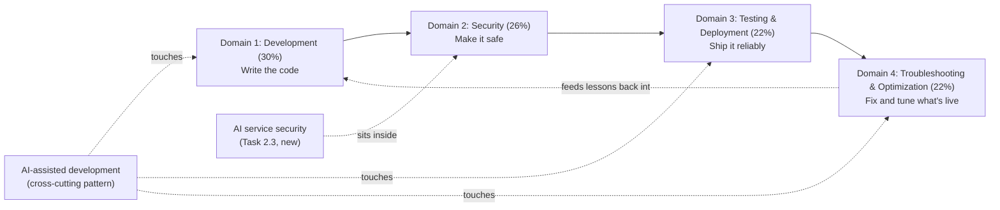
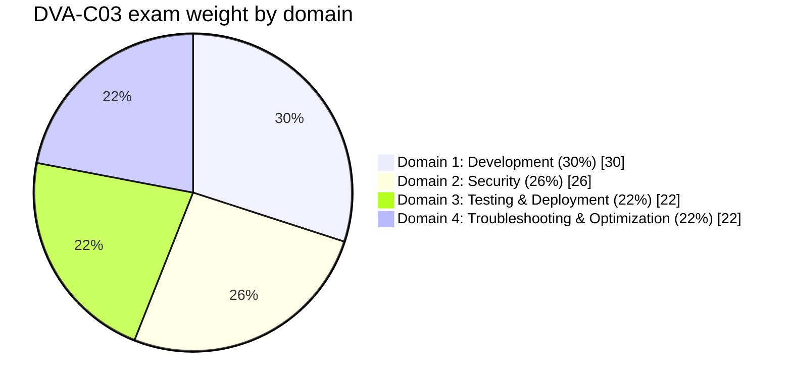
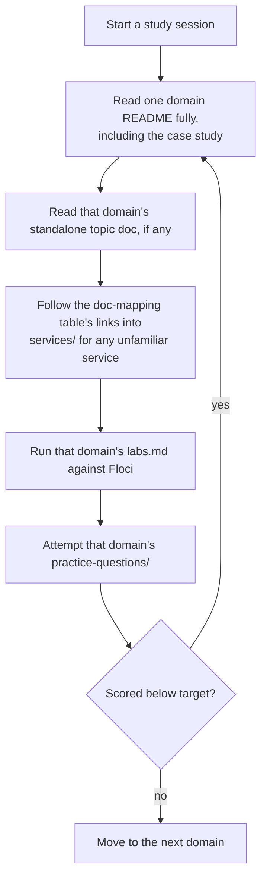

# DVA-C03 — AWS Certified Developer – Associate

*Source: [AWS Certification](https://aws.amazon.com/certification/). The official digital badge earned on passing — same artwork AWS issues through Credly on certification.*

> **Exam transition:** DVA-C03 registration opened Oct 27, 2026. DVA-C02 retires Nov 30, 2026.
> DVA-C03 is live from **Dec 1, 2026**. This repo targets DVA-C03 since that's the version en
> will actually sit.

## Exam Overview

| | |
|---|---|
| Who it's for | Developers building, testing, deploying, and debugging AWS Cloud applications (incl. AI-assisted development tools) |
| Questions | 65 total (50 scored, 15 unscored) |
| Time | 130 minutes |
| Format | Multiple choice & multiple response |
| Passing score | 720 / 1000 |
| Cost | $150 USD |
| Official guide | https://docs.aws.amazon.com/pdfs/aws-certification/latest/developer-associate-03/developer-associate-03.pdf |

## What's new vs DVA-C02

- New **Task 2.3**: security risks of using/integrating AI services (access control for AI
  services, data privacy controls like VPC endpoints, keeping inputs/outputs out of model
  training, content filtering, prompt-injection protection, AI agent security, sensitive data
  in logs).
- **AI-assisted development** now assessed across all 4 domains: code generation/review
  (Domain 1), test generation/regression automation (Domain 3), CI/CD automation (Domain 3),
  error analysis/optimization recommendations (Domain 4).
- **Containers** now directly tested: ECR image build/tag/lifecycle, ECS/EKS/Fargate deployment.
- New in-scope services: **Amazon Bedrock, Bedrock AgentCore, Amazon Q, Kiro, Data Firehose,
  AWS PrivateLink**. SageMaker AI and Strands Agents are explicitly **out of scope** (that's
  MLA-C02 territory).

## The exam in one picture: how the four domains relate

Each domain assumes the previous one happened correctly: Domain 2's security controls protect code
that Domain 1 already wrote; Domain 3's pipeline deploys code that Domain 2 already secured;
Domain 4 troubleshoots and tunes what Domain 3 already shipped. The two cross-cutting new topics —
AI-assisted development and AI service security — don't get their own domain weight; they're woven
into the existing four, which is exactly why this repo gives each one a canonical doc
([`domain-1-development/ai-assisted-development.md`](domain-1-development/ai-assisted-development.md),
[`domain-2-security/ai-service-security-risks.md`](domain-2-security/ai-service-security-risks.md))
that every other domain cross-links into instead of repeating.

## Domains & Weights

| # | Domain | Weight | Folder |
|---|---|---|---|
| 1 | Development with AWS Services | **30%** | [`domain-1-development/`](domain-1-development) |
| 2 | Security | **26%** | [`domain-2-security/`](domain-2-security) |
| 3 | Testing and Deployment | **22%** | [`domain-3-testing-deployment/`](domain-3-testing-deployment) |
| 4 | Troubleshooting and Optimization | **22%** | [`domain-4-troubleshooting-optimization/`](domain-4-troubleshooting-optimization) |

## Domain 1: Development with AWS Services (30%)

- **Task 1.1** — Develop code for applications hosted on AWS (AWS SDKs/APIs, streaming data,
  serialize/deserialize, event-driven patterns with EventBridge/S3 events, API Gateway stages)
- **Task 1.2** — Develop code for AWS Lambda (VPC access to private resources, layers, concurrency, triggers)
- **Task 1.3** — Use data stores in application development (DynamoDB, S3, RDS/Aurora — access patterns, consistency models, SDK integration)

See [`domain-1-development/README.md`](domain-1-development/README.md) for the full breakdown,
including a worked flash-sale order API case study, the Lambda trigger models, and 15 common exam
scenarios.

## Domain 2: Security (26%)

- **Task 2.1** — Implement authentication/authorization for apps and AWS services (IAM, Cognito, STS)
- **Task 2.2** — Implement encryption and manage sensitive data (at-rest/in-transit encryption, ACM/Private CA, KMS, PII masking)
- **Task 2.3** *(new)* — Identify and mitigate security risks of using/integrating AI services (access control, data privacy via VPC endpoints, content filtering, agent security, log hygiene)

See [`domain-2-security/README.md`](domain-2-security/README.md) for the full breakdown, including
IAM policy evaluation logic, envelope encryption, and a multi-tenant SaaS + AI chatbot case study.

## Domain 3: Testing and Deployment (22%)

- **Task 3.1** — Prepare application artifacts for deployment (dependency management, ECR container images, Dockerfiles, config via AppConfig/Parameter Store/Secrets Manager, API Gateway stages)
- **Task 3.2** — Implement and automate application testing (SAM/CDK/CloudFormation test validation, mock APIs, test events, AI-assisted test generation/regression automation)
- **Task 3.3** — Deploy code via CI/CD (Lambda packaging, ECS/EKS/Fargate deployment, IaC templates, CodeDeploy, CodePipeline, blue/green/canary/rolling strategies, rollback, AI-assisted deployment approvals)

See [`domain-3-testing-deployment/README.md`](domain-3-testing-deployment/README.md) for the full
breakdown, including deployment strategy comparisons and a containerized checkout microservice
CI/CD case study.

## Domain 4: Troubleshooting and Optimization (22%)

- **Task 4.1** — Assist in root cause analysis (CloudWatch Logs/Metrics, X-Ray tracing, CloudTrail, AI-assisted error analysis)
- **Task 4.2** — Instrument code for observability
- **Task 4.3** — Optimize applications on AWS (Lambda performance tuning, cost/performance tradeoffs, AI-assisted optimization recommendations)

See [`domain-4-troubleshooting-optimization/README.md`](domain-4-troubleshooting-optimization/README.md)
for the full breakdown, including the symptom-to-tool lookup, Lambda cost math, and a slow-checkout
diagnosis case study.

## The two cross-cutting new topics, side by side

| | AI-assisted development | AI service security |
|---|---|---|
| Where it lives | [`domain-1-development/ai-assisted-development.md`](domain-1-development/ai-assisted-development.md) | [`domain-2-security/ai-service-security-risks.md`](domain-2-security/ai-service-security-risks.md) |
| What it's about | Humans using an AI tool (Amazon Q Developer, Kiro) to help *build* software | Securing an AI *service* (Bedrock, Amazon Q) that your *application* calls |
| Tasks it touches | 1.1, 3.2, 3.3, 4.1, 4.3 | 2.3 specifically |
| The one rule that answers most questions | AI proposes, a human verifies before anything irreversible happens | Least privilege + private network path + don't trust model input/output by default |

These get confused with each other constantly on first read because both involve "AI" — the fast
disambiguator: if the question is about a *developer* using a tool to write/test/deploy/debug
code, it's the first column; if it's about an *application feature* built on a generative AI
model that end users interact with, it's the second.

## Use Cases — Real Scenarios

Cross-domain scenarios showing how the four domains actually interact on one piece of real work —
useful because most real sprints (and the exam's harder scenario questions) don't stay inside one
domain's task statements:

1. **App type:** Flash-sale e-commerce checkout. **Requirement:** absorb a 50x traffic spike,
   never lose an accepted order, never double-charge on retry. **Cross-domain path:** Domain 1
   picks DynamoDB + conditional writes for the data layer, Domain 2 secures the execution role and
   encrypts order data at rest, Domain 3 ships it via blue/green with an alarm-based rollback, and
   Domain 4 instruments it with X-Ray/custom metrics *before* the sale, not after a 2am incident.
2. **App type:** B2B SaaS support chatbot on Bedrock, multi-tenant. **Requirement:** tenant
   isolation, no training-data leakage, auditable chatbot interactions. **Cross-domain path:**
   Domain 1 builds the Lambda orchestrator calling Bedrock, Domain 2's Task 2.3 scopes IAM/VPC
   endpoints/Guardrails around it, Domain 3 gates any change to the agent's action groups behind a
   human approval, Domain 4's observability doc governs what's safe to log from the model's I/O.
3. **App type:** Regulated healthcare records API migrating off a legacy monolith.
   **Requirement:** encrypt everything at rest with an auditable key, keep Lambda inside a private
   VPC reaching an existing RDS instance, and prove compliance after the fact.
   **Cross-domain path:** Domain 1's VPC-attached Lambda pattern, Domain 2's KMS CMK + key policy,
   Domain 3's template-validated IaC deployment, Domain 4's CloudTrail/Config pairing for the
   compliance audit trail.
4. **App type:** Containerized checkout microservice CI/CD pipeline. **Requirement:** every merge
   to `main` deploys automatically, but nothing destructive reaches production without a human
   approval informed by an AI risk summary. **Cross-domain path:** this is almost entirely Domain
   3, but the AI-risk-summary step is the Domain-1-cross-cutting "AI-assisted development" pattern
   showing up inside a Domain 3 pipeline — recognizing that overlap is exactly what the repo's
   "two cross-cutting topics" table above is for.
5. **App type:** Clickstream analytics platform with an AI-generated anomaly summary.
   **Requirement:** ingest a high-throughput event stream, detect anomalies, and let an AI tool
   propose a likely cause without a human blindly trusting it. **Cross-domain path:** Domain 1's
   Kinesis ingestion pattern, Domain 4's X-Ray Insights/CloudWatch anomaly detection, and the
   "AI proposes, human verifies" rule from the cross-cutting AI-assisted-development doc gating
   whether the proposed cause gets acted on.
6. **App type:** Internal AI coding assistant rollout across an engineering org. **Requirement:**
   speed up development without creating a new security or compliance blind spot.
   **Cross-domain path:** Domain 1's AI-assisted-development doc covers the workflow (generation,
   review, test-gen), while Domain 2's Task 2.3 doc covers a *different* risk entirely if that same
   assistant is itself acting as an agent with AWS access — the repo's disambiguator table exists
   specifically because this pairing gets confused on first read.
7. **App type:** Legacy inventory system's first serverless feature. **Requirement:** a new Lambda
   function must reach an existing private-subnet RDS instance, ship through the same pipeline as
   everything else, and be debuggable like every other function once live. **Cross-domain path:**
   Domain 1's VPC-attached Lambda, Domain 3's externalized-config pattern so the new function
   fits the existing promotion pipeline, Domain 4's instrumentation checklist applied on day one
   instead of retrofitted after the first incident.
8. **App type:** Cost-conscious scale-up reviewing its serverless bill. **Requirement:** cut cost
   without regressing latency or breaking the deployment pipeline's existing safety nets.
   **Cross-domain path:** Domain 4's memory/duration cost math identifies the lever, Domain 3's
   CI/CD pipeline deploys the memory-size change through the same validated, rollback-protected
   path as any other change — a reminder that even a Domain-4 "optimization" still goes through
   Domain 3's deployment discipline, not a one-off console edit.
9. **App type:** Prospective DVA-C03 candidate planning study time. **Requirement:** 65 questions,
   130 minutes, four domains of uneven weight (30/26/22/22). **Cross-domain path:** the Study
   order section below sequences the domains so each one's prerequisite knowledge (IAM vocabulary,
   the data stores Domain 2 secures, the code Domain 3 deploys) is already in place before you
   reach the domain that assumes it.

## How to use this repo day to day

## Study order

1. [`00-fundamentals/`](../../00-fundamentals) and ideally SAA-C03 Domain 1 first (shared IAM/VPC/security vocabulary)
2. Domain 1 (core development patterns)
3. Domain 2 (security — builds directly on Domain 1's data stores and APIs)
4. Domain 3 (testing/deployment — assumes you can already write the code from Domains 1-2)
5. Domain 4 (troubleshooting — the "something's wrong with what I built in 1-3" layer)

## Practice questions

Each domain has a dedicated question set under [`practice-questions/`](practice-questions/index.md),
weighted roughly in proportion to the domain's exam weight. Use them *after* finishing a domain's
README, topic docs, and labs — not as a substitute for reading the material, since the questions
assume you've already internalized the case studies and diagrams, not just the task-statement list.

## What "done" looks like for this repo

- [ ] Every domain README's "Common exam scenarios" section can be explained out loud without
      re-reading it.
- [ ] Every domain's full worked case study can be redrawn from memory (architecture diagram +
      the "why" for each component choice).
- [ ] Every lab in every domain's `labs.md` has actually been run against Floci at least once.
- [ ] Every practice question set scores above your personal target threshold on a second attempt.
- [ ] You can explain, without looking it up, the difference between AI-assisted development
      (Domain 1 cross-cutting) and AI service security (Task 2.3) on demand.

## Status

✅ All four domain folders (README, topic docs, labs) are fully expanded with worked case studies,
Mermaid diagrams, and cross-links into `services/`. Practice question sets remain under
[`practice-questions/`](practice-questions/index.md) for drilling after each domain.
