# DVA-C03 Domain 1 — Master Chunk: Every Development Service, Standalone

> **What this file is.** A single, self-contained reference covering every service tested in
> Domain 1 (Development with AWS Services, 30% of DVA-C03) — Amplify, AppSync, CodeDeploy,
> CodePipeline, IAM, Lambda, STS & Role Switching, Step Functions, API Gateway, Aurora, Bedrock,
> CloudWatch, Data Firehose, DynamoDB, ElastiCache, ECR, EventBridge, Kinesis Family, Amazon Q,
> RDS, S3, SNS, SQS, VPC, the Database Selection Guide, and the Messaging Patterns Overview. Each
> entry gives you Definition, plain-English Analogy, Purpose, When to Use, When NOT to Use, 4-6 Use
> Cases, Why Important, a Mermaid diagram with explanation, a real curl-verified AWS documentation
> image with discussion, a code/CLI snippet where relevant, and 2-3 Exam Tips. You should be able to
> study from this one file without opening anything else — every cross-reference to a deeper
> `services/*.md` doc is optional further reading, not a requirement to understand this file.
>
> **How to use it.** Read front to back for full-domain review, or jump to one service via the
> table of contents below. Pair it with [`README.md`](README.md) for the task-statement mapping and
> worked case studies, and with the three companion deep-dive docs
> ([`idempotency-and-retry-patterns.md`](idempotency-and-retry-patterns.md),
> [`aws-sdk-credential-resolution-chain.md`](aws-sdk-credential-resolution-chain.md),
> [`lambda-event-source-mapping-deep-dive.md`](lambda-event-source-mapping-deep-dive.md)) for the
> subtopics that warrant more depth than fits cleanly into one service entry here.

## Table of contents

1. [AWS Amplify](#1-aws-amplify)
2. [AWS AppSync](#2-aws-appsync)
3. [AWS CodeDeploy](#3-aws-codedeploy)
4. [AWS CodePipeline](#4-aws-codepipeline)
5. [AWS IAM](#5-aws-iam)
6. [AWS Lambda](#6-aws-lambda)
7. [AWS STS & Role Switching](#7-aws-sts--role-switching)
8. [AWS Step Functions](#8-aws-step-functions)
9. [Amazon API Gateway](#9-amazon-api-gateway)
10. [Amazon Aurora](#10-amazon-aurora)
11. [Amazon Bedrock](#11-amazon-bedrock)
12. [Amazon CloudWatch](#12-amazon-cloudwatch)
13. [Amazon Data Firehose](#13-amazon-data-firehose)
14. [Amazon DynamoDB](#14-amazon-dynamodb)
15. [Amazon ElastiCache](#15-amazon-elasticache)
16. [Amazon ECR](#16-amazon-ecr)
17. [Amazon EventBridge](#17-amazon-eventbridge)
18. [Amazon Kinesis Family](#18-amazon-kinesis-family)
19. [Amazon Q](#19-amazon-q)
20. [Amazon RDS](#20-amazon-rds)
21. [Amazon S3](#21-amazon-s3)
22. [Amazon SNS](#22-amazon-sns)
23. [Amazon SQS](#23-amazon-sqs)
24. [Amazon VPC](#24-amazon-vpc)
25. [Database Selection Guide](#25-database-selection-guide)
26. [Messaging Patterns Overview](#26-messaging-patterns-overview)

---

## 1. AWS Amplify

### Definition
AWS Amplify is a set of tools and services (a CLI, client libraries, and a hosting service) for
building and deploying full-stack web and mobile applications fast, by provisioning real,
individually addressable AWS backend resources (Cognito, AppSync or API Gateway, DynamoDB, S3,
Lambda) behind simple commands and config files — rather than hand-wiring each service yourself.

### Plain-English Analogy
Amplify is a general contractor for your app's backend. You tell it "I need auth, an API, and file
storage," and it pulls the right licensed subcontractors (Cognito for auth, AppSync/API Gateway for
the API, S3 for storage) onto the job and wires the plumbing between them — you still own the
finished house (the underlying resources are real, inspectable, individually-billed AWS resources
in your account), you just didn't have to personally negotiate with each subcontractor.

### Purpose
Standing up a production-grade auth + API + storage + hosting stack by hand means correctly wiring
Cognito user pools to an API authorizer, an API to a database, a frontend build to a CDN, and CI/CD
for all of it — real, repetitive, error-prone work for a shape that's extremely common. Amplify
exists to collapse that recurring assembly into CLI commands and a managed hosting pipeline, so a
small team's time goes to the application's actual logic, not backend plumbing.

### When to Use It
- Standing up a new full-stack app's auth/API/storage/hosting quickly, especially for small teams
  without dedicated DevOps capacity.
- Front-end-heavy teams (mobile or web) who want a backend without becoming infrastructure experts.
- Prototyping or MVPs where iteration speed matters more than bespoke infrastructure control.

### When NOT to Use It
- Large, complex enterprise backends with intricate custom infrastructure requirements are often
  better served by CDK/CloudFormation directly, where you're not working through Amplify's
  opinionated abstractions.
- If your team already has mature, bespoke CI/CD and IaC practices, adopting Amplify on top adds a
  second paradigm to maintain rather than simplifying anything.
- Deep, service-specific tuning (e.g., unusual DynamoDB access patterns, custom VPC topologies) can
  be fought against Amplify's abstractions rather than helped by them.

### Use Cases
1. A startup's mobile app needs auth, a GraphQL API, and image storage live in days, not months.
2. A static marketing site needs Git-push CI/CD hosting with preview URLs per branch/PR.
3. A hackathon or student project needs a working full-stack app without a dedicated backend engineer.
4. A web app needs offline-first data sync (Amplify DataStore) against an AppSync API automatically.
5. A team wants environment-per-branch (dev/staging/prod) backend provisioning without hand-rolling
   three separate CloudFormation stacks.
6. An enterprise team wants to prototype quickly, then "eject" specific resources into hand-managed
   CDK once a part of the stack needs bespoke tuning.

### Why Important
Domain 1 tests recognizing when "stand up an app's backend fast, without manually provisioning each
underlying service" is the scenario — Amplify is the correct answer precisely because it *does*
provision real Cognito/AppSync/DynamoDB/S3 resources (not a black box), just behind a higher-level
interface, and the exam wants you to know both that abstraction exists and that the underlying
resources are still ordinary, inspectable AWS resources you can reach directly if needed.

### How It Works

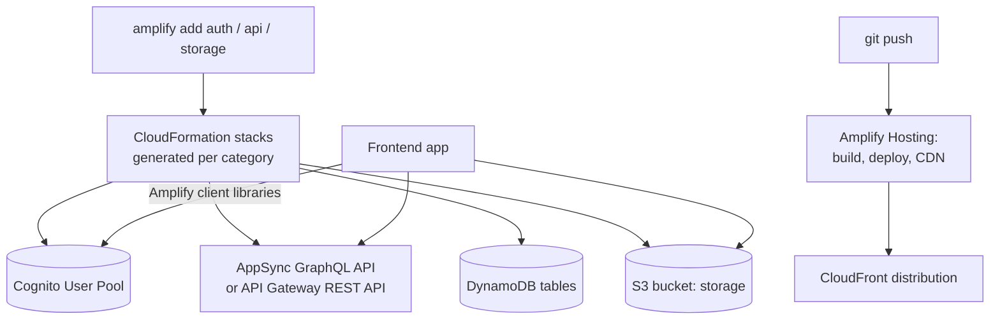

Each `amplify add <category>` command generates and deploys its own CloudFormation stack for that
category, wiring IAM roles and resource references between them automatically (e.g., the generated
AppSync API's resolvers already know the DynamoDB table ARN Amplify just created). Amplify Hosting
separately handles the frontend: a `git push` triggers a build and deploy to a CloudFront-backed
hosting environment, with branch-based environments for preview deployments.

### Real AWS image


*Source: [AWS Reference Architecture Diagrams — Modern Serverless Mobile/Web Application](https://docs.aws.amazon.com/reference-architecture-diagrams/latest/modern-serverless-mobile-web/modern-serverless-mobile-web.html)
(curl-verified 200). This is exactly the shape Amplify provisions behind its CLI commands: Cognito
for identity, AppSync for the API layer, Lambda/DynamoDB for business logic and data, with
CloudFront fronting the static frontend. The point worth internalizing: Amplify isn't a different
architecture from what a team would otherwise hand-build — it's this same reference architecture,
generated and wired for you.*

### Code Example
```bash
# Scaffolding an Amplify project's backend categories
amplify init
amplify add auth        # provisions a Cognito User Pool + Identity Pool
amplify add api          # choose GraphQL (AppSync) or REST (API Gateway)
amplify add storage      # provisions an S3 bucket with per-user access rules
amplify push              # deploys all configured categories as CloudFormation stacks
```
```javascript
// Frontend: using the generated config to call the provisioned backend, no manual endpoint wiring
import { Amplify } from 'aws-amplify';
import { generateClient } from 'aws-amplify/api';
import config from './amplifyconfiguration.json';
Amplify.configure(config);

const client = generateClient();
const todos = await client.graphql({ query: listTodos });
```

### Pricing Note
Amplify Hosting bills for build minutes and data served; the underlying provisioned resources (Cognito, AppSync/API Gateway, DynamoDB, S3) are billed separately at their own normal rates — Amplify itself adds no extra per-resource markup, it's a provisioning/CI convenience layer on top of standard service pricing.

### Common Exam Scenarios
- *"A two-person startup needs auth, a GraphQL API, and file storage live in days, with Git-push CI/CD, and doesn't want to provision each service by hand"* → Amplify.
- *"An enterprise team needs bespoke, fine-grained control over every underlying resource's configuration"* → hand-rolled CDK/CloudFormation, not Amplify's opinionated abstraction.
- *"A mobile app needs offline-first data sync against a managed backend"* → Amplify DataStore on top of an AppSync API.

### Exam Tips
- Recognize "stand up auth + API + storage fast with Git-push CI/CD, without directly provisioning
  each service" as the Amplify signature wording.
- Amplify provisions **real** underlying AWS resources (Cognito, AppSync/API Gateway, DynamoDB,
  S3) — it is not a separate proprietary backend; those resources are addressable and billable
  independently.
- Don't confuse Amplify (full-stack app tooling) with CDK/CloudFormation (general-purpose IaC) —
  Amplify is opinionated and app-shaped; CDK/CloudFormation is general-purpose and unopinionated.

---

## 2. AWS AppSync

### Definition
AWS AppSync is a fully managed service for building **GraphQL APIs** (and, more recently, real-time
Events APIs) that connect a single API endpoint to multiple backend data sources — DynamoDB,
Lambda, RDS, OpenSearch, or any HTTP endpoint — through per-field **resolvers**, with built-in
real-time subscriptions and offline data sync support.

### Plain-English Analogy
A REST API is like ordering from a fixed menu — you get exactly the dish as plated, extra sides or
not. GraphQL (what AppSync serves) is like a buffet with a single serving counter: you tell the
counter exactly which items you want from however many stations (data sources) are behind it, and
you get back one plate with just those items — no more, no less, in a single trip.

### Purpose
REST APIs typically need either many endpoints (one per resource shape) or over-fetching (one
endpoint that returns more data than a given client needs). GraphQL lets a client request exactly
the fields it needs from potentially many different backend sources in a single round trip.
AppSync exists so you don't have to build and operate a GraphQL server yourself — schema,
resolvers, real-time subscriptions, and caching are all managed.

### When to Use It
- Mobile/web clients that want to fetch exactly the fields they need, from multiple sources, in one
  request (reducing both over-fetching and the number of round trips).
- Real-time, live-updating UIs (chat apps, dashboards, collaborative editors) via GraphQL
  subscriptions pushed over WebSockets.
- Combining multiple backend data sources (DynamoDB + Lambda + an existing REST API) behind one
  unified API surface.

### When NOT to Use It
- Simple CRUD APIs with no multi-source aggregation need are often simpler and cheaper to build as
  a plain REST API via API Gateway + Lambda — GraphQL's flexibility is overhead you don't need.
- Teams unfamiliar with GraphQL's schema/resolver model take on a real learning curve; a small
  internal tool doesn't always justify that investment.
- File/binary transfer (large uploads/downloads) isn't GraphQL's strength — pair AppSync with
  direct S3 presigned URLs rather than trying to push binary data through a GraphQL mutation.

### Use Cases
1. A social app needs a single API call to return a post, its author's profile, and its comment
   count — three different data sources, one GraphQL query.
2. A collaborative whiteboard app needs every connected client to see other users' changes in
   real time via subscriptions.
3. A mobile app needs offline-first support, syncing local writes back to the cloud once
   connectivity returns (Amplify DataStore sits on top of AppSync for exactly this).
4. An enterprise wants to expose an existing legacy REST API and a new DynamoDB table behind one
   unified GraphQL schema for a new frontend, without rewriting the legacy system.
5. A dashboard needs live-updating metrics pushed to connected clients instead of polling.
6. A team wants fine-grained, per-field authorization (some fields visible to admins only) that a
   REST endpoint's all-or-nothing response shape makes awkward.

### Why Important
Task 1.1 explicitly calls out GraphQL as an alternative to REST/HTTP APIs — the exam expects you
to recognize AppSync as the managed-GraphQL answer when a scenario emphasizes flexible field
selection, multi-source aggregation, or real-time subscriptions, instead of defaulting to API
Gateway + Lambda for every API scenario.

### How It Works

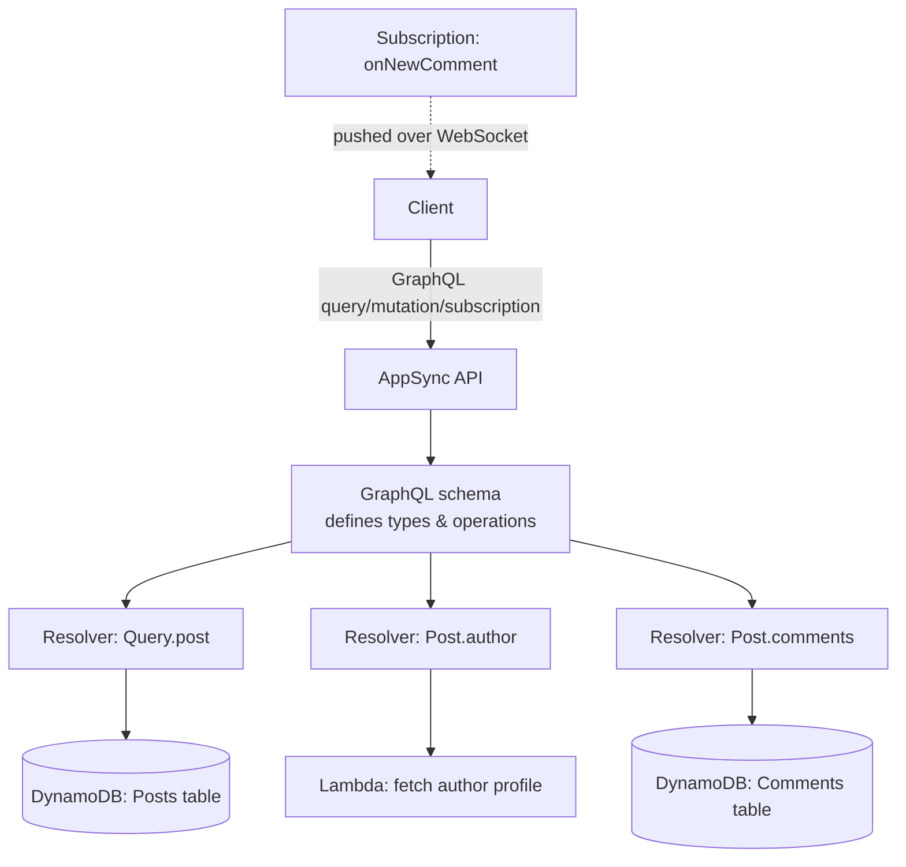

A single client query can trigger multiple independent resolvers — one per requested field — each
hitting its own data source, and AppSync assembles all the results into one JSON response shaped
exactly like the client's query. Subscriptions work by having AppSync push a message over a
WebSocket connection whenever a specified mutation occurs, without the client ever polling.

### Real AWS image


*Source: [AWS AppSync Developer Guide — What is AWS AppSync?](https://docs.aws.amazon.com/appsync/latest/devguide/what-is-appsync.html)
(curl-verified 200). The schema sits in the middle as the single contract clients talk to;
resolvers are the translation layer between each schema field and its actual backend data source.
Exam-relevant detail visible here: a single API's resolvers can point at *different kinds* of data
sources simultaneously — this diagram is the visual proof that AppSync isn't "GraphQL in front of
one database," it's a genuine aggregation layer.*

### Code Example
```graphql
# Schema: one query touching two different underlying data sources transparently to the client
type Post {
  id: ID!
  title: String!
  author: Author!       # resolved via a Lambda data source
  comments: [Comment!]!  # resolved via a separate DynamoDB table
}
type Query {
  getPost(id: ID!): Post
}
type Subscription {
  onNewComment(postId: ID!): Comment
    @aws_subscribe(mutations: ["addComment"])
}
```
```javascript
// Client: requesting exactly the fields needed, one round trip, two data sources
const query = `query { getPost(id: "p1") { title author { name } comments { text } } }`;
const resp = await client.graphql({ query });
```

### Pricing Note
Billed per million GraphQL requests resolved and per real-time subscription minute/message — a query touching five fields through five separate resolvers is billed as resolver executions, so schema design (fewer, more efficient resolvers) has a direct cost impact, not just a performance one.

### Common Exam Scenarios
- *"A mobile client wants to fetch exactly the fields it needs from three different backend sources in one round trip"* → AppSync/GraphQL, not three separate REST calls.
- *"A collaborative app needs every connected client to see other users' changes live"* → AppSync subscriptions over WebSockets.
- *"A simple CRUD API with no multi-source aggregation need"* → plain REST via API Gateway + Lambda is simpler than standing up a GraphQL schema for no benefit.

### Exam Tips
- "Managed GraphQL API with real-time subscriptions" → AppSync, not API Gateway + Lambda for each
  field individually.
- AppSync resolvers can target DynamoDB, Lambda, RDS (via Data API), OpenSearch, and HTTP
  endpoints — know it's a genuine multi-source aggregator, not DynamoDB-only.
- Subscriptions are pushed over WebSockets automatically when a specified mutation fires — no
  client-side polling loop required.

---

## 3. AWS CodeDeploy

### Definition
AWS CodeDeploy automates application deployments to EC2 instances, on-premises servers, Lambda
functions, or ECS services, using a configurable deployment strategy (in-place, blue/green,
canary, linear) with built-in health checks and automatic rollback on failure.

### Plain-English Analogy
CodeDeploy is a theater's stage manager during a cast change between performances. Instead of
pulling every actor off stage simultaneously and risking an empty stage if the new cast isn't
ready (a risky all-at-once swap), the stage manager can swap actors in gradually, watch the
audience's reaction (health checks) after each swap, and immediately put the old actor back if
something goes wrong — all according to a rehearsed plan (the deployment configuration), not
improvised on the spot.

### Purpose
Deploying new application code safely at scale is risky if done as an uncoordinated, all-at-once
replacement — a bad deployment can take an entire fleet down simultaneously with no automatic way
back. CodeDeploy exists to make deployments a controlled, observable, reversible process instead of
a one-shot gamble, with the deployment strategy itself (how fast, how much traffic shifts at once)
as an explicit, reusable configuration.

### When to Use It
- Deploying new application revisions to a fleet of EC2 instances or an on-premises server fleet
  with an automated rollout strategy.
- Shifting Lambda traffic gradually between function versions (linear/canary) for safer releases.
- Blue/green deployments to ECS, swapping an entire new task set in behind a load balancer with an
  automatic rollback path if health checks fail.

### When NOT to Use It
- CloudFormation/CDK stack updates for infrastructure changes are a different concern
  (infrastructure state) from CodeDeploy's concern (application code rollout) — don't reach for
  CodeDeploy to manage infrastructure provisioning itself.
- A single-instance, low-stakes internal tool rarely needs the operational overhead of a
  deployment-configuration strategy; a simple scripted deploy may be sufficient.
- Simple S3 static site deployments don't need CodeDeploy at all — a plain `s3 sync` or Amplify
  Hosting handles that case more directly.

### Use Cases
1. Rolling out a new application version across a fleet of EC2 instances with automatic rollback if
   health checks fail mid-rollout.
2. Shifting 10% of Lambda traffic to a new version every few minutes (canary) before going to 100%.
3. Blue/green ECS deployment: a whole new task set is stood up, validated, then traffic is cut over
   at the load balancer, with the old task set kept briefly for instant rollback.
4. Hybrid on-premises + EC2 fleets needing the same coordinated deployment process across both.
5. Deployment gated by a `BeforeAllowTraffic` validation Lambda hook that must pass before any real
   traffic is routed to the new revision.
6. Coordinating application deployment as one stage inside a larger CodePipeline CI/CD pipeline.

### Why Important
Task 3.3 (Domain 3) leans on CodeDeploy heavily, but Domain 1 needs to recognize it as the
deployment-automation counterpart to the code you've written in this domain — a correctly-written
Lambda function or containerized app still needs a safe rollout mechanism, and CodeDeploy is that
mechanism, distinct from CodePipeline (which orchestrates the stages *around* a CodeDeploy action).

### How It Works

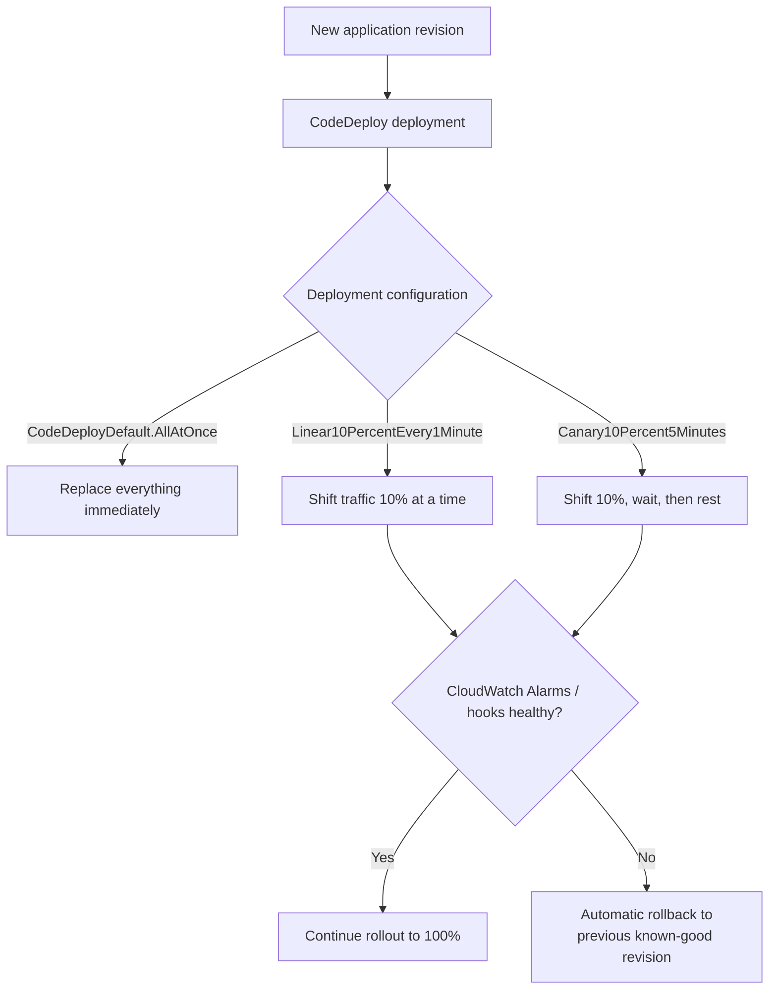

A deployment configuration determines the pace and shape of the rollout; CodeDeploy continuously
checks configured health signals (CloudWatch alarms, or lifecycle hook Lambda functions like
`BeforeAllowTraffic`/`AfterAllowTraffic`) between increments, and automatically rolls the whole
deployment back to the last known-good revision the moment a configured health signal goes bad —
this automatic, built-in rollback is the single biggest reason to use CodeDeploy over a hand-rolled
deployment script.

### Real AWS image


*Source: [AWS CodeDeploy User Guide — How CodeDeploy Works](https://docs.aws.amazon.com/codedeploy/latest/userguide/welcome.html)
(curl-verified 200). This shows the EC2/on-premises deployment lifecycle: revision stored (S3 or
GitHub), deployment group targets a set of instances, and the CodeDeploy agent on each instance
pulls and installs the new revision according to the `appspec.yml`'s lifecycle hooks. The
equivalent diagram for ECS (`deployment-process-ecs.png`, same user guide) shows the blue/green task
set swap instead — same orchestrating service, genuinely different mechanics per compute target.*

### Code Example
```yaml
# appspec.yml — defines lifecycle hooks CodeDeploy calls during an EC2 deployment
version: 0.0
os: linux
files:
  - source: /
    destination: /var/www/html
hooks:
  BeforeInstall:
    - location: scripts/stop_server.sh
  AfterInstall:
    - location: scripts/install_dependencies.sh
  ApplicationStart:
    - location: scripts/start_server.sh
  ValidateService:
    - location: scripts/health_check.sh
```
```bash
aws deploy create-deployment \
  --application-name my-app \
  --deployment-group-name production-fleet \
  --deployment-config-name CodeDeployDefault.LambdaLinear10PercentEvery3Minutes \
  --s3-location bucket=my-deploy-bucket,bundleType=zip,key=revision.zip
```

### Pricing Note
No charge for deployments to EC2/on-premises/Lambda/ECS — CodeDeploy itself is free; you pay only for the compute resources being deployed to. This is worth remembering specifically because it removes 'CodeDeploy costs more at scale' as a legitimate design objection.

### Common Exam Scenarios
- *"A deployment should automatically revert if a health check fails partway through the rollout"* → CodeDeploy's automatic rollback, not a manually scripted deploy.
- *"Traffic should shift gradually to a new Lambda version, verified in small increments before going to 100%"* → canary/linear deployment configuration.
- *"An ECS service needs a full new task set validated before any real traffic reaches it"* → blue/green deployment, old task set kept briefly for instant rollback.

### Exam Tips
- Automatic rollback on a failed health check is CodeDeploy's headline feature — a scenario
  describing "automatically revert a bad deployment" points here.
- Know the three deployment shapes by name: all-at-once, linear, canary — and that blue/green is
  the ECS/Lambda-specific pattern of standing up the new version fully before cutting over traffic.
- CodeDeploy automates the *deployment itself*; CodePipeline automates the *pipeline of stages*
  around it (source → build → deploy) — don't conflate the two services.

---

## 4. AWS CodePipeline

### Definition
AWS CodePipeline is a fully managed continuous delivery service that models and automates the
stages of a software release process — source, build, test, deploy, and any manual approval gates
— as a single pipeline that runs automatically whenever a configured source change triggers it.

### Plain-English Analogy
CodePipeline is an assembly line's conveyor belt and station sequence. Each station
(source-checkout, build, test, deploy) does its one job and passes the work along only once it's
done; if a station rejects the piece (a build fails, a test fails), the whole line stops right
there instead of continuing to assemble on top of a known-bad part. An optional "quality inspector"
station (manual approval) can require a human sign-off before the piece continues toward shipping.

### Purpose
Manually re-running a build, then a test suite, then a deployment script in the right order every
time code changes is tedious and error-prone at team scale. CodePipeline exists to make that
sequence a defined, automatically-triggered, consistently-ordered set of stages — removing "did
someone forget to run the tests before deploying" as a possible failure mode entirely.

### When to Use It
- Any team wanting source-change-triggered CI/CD instead of manually running each release step.
- Coordinating multiple distinct tools (CodeBuild for build/test, CodeDeploy or CloudFormation for
  deploy) into one observable, auditable pipeline.
- Requiring a manual human approval gate before a specific environment (commonly production)
  receives a deployment.

### When NOT to Use It
- A single-developer side project with infrequent, low-stakes deploys may not need a full managed
  pipeline's overhead — a simple script can suffice.
- If your organization is already standardized on a different CI/CD platform (Jenkins, GitHub
  Actions, GitLab CI) end-to-end, introducing CodePipeline alongside it is often redundant rather
  than complementary unless there's a specific AWS-native integration reason to add it.

### Use Cases
1. Git push to main triggers source → build (CodeBuild) → test → deploy (CodeDeploy) automatically.
2. A pipeline deploys to a `dev` stage automatically, then requires manual approval before
   promoting the exact same build artifact to `prod`.
3. A CloudFormation/CDK-based infrastructure pipeline that builds and deploys stack changes through
   dev/staging/prod environments sequentially.
4. A pipeline with a parallel build stage producing both a Docker image (pushed to ECR) and a set
   of static assets (pushed to S3) before a combined deploy stage.
5. An AI-assisted deployment-risk summary attached as context to a manual approval action (see
   [`ai-assisted-development.md`](ai-assisted-development.md)) before production promotion.
6. A pipeline that triggers a Lambda-based custom action for a non-standard validation step not
   covered by a built-in action type.

### Why Important
Domain 1 code only matters once it ships — CodePipeline is the mechanism that turns the SDK/Lambda
code you write into a running, correctly-promoted deployment, and the exam tests whether you
recognize it as the orchestration layer (stages, triggers, approvals) distinct from the build tool
(CodeBuild) or deployment tool (CodeDeploy) it coordinates.

### How It Works

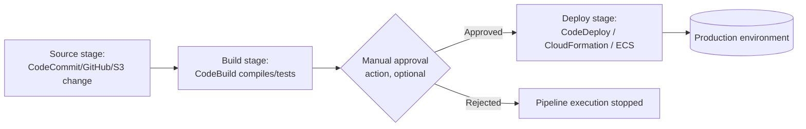

Each stage contains one or more actions; a stage only begins once the previous stage's actions all
succeed. A manual approval action pauses the pipeline entirely until a human (or an automated
system acting on a human's behalf through the API) approves or rejects it — nothing downstream runs
until that decision is made.

### Real AWS image


*Source: [AWS Reference Architecture Diagrams — Database DevOps](https://docs.aws.amazon.com/reference-architecture-diagrams/latest/data-analytics/database-devops.html)
(curl-verified 200). Shows a release manager's change entering through source control, flowing
through CodeBuild, and promoting automatically through to an RDS deployment target — a reminder
that CodePipeline's deploy stage isn't limited to EC2/Lambda; a database schema migration pipeline
is an equally valid pipeline shape.*

### Code Example
```json
{
  "pipeline": {
    "name": "orders-api-pipeline",
    "stages": [
      { "name": "Source", "actions": [{ "actionTypeId": {"category": "Source", "provider": "CodeStarSourceConnection"} }] },
      { "name": "Build", "actions": [{ "actionTypeId": {"category": "Build", "provider": "CodeBuild"} }] },
      { "name": "ApproveProd", "actions": [{ "actionTypeId": {"category": "Approval", "provider": "Manual"} }] },
      { "name": "DeployProd", "actions": [{ "actionTypeId": {"category": "Deploy", "provider": "CodeDeployToECS"} }] }
    ]
  }
}
```
```bash
# Approving a pending manual-approval action via CLI (the exact gate an AI risk-summary feeds into)
aws codepipeline put-approval-result \
  --pipeline-name orders-api-pipeline --stage-name ApproveProd --action-name ManualApproval \
  --result summary="Reviewed diff, no destructive changes",status=Approved --token <approval-token>
```

### Pricing Note
Billed per active pipeline per month (a flat fee), plus the cost of whatever actions it invokes (CodeBuild compute minutes, etc.) — a pipeline that sits idle between infrequent releases still accrues its monthly charge, which is worth knowing when comparing pipeline consolidation strategies.

### Common Exam Scenarios
- *"A source change should automatically flow through build, test, and deploy without manual intervention"* → CodePipeline orchestrating CodeBuild/CodeDeploy stages.
- *"Production must never receive a deployment without a documented human sign-off, even if an AI tool says the change looks safe"* → a manual approval action, with the AI summary as context only.
- *"The same tested build artifact must be the one that reaches every environment, not a rebuild per environment"* → CodePipeline promotes one artifact through stages.

### Exam Tips
- CodePipeline orchestrates *stages*; it doesn't build code itself (CodeBuild) or deploy it itself
  (CodeDeploy/CloudFormation) — know the division of labor among the three.
- A manual approval action is the correct mechanism for "require human sign-off before production,"
  even when an AI tool also summarizes the change for the approver's benefit.
- A pipeline promotes the *same build artifact* through environments (dev → staging → prod) rather
  than rebuilding per environment — this is what guarantees "what you tested is what you shipped."

---

## 5. AWS IAM

### Definition
AWS Identity and Access Management (IAM) is the service that controls **who** (which principal —
user, role, or federated identity) can do **what** (which actions) on **which** AWS resources,
under **what** conditions, evaluated on every single AWS API call.

### Plain-English Analogy
IAM is a building's badge-access system. Every badge (identity) has a list of doors it can open
(permissions policy); some doors additionally require a specific badge *type* to even approach them
(a resource-based policy or trust policy); a company-wide security rule can override every
individual badge ("no one opens the server room after 10pm," regardless of what their own badge
says — a Deny always wins, same as an explicit `Deny` statement always overrides an `Allow`
anywhere else in the evaluation).

### Purpose
Every AWS API call needs an answer to "is this allowed?" — IAM exists as the single, universal
authorization layer every service defers to, so permissions aren't reinvented per service. It also
replaces static, shareable credentials with fine-grained, revocable, auditable permission grants —
the foundation every other security control in AWS (SCPs, permission boundaries, resource policies)
builds on top of.

### When to Use It
- Every single AWS interaction, always — there's no scenario in which IAM is optional; the only
  question is *which* IAM construct (user, role, group, policy type) fits a given need.
- Granting an application (Lambda, EC2, ECS task) exactly the permissions its code needs, via an
  execution/task role, not a shared static credential.
- Cross-account or federated access, via roles assumed through STS rather than distributing
  account-specific IAM users.

### When NOT to Use It
- IAM users with long-lived access keys should essentially never be the answer on this exam for
  application/service access — roles (assumed via STS) are correct in every case a role can cover.
- IAM is not a network-layer control — don't reach for an IAM policy to solve a problem that's
  actually about security groups/NACLs (network reachability) or KMS (encryption), even though all
  four are security controls in the same general family.

### Use Cases
1. Granting a Lambda function's execution role exactly `dynamodb:PutItem` on one specific table
   ARN, nothing broader.
2. Federating a third-party partner's access via `AssumeRole` + `ExternalId`, avoiding any shared
   static credential.
3. Using a permission boundary to cap what a delegated team can grant themselves, even via policies
   they create themselves.
4. Attaching a resource-based (bucket) policy to an S3 bucket to allow cross-account read access
   without creating an IAM user in your account for the other account to use.
5. Requiring MFA via a policy condition (`aws:MultiFactorAuthPresent`) before allowing a sensitive
   action like deleting a production table.
6. Using IAM Access Analyzer to detect a resource policy that unintentionally grants external
   access.

### Why Important
Every Domain 1 code example that calls an AWS API depends on IAM getting it right — a correctly
written SDK call still fails with `AccessDenied` if the underlying identity's policy doesn't allow
the specific action/resource/condition combination, making IAM the invisible prerequisite behind
essentially every other service in this file.

### How It Works

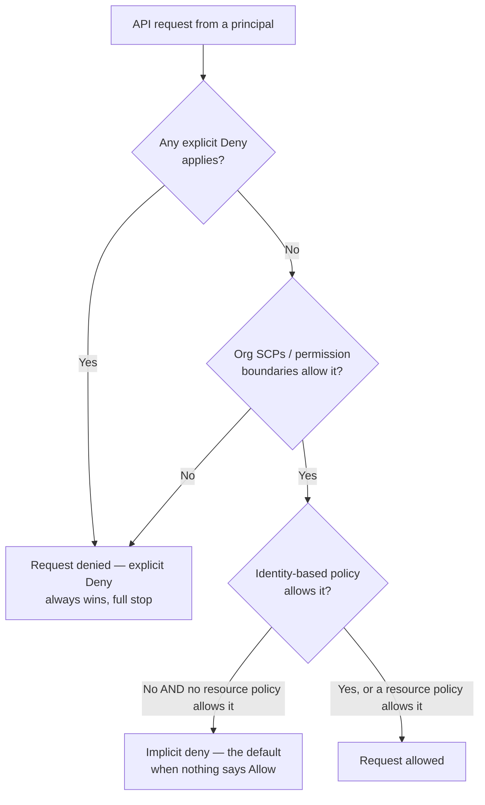

Every evaluation starts from an implicit deny (nothing is allowed unless something explicitly says
so), checks for any explicit `Deny` first (which always wins regardless of any `Allow` elsewhere),
then checks organization-level ceilings (SCPs, permission boundaries) before finally checking
whether an identity-based or resource-based policy actually grants an `Allow`.

### Real AWS image


*Source: [AWS IAM User Guide — Policy evaluation logic](https://docs.aws.amazon.com/IAM/latest/UserGuide/reference_policies_evaluation-logic.html)
(curl-verified 200). This is the exact flow diagrammed above, straight from AWS's own
documentation — worth memorizing the shape (explicit deny first, ceilings next, identity/resource
union last) because nearly every "why was this request denied" exam question is really asking you
to walk this chart correctly.*

### Code Example
```json
{
  "Version": "2012-10-17",
  "Statement": [
    {
      "Effect": "Allow",
      "Action": ["dynamodb:PutItem", "dynamodb:GetItem"],
      "Resource": "arn:aws:dynamodb:us-east-1:123456789012:table/Orders",
      "Condition": { "Bool": { "aws:SecureTransport": "true" } }
    }
  ]
}
```
```bash
aws iam simulate-principal-policy \
  --policy-source-arn arn:aws:iam::123456789012:role/OrdersLambdaRole \
  --action-names dynamodb:Scan --resource-arns arn:aws:dynamodb:us-east-1:123456789012:table/Orders
```

### Pricing Note
IAM itself has no charge — creating users, roles, and policies, and every policy evaluation on every API call, is free. The cost always lives in the resources those permissions grant access to, never in IAM's own usage.

### Common Exam Scenarios
- *"A Lambda function gets AccessDenied even though its code looks correct"* → check the execution role's permissions policy first, not the code.
- *"A policy's effect is ambiguous because multiple statements seem to conflict"* → an explicit Deny always wins over any Allow, full stop.
- *"A third-party vendor needs scoped, revocable access without a shared static credential"* → a role with a trust policy, not an IAM user with an access key.

### Exam Tips
- An explicit `Deny` always wins — no `Allow` anywhere else overrides it; this single fact resolves
  a large share of "which access actually applies" exam questions.
- Least privilege (narrowest action + resource + condition that still lets the code work) is the
  exam's default correct instinct whenever a policy's scope is in question.
- Don't confuse a role's **trust policy** (who may assume it) with its **permissions policy** (what
  it can do once assumed) — see the STS entry below for the mechanism that uses both.

---

## 6. AWS Lambda

### Definition
AWS Lambda is a serverless compute service that runs your code in response to events — HTTP
requests, file uploads, queue messages, scheduled times — without you provisioning or managing any
servers, billed per invocation and per millisecond of execution time.

### Plain-English Analogy
Lambda is a light switch wired to a motion sensor, not a light left running all night. The light
(your code) only draws power (cost) while something is actually happening in the room (an
invocation), and the instant nobody's there, it's off — no idle capacity sitting around, but also
a brief moment to "warm up" (a cold start) the first time it's switched on after being off a while.

### Purpose
Running a server continuously to handle request bursts that arrive unpredictably wastes money on
idle capacity, and capacity-planning for every possible scenario is its own ongoing burden. Lambda
exists to let you write and ship only the business logic, with AWS handling all provisioning,
patching, and automatic scaling — turning "run this code when X happens" into the entire
operational concern.

### When to Use It
- Event-driven processing (file uploads, queue messages, scheduled jobs) where execution is
  bursty, infrequent, or hard to predict in advance.
- Backing a REST/GraphQL API's business logic behind API Gateway/AppSync.
- Short-lived tasks (well under 15 minutes) that don't need a persistently running process.

### When NOT to Use It
- Long-running processes (hours, continuous streaming) exceed Lambda's 15-minute maximum — use
  ECS/Fargate or EC2 instead.
- Extremely latency-sensitive workloads that can't tolerate any cold-start variance, without paying
  for provisioned concurrency to offset it, may be better served by an always-on compute option.
- Workloads needing specialized hardware (GPUs at scale, for example) beyond what Lambda supports.

### Use Cases
1. Processing an uploaded image (resize, scan) the moment it lands in S3.
2. Backing a REST API's business logic, invoked synchronously by API Gateway per request.
3. Polling and processing batches off an SQS queue or Kinesis stream via an event source mapping.
4. Running a nightly scheduled cleanup job via an EventBridge scheduled rule.
5. Validating and transforming records inside a Kinesis Data Firehose delivery stream.
6. Acting as a Step Functions task, performing one discrete step in a larger orchestrated workflow.

### Why Important
Lambda is the computational center of gravity for nearly every Domain 1 scenario — Task 1.2 is
entirely about Lambda specifically (VPC access, layers, concurrency, triggers), and Tasks 1.1/1.3
assume Lambda as the place SDK calls to other services (DynamoDB, S3, EventBridge) actually happen.

### How It Works

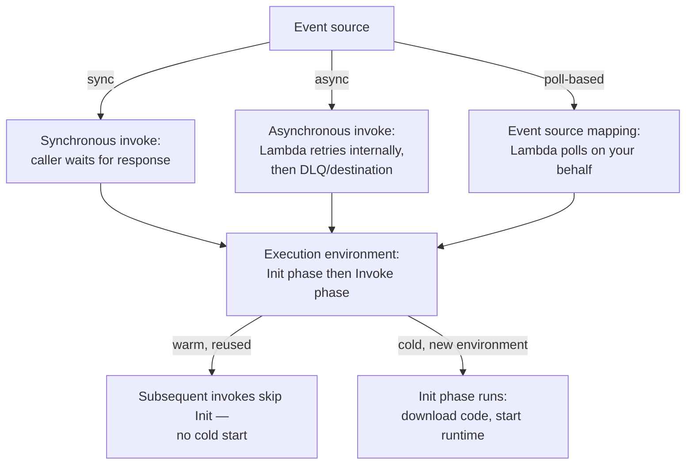

The three invocation models (synchronous, asynchronous, poll-based) determine who's responsible for
retries and how failures surface — see [`README.md`](README.md#lambda-triggers-three-invocation-models-one-function)
and [`lambda-event-source-mapping-deep-dive.md`](lambda-event-source-mapping-deep-dive.md) for the
full depth on each. A cold start only happens when a new execution environment is created; a warm
environment reused for a subsequent invocation skips the Init phase entirely.

### Real AWS image


*Source: [AWS Lambda Developer Guide — Lambda execution environment](https://docs.aws.amazon.com/lambda/latest/dg/lambda-runtime-environment.html)
(curl-verified 200). Init only runs once per new execution environment — everything declared
*outside* your handler function (SDK client construction, a database connection) runs during Init
and is reused across every subsequent warm Invoke, which is exactly why "initialize your SDK client
outside the handler" is the standard cold-start/performance tip: code inside Init amortizes its cost
across potentially thousands of invocations on the same warm environment.*

### Code Example
```python
import boto3, json
ddb = boto3.client("dynamodb")   # Init phase — runs once per environment, reused across warm invokes

def handler(event, context):     # Invoke phase — runs every single invocation
    body = json.loads(event["body"])
    ddb.put_item(TableName="Orders", Item={"orderId": {"S": body["orderId"]}})
    return {"statusCode": 200, "body": json.dumps({"status": "ok"})}
```
```bash
aws lambda put-function-concurrency --function-name create-order --reserved-concurrent-executions 20
aws lambda put-provisioned-concurrency-config --function-name create-order \
  --qualifier prod --provisioned-concurrent-executions 5
```

### Pricing Note
Billed per request and per GB-second of memory × duration, with a perpetual free tier — provisioned concurrency is billed separately for the time it's enabled, whether or not it's actually invoked, which is exactly why it's reserved for traffic patterns predictable enough to justify paying for idle warm capacity.

### Common Exam Scenarios
- *"Cold-start latency is hurting a latency-sensitive API's p99"* → provisioned concurrency, not reserved concurrency (which only caps/guarantees capacity, it doesn't pre-warm).
- *"One noisy function is starving the rest of the account's concurrency pool"* → reserved concurrency on that one function.
- *"A function needs to reach a private RDS instance in a VPC with no public endpoint"* → attach the function to that VPC; don't attach it if it only calls public AWS APIs.

### Exam Tips
- Reserved concurrency caps/guarantees capacity; only provisioned concurrency actually pre-warms
  environments and fixes cold starts — a very common wrong-answer trap.
- Know which invocation model (sync/async/poll-based) a given trigger uses before reasoning about
  its error-handling behavior — the three models fail completely differently.
- Code placed outside the handler runs once per cold environment (Init), not once per invocation —
  this is the mechanism behind the standard "initialize SDK clients globally" performance advice.

---

## 7. AWS STS & Role Switching

### Definition
AWS Security Token Service (STS) issues short-lived, temporary security credentials — an access
key, secret key, and session token that expire automatically — allowing a principal to temporarily
"become" a different IAM role (role switching) instead of using permanent, static credentials.

### Plain-English Analogy
STS is a hotel's keycard system that reissues a fresh, time-limited card for your exact stay
instead of handing you a master key that works forever. Your reservation (the role's trust policy)
determines whether the front desk will issue you a card at all; the card itself (the temporary
credentials) simply stops working at checkout time (expiry) — nobody has to manually deactivate it.

### Purpose
Long-lived credentials are a standing liability: leaked, they work indefinitely until someone
notices and manually revokes them. STS exists so that almost nothing in AWS — EC2 instances,
Lambda executions, cross-account access, federated logins — ever needs a permanent secret; every
one of those gets credentials that expire on their own, usually within an hour, shrinking the blast
radius of any leak automatically.

### When to Use It
- Any Lambda/EC2/ECS compute identity (handled automatically via an execution/instance/task role).
- Cross-account access, using `AssumeRole` with an `ExternalId` for third-party integrations.
- Federated human access (SSO, SAML, web identity) exchanging an external token for temporary AWS
  credentials.

### When NOT to Use It
- Don't reach for a brand-new IAM user with a static key when a role assumable via STS already
  solves the access need — this is nearly always the wrong-answer pattern on the exam.
- `GetSessionToken` (simple MFA-protected temporary creds, same identity) is the wrong tool when the
  actual need is to *change* identity (assume a different role) — know the two are different STS
  operations for different purposes.

### Use Cases
1. A Lambda function's execution role credentials, injected automatically before the handler runs.
2. A third-party SaaS vendor assuming a role in your account via `ExternalId`, defeating the
   confused-deputy problem.
3. A developer using `aws sso login` to get temporary credentials instead of a static access key.
4. Role chaining: a user assumes Role A, then from that session assumes Role B, capped at a 1-hour
   session duration.
5. EKS pods assuming an IAM role via IRSA (web identity federation) without any node-level static
   credentials.
6. A CI/CD pipeline assuming a deployment role scoped only to the specific resources it needs to
   touch, instead of using a long-lived pipeline IAM user.

### Why Important
STS is the mechanism underneath "where do my SDK's credentials actually come from" in every
non-trivial scenario — see
[`aws-sdk-credential-resolution-chain.md`](aws-sdk-credential-resolution-chain.md) for how the SDK
finds these credentials, and this entry for how they were minted in the first place.

### How It Works

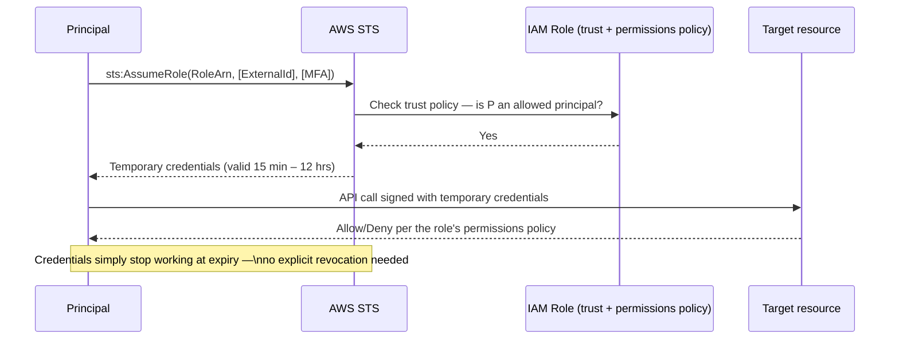

### Real AWS image


*Source: [AWS IAM User Guide — Federating AWS identities across partitions](https://docs.aws.amazon.com/IAM/latest/UserGuide/id_roles_providers_outbound_cross_partition.html)
(curl-verified 200). Illustrates the general trust-token exchange every `AssumeRoleWith*` variant
follows: a token minted by one trust anchor (SAML IdP, OIDC provider, source STS) is validated
against the issuer's public signing keys and exchanged for scoped temporary credentials.*

### Code Example
```python
import boto3
sts = boto3.client("sts")
resp = sts.assume_role(
    RoleArn="arn:aws:iam::222233334444:role/CrossAccountReadOnly",
    RoleSessionName="partner-integration",
    ExternalId="partner-secret-abc123",
)
creds = resp["Credentials"]
s3 = boto3.client("s3", aws_access_key_id=creds["AccessKeyId"],
                   aws_secret_access_key=creds["SecretAccessKey"], aws_session_token=creds["SessionToken"])
```

### Pricing Note
STS API calls (AssumeRole, GetSessionToken, etc.) carry no additional charge beyond standard request pricing where applicable — the cost lives entirely in what the resulting temporary credentials are then used to do, not in the act of assuming a role itself.

### Common Exam Scenarios
- *"A third-party SaaS vendor serving many customers must not be trickable into accessing a different customer's resources via a shared integration"* → ExternalId, the confused-deputy defense.
- *"A user can't even start assuming a role"* → check the role's trust policy, not its permissions policy.
- *"A session is assumed through two roles in sequence"* → role chaining caps the resulting session at 1 hour regardless of either role's configured max.

### Exam Tips
- `ExternalId` defends specifically against the confused-deputy problem in cross-account role
  assumption — know this term by name.
- Role chaining (assuming a role from within an already-assumed role's session) caps the resulting
  session at a maximum of 1 hour, regardless of either role's own configured max session duration.
- A role's trust policy (who can assume it) and permissions policy (what it can do) are two
  separate documents — a symptom of "can't assume the role at all" points at the trust policy; "can
  assume it but every call is denied" points at the permissions policy.

---

## 8. AWS Step Functions

### Definition
AWS Step Functions is a serverless orchestration service for coordinating multiple AWS services
(primarily Lambda, but also direct service integrations with DynamoDB, SQS, SNS, ECS, and more)
into visual, durable workflows called **state machines**, defined declaratively in Amazon States
Language (ASL/JSON), with built-in retry, error-catching, and parallel/branching execution.

### Plain-English Analogy
Step Functions is a flowchart brought to life — each box in the flowchart (a `State`) is an actual
step that runs, and the arrows are the actual control flow the system follows, including "if this
step fails three times, follow this other arrow instead" logic built right into the diagram, not
bolted on as separate retry code scattered through every step.

### Purpose
Coordinating a multi-step process by hand — calling one Lambda, waiting for it, calling the next,
handling partial failures, tracking which step a long-running process is currently on — quickly
turns into fragile glue code with the orchestration logic scattered across functions. Step Functions
exists to make that orchestration an explicit, visual, durable definition instead of implicit code
spread across multiple Lambda functions.

### When to Use It
- Multi-step workflows with explicit sequencing, branching, parallel execution, or wait states.
- Any workflow needing differentiated retry/catch behavior per step (see
  [`idempotency-and-retry-patterns.md`](idempotency-and-retry-patterns.md#worked-exam-scenario-step-functions-retrycatch-on-a-side-effecting-task)).
- Long-running processes (up to a full year for Standard workflows) that need to survive well
  beyond any single Lambda invocation's 15-minute maximum.

### When NOT to Use It
- A single Lambda function handling one atomic unit of work doesn't need an orchestrator wrapped
  around it — that's unnecessary complexity for no coordination benefit.
- Extremely high-throughput, low-latency, short-lived event processing is often better served by
  Express workflows specifically (or no Step Functions at all) rather than Standard workflows, which
  are priced and designed for durability over raw throughput.

### Use Cases
1. An order-processing workflow: validate → charge payment (with retry/catch) → update inventory →
   notify, each a discrete state with its own error handling.
2. A human-approval gate inside a data pipeline, using a Wait-for-callback (`.waitForTaskToken`)
   task that pauses until an external system calls back.
3. Fan-out parallel processing: resize an uploaded image into five different sizes simultaneously
   using a `Parallel` or `Map` state.
4. A long-running ML training/inference pipeline coordinating Bedrock/SageMaker calls, each too
   slow for a single Lambda's 15-minute cap.
5. Saga-pattern distributed transactions: a multi-step booking process that explicitly undoes
   earlier steps (cancels a reservation) if a later step fails.
6. CI/CD-adjacent orchestration: an AI-assisted deployment-risk check feeding a Step Functions
   manual-approval task before a pipeline continues.

### Why Important
Task 1.1's event-driven, multi-service orchestration scenarios frequently resolve to Step Functions
once more than a couple of steps with differentiated error handling are involved — recognizing when
a scenario has outgrown "just chain some Lambda calls together" into "this needs an explicit state
machine" is a recurring exam judgment call.

### How It Works

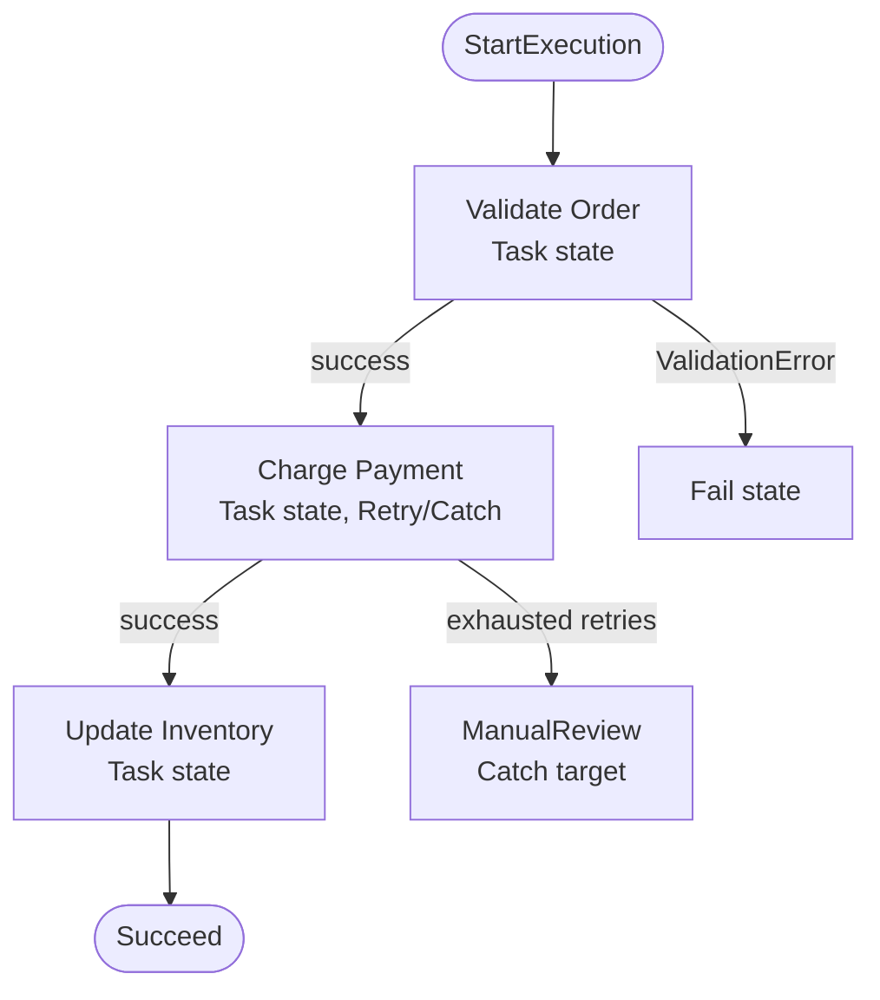

### Real AWS image


*Source: [AWS Step Functions Developer Guide — What is AWS Step Functions?](https://docs.aws.amazon.com/step-functions/latest/dg/welcome.html)
(curl-verified 200). This console-rendered visual workflow is a genuine operational tool, not just
documentation: during an incident, seeing exactly which state an in-flight execution is stuck on —
rendered visually, state by state — is dramatically faster triage than reading disjointed Lambda
logs across several functions trying to reconstruct the same sequence mentally.*

### Code Example
```json
{
  "StartAt": "ValidateOrder",
  "States": {
    "ValidateOrder": { "Type": "Task", "Resource": "arn:aws:lambda:...:ValidateOrder", "Next": "ChargePayment" },
    "ChargePayment": {
      "Type": "Task", "Resource": "arn:aws:lambda:...:ChargePayment",
      "Retry": [{ "ErrorEquals": ["States.Timeout"], "MaxAttempts": 3, "BackoffRate": 2.0 }],
      "Catch": [{ "ErrorEquals": ["States.ALL"], "Next": "ManualReview" }],
      "Next": "UpdateInventory"
    },
    "UpdateInventory": { "Type": "Task", "Resource": "arn:aws:lambda:...:UpdateInventory", "End": true },
    "ManualReview": { "Type": "Succeed" }
  }
}
```

### Pricing Note
Standard workflows bill per state transition; Express workflows bill per execution duration and memory, similar in spirit to Lambda's pricing model — a long-running Standard workflow with many steps costs differently than a high-volume, short-lived Express workflow, which is itself a reason to pick the right workflow type for the traffic shape, not just the durability need.

### Common Exam Scenarios
- *"A payment charge step should retry automatically on a transient AWS-side timeout, but never retry (and instead route to manual review) on a definitive card-declined error"* → differentiated Retry/Catch blocks matching specific error names.
- *"A workflow must survive well beyond Lambda's 15-minute maximum, coordinating steps over hours or days"* → Step Functions Standard workflow, not a single long-running Lambda.
- *"An execution started twice with the same business key by mistake should not create two parallel runs"* → the name parameter on StartExecution deduplicates natively.

### Exam Tips
- `Retry`/`Catch` on individual states is the headline Task 1.1/1.3 testable mechanism — know that
  each can match specific error names, not just a blanket "retry everything."
- Standard workflows support executions up to a year and exactly-once semantics; Express workflows
  trade that durability for higher throughput and at-least-once semantics — pick based on the
  stated duration/throughput requirement.
- A `name` passed to `StartExecution` deduplicates executions natively — recognize this as built-in
  idempotency, not something you need to hand-build with a separate table.

---

## 9. Amazon API Gateway

### Definition
Amazon API Gateway is a fully managed service for creating, publishing, securing, and monitoring
REST, HTTP, and WebSocket APIs at any scale, acting as the "front door" for applications to access
backend logic running on Lambda, EC2, ECS, or any publicly reachable HTTP endpoint.

### Plain-English Analogy
API Gateway is the reception desk of an office building. Visitors (clients) never walk directly
into any department (Lambda function, EC2 fleet); they check in at reception first, where their
credentials are verified (authorization), they're told how many visitors per minute the building
allows (throttling), and they're pointed to the correct department (routing/integration) — the
departments themselves never have to handle visitor intake logic.

### Purpose
Exposing backend compute directly to the internet means every function/service has to handle its
own TLS termination, authentication, rate limiting, and request validation — duplicated effort
across every endpoint. API Gateway exists to centralize all of that at one front door, so backend
code (Lambda handlers, in this domain) only has to handle business logic.

### When to Use It
- Fronting a Lambda-based or container-based backend with a managed, authenticated, throttled API
  surface.
- Needing multiple deployment stages (dev/test/prod) with independent configuration, promoted
  through a controlled deployment process.
- WebSocket APIs for persistent, bidirectional client connections (chat, live updates) without
  managing your own connection-handling infrastructure.

### When NOT to Use It
- Extremely simple internal-only service-to-service calls within a VPC may not need a public API
  Gateway layer at all — a direct internal ALB or VPC Lattice setup can be simpler.
- If a GraphQL aggregation model fits better (multiple sources, client-selected fields), AppSync is
  the more natural fit than forcing a REST shape onto a multi-source aggregation need.

### Use Cases
1. A REST API backed by Lambda functions, with a Cognito authorizer enforcing authenticated access.
2. Promoting the same deployment through `dev` and `prod` stages with different stage variables
   pointing at different Lambda aliases.
3. A WebSocket API for a real-time multiplayer game's state updates.
4. Request validation at the gateway (reject malformed JSON before it ever reaches Lambda),
   reducing wasted invocations.
5. Usage plans and API keys to throttle and meter different third-party API consumers separately.
6. An HTTP API (the lighter-weight, lower-latency alternative to REST API) proxying straight to an
   ALB fronting a containerized backend.

### Why Important
Task 1.1 explicitly calls out "use API Gateway stages correctly" — stage variables, throttling,
and deployment promotion are concrete, testable mechanics, and nearly every Domain 1 synchronous
request-flow scenario (see [`README.md`](README.md#how-it-fits-together-a-lambda--api-gateway--dynamodb-request))
starts here.

### How It Works

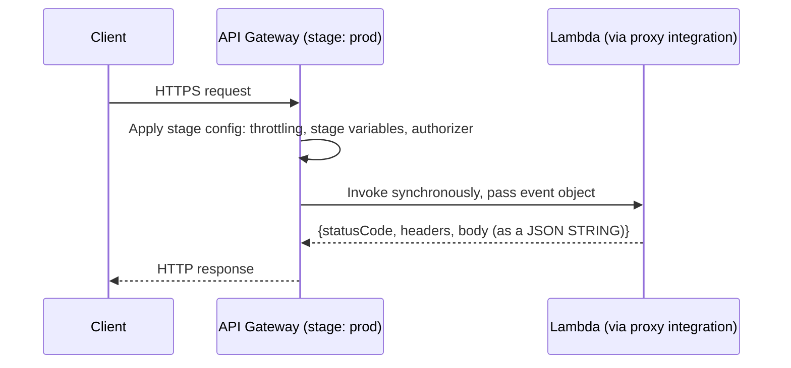

A **stage** is a named, independently configured snapshot of a deployed API — the same API
definition can have `dev` and `prod` stages with different throttle limits and different stage
variables (commonly which Lambda alias/version to invoke), letting you promote a tested deployment
from one stage to another without redefining the API.

### Real AWS image


*Source: [AWS API Gateway Developer Guide — What is Amazon API Gateway?](https://docs.aws.amazon.com/apigateway/latest/developerguide/welcome.html)
(curl-verified 200). Shows API Gateway as the single front door fanning out to Lambda, EC2, and any
other web application — a reminder this service is not Lambda-exclusive, even though this domain's
scenarios lean heavily on the Lambda integration.*

### Code Example
```bash
aws apigateway create-deployment --rest-api-id abc123 --stage-name prod
aws apigateway update-stage --rest-api-id abc123 --stage-name prod \
  --patch-operations op=replace,path=/throttle/rateLimit,value=500
```
```python
# Lambda proxy integration response — the exact shape API Gateway requires
import json
def handler(event, context):
    return {"statusCode": 200, "headers": {"Content-Type": "application/json"},
            "body": json.dumps({"orderId": "abc-123"})}  # body MUST be a string
```

### Pricing Note
Billed per million API calls (REST/HTTP APIs) or per connection-minute plus messages (WebSocket APIs) — HTTP APIs are meaningfully cheaper per call than REST APIs for simple Lambda-proxy use cases, a real cost lever worth knowing when a scenario doesn't need REST-API-only features like usage plans or request validation.

### Common Exam Scenarios
- *"A Lambda function logs a clean successful run but the client still sees a 502"* → the proxy integration response's body isn't a JSON string.
- *"The same API needs different throttle limits and backend targets per environment, promoted in sequence"* → stages with distinct stage variables.
- *"A real-time, persistent, bidirectional client connection is needed, not request/response"* → a WebSocket API.

### Exam Tips
- `body` in a Lambda proxy integration response must be a JSON string, not a raw object — missing
  this is the single most common "502 despite successful function logs" exam/real bug.
- Stage variables let one API definition point at different backend targets (Lambda aliases) per
  stage — this is the concrete mechanic behind "promote through environments."
- Request validation and usage plans/API keys both live at the gateway layer, reducing backend load
  from malformed or unauthorized requests before they ever reach your code.

---

## 10. Amazon Aurora

### Definition
Amazon Aurora is a MySQL- and PostgreSQL-compatible relational database engine built for the
cloud, using a distributed, auto-scaling, multi-AZ-replicated shared storage layer decoupled from
compute, delivering higher throughput and faster failover than standard RDS on the same engines.

### Plain-English Analogy
Standard RDS is like each database instance having its own private water tank it fills and drains
independently; Aurora is a shared municipal water system underneath every instance connected to
it — a new "instance" (a reader) doesn't need its own tank refilled from scratch, it just gets a
new pipe connected to the same already-full reservoir, which is why adding an Aurora read replica
is so much faster than provisioning a brand-new standard RDS replica from a fresh snapshot.

### Purpose
Standard relational databases replicate data between instances over the network, which caps
throughput and slows failover. Aurora's storage layer is itself distributed and replicated six ways
across three Availability Zones *before* any compute instance even attaches to it — compute
instances (writer and readers) all point at the same shared, self-healing storage, which is why
Aurora failover is typically under 30 seconds and adding read capacity is fast.

### When to Use It
- Relational (SQL, ACID, multi-table joins) workloads needing higher throughput or faster failover
  than standard RDS on the same engine, at a similar operational model.
- Unpredictable or highly variable relational workloads, using Aurora Serverless v2 to scale
  capacity automatically without manual instance resizing.
- Global applications needing cross-Region read replicas with low replication lag (Aurora Global
  Database).

### When NOT to Use It
- Workloads needing simple key-value access at extreme scale with no joins are typically a
  DynamoDB fit, not Aurora — don't force a NoSQL access pattern into a relational engine just
  because Aurora "could" technically hold the data.
- Teams specifically needing Oracle/SQL Server compatibility should use standard RDS (or RDS
  Custom) — Aurora only supports MySQL- and PostgreSQL-compatible engines.

### Use Cases
1. An e-commerce platform's order/invoice system needing ACID transactions across normalized
   tables.
2. A SaaS product with unpredictable traffic using Aurora Serverless v2 to scale capacity units
   automatically instead of manually resizing instances.
3. A globally distributed application using Aurora Global Database for low-latency reads in
   multiple Regions, with a single write Region.
4. A read-heavy reporting workload adding Aurora read replicas quickly, without a lengthy
   replica-provisioning process.
5. A disaster-recovery requirement needing sub-30-second automatic failover to a reader promoted
   to writer.
6. A legacy MySQL/PostgreSQL application migrating to AWS wanting higher throughput with minimal
   application code changes, since Aurora is wire-compatible with both engines.

### Why Important
Task 1.3's "choose and use RDS/Aurora correctly" and the ACID-transaction decision point in the
Database Selection Guide both hinge on recognizing Aurora as the answer whenever a scenario needs
relational guarantees *and* higher scale/availability than a standard RDS instance alone provides.

### How It Works

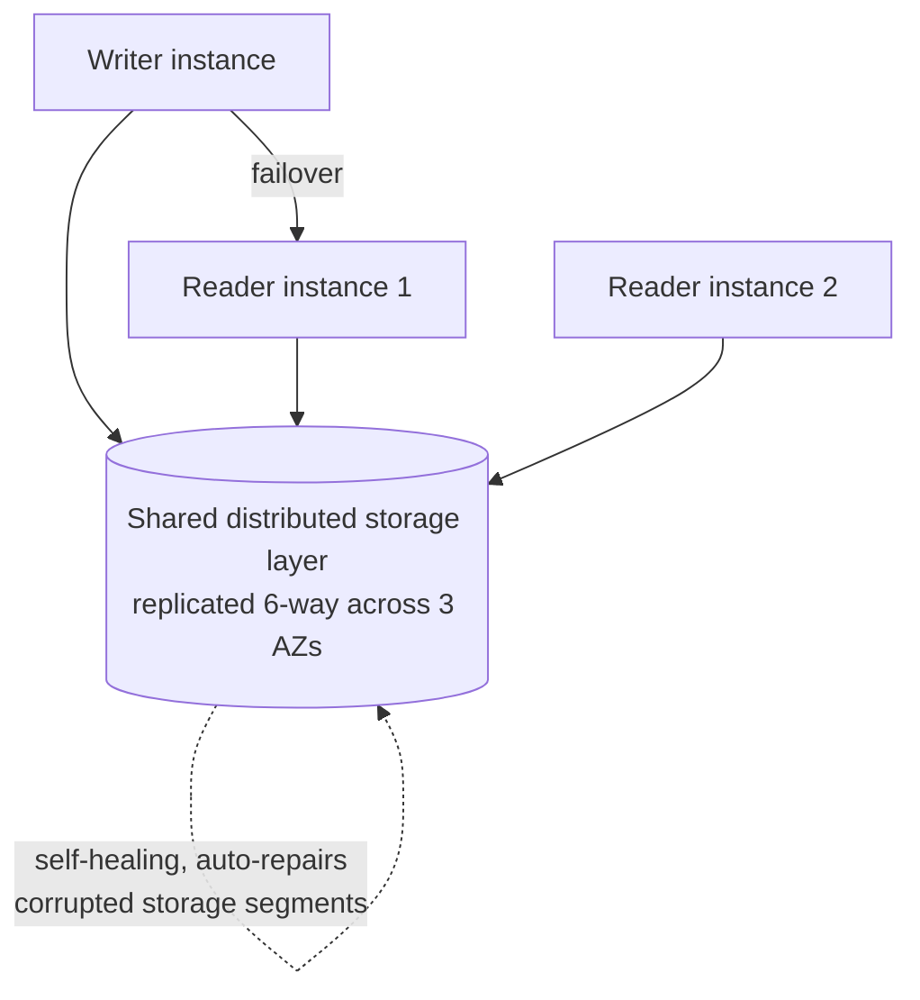

All instances (one writer, zero or more readers) attach to the *same* shared storage volume —
writes from the writer are visible to readers within single-digit milliseconds of replication lag,
and promoting a reader to writer on failover doesn't require re-copying any data, since the reader
was already attached to the exact same storage.

### Real AWS image


*Source: [Amazon Aurora User Guide — Aurora DB clusters](https://docs.aws.amazon.com/AmazonRDS/latest/AuroraUserGuide/Aurora.Overview.html)
(curl-verified 200). The shared storage layer is the entire architectural story here — every
instance in the diagram is a compute attachment point to the same underlying storage, which is the
concrete reason Aurora failover and read-replica provisioning are both dramatically faster than
standard RDS's independent-storage-per-instance model.*

### Code Example
```python
import boto3
rds = boto3.client("rds")
rds.create_db_cluster(
    DBClusterIdentifier="orders-cluster", Engine="aurora-postgresql",
    MasterUsername="admin", MasterUserPassword="***", ServerlessV2ScalingConfiguration={"MinCapacity": 0.5, "MaxCapacity": 8},
)
```
```sql
-- Application code uses the SAME SQL as standard PostgreSQL — wire-compatible
BEGIN;
INSERT INTO invoices (customer_id, total) VALUES (42, 199.99);
INSERT INTO invoice_items (invoice_id, product, amount) VALUES (currval('invoices_id_seq'), 'widget', 199.99);
COMMIT;
```

### Pricing Note
Billed per instance-hour (or per ACU-hour for Serverless v2) plus storage consumed and I/O requests — Aurora's storage auto-scales and bills for actual usage, removing the need to pre-provision a fixed volume size the way some other engines require.

### Common Exam Scenarios
- *"A relational workload needs higher throughput and faster failover than a standard RDS instance on the same engine provides"* → Aurora, not a resharded NoSQL redesign.
- *"Read capacity needs to scale up quickly without a lengthy replica-provisioning process"* → Aurora read replicas attach to the same shared storage almost immediately.
- *"Traffic is highly unpredictable and manual instance resizing would always be reactive"* → Aurora Serverless v2.

### Exam Tips
- "Need joins/ACID transactions at higher throughput/faster failover than a single RDS instance" →
  Aurora, not a resharded DynamoDB design.
- Aurora Serverless v2 scales capacity automatically within configured min/max — the answer for
  unpredictable relational workloads where manual instance resizing would be reactive and slow.
- Aurora Global Database replicates across Regions with typically sub-second lag — a distinct
  feature from standard RDS cross-Region read replicas (which Aurora also supports, but Global
  Database is purpose-built and faster).

---

## 11. Amazon Bedrock

### Definition
Amazon Bedrock is AWS's fully managed service for accessing and customizing foundation models
(large pre-trained generative AI models) from multiple providers through one consistent API,
without provisioning or managing any GPU infrastructure yourself.

### Plain-English Analogy
Bedrock is a utility company for electricity, except the "electricity" is AI model inference. You
don't build a power plant (train/host a model) to turn on a light (get an AI-generated answer) —
you just plug into the grid (call the API) and get metered, pay-per-use access to power generated
by someone else's enormous, expensive infrastructure.

### Purpose
Training or self-hosting a foundation model requires ML expertise and infrastructure most
application teams don't have. Bedrock exists so an ordinary application team can integrate
generative AI (chat, summarization, embeddings, RAG, agents) via API calls, with AWS handling model
hosting, scaling, and keeping customer prompts/data out of model retraining.

### When to Use It
- Adding generative AI features (chat, summarization, content generation) to an application without
  hosting a model yourself.
- Building a RAG (Retrieval-Augmented Generation) application grounded in your own private
  documents, using a Bedrock Knowledge Base.
- Building an autonomous or semi-autonomous agent that can call your own APIs/Lambda functions in
  response to natural-language requests (Bedrock Agents).

### When NOT to Use It
- Deterministic, rules-based logic (exact calculations, strict validation) doesn't belong in a
  foundation model call — use ordinary application code for anything that needs a guaranteed,
  reproducible answer rather than a generated one.
- Teams needing a finished, pre-built internal chatbot product rather than building custom AI
  features from primitives are better served by Amazon Q Business, which is built on top of Bedrock
  but packages the RAG/indexing work for you.

### Use Cases
1. A customer support app summarizing a long support ticket thread into a short triage summary.
2. A RAG chatbot grounded in a company's internal wiki, reducing hallucination versus an
   ungrounded model.
3. An agent that can check order status and issue refunds by calling your own Lambda functions in
   response to natural-language customer requests.
4. Generating product description drafts from structured catalog data, with a human editor
   reviewing before publish.
5. Content moderation: classifying user-submitted text/images against policy categories using a
   foundation model instead of hand-written rules.
6. Extracting structured fields (dates, amounts, parties) from unstructured contract text for
   downstream processing.

### Why Important
DVA-C03 added Bedrock/generative-AI awareness as new exam content — Domain 1 needs to recognize
when a scenario calls for a managed foundation-model API versus a classic deterministic service,
and know the core vocabulary (prompt, context window, RAG, embeddings, agents) well enough to
reason about which Bedrock feature addresses which requirement.

### How It Works

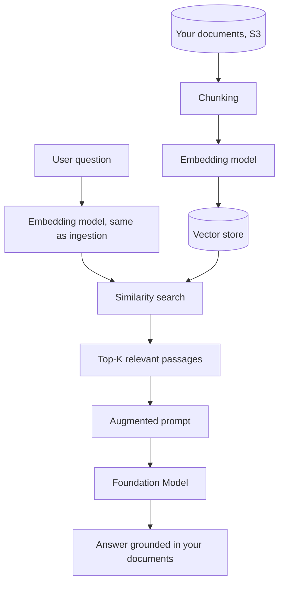

RAG grounds a model's answer in your own retrieved documents rather than relying purely on what it
memorized during training — dramatically reducing hallucination for knowledge the model was never
trained on, while keeping your proprietary data out of any model retraining process.

### Real AWS image


*Source: [AWS Machine Learning Blog — Bedrock Knowledge Bases RAG architecture](https://aws.amazon.com/blogs/machine-learning/)
(curl-verified 200). Notice the familiar Domain 1 building blocks doing the orchestration work:
S3 for document storage, Lambda for ingestion triggering, API Gateway fronting the chat API — RAG
applications reuse this domain's ordinary primitives around the genuinely new piece (the vector
store and the foundation model call itself).*

### Code Example
```python
import boto3, json
bedrock = boto3.client("bedrock-runtime")
resp = bedrock.invoke_model(
    modelId="anthropic.claude-3-sonnet-20240229-v1:0",
    body=json.dumps({"anthropic_version": "bedrock-2023-05-31", "max_tokens": 200,
                      "messages": [{"role": "user", "content": "Summarize this ticket: ..."}]}),
)
print(json.loads(resp["body"].read())["content"][0]["text"])
```

### Pricing Note
Billed per token (input and output separately, and input tokens are usually cheaper than output tokens) for on-demand model invocation, or per provisioned throughput if reserving dedicated capacity for predictable high-volume workloads — Knowledge Base and Agent features add their own usage-based charges on top of the underlying model calls.

### Common Exam Scenarios
- *"An application needs to answer questions grounded in a company's own private documents, with reduced hallucination"* → a Bedrock Knowledge Base (RAG), not an ungrounded raw model call.
- *"Certain topics or PII must never appear in a model's output regardless of what a user asks"* → Guardrails, a policy layer distinct from the model call itself.
- *"An agent needs to actually take actions (check order status, issue a refund) in response to natural language"* → Bedrock Agents calling your own Lambda functions/APIs.

### Exam Tips
- RAG exists specifically to reduce hallucination by grounding answers in retrieved real documents
  — recognize this as the answer whenever a scenario needs answers based on private/internal data.
- Guardrails filter both input and output content regardless of what the model generates — a
  distinct layer from the model call itself, and the right answer for "block certain topics/PII."
- Bedrock keeps customer prompts/data out of model retraining by default — a key differentiator
  versus calling an external, non-AWS-native AI API directly for data-sensitive use cases.

---

## 12. Amazon CloudWatch

### Definition
Amazon CloudWatch is AWS's native observability service — collecting metrics, logs, and alarms
from virtually every AWS resource and custom application code, giving you dashboards, alerting, and
log search/analysis in one place.

### Plain-English Analogy
CloudWatch is a hospital's central monitoring station: every patient (resource) is wired to
sensors reporting vital signs (metrics) continuously to one shared monitor wall; a threshold
breach (an alarm) pages a nurse automatically instead of requiring someone to watch every single
screen manually, and every patient's chart (logs) is available for review when something needs
investigating after the fact.

### Purpose
Operating any non-trivial application without visibility into its health is operating blind —
CloudWatch exists to centralize that visibility across every AWS service uniformly, so you don't
need a different monitoring tool per service, and so automated action (an alarm triggering an Auto
Scaling action or an SNS notification) can happen without a human watching a dashboard in real time.

### When to Use It
- Monitoring any AWS resource's health/performance metrics (Lambda duration/errors, DynamoDB
  throttles, EC2 CPU) with automatic alerting on thresholds.
- Centralizing application logs (Lambda automatically ships logs here) for searching and debugging.
- Building custom metrics/dashboards for business-specific signals (orders per minute, queue depth)
  alongside AWS's own built-in metrics.

### When NOT to Use It
- Deep distributed-tracing across many microservices is X-Ray's specialty, not CloudWatch's
  (though the two integrate closely) — don't expect CloudWatch alone to reconstruct a multi-service
  request's full timeline.
- Long-term log retention at very large scale/low cost is sometimes better served by exporting logs
  to S3 rather than keeping everything in CloudWatch Logs indefinitely at its storage pricing.

### Use Cases
1. An alarm on a Lambda function's `Errors` metric triggers an SNS notification to an on-call
   engineer.
2. CloudWatch Logs Insights queries searching millions of log lines for a specific error pattern
   during an incident.
3. A custom business metric (checkout conversion rate) published from application code and
   graphed on a dashboard alongside infrastructure metrics.
4. An alarm on DynamoDB `ThrottledRequests` triggering an automatic capacity adjustment.
5. CloudWatch Logs subscription filters streaming log data into a Firehose delivery stream for
   long-term analysis in S3/OpenSearch.
6. Composite alarms combining multiple metric conditions (high latency AND high error rate) before
   paging, reducing noisy single-metric false alarms.

### Why Important
Nearly every troubleshooting scenario across all four exam domains starts with "what does
CloudWatch show" — Domain 1 specifically needs it for confirming whether application code is
actually erroring (Lambda logs/metrics) versus failing at the integration layer (API Gateway
metrics), the exact distinction the README's 502-debugging worked scenario exercises.

### How It Works

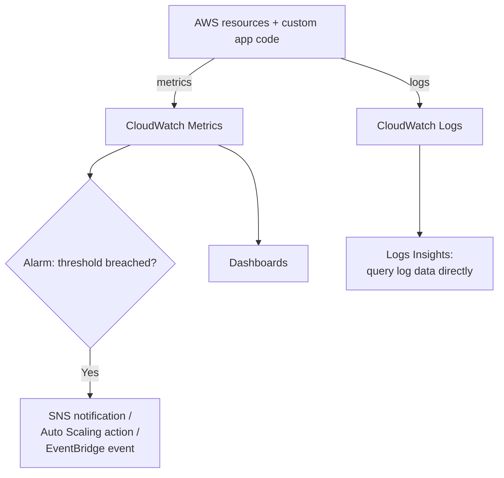

### Real AWS image


*Source: [Amazon CloudWatch User Guide — What is Amazon CloudWatch?](https://docs.aws.amazon.com/AmazonCloudWatch/latest/monitoring/WhatIsCloudWatch.html)
(curl-verified 200). The default dashboard aggregates alarm state across every monitored service in
one view — the exam-relevant habit this encourages is checking CloudWatch *first* during any
"what's wrong" scenario, before diving into any one service's own console.*

### Code Example
```python
import boto3
cw = boto3.client("cloudwatch")
cw.put_metric_data(Namespace="OrdersApp", MetricData=[
    {"MetricName": "CheckoutConversionRate", "Value": 0.42, "Unit": "Percent"}
])
cw.put_metric_alarm(
    AlarmName="LambdaHighErrorRate", MetricName="Errors", Namespace="AWS/Lambda",
    Statistic="Sum", Period=60, EvaluationPeriods=2, Threshold=5, ComparisonOperator="GreaterThanThreshold",
    AlarmActions=["arn:aws:sns:us-east-1:123456789012:oncall-alerts"],
)
```

### Pricing Note
Billed per custom metric, per log ingestion/storage GB, per alarm, and per dashboard — ingesting extremely verbose application logs at high volume is a frequently underestimated real cost driver, worth right-sizing log verbosity for in production rather than leaving debug-level logging on indefinitely.

### Common Exam Scenarios
- *"Too many noisy single-metric alerts are paging on-call unnecessarily"* → a composite alarm requiring multiple conditions together.
- *"An incident needs a pattern found across millions of log lines quickly"* → CloudWatch Logs Insights, not manually scrolling raw log streams.
- *"A custom business metric needs to appear on a dashboard alongside built-in AWS metrics"* → an explicit put_metric_data call; AWS service metrics publish automatically, custom ones don't.

### Exam Tips
- Lambda, API Gateway, and DynamoDB all publish metrics to CloudWatch automatically with zero
  extra code — custom business metrics require an explicit `put_metric_data` call.
- CloudWatch Logs Insights is the tool for *searching* log content at scale; raw log streaming is
  not the same capability as a scenario describing "query across millions of log lines for a
  pattern."
- Composite alarms reduce false-positive paging by requiring multiple conditions together — know
  this as the answer to "too many noisy single-metric alerts."

---

## 13. Amazon Data Firehose

### Definition
Amazon Data Firehose (formerly Kinesis Data Firehose) is a fully managed service that captures
streaming data and automatically delivers it — buffered, optionally transformed, and batched — to a
destination like S3, Redshift, OpenSearch, Splunk, Snowflake, or Apache Iceberg tables, with zero
consumer code to write or operate.

### Plain-English Analogy
Firehose is an always-running conveyor belt loading dock: items arrive continuously, accumulate
into a crate once it's full enough (or enough time has passed), and the crate is automatically
shipped to its destination — no one drives a forklift; you configure the destination once and the
belt just keeps running.

### Purpose
Getting streaming data to land somewhere durable and queryable is usually a *delivery* problem, not
a *compute* problem — Firehose exists so "just deliver it reliably, near real time, zero ops" is a
configuration choice, the delivery counterpart to Kinesis Data Streams' write-your-own-consumer model.

### When to Use It
- Streaming data needs to land in S3/Redshift/OpenSearch/Splunk with no custom consumer application.
- Format conversion (JSON → Parquet/ORC) and partitioning are needed at delivery time, declaratively.
- An existing Kinesis Data Stream or MSK topic needs a zero-code delivery path to a destination
  alongside (or instead of) a custom consumer application.

### When NOT to Use It
- Any scenario needing custom, stateful, multi-step processing logic per record belongs to a real
  consumer application (Kinesis Data Streams + your own code), not Firehose's simple transform hook.
- Sub-second delivery latency requirements don't fit Firehose's buffering model well — it's near
  real time, not a replacement for a synchronous, low-latency call path.

### Use Cases
1. IoT sensor data delivered continuously to S3, partitioned by hour, converted to Parquet.
2. Application logs streamed to OpenSearch for near-real-time search, with a parallel S3 backup.
3. Clickstream events delivered to Redshift for analytics, with Firehose handling the S3-staging
   and `COPY` command automatically.
4. CloudWatch Logs subscription filters streaming directly into Firehose with zero custom glue code.
5. A Lambda transform enriching/filtering each record before it's written to the destination.
6. Dynamic partitioning routing records to different S3 prefixes based on a field in the data itself.

### Why Important
Task 1.1's "work with streaming data" bullet has two correct answers depending on wording: Kinesis
Data Streams when the scenario implies you write the consumer; Firehose when it implies "deliver
with no consumer code" — recognizing which is being asked is the entire exam-relevant skill here.

### How It Works

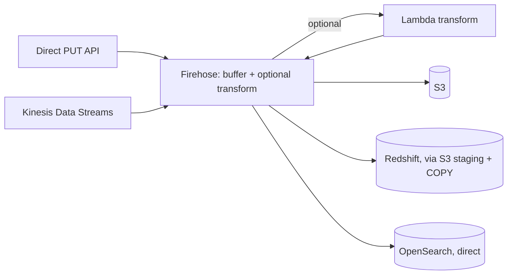

### Real AWS image


*Source: [AWS Data Firehose Developer Guide](https://docs.aws.amazon.com/firehose/latest/dev/what-is-this-service.html)
(curl-verified 200). The optional backup bucket for pre-transformation source data is the detail
worth remembering: a bug in a transformation Lambda never destroys your ability to recover the
original, untransformed records.*

### Code Example
```python
import boto3
firehose = boto3.client("firehose")
firehose.put_record(DeliveryStreamName="clickstream-to-s3",
                     Record={"Data": b'{"event":"page_view","page":"/home"}\n'})
```

### Pricing Note
Billed per GB of data ingested, with additional charges for format conversion and any invoked Lambda transformation — no charge for the delivery infrastructure itself beyond the data volume processed, consistent with its zero-ops positioning.

### Common Exam Scenarios
- *"Streaming data must land in S3/Redshift/OpenSearch with zero consumer code to write or operate"* → Firehose, not a hand-written Kinesis Data Streams consumer.
- *"Format conversion to Parquet and partitioning by a field in the data are both needed at delivery time"* → Firehose's built-in transform/partitioning, not a custom Lambda pipeline.
- *"Data seems to be missing at the destination after a transformation Lambda was added"* → check the error output S3 prefix before assuming data loss.

### Exam Tips
- "No consumer code to write or operate, deliver to S3/Redshift/OpenSearch/Splunk" → Firehose, not
  a hand-written Kinesis Data Streams consumer.
- S3 is either the final destination, a mandatory staging stop (Redshift), or an optional parallel
  backup (OpenSearch) — know Firehose's relationship to S3 differs by destination.
- Buffer size/interval trade latency against cost/file-count efficiency — a smaller buffer delivers
  faster but produces more, smaller files.

---

## 14. Amazon DynamoDB

### Definition
Amazon DynamoDB is a fully managed, serverless NoSQL key-value and document database delivering
single-digit-millisecond performance at any scale, with data automatically partitioned across
servers based on a partition key.

### Plain-English Analogy
DynamoDB is a vast wall of labeled lockers (partitions), where the locker you go to is determined
instantly by hashing your key — you never search the whole wall, you compute which locker and walk
straight there, which is why lookups stay fast no matter how many lockers exist, but it's also why
poor key design (everyone wanting the same locker) creates a bottleneck at that one locker.

### Purpose
Relational databases struggle to scale horizontally for simple key-based access patterns at
extreme scale — connection pools and joins add overhead that a pure "fetch by key" pattern doesn't
need. DynamoDB exists to serve exactly that access shape at effectively unlimited, predictable-
latency scale, trading SQL joins and transactions-across-many-items for that scalability.

### When to Use It
- Access pattern is simple key lookups (by partition key, optionally + sort key) at large or bursty
  scale, needing predictable low-latency performance.
- Serverless application backends where operational overhead (patching, capacity planning) should
  be minimal to zero.
- Workloads needing microsecond reads on hot items, layered with DAX.

### When NOT to Use It
- Workloads needing SQL joins across normalized tables or ad hoc query flexibility are an RDS/Aurora
  fit, not DynamoDB — forcing joins into DynamoDB means expensive application-side stitching.
- Analytical, scan-heavy, ad hoc reporting queries are a poor fit — DynamoDB rewards access patterns
  designed in advance, not arbitrary queries after the fact.

### Use Cases
1. A flash-sale order system needing extreme burst scale with simple key-based reads/writes.
2. A session-store backing a web application, keyed by session ID.
3. A mobile app's user profile store, read by user ID on every app launch.
4. An IoT device-state table, keyed by device ID, updated at high frequency.
5. An idempotency-key table enforcing exactly-once order creation via conditional writes.
6. A gaming leaderboard using a sort key for score-ordered queries within a partition.

### Why Important
Task 1.3 centers on DynamoDB access patterns and consistency choices — knowing when
`ConsistentRead=true` is worth its doubled cost, and how partition key design avoids hot
partitions, is tested directly and repeatedly.

### How It Works

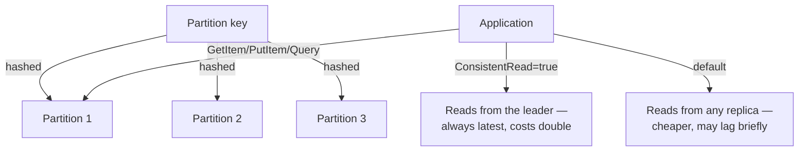

### Real AWS image


*Source: [Amazon DynamoDB Developer Guide — Partitions and data distribution](https://docs.aws.amazon.com/amazondynamodb/latest/developerguide/HowItWorks.Partitions.html)
(curl-verified 200). Every item lands in exactly one partition determined purely by its partition
key's hash — the entire reason partition key design (spreading keys evenly) is a first-class exam
topic, not an implementation detail.*

### Code Example
```python
import boto3
ddb = boto3.client("dynamodb")
ddb.put_item(TableName="Orders", Item={"orderId": {"S": "abc-123"}, "item": {"S": "widget"}},
             ConditionExpression="attribute_not_exists(orderId)")
resp = ddb.get_item(TableName="Orders", Key={"orderId": {"S": "abc-123"}}, ConsistentRead=True)
```

### Pricing Note
On-demand mode bills per read/write request unit consumed; provisioned mode bills per hour of reserved throughput regardless of actual usage — on-demand suits unpredictable/bursty traffic (like the flash-sale case study), while provisioned with auto scaling suits steady, forecastable load at a lower unit cost.

### Common Exam Scenarios
- *"An item must be readable immediately after being written, reflecting the very latest value, every single time"* → ConsistentRead=true, at double the read-capacity cost.
- *"Write throughput throttles on one specific key even though overall table capacity looks fine"* → a hot partition key, fixable by better key design, not by raising table-wide capacity alone.
- *"The same POST request might arrive twice due to a client retry and must not create two records"* → ConditionExpression=attribute_not_exists(pk).

### Exam Tips
- `ConsistentRead=true` guarantees the latest write is visible, at double the read-capacity cost —
  apply it only on the specific access pattern that needs it, not globally.
- A hot partition key (uneven key distribution) throttles that one partition regardless of overall
  table capacity — the same lesson Kinesis's partition key design teaches, reused here.
- `ConditionExpression=attribute_not_exists(pk)` is the standard idempotent-write mechanism on this
  exam — see [`idempotency-and-retry-patterns.md`](idempotency-and-retry-patterns.md).

---

## 15. Amazon ElastiCache

### Definition
Amazon ElastiCache is a fully managed in-memory data store and cache service, supporting
Redis OSS/Valkey and Memcached engines, used to reduce load on a primary database and serve
extremely low-latency reads for frequently accessed data.

### Plain-English Analogy
ElastiCache is a sticky note on your desk with an answer you looked up five minutes ago, instead of
walking back to the filing cabinet (the primary database) every single time you need that same
answer again — much faster to check the sticky note, as long as you remember to update it when the
real answer changes.

### Purpose
Repeatedly querying a primary database for the same, rarely-changing data wastes database capacity
and adds latency that an in-memory lookup wouldn't have. ElastiCache exists to sit in front of (or
alongside) a primary data store, absorbing read traffic for hot data and serving it at microsecond
latency instead of round-tripping to the database every time.

### When to Use It
- Caching expensive or frequently repeated database query results to reduce primary-database load.
- Session storage needing extremely fast read/write access shared across a fleet of application
  servers.
- Real-time leaderboards, counters, or rate-limiting logic needing atomic in-memory operations.

### When NOT to Use It
- Data that must always be perfectly fresh/consistent and rarely repeated access shouldn't be
  cached at all — caching adds a staleness window that isn't worth it for data read only once.
- Don't use ElastiCache as a system of record — a cache can be flushed or evicted; the primary data
  store (RDS/DynamoDB) remains the durable source of truth.

### Use Cases
1. Caching a product catalog's frequently-read pages to absorb traffic spikes without scaling RDS.
2. Storing web session data shared across a horizontally scaled application tier.
3. A real-time gaming leaderboard using Redis sorted sets for atomic score updates and ranking.
4. Rate-limiting API requests per user using Redis atomic increment/expire operations.
5. Caching the results of an expensive aggregation query, refreshed on a schedule.
6. Pub/Sub messaging between application components using Redis's built-in pub/sub feature.

### Why Important
Task 1.3 explicitly calls out layering a cache in front of a data store — recognizing when a
scenario's "reduce database load" or "sub-millisecond repeated reads" requirement points at
ElastiCache (general-purpose cache) versus DAX (DynamoDB-specific cache) is a frequently tested
distinction.

### How It Works

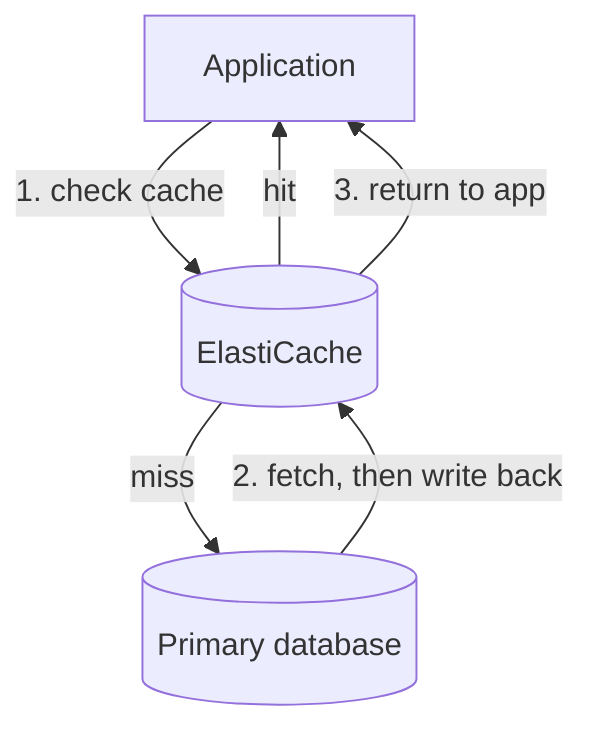

The **cache-aside** pattern shown here is the most common shape: the application checks the cache
first, and only on a miss does it query the primary database, writing the result back to the cache
for next time.

### Real AWS image


*Source: [Amazon ElastiCache User Guide — Redis OSS/Valkey clusters](https://docs.aws.amazon.com/AmazonElastiCache/latest/dg/WhatIs.html)
(curl-verified 200). Nodes grouped into shards, each with its own replicas — the architectural
basis for both read scaling (route reads to replicas) and high availability (automatic failover to
a replica if the primary node fails).*

### Code Example
```python
import redis
r = redis.Redis(host="my-cluster.xxxxx.cache.amazonaws.com", port=6379)
cached = r.get("product:123")
if cached is None:
    product = fetch_from_rds(123)       # cache miss — query the primary database
    r.setex("product:123", 300, json.dumps(product))  # cache for 5 minutes
else:
    product = json.loads(cached)
```

### Pricing Note
Billed per node-hour based on node type, plus data transfer — unlike DynamoDB there's no request-based pricing tier; you pay for the cluster's provisioned capacity whether or not it's being heavily used, which is the trade-off for its always-warm, predictable-latency performance.

### Common Exam Scenarios
- *"Repeated reads of the same data are overloading a primary database"* → ElastiCache cache-aside, not scaling the database itself first.
- *"Microsecond reads are needed specifically on top of an existing DynamoDB table's hot items"* → DAX, a DynamoDB-specific cache, not general-purpose ElastiCache.
- *"A scenario implies data loss on cache eviction would be unacceptable"* → that's a sign the cache is being treated as a system of record, which is a design mistake.

### Exam Tips
- "Reduce load on the primary database for frequently repeated reads" → ElastiCache (general
  purpose); "microsecond reads specifically in front of DynamoDB" → DAX instead.
- Cache-aside (check cache, fall back to DB on miss, write back) is the default pattern to
  recognize in a code snippet or scenario.
- A cache is never the durable system of record — a scenario implying data loss on cache eviction
  being unacceptable signals a design mistake, not an ElastiCache limitation.

---

## 16. Amazon ECR

### Definition
Amazon Elastic Container Registry (ECR) is a fully managed Docker/OCI container image registry,
tightly integrated with IAM for access control and with ECS/EKS/Lambda for pulling images directly
into running workloads.

### Plain-English Analogy
ECR is a secure, access-controlled warehouse for shipping containers (container images) — you
build the container once, store it in the warehouse, and any authorized truck (ECS task, EKS pod,
Lambda container-image function) can pull the exact same container off the shelf whenever it needs
to run, instead of rebuilding it from scratch each time.

### Purpose
Running containerized workloads needs a secure, available place to store and version container
images, with fine-grained access control over who can push/pull. ECR exists so that storage is
IAM-integrated by default (no separate registry credentials to manage) and natively close to the
compute services (ECS, EKS, Lambda) that actually run the images.

### When to Use It
- Storing and versioning Docker/OCI images for ECS, EKS, or container-image Lambda functions.
- Needing fine-grained IAM-based push/pull permissions instead of a separate registry credential
  system.
- Automating image lifecycle (expiring untagged or old images) to control storage cost.

### When NOT to Use It
- A zip-based Lambda deployment package doesn't need ECR at all — only container-image Lambda
  packaging uses it.
- Public, widely-shared open-source images are often better hosted on a public registry (or ECR
  Public specifically) rather than a private registry meant for your own internal workloads.

### Use Cases
1. Storing a microservice's Docker image, pulled by ECS Fargate tasks on every deployment.
2. A Lambda function packaged as a container image (useful for larger dependencies exceeding the
   zip deployment package size limits), pulled from ECR at invocation.
3. A CI/CD pipeline building and pushing a new image tag to ECR as part of a CodePipeline build stage.
4. A lifecycle policy automatically expiring untagged images older than 14 days to control costs.
5. Cross-account image sharing via an ECR repository policy, without duplicating the image per account.
6. Image vulnerability scanning on push, blocking a deployment pipeline if critical CVEs are found.

### Why Important
Task 1.2 notes container-image packaging as an alternative to zip-based Lambda deployment — ECR is
the registry half of that pattern, and Domain 3 builds further on ECR for CI/CD image promotion.

### How It Works

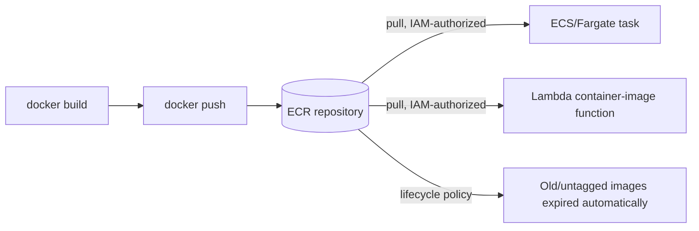

### Real AWS image


*Source: [Amazon ECR User Guide — Lifecycle policies](https://docs.aws.amazon.com/AmazonECR/latest/userguide/LifecyclePolicies.html)
(curl-verified 200). Lifecycle rules are evaluated in priority order against the repository's
images, expiring whatever matches first — the mechanism that keeps a long-lived repository from
accumulating unbounded storage cost from every historical build.*

### Code Example
```bash
aws ecr get-login-password --region us-east-1 | docker login --username AWS --password-stdin 123456789012.dkr.ecr.us-east-1.amazonaws.com
docker build -t orders-service .
docker tag orders-service:latest 123456789012.dkr.ecr.us-east-1.amazonaws.com/orders-service:latest
docker push 123456789012.dkr.ecr.us-east-1.amazonaws.com/orders-service:latest
```

### Pricing Note
Billed per GB-month of image storage and per GB of data transfer out of the region — a lifecycle policy that prunes old/untagged images directly controls this storage cost over time, the exact mechanism the earlier Exam Tips call out.

### Common Exam Scenarios
- *"A Lambda function's dependencies are too large for a zip deployment package"* → package it as a container image, pulled from ECR.
- *"Old, untagged container images are accumulating unnecessary storage cost"* → a lifecycle policy, not manual periodic cleanup.
- *"A CI/CD pipeline needs to build and push a new image tag as part of its build stage"* → CodeBuild pushing to ECR, authenticated via IAM, not a separate registry credential.

### Exam Tips
- ECR authentication flows through IAM (`get-login-password`), not a separate registry account —
  know this as the "no separate credential system" selling point.
- Container-image Lambda functions pull directly from ECR at invocation — a distinct packaging
  path from the zip-based deployment this domain otherwise emphasizes.
- Lifecycle policies are the answer to "control storage cost from accumulating old/untagged
  images" without manual cleanup.

---

## 17. Amazon EventBridge

### Definition
Amazon EventBridge is a serverless event bus service for building event-driven architectures,
routing events from AWS services, custom applications, or SaaS partners to multiple targets based
on **rules** that match an event's content.

### Plain-English Analogy
EventBridge is a smart mail-sorting facility: every incoming letter (event) is inspected against a
set of sorting rules ("anything addressed to Finance goes to bin A, anything mentioning 'urgent'
also goes to bin C"), and a single letter can land in multiple bins simultaneously if it matches
multiple rules — the sender never needs to know which bins exist or how many there are.

### Purpose
Direct point-to-point integration between every producer and every consumer of events creates a
tangled, tightly coupled mesh that's hard to extend. EventBridge exists to decouple producers from
consumers entirely: producers publish events without knowing who (if anyone) is listening, and
consumers subscribe via content-based rules without the producer ever being modified to add a new
consumer.

### When to Use It
- Routing events to different targets based on event *content*, not just a blanket fan-out to every
  subscriber.
- Building a central event bus across many decoupled microservices or AWS accounts.
- Integrating third-party SaaS events (via EventBridge's SaaS partner event sources) alongside your
  own application events on one bus.

### When NOT to Use It
- Simple "every subscriber gets every message" fan-out is often simpler and cheaper via SNS, if no
  content-based routing is actually needed.
- Strict message ordering/exactly-once-style guarantees within a single queue are better served by
  SQS FIFO directly, not routed through an event bus first.

### Use Cases
1. An S3 upload event routed to different Lambda functions depending on the object's key prefix.
2. A scheduled rule (cron-like) triggering a nightly Lambda cleanup job, with no producer code at all.
3. Cross-account event routing: a central security-tooling account receiving GuardDuty findings
   from every member account via EventBridge.
4. A SaaS partner's event source (e.g. a payment provider) delivered straight onto your event bus.
5. An order-placed event routed to both a fraud-check pipeline and a standard fulfillment pipeline
   based on the order's amount field.
6. Archiving every matched event for later replay, using EventBridge's built-in archive/replay feature.

### Why Important
Task 1.1 explicitly names EventBridge for event-driven applications and S3 event notifications —
recognizing it as the content-based router (versus SNS's blanket fan-out, versus SQS's point-to-
point queue) is one of the most frequently tested "same category, different right answer" splits.

### How It Works

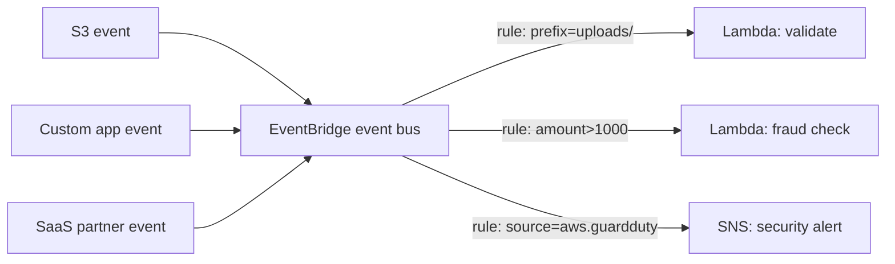

### Real AWS image


*Source: [Amazon EventBridge User Guide — Rules](https://docs.aws.amazon.com/eventbridge/latest/userguide/eb-rules.html)
(curl-verified 200). This "match or silently drop" mental model is the key behavior to internalize:
an event that matches zero rules simply goes nowhere — there's no default catch-all target unless
you explicitly create a rule broad enough to match everything.*

### Code Example
```python
import boto3
events = boto3.client("events")
events.put_rule(Name="high-value-orders",
                 EventPattern='{"source":["orders"],"detail":{"amount":[{"numeric":[">","1000"]}]}}')
events.put_targets(Rule="high-value-orders",
                    Targets=[{"Id": "1", "Arn": "arn:aws:lambda:us-east-1:123456789012:function:FraudCheck"}])
```

### Pricing Note
Billed per million events published to a custom event bus (events on the default bus matching AWS service-generated events are free) — archive/replay and schema discovery features carry their own separate charges on top of base event publishing.

### Common Exam Scenarios
- *"Events need to route to different targets depending on their content, not just a blanket fan-out"* → EventBridge rules, not SNS.
- *"A scheduled job needs to run nightly with no producer code triggering it"* → an EventBridge scheduled rule.
- *"Security findings need to flow from every member account to a central security-tooling account"* → cross-account EventBridge routing.

### Exam Tips
- Content-based routing via rules is EventBridge's defining feature versus SNS's blanket fan-out —
  a scenario emphasizing "route differently based on event content" points here.
- An event matching zero rules is simply dropped, silently — there's no implicit default target.
- EventBridge, S3, and SNS are all at-least-once delivery — downstream consumers must be idempotent
  regardless of which of the three delivered the event (see
  [`idempotency-and-retry-patterns.md`](idempotency-and-retry-patterns.md)).

---

## 18. Amazon Kinesis Family

### Definition
The Kinesis family is AWS's suite of real-time streaming data services: **Kinesis Data Streams**
(you write producers and consumers against ordered, partitioned shards), **Managed Service for
Apache Flink** (managed stream processing/analytics), and historically Kinesis Data Firehose (now
branded separately as Amazon Data Firehose, covered as its own entry above).

### Plain-English Analogy
Kinesis Data Streams is a multi-lane highway with numbered lanes (shards): cars (records) with the
same license plate prefix (partition key) always merge into the same lane, keeping their relative
order, and multiple independent toll booths (consumers) can each watch the same highway
simultaneously at their own pace, without interfering with each other.

### Purpose
Ingesting and processing high-throughput, ordered streaming data (clickstreams, IoT telemetry,
log aggregation) at scale needs a durable, replayable, multi-consumer-capable stream — not a
single-consumer queue. Kinesis Data Streams exists to give you that durable, ordered, horizontally
scalable stream, with you writing the producer/consumer logic for full control.

### When to Use It
- Multiple independent consumers each need to read the *same* stream of events at their own pace.
- Strict per-key ordering is required (same entity's events must process in the order they
  occurred).
- Custom, stateful stream processing logic beyond what a managed delivery service (Firehose) offers.

### When NOT to Use It
- A single consumer with no ordering requirement is usually simpler and cheaper on SQS — don't reach
  for Kinesis's shard model when a plain queue would do.
- Zero-code delivery to S3/Redshift/OpenSearch with no custom processing is Amazon Data Firehose's
  job specifically, not a hand-rolled Kinesis Data Streams consumer.

### Use Cases
1. Ride-hailing driver location updates, partitioned by driver ID, consumed by a dispatch service.
2. Clickstream analytics feeding three independent consumers (dashboard, fraud model, data lake)
   at their own pace from the same stream.
3. Log aggregation across a large fleet, ingested into a stream for real-time processing before
   long-term storage.
4. IoT telemetry at massive scale, partitioned by device ID to preserve per-device event order.
5. A Lambda event source mapping consuming shard batches for near-real-time processing (see
   [`lambda-event-source-mapping-deep-dive.md`](lambda-event-source-mapping-deep-dive.md)).
6. Managed Service for Apache Flink performing windowed aggregations directly over a Kinesis stream.

### Why Important
Task 1.1's "work with streaming data" bullet is most directly Kinesis Data Streams when a scenario
implies you write the producer/consumer code yourself — the partition key design lesson here (even
distribution avoids hot shards) repeats the same principle DynamoDB partition keys teach.

### How It Works

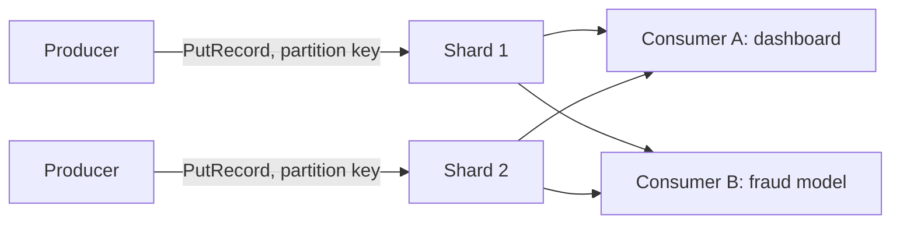

### Real AWS image


*Source: [AWS Kinesis Data Streams Developer Guide — Key Concepts](https://docs.aws.amazon.com/streams/latest/dev/key-concepts.html)
(curl-verified 200). Multiple independent consumer applications can read the same stream at their
own pace — the single biggest differentiator from SQS, where a message is typically consumed once
and gone.*

### Code Example
```python
import boto3
kinesis = boto3.client("kinesis")
kinesis.put_record(StreamName="driver-locations", Data=b'{"lat":37.7,"lng":-122.4}',
                    PartitionKey="driver-42")  # same driver always lands on the same shard
```

### Pricing Note
Kinesis Data Streams bills per shard-hour plus PUT payload units; on-demand mode bills per stream based on throughput instead of a fixed shard count — on-demand removes the need to manually calculate required shard count up front, at a different unit cost than provisioned shards.

### Common Exam Scenarios
- *"Three independent downstream systems each need to consume every event at their own pace"* → Kinesis Data Streams, not SQS (where a message is typically consumed once).
- *"Per-key event order must be preserved even under high throughput"* → a well-distributed partition key design, same lesson as DynamoDB.
- *"Streaming data just needs to land in S3 with zero consumer code"* → that's Amazon Data Firehose, not a hand-rolled Kinesis Data Streams consumer.

### Exam Tips
- Multiple independent consumers reading the same stream at their own pace → Kinesis Data Streams,
  not SQS (where a message is normally consumed once).
- A hot partition key overloads one shard regardless of overall stream capacity — spread keys
  evenly, the same lesson as DynamoDB partition key design.
- Firehose vs. Data Streams: "deliver with zero consumer code" is Firehose; "I write the
  consumer/processing logic myself" is Data Streams.

---

## 19. Amazon Q

### Definition
Amazon Q is AWS's family of generative-AI assistants built on Bedrock: **Amazon Q Developer**
(coding/AWS assistance in IDEs, CLI, console) and **Amazon Q Business** (an enterprise assistant
answering questions grounded in a company's own internal data sources).

### Plain-English Analogy
Amazon Q Developer is a senior engineer sitting next to you who already knows AWS cold and can see
your code; Amazon Q Business is a new hire who's already read your entire company wiki and can
answer "where's the PTO policy" without you building them a search tool first.

### Purpose
Building a good coding assistant or internal company chatbot from Bedrock's raw building blocks
(models, RAG, agents) is still real engineering work. Amazon Q exists as the finished product on
top of those building blocks, pre-integrated with AWS development tooling and enterprise data
connectors respectively.

### When to Use It
- Developers wanting inline code suggestions, chat, and security scanning integrated into their IDE
  or CLI, aware of AWS services specifically.
- Businesses wanting an internal assistant answering questions from existing enterprise data
  sources (SharePoint, Slack, S3) without building a custom RAG pipeline.
- Troubleshooting AWS resources/costs directly via natural-language questions in the console.

### When NOT to Use It
- Building a fully custom AI application with bespoke prompt/retrieval logic calls for raw Bedrock,
  not Amazon Q's pre-packaged product shape.
- Don't treat Q's suggestions (code or chat answers) as unreviewed ground truth — see
  [`ai-assisted-development.md`](ai-assisted-development.md) for the full "AI proposes, human
  verifies" pattern this exam tests repeatedly.

### Use Cases
1. A developer gets inline Lambda handler code suggestions directly in their IDE.
2. A security team uses Q Developer's automated scan to flag a hardcoded secret before merge.
3. An employee asks Q Business "what's our current PTO policy" and gets a cited answer from the
   indexed HR SharePoint site.
4. An engineer asks Q directly in the AWS console why a specific EC2 instance's cost spiked.
5. A support team uses Q Business connected to Slack/Zendesk history to answer a recurring customer
   question instantly.
6. A new hire uses Q Developer's codebase Q&A to get oriented on an unfamiliar Lambda-based service.

### Why Important
DVA-C03 tests recognizing Amazon Q Developer as the Task 1.1 AI-assisted-development example by
name, and distinguishing it from raw Bedrock (toolkit) and from Amazon Q Business (a different
audience/use case) — see [`ai-assisted-development.md`](ai-assisted-development.md) for the full
cross-domain pattern this service exemplifies.

### How It Works

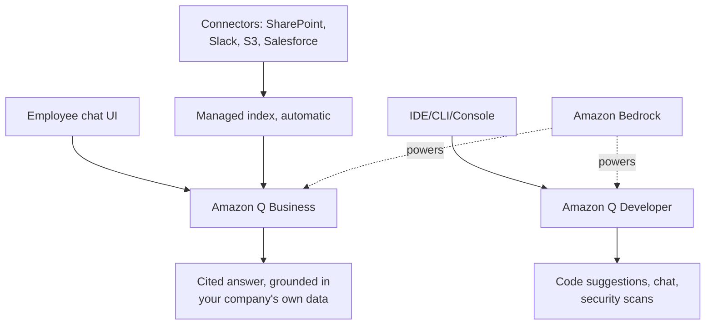

### Real AWS image


*Source: [AWS Machine Learning Blog — Accelerate enterprise AI implementations with Amazon Q Business](https://aws.amazon.com/blogs/machine-learning/)
(curl-verified 200). Note IAM Identity Center sits at the authentication layer — Q Business
respects existing access controls of connected data sources, so an employee only ever sees answers
sourced from documents they could already access directly.*

### Code Example
```bash
# Q Developer in the CLI — natural-language AWS troubleshooting
q chat "why did my Lambda function's cost increase this month?"
```

### Pricing Note
Amazon Q Developer has a free tier and a paid Pro tier with higher usage limits and enterprise features; Amazon Q Business bills per active user per month — cost isn't the primary testable angle for either product on this exam, usage pattern recognition is.

### Common Exam Scenarios
- *"A developer gets inline code suggestions and a PR-level security scan inside their existing IDE/workflow"* → Amazon Q Developer, mapped to Task 1.1's AI-assisted-development pattern.
- *"An employee asks a chat tool a question and expects an answer grounded in the company's own SharePoint/Slack history, with citations"* → Amazon Q Business, not a custom-built RAG pipeline.
- *"A question offers 'the AI auto-merges its own suggested fix with no review' as an option"* → always wrong, regardless of which Q product is named.

### Exam Tips
- Q Developer maps to Task 1.1 (code generation/review); the same "AI proposes, human verifies"
  rule applies to its suggestions as any other assistant.
- Q Business is permissions-aware — it never bypasses a connected source's existing access
  controls, a frequently tested safety property.
- Both products run on Bedrock's foundation models underneath — Q is the finished product, Bedrock
  is the toolkit it's built from.

---

## 20. Amazon RDS

### Definition
Amazon Relational Database Service (RDS) is a managed relational database service supporting
MySQL, PostgreSQL, MariaDB, Oracle, and SQL Server engines, handling patching, backups, and
Multi-AZ high availability without you managing the underlying database server yourself.

### Plain-English Analogy
RDS is a fully serviced rental car: you still drive it exactly like you'd drive your own car (same
SQL, same engine behavior), but the oil changes, tire rotations, and roadside-assistance tow (a
Multi-AZ failover) are all handled by someone else automatically, instead of you doing it yourself
or hiring your own mechanic.

### Purpose
Operating a relational database yourself means patching the OS/engine, configuring backups,
building failover automation, and monitoring capacity — recurring operational work unrelated to
your actual application. RDS exists to hand that operational burden to AWS, while your application
keeps using the exact same SQL/engine behavior as a self-managed database.

### When to Use It
- Relational (SQL, ACID, multi-table joins) workloads on a standard engine you don't want to
  operate yourself.
- Needing automated backups, patching, and Multi-AZ failover without building that automation
  yourself.
- Workloads needing a specific engine Aurora doesn't support (Oracle, SQL Server).

### When NOT to Use It
- Extreme-scale, bursty key-value access patterns are a DynamoDB fit, not RDS — connection-pool
  limits become the bottleneck under that kind of load.
- If you're already on MySQL/PostgreSQL and want higher throughput/faster failover at similar
  operational simplicity, Aurora is usually the better fit than standard RDS on the same engine.

### Use Cases
1. A SaaS product's relational backend needing ACID transactions and multi-table joins.
2. A Multi-AZ deployment for automatic failover during an AZ outage, with zero manual intervention.
3. A legacy application requiring Oracle or SQL Server specifically, migrated to managed RDS.
4. Read replicas offloading reporting queries from the primary instance.
5. Automated backups with point-in-time recovery for compliance requirements.
6. Cross-Region read replicas serving read traffic closer to a geographically distributed user base.

### Why Important
Task 1.3's RDS/Aurora access-pattern and ACID-transaction testing starts here — RDS is the baseline
relational option, and knowing when it's preferred over Aurora (specific engine needs) or over
DynamoDB (relational requirements) is the core decision this entry supports.

### How It Works

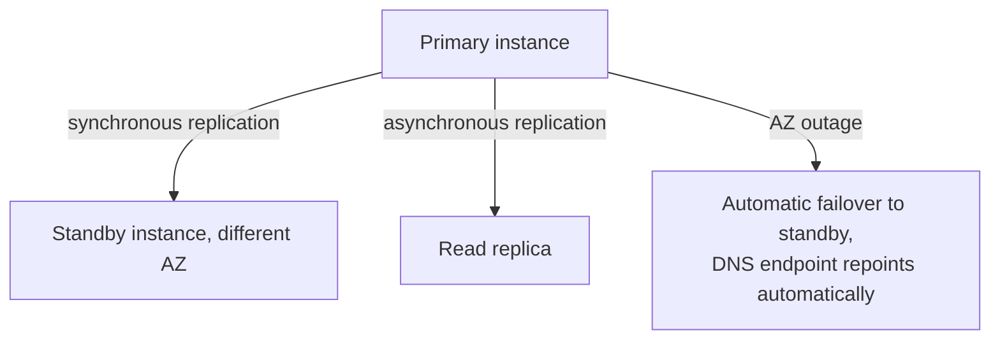

Multi-AZ failover repoints the same DNS endpoint applications already use at the newly promoted
standby — application code doesn't need to change connection strings, just reconnect.

### Real AWS image


*Source: [Amazon RDS User Guide — Multi-AZ deployments](https://docs.aws.amazon.com/AmazonRDS/latest/UserGuide/Concepts.MultiAZ.html)
(curl-verified 200). Synchronous replication to the standby (not asynchronous, unlike a read
replica) is the detail that makes Multi-AZ failover safe for high availability — no data loss
window the way an asynchronous replica promotion could have.*

### Code Example
```python
import boto3
rds = boto3.client("rds")
rds.create_db_instance(DBInstanceIdentifier="orders-db", Engine="postgres",
                        DBInstanceClass="db.t3.medium", MultiAZ=True,
                        MasterUsername="admin", MasterUserPassword="***", AllocatedStorage=100)
```

### Pricing Note
Billed per instance-hour based on instance class and engine, plus storage and I/O — Multi-AZ roughly doubles the compute cost (a second standby instance is always running) compared to a single-AZ deployment, a concrete trade-off worth weighing against the availability requirement actually stated.

### Common Exam Scenarios
- *"An application specifically needs Oracle or SQL Server"* → RDS, since Aurora only supports MySQL-/PostgreSQL-compatible engines.
- *"An AZ outage must not take the database down, with automatic failover and no application code changes"* → Multi-AZ, synchronous replication to a standby, same endpoint after failover.
- *"Reporting queries are slowing down the primary instance"* → a read replica (asynchronous), offloading read traffic — not the same mechanism as Multi-AZ.

### Exam Tips
- Multi-AZ standby replication is synchronous (for safe automatic failover); read replica
  replication is asynchronous (for read scaling, not HA by itself) — don't conflate the two.
- "Need Oracle/SQL Server specifically" → RDS, not Aurora (Aurora is MySQL/PostgreSQL-compatible
  only).
- Application code reconnects to the same endpoint after a Multi-AZ failover — no connection-string
  change required, though a brief reconnection window is expected.

---

## 21. Amazon S3

### Definition
Amazon Simple Storage Service (S3) is a fully managed, durable object storage service, storing any
amount of data as key-value objects in buckets, with 11 nines of durability and strong read-after-
write consistency for all operations.

### Plain-English Analogy
S3 is a vast, infinitely expandable warehouse of labeled, sealed boxes (objects) — you don't rent a
specific-sized room (a fixed volume) the way a traditional filesystem might; you just drop boxes
off under whatever label (key) you choose, retrieve any box instantly by its exact label, and the
warehouse itself never runs out of room.

### When to Use It
- Storing files/blobs (images, backups, logs, data lake files) rather than structured query-able
  records.
- Static website hosting, or as the origin for a CloudFront distribution.
- Event-driven processing triggered the moment an object is created (`s3:ObjectCreated`).

### When NOT to Use It
- Structured data needing indexed queries, joins, or transactional updates belongs in a database
  (DynamoDB or RDS/Aurora), not S3 directly.
- Extremely low-latency, high-frequency small reads/writes (session data, counters) are better
  served by DynamoDB or ElastiCache than S3's per-request latency profile.

### Use Cases
1. Storing uploaded user files (images, documents) referenced by a database record.
2. A data lake's raw and processed zones, queried by Athena/Redshift Spectrum directly on S3.
3. Hosting a static website/SPA, served through CloudFront.
4. Triggering a Lambda function the instant an object is uploaded, for validation/processing.
5. Storing application logs/backups with lifecycle policies transitioning older data to cheaper
   storage classes automatically.
6. Serving large media files via presigned URLs, avoiding proxying binary data through application
   compute.

### Why Important
Task 1.3 names S3 directly for application code — object operations, consistency behavior, and
multipart upload are concretely testable, and S3 event notifications are one of Task 1.1's named
event-driven building blocks.

### Purpose
Storing arbitrary amounts of unstructured data durably, cheaply, and accessibly from anywhere, with
no capacity planning, is a near-universal application need — S3 exists to be that default durable
store any other service can read from or write to.

### How It Works

```mermaid
flowchart TD
    APP[Application] -->|PutObject| S3[(S3 bucket)]
    S3 -->|s3:ObjectCreated event| EB[EventBridge / Lambda / SQS / SNS]
    OTHER[Second client] -->|GetObject, immediately after| S3
    S3 -->|strongly consistent — always returns the latest write| OTHER
```

S3 provides **strong read-after-write consistency** for all operations (PUTs and DELETEs) as of
December 2020 — a read immediately following a write is guaranteed to reflect that write, no
"eventual consistency" caveat to design around, unlike some other distributed stores.

### Real AWS image


*Source: [Amazon S3 User Guide — Amazon S3 data consistency model](https://docs.aws.amazon.com/AmazonS3/latest/userguide/Welcome.html)
(curl-verified 200). Every client sees the same, latest value immediately after a write completes
— a detail worth knowing cold, since it contrasts directly with DynamoDB's optional eventual
consistency, a distinction the exam likes to probe by swapping the two services in the same
scenario wording.*

### Code Example
```python
import boto3
s3 = boto3.client("s3")
s3.put_object(Bucket="uploads-bucket", Key="images/photo.jpg", Body=data)
url = s3.generate_presigned_url("get_object", Params={"Bucket": "uploads-bucket", "Key": "images/photo.jpg"}, ExpiresIn=3600)
```

### Pricing Note
Billed per GB stored per month (varying by storage class), per request, and per GB transferred out — storage class selection (Standard vs. Infrequent Access vs. Glacier tiers) is the single biggest lever for controlling long-term storage cost on data accessed at different frequencies.

### Common Exam Scenarios
- *"An object must be readable immediately after being written, with no staleness window"* → S3's strong read-after-write consistency, by default, on every operation.
- *"An application needs to process a file the moment it's uploaded"* → an s3:ObjectCreated event notification, routed through EventBridge for multi-consumer fan-out if needed.
- *"A very large file upload needs to be resumable and parallelized"* → multipart upload.

### Exam Tips
- S3 gives strong read-after-write consistency on every operation — don't treat it as eventually
  consistent the way some NoSQL stores are.
- `s3:ObjectCreated` event notifications are the standard Task 1.1 event-driven trigger — route
  through EventBridge for multi-consumer fan-out with content-based rules.
- Multipart upload is the correct mechanism for large object uploads, allowing parallel part
  uploads and resumability on failure.

---

## 22. Amazon SNS

### Definition
Amazon Simple Notification Service (SNS) is a fully managed pub/sub messaging service that fans a
single published message out to multiple independent subscribers — SQS queues, Lambda functions,
HTTP/S endpoints, email, or SMS — simultaneously.

### Plain-English Analogy
SNS is a radio broadcast tower: the station (publisher) sends one signal, and every tuned-in radio
(subscriber) receives its own independent copy simultaneously — the station never knows or cares
how many radios are listening, and adding a new listener requires no change at the tower.

### Purpose
Notifying multiple independent systems about the same event without the publisher knowing or
caring who's listening (or how many) is a recurring need — SNS exists to decouple "something
happened" from "everyone who cares about it," with the publisher doing exactly one publish call
regardless of subscriber count.

### When to Use It
- Every subscriber needs its own independent copy of every published message (true fan-out).
- Simple topic-based pub/sub without needing content-based routing logic.
- Sending notifications across heterogeneous channels (email, SMS, push, SQS, Lambda) from one topic.

### When NOT to Use It
- Content-based routing to different targets depending on message fields is EventBridge's job, not
  a plain SNS fan-out (SNS filter policies exist but are more limited than EventBridge's rule engine).
- A single logical queue where messages should be consumed once by a competing worker pool is SQS's
  job, not SNS's broadcast model.

### Use Cases
1. An order-placed event fanned out simultaneously to an email confirmation Lambda, an SQS queue
   for fulfillment, and an analytics SQS queue.
2. A CloudWatch alarm publishing to an SNS topic that emails the on-call engineer.
3. Mobile push notifications sent to iOS/Android devices via SNS's mobile push support.
4. A multi-region failover notification system alerting several independent downstream teams
   simultaneously.
5. SMS alerts for critical infrastructure events, alongside a parallel SQS subscription for
   automated remediation.
6. Filter policies on subscriptions, so only a subset of a topic's messages reach a specific
   subscriber based on message attributes.

### Why Important
Domain 1's messaging-pattern questions repeatedly test SNS's fan-out shape against SQS's
competing-consumer shape and EventBridge's content-routing shape — correctly identifying which of
the three a scenario needs is one of the highest-frequency "same category" decision points on the
exam.

### How It Works

```mermaid
flowchart LR
    PUB[Publisher] -->|Publish, once| TOPIC[SNS Topic]
    TOPIC --> SQS1[(SQS Queue: fulfillment)]
    TOPIC --> LAMBDA[Lambda: send email]
    TOPIC --> SQS2[(SQS Queue: analytics)]
```

### Real AWS image


*Source: [AWS SNS Developer Guide — Fanout scenario](https://docs.aws.amazon.com/sns/latest/dg/sns-common-scenarios.html)
(curl-verified 200). One publish call, multiple independently-durable SQS queues receiving their
own full copy — the architectural pattern to recognize whenever a scenario says "every downstream
system must receive every event."*

### Code Example
```python
import boto3
sns = boto3.client("sns")
sns.publish(TopicArn="arn:aws:sns:us-east-1:123456789012:order-events",
            Message='{"orderId":"abc-123","status":"placed"}')
```

### Pricing Note
Billed per million publishes and per delivery attempt per protocol (SQS/Lambda deliveries are typically cheaper per-message than SMS/email) — a fan-out to many protocol types multiplies the delivery-side cost per published message, not just the publish call itself.

### Common Exam Scenarios
- *"Every one of several independent downstream systems must receive its own copy of every event"* → SNS fan-out, typically to multiple SQS queues.
- *"Messages should route differently depending on their content, not just broadcast to every subscriber"* → that's EventBridge's rule engine, a more powerful fit than an SNS filter policy.
- *"Notifications must reach heterogeneous channels (email, SMS, Lambda, SQS) from one publish call"* → SNS's multi-protocol subscription model.

### Exam Tips
- "Every subscriber needs its own copy of every message" → SNS fan-out, not EventBridge or SQS alone.
- SNS → SQS fan-out (an SQS queue as an SNS subscriber) is the standard pattern for durable,
  independently-consumable copies per downstream system.
- Filter policies narrow which messages a specific subscription receives, but EventBridge's rule
  engine is the more powerful choice when genuinely complex content-based routing is the actual need.

---

## 23. Amazon SQS

### Definition
Amazon Simple Queue Service (SQS) is a fully managed message queuing service, decoupling producers
from consumers via a durable queue, supporting both Standard (at-least-once, best-effort ordering)
and FIFO (exactly-once processing, strict per-group ordering) queue types.

### Plain-English Analogy
SQS is a ticket-dispenser deli counter: customers (producers) take a number and the ticket sits in
the queue until a free server (consumer) calls it; the ticket is only torn up (deleted) once
service is actually complete, so if a server walks away mid-service without finishing, that ticket
reappears in the queue for the next available server to pick up.

### Purpose
Direct, synchronous producer-to-consumer calls couple the two tightly — a slow or down consumer
directly stalls the producer. SQS exists to buffer work between them: producers enqueue and move
on immediately, and any number of consumers can drain the queue at their own pace, absorbing
traffic spikes without either side needing to match the other's throughput in real time.

### When to Use It
- Decoupling a producer from a consumer so a traffic spike or consumer slowdown doesn't propagate
  back to the producer.
- A worker pool competing for individual messages, each message processed exactly by one worker.
- FIFO ordering with exactly-once processing within a specific message group.

### When NOT to Use It
- Multiple independent consumers each needing their *own* full copy of every message is SNS's
  (fan-out) job, or Kinesis's (multi-reader stream) job — not a single SQS queue's competing-
  consumer model.
- Extremely low-latency synchronous request/response doesn't fit a queue's inherently asynchronous
  model.

### Use Cases
1. A worker fleet processing image-resize jobs off a queue, scaling worker count with queue depth.
2. A dead-letter queue catching messages that fail processing repeatedly, for manual inspection.
3. FIFO queue ensuring a specific customer's order events process in the exact order they occurred.
4. Buffering a traffic spike between a web tier and a slower backend processing tier.
5. A Lambda event source mapping polling SQS, scaling concurrent Lambda invocations with backlog
   depth (see [`lambda-event-source-mapping-deep-dive.md`](lambda-event-source-mapping-deep-dive.md)).
6. Rate-limiting downstream calls to a legacy system by controlling how fast a queue is drained.

### Why Important
Task 1.1's messaging/decoupling pattern and Task 1.2's poll-based Lambda trigger both center on
SQS — visibility timeout, DLQs, and FIFO vs. standard semantics are concretely, repeatedly tested.

### How It Works

```mermaid
flowchart TD
    P[Producer] -->|SendMessage| Q[(SQS Queue)]
    C1[Consumer] -->|ReceiveMessage| Q
    Q -->|message invisible during processing| C1
    C1 -->|DeleteMessage, on success| Q
    C1 -.fails to delete before visibility timeout.-> Q
    Q -->|message becomes visible again| C2[Another consumer]
```

### Real AWS image


*Source: [AWS SQS Developer Guide — Visibility timeout](https://docs.aws.amazon.com/AWSSimpleQueueService/latest/SQSDeveloperGuide/sqs-visibility-timeout.html)
(curl-verified 200). This is SQS's at-least-once delivery contract made visible — a message not
deleted before its visibility timeout expires reappears for redelivery, which is exactly why
consumer logic must be idempotent regardless of how reliable the consumer code otherwise is.*

### Code Example
```python
import boto3
sqs = boto3.client("sqs")
sqs.send_message(QueueUrl="https://sqs.us-east-1.amazonaws.com/123456789012/orders", MessageBody='{"orderId":"abc"}')
msgs = sqs.receive_message(QueueUrl="...", MaxNumberOfMessages=10, VisibilityTimeout=30)
for m in msgs.get("Messages", []):
    process(m["Body"])
    sqs.delete_message(QueueUrl="...", ReceiptHandle=m["ReceiptHandle"])
```

### Pricing Note
Billed per million requests (SendMessage, ReceiveMessage, DeleteMessage each count) — long-polling (setting a non-zero ReceiveMessageWaitTimeSeconds) reduces the number of empty-receive requests compared to aggressive short-polling, a direct, often-overlooked cost and efficiency lever.

### Common Exam Scenarios
- *"The same message appears to be processed twice by different consumers concurrently"* → the visibility timeout is too short relative to actual processing time (should be ≥ 6x the consumer's timeout).
- *"One malformed message is causing an entire batch to retry forever"* → ReportBatchItemFailures isn't enabled, or the handler doesn't return the right shape.
- *"A specific customer's messages must process in strict order, but different customers can process in parallel"* → SQS FIFO with a per-customer MessageGroupId.

### Exam Tips
- Visibility timeout should be at least 6x the consumer's processing time, per AWS's own guidance —
  too short causes duplicate concurrent processing of the same message.
- Standard queues offer no ordering guarantee and at-least-once delivery; FIFO queues guarantee
  order within a message group and effectively-once processing within a 5-minute dedup window.
- A DLQ catches messages that fail processing repeatedly — configure a `maxReceiveCount` so
  messages route there instead of retrying forever.

---

## 24. Amazon VPC

### Definition
Amazon Virtual Private Cloud (VPC) is a logically isolated virtual network within AWS where you
launch resources, with full control over IP addressing, subnets, route tables, and network
gateways.

### Plain-English Analogy
A VPC is your own private plot of land inside a shared city (an AWS Region) — you decide the
street layout (subnets), which roads connect to the outside world (internet/NAT gateways), and
which doors are locked to whom (security groups/NACLs) — your neighbors (other accounts' VPCs)
can't just wander onto your property unless you explicitly build a bridge (peering/Transit Gateway)
to them.

### Purpose
Running cloud resources without network isolation and control would mean every resource is equally
reachable with no boundary — VPC exists to give you a private, configurable network boundary,
letting you decide exactly what's public, what's private, and how traffic flows between them.

### When to Use It
- Essentially every non-trivial AWS workload uses a VPC, by default — the real question is how to
  configure subnets/routing/security for a given requirement, not whether to use one.
- A Lambda function needing to reach a private resource (RDS in a private subnet) must be attached
  to that VPC.
- Isolating sensitive workloads in private subnets with no direct internet route.

### When NOT to Use It
- Lambda functions that only call other AWS service APIs (not private VPC resources) are *better
  off* not being attached to a VPC at all — VPC attachment adds ENI provisioning overhead and
  requires a NAT gateway for any internet-bound calls, with zero benefit if nothing private is
  being reached.
- Public-facing static content doesn't need VPC-level network controls at all — that's S3/CloudFront's job.

### Use Cases
1. A Lambda function attached to a VPC to reach a private RDS instance with no public endpoint.
2. Public subnets hosting an internet-facing load balancer; private subnets hosting application/database tiers.
3. A NAT gateway letting private-subnet resources reach the internet (for patches/updates) without
   being directly reachable from it.
4. VPC peering or Transit Gateway connecting multiple VPCs/accounts for internal service-to-service traffic.
5. VPC endpoints (PrivateLink) letting private-subnet resources reach S3/DynamoDB without routing
   through the public internet at all.
6. Security groups and NACLs layered together to control exactly which traffic reaches a given resource.

### Why Important
Task 1.2 explicitly names "configure Lambda to access resources inside a VPC" — knowing when VPC
attachment is required (private resource access) versus actively harmful (unnecessary latency/NAT
cost for pure AWS-API-only functions) is a frequently tested judgment call.

### How It Works

```mermaid
flowchart TD
    IGW[Internet Gateway] --> PUBSUB[Public subnet: ALB]
    PUBSUB --> PRIVSUB[Private subnet: app/DB tier]
    PRIVSUB -->|outbound only| NATGW[NAT Gateway, in public subnet]
    NATGW --> IGW
    LAMBDA[Lambda, VPC-attached] -->|ENI in private subnet| PRIVSUB
    PRIVSUB -->|VPC endpoint, no internet route| S3EP[S3 via PrivateLink]
```

### Real AWS image


*Source: [Amazon VPC User Guide — How Amazon VPC works](https://docs.aws.amazon.com/vpc/latest/userguide/how-it-works.html)
(curl-verified 200). Subnets spanning multiple Availability Zones is the foundation of
high-availability design — a single-AZ subnet layout is a common exam distractor whenever a
scenario requires resilience to an AZ outage.*

### Code Example
```bash
aws lambda update-function-configuration --function-name create-order \
  --vpc-config SubnetIds=subnet-abc123,subnet-def456,SecurityGroupIds=sg-0123456789
```

### Pricing Note
The VPC construct itself is free; NAT gateways bill per hour plus per GB processed, and VPC endpoints (interface type) bill per hour plus per GB — a Lambda function attached to a VPC purely to reach public AWS APIs is a recurring NAT-gateway cost for zero functional benefit, reinforcing the earlier 'don't attach unnecessarily' exam tip.

### Common Exam Scenarios
- *"A Lambda function needs to reach a private RDS instance with no public endpoint"* → attach it to that VPC, with a security group allowing the DB port.
- *"A Lambda function that only calls public AWS service APIs is attached to a VPC unnecessarily"* → remove the attachment; it adds ENI/NAT overhead with zero benefit for that function.
- *"Private-subnet resources need to reach S3/DynamoDB without any route to the public internet"* → a VPC endpoint (Gateway or Interface/PrivateLink), not a NAT gateway.

### Exam Tips
- Attach Lambda to a VPC only when it must reach a private resource — attaching for no reason adds
  ENI provisioning latency and NAT cost with zero benefit.
- A NAT gateway lives in a *public* subnet and provides outbound-only internet access for private-
  subnet resources — know this directionality (outbound initiated from inside, not inbound from outside).
- VPC endpoints (PrivateLink/Gateway endpoints) let private-subnet resources reach AWS services
  like S3/DynamoDB without any NAT gateway or internet route at all.

---

## 25. Database Selection Guide

### Definition
The Database Selection Guide is not a single AWS service but the decision framework Task 1.3 tests
directly: given a scenario's access pattern and consistency/transaction requirements, choosing
correctly among DynamoDB, RDS/Aurora, S3, and a cache layer (ElastiCache/DAX).

### Plain-English Analogy
Choosing a database is choosing a filing system for a specific kind of paperwork: a phone book
(DynamoDB) is unbeatable for "look up by exact name," but useless for "find everyone who owes more
than $500 across three different ledgers" — that cross-referencing need is what a relational filing
cabinet with cross-indexed folders (RDS/Aurora) is actually built for.

### Purpose
Every exam scenario in this family gives you requirements, not a service name — the testable skill
is translating "needs joins," "needs microsecond key lookups at huge scale," or "storing files, not
records" into the one correct service, instead of defaulting to whichever database you personally
know best.

### When to Use Each
- **DynamoDB**: simple key lookups at massive, bursty scale, with low and predictable latency; no
  multi-table joins needed.
- **RDS/Aurora**: ACID transactions, multi-table SQL joins, normalized relational schema.
- **S3**: storing files/blobs, not structured query-able records.
- **DynamoDB + DAX**: DynamoDB's access pattern, but needing microsecond reads on hot, repeated keys.
- **ElastiCache**: general-purpose caching in front of any primary store, not DynamoDB-specific.

### When NOT to force a fit
- Don't force relational joins into DynamoDB by denormalizing everything and stitching results in
  application code when the actual requirement is genuinely relational — that's a sign RDS/Aurora
  was the right call from the start.
- Don't force a DynamoDB access pattern into RDS "because it's already there" when the real
  requirement is unbounded bursty scale — a connection-pool ceiling will eventually become the
  bottleneck.

### Use Cases
1. A flash-sale checkout needing extreme burst scale with simple key lookups → DynamoDB on-demand.
2. A SaaS invoicing system needing an ACID transaction across an invoice header and its line items → Aurora.
3. A photo-sharing app storing the actual image bytes → S3, with metadata in DynamoDB.
4. A leaderboard needing microsecond reads on the same few "top player" keys repeatedly → DynamoDB + DAX.
5. A reporting dashboard needing ad hoc analytical queries across normalized data → RDS/Aurora (or
   Redshift for truly large-scale analytics).
6. A session store needing extremely fast, ephemeral reads/writes shared across a fleet → ElastiCache.

### Why Important
This is arguably the single highest-value decision framework on all of DVA-C03's Domain 1 — nearly
every "which data store" question reduces to walking this same decision tree correctly.

### How It Works

```mermaid
flowchart TD
    Q1{Need ACID transactions /\nmulti-table SQL joins?} -->|Yes| RDS[RDS / Aurora]
    Q1 -->|No| Q2{Storing files/blobs,\nnot structured records?}
    Q2 -->|Yes| S3DS[Amazon S3]
    Q2 -->|No| Q3{Simple key lookups at\nmassive, bursty scale?}
    Q3 -->|Yes| Q4{Need microsecond reads\non the same hot keys?}
    Q4 -->|Yes| DAX[DynamoDB + DAX]
    Q4 -->|No| DDBDS[DynamoDB]
    Q3 -->|No, relational + occasional\nheavy analytics| AuroraDS[Aurora read replicas /\nAurora Serverless v2]
```

### Real AWS image


*Source: [Amazon RDS User Guide — Multi-AZ deployments](https://docs.aws.amazon.com/AmazonRDS/latest/UserGuide/Concepts.MultiAZ.html)
(curl-verified 200). Representative of the OLTP (relational, transactional) half of this decision
tree — pair conceptually against DynamoDB's partition-key diagram in entry 14 above to hold both
shapes in mind simultaneously when a scenario's requirements are ambiguous at first read.*

### Code Example
```python
# The SAME requirement, two different correct implementations depending on the OTHER requirement
# Requirement: "look up an order by ID, at massive bursty scale" -> DynamoDB
ddb.get_item(TableName="Orders", Key={"orderId": {"S": "abc-123"}})

# Requirement: "generate an invoice joining a subscription row with every usage line item,
# atomically" -> Aurora/RDS, a SQL join + transaction, not a DynamoDB access pattern
# BEGIN; SELECT ... FROM subscriptions JOIN usage_items ...; INSERT INTO invoices ...; COMMIT;
```

### Pricing Note
Pricing shape differs fundamentally by model: DynamoDB and S3 are usage-based (pay for what you actually read/write/store), while RDS/Aurora instances bill per running hour regardless of query volume — a scenario emphasizing unpredictable, bursty access patterns often favors the usage-based pricing model as much as the access-pattern fit itself.

### Common Exam Scenarios
- *"A scenario emphasizes joins across normalized tables and strict referential integrity"* → relational (RDS/Aurora), no matter how the NoSQL alternative is framed as "possible."
- *"A scenario emphasizes unbounded, bursty scale with simple key lookups and predictable low latency"* → DynamoDB, not a scaled-up relational instance.
- *"A scenario is about storing and serving files/blobs, not structured records"* → S3, even if a database could technically hold binary data.

### Exam Tips
- Scenario says "joins" or "ACID transaction across multiple related tables" → relational, full stop.
- Scenario says "unbounded scale, simple key lookup, low predictable latency" → DynamoDB, full stop.
- Scenario says "storing files, not records" → S3, even if a database could technically hold binary
  blobs — it's never the efficient or intended choice for that shape of data.

---

## 26. Messaging Patterns Overview

### Definition
The Messaging Patterns Overview isn't a single service either — it's the conceptual map of *why*
SNS, SQS, EventBridge, and Kinesis exist as separate services solving genuinely different
decoupling problems, rather than four interchangeable ways to "send a message."

### Plain-English Analogy
Four different delivery methods for four different needs: a broadcast radio station (SNS) for
"everyone subscribed gets a copy"; a ticket-number deli queue (SQS) for "one worker handles each
ticket, workers compete for tickets"; a smart mail sorter (EventBridge) for "route based on
content, not just who's subscribed"; and a multi-lane highway with independent toll-watchers
(Kinesis) for "many independent readers replay the same ordered sequence of events."

### Purpose
Every messaging scenario on the exam is really asking "which of these four decoupling shapes does
this requirement actually describe" — the services' individual feature sets matter less than
correctly identifying which *shape* a scenario is describing before picking a service name.

### When to Use Each
- **SNS**: blanket fan-out, every subscriber gets every message, simple pub/sub.
- **SQS**: point-to-point, competing consumers, each message processed once.
- **EventBridge**: content-based routing to different targets via rules, decoupled schema-aware
  event bus, cross-account/SaaS integration.
- **Kinesis Data Streams**: multiple independent consumers replaying the same ordered stream at
  their own pace, strict per-key ordering.

### When NOT to combine unnecessarily
- Don't route every single event through all four services "just in case" — each adds its own
  latency and cost; pick the one shape the actual requirement calls for.
- Don't use EventBridge's content-based routing where a plain SNS fan-out with no routing logic
  would already satisfy the requirement — unnecessary complexity for no benefit.

### Use Cases
1. SNS → multiple SQS queues: durable fan-out where each downstream system gets its own
   independently-processed copy.
2. SQS alone: a single worker pool competing for jobs off one queue, scaling with backlog depth.
3. EventBridge rules: routing an order event to a fraud pipeline *only* if its amount exceeds a
   threshold, otherwise to standard fulfillment.
4. Kinesis Data Streams: three independent consumers (dashboard, ML model, data lake) reading the
   same clickstream at their own pace.
5. SNS + SQS + Lambda combined: a single publish fanning out to an email Lambda and a durable SQS
   queue for later analytics, in one architecture.
6. EventBridge Scheduler combined with SQS: a nightly scheduled rule enqueuing a batch job for a
   worker pool to process at its own pace.

### Why Important
This overview is the connective tissue across Tasks 1.1/1.3 — nearly every event-driven scenario
in this domain is secretly a "which messaging shape" question wearing a different service-specific
costume.

### How It Works

```mermaid
flowchart TD
    REQ{What does the requirement\nactually describe?}
    REQ -->|Everyone needs a copy| SNS_P[SNS fan-out]
    REQ -->|One worker handles each item,\ncompeting consumers| SQS_P[SQS queue]
    REQ -->|Route differently based\non event content| EB_P[EventBridge rules]
    REQ -->|Many independent readers,\nreplay the same ordered sequence| KIN_P[Kinesis Data Streams]
```

### Real AWS image


*Source: [AWS Lambda Developer Guide — Understanding event-driven architectures](https://docs.aws.amazon.com/lambda/latest/dg/concepts-event-driven-architectures.html)
(curl-verified 200). The core idea every messaging pattern in this domain shares: replacing a
direct, synchronous, tightly-coupled call with an intermediary that lets producer and consumer
scale, fail, and evolve independently of each other.*

### Code Example
```python
# The decision in code form — same event, routed differently depending on the ACTUAL shape needed
# Fan-out (SNS): sns.publish(TopicArn=..., Message=event_json)
# Competing consumers (SQS): sqs.send_message(QueueUrl=..., MessageBody=event_json)
# Content-based routing (EventBridge): events.put_events(Entries=[{"Source": "orders", "DetailType": "OrderPlaced", "Detail": event_json}])
```

### Pricing Note
All four messaging services (SNS, SQS, EventBridge, Kinesis) are usage-based with no fixed hourly instance cost — the cost lever across all of them is message/event *volume*, not idle capacity, which is part of why they fit bursty, unpredictable event-driven workloads so well architecturally and economically.

### Common Exam Scenarios
- *"Every subscriber needs its own full copy of every event"* → SNS fan-out.
- *"Workers compete for individual jobs off a shared backlog, each processed once"* → SQS.
- *"Routing must depend on event content, and/or the architecture spans accounts or ingests SaaS partner events"* → EventBridge, not a plain SNS topic.

### Exam Tips
- Before picking a service name, restate the scenario as one of the four shapes (fan-out,
  competing-consumer, content-routed, multi-reader-stream) — the right service almost always falls
  out immediately once the shape is identified.
- All of SNS, SQS, EventBridge, and Kinesis are at-least-once in their standard configurations —
  idempotent consumers are the universal requirement, not a per-service concern.
- A single real architecture frequently combines more than one of these shapes (e.g., SNS fan-out
  into two separate SQS queues) — know that combining them is normal, not a sign you picked wrong.
