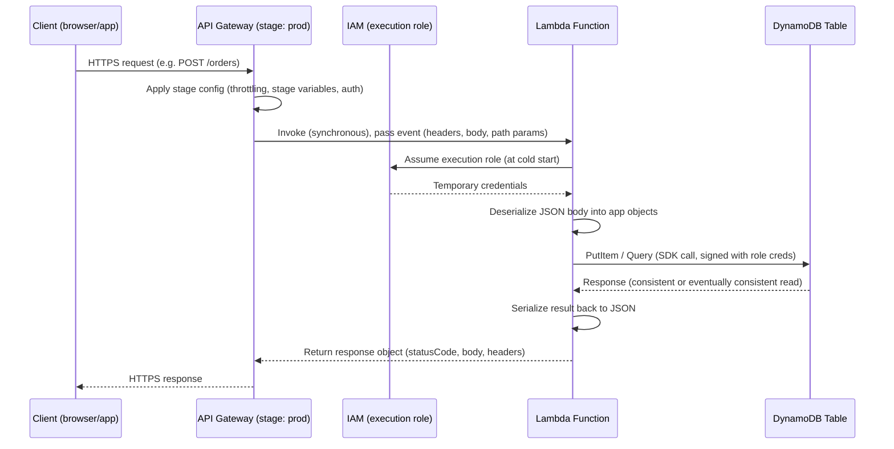
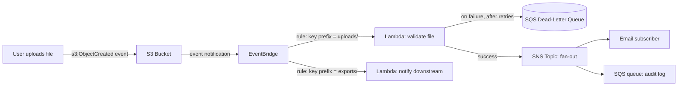
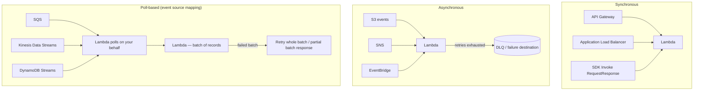
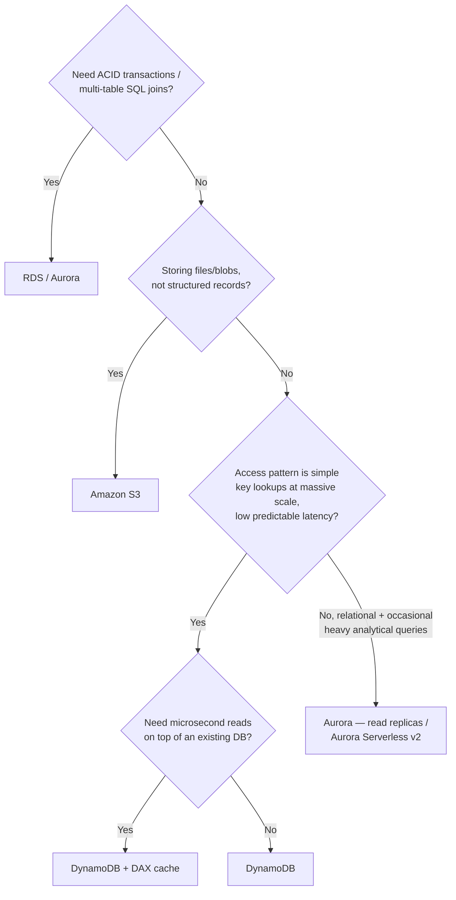
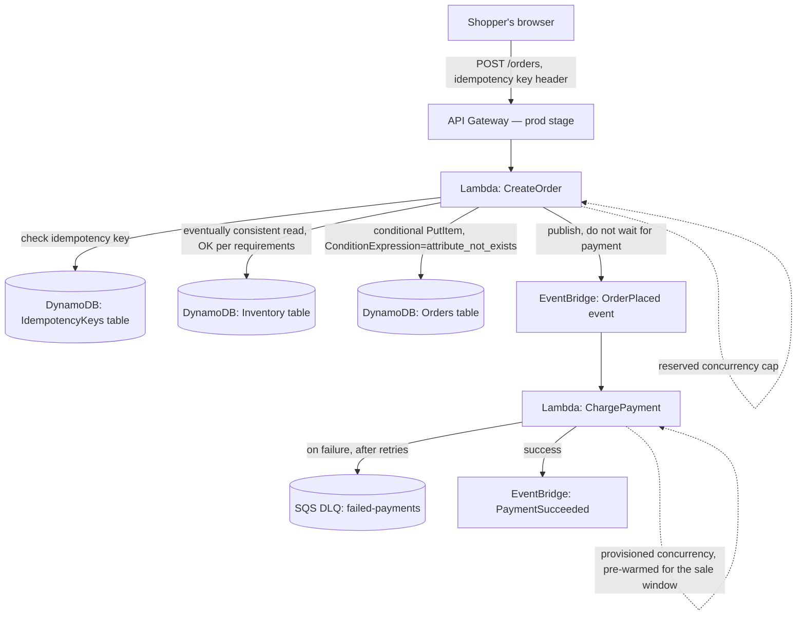
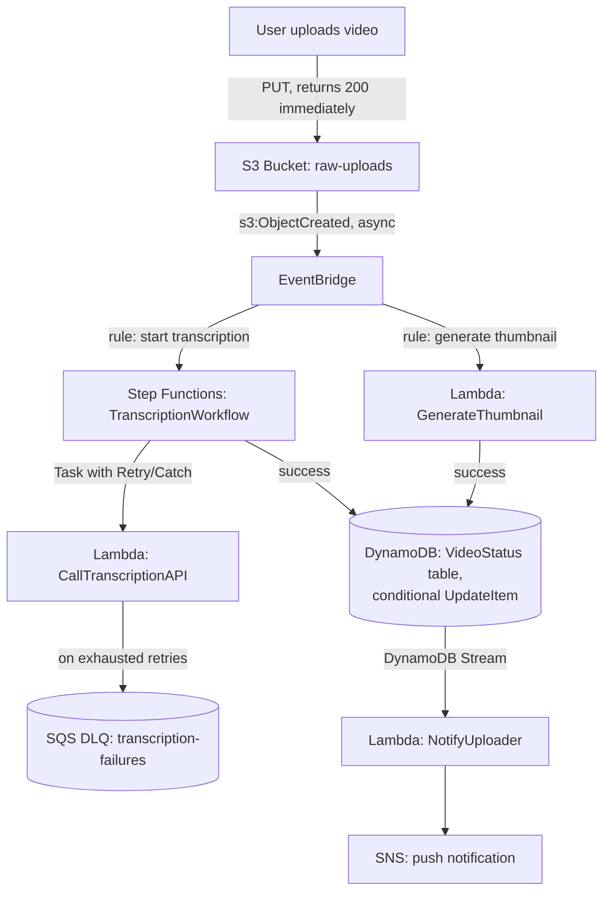
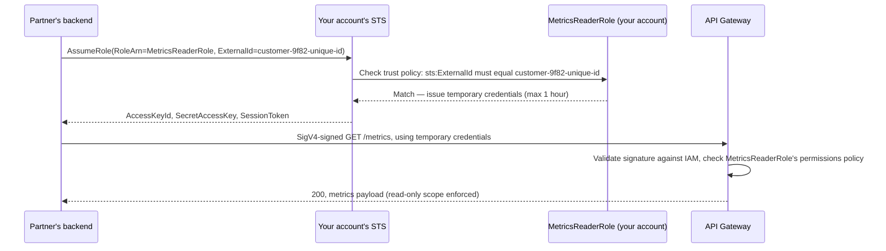

# Domain 1: Development with AWS Services (30%)


*Source: [AWS Reference Architecture Diagrams — Modern Serverless Mobile/Web Application](https://docs.aws.amazon.com/reference-architecture-diagrams/latest/modern-serverless-mobile-web/modern-serverless-mobile-web.html). This is close to the canonical shape Domain 1 tests end to end: an identity layer, an API layer, compute, and a data layer, wired together with events.*

This is the biggest single domain on DVA-C03 — nearly a third of the exam. It's the "can you
actually write the application code" domain: calling AWS services from your code, writing Lambda
functions correctly, and picking/using the right data store. Everything in Domains 2-4 (security,
testing/deployment, troubleshooting) assumes you can already do what's in this domain. If you take
nothing else from this folder, take this: Domain 1 is about **application code that calls AWS
APIs correctly** — not about clicking through console wizards. Every exam question in this domain
is really asking "does the candidate know what the SDK call does, what it returns, and what
happens when it fails?"

## Task statements (verbatim from the exam guide)

**Task 1.1 — Develop code for applications hosted on AWS**
- Use AWS SDKs/APIs to interact with AWS services from application code
- Work with streaming data
- Serialize and deserialize data
- Build event-driven applications (EventBridge, S3 event notifications)
- Use API Gateway stages correctly (dev/test/prod promotion, stage variables)

**Task 1.2 — Develop code for AWS Lambda**
- Configure Lambda to access resources inside a VPC (private RDS, ElastiCache, etc.)
- Use Lambda layers to share code/dependencies across functions
- Manage concurrency (reserved, provisioned, account/region limits)
- Configure triggers (synchronous, asynchronous, poll-based event sources)

**Task 1.3 — Use data stores in application development**
- Choose and use DynamoDB, S3, and RDS/Aurora correctly from application code
- Understand access patterns (how you query/write, not just "what the service does")
- Understand consistency models (DynamoDB eventual vs strong, RDS/Aurora ACID transactions)
- Use the AWS SDK correctly against each (client config, retries, pagination, batching)

## Every task, mapped to a doc

| Task | What to read | Where |
|---|---|---|
| 1.1 — SDK/API calls, retries, pagination | AWS Lambda doc covers SDK-from-handler patterns; also see IAM for the credentials the SDK uses | [`services/compute/lambda.md`](../../../services/compute/lambda.md), [`services/security-identity-compliance/iam.md`](../../../services/security-identity-compliance/iam.md) |
| 1.1 — Streaming data | Kinesis family for stream ingestion patterns where you write the consumer code; Amazon Data Firehose for the other half of "manage streaming data" — fully managed, code-free delivery of a stream to S3/Redshift/OpenSearch/Splunk, no consumer application to write or operate | [`services/analytics/kinesis-family.md`](../../../services/analytics/kinesis-family.md), [`services/analytics/data-firehose.md`](../../../services/analytics/data-firehose.md) |
| 1.1 — Event-driven apps (EventBridge, S3 events) | EventBridge is the central event bus; S3 event notifications are covered in the S3 doc | [`services/application-integration/eventbridge.md`](../../../services/application-integration/eventbridge.md), [`services/storage/s3.md`](../../../services/storage/s3.md) |
| 1.1 — Messaging/decoupling patterns feeding event-driven code | SQS/SNS/Step Functions patterns | [`services/application-integration/messaging-patterns-overview.md`](../../../services/application-integration/messaging-patterns-overview.md), [`services/application-integration/sqs.md`](../../../services/application-integration/sqs.md), [`services/application-integration/sns.md`](../../../services/application-integration/sns.md), [`services/application-integration/step-functions.md`](../../../services/application-integration/step-functions.md) |
| 1.1 — API Gateway stages | Stage variables, deployment promotion, throttling per stage | [`services/networking-content-delivery/api-gateway.md`](../../../services/networking-content-delivery/api-gateway.md) |
| 1.1 — GraphQL APIs (alternative to REST/HTTP APIs) | AppSync for managed GraphQL | [`services/application-integration/appsync.md`](../../../services/application-integration/appsync.md) |
| 1.2 — Lambda + VPC | Covered inside the Lambda doc's "VPC access" section | [`services/compute/lambda.md`](../../../services/compute/lambda.md) (see also [`services/networking-content-delivery/vpc.md`](../../../services/networking-content-delivery/vpc.md)) |
| 1.2 — Lambda layers, concurrency, triggers | Same doc — Lambda is a single deep-dive covering all of Task 1.2 | [`services/compute/lambda.md`](../../../services/compute/lambda.md) |
| 1.2 — Container-image Lambda packaging (alternative to zip) | [`services/containers/ecr.md`](../../../services/containers/ecr.md) for the image registry side | [`services/containers/ecr.md`](../../../services/containers/ecr.md) |
| 1.3 — DynamoDB access patterns & consistency | Full deep-dive including partition key design and consistency model | [`services/database/dynamodb.md`](../../../services/database/dynamodb.md) |
| 1.3 — S3 from application code | Object operations, consistency, multipart upload | [`services/storage/s3.md`](../../../services/storage/s3.md) |
| 1.3 — RDS/Aurora access patterns & ACID | [`services/database/rds.md`](../../../services/database/rds.md), [`services/database/aurora.md`](../../../services/database/aurora.md) |
| 1.3 — In-memory caching layered in front of a data store | [`services/database/elasticache.md`](../../../services/database/elasticache.md) |
| 1.3 — Choosing between data stores | Decision framework when a question gives you requirements instead of a service name | [`services/database/database-selection-guide.md`](../../../services/database/database-selection-guide.md) |
| Supporting — IAM credentials the SDK uses under the hood | [`services/security-identity-compliance/iam.md`](../../../services/security-identity-compliance/iam.md), [`services/security-identity-compliance/sts-and-role-switching.md`](../../../services/security-identity-compliance/sts-and-role-switching.md) |
| Supporting — observability hooks you'll want once this code ships | [`../domain-4-troubleshooting-optimization/observability-instrumentation.md`](../domain-4-troubleshooting-optimization/observability-instrumentation.md) |
| Supporting — standing up/hosting the frontend half of a full-stack app fast, without hand-wiring Cognito/AppSync/S3/CloudFront yourself | [`services/front-end-web-mobile/amplify.md`](../../../services/front-end-web-mobile/amplify.md) |

## New in DVA-C03: AI-assisted development

Task 1.1 (and parts of Domains 3 and 4) now expect you to recognize AI coding assistants
(Amazon Q Developer, Kiro, GitHub Copilot-style tools) as part of the normal dev workflow —
code generation, code review, and later test generation and error analysis. This pattern repeats
across all four domains, so it gets one canonical doc here, cross-linked everywhere else:

➡️ **[`ai-assisted-development.md`](ai-assisted-development.md)** — code generation/review here in
Domain 1; also referenced from [Domain 2](../domain-2-security/README.md#ai-assisted-development-cross-link),
[Domain 3](../domain-3-testing-deployment/README.md#ai-assisted-development-cross-link), and
[Domain 4](../domain-4-troubleshooting-optimization/README.md#ai-assisted-development-cross-link).

## How it fits together: a Lambda + API Gateway + DynamoDB request

This is the single most common request shape tested in Domain 1 — a REST API backed by a
serverless function backed by a NoSQL table. Nearly every Task 1.1/1.2/1.3 concept shows up
somewhere in this flow.



Step by step:
1. **Client calls API Gateway**, not Lambda directly — API Gateway is the front door, handling
   TLS termination, request validation, throttling, and routing.
2. **The stage matters** — the same API definition can have a `dev` stage and a `prod` stage with
   different throttle limits, different stage variables (e.g. which Lambda alias to call), and
   different deployment history. This is exactly Task 1.1's "use API Gateway stages correctly."
3. **API Gateway invokes Lambda synchronously** for a REST/HTTP API integration — the caller is
   waiting, so Lambda must respond within the configured timeout or API Gateway returns a 504.
4. **Lambda assumes its execution role via IAM** to get temporary credentials — this role, not the
   caller's identity, is what authorizes the DynamoDB call. Get the IAM policy wrong (missing
   `dynamodb:PutItem`) and the function fails with an `AccessDeniedException`, not a Lambda error.
5. **The handler deserializes the incoming JSON** into whatever objects the application code
   uses — Task 1.1's "serialize/deserialize data" skill.
6. **The SDK call to DynamoDB** uses the credentials from step 4. Whether the read is strongly or
   eventually consistent is a parameter you choose per-call — exam questions test whether you know
   which one a given scenario needs (e.g. "must read your own write immediately" → strong).
7. **The result is serialized back to JSON** and returned in the specific shape API Gateway's Lambda
   proxy integration expects (`statusCode`, `headers`, `body` as a string) — a very common exam trap
   is forgetting that `body` must be a JSON *string*, not a raw object.
8. **API Gateway relays the response** to the client, applying any configured response mapping.

## Event-driven alternative: S3 upload fan-out

Not every Domain 1 question is a synchronous API. The other half of Task 1.1 is event-driven,
asynchronous processing — and the exam loves mixing the two shapes in the same scenario to see if
you can tell a synchronous call apart from an asynchronous trigger.



Step by step: an S3 object creation fires an event notification. Routing it straight to a single
Lambda function works for simple cases, but routing through **EventBridge** first lets you apply
multiple rules (different prefixes, different event types) to fan the same underlying event out to
several independent consumers without any of them needing to know about each other — this is the
decoupling Task 1.1 is testing when a scenario says "add a new consumer without changing existing
code." Lambda's **asynchronous invocation model** here means S3/EventBridge don't wait for a
response; if the function fails, Lambda retries automatically (default: twice) before routing the
event to a configured **dead-letter queue (DLQ)** or **on-failure destination** so the event isn't
silently lost. Know this distinction: synchronous invocations (API Gateway, direct SDK `Invoke`)
return the error to the *caller*; asynchronous invocations (S3, EventBridge, SNS) retry internally
and need an explicit DLQ/destination or failures disappear.

## Lambda triggers: three invocation models, one function

Task 1.2's "configure triggers" bullet is really asking you to recognize which of three invocation
models a given event source uses, because that changes how you must handle errors and concurrency.



- **Synchronous**: the caller blocks for a response. Errors return directly to the caller; there's
  no Lambda-managed retry — if you want retry behavior, the *caller* must implement it (API Gateway
  doesn't retry a 5xx from Lambda automatically).
- **Asynchronous**: the event source hands the event to the Lambda service and moves on. Lambda
  itself retries (twice, by default) with a delay, then gives up and routes to a DLQ or configured
  failure destination if one exists — if neither exists, the event is dropped.
- **Poll-based (event source mapping)**: Lambda's own poller reads a batch of records from SQS,
  Kinesis, or DynamoDB Streams and invokes your function with the batch. A single bad record can
  block a whole batch unless you enable **partial batch response** (`ReportBatchItemFailures`) so
  only the failed items are retried/redriven instead of the entire batch repeating.

## Choosing a data store: the Task 1.3 decision tree



This is the single most commonly tested "pick the right service" decision in Domain 1. A scenario
that says "need joins across normalized tables, strict referential integrity" is RDS/Aurora every
time, no matter how fast the questioner claims the NoSQL alternative "could" be made to work.
Conversely, "single-digit-millisecond reads at effectively unbounded scale, access pattern is
always by a known key" is DynamoDB — trying to force that into RDS means either a sharding project
or a connection-pool bottleneck under load.

## Full worked case study: a flash-sale order API

**Requirement.** A retail client is launching a flash sale. They need an order-placement API that
can absorb a sudden 50x traffic spike for about 10 minutes, must never lose an accepted order even
if a downstream payment step is briefly unavailable, must return inventory-availability checks
with reads that are allowed to be a few hundred milliseconds stale (they explicitly do **not** need
a strongly consistent read on inventory count, just "close enough"), and must guarantee that a
confirmed order is never double-charged even if the client retries the request.

**Architecture.**



**Why each choice:**
- **DynamoDB, not RDS, for Orders/Inventory/IdempotencyKeys.** The access pattern is simple key
  lookups at extreme, bursty scale — exactly Task 1.3's DynamoDB case. On-demand capacity mode
  (or provisioned with auto scaling pre-warmed before the sale) absorbs the 50x spike without a
  capacity-planning exercise, and DynamoDB has no connection-pool ceiling the way RDS does under a
  sudden burst of concurrent Lambda executions.
- **Eventually consistent reads for the inventory check, explicitly.** The requirement states
  "close enough" is fine — using `ConsistentRead=true` here would needlessly double the
  read-capacity cost for a guarantee the business doesn't need. This is a direct Task 1.3 consistency
  trade-off decision, not a default to blindly apply everywhere.
- **A conditional write (`ConditionExpression=attribute_not_exists(orderId)`) on the Orders table**
  combined with a client-supplied **idempotency key** stored in its own table is how "never
  double-charge on retry" is actually implemented — not a queue setting, not a Lambda setting, an
  application-level pattern using DynamoDB's conditional-write feature.
- **EventBridge decouples order placement from payment**, so a payment-service outage doesn't fail
  the customer-facing order request — the order is durably recorded first, and payment is charged
  asynchronously. If payment ultimately fails, the event lands in a DLQ for manual/automated
  reconciliation instead of silently vanishing — the "never lose an accepted order" requirement.
- **Reserved concurrency on `CreateOrder`** caps how many concurrent executions it can consume,
  protecting the rest of the account's Lambda concurrency pool from being starved during the spike.
  **Provisioned concurrency on `ChargePayment`**, pre-warmed ahead of the sale's known start time,
  eliminates cold-start latency on the function handling money — a case where paying for
  pre-warmed capacity is worth it precisely *because* the traffic spike is predictable in advance.
- **API Gateway's `prod` stage** fronts the whole thing with its own throttle limits, so a runaway
  client can't consume the account's entire Lambda concurrency budget on its own.

This single scenario, reworded, is one of the most common "design the right architecture" essay-style
questions on the real exam — know this pattern and you can answer a large fraction of Domain 1's
harder scenario questions by recognizing which piece of it is being tested.

## SDK patterns Task 1.1 actually tests: retries, pagination, batching

The exam guide's "use AWS SDKs/APIs" bullet sounds generic, but in practice it's testing three
specific code-level behaviors that show up constantly in both multiple-choice distractors and
"what's wrong with this code snippet" questions.

**Retries with exponential backoff.** Every AWS SDK retries throttling/5xx errors automatically,
but the *default* retry count and backoff strategy aren't always enough for a bursty workload:

```python
import boto3
from botocore.config import Config

config = Config(
    retries={"max_attempts": 10, "mode": "adaptive"}  # adaptive backs off faster under sustained throttling
)
ddb = boto3.client("dynamodb", config=config)
```

Exam angle: a scenario describing "intermittent `ProvisionedThroughputExceededException` under
load, and the application should retry with increasing delay instead of failing immediately" wants
you to recognize this is a *client configuration* fix (retry mode/count), not a request to raise
table capacity blindly — capacity and retry tuning are two separate levers.

**Pagination.** Nearly every AWS "list"/"scan"/"query" API caps how many items it returns per call
and gives back a continuation token — missing this is one of the most common real bugs in
candidate-written sample code:

```python
paginator = ddb.get_paginator("scan")
items = []
for page in paginator.paginate(TableName="Orders"):
    items.extend(page["Items"])  # without a paginator, you'd only ever see the first page
```

Exam angle: "a Scan only returns a subset of the table's items even though more match the filter" →
the code isn't following `LastEvaluatedKey`/using a paginator, not a service bug.

**Batching.** `PutItem`/`GetItem` one record at a time at scale wastes round trips; `BatchWriteItem`/
`BatchGetItem` (DynamoDB) or `PutRecords` (Kinesis) batch up to a per-call limit (DynamoDB: 25 items
per batch write, 100 per batch get) — and a batch call can **partially fail**, returning
`UnprocessedItems`/`UnprocessedRecords` that your code must retry, it won't raise an exception for
a partial failure the way a single-item call would.

## Serialization and streaming data, concretely

**Serialize/deserialize** (Task 1.1) in an AWS context almost always means: JSON in/out of a Lambda
handler (API Gateway proxy integration), and DynamoDB's own attribute-value wire format (every
value is wrapped, e.g. `{"S": "hello"}` for a string, `{"N": "42"}` for a number) when you use the
low-level `dynamodb` client instead of the higher-level `dynamodb.resource`/`DynamoDbEnhancedClient`
abstraction that hides the wrapping. A classic exam trap: code that works against the DynamoDB
*resource* API (plain Python/JS types) is pasted into a context expecting the low-level *client*
API (wrapped types) and fails — know that both exist and are not interchangeable without conversion.

**Streaming data** (Task 1.1) means Kinesis Data Streams in application code: a producer calls
`PutRecord`/`PutRecords` with a **partition key** that determines which shard a record lands on
(records with the same partition key always land on the same shard, preserving per-key order), and
a consumer either polls with the SDK directly (`GetRecords`, tracking a shard iterator manually) or
— far more commonly tested — lets a Lambda **event source mapping** poll on its behalf, delivering
batches of records per shard. The exam-relevant subtlety: a hot partition key (one key receiving a
disproportionate share of traffic) creates a hot shard, which throttles that one shard, which is
exactly the kind of DynamoDB-partition-key lesson from Task 1.3 showing up again in a different
service — AWS repeats this "even distribution of keys matters" idea across Kinesis, DynamoDB, and
(less directly) S3 key-prefix design, and the exam expects you to recognize it as one concept.

## Lambda concurrency, precisely

Task 1.2's "manage concurrency" bullet has three distinct knobs that get mixed up constantly:

| Knob | What it actually does | When to use it |
|---|---|---|
| **Unreserved account concurrency** | The shared pool every function draws from by default (account/region soft limit, default 1,000, raisable via support ticket) | The default — fine until one noisy function can starve the rest |
| **Reserved concurrency** | Caps (and guarantees) a specific number of concurrent executions *for one function*, carved out of the shared pool | Protect other functions from being starved by one noisy one; or deliberately throttle a function's downstream impact (e.g. never hit a legacy DB with more than N concurrent connections) |
| **Provisioned concurrency** | Pre-initializes a set number of execution environments so they're warm and ready — eliminates cold starts for that count | Latency-sensitive, predictable-traffic workloads (e.g. a payment function right before a known traffic spike) — costs money even when idle, unlike reserved concurrency which costs nothing extra by itself |

A classic wrong-answer pattern: a question describes a cold-start latency problem and the
distractor answer is "increase reserved concurrency." Reserved concurrency guarantees *capacity
exists*, it does not pre-warm anything — only provisioned concurrency fixes cold starts.

## Use Cases — Real Scenarios

Concrete situations where a developer has to actually make the Task 1.1/1.2/1.3 calls this domain
tests — the shape of a real feature, not a one-line exam distractor:

1. **App type:** B2C ride-hailing backend. **Requirement:** driver location updates arrive every 2
   seconds from thousands of active drivers and must reach a dispatch service within about a
   second; a dropped stale update is fine, an out-of-order one for the same driver is not.
   **Decision:** Kinesis Data Streams with driver ID as the partition key (same driver's updates
   always land on one shard, preserving order) consumed by a Lambda event source mapping — not SQS
   (no per-key ordering guarantee at this scale) and not a synchronous API call per update (ties
   dispatch's responsiveness to every driver's network quality).
2. **App type:** Internal HR document portal. **Requirement:** employees upload PDFs that must be
   virus-scanned and text-extracted before being marked "available," and the UI shouldn't need to
   poll constantly to show progress. **Decision:** S3 `ObjectCreated` event → EventBridge rule
   fanning out to an independent scan Lambda and an independent text-extraction Lambda, each
   writing its own status attribute to one DynamoDB item; the UI's refresh just does a cheap
   `GetItem` instead of recomputing anything.
3. **App type:** B2B invoicing SaaS. **Requirement:** generating a monthly invoice needs to join a
   customer's subscription row with every usage-metered line item and enforce that the invoice
   total and its line items are written atomically — a partial write is worse than no write.
   **Decision:** Aurora (relational, multi-table join plus an ACID transaction wrapping the insert
   of the invoice header and all line items), not DynamoDB — DynamoDB transactions exist but cap
   at 25 items and don't give you SQL joins across a normalized schema.
4. **App type:** Flash-sale e-commerce checkout (see the full case study above). **Requirement:**
   absorb a 50x traffic spike for ~10 minutes without a capacity-planning exercise, and tolerate a
   few hundred milliseconds of staleness on inventory counts. **Decision:** DynamoDB on-demand
   capacity with an eventually consistent read for the inventory check — paying for
   `ConsistentRead=true` here would double read-capacity cost for a guarantee the business
   explicitly doesn't need.
5. **App type:** Photo-sharing mobile app. **Requirement:** a user uploads a photo and expects to
   immediately see it in their own feed, but other users' feeds can lag by a second or two.
   **Decision:** a strongly consistent DynamoDB read (`ConsistentRead=true`) only on the
   just-uploaded user's own feed query right after upload, while every other feed read stays
   eventually consistent — applying the consistency decision per access pattern, not globally.
6. **App type:** Legacy inventory system migration. **Requirement:** a new serverless order API
   must call an existing on-prem-style RDS instance that lives in a private subnet with no public
   endpoint, and must not need a VPN client installed on the Lambda service itself. **Decision:**
   attach the Lambda function to that VPC (ENI in the private subnet, security group open on the
   DB port) — the function gets a private IP inside the VPC, no NAT/internet access required
   unless the function also needs to reach something external.
7. **App type:** Multi-team platform with five Lambda functions sharing one HTTP client wrapper and
   a company-standard logging format. **Requirement:** update the shared wrapper once without
   redeploying every function, and without versioning five separate copies of the same code.
   **Decision:** a Lambda layer containing the shared module; each function's own deployment
   package stays small and only the layer version is bumped when the wrapper changes.
8. **App type:** Payment-processing function sitting behind a known, pre-announced Black Friday
   traffic spike. **Requirement:** the function must respond within 200ms even in the first few
   seconds of the spike, and must never consume more than a fixed share of the account's Lambda
   concurrency pool, so a runaway retry storm on checkout can't starve unrelated functions.
   **Decision:** provisioned concurrency (pre-warmed ahead of the known spike, eliminating cold
   starts) stacked with reserved concurrency (caps the function's own ceiling) — two different
   knobs solving two different problems on the same function.
9. **App type:** Clickstream analytics pipeline for a media site. **Requirement:** three
   independent downstream systems (real-time dashboard, fraud-detection model, long-term data
   lake) each need to consume every page-view event at their own pace, without one slow consumer
   blocking another. **Decision:** Kinesis Data Streams (multiple independent consumers can read
   the same stream at their own position) rather than SQS, where a message is normally consumed
   once and fanning it out to three independent consumer rates needs three separate queues anyway.

## Common exam scenarios

- *"A Lambda function needs to read from an RDS instance in a private subnet"* → Lambda must be
  attached to that VPC (ENI in the private subnet) with a security group allowing the DB port; add
  NAT if the function also needs internet access.
- *"Multiple Lambda functions share the same third-party SDK/dependency and you want to avoid
  duplicating it in every deployment package"* → Lambda layers.
- *"A burst of traffic is causing cold starts to hurt p99 latency on a latency-sensitive API"* →
  provisioned concurrency, not just reserved concurrency (reserved only caps/guarantees capacity,
  it doesn't pre-warm).
- *"An application must process an object immediately after it's uploaded to S3"* → S3 event
  notification → Lambda (or to SQS/SNS/EventBridge first if you need fan-out, retry buffering, or
  filtering before Lambda).
- *"You need an item read immediately after writing it to reflect the latest value, every time"* →
  DynamoDB strongly consistent read (`ConsistentRead=true`), at roughly double the read-capacity cost.
- *"An application needs multi-table joins and guaranteed ACID transactions across them"* → that's
  a relational workload → RDS/Aurora, not DynamoDB (DynamoDB transactions exist but are limited to
  25 items and don't do SQL joins).
- *"Decouple a producer and consumer so a traffic spike on one side doesn't overwhelm the other"* →
  SQS queue in between (buffer + backpressure), not a direct synchronous call.
- *"The exam scenario mentions Amazon Q suggesting code changes in the IDE, or reviewing a pull
  request"* → that's the AI-assisted development pattern — see
  [`ai-assisted-development.md`](ai-assisted-development.md).
- *"An asynchronously invoked Lambda function keeps failing and the events seem to disappear"* →
  no DLQ or on-failure destination was configured; async invocations retry twice, then drop the
  event unless one is set.
- *"One malformed record in an SQS batch is causing the entire batch to be retried forever"* → the
  function isn't using `ReportBatchItemFailures` (partial batch response) on the event source
  mapping — without it, one bad record fails the whole batch every time.
- *"The client may send the same `POST /orders` request twice due to a network retry, and it must
  not create two orders"* → idempotency key + a DynamoDB conditional write
  (`ConditionExpression=attribute_not_exists`), see the case study above.
- *"A mobile app needs a managed GraphQL API with real-time subscriptions instead of REST"* →
  AppSync, not API Gateway + Lambda for every field (AppSync resolvers call Lambda/DynamoDB/etc.
  per field/operation, but the API shape itself is GraphQL).
- *"A small team needs to stand up a mobile/web app's auth, API, and storage backend fast, and
  deploy the frontend with Git-push CI/CD, without directly provisioning each underlying service"*
  → AWS Amplify — it provisions real Cognito/AppSync-or-API Gateway/DynamoDB/S3 resources behind a
  CLI command and hosts the frontend via Amplify Hosting; see
  [`services/front-end-web-mobile/amplify.md`](../../../services/front-end-web-mobile/amplify.md).
- *"Streaming data needs to land in S3/Redshift/OpenSearch with no consumer code to write or
  operate"* → Amazon Data Firehose, not a Kinesis Data Streams consumer app — see
  [`services/analytics/data-firehose.md`](../../../services/analytics/data-firehose.md) for the
  Firehose-vs-Data-Streams trap worked in detail.
- *"A function needs microsecond-level read latency on a DynamoDB table that gets repeated reads of
  the same hot items"* → DynamoDB Accelerator (DAX) as a caching layer in front of DynamoDB, not a
  general-purpose cache like ElastiCache for this specific DynamoDB-shaped need.
- *"A high-throughput clickstream must be ingested and processed in near-real-time by multiple
  consumers independently"* → Kinesis Data Streams (multiple independent consumers read the same
  stream at their own pace) rather than SQS (a message is typically consumed once).
- *"A Lambda function's response to API Gateway is a 502 even though the function logs show it ran
  successfully"* → the returned object doesn't match the Lambda proxy integration's required shape
  (commonly: `body` wasn't serialized to a JSON string, or `statusCode` is missing/wrong type).

## Domain 1 study checklist

Before moving to Domain 2, make sure you can do all of the following without looking anything up:

- [ ] Write a Lambda handler that reads a JSON body from an API Gateway proxy event and returns a
      correctly shaped response (`statusCode`, `headers`, `body` as a string).
- [ ] Explain the difference between a synchronous, asynchronous, and poll-based Lambda trigger,
      and what happens to a failed invocation under each.
- [ ] Explain when to use `ConsistentRead=true` on DynamoDB and what it costs.
- [ ] Explain why RDS/Aurora wins over DynamoDB for a given scenario, and vice versa.
- [ ] Configure Lambda VPC access and know what breaks if the security group or route table is wrong.
- [ ] Describe reserved vs. provisioned concurrency and pick the right one for a cold-start question.
- [ ] Recognize an idempotent-write pattern (conditional expression + client-supplied idempotency key).
- [ ] Recognize when AI-assisted code generation/review is the pattern being tested (see
      [`ai-assisted-development.md`](ai-assisted-development.md)) vs. when it's a distractor.

## Real AWS image: API Gateway's own architecture diagram


*Source: [AWS API Gateway Developer Guide — What is Amazon API Gateway?](https://docs.aws.amazon.com/apigateway/latest/developerguide/welcome.html)
(curl-verified 200). Worth reading literally against the sequence diagram above: this shows the
front door (API Gateway) sitting between "apps" on the left and a fan of backend targets on the
right — Lambda, EC2, and "any web application" are all valid integration targets, not just
Lambda. The exam likes to test that API Gateway is not Lambda-exclusive; a REST or HTTP API can
just as easily proxy to an ALB fronting EC2/ECS, or to any publicly reachable HTTP endpoint via an
HTTP_PROXY integration — the "serverless API" shape this domain emphasizes is the *common* case on
the exam, not the *only* case API Gateway supports.*

## Analogy bank: pinning down the abstractions with everyday comparisons

Several Domain 1 concepts resist intuition the first time you meet them. These analogies are
deliberately plain, because the exam rewards being able to re-derive the correct behavior under
pressure, not recite a textbook definition:

- **Synchronous vs. asynchronous Lambda invocation** is a phone call vs. a voicemail. A phone call
  (synchronous — API Gateway, SDK `Invoke` with `RequestResponse`) means the caller is on the line
  waiting; if you don't answer, *they* know immediately and must decide what to do. A voicemail
  (asynchronous — S3, SNS, EventBridge) means the caller dropped a message and hung up; if you
  never call back, nothing tells the caller anything is wrong — someone else has to notice the
  voicemail was never returned (that's the DLQ/failure destination's job).
- **Reserved vs. provisioned concurrency** is a reserved parking spot vs. a car already running in
  that spot with the engine warm. A reserved spot (reserved concurrency) *guarantees* you a place
  to park, but you still have to walk up, get in, and start the engine (a cold start) every time. A
  pre-warmed car (provisioned concurrency) is already idling — you just get in and drive, no
  startup delay, but it costs money to keep the engine running even when nobody's using it.
- **Eventually consistent vs. strongly consistent DynamoDB reads** is asking a local branch
  manager vs. calling headquarters directly. The local branch (eventually consistent, cheaper,
  faster) usually has the right answer but might be a beat behind on the very latest update that
  hasn't propagated down yet. Headquarters (strongly consistent, costs double) always has the
  absolute latest truth, because you're asking the source of record directly, at the cost of
  always making the longer call.
- **An idempotency key** is the claim-ticket number at a dry cleaner. Handing over the same ticket
  twice doesn't get you two sets of cleaned clothes — the clerk recognizes the ticket number and
  hands you the *same* order, whether you ask once or five times.
- **A Lambda layer** is a shared toolbox kept in a common supply closet instead of every worker
  carrying their own duplicate set of tools. Update the toolbox once; every worker who checks it
  out next gets the new version, without you having to visit each worker individually.

## Worked exam scenario: debugging a 502 with SDK/CLI evidence, step by step

A Lambda function behind API Gateway returns a 502 to clients even though CloudWatch Logs show the
function completing without an unhandled exception. Here's the actual investigation sequence a
developer (and the exam) expects:

```bash
# 1. Confirm the function itself isn't erroring at the Lambda level (this rules out a crash)
aws lambda invoke --function-name OrdersHandler --payload '{"queryStringParameters":{"userId":"u1"}}' \
  --cli-binary-format raw-in-base64-out out.json
cat out.json
```

```json
// The function's own returned payload, inspected directly — this is the smoking gun
{"statusCode": 200, "body": {"orderId": "abc-123", "item": "widget"}}
```

The bug is visible immediately once you look at the raw returned object: `body` is a JSON
**object**, not a JSON **string** — exactly the Lambda proxy integration trap called out earlier
in this doc. API Gateway's proxy integration requires `body` to already be a serialized string;
handed an object instead, it can't build a valid HTTP response and returns a 502 to the client,
while the function itself logs a totally clean, successful completion — which is exactly why
checking CloudWatch Logs alone misses this bug; you have to inspect the *returned payload shape*,
not just whether an exception was thrown.

```python
# The fix — one line, but it's the entire bug
import json

def handler(event, context):
    result = {"orderId": "abc-123", "item": "widget"}
    return {
        "statusCode": 200,
        "body": json.dumps(result),   # <-- must be a string, not the raw dict
    }
```

```bash
# 2. Re-invoke directly to confirm the fix before even touching API Gateway
aws lambda invoke --function-name OrdersHandler --payload '{"queryStringParameters":{"userId":"u1"}}' \
  --cli-binary-format raw-in-base64-out out2.json && cat out2.json
# Expect: {"statusCode": 200, "body": "{\"orderId\": \"abc-123\", \"item\": \"widget\"}"}

# 3. Only now call it through the actual API Gateway stage, confirming the whole path end to end
curl -s -o /dev/null -w "%{http_code}\n" https://abc123.execute-api.us-east-1.amazonaws.com/prod/orders?userId=u1
# Expect: 200
```

The methodology matters as much as the fix: **invoke Lambda directly first** to isolate whether the
bug is in the function or in API Gateway's handling of the function's response, *then* test through
the full stage URL — collapsing straight to "call the API and see what happens" obscures exactly
which layer introduced the defect, and the exam's troubleshooting-flavored questions reward
candidates who know to peel the stack apart one layer at a time.

## Worked exam scenario: choosing between SNS, SQS, and EventBridge with CLI evidence

A scenario gives three requirements and asks which messaging service fits each — a classic Domain 1
"same category, different right answer per requirement" pattern:

**Requirement A** — "every one of five independent downstream systems must receive every order
event, and we need to add new independent subscribers over time without touching existing code."

```bash
# SNS fan-out: publish once, every subscriber gets its own independent copy
aws sns publish --topic-arn arn:aws:sns:us-east-1:123456789012:order-events \
  --message '{"orderId":"abc-123","status":"placed"}'
# Each of the 5 subscribed SQS queues now independently holds its own copy of this one message —
# adding a 6th subscriber later requires zero changes to the publisher or the other 5 subscribers.
```

**Requirement B** — "a single downstream worker fleet must process each order exactly once, and the
fleet should be able to scale workers up/down based on backlog depth."

```bash
# SQS: one logical queue, many competing consumers, each message consumed once
aws sqs send-message --queue-url https://sqs.us-east-1.amazonaws.com/123456789012/order-processing \
  --message-body '{"orderId":"abc-123","status":"placed"}'
# Any number of worker processes can poll this one queue; AWS-managed or self-managed auto scaling
# can key off ApproximateNumberOfMessagesVisible to add/remove workers.
```

**Requirement C** — "route order events differently depending on their *content* (high-value orders
to a fraud-check pipeline, everything else to standard fulfillment), without each subscriber
re-implementing the same filtering logic."

```bash
# EventBridge: content-based routing via rules, not a single blanket fan-out
aws events put-rule --name high-value-orders \
  --event-pattern '{"source":["orders"],"detail":{"amount":[{"numeric":[">","1000"]}]}}'
aws events put-targets --rule high-value-orders \
  --targets "Id"="1","Arn"="arn:aws:lambda:us-east-1:123456789012:function:FraudCheck"
```

The pattern underneath all three: **SNS fans the same message out to every subscriber** (good for
"everyone needs a copy"), **SQS lets many workers compete for one message each** (good for "process
once, scale the workforce"), and **EventBridge routes based on event content via rules** (good for
"different events should go different places, decided by what's *in* the event, not just who's
subscribed"). A scenario that emphasizes content-based routing virtually always points at
EventBridge over a blanket SNS fan-out, even though both can technically reach multiple targets.

## Full worked case study #2: a media-processing pipeline with mixed invocation models

**Requirement.** A video-sharing platform needs to generate thumbnails and a transcript for every
uploaded video, notify the uploader when processing finishes, and guarantee that a transient
transcription-service outage never silently loses a video — while keeping the user-facing upload
response fast (under 2 seconds) regardless of how long the actual processing takes.



**Why each choice:**
- **The upload response returns immediately** because `S3 PutObject` itself is synchronous and fast
  — none of the actual processing blocks the HTTP response the uploader sees; everything after the
  upload is event-driven and asynchronous, satisfying the "under 2 seconds" requirement by
  construction rather than by optimizing slow work.
- **EventBridge, not a direct S3-to-Lambda trigger, fans the one upload event out to two
  independent consumers** (thumbnail generation and transcription) — exactly the Task 1.1
  decoupling pattern from the README's first case study, reused here for a second, unrelated
  reason (two genuinely different pieces of work, not retry-of-the-same-work).
- **Step Functions orchestrates transcription specifically because it has distinct retry/catch
  semantics worth expressing declaratively** (see
  [`idempotency-and-retry-patterns.md`](idempotency-and-retry-patterns.md#worked-exam-scenario-step-functions-retrycatch-on-a-side-effecting-task))
  — a transient transcription-API hiccup retries automatically with backoff; a definitive "this
  codec isn't supported" error should route straight to the DLQ without wasting retries.
- **DynamoDB conditional `UpdateItem`, not a blind write**, records each stage's completion — so a
  duplicate EventBridge delivery (at-least-once, like every AWS event bus) doesn't double-count a
  stage as "done twice" or race against a later stage's write.
- **A DynamoDB Stream, not a direct Lambda call from the processing functions, triggers the
  notification** — decoupling "record that this stage finished" from "tell the user about it" means
  a notification-delivery bug (SNS misconfiguration, say) can never prevent the actual status record
  from being written correctly; the two concerns fail independently instead of one masking the other.

## Full worked case study #3: a third-party integration calling your API with least-privilege cross-account access

**Requirement.** A SaaS partner needs read-only access to call your `GET /metrics` endpoint on
behalf of multiple customers, without any of them ever receiving a long-lived AWS access key, and
without one customer's compromised partner integration being usable to access a different
customer's data.



**Why each choice:** this reuses the [STS & role-switching cross-account pattern](../../../services/security-identity-compliance/sts-and-role-switching.md)
directly — `ExternalId` is unique **per customer**, so a leaked set of temporary credentials from
one customer's integration cannot be replayed to assume the role under a *different* customer's
`ExternalId`, and even if it could, the credentials expire within the hour regardless. API Gateway
with IAM authorization (`aws_iam` authorizer type), not an API key or a custom Lambda authorizer,
is the right choice here specifically *because* the caller is already an AWS principal (the
assumed role) — reusing SigV4 signing means no separate secret-distribution problem is created on
top of the one STS already solved.

## Labs

See [`labs.md`](labs.md) for hands-on Floci exercises covering this domain — now including the
idempotent-write and event-source-mapping patterns from the case study above.

## Deep-dive companion docs

Three subtopics in this domain are substantial enough to warrant their own standalone files,
cross-linked from the relevant sections above:

- [`idempotency-and-retry-patterns.md`](idempotency-and-retry-patterns.md) — the full mechanics of
  idempotency keys, conditional writes, and backoff-with-jitter, expanding the flash-sale case
  study's retry handling into a general-purpose reference.
- [`aws-sdk-credential-resolution-chain.md`](aws-sdk-credential-resolution-chain.md) — exactly
  where an SDK call's credentials come from in each compute environment (Lambda, EC2, ECS, local
  dev), expanding the request-flow diagram's "Lambda assumes its execution role" step.
- [`lambda-event-source-mapping-deep-dive.md`](lambda-event-source-mapping-deep-dive.md) — the
  poll-based invocation model (Kinesis/DynamoDB Streams/SQS) in full depth, including
  `ReportBatchItemFailures`, scaling behavior, and visibility-timeout tuning.
- [`MASTER-CHUNK.md`](MASTER-CHUNK.md) — a single self-contained reference covering every one of
  this domain's 24+ services (definition, analogy, use cases, diagram, image, code, exam tips),
  useful as a last-pass review file that doesn't require following cross-links into `services/`.
