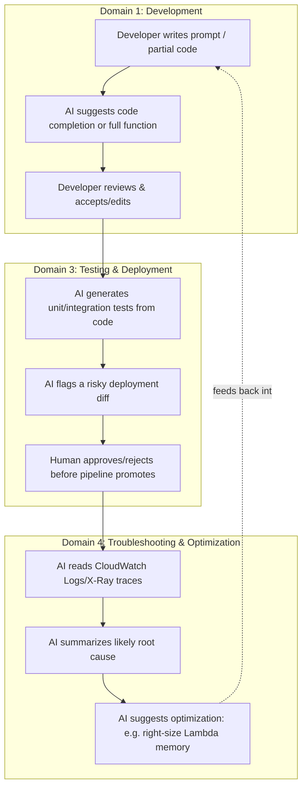
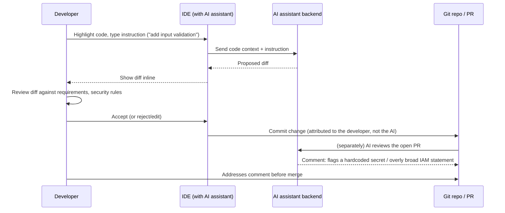
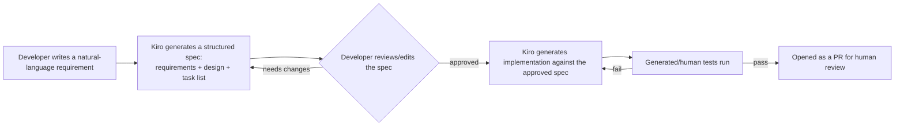
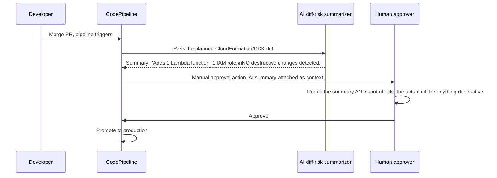
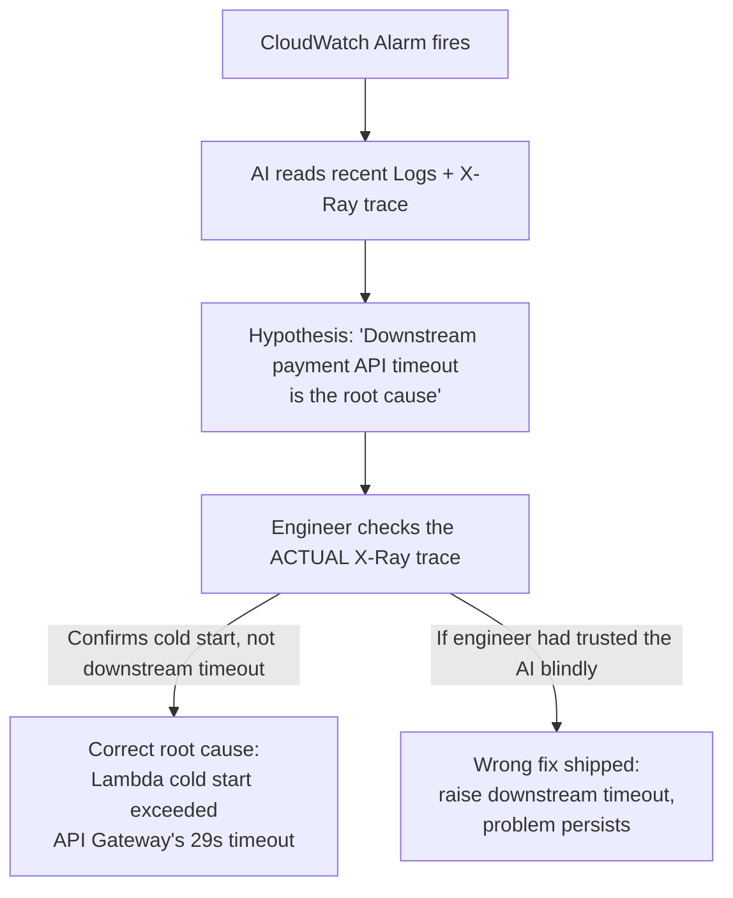

# AI-Assisted Development (cross-domain pattern)


*Source: [AWS Documentation — Chatting inline with Amazon Q Developer](https://docs.aws.amazon.com/amazonq/latest/qdeveloper-ug/q-in-IDE-inline-chat.html). A developer highlights code, types an instruction, and the assistant proposes a change — the human stays the one who accepts or rejects it.*

> This doc lives in Domain 1 because code generation/review is where the pattern starts, but the
> same underlying idea — an AI assistant doing part of a workflow a human used to do entirely by
> hand — repeats in [Domain 2](../domain-2-security/README.md#ai-assisted-development-cross-link)
> (reviewing AI-service security risks), [Domain 3](../domain-3-testing-deployment/README.md#ai-assisted-development-cross-link)
> (test generation, deployment approvals), and [Domain 4](../domain-4-troubleshooting-optimization/README.md#ai-assisted-development-cross-link)
> (error analysis, optimization suggestions). Read this once; recognize it everywhere.

## Definition

AI-assisted development means using an AI coding tool — **Amazon Q Developer**, **Kiro**, or a
similar assistant — inline in your IDE or CLI to generate code, review it, write tests for it,
help decide whether a deployment is safe, or explain why something broke. DVA-C03 is new in
testing this explicitly: you're expected to recognize *which part of the SDLC* a given AI
interaction fits into, and what its real limits are, not to know how to operate any specific tool.

## Purpose

Writing, testing, deploying, and debugging code are all time-consuming and error-prone when done
entirely by hand. AWS added these assistants (and the exam added this topic) because developer
workflows increasingly include an AI step at each stage — and because using one safely/well is now
a distinct, testable skill: knowing what to trust, what to double-check, and what never to hand
an assistant (secrets, production credentials, unreviewed auto-merges).

## How It Works — the pattern across the SDLC



Step by step:
1. **Domain 1 — generation & review**: you describe intent (a comment, a prompt, a partial
   function signature); the assistant proposes code. You, the developer, remain responsible for
   correctness — the assistant is a fast first draft, not a final reviewer. Exam angle: a question
   describing "a developer uses an AI tool suggestion in their IDE to speed up writing a Lambda
   handler" is Task 1.1 territory, not magic — same IAM, same error handling rules apply to the
   generated code.
2. **Domain 3 — test generation & deployment approvals**: the same kind of assistant can read your
   function and propose unit tests or regression tests (Task 3.2), or evaluate a pipeline's planned
   change and flag something that looks risky for a human to approve before CodePipeline/CodeDeploy
   promotes it (Task 3.3). The AI never *replaces* the approval gate — it informs it.
3. **Domain 4 — root cause & optimization**: an assistant can ingest CloudWatch Logs/Metrics, X-Ray
   trace data, and CloudTrail events and propose a likely root cause or a specific tuning change
   (e.g. "this Lambda is memory-constrained, not CPU-constrained — increase memory") (Task 4.1, 4.3).
   You still verify against the actual metrics before acting.

## The two assistants the exam cares about: Amazon Q Developer vs. Kiro

The exam guide names both explicitly, and it's worth knowing roughly how they differ in emphasis
even though the exam tests the *pattern*, not product trivia:

| | Amazon Q Developer | Kiro |
|---|---|---|
| Primary surface | Chat/inline suggestions inside an existing IDE (VS Code, JetBrains, etc.) | A full agentic IDE built around a spec-first workflow |
| Typical use | Ask questions, generate/complete code, explain an existing codebase, scan for vulnerabilities | Turn a natural-language requirement into a structured spec, then generate and iterate on an implementation against that spec |
| Where it shows up on DVA-C03 | Task 1.1 (generation/review), cross-linked into 3.2/3.3/4.1/4.3 | Same task statements — treated as an equivalent example of "AI coding assistant," not a separately tested product |
| End-of-support note | AWS has signaled it is winding down the standalone Q Developer IDE plugins in favor of Kiro-style tooling — for the exam, know both names and that they fill the same *role* | — |

Exam angle: don't memorize a feature comparison matrix. If a question names either tool, map it to
the *generic capability* (code gen, review, test gen, deployment-risk flagging, error analysis,
optimization suggestion) and answer based on that capability's rules, not the product name.

## Code generation and review, in practice



Two distinct moments matter here, and the exam likes to test whether you can tell them apart:
1. **Generation-time review** — the developer reviews a suggestion *before* accepting it into the
   codebase. This is the fastest feedback loop and catches the most obviously wrong suggestions.
2. **Post-hoc AI code review** — a second AI pass over an already-committed diff/PR, looking for
   patterns a human reviewer might also look for (hardcoded secrets, SQL injection shapes,
   overly permissive IAM). This doesn't replace a human reviewer, it's a faster first pass that
   surfaces things for the human to actually decide on.

## Key capabilities tested

- **Code generation/completion** — inline suggestions, full function scaffolds, boilerplate (IAM
  policy JSON, CloudFormation/CDK snippets, SDK calls).
- **Code review** — flagging obvious bugs, insecure patterns (hardcoded secrets, overly broad IAM),
  or style inconsistencies before a human merges.
- **Test generation / regression automation** — proposing unit tests, edge cases, or mock event
  payloads for Lambda test events.
- **Deployment approvals** — surfacing risk in a change (e.g. "this CDK diff deletes a DynamoDB
  table") so a human approver has more context before clicking approve in CodePipeline.
- **Error analysis** — summarizing logs/traces into a plain-English likely cause.
- **Optimization recommendations** — Lambda memory/timeout tuning, identifying overprovisioned
  resources, suggesting caching opportunities.
- **Codebase Q&A** — answering "where is X implemented" or "how does this module call that
  service" against your actual repository, which is a different capability from pure generation
  and shows up in scenarios about onboarding/understanding unfamiliar code.

## Use Cases — When to Use It

- Scaffolding repetitive boilerplate (SDK client setup, CRUD handlers, IaC resource blocks) so a
  developer's time goes to the logic that's actually novel.
- Generating a first pass at unit tests immediately after writing a function, before a human adds
  the edge cases the AI missed.
- Summarizing a wall of CloudWatch Logs into "here are the three requests that errored and why"
  during an incident, to shortcut triage.
- Getting a second opinion on an IAM policy or security group rule before it ships.
- Explaining an unfamiliar legacy module to a new team member faster than reading the whole thing
  line by line.
- Drafting a first version of documentation (README, runbook) from existing code/comments, which a
  human then edits for accuracy.

## Use Cases — Real Scenarios

Concrete developer situations where the "AI proposes, human verifies" pattern actually shows up in
a sprint, mapped to app type / requirement / implementation decision:

1. **App type:** Mid-size fintech API team, 15 microservices. **Requirement:** onboard a new hire
   onto a Lambda-based ledger service they didn't write, in under a day instead of a week.
   **Decision:** use the assistant's codebase Q&A capability ("where is the balance-reconciliation
   logic implemented") to get oriented fast, then verify the answer against the actual code before
   touching anything — the assistant accelerates orientation, it doesn't replace reading the code.
2. **App type:** Early-stage startup, one backend developer. **Requirement:** stand up a CRUD API
   for a new feature (Lambda + API Gateway + DynamoDB) in an afternoon instead of a day.
   **Decision:** prompt the IDE assistant for the boilerplate handler/IAM policy/SAM template, then
   manually scope the generated IAM policy down from its default broad-permission first draft
   before it ships — generation saves the boilerplate, the developer still owns the security review.
3. **App type:** E-commerce platform adding a "reorder previous purchase" endpoint. **Requirement:**
   ship with reasonable test coverage without spending a full day hand-writing every test case.
   **Decision:** ask the assistant to generate unit tests for the happy path and obvious edge
   cases (no previous order), then add the business-specific edge case by hand (a referenced
   product that's since been discontinued) that the assistant had no way to know mattered.
4. **App type:** Regulated healthcare SaaS. **Requirement:** a pipeline change must never reach
   production without a documented human approval, even when an AI tool says the diff looks safe.
   **Decision:** wire the AI's diff-risk summary into the existing CodePipeline manual approval
   step as additional context for the approver, not as an auto-approve condition — the approval
   gate itself stays a human action, satisfying the compliance requirement.
5. **App type:** On-call engineer at 2am, Lambda-backed checkout service alerting. **Requirement:**
   get to a plausible root cause fast without reading a full night's worth of CloudWatch Logs line
   by line. **Decision:** have an AI tool summarize the logs/X-Ray trace into a candidate root
   cause, then spend five minutes confirming it against the actual raw data before applying any
   fix — treating the summary as a fast hypothesis, not a diagnosis.
6. **App type:** Cost-conscious scale-up with dozens of Lambda functions. **Requirement:** find
   obvious memory/timeout over-provisioning without manually reviewing every function's metrics.
   **Decision:** use AI-assisted optimization suggestions as a triage/prioritization pass across
   many functions, then verify each flagged function's actual `Max Memory Used` and Duration
   metrics in CloudWatch before changing any production configuration.
7. **App type:** Security-conscious engineering org doing routine PR review. **Requirement:**
   catch an obviously over-broad IAM statement (`Resource: "*"`) before it merges, without relying
   solely on a human reviewer's attention at the end of a long review queue. **Decision:** an
   automated AI code-review pass flags the overly broad statement as a PR comment; a human
   reviewer still makes the actual accept/reject call, since false positives on this kind of
   static-pattern check are common enough that blind auto-rejection would create noise.
8. **App type:** Small team evaluating whether to adopt a spec-first workflow for a new service.
   **Requirement:** lock down requirements and design before a single line of implementation code
   exists, to avoid late-stage rework on a feature with ambiguous scope. **Decision:** use Kiro's
   spec-first flow — generate the structured spec, have the team review/edit *that* before any
   implementation is generated against it — making the human checkpoint structural rather than an
   after-the-fact diff review.
9. **App type:** Contractor doing a quick debugging session on an unfamiliar legacy function.
   **Requirement:** get unstuck on a cryptic stack trace fast, without violating the client's data
   handling policy. **Decision:** scrub the stack trace of the embedded database connection string
   before pasting it into any chat assistant — never assume a chat tool's context window is a safe
   place for a live credential, regardless of time pressure.

## When NOT to Use It / Limits

- **Never feed secrets, credentials, customer PII, or proprietary source you don't have rights to
  share into a third-party-hosted assistant** unless you've confirmed the specific tool's data
  handling (see [Task 2.3 security doc](../domain-2-security/ai-service-security-risks.md) for how
  this is modeled for Bedrock-style AI services specifically).
- **Never let an AI-proposed change auto-deploy to production without a human approval gate** —
  Task 3.3 still expects CodeDeploy/CodePipeline manual approval actions or equivalent guardrails.
- **Don't trust AI-generated root-cause explanations as ground truth** — always cross-check against
  the actual CloudWatch/X-Ray data; the assistant can hallucinate a plausible-sounding but wrong
  explanation.
- Generated code still needs the same code review rigor as human-written code — faster to produce
  is not the same as more correct.
- **Don't treat AI-generated IAM policies as safe-by-default** — a common real failure mode is an
  assistant proposing `Resource: "*"` "to make it work" because that's the shortest path to a
  passing test; the developer still owns scoping it down.
- **Don't rely on AI-generated tests as your only test coverage** — they're a strong starting point
  but tend to miss the edge cases the original developer didn't think to mention either.

## Why It's Important

Real-world: these tools are now a default part of how teams at AWS-using companies build software;
not knowing their failure modes (over-trusting output, leaking data into prompts) is a genuine
operational risk. Exam weight: this is explicitly called out as new in DVA-C03 across Tasks 1.1,
3.2, 3.3, and 4.1/4.3 — expect at least one question per domain that's really testing "do you know
where the human judgment still has to sit."

## Worked scenario: using AI assistance correctly through one feature's lifecycle

A team is adding a "reorder previous purchase" button to an e-commerce app's Lambda-backed API.
Walk through how AI assistance shows up correctly at each stage, and where a human must step in:

1. **Generation (Domain 1).** The developer prompts the IDE assistant: "write a handler that looks
   up the user's last order from DynamoDB and re-creates it as a new order." The assistant
   generates a first draft. The developer reviews it and notices it doesn't handle the case where
   the user has no previous orders — adds that check manually. *Correct use*: fast first draft,
   human catches the gap.
2. **Test generation (Domain 3).** Before opening a PR, the developer asks the assistant to
   generate unit tests for the handler. It proposes tests for the happy path and the no-previous-
   order case, but misses a test for a previous order that references a now-discontinued product.
   The developer adds that test by hand after thinking about what could realistically go wrong.
   *Correct use*: AI covers the obvious cases fast, human adds the business-specific edge case.
3. **Deployment approval (Domain 3).** The PR merges and CodePipeline builds a deployment. An AI
   step summarizes the diff for the approver: "adds a new Lambda function and a new IAM permission
   to read the Orders table — no destructive changes." A human approver reads the summary, confirms
   it against the actual diff, and clicks approve. *Correct use*: the AI saves the approver time
   reading a full diff, but the approver still makes the actual decision.
4. **Incident response (Domain 4).** A week later, the function starts erroring. An AI tool reads
   the CloudWatch Logs and X-Ray trace and proposes: "likely cause: the discontinued-product edge
   case is throwing an unhandled exception." An engineer checks the actual logs, confirms the
   AI's hypothesis is correct this time, and ships a fix. *Correct use*: faster triage, verified
   before acting — not blind trust.

Every step followed the same shape: **AI proposes, human verifies, human remains accountable.**
That shape, not any specific tool feature, is what DVA-C03 is actually testing.

## Pricing Model (summary)

Not a billed AWS service line item in the same sense as compute/storage — Amazon Q Developer has
free and paid (Pro) tiers tied to usage limits and organizational features; Kiro's pricing is
usage/seat based. Exam-relevant point: cost isn't the testable angle here, *usage pattern* is.

## Hands-on Lab (Floci)

Floci doesn't emulate AI coding assistants themselves (there's no API surface to call locally for
code generation). See [`labs.md`](labs.md) Lab 4 for an exercise that simulates the *pattern* —
writing a script that mimics "AI proposes, pipeline gate requires human approval" using
EventBridge + a manual Step Functions approval task, which is the testable mechanism underneath
the AI-assisted-deployment-approval idea.

## Feature-by-feature: what each AI capability maps to on the exam

| Capability | What it looks like in practice | Exam task it maps to | What a human must still verify |
|---|---|---|---|
| Inline code completion | Ghost-text suggestion as you type, accepted with Tab | 1.1 | Logic correctness, IAM scope of any API calls it introduces |
| Chat-based generation | "write a function that does X" in a chat panel | 1.1 | Same as above, plus that the generated code matches the *actual* event shape (e.g. S3 vs. SQS event structure) |
| Inline diff / refactor | Highlight code, ask for a change, review a diff before accepting | 1.1 | The diff doesn't silently change behavior outside what was asked |
| Security/vulnerability scanning | Static-analysis-style scan flags a hardcoded secret, SQL injection shape, or overly broad IAM statement | 1.1 / 2.1 / 2.2 (overlaps into security) | A flagged finding is still a human decision to fix/ignore — false positives happen |
| Unit/integration test generation | Given a function, propose test cases including a few edge cases | 3.2 | Business-specific edge cases the AI has no way to know about |
| Documentation/explanation | Summarize what an unfamiliar module does | — (productivity, not directly task-mapped) | Accuracy against the actual code, not just plausible-sounding prose |
| Deployment-risk summarization | Summarize a pending IaC diff's blast radius for an approver | 3.3 | The approver reads the actual diff too for anything destructive |
| Log/trace summarization | Condense a wall of CloudWatch/X-Ray data into a likely root cause | 4.1 | Cross-check against the raw metrics/trace before acting |
| Optimization suggestion | "this function is memory-constrained, raise memory" | 4.3 | Confirm with actual CloudWatch Duration/Memory-utilization metrics before changing production config |

## Concrete before/after: a Lambda handler reviewed by an AI assistant

What a *correct* AI-assisted review catches, concretely — this is the shape of a Domain 1/2
overlap question:

```python
# Before: developer's first draft (hands this to the assistant for review)
import boto3
ddb = boto3.client("dynamodb")

def handler(event, context):
    table = "Orders"
    user_id = event["queryStringParameters"]["userId"]
    resp = ddb.query(
        TableName=table,
        KeyConditionExpression="userId = :u",
        ExpressionAttributeValues={":u": {"S": user_id}}
    )
    return {"statusCode": 200, "body": resp["Items"]}  # BUG: body must be a JSON string
```

```python
# After: AI-flagged issues addressed by the developer, not blindly auto-applied
import boto3, json
ddb = boto3.client("dynamodb")

def handler(event, context):
    qsp = event.get("queryStringParameters") or {}
    user_id = qsp.get("userId")
    if not user_id:
        return {"statusCode": 400, "body": json.dumps({"error": "userId is required"})}

    resp = ddb.query(
        TableName="Orders",
        KeyConditionExpression="userId = :u",
        ExpressionAttributeValues={":u": {"S": user_id}}
    )
    return {"statusCode": 200, "body": json.dumps(resp["Items"])}
```

Three things an assistant plausibly flags here, mapped to what's actually being tested: (1) the
missing JSON serialization of `body` (Task 1.1's serialize/deserialize skill), (2) no defensive
check for a missing query string parameter (basic input validation, not AWS-specific but a common
"what's wrong with this code" exam snippet pattern), (3) implicitly, that `event["queryStringParameters"]`
can be `None` entirely (not just missing a key) if the request had no query string at all — a very
common real Lambda bug that an assistant's suggestion correctly guards against with `.get(...) or {}`.

## Real-world failure modes worth knowing by name

- **Prompt-to-production with no review.** A team configures a pipeline step that takes an AI
  tool's suggested fix for a failing test and auto-commits it directly to the deploy branch with no
  human review. The fix happens to "pass" by deleting the failing assertion rather than fixing the
  underlying bug. This is the textbook wrong-answer shape on the exam: any workflow where AI output
  reaches production without a human checkpoint is the incorrect option.
- **Context leakage.** A developer pastes a full stack trace into a chat assistant to get help
  debugging, not noticing the stack trace includes a database connection string with embedded
  credentials. Mitigation is procedural (scrub secrets before pasting, or use a tool/config that
  guarantees inputs aren't retained/used for training) — see
  [`../domain-2-security/ai-service-security-risks.md#keeping-inputsoutputs-out-of-model-training`](../domain-2-security/ai-service-security-risks.md#keeping-inputsoutputs-out-of-model-training).
- **Over-broad generated IAM.** An assistant generates a Lambda execution role with
  `"Action": "dynamodb:*"` because the prompt didn't specify which actions were actually needed and
  the broadest policy is the fastest way to make a demo "just work." Ships without being scoped
  down. This is Task 2.1/2.2 territory wearing a Domain-1 hat — least privilege is still the
  developer's job regardless of who/what wrote the first draft of the policy.
- **Confident wrong root cause.** During an incident, an AI summarizes CloudWatch Logs and
  confidently states the cause is a downstream timeout, when the actual cause (visible in X-Ray but
  not surfaced in the summary) is a cold-start-induced delay exceeding an API Gateway timeout. An
  engineer who ships a fix for the wrong cause (increasing a downstream timeout) wastes an incident
  cycle. This is exactly why Task 4.1 still expects a human to verify against the raw data.

## Kiro's spec-driven workflow, in a bit more depth

Where Amazon Q Developer's primary mode is conversational/inline assistance inside an existing
project, Kiro leans into a **spec-first** workflow that's worth understanding conceptually (not
operationally) because it's a cleaner illustration of "AI proposes, human verifies" than a single
inline suggestion is:



The exam-relevant takeaway isn't the tool's UI, it's that this workflow makes the "human
checkpoint" explicit and structural (you review the *spec* before any code is generated against
it) rather than ad hoc (reviewing a diff after the fact). Both are valid instances of the same
underlying pattern this doc keeps repeating: **generation, then human judgment, before anything
becomes permanent.** A scenario question contrasting "a team wants requirements reviewed and
locked before any code is generated" against "a team wants fast inline suggestions while typing"
is really just asking you to recognize these as two flavors of the same safe pattern, not to pick
a specific product by name.

## Exam Tips

- If a question describes an AI tool *doing* something irreversible (deploying, deleting, merging)
  with zero human check — that's the wrong answer. The correct pattern always keeps a human gate.
- If a question is about *generating* code/tests/explanations to *assist* a human — that's the
  right usage pattern.
- Don't memorize specific tool names' feature lists — the exam tests the *pattern* (generation,
  review, test-gen, approval-assist, error-analysis, optimization-assist), not product trivia.
- If a question asks "what should NOT be sent to an AI coding assistant," the answer is always
  secrets/credentials/PII — regardless of which specific tool is named.
- Expect at most one or two direct questions per domain on this topic; it's broad but shallow on
  this exam version — know the pattern, don't over-invest in tool-specific trivia.

## Real AWS image: Amazon Q Developer's code-development workflow


*Source: [AWS Prescriptive Guidance — Developer workflows with Amazon Q Developer](https://docs.aws.amazon.com/prescriptive-guidance/latest/best-practices-code-generation/)
(curl-verified 200). Note that AWS's own diagram places AI assistance at every single stage —
design, writing, testing, review — not just "writing code faster." This matches the exam's
emphasis exactly: DVA-C03 doesn't just test code generation (Task 1.1), it tests the *same*
AI-assisted pattern recurring at test generation (Task 3.2), deployment-risk review (Task 3.3),
and error analysis (Task 4.1/4.3) — one underlying capability, applied at four different SDLC
stages, which is the whole reason this doc is written as a single cross-domain reference instead
of four separate ones.*

## Plain-English analogy: a very fast, very confident junior developer

The single most useful mental model for every AI coding assistant on this exam: treat it as a
**junior developer who types faster than anyone on the team, has read an enormous amount of code,
and will confidently hand you a first draft within seconds — but who has never actually run your
tests, never talked to your product manager, and has no idea which shortcuts are unacceptable in
your specific regulated industry.** You wouldn't let a junior developer's first PR merge to
production with zero review just because they typed it fast; the same discipline applies to every
AI-generated suggestion, regardless of how polished it looks. This is also why a *correct* review
process (human checks the diff) doesn't change just because the "junior developer" is an AI instead
of an actual new hire — the review discipline is the constant; only the speed of the first draft
changed.

## Worked exam scenario: code generation with a real before/after diff, mapped to IAM least privilege

A developer prompts an assistant: "write a Lambda function that reads a user's order history from
DynamoDB." The assistant's first draft, and the corrected version a developer actually ships,
illustrate exactly what Task 1.1/2.1 overlap questions test:

```python
# AI first draft — functionally correct, but over-permissioned by default
# (the IAM policy below is what the assistant ALSO generated alongside this handler)
import boto3, json
ddb = boto3.resource("dynamodb")

def handler(event, context):
    table = ddb.Table("Orders")
    user_id = event["pathParameters"]["userId"]
    resp = table.query(KeyConditionExpression=boto3.dynamodb.conditions.Key("userId").eq(user_id))
    return {"statusCode": 200, "body": json.dumps(resp["Items"])}
```

```json
// The accompanying IAM policy the assistant generated — flagged on review
{
  "Version": "2012-10-17",
  "Statement": [
    { "Effect": "Allow", "Action": "dynamodb:*", "Resource": "*" }
  ]
}
```

```json
// What a developer actually ships after reviewing the AI's suggestion
{
  "Version": "2012-10-17",
  "Statement": [
    {
      "Effect": "Allow",
      "Action": "dynamodb:Query",
      "Resource": "arn:aws:dynamodb:us-east-1:123456789012:table/Orders"
    }
  ]
}
```

The handler code itself was fine as generated — the IAM policy was not. `dynamodb:*` on `Resource:
"*"` is the textbook shape of an AI assistant "making the demo just work" by requesting the
broadest permission that guarantees no `AccessDenied` error during testing, rather than the
narrowest permission the actual code path needs. Scoping it down to exactly `dynamodb:Query` on
exactly the `Orders` table ARN is the human step the exam expects every time — a question
describing "a developer merges an AI-generated IAM policy without reviewing its scope" is
describing precisely this failure, and the correct remediation is always "scope the policy down to
least privilege," never "trust the AI's permission choices by default."

## Worked exam scenario: test generation, and the edge case a human still has to add

Following up the handler above, the developer asks the assistant to generate unit tests:

```python
# AI-generated tests — covers the obvious cases fast
import pytest
from unittest.mock import patch, MagicMock

def test_returns_orders_for_valid_user():
    with patch("boto3.resource") as mock_resource:
        mock_table = MagicMock()
        mock_table.query.return_value = {"Items": [{"orderId": "o1"}]}
        mock_resource.return_value.Table.return_value = mock_table
        event = {"pathParameters": {"userId": "u1"}}
        result = handler(event, None)
        assert result["statusCode"] == 200

def test_returns_empty_list_for_user_with_no_orders():
    with patch("boto3.resource") as mock_resource:
        mock_table = MagicMock()
        mock_table.query.return_value = {"Items": []}
        mock_resource.return_value.Table.return_value = mock_table
        event = {"pathParameters": {"userId": "u2"}}
        result = handler(event, None)
        assert json.loads(result["body"]) == []
```

```python
# Human-added test — the assistant had no way to know this edge case mattered to THIS business
def test_raises_clear_error_when_path_parameter_missing():
    # A malformed request (missing pathParameters entirely) should fail predictably,
    # not with an unhandled KeyError that surfaces as an opaque 502 to the caller.
    event = {}
    with pytest.raises(KeyError):
        handler(event, None)
    # Business decision the team made after a past incident: this should actually be a
    # graceful 400, not a KeyError — a test an AI tool has no way to propose on its own,
    # because it requires knowing the team's specific incident history, not just the code.
```

The two AI-generated tests are genuinely useful and correctly cover the stated happy path and one
obvious edge case (empty result set). The third test encodes **organizational memory** — a past
incident, a team convention, a business rule not visible anywhere in the function's code — which is
exactly the category of test an assistant structurally cannot generate, because it isn't derivable
from the code alone. This is the cleanest way to internalize "AI covers the obvious cases fast,
human adds the business-specific edge case" instead of just reciting it as a slogan.

## Worked exam scenario: a deployment-risk summary, and where the approval gate actually sits



The exam-relevant detail isn't that an AI summarized the diff — it's **where in the pipeline the
human approval action still sits**. The AI summary is additional context attached to an existing
manual approval step (see [`services/developer-tools/codepipeline.md`](../../../services/developer-tools/codepipeline.md)
for how that manual approval action is actually configured) — it never replaces the approval step,
and it never auto-promotes based on its own "looks safe" conclusion. A wrong-answer variant of this
scenario removes the human approval step entirely because "the AI already said it's safe" — that's
always the incorrect choice on this exam, regardless of how good the AI's track record has been.

## Worked exam scenario: error analysis, and verifying before acting



A concrete reason this verification step isn't paranoia: a summarizer reading a wall of logs can
latch onto the most *frequent* error string in the window (a downstream timeout that happens on
every request during the incident, because requests are backing up) rather than the *first*,
causal one (a cold-start-induced delay that triggered everything downstream). Both symptoms are
real and both appear in the logs — only one is the actual root cause, and distinguishing them
requires looking at the X-Ray trace's timing breakdown directly, not just the AI's text summary of
it. This is the concrete mechanism behind "don't trust AI-generated root-cause explanations as
ground truth," not just a generic caution.

## The limits, concretely: three things that look like AI mistakes but are modeling your own blind spots

- **An assistant can only reason about the code/logs/context it was actually given.** If your
  prompt doesn't mention that a downstream service has a known intermittent outage, the assistant
  has no way to factor that in — this isn't the assistant being wrong, it's a reminder that output
  quality is bounded by input completeness, same as it would be for a new team member missing the
  same context.
- **An assistant trained on general patterns will suggest the statistically common fix, not
  necessarily your organization's specific fix.** A generically "correct-looking" retry pattern
  might violate your team's specific idempotency convention if the assistant wasn't shown that
  convention — review against *your* standards, not just general best practice.
- **Confidence in tone is not evidence of correctness.** A hallucinated root cause and a correct one
  can both be phrased with identical confidence — the exam's repeated "verify against actual data"
  guidance exists precisely because tone gives you no signal to distinguish the two.

## Exam Tips (expanded)

- A scenario naming a *specific* capability (code completion, test generation, deployment-risk
  summary, log summarization, optimization suggestion) is almost always mappable to exactly one
  Task number (1.1, 3.2, 3.3, 4.1, or 4.3 respectively) — use that mapping to narrow down which
  domain's rules apply to the rest of the question.
- If an answer choice has the AI *taking an irreversible action autonomously* (auto-merge,
  auto-deploy, auto-delete) — eliminate it immediately regardless of how plausible-sounding the
  rest of the scenario is.
- If a scenario's AI output disagrees with the raw data you're shown elsewhere in the question
  (e.g., the AI says "no destructive changes" but the diff shown clearly drops a table) — trust the
  raw data, not the AI's summary; the question is testing whether you'd actually read the diff.
- Scrubbing secrets before sending any text to a chat-based assistant is a recurring "what's the
  best practice here" answer — treat any mention of pasting logs/stack traces/config into a chat
  tool as a cue to check whether the pasted content contains credentials first.
- Kiro's spec-first flow and Q Developer's inline suggestions are the *same underlying pattern*
  tested two different ways — don't spend study time memorizing UI differences between the two
  products; spend it on recognizing the shared "generate, then human verifies" shape.

## Related Terms

- [`../domain-2-security/ai-service-security-risks.md`](../domain-2-security/ai-service-security-risks.md) — the security-specific risks of AI *services* (Bedrock/Q), distinct from this dev-workflow pattern.
- [`../domain-3-testing-deployment/README.md#ai-assisted-development-cross-link`](../domain-3-testing-deployment/README.md#ai-assisted-development-cross-link) — test generation and deployment approvals in practice.
- [`../domain-4-troubleshooting-optimization/README.md#ai-assisted-development-cross-link`](../domain-4-troubleshooting-optimization/README.md#ai-assisted-development-cross-link) — error analysis and optimization recommendations in practice.
- [`services/machine-learning-ai/bedrock.md`](../../../services/machine-learning-ai/bedrock.md)
- [`services/machine-learning-ai/amazon-q.md`](../../../services/machine-learning-ai/amazon-q.md)
- [`services/developer-tools/codepipeline.md`](../../../services/developer-tools/codepipeline.md) — where deployment approval gates live.
- [`services/developer-tools/codedeploy.md`](../../../services/developer-tools/codedeploy.md) — where an AI-flagged risky deployment would actually be held for approval.
- [`services/management-governance/cloudwatch.md`](../../../services/management-governance/cloudwatch.md) — the data AI-assisted error analysis reads.
- [`services/compute/lambda.md`](../../../services/compute/lambda.md) — the most common target of AI-generated code on this exam's scenarios.
