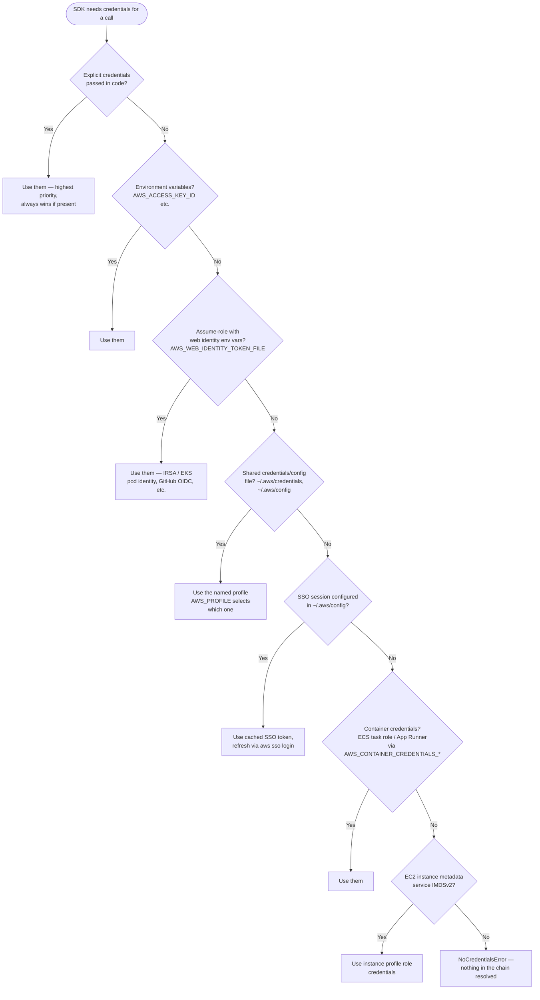
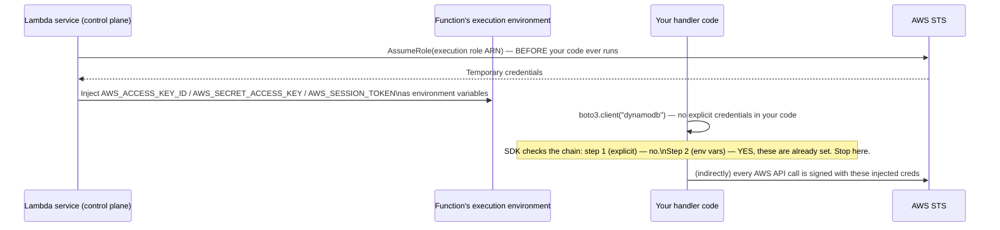
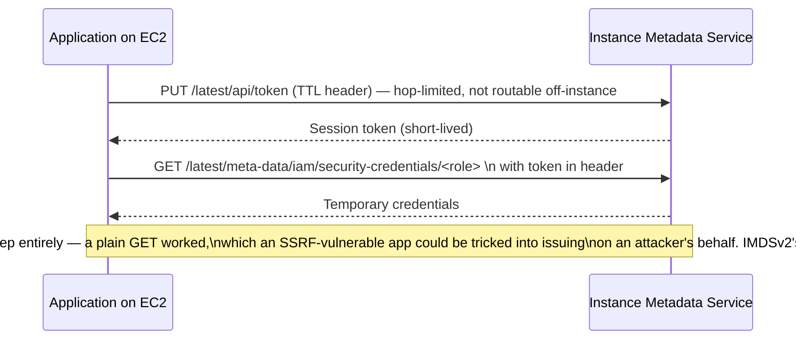

# AWS SDK Credential Resolution Chain, Deep Dive

> Referenced from [`README.md`](README.md#how-it-fits-together-a-lambda--api-gateway--dynamodb-request)
> (step 4 of the request-flow diagram: "Lambda assumes its execution role via IAM") and from
> [`services/security-identity-compliance/sts-and-role-switching.md`](../../../services/security-identity-compliance/sts-and-role-switching.md).
> That doc covers *what* temporary credentials are and how `AssumeRole` works; this one covers the
> question Task 1.1 actually tests at the code level: **when your application calls
> `boto3.client("s3")` with no explicit credentials, where do the credentials it uses actually come
> from, and in what order does the SDK look?**

## Definition

Every AWS SDK (boto3, the JS SDK v3, the Java SDK, etc.) resolves credentials by checking a fixed,
ordered list of sources — environment variables, config files, container metadata, instance
metadata, and more — stopping at the **first** source that provides a complete, usable set of
credentials. This ordered list is the **credential resolution chain** (boto3 calls it the "default
credential provider chain"; other SDKs use near-identical names). Nothing in application code has
to specify where credentials come from most of the time — the chain is precisely what lets the
exact same `boto3.client("s3")` call work unmodified on a developer's laptop, inside a CI job,
inside a Lambda function, and inside an EC2 instance, each getting different real credentials from
a different source in the chain without a single code change.

## Plain-English Analogy

Imagine arriving at a building and needing a keycard. You check your own pocket first (environment
variables) — got one? Use it, stop looking. Not there? Check the folder in your bag you keep for
exactly this (`~/.aws/credentials` file) — found one? Use it, stop. Still nothing? Ask the building
concierge, who already knows who you are because you badged in at the front door (ECS task role /
EC2 instance role via a metadata service) — they hand you a temporary visitor badge that expires at
5pm. You never had to *tell* anyone which of these methods to use; you just walked up to each
checkpoint in a fixed order and took the first badge offered. The AWS SDK does the exact same thing,
every single call, completely invisibly unless something goes wrong.

## Why Important

This is one of the most consequential "invisible" mechanisms in the entire exam, for two reasons
Task 1.1 cares about directly: (1) **hardcoding credentials in source code is always the wrong
answer** on any exam scenario, and the credential chain is *why* — there is always a better source
higher or lower in the chain that doesn't require a static secret committed to a repo; (2) a huge
class of real (and exam) bugs is "my code works locally but fails with `AccessDenied` / `NoCredentialsError`
in Lambda/EC2/ECS" — which is almost always the chain resolving to a *different* source than the
developer assumed, carrying different (or no) permissions.

## The chain itself, precisely (boto3's order — other SDKs are nearly identical)



Step by step, in the order the SDK actually checks:
1. **Explicit, in-code credentials** — e.g. `boto3.client("s3", aws_access_key_id=..., aws_secret_access_key=...)`.
   Highest priority precisely because it's the most deliberate override; also the single most
   common wrong-answer pattern on the exam ("hardcode an access key in the Lambda function code")
   because it bypasses every safer mechanism below it for no benefit.
2. **Environment variables** — `AWS_ACCESS_KEY_ID`, `AWS_SECRET_ACCESS_KEY`, `AWS_SESSION_TOKEN`.
   This is exactly how **Lambda** delivers execution-role credentials to your handler — Lambda sets
   these three environment variables itself, fresh, for every invocation; your code never calls
   `AssumeRole` explicitly, the Lambda service already did it on your behalf before your handler ran.
3. **Assume-role with web identity** — `AWS_WEB_IDENTITY_TOKEN_FILE` + `AWS_ROLE_ARN` environment
   variables, pointing at a JWT on disk. This is how **EKS IAM Roles for Service Accounts (IRSA)**
   and GitHub Actions OIDC federation both work: a trusted token is already sitting in a known file
   path, and the SDK exchanges it for real AWS credentials via `sts:AssumeRoleWithWebIdentity`
   automatically, with zero application code calling STS directly.
4. **Shared credentials/config files** (`~/.aws/credentials`, `~/.aws/config`) — the developer's
   local `aws configure` setup; `AWS_PROFILE` selects which named profile to use if there's more
   than one.
5. **SSO session** — if `~/.aws/config` defines an `sso_session`, the SDK uses a cached token from
   `aws sso login`, refreshing it as needed, without ever handling a static access key at all.
6. **Container credentials** — `AWS_CONTAINER_CREDENTIALS_RELATIVE_URI` (or the full URI variant)
   points the SDK at a local HTTP endpoint only reachable from inside the container, serving
   temporary credentials for the **ECS task role**. This is the ECS/Fargate equivalent of step 7
   below — same idea, different metadata endpoint, different trust boundary.
7. **EC2 instance metadata service (IMDS)** — the SDK calls `http://169.254.169.254/latest/meta-data/iam/security-credentials/<role-name>`
   to fetch temporary credentials for whatever **instance profile role** is attached to the EC2
   instance. On IMDSv2 (the AWS-recommended, increasingly enforced version), this requires a
   session token obtained via a `PUT` request first — a defense specifically against SSRF attacks
   that trick an application into fetching IMDSv1 credentials through an unrelated HTTP request.

If none of the above resolves, the SDK raises `NoCredentialsError` (boto3) or an equivalent — this
is the exact error developers hit when running code that *assumed* an EC2 instance profile locally
on their own laptop, where no such metadata service exists.

## Real AWS image: the IAM policy evaluation that still runs AFTER credentials resolve


*Source: [AWS IAM User Guide — Policy evaluation logic](https://docs.aws.amazon.com/IAM/latest/UserGuide/reference_policies_evaluation-logic.html)
(curl-verified 200). Worth pairing with the credential chain diagram above because it's a common
exam confusion point: resolving *which* credentials a call uses (the chain above) is a completely
separate question from *what those credentials are allowed to do* (this evaluation, which runs on
every single API call regardless of which source in the chain produced the credentials). A call
that resolves credentials successfully can still fail with `AccessDenied` — that's this diagram's
job, not the chain's.*

## Code: inspecting which source actually resolved, instead of guessing

```python
import boto3

session = boto3.Session()
creds = session.get_credentials()
frozen = creds.get_frozen_credentials()
print("Access key prefix:", frozen.access_key[:4])
print("Credential source/method:", creds.method)   # e.g. "env", "shared-credentials-file",
                                                    # "iam-role" (instance profile),
                                                    # "container-role" (ECS task role),
                                                    # "assume-role-with-web-identity"
```

`creds.method` is the single fastest way to stop guessing and actually confirm which link in the
chain fired — a genuinely useful debugging habit, and a good instinct to have whenever a scenario
says "the application works in one environment but gets `AccessDenied` in another."

```python
# Forcing a SPECIFIC source explicitly — rare in application code, common in testing/tooling
session = boto3.Session(profile_name="dev-sandbox")   # forces step 4, ignoring env vars entirely
s3 = session.client("s3")
```

## Lambda specifically: where the execution role's credentials actually come from



This is the concrete mechanism behind the README's request-flow diagram step "Lambda assumes its
execution role via IAM" — your handler code never calls `sts:AssumeRole` itself; the Lambda service
does it on your behalf at execution-environment startup (part of the Init phase, reused across warm
invocations), and delivers the result as environment variables your SDK finds at chain step 2
without you writing a single line to fetch them.

## Cross-SDK comparison: same concept, different variable names

The exam is written SDK-agnostic (it tests the concept of a resolution chain, not boto3 syntax
specifically), but it helps to recognize the pattern holds across every official AWS SDK, just
with different environment variable or config object names:

| Concept | boto3 (Python) | AWS SDK for JavaScript v3 | AWS SDK for Java v2 |
|---|---|---|---|
| Explicit in-code override | `boto3.client("s3", aws_access_key_id=...)` | `new S3Client({ credentials: {...} })` | `S3Client.builder().credentialsProvider(StaticCredentialsProvider.create(...))` |
| Environment variables | `AWS_ACCESS_KEY_ID` / `AWS_SECRET_ACCESS_KEY` / `AWS_SESSION_TOKEN` | Same variable names | Same variable names |
| Shared config/credentials file | `~/.aws/credentials`, `AWS_PROFILE` | Same files, same `AWS_PROFILE` | Same files, same `AWS_PROFILE` |
| Container credentials (ECS) | Automatic via `AWS_CONTAINER_CREDENTIALS_RELATIVE_URI` | Automatic, same env var | Automatic, same env var |
| EC2 instance metadata | Automatic via IMDS | Automatic via IMDS | Automatic via IMDS |
| Introspecting which source fired | `session.get_credentials().method` | `await credentials()` resolves but doesn't label its source directly — check `AWS_SDK_LOAD_CONFIG` / enable SDK logging | `ProfileCredentialsProvider`/chain class name visible via debug logging |

The exam-relevant takeaway from this table isn't memorizing every language's exact API — it's that
**the underlying chain and its ordering is a platform-wide AWS concept**, not a boto3 quirk, so a
question framed around any SDK is testing the same resolution order described above.

## Worked troubleshooting scenario: "it works on my machine"

A developer's script running `boto3.client("dynamodb").scan(TableName="Orders")` works perfectly
on their laptop. The exact same code, packaged into a container and deployed to ECS Fargate, fails
with `AccessDenied: User: arn:aws:sts::123456789012:assumed-role/ecsTaskExecutionRole/... is not
authorized to perform: dynamodb:Scan`. Walking the chain to find the real cause:

1. **Confirm which credentials are actually being used in each environment** — on the laptop,
   `session.get_credentials().method` reports `"shared-credentials-file"`, resolving to the
   developer's own IAM user, which (through whatever role/policy that user has) happens to include
   `dynamodb:Scan` on `Orders`.
2. **In ECS**, the same introspection call reports `"container-role"` — meaning it resolved through
   `AWS_CONTAINER_CREDENTIALS_RELATIVE_URI` to the **task role**, a completely different identity
   from the developer's own IAM user.
3. **The actual bug**: the task role attached to this ECS service has a permissions policy that was
   scoped only to `dynamodb:GetItem`/`dynamodb:PutItem` on `Orders` — nobody granted it `Scan`.
4. **The fix** is adding `dynamodb:Scan` to the **task role's** permissions policy — not touching
   the code at all, and not touching the developer's personal IAM user, which was never the
   identity the deployed application actually uses. This is precisely the kind of question the
   exam asks to see whether a candidate reflexively "fixes" the code when the actual bug is in
   which role is attached to the compute environment.

This pattern — same code, different environment, different link in the chain, different
attached role, different effective permissions — is worth recognizing as a *category* of bug, not
memorizing this one example: any "works here, not there" AWS question involving credentials is
almost always this, not a code defect.

## Common exam scenarios

- *"A Lambda function works fine when invoked directly but fails with `AccessDenied` when deployed
  to a second environment"* → check the execution role attached in that environment, not the code —
  the credentials come from the role, resolved automatically; the code is identical.
- *"A question offers 'hardcode an IAM user's access key into the application' as an answer choice"*
  → always wrong on this exam, regardless of context — every legitimate case is better served by a
  role resolved through the chain.
- *"An application running in ECS needs different permissions than one running on EC2 in the same
  account, with no code changes"* → different task role (ECS) vs. instance profile role (EC2) —
  same chain position concept (steps 6 vs. 7), different attached IAM role, zero code difference.
- *"A local developer's script needs to assume a role that's only grantable to EKS pods"* → that's
  IRSA (step 3), not something a developer's laptop profile (step 4) can do directly without an
  explicit `AssumeRole` call layered on top.
- *"Code calling the SDK gets `NoCredentialsError` only when run inside a Docker container on a
  developer's laptop (not in CI, not in Lambda)"* → the container has no path to any link in the
  chain (no env vars passed through, no mounted `~/.aws`, and it's not running on EC2/ECS so IMDS
  doesn't apply) — the fix is to explicitly pass credentials into the container (env vars or a
  mounted credentials file), not a code change in the SDK call itself.
- *"A security review flags `AWS_SECRET_ACCESS_KEY` set as a hardcoded value in a Dockerfile `ENV`
  instruction"* → still a static long-lived secret baked into an image layer, functionally
  equivalent to hardcoding it in source — same wrong-answer category as embedding it directly in code.

## IMDSv2 and SSRF: the one security nuance worth knowing by name



The exam-relevant point: IMDSv2 requires a `PUT` to fetch a token before any `GET` against instance
metadata, and that token request's hop limit (default 1) means it cannot be relayed through a proxy
or forwarded across a network boundary the way a bare `GET` request could be by a vulnerable web
app. A scenario describing a web application vulnerable to SSRF being used to steal instance
credentials describes exactly the attack IMDSv2 was introduced to stop — and "require IMDSv2" /
"set the metadata hop limit to 1" is the fix pattern to recognize.

## Exam Tips

- Memorize the shape of the chain (explicit → env vars → web identity → shared config/SSO →
  container → instance metadata), not necessarily every exact environment variable name — the
  exam tests recognizing *order of precedence* far more often than spelling.
- "Hardcoded credentials in application code" is a near-universal wrong answer on this exam — if
  you see it as an option and nothing else is obviously worse, it's the trap.
- Different compute environments (EC2 vs. ECS vs. Lambda) get credentials from different chain
  links automatically — this is *why* the same code can have different effective permissions in
  different places without any code change, and it's a very common root-cause-analysis scenario.
- `creds.method` (boto3) or the SDK-equivalent introspection call is the fast way to confirm which
  chain link actually fired — know that this kind of debugging tool exists, even if you don't
  memorize its exact syntax.
- IMDSv2's token requirement exists specifically to block SSRF-based credential theft — recognize
  this as the answer whenever a scenario combines "EC2 instance metadata" with "a web app
  vulnerability."

## Related Terms

- [`services/security-identity-compliance/sts-and-role-switching.md`](../../../services/security-identity-compliance/sts-and-role-switching.md) — what happens on the far side of `AssumeRole`, trust policies, role chaining.
- [`services/security-identity-compliance/iam.md`](../../../services/security-identity-compliance/iam.md) — the policy evaluation that runs after credentials resolve.
- [`services/compute/lambda.md`](../../../services/compute/lambda.md) — execution roles and how
  credentials reach a function's environment.
- [`services/compute/ec2.md`](../../../services/compute/ec2.md) and
  [`services/containers/ecs.md`](../../../services/containers/ecs.md) — instance profiles vs. task roles.
- [`README.md`](README.md#how-it-fits-together-a-lambda--api-gateway--dynamodb-request) — where
  this chain fires inside the canonical Domain 1 request flow.
