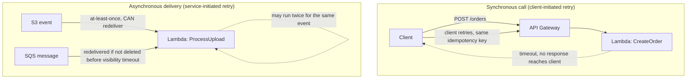
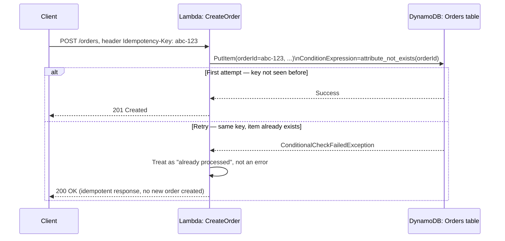
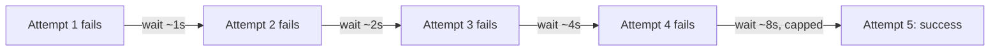

# Idempotency and Retry Patterns, Deep Dive

> This doc expands the idempotency/retry thread that runs through
> [`README.md`](README.md#full-worked-case-study-a-flash-sale-order-api) (the flash-sale case
> study) and [`labs.md`](labs.md#lab-4--idempotent-writes-with-a-conditional-expression-the-case-study-pattern)
> (Lab 4) into a standalone reference. On DVA-C03, "the client may retry" is one of the
> highest-value disguised patterns on the exam — it hides inside scenario wording about flaky
> networks, mobile clients, Lambda async retries, SQS redelivery, and Step Functions error
> handling, and every one of those surface forms reduces to the same two underlying mechanisms:
> **idempotency keys** and **conditional writes**.

## Definition

An operation is **idempotent** if performing it two (or N) times has the exact same effect as
performing it once. `PUT /users/42 {"name":"Alice"}` is naturally idempotent — doing it five times
leaves the same end state as doing it once. `POST /orders {"item":"widget"}` is **not** naturally
idempotent — each call, by default, creates a new order. A **retry** is any re-attempt of a failed
or uncertain operation, driven either by a client (network timeout, no response received) or by an
AWS service itself (Lambda's async retry, an SQS consumer not deleting a message in time, Step
Functions' `Retry` field). **Idempotency patterns** are the application-level techniques that make
an inherently non-idempotent operation (like "create an order") safe to retry blindly.

## Plain-English Analogy

Think of a vending machine that sometimes doesn't show you a confirmation light after you pay.
If you can't tell whether your payment went through, pressing the button again might vend two
snacks and charge you twice — unless the machine has a rule like "if I already dispensed snack
#B4 for *this specific coin insertion*, don't dispense it again, just show you the light." The
**idempotency key** is the serial number stamped on your coin before you insert it: the machine
(your backend) remembers every serial number it has already honored, and any future presentation
of that same serial number is treated as "already done," not "do it again."

## Why Important

Every distributed system has calls that can fail *in the ambiguous zone* — the request reached
the server, the server did the work, but the response never made it back to the caller (timeout,
connection reset, client crash). The caller cannot tell "it never happened" apart from "it
happened but I didn't hear back," and the only safe behavior under that ambiguity is to retry —
which means **every operation that can be retried must be made idempotent, or it must not be
retried at all.** AWS SDKs retry automatically by default for many error classes; Lambda retries
asynchronous invocations automatically; SQS redelivers unacknowledged messages automatically. None
of that automatic retry machinery knows or cares whether your business logic is idempotent — that
part is always the developer's job, and it's exactly what Task 1.1/1.3 test with disguised wording
like "must never double-charge," "duplicate processing is unacceptable," or "the same event may be
delivered more than once."

## When to Use It

- Any `POST`/`create` operation reachable by a client that might retry on timeout (mobile apps,
  browsers with flaky connections, any synchronous API behind API Gateway).
- Any consumer of an **at-least-once** delivery mechanism — SQS, S3 event notifications, EventBridge,
  SNS, Kinesis, DynamoDB Streams. None of these guarantee exactly-once delivery; all of them can
  redeliver the same logical event more than once under real failure conditions.
- Any Lambda function invoked **asynchronously** (S3, SNS, EventBridge triggers) — Lambda's own
  retry-twice-then-DLQ behavior means your handler can run more than once for one logical event.
- Any Step Functions state with a `Retry` field on a task that has side effects (charges a card,
  sends an email, writes a record).

## When NOT to Use It

- Naturally idempotent operations (`PUT`, `DELETE` by ID, a plain `GetItem`) don't need an
  idempotency key — doing them twice is already safe by construction. Adding one anyway is just
  unnecessary complexity and an extra DynamoDB table to pay for and maintain.
- Pure read operations never need this pattern — only reads *paired with a write decision* do.
- Don't over-engineer a client-generated idempotency key into a system where the operation is
  *inherently* exactly-once already (e.g., a Step Functions execution name, which AWS itself
  already deduplicates by name within a time window) — know when the platform already did this
  for you (see the Step Functions section below) instead of stacking a redundant layer.

## How two failure classes force two different defenses



Both boxes above produce the exact same symptom at the data layer — "this logical operation might
be attempted more than once" — but for two completely different reasons: the left side is a client
that legitimately doesn't know if its first attempt succeeded; the right side is an AWS messaging
primitive whose delivery contract is *at-least-once by design*, not a bug. The fix (idempotent
write) is identical either way, which is exactly why the exam likes to test both wordings against
the same underlying answer.

## The core mechanism: idempotency key + conditional write



The client supplies the idempotency key (usually a UUID generated once per *logical* user action,
reused on every retry of that same action — never regenerated on retry, that would defeat the
whole point). The server's only real job is to make the "has this key been seen" check and the
"record that this key has now been seen" write **atomic** — if those were two separate steps (a
`GetItem` followed by a `PutItem`), two concurrent retries could both pass the check before either
writes, recreating the exact race condition the pattern exists to close. DynamoDB's
`ConditionExpression=attribute_not_exists(orderId)` on `PutItem` makes the check-and-write one
atomic server-side operation — this is the single most-tested mechanic in this whole topic.

```python
import json, boto3
from botocore.exceptions import ClientError

ddb = boto3.client("dynamodb")

def handler(event, context):
    body = json.loads(event["body"])
    idem_key = event["headers"].get("Idempotency-Key")
    if not idem_key:
        return {"statusCode": 400, "body": json.dumps({"error": "Idempotency-Key header required"})}

    try:
        ddb.put_item(
            TableName="Orders",
            Item={"orderId": {"S": idem_key}, "item": {"S": body["item"]}},
            ConditionExpression="attribute_not_exists(orderId)",
        )
        return {"statusCode": 201, "body": json.dumps({"status": "created", "orderId": idem_key})}
    except ClientError as e:
        if e.response["Error"]["Code"] == "ConditionalCheckFailedException":
            # This IS the retry. Return the same success shape, do NOT re-run side effects.
            return {"statusCode": 200, "body": json.dumps({"status": "already processed", "orderId": idem_key})}
        raise
```

A subtlety the exam likes: a bare `ConditionalCheckFailedException` only tells you the key was
already used — it does **not** tell you the *result* of the original request. A more complete
implementation stores the original response body alongside the idempotency record and returns it
verbatim on a retry, rather than re-deriving a response, so two different clients retrying the
same key always see byte-identical responses.

```python
# Storing and replaying the original response, not just acknowledging "already done"
def handler(event, context):
    body = json.loads(event["body"])
    idem_key = event["headers"]["Idempotency-Key"]

    existing = ddb.get_item(TableName="IdempotencyRecords", Key={"key": {"S": idem_key}}).get("Item")
    if existing:
        return json.loads(existing["response"]["S"])  # replay the ORIGINAL response, byte for byte

    order_id = create_order(body)  # the real side effect
    response = {"statusCode": 201, "body": json.dumps({"orderId": order_id})}
    try:
        ddb.put_item(
            TableName="IdempotencyRecords",
            Item={"key": {"S": idem_key}, "response": {"S": json.dumps(response)}},
            ConditionExpression="attribute_not_exists(#k)",
            ExpressionAttributeNames={"#k": "key"},
        )
    except ClientError as e:
        if e.response["Error"]["Code"] != "ConditionalCheckFailedException":
            raise
        # Lost a race against a concurrent retry — fetch and return ITS stored response instead
        existing = ddb.get_item(TableName="IdempotencyRecords", Key={"key": {"S": idem_key}})["Item"]
        return json.loads(existing["response"]["S"])
    return response
```

## Real AWS image: SQS's at-least-once delivery, the root cause behind most "retry" scenarios


*Source: [AWS SQS Developer Guide — Visibility timeout](https://docs.aws.amazon.com/AWSSimpleQueueService/latest/SQSDeveloperGuide/sqs-visibility-timeout.html)
(curl-verified 200). This is worth staring at carefully: a message a consumer is actively
processing but hasn't yet deleted is still sitting in the queue, invisible, on a timer. If
processing takes longer than the visibility timeout — a slow downstream call, a cold start, a
retry inside your own handler — the message reappears and a **second** consumer (or the same
consumer, on its next poll) can receive and process it again. This is not a bug or an edge case;
it is SQS's documented at-least-once contract, and it is the single most common root cause behind
exam scenarios and real production bugs that describe "the same message was processed twice."*

Discussion: the fix is never "configure SQS to be exactly-once" (standard queues cannot be, and
even FIFO queues only dedupe within a 5-minute window via `MessageDeduplicationId` — a true
architectural guarantee, but still bounded in time and still best paired with an idempotent
consumer for defense in depth). The fix is always the same idempotent-write pattern shown above,
applied inside the SQS consumer's business logic — the queue's delivery guarantee and the
consumer's idempotency are two independent, complementary layers, and the exam expects you to
know neither one substitutes for the other.

## Exponential backoff with jitter: the client-side half of this topic

Server-side idempotency protects against *duplicate effects*; client-side backoff protects the
*service* from a retry storm. Both halves are tested, often in the same scenario.



Without jitter, a thousand clients that all failed at the same moment (say, a brief service blip)
all retry at the same 1s, 2s, 4s... intervals in lockstep, recreating the exact overload spike
that caused the first failure — a **thundering herd**. Jitter (randomizing the wait within a
range, e.g. `random(0, 2^attempt)` instead of a fixed `2^attempt`) spreads retries out over time so
the aggregate retry traffic smooths into a gentle ramp instead of a synchronized spike.

```python
import time, random
import boto3
from botocore.config import Config

# The AWS SDK already does this for you for retryable service errors — exam angle: know that
# "adaptive" mode specifically backs off FASTER under sustained throttling than "standard" mode.
config = Config(retries={"max_attempts": 8, "mode": "adaptive"})
ddb = boto3.client("dynamodb", config=config)

# Hand-rolled equivalent, for a case the SDK's built-in retry doesn't cover (e.g. retrying your
# OWN application-level "not ready yet" condition, not a raw service error):
def call_with_backoff(fn, max_attempts=6):
    for attempt in range(max_attempts):
        try:
            return fn()
        except Exception:
            if attempt == max_attempts - 1:
                raise
            sleep_s = min(30, (2 ** attempt)) * (0.5 + random.random() * 0.5)  # full jitter, capped
            time.sleep(sleep_s)
```

Exam angle: a question describing "intermittent throttling under load, and the application should
back off with increasing, randomized delay" wants `Config(retries={"mode": "adaptive"})` or a
hand-rolled jittered backoff — **not** "just raise the table's provisioned capacity," which is a
completely different lever (capacity vs. client retry behavior) that the exam loves to offer as a
plausible-looking wrong answer.

## Idempotency mechanisms by service: a reference table

| Service | Native idempotency mechanism | What it actually guarantees |
|---|---|---|
| DynamoDB `PutItem`/`UpdateItem` | `ConditionExpression=attribute_not_exists(pk)` | Atomic check-and-write; the pattern this whole doc centers on |
| DynamoDB Transactions (`TransactWriteItems`) | `ClientRequestToken` | A retried transaction with the same token within 10 minutes is deduplicated server-side — no application-level key table needed |
| SQS FIFO queues | `MessageDeduplicationId` (explicit, or content-based dedup) | Messages with the same ID within a 5-minute window are deduplicated *at the queue*, before a consumer ever sees them — bounded by time, not forever |
| Lambda (idempotent *invocation*, not business logic) | None built in for standard invokes — AWS Lambda Powertools' `@idempotent` decorator wraps a DynamoDB table for you | Lambda itself does not dedupe invocations; this is purely an application-layer add-on |
| Step Functions | `name` parameter on `StartExecution` | Starting an execution with a name that already exists (and matching input) within the retention window returns the existing execution instead of starting a new one — platform-level idempotency, no table needed |
| S3 `PutObject` | None by default — overwrites are idempotent by key, but a conditional write needs `If-None-Match: *` (S3 now supports this natively) | Prevents two concurrent uploads from silently clobbering each other when "only create if it doesn't exist" is the actual requirement |
| API Gateway + Lambda | `Idempotency-Key` header (your own convention, not an AWS feature) | Entirely an application-level pattern — API Gateway has no native idempotency feature for arbitrary REST operations |
| Payment-style APIs (pattern, not AWS-specific) | Client-generated idempotency key passed as a request parameter | The de facto standard shape (Stripe, PayPal, and this doc's own pattern all converge on it) |

## Worked exam scenario: Step Functions retry/catch on a side-effecting task

A state machine step calls a Lambda function that charges a payment. The requirement: retry
transient failures automatically, but never retry (or at least never silently swallow) a failure
that indicates the charge might have actually succeeded despite an error being thrown.

```json
{
  "Comment": "Charge payment with differentiated retry/catch",
  "StartAt": "ChargePayment",
  "States": {
    "ChargePayment": {
      "Type": "Task",
      "Resource": "arn:aws:lambda:us-east-1:123456789012:function:ChargePayment",
      "Retry": [
        {
          "ErrorEquals": ["States.Timeout", "Lambda.ServiceException"],
          "IntervalSeconds": 2,
          "MaxAttempts": 3,
          "BackoffRate": 2.0
        },
        {
          "ErrorEquals": ["PaymentDeclinedError"],
          "MaxAttempts": 0
        }
      ],
      "Catch": [
        {
          "ErrorEquals": ["States.ALL"],
          "ResultPath": "$.error",
          "Next": "ManualReviewQueue"
        }
      ],
      "Next": "OrderConfirmed"
    },
    "ManualReviewQueue": { "Type": "Succeed" },
    "OrderConfirmed": { "Type": "Succeed" }
  }
}
```

Reading this the way the exam wants you to: `States.Timeout`/`Lambda.ServiceException` are
infrastructure-shaped failures (the function didn't even finish, or AWS itself hiccupped) — safe
to retry automatically, with exponential backoff (`BackoffRate: 2.0`) built directly into the
state machine definition, no hand-rolled loop needed. `PaymentDeclinedError` is a **business**
failure — the function *did* run and *did* get a definitive answer ("card declined") — retrying it
would be pointless at best and a double-charge risk at worst if the error were misclassified, so
`MaxAttempts: 0` sends it straight to `Catch` instead. This differentiated retry/catch — not "retry
everything the same way" — is exactly what Task 1.1/1.3's retry-pattern questions are testing when
they mention Step Functions specifically.

## Common exam scenarios

- *"A client on a flaky mobile network may send the same `POST /orders` request twice; the backend
  must never create two orders"* → client-supplied idempotency key + `ConditionExpression=attribute_not_exists`.
- *"An SQS consumer appears to process the same message more than once"* → expected at-least-once
  behavior, not a bug — make the consumer's write idempotent; also check whether the visibility
  timeout is shorter than actual processing time.
- *"A Step Functions execution is accidentally started twice with the same business key"* → use the
  `name` parameter on `StartExecution` so the second call is deduplicated by Step Functions itself.
- *"Throttling errors increase under load and the app should back off with increasing delay instead
  of failing fast"* → `Config(retries={"mode": "adaptive"})`, not a capacity change.
- *"A DynamoDB transaction is retried by the client after a network timeout and must not apply
  twice"* → `ClientRequestToken` on `TransactWriteItems`, not a hand-rolled idempotency table (the
  platform already does this one for you).
- *"A payment charge must never be retried if the first attempt's failure means the card was
  genuinely declined, but should retry if AWS itself had a transient issue"* → differentiated
  `Retry`/`Catch` blocks in Step Functions, matching specific error names, not one blanket retry rule.

## Exam Tips

- If a scenario says "duplicate," "retried," "at-least-once," or "the same event twice" — the
  answer is almost always a conditional write plus an idempotency key, regardless of which AWS
  service is named in the question.
- Know the difference between *server-side* idempotency (protects data correctness) and
  *client-side* backoff-with-jitter (protects the service from overload) — a question can test
  either half independently.
- `ConditionExpression=attribute_not_exists(pk)` on DynamoDB is the single most frequently
  referenced mechanism for this whole topic — know its name and syntax cold.
- Don't pick "increase capacity" as the fix for a throttling-retry scenario — that's a distractor;
  retry/backoff configuration and capacity planning are two separate, independent levers.
- Remember that some AWS services already give you idempotency natively (Step Functions execution
  names, DynamoDB transaction `ClientRequestToken`, SQS FIFO dedup IDs) — recognizing "the platform
  already solved this" is itself a tested skill, not just knowing how to build the pattern by hand.

## Related Terms

- [`README.md`](README.md#full-worked-case-study-a-flash-sale-order-api) — the flash-sale case
  study this doc expands on.
- [`labs.md`](labs.md#lab-4--idempotent-writes-with-a-conditional-expression-the-case-study-pattern) — hands-on lab exercising this exact pattern.
- [`services/database/dynamodb.md`](../../../services/database/dynamodb.md) — conditional writes
  and transactions in full depth.
- [`services/application-integration/sqs.md`](../../../services/application-integration/sqs.md) —
  visibility timeout and FIFO dedup mechanics.
- [`services/application-integration/step-functions.md`](../../../services/application-integration/step-functions.md) — `Retry`/`Catch` syntax in full.
- [`services/compute/lambda.md`](../../../services/compute/lambda.md) — async invocation retry
  behavior and DLQs/failure destinations.
