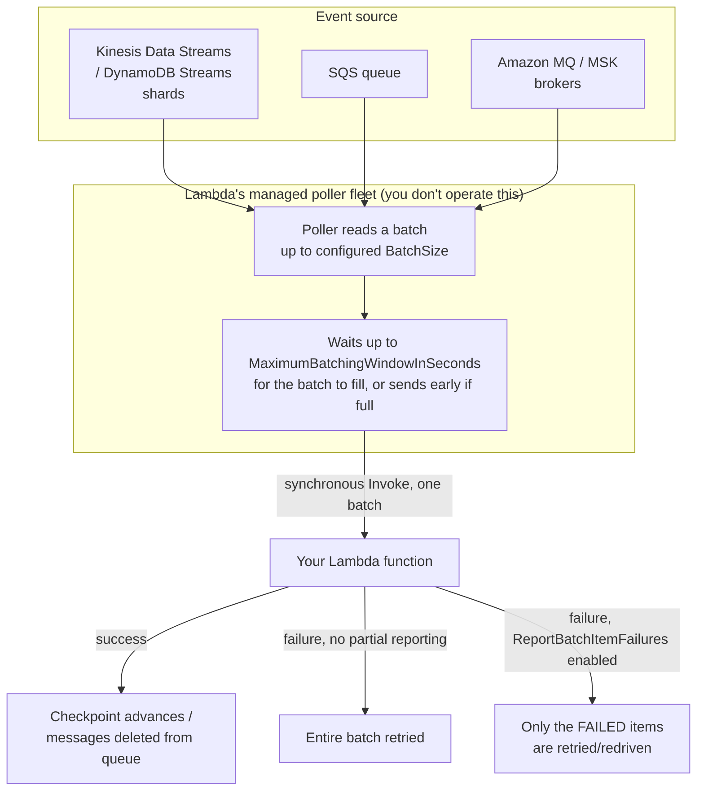
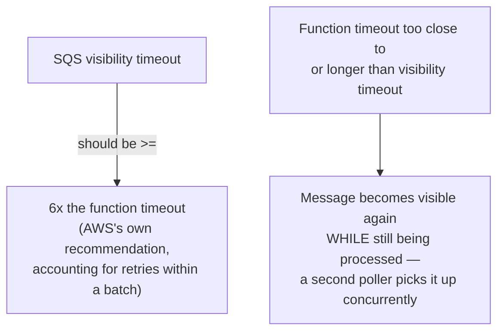

# Lambda Event Source Mapping, Deep Dive

> Expands the "poll-based (event source mapping)" box from
> [`README.md`](README.md#lambda-triggers-three-invocation-models-one-function) into a standalone
> reference. Task 1.2's "configure triggers (synchronous, asynchronous, poll-based event sources)"
> bullet is tested in the most depth right here — poll-based triggers have more configurable knobs,
> more failure modes, and more exam traps than the other two invocation models combined.

## Definition

An **event source mapping (ESM)** is a Lambda resource that polls a streaming or queue-based
service on your function's behalf — Kinesis Data Streams, DynamoDB Streams, Amazon SQS, Amazon MQ,
or self-managed/MSK Kafka — and invokes your function **synchronously** with a batch of records
each time it has enough to justify a call. You never write the polling loop yourself; you configure
batch size, batching window, and error-handling behavior, and the Lambda service's own poller fleet
does the rest, scaling up or down automatically as the source's backlog grows or shrinks.

## Plain-English Analogy

Picture a mail sorting facility (your stream/queue) and a courier service (the event source
mapping) that checks the facility on a schedule, bundles up however much mail has accumulated (a
batch), and personally delivers the whole bundle to your office door (your Lambda function) in one
trip rather than making a separate trip per letter. You never drive to the sorting facility
yourself; you just tell the courier how big a bundle to wait for, how long to wait before leaving
anyway even with a small bundle, and what to do if your office refuses an entire bundle (do they
drive the *whole* bundle back for another attempt, or can they identify and redeliver just the
pieces you rejected?).

## Purpose

Without an event source mapping, "process records from a stream/queue" would mean standing up and
operating your own polling application — tracking a shard iterator or receipt handle, handling
reconnects, scaling the number of pollers up and down with load, and distributing work across
however many partitions/shards exist. The ESM exists so none of that infrastructure work is yours:
you write a stateless function that receives a batch and processes it, and AWS's own managed poller
fleet handles discovery, scaling, checkpointing, and retry orchestration around it.

## When to Use It

- Consuming **Kinesis Data Streams** or **DynamoDB Streams** records without running a standalone
  consumer application (KCL) yourself.
- Processing **SQS** messages where you want automatic polling/scaling instead of writing a
  `ReceiveMessage` loop and managing your own worker pool.
- Bridging **Amazon MQ** or **self-managed Kafka / Amazon MSK** topics into serverless compute
  without operating a dedicated consumer cluster.
- Any scenario where the exam says "process records from a stream" or "consume a queue" without
  mentioning the application making its own polling calls — that absence is the tell that it's an
  ESM, not direct SDK polling.

## When NOT to Use It

- A **synchronous** request/response need (an API call that must return a result to the caller
  immediately) is never an event source mapping — that's a direct, synchronous Lambda invocation
  (API Gateway, ALB, or SDK `Invoke` with `RequestResponse`).
- If you need full manual control over checkpoint position, custom consumer group semantics beyond
  what Lambda exposes, or you're integrating with a system Lambda doesn't support as an ESM source,
  a self-hosted consumer (on EC2/ECS/Fargate, using the Kinesis Client Library or a Kafka consumer
  library directly) is the right tool, not forcing the problem into Lambda's ESM model.
- Extremely high per-record processing latency (minutes per record) doesn't fit the ESM model well
  — batches have to fully process within Lambda's maximum timeout (15 minutes), and a slow batch
  blocks that shard/partition's throughput for everyone behind it.

## How It Works



Step by step:
1. **Lambda's own poller fleet** (infrastructure you never see or manage) continuously checks the
   configured source for new records/messages, scaling the number of pollers to match the source's
   shard/partition count and backlog depth.
2. **A batch accumulates** until either `BatchSize` (max records per invocation) is reached, or
   `MaximumBatchingWindowInSeconds` elapses — whichever comes first. A short window delivers
   smaller batches faster (lower latency, more invocations, higher per-invocation overhead cost); a
   longer window delivers fewer, larger, more efficient batches at the cost of latency.
3. **The poller invokes your function synchronously** with the whole batch as the event payload —
   from your function's point of view, this looks exactly like a normal synchronous invocation
   (the poller is the "caller" and blocks waiting for a response), even though the original data
   source (stream/queue) was never waiting on anything.
4. **On success**, the poller advances its checkpoint (for streams) or deletes the processed
   messages (for SQS) — this is what "acknowledges" the batch as done.
5. **On failure**, behavior branches hard depending on whether **partial batch response**
   (`ReportBatchItemFailures`) is enabled — this single setting is the most heavily tested knob in
   this entire topic (see below).

## Real AWS image: the Kinesis architecture an ESM polls against


*Source: [AWS Kinesis Data Streams Developer Guide — Key Concepts](https://docs.aws.amazon.com/streams/latest/dev/key-concepts.html)
(curl-verified 200). Producers write into shards; an ESM is functionally one more kind of
consumer sitting at the right side of this diagram, except that instead of you writing the
consumer code, polling, and shard-iterator management shown here, Lambda's managed poller fleet
does exactly that — one poller per shard, invoking your function with that shard's batch. This is
why **Kinesis/DynamoDB Streams concurrency scales with shard count**: each shard gets its own
independent poller-to-Lambda pipeline, so a stream with 20 shards can have up to 20 concurrent
Lambda invocations in flight from that one event source mapping (ignoring `ParallelizationFactor`,
covered below).*

## Partial batch response (`ReportBatchItemFailures`): the single most tested knob

```mermaid
flowchart LR
    subgraph Without["WITHOUT ReportBatchItemFailures"]
        B1[Batch of 10 records] --> F1[Record #7 throws]
        F1 --> R1[ENTIRE batch of 10\nretried, including the\n6 that already succeeded]
    end
    subgraph With["WITH ReportBatchItemFailures"]
        B2[Batch of 10 records] --> F2[Record #7 throws]
        F2 --> R2[Handler returns batchItemFailures: [itemIdentifier: record-7]]
        R2 --> R3[ONLY record #7 is retried/redriven —\nthe other 9 are NOT reprocessed]
    end
```

Without this feature enabled, a Lambda function's handler either succeeds for the *whole* batch or
throws and fails the *whole* batch — there is no way to tell the poller "9 of these worked, only
#7 didn't." On a stream source this means **the batch retries from the beginning on every attempt**,
reprocessing records that already succeeded (which is itself a reason downstream writes must be
idempotent — see [`idempotency-and-retry-patterns.md`](idempotency-and-retry-patterns.md)). On SQS,
without this feature, a single bad message in a batch of 10 means all 10 messages become visible
again and get redelivered, not just the bad one.

```python
# Handler using ReportBatchItemFailures (works for SQS, Kinesis, and DynamoDB Streams ESMs)
def handler(event, context):
    batch_item_failures = []
    for record in event["Records"]:
        try:
            process(record)
        except Exception:
            # Identify the failed record so ONLY it gets retried, not the whole batch
            failure_id = record.get("messageId") or record["kinesis"]["sequenceNumber"]
            batch_item_failures.append({"itemIdentifier": failure_id})
    return {"batchItemFailures": batch_item_failures}
```

```yaml
# Enabling it in SAM/CloudFormation — this is the config half of the feature, equally testable
Resources:
  MyFunction:
    Type: AWS::Serverless::Function
    Properties:
      Events:
        SqsTrigger:
          Type: SQS
          Properties:
            Queue: !GetAtt MyQueue.Arn
            BatchSize: 10
            FunctionResponseTypes:
              - ReportBatchItemFailures   # MUST be set here, or the returned batchItemFailures is ignored
```

A frequent exam trap: a candidate's handler code correctly returns `batchItemFailures`, but the
event source mapping config never enabled `FunctionResponseTypes: [ReportBatchItemFailures]` — the
feature is **off by default** and requires both halves (the handler's return shape and the ESM
configuration flag) to actually take effect. Missing either half silently falls back to
whole-batch failure semantics.

## SQS-specific tuning: visibility timeout math



If the visibility timeout is shorter than (or too close to) the function's configured timeout, a
slow invocation can still be running when the message becomes visible again, and a second poller
can pick up and start processing the *same* message concurrently with the first — a race condition
that again makes idempotent processing non-optional, not just a best practice. AWS's published
guidance is to set the queue's visibility timeout to at least **6 times** the function's timeout
specifically to absorb Lambda's own internal retry behavior on that batch before the message would
otherwise reappear.

## Scaling behavior by source: a reference table

| Source | Unit of concurrency | How it scales | Ordering guarantee |
|---|---|---|---|
| Kinesis Data Streams | One poller per shard | Add shards to add concurrency (resharding); `ParallelizationFactor` (1-10) lets multiple batches per shard process concurrently, trading some ordering for throughput | Per-partition-key order preserved within a shard, unless `ParallelizationFactor` > 1 |
| DynamoDB Streams | One poller per shard | Shards split automatically as the table's partitions change; concurrency scales similarly to Kinesis | Per-partition-key order preserved within a shard |
| SQS Standard | Up to 1,000 concurrent batches by default (configurable via `ScalingConfig.MaximumConcurrency`) | Scales based on queue depth, up to the function's own concurrency limits | None — standard queues do not guarantee order |
| SQS FIFO | Concurrency bounded by number of distinct `MessageGroupId`s | One in-flight batch per message group at a time, by design | Strict order preserved *within* a message group |
| Amazon MQ / Kafka (MSK or self-managed) | One poller per partition (Kafka) or configurable consumer concurrency (MQ) | Add partitions to add concurrency, same conceptual model as Kinesis shards | Per-partition order preserved |

Exam angle: "a high-throughput stream needs more Lambda invocations running in parallel, but
current throughput is capped at one invocation per shard" → raise `ParallelizationFactor`, not
necessarily add more shards (resharding is a bigger, slower operational change; `ParallelizationFactor`
is a same-shard-count, same-resharding-required config bump, up to 10 concurrent batches per shard)
— know that both levers exist and which one a scenario is actually asking for.

## Failure handling: destinations vs. DLQs, for poll-based sources specifically

Poll-based sources (Kinesis/DynamoDB Streams specifically — SQS has no equivalent, its own DLQ
is configured on the *queue*, not the ESM) support an **on-failure destination** for a batch that
exhausts its retries, plus two tuning knobs that shape how long Lambda keeps retrying before giving
up on a stuck batch:

| Setting | What it controls |
|---|---|
| `MaximumRecordAgeInSeconds` | Records older than this are discarded (or sent to the failure destination) without further retry — protects against endlessly retrying a batch so old its data is no longer actionable |
| `MaximumRetryAttempts` | Caps how many times a failing batch is retried before being discarded/sent to the destination, instead of retrying forever |
| `BisectBatchOnFunctionError` | On failure, split the batch in half and retry each half separately — isolates a single poison-pill record faster than retrying the whole original batch repeatedly |
| On-failure destination | SNS, SQS, Lambda, or EventBridge target for a batch that permanently fails — the stream/queue equivalent of a DLQ for async invocations |

`BisectBatchOnFunctionError` combined with `ReportBatchItemFailures` solves closely related but
distinct problems: bisection narrows down *which half* of a batch contains a bad record over
several retries (useful when you can't or haven't implemented per-item failure reporting);
`ReportBatchItemFailures` identifies the *exact* bad record in a single pass if your handler
already tracks per-item success/failure. A well-designed function typically uses
`ReportBatchItemFailures` as the primary mechanism and doesn't need bisection at all.

## Common exam scenarios

- *"One malformed record in a batch is causing the entire batch to be retried indefinitely"* →
  `ReportBatchItemFailures` is not enabled (or the handler doesn't return the right shape) — this
  is the signature wording for this exact feature.
- *"A Lambda function processing SQS messages seems to receive and process the same message twice
  concurrently"* → visibility timeout is too short relative to the function's execution time
  (should be ≥ 6x the function timeout).
- *"Throughput from a 10-shard Kinesis stream is capped even though the function itself isn't
  throttled or erroring"* → raise `ParallelizationFactor` to allow more than one concurrent batch
  per shard, rather than resharding the stream.
- *"A FIFO SQS queue's messages for one customer must always process in order, but different
  customers' messages can process in parallel"* → use `MessageGroupId` per customer — concurrency
  is bounded per group, not globally, so this is already the native behavior once group IDs are set
  correctly.
- *"Old, stale stream records should be dropped automatically instead of retried forever once a
  downstream outage resolves"* → `MaximumRecordAgeInSeconds`, paired with an on-failure destination
  so dropped records aren't silently lost.
- *"A scenario says 'the application polls SQS directly using the SDK,' not 'Lambda processes SQS
  messages'"* → that's direct SDK polling (`receive_message`/`delete_message` calls in your own
  code), not an event source mapping at all — know the two are genuinely different mechanisms even
  though they consume the same queue.

## Exam Tips

- `ReportBatchItemFailures` is the single highest-value fact in this topic — know its name, that it
  requires both a config flag (`FunctionResponseTypes`) and a specific handler return shape
  (`{"batchItemFailures": [{"itemIdentifier": ...}]}`), and that it's off by default.
- Poll-based concurrency scales with **shard/partition count** (streams) or **message group count**
  (SQS FIFO) or **configurable concurrency** (SQS standard) — know which lever applies to which
  source before reaching for "just add more compute."
- SQS visibility timeout vs. Lambda function timeout is a frequently tested ratio — remember "at
  least 6x" as the documented guidance, not an exact multiplier you need to compute precisely.
- Ordering guarantees differ sharply by source (per-shard for streams, per-group for SQS FIFO, none
  for SQS standard) — a scenario demanding strict ordering at scale is a strong signal toward
  Kinesis/DynamoDB Streams or SQS FIFO with a deliberate `MessageGroupId`, not SQS standard.
- A poll-based event source mapping is invoked **synchronously** from Lambda's own perspective (the
  poller blocks on the response) even though the original source (stream/queue) never does — don't
  confuse this with the asynchronous invocation model just because the ultimate data source is
  "fire and forget" from a producer's point of view.

## Related Terms

- [`README.md`](README.md#lambda-triggers-three-invocation-models-one-function) — where this fits
  among the three invocation models.
- [`idempotency-and-retry-patterns.md`](idempotency-and-retry-patterns.md) — why batch retries
  require idempotent downstream writes.
- [`services/compute/lambda.md`](../../../services/compute/lambda.md) — concurrency, layers, and
  the other Task 1.2 topics.
- [`services/analytics/kinesis-family.md`](../../../services/analytics/kinesis-family.md) — shard
  architecture and producer-side partition key design.
- [`services/application-integration/sqs.md`](../../../services/application-integration/sqs.md) —
  visibility timeout and FIFO mechanics in full.
- [`services/database/dynamodb.md`](../../../services/database/dynamodb.md) — DynamoDB Streams
  configuration (`NEW_IMAGE`, `OLD_IMAGE`, etc.).
