# Domain 2 Security — Master Chunk (DVA-C03, 26% of exam)

**Standalone reference.** This single file covers all 23 services/topics in DVA-C03 Domain 2 at
full depth — Definition, plain-English Analogy, Purpose, When to Use, When NOT to Use, 4-6 Use
Cases, Why Important, at least one explained Mermaid diagram, at least one real curl-verified AWS
documentation image with discussion, an IAM policy JSON example where relevant, and 2-3 Exam Tips,
for every topic. You should be able to read this file with nothing else open and walk out knowing
Domain 2 cold. For narrower/condensed treatment, see [`README.md`](README.md); for the newest exam
task statement specifically, see [`ai-service-security-risks.md`](ai-service-security-risks.md)
and [`prompt-injection-and-genai-security-deep-dive.md`](prompt-injection-and-genai-security-deep-dive.md);
for the hardest IAM reasoning skill, see [`iam-policy-evaluation-logic.md`](iam-policy-evaluation-logic.md).

## Table of Contents

1. [ACM & Private CA](#1-acm--private-ca)
2. [CloudTrail](#2-cloudtrail)
3. [IAM Identity Center (SSO)](#3-iam-identity-center-sso)
4. [IAM](#4-iam)
5. [KMS](#5-kms)
6. [Lambda (security angle)](#6-lambda-security-angle)
7. [Organizations & SCPs](#7-organizations--scps)
8. [AI Services Overview](#8-ai-services-overview)
9. [STS & Role Switching](#9-sts--role-switching)
10. [Secrets Manager vs. Parameter Store](#10-secrets-manager-vs-parameter-store)
11. [Security Hub & Inspector](#11-security-hub--inspector)
12. [Shield](#12-shield)
13. [WAF](#13-waf)
14. [Bedrock](#14-bedrock)
15. [CloudWatch (security angle)](#15-cloudwatch-security-angle)
16. [Cognito](#16-cognito)
17. [DynamoDB (security angle)](#17-dynamodb-security-angle)
18. [GuardDuty](#18-guardduty)
19. [Macie](#19-macie)
20. [Amazon Q](#20-amazon-q)
21. [S3 (security angle)](#21-s3-security-angle)
22. [Shared Responsibility Model Deep Dive](#22-shared-responsibility-model-deep-dive)
23. [VPC Endpoints & PrivateLink](#23-vpc-endpoints--privatelink)
24. [Appendix: Worked Scenarios Per Topic](#appendix-one-additional-worked-exam-scenario-per-topic)
25. [Mega Case Study: Multi-Account SaaS Platform](#mega-case-study-a-complete-secure-multi-account-saas-platform)
26. [Quick Reference: Symptom → Service](#quick-reference-which-service-given-this-one-line-symptom)
27. [Pricing Model Quick Reference](#pricing-model-quick-reference)
28. [Common Confusions](#common-confusions-services-the-exam-loves-to-pair-as-distractors)
29. [Second Mega Case Study: Regulated Healthcare API](#second-mega-case-study-a-regulated-healthcare-records-api)
30. [Exam-Day Checklist](#exam-day-checklist)
31. [Glossary of Recurring Acronyms and Terms](#glossary-of-recurring-acronyms-and-terms)

---

## 1. ACM & Private CA

### Definition
**AWS Certificate Manager (ACM)** provisions, manages, and auto-renews free public TLS/SSL
certificates for use with AWS services (CloudFront, ALB, API Gateway custom domains). **ACM
Private CA** is a managed private certificate authority that issues certificates trusted only
within an organization's own trust chain, for internal service-to-service TLS where a publicly
trusted certificate is unnecessary or undesirable.

### Analogy
Public ACM is like a notary whose stamp every bank, airport, and government office already
recognizes on sight — great for anything the public interacts with. Private CA is like your
company printing its own employee ID badges: every door inside the building recognizes them, but
a badge means nothing outside, and nobody outside ever even learns the badge numbering scheme
exists. You wouldn't use a public notary stamp for an internal badge system (overkill, and it
would publicly broadcast internal details); you wouldn't use an internal badge at the airport
(nobody outside trusts it).

### Purpose
Remove the operational burden (and common security failure mode) of manually generating,
installing, and renewing TLS certificates — ACM automates issuance and renewal for public-facing
endpoints; Private CA extends the same automation to an internal trust hierarchy you control.

### When to Use
- Public ACM: any internet-facing endpoint needing TLS — a CloudFront distribution, an ALB, an
  API Gateway custom domain.
- Private CA: internal service-to-service TLS, internal hostnames, IoT device certificates, or
  any case where a publicly trusted cert would leak internal naming via Certificate Transparency
  logs.

### When NOT to Use
- Don't use Private CA for anything public-facing — clients outside your trust chain (e.g. a
  customer's browser) will reject the certificate with no recognized root.
- Don't use public ACM for internal-only hostnames that must never appear in a public CT log —
  every publicly issued certificate's hostname is logged publicly, which can itself be an
  information leak for internal naming conventions.

### Use Cases
1. HTTPS termination on a CloudFront distribution serving a public website — public ACM, free,
   auto-renewing.
2. mTLS between two internal microservices that should never be reachable from outside the VPC —
   Private CA issuing certs trusted only by the internal services configured to trust the CA.
3. IoT fleet device identity certificates issued and rotated at scale — Private CA integrated
   with IoT Core.
4. A regulated internal API gateway requiring client certificate authentication from known
   internal callers only — Private CA-issued client certs.
5. A multi-account internal mesh where a central Private CA issues certs consumed across
   accounts via AWS RAM-shared CA access.
6. Replacing an expensive, manually-renewed, self-hosted internal CA with a managed equivalent
   that auto-renews and audits issuance via CloudTrail.

### Why Important
TLS misconfiguration (expired certs, manual renewal failures, weak internal trust setups) remains
one of the most common causes of both outages and security incidents. ACM/Private CA remove the
two most error-prone manual steps (renewal timing, trust chain management) entirely.

### Diagram

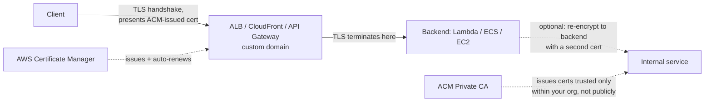
Public ACM certs sit at the internet-facing edge (CloudFront/ALB/API Gateway); Private CA certs
sit on the internal hop behind it, where a publicly-trusted cert would be unnecessary exposure.
The two services solve the same mechanical problem (issue + auto-renew a cert) at two different
trust boundaries — recognizing which boundary a scenario describes is the entire decision.

### Real AWS Image


*Source: [AWS Documentation — ACM Private CA certificate validity](https://docs.aws.amazon.com/privateca/latest/userguide/PcaValidity.html). This nested-validity rule is the one Private CA-specific gotcha worth knowing cold: a subordinate CA or end-entity cert can never outlive its parent — renewing a leaf certificate without also checking the CA hierarchy's remaining validity is a common real-world outage cause unique to running your own CA hierarchy, which public ACM never exposes you to since AWS manages that hierarchy for you.*

### IAM Policy Example
```json
{
  "Version": "2012-10-17",
  "Statement": [{
    "Effect": "Allow",
    "Action": ["acm-pca:IssueCertificate", "acm-pca:GetCertificate"],
    "Resource": "arn:aws:acm-pca:us-east-1:111122223333:certificate-authority/abcd1234-ef56-7890-ab12-cd34ef567890"
  }]
}
```
Scoped to one specific CA ARN — a service that can issue certificates on your behalf should never
hold `acm-pca:*` on `Resource: "*"`, since that would let it mint certificates from any CA in the
account, including ones outside its intended scope.

### Exam Tips
- "Internal-only hostnames that should never appear in a public certificate transparency log"
  always points to Private CA, not public ACM.
- ACM certificates cannot be exported/used outside the AWS services they're attached to (ALB,
  CloudFront, API Gateway, etc.) — if a scenario needs the private key itself for use outside AWS,
  that's a signal something else (or Private CA with exportable keys) is needed.
- Public ACM renewal is fully automatic as long as DNS/email validation stays correctly
  configured — a renewal failure almost always traces back to a changed DNS validation record, not
  an ACM bug.

---

## 2. CloudTrail

### Definition
**AWS CloudTrail** records every API call made within an AWS account — who called it, when, from
where, and with what parameters/result — as an immutable, queryable audit log. It is the
account's "who did what" system of record, distinct from CloudWatch Logs' "what did the
application do" role.

### Analogy
If your AWS account were a building, CloudTrail is the building's complete access-badge swipe
log: every door opened, by which badge, at what time — not what anyone did once inside their
office (that's CloudWatch's job), just the fact that they got in and which door they used.
Security investigations always start by pulling the badge log, not by searching every office's
internal notes.

### Purpose
Provide an immutable, comprehensive record of account activity for security investigation,
compliance audit, and operational troubleshooting — "did someone call this API, and if so, who
and when" is a CloudTrail question, full stop, regardless of which AWS service was involved.

### When to Use
- Any security investigation needing to know who called a specific API (`DeleteBucket`,
  `AssumeRole`, `InvokeModel`) and when.
- Compliance requirements mandating an audit trail of administrative/API actions.
- Detecting configuration drift or unauthorized changes (paired with Config/Security Hub).

### When NOT to Use
- Don't use CloudTrail for application-level debugging ("why did my function return the wrong
  value") — that's CloudWatch Logs' job; CloudTrail only records the fact an AWS API was called,
  not your application's internal logic.
- Don't expect CloudTrail to capture data-plane events (e.g. individual S3 object reads) unless
  **data events** are explicitly enabled — management-plane events are on by default, data events
  are opt-in and billed separately.

### Use Cases
1. Investigating who disabled a security group rule right before an incident.
2. Confirming which IAM principal invoked a specific Bedrock model, for an AI-service audit
   requirement (Task 2.3's overlap with CloudTrail).
3. Compliance evidence that MFA was required and used for every console login over a quarter.
4. Detecting a compromised credential by reviewing a sudden burst of unfamiliar API calls from an
   unfamiliar source IP/region.
5. Feeding CloudTrail Lake or Security Hub with normalized event data for organization-wide
   detection.
6. Proving to an auditor that a specific S3 object was never read by any principal other than the
   intended service role (requires S3 data events enabled).

### Why Important
Almost every "who did this" Domain 2/4 exam question and every real post-incident review depends
on CloudTrail existing and being correctly configured (multi-region trail, log file integrity
validation, data events where needed) *before* the incident — it cannot retroactively capture
activity that happened before it was turned on or scoped correctly.

### Diagram

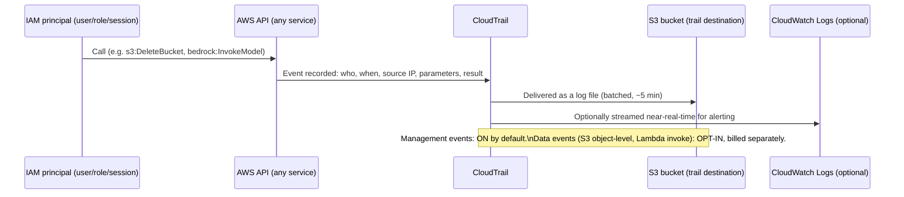
The two-destination fan-out (S3 for durable/queryable storage, CloudWatch Logs for near-real-time
alerting) is the detail most scenario questions hinge on: "near real-time alerting on a specific
API call" needs the CloudWatch Logs integration plus a metric filter/alarm, not just the default
S3 delivery, which batches with several minutes of delay.

### Real AWS Image


*Source: [AWS Documentation — Viewing CloudTrail events](https://docs.aws.amazon.com/awscloudtrail/latest/userguide/view-cloudtrail-events.html). Event history gives you 90 days of management events for free with no trail configuration at all — useful to know because a scenario asking for "a quick look at recent account activity" doesn't necessarily require a configured trail, while anything needing longer retention, data events, or multi-region aggregation does.*

### IAM Policy Example
```json
{
  "Version": "2012-10-17",
  "Statement": [{
    "Effect": "Deny",
    "Action": ["cloudtrail:StopLogging", "cloudtrail:DeleteTrail", "cloudtrail:UpdateTrail"],
    "Resource": "*",
    "Condition": { "StringNotEquals": { "aws:PrincipalArn": "arn:aws:iam::111122223333:role/SecurityAdmin" } }
  }]
}
```
This is commonly implemented as an **SCP**, not a plain IAM policy, precisely because the point is
to prevent even an account administrator from disabling the audit trail — see
[`iam-policy-evaluation-logic.md`](iam-policy-evaluation-logic.md) for why an SCP is the structural
mechanism that makes this unbypassable from within the account.

### Exam Tips
- CloudTrail answers "who called this API and when"; CloudWatch Logs answers "what did the
  application do" — a question combining both symptoms needs both tools, each for its own half.
- Data events (S3 object-level reads/writes, Lambda invocations) are NOT captured by default — if
  a scenario needs object-level audit granularity, data events must be explicitly enabled and are
  billed separately from management events.
- "Even an administrator shouldn't be able to disable logging" is an SCP use case, not an IAM
  policy use case — see the Organizations & SCPs section.

---

## 3. IAM Identity Center (SSO)

### Definition
**IAM Identity Center** (formerly AWS SSO) is the managed service for workforce identity: it lets
employees sign in once and get scoped console/CLI access across many AWS accounts in an
Organization, brokered from an existing identity source (its own built-in directory, Active
Directory via AD Connector, or an external IdP via SAML/SCIM).

### Analogy
A large company with 40 buildings (AWS accounts) could issue every employee 40 separate keys
(an IAM user in each account) — unworkable at scale and a nightmare to revoke. IAM Identity
Center is the single master keycard system: one login, synced from HR's existing employee
directory, that opens exactly the buildings/floors (accounts/permission sets) each employee is
assigned to, and revoking one employee's access everywhere is a single action at the source.

### Purpose
Eliminate per-account IAM users for a human workforce, centralize authentication against an
existing identity source, and manage fine-grained account/role access assignments from one place
— AWS's prescribed pattern for any Organization with more than a handful of accounts.

### When to Use
- Employees/contractors needing console or CLI access across multiple AWS accounts in an
  Organization.
- An existing corporate directory (Active Directory, Okta, Entra ID) should be the single source
  of truth for who can log in and with what permissions.
- Centralizing permission-set management (a role template) applied consistently across many
  accounts.

### When NOT to Use
- Application end-users (customers of your product) — that's Cognito's job entirely; Identity
  Center has no concept of "my app's sign-up form."
- A single-account setup with only a couple of IAM users — the overhead of setting up Identity
  Center isn't justified until multi-account access management becomes the actual pain point.

### Use Cases
1. Onboarding a new engineer with access to dev/staging/prod accounts, scoped differently per
   account, from one directory-synced login.
2. Offboarding an employee instantly across all 40 accounts by disabling one directory account.
3. Federating an external IdP (Okta/Entra ID) via SAML so AWS access inherits the company's
   existing MFA/conditional access policies.
4. Auditors getting read-only cross-account access via a dedicated permission set, without a
   single IAM user being created anywhere.
5. CLI access for engineers via `aws sso login`, issuing short-lived credentials instead of
   long-lived IAM user access keys.
6. Enforcing a consistent "break-glass" emergency-access permission set across every account in
   the Organization from one definition.

### Why Important
Per-account IAM users for a human workforce is both an operational burden and a security
liability (long-lived credentials, inconsistent revocation, no central audit of "who can access
what across the whole org") — Identity Center is AWS's answer to exactly this problem, and the
exam treats it as the default-correct choice whenever the scenario says "workforce," "employees,"
or "multiple accounts," as opposed to "application users."

### Diagram

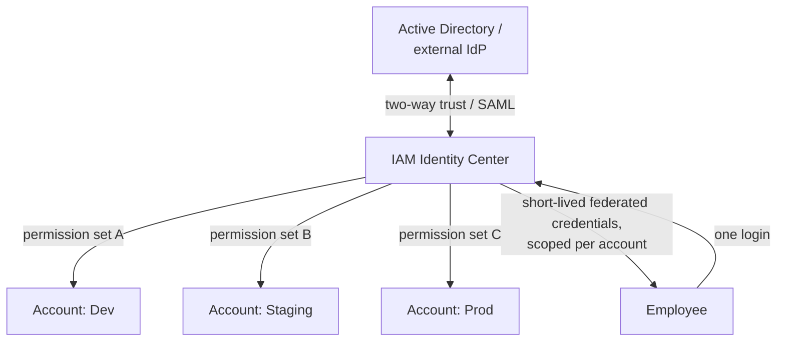
One identity, one login event, fanning out to short-lived, differently-scoped credentials per
account via **permission sets** (reusable role templates) — this is the structural reason
revocation is instant and centralized: disable the identity once at the source, and every
account's access derived from it stops working, because none of it was ever a standing IAM user
credential in any individual account.

### Real AWS Image


*Source: [AWS Documentation — AWS Security Reference Architecture, Identity Management](https://docs.aws.amazon.com/prescriptive-guidance/latest/security-reference-architecture-identity-management/welcome.html). "Without caching them in the cloud" is the specific detail worth remembering: AD Connector is a proxy/trust relationship, not a directory sync that copies your on-prem users into AWS — on-prem AD remains the single source of truth, and a disabled on-prem account is immediately reflected, not eventually-consistent-synced.*

### Exam Tips
- "Workforce/employees need access across multiple AWS accounts" is IAM Identity Center; "my
  application's customers need to sign up/sign in" is Cognito — this single distinction resolves
  nearly every exam question mentioning both services as options.
- Permission sets are reusable role templates assigned per account/group — not the same thing as
  an IAM policy attached directly to a user, and they're what makes centralized revocation
  possible.
- AD Connector proxies/trusts an existing on-prem directory rather than copying it — identity
  stays authoritative on-prem, which matters for "how fast does a disabled on-prem account lose
  AWS access" style questions.

---

## 4. IAM

### Definition
**AWS Identity and Access Management (IAM)** is the foundational service controlling who
(principal) can do what (action) to which resource, under what conditions, across every other
AWS service. Users, groups, roles, and policies are IAM's core objects; every other access-control
mechanism in this file (SCPs, resource policies, STS, Identity Center, Cognito) ultimately
produces or constrains an IAM-evaluated decision.

### Analogy
IAM is the building's entire security rulebook and badge system combined — not one door's lock,
but the complete set of rules determining which badges (identities) open which doors (resources)
under which circumstances (conditions), enforced identically no matter which door someone's
standing at. Every other service in Domain 2 either issues a badge (STS, Cognito, Identity
Center), manages what's behind a door (KMS, Secrets Manager), or adds an extra rule on top (SCPs,
permission boundaries) — IAM is the rulebook all of them ultimately defer to.

### When to Use
- Any access-control decision inside a single AWS account for any service.
- Defining what an application's compute (Lambda execution role, EC2 instance profile, ECS task
  role) is allowed to do.
- Scoping human or machine access with least privilege, via users (discouraged for humans now),
  roles (preferred for both humans via federation and machine workloads), and policies.

### When NOT to Use
- Account-wide, unbypassable guardrails spanning many accounts — that's SCPs/RCPs at the
  Organizations layer, not IAM policy, which can never restrict a more broadly permissioned
  principal in the same account.
- Application end-user authentication — IAM identities are for AWS access, not for your product's
  customer accounts (that's Cognito).

### Use Cases
1. A Lambda execution role scoped to exactly the DynamoDB table and S3 prefix it needs, nothing
   more.
2. A permission boundary capping what roles a delegated team lead can create, without that team
   lead being able to grant more than the boundary allows.
3. A cross-account role with a trust policy naming a specific external account/role, assumed via
   STS for partner integrations.
4. A policy condition restricting console access to only MFA-authenticated sessions
   (`aws:MultiFactorAuthPresent`).
5. A tag-based access-control policy letting each team only touch resources tagged with their own
   team name, via a single reusable policy with a `${aws:PrincipalTag/...}` variable.
6. An IAM Access Analyzer scan confirming no S3 bucket or IAM role is unintentionally shared
   outside the account/org.

### Why Important
IAM is tested throughout every domain of the exam, not just Domain 2 — nearly every scenario
involving "can this call succeed" ultimately comes down to IAM policy evaluation, and
misunderstanding it is both the most common real-world AWS security incident root cause and the
most heavily tested reasoning skill on this exam.

### Diagram

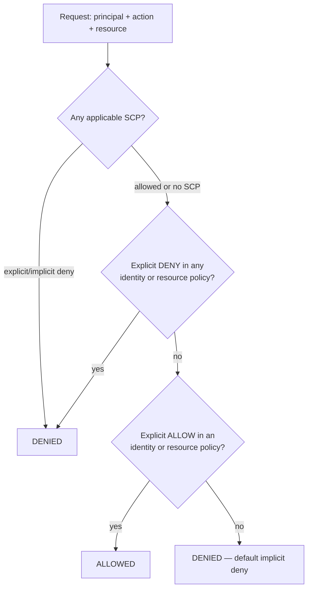
This is the condensed version of the full algorithm in
[`iam-policy-evaluation-logic.md`](iam-policy-evaluation-logic.md) — explicit deny always wins,
nothing is allowed by default, and SCPs/boundaries/session policies only ever narrow what a
combination of identity+resource policy could otherwise grant.

### Real AWS Image


*Source: [AWS Documentation — IAM policy evaluation logic](https://docs.aws.amazon.com/IAM/latest/UserGuide/reference_policies_evaluation-logic.html). The official AWS flowchart this doc's diagram simplifies — note it shows the ceiling checks (SCP, permission boundary, session policy) as distinct, ordered steps before the final Allow/Deny determination, which is the detail most memorized three-rule summaries compress away.*

### IAM Policy Example
```json
{
  "Version": "2012-10-17",
  "Statement": [
    { "Effect": "Allow", "Action": "s3:*", "Resource": "*" },
    { "Effect": "Deny", "Action": "s3:DeleteObject", "Resource": "arn:aws:s3:::prod-data/*" }
  ]
}
```
A policy that *looks* fully permissive but is completely blocked from deleting objects in
`prod-data` by the second statement — explicit deny always wins regardless of how broad the Allow
looks, the single most-tested IAM reasoning trap.

### Exam Tips
- Explicit deny always wins; nothing is allowed by default; SCPs/boundaries/session policies only
  ever narrow, never grant — three rules that resolve most "will this call succeed" questions.
- IAM role trust policies and KMS key policies are the two resource types where an identity-based
  policy's Allow is never independently sufficient — the resource itself must explicitly grant it.
- For deep combination-reasoning questions (multiple policy types stacked), see
  [`iam-policy-evaluation-logic.md`](iam-policy-evaluation-logic.md) rather than relying on the
  three-rule summary alone.

---

## 5. KMS

### Definition
**AWS Key Management Service (KMS)** creates and manages cryptographic keys and performs
encryption/decryption/signing operations, either directly (small payloads) or via **envelope
encryption** (large payloads), with every key's usage governed by a key policy and fully audited
through CloudTrail.

### Analogy
KMS is a bank vault that never lets the master key itself leave the vault — instead, every time
you need to lock something up, the vault hands you a brand-new, single-use lockbox key (the data
key), lets you lock your item with it yourself outside the vault, then asks for the lockbox key
back encrypted. The vault never touches your actual valuables directly; it only ever handles
small lockbox keys, which is exactly why it can "protect" an arbitrarily large warehouse of goods
despite the vault door itself being too small to fit any of them through.

### Purpose
Provide centralized, auditable, access-controlled encryption key management so that "encrypt this
data" and "control exactly who can decrypt it" are separate, independently governable decisions —
distinct from simply "the data is scrambled somehow."

### When to Use
- Encryption at rest for any AWS storage service (S3 SSE-KMS, EBS, RDS, DynamoDB) where a security
  team needs audit control over who can decrypt, beyond the default AWS-managed key.
- Encrypting large payloads via envelope encryption (`GenerateDataKey` + local encryption).
- Signing/verifying data with asymmetric KMS keys for workloads needing non-repudiation.

### When NOT to Use
- Don't call `kms:Encrypt`/`kms:Decrypt` directly on payloads over 4KB — use envelope encryption
  instead; KMS's direct API calls are meant for keys, not bulk data.
- Don't reach for a customer-managed key when the AWS-managed default key already satisfies the
  requirement (no audit/control need) — the extra cost and key-policy management overhead isn't
  justified without a specific reason.

### Use Cases
1. A healthcare records API encrypting patient data at rest with a CMK whose key policy the
   security team tightly controls and audits via CloudTrail.
2. Envelope-encrypting a 10GB file: `GenerateDataKey` once, encrypt locally with the plaintext
   data key, discard it, store only the ciphertext + encrypted data key.
3. Cross-account encrypted data sharing where the KMS key policy explicitly grants a partner
   account's role `kms:Decrypt`.
4. Scheduled automatic key rotation for a CMK, with old key material retained internally so
   previously encrypted data stays decryptable.
5. Signing a document with an asymmetric KMS key for a workflow requiring verifiable origin.
6. Encrypting Lambda environment-variable values client-side ("encryption helpers") using a
   CMK, distinct from the default at-rest encryption Lambda already provides.

### Why Important
Encryption at rest is a Task 2.2 cornerstone, and envelope encryption specifically explains a
recurring "why doesn't this work" exam pattern (trying to directly KMS-encrypt something large) —
understanding the mechanism, not just the vocabulary, is what separates a correct answer from a
guess here.

### Diagram

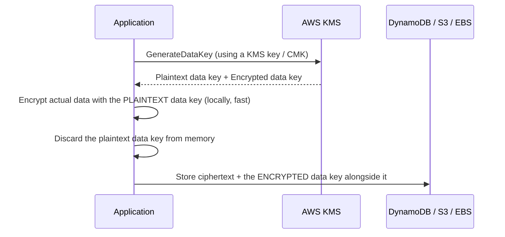
KMS only ever touches the small data key, never the bulk payload — this is why KMS can protect
data far larger than its own 4KB-per-call `Encrypt`/`Decrypt` limit, and it's the single mechanism
every KMS-integrated AWS storage service (S3 SSE-KMS, EBS, DynamoDB) implements transparently on
your behalf.

### Real AWS Image


*Source: [AWS Documentation — AWS KMS cryptographic details](https://docs.aws.amazon.com/kms/latest/developerguide/concepts.html). Root keys never leave AWS's HSMs and are never used to encrypt your data directly — this three-tier hierarchy is why automatic key rotation doesn't require re-encrypting existing data: only how NEW data keys get wrapped changes, while old wrapped data keys remain decryptable against retained prior key material.*

### IAM Policy Example
```json
{
  "Version": "2012-10-17",
  "Statement": [{
    "Effect": "Allow",
    "Action": ["kms:Decrypt", "kms:GenerateDataKey"],
    "Resource": "arn:aws:kms:us-east-1:111122223333:key/abcd1234-ef56-7890-ab12-cd34ef567890",
    "Condition": { "StringEquals": { "kms:ViaService": "s3.us-east-1.amazonaws.com" } }
  }]
}
```
Scoped to one key ARN and restricted to only apply when routed through S3 specifically — remember
that an IAM policy alone is never sufficient for KMS; the key's own **key policy** must
independently grant the calling principal access too.

### Exam Tips
- KMS `Encrypt`/`Decrypt` is capped at 4KB per call — anything larger needs envelope encryption
  (`GenerateDataKey` + local encryption), not a direct API call.
- A KMS key policy must independently grant access — an IAM policy's Allow alone is never
  sufficient for a KMS key, unlike most other resource types.
- Automatic key rotation doesn't require re-encrypting existing data — only future data-key
  wrapping changes; previously encrypted data remains decryptable.

---

## 6. Lambda (Security Angle)

### Definition
From a Domain 2 lens, **Lambda** is the compute service whose identity (its **execution role**)
is the IAM principal nearly every Domain 2 scenario in this exam's application-layer questions
ultimately traces back to — every control discussed elsewhere in this file (secrets, KMS, VPC
endpoints, Bedrock access) is typically being *applied to* a Lambda function's execution role.

### Analogy
If the AWS account is the building, a Lambda function is a specific employee's desk, and its
execution role is that employee's actual badge — every door they can open, every filing cabinet
they can access, traces back to what's printed on that one badge, not to anything about the desk
itself. Changing what the function "is allowed to do" means editing the badge (the IAM role), not
the desk.

### When to Use
- Any serverless compute needing a tightly scoped, auditable AWS identity for the specific
  resources it touches.
- Workloads needing per-function least-privilege, as opposed to a shared, broad role across many
  unrelated functions.

### When NOT to Use (security angle)
- Don't share one broad execution role across many functions with different actual needs "to
  simplify management" — it defeats least privilege and makes a single function's compromise a
  blast radius for everything else sharing that role.
- Don't put secret values directly as plain environment variable values without the
  reference-plus-Secrets-Manager pattern — see
  [`securing-lambda-environment-variables-and-secrets.md`](securing-lambda-environment-variables-and-secrets.md).

### Use Cases
1. A function's execution role scoped to `dynamodb:GetItem`/`PutItem` on exactly one table, not
   `dynamodb:*` on `Resource: "*"`.
2. Fetching a database password from Secrets Manager via the AWS Parameters and Secrets Lambda
   Extension at runtime, rather than a hardcoded or plain-env-var credential.
3. A function running inside a VPC with no NAT/IGW route, reaching Bedrock only via a
   `bedrock-runtime` VPC interface endpoint, for a data-privacy requirement.
4. Encrypting specific environment variable values client-side with a customer-managed KMS key
   ("encryption helpers") so even someone with console read access can't see the plaintext.
5. A function's resource-based policy granting a specific other account's EventBridge rule
   permission to invoke it, without the invoking account needing any IAM policy change on its own
   side.
6. CloudTrail-auditing every `UpdateFunctionConfiguration` call to detect unauthorized changes to
   a function's environment variables or role.

### Why Important
Lambda is the de facto default compute service this exam assumes for "backend code," and its
execution role is the concrete object every abstract Domain 2 "least privilege" discussion
actually gets implemented against — understanding Lambda-specific security mechanics (env var
encryption layers, VPC networking for private AI-service access, resource-based policies) is
assumed background for a large share of Domain 2 and Domain 2/2.3 overlap questions.

### Diagram

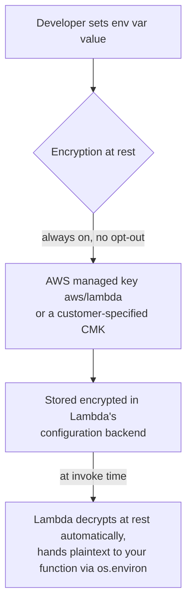
At-rest encryption of environment variables is automatic and free; it protects the stored
configuration from anyone without AWS API access at all. It does **not** protect a secret's value
from someone who legitimately has `lambda:GetFunctionConfiguration` — that requires the separate,
opt-in **encryption-in-transit helpers**, detailed fully in
[`securing-lambda-environment-variables-and-secrets.md`](securing-lambda-environment-variables-and-secrets.md).

### Real AWS Image


*Source: [AWS Documentation — Lambda execution environment lifecycle](https://docs.aws.amazon.com/lambda/latest/dg/lambda-runtime-environment.html). The Init phase is specifically where a function fetches and caches a secret (via the Secrets Lambda Extension) if following the recommended pattern — it only runs once per execution environment, not once per invocation, which is the mechanical reason a warm invocation doesn't re-pay the Secrets Manager API round trip.*

### IAM Policy Example
```json
{
  "Version": "2012-10-17",
  "Statement": [{
    "Effect": "Allow",
    "Action": ["dynamodb:GetItem", "dynamodb:PutItem"],
    "Resource": "arn:aws:dynamodb:us-east-1:111122223333:table/orders"
  }]
}
```
A correctly scoped execution-role policy — one table, two specific actions, never `dynamodb:*` on
`Resource: "*"` for a runtime application role.

### Exam Tips
- A function's AWS permissions come from its execution role, not from any calling user's
  identity — unless a Cognito Identity Pool exchange deliberately issues user-scoped credentials
  instead.
- Env var encryption-at-rest is automatic; encryption-in-transit helpers are opt-in and require
  your code to call `kms:Decrypt` explicitly — know which layer a described gap is missing.
- "No NAT/IGW route plus a VPC interface endpoint" is the strongest version of "never touches the
  public internet," applicable to any service a Lambda function calls, including Bedrock.

---

## 7. Organizations & SCPs

### Definition
**AWS Organizations** centrally manages multiple AWS accounts under one management account,
enabling consolidated billing, organizational units (OUs), and **Service Control Policies
(SCPs)** — account-wide guardrails that define the maximum permissions any identity in an
account/OU can ever have, regardless of what its own IAM policy grants.

### Analogy
If IAM policies are each employee's personal permission list, an SCP is a building-wide fire code
posted at the main entrance that applies to literally everyone inside, including the building
manager — no employee's personal permission list, however generous, can ever override the fire
code, because the fire code isn't a permission grant at all; it's an outer boundary on what any
permission grant inside the building can possibly mean.

### Purpose
Provide an unbypassable, account-wide (or OU-wide) ceiling on what's possible — guardrails that
hold even against a fully compromised or maximally-privileged identity inside the governed
account, which no identity-based IAM policy can structurally achieve on its own.

### When to Use
- Preventing even administrators from disabling CloudTrail, leaving the Organization, or
  operating outside approved regions.
- Enforcing org-wide guardrails like "no account may ever create a publicly readable S3 bucket."
- Delegating account-level administration to teams while capping the blast radius of mistakes or
  malice at the org level.

### When NOT to Use
- Don't use an SCP to *grant* permissions — it structurally cannot; it only ever narrows what an
  identity-based policy inside the account could otherwise allow.
- Don't use an SCP for fine-grained, per-resource access control within a single team's normal
  workflow — that's IAM policy's job; SCPs are coarse, account/OU-wide guardrails.

### Use Cases
1. An SCP denying `cloudtrail:StopLogging`/`DeleteTrail` org-wide, so no account's administrator
   can disable the audit trail.
2. Restricting all accounts in a "Sandbox" OU to a small set of approved, low-cost services.
3. Denying any API call outside a company's two approved AWS regions, for data-residency
   compliance.
4. Preventing member accounts from leaving the Organization without management-account approval.
5. A **Resource Control Policy (RCP)**, the resource-side mirror of an SCP, denying any S3 bucket
   in the org from ever being made public, regardless of what a bucket policy tries to grant.
6. Requiring MFA for any IAM/root action across every account in the Organization as a single
   enforced rule.

### Why Important
SCPs are the structural answer to "even an administrator can't do X" — a phrase the exam uses
specifically to signal an SCP/RCP answer, never an IAM policy answer, because IAM policies by
definition cannot restrict a broader grant on the same principal within the same account.

### Diagram

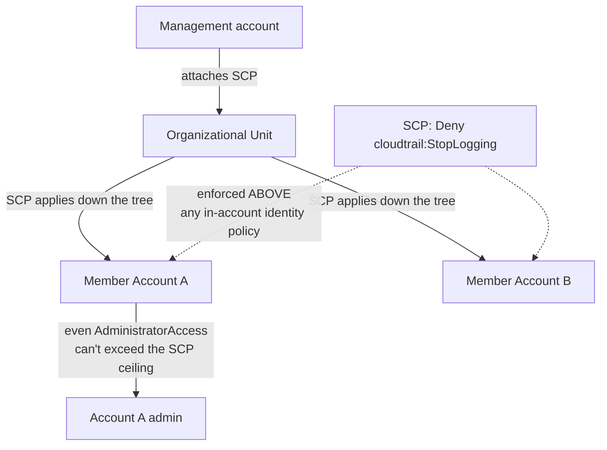
The SCP is enforced from a structural layer **above** any account's own identity policies — this
is why it's unbypassable from inside the account: no identity policy, however broad, operates at
a layer that could reach up and modify an SCP it's subject to.

### Real AWS Image


*Source: [AWS Documentation — AWS Security Reference Architecture](https://docs.aws.amazon.com/prescriptive-guidance/latest/security-reference-architecture/welcome.html). The management account's position at the top of this diagram is the whole reason SCPs are unbypassable from any account below it — only someone with access to the management account itself (a highly restricted role in any well-run org) can change an SCP.*

### IAM Policy Example
```json
{
  "Version": "2012-10-17",
  "Statement": [{
    "Effect": "Deny",
    "Action": "organizations:LeaveOrganization",
    "Resource": "*"
  }]
}
```
This is an SCP statement, not an IAM policy statement, applied at the OU/account level — the
distinction matters because the same JSON shape means something structurally different depending
on which layer it's attached at.

### Exam Tips
- "Even an administrator cannot do X" is always an SCP/RCP signal, never an IAM policy.
- SCPs can only narrow, never grant — a generous SCP doesn't give anyone anything; it just fails
  to remove possibilities an identity policy already grants.
- RCPs are the newer, resource-side mirror of SCPs — know that both exist and that they answer
  "principal-side ceiling" vs. "resource-side ceiling" respectively.

---

## 8. AI Services Overview

### Definition
AWS's **AI Services** are managed, pre-trained (or fine-tunable) services for common AI tasks
without building/training your own model — Rekognition (vision), Transcribe/Polly (speech),
Comprehend (NLP), Textract (document extraction), Translate, and others — distinct from Bedrock
(foundation-model access) and SageMaker (custom ML model building).

### Analogy
If Bedrock is a general-purpose, highly capable contractor you give instructions to in plain
language, and SageMaker is hiring and training your own specialist from scratch, the AI Services
are off-the-shelf power tools — a drill is just a drill, pre-built for exactly one job
(extracting text from a document, transcribing audio), requiring no training and very little
configuration, and you reach for it specifically because your job matches what it already does
well.

### When to Use
- A well-defined, common task (extract text from a scanned form, moderate uploaded images,
  translate text, transcribe a call) that an existing AI service already does out of the box.
- When you don't need or want the flexibility (and operational overhead) of prompting a general
  foundation model for a narrow, structured task.

### When NOT to Use
- Open-ended generative tasks (chatbots, summarization in arbitrary domains, agents) — that's
  Bedrock's territory, not a narrow AI Service.
- Highly custom model requirements no pre-built service covers — that's SageMaker.

### Use Cases
1. Textract extracting structured fields from scanned insurance claim forms.
2. Rekognition content-moderation flagging inappropriate images in user uploads before publish.
3. Comprehend detecting PII entities in free-text customer support tickets.
4. Transcribe converting call-center audio to text for downstream analytics.
5. Translate localizing user-generated content in near real time.
6. A combined content-moderation-and-compliance pipeline: Transcribe/Rekognition process
   video/audio, Comprehend performs NLP analysis, Textract extracts document content, with human
   review via Amazon A2I for anything flagged uncertain.

### Why Important
Task 2.3 explicitly calls out securing "AI services," and the exam expects you to apply the same
access-control, data-privacy (VPC endpoints), and training opt-out discipline to these
narrower services as it does to Bedrock — the risk framework doesn't change just because the
service is task-specific rather than general-purpose.

### Diagram

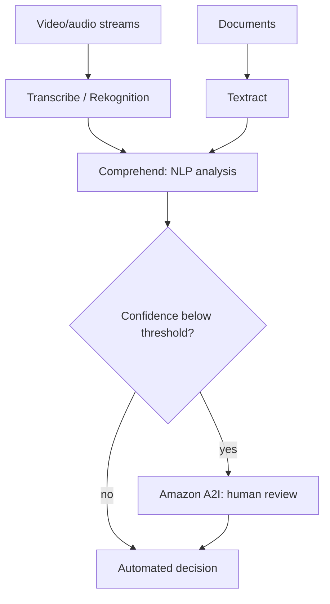
Human review (A2I) sits specifically at the *uncertain* branch, not on every single item — this
is the same cost/throughput-vs-safety tradeoff pattern seen in Bedrock Agent human-approval gates:
full automation where confidence is high, a human backstop only where it's genuinely needed.

### Real AWS Image


*Source: [AWS Documentation — Content moderation and compliance reference architecture](https://docs.aws.amazon.com/reference-architecture-diagrams/latest/content-moderation-compliance/content-moderation-compliance.html). This is a genuine multi-service AI pipeline, not a single-service call — a scenario mentioning several of these services together (not just Bedrock) is often describing exactly this kind of composed AI Services pipeline rather than a single foundation-model call.*

### IAM Policy Example
```json
{
  "Version": "2012-10-17",
  "Statement": [{
    "Effect": "Allow",
    "Action": ["textract:AnalyzeDocument", "comprehend:DetectPiiEntities"],
    "Resource": "*"
  }]
}
```
Most AI Services (Textract, Comprehend, Rekognition) don't support resource-level ARN scoping the
way Bedrock model ARNs do — the least-privilege lever here is scoping the **action list** tightly
rather than the resource, since `Resource: "*"` is often the only option these APIs support.

### Exam Tips
- AI Services are task-specific and pre-trained; Bedrock is general-purpose foundation-model
  access; SageMaker is custom model building — matching the described task to the right tier is
  the core decision.
- Task 2.3's access-control, data-privacy, and training-opt-out concerns apply to AI Services
  too, not just Bedrock — don't assume the exam only tests the newer, flashier service.
- A pipeline combining several AI Services with a human-review step (A2I) at the low-confidence
  branch is a recognizable, recurring architecture pattern, not a one-off.

---

## 9. STS & Role Switching

### Definition
**AWS Security Token Service (STS)** issues short-lived temporary security credentials —
primarily via `AssumeRole` — enabling cross-account access, federation, and scoped, time-limited
permissions without ever distributing long-lived access keys.

### Analogy
A long-lived IAM user access key is a spare house key you mail to a contractor and hope they
return (or destroy) when the job's done — if they don't, you have to re-key the whole house. STS
`AssumeRole` is a smart lock that generates a brand-new, auto-expiring code for each specific
visit, tied to exactly the rooms that visit is allowed to touch, expiring on its own with nothing
further for you to do — losing one code is a non-event, not a re-keying emergency.

### Purpose
Eliminate the operational and security burden of long-lived credentials for any access pattern
that's inherently temporary or cross-boundary — cross-account access, federated human login,
service-to-service delegation.

### When to Use
- Cross-account access: a role in Account A assuming a role in Account B.
- Federated human access (via IAM Identity Center or a SAML IdP) resulting in temporary console/
  CLI credentials, never a standing IAM user.
- Scoping a specific CI/CD run's credentials narrower than the underlying role it assumes, via a
  session policy.

### When NOT to Use
- Don't use STS where a resource-based policy alone already solves the access need without an
  explicit `AssumeRole` step (e.g. an S3 bucket policy granting a specific external role direct
  access) — simpler is better when it's sufficient.
- Don't treat `AssumeRole` succeeding as proof the resulting credentials can do everything the
  target role's policy allows — a session policy or permission boundary can still narrow it
  further.

### Use Cases
1. A partner's Lambda (Account A) reading an S3 bucket in your account (Account B) via a
   cross-account role, revocable by removing the trust statement, not rotating a shared key.
2. A CI/CD pipeline assuming a broad `DeployerRole` but passing a session policy scoping one run
   to only the stack it's deploying.
3. Multi-tenant SaaS isolation: assuming a role with a tenant-ID session tag, combined with a
   session policy restricting access to that tenant's data prefix only.
4. Workload identity federation: an external workload (e.g. a GitHub Actions run) exchanging an
   OIDC token for temporary AWS credentials with no stored AWS secret at all.
5. A federated console user (via Identity Center) getting time-limited credentials instead of a
   permanent IAM user.
6. `GetFederationToken` issuing temporary credentials for a custom federation broker use case.

### Why Important
Task 2.1 explicitly calls out "temporary credentials and cross-account/cross-service role
assumption" — STS is the mechanism underneath nearly every cross-account and federation scenario
on the exam, and the trust-policy-vs-permissions-policy confusion it enables is one of Domain 2's
most repeated traps.

### Diagram

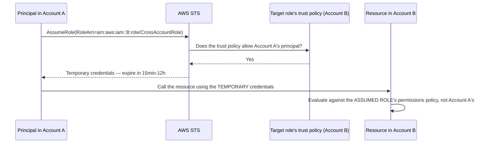
Two separate documents govern this and mixing them up is the single most common Domain 2 trap:
the **trust policy** answers "who can assume me"; the **permissions policy** answers "what can
someone who assumed me actually do" — a failure can be either one being wrong, even though the
`AssumeRole` call itself succeeds either way if only the permissions policy is the problem.

### Real AWS Image


*Source: [AWS Documentation — IAM Roles Anywhere / cross-partition workload identity](https://docs.aws.amazon.com/IAM/latest/UserGuide/id_roles_providers.html). This is the OIDC-federation flavor of "get temporary AWS credentials without a stored secret" — the same `AssumeRole`-family mechanism underlies workload identity federation (e.g. GitHub Actions to AWS) as underlies plain cross-account role assumption; only the trust-establishing identity source differs.*

### IAM Policy Example
```json
{
  "Version": "2012-10-17",
  "Statement": [{
    "Effect": "Allow",
    "Principal": { "AWS": "arn:aws:iam::111122223333:role/ReportingRole" },
    "Action": "sts:AssumeRole",
    "Condition": { "StringEquals": { "sts:ExternalId": "unique-partner-id-9f3a" } }
  }]
}
```
A trust policy scoped to one specific principal **and** requiring a matching `ExternalId` —
standard defense against the "confused deputy" problem in third-party cross-account access
patterns.

### Exam Tips
- Trust policy answers "who can assume me"; permissions policy answers "what can they do once
  assumed" — a failure in cross-account access is almost always one of these two, diagnosed
  separately.
- Temporary credentials expire (15 min to 12 hours) and never need manual rotation — this is the
  entire point, as opposed to a long-lived IAM user access key.
- A session policy passed at `AssumeRole` time narrows the resulting credentials below what the
  target role's own permissions policy allows — it can never broaden it.

---

## 10. Secrets Manager vs. Parameter Store

### Definition
**AWS Secrets Manager** stores and manages secrets (API keys, database credentials) with native,
scheduled rotation support (including built-in Lambda rotation functions for RDS/Aurora/Redshift/
DocumentDB). **AWS Systems Manager Parameter Store** stores configuration values and secrets
(SecureString type) with no native rotation, at a lower (often free) cost for the Standard tier.

### Analogy
Secrets Manager is a bank safe-deposit box service that automatically swaps your box's lock for a
new one on a schedule, handing you the new combination each time, with a fee per box. Parameter
Store is a locked filing cabinet drawer in your own office — perfectly secure for what you put in
it, free to use, but if you want the lock changed, you're doing it yourself; nobody's coming by on
a schedule to do it for you.

### When to Use
- Secrets Manager: a database password, API key, or OAuth secret that must rotate automatically
  on a schedule with zero application downtime during rotation.
- Parameter Store: non-secret configuration (log level, feature flags, endpoint URLs) or a
  SecureString secret that doesn't need native rotation, cost-consciously.

### When NOT to Use
- Don't use Secrets Manager for simple, non-sensitive config values — it's needless extra cost
  for no benefit over free Parameter Store Standard parameters.
- Don't use Parameter Store for anything requiring scheduled rotation with zero application
  downtime — it has no native rotation mechanism to provide that.

### Use Cases
1. An RDS database password rotating automatically every 30 days via Secrets Manager's built-in
   RDS rotation Lambda, with zero app downtime via staged version labels.
2. A non-secret log-level flag stored in Parameter Store Standard, free, read at Lambda cold
   start.
3. A third-party API key needing periodic manual rotation, stored as a Parameter Store
   SecureString (KMS-encrypted) when native rotation isn't a hard requirement.
4. Cross-account secret sharing via a Secrets Manager resource policy, for a partner integration.
5. A Lambda function's environment variable holding a Secrets Manager ARN reference, fetched and
   cached at runtime via the Secrets Lambda Extension.
6. Hierarchical configuration management using Parameter Store's path-based naming
   (`/prod/app/db-host`) for an entire application's non-secret settings tree.

### Why Important
This is one of Domain 2's most repeatedly tested service-choice decisions, almost always phrased
as a scenario ("the secret rotates automatically...") rather than naming the service directly —
rotation support is the single most-tested differentiator, not "it's a secret" alone.

### Diagram

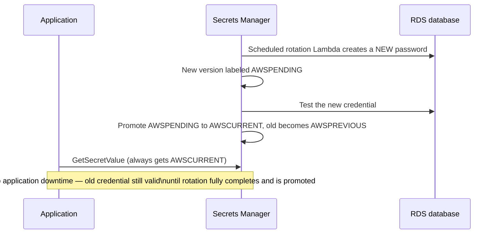
The staged version-label mechanism (`AWSCURRENT`/`AWSPENDING`/`AWSPREVIOUS`) is specifically what
makes zero-downtime rotation possible — Parameter Store has no equivalent staging mechanism at
all, which is the concrete, mechanical reason it can't offer the same zero-downtime rotation
guarantee.

### Real AWS Image


*Source: [AWS Documentation — How rotation works](https://docs.aws.amazon.com/secretsmanager/latest/userguide/rotate-secrets_how-rotation-works.html). This "alternating users" rotation strategy (two database users, A and B, swapping which is AWSCURRENT each rotation) is specifically designed so a long-running connection using the just-rotated-away credential doesn't break mid-transaction — the old user still exists and is valid, just not the one newly issued credentials point to.*

### IAM Policy Example
```json
{
  "Version": "2012-10-17",
  "Statement": [{
    "Effect": "Allow",
    "Action": "secretsmanager:GetSecretValue",
    "Resource": "arn:aws:secretsmanager:us-east-1:111122223333:secret:prod/db-AbCdEf"
  }]
}
```
Scoped to the exact secret ARN — see
[`securing-lambda-environment-variables-and-secrets.md`](securing-lambda-environment-variables-and-secrets.md)
for the paired `kms:Decrypt` grant needed when the secret uses a customer-managed key.

### Exam Tips
- "The secret rotates automatically on a schedule with zero downtime" is Secrets Manager, full
  stop — this phrasing is the exam's standard signal, more reliable than looking for the word
  "secret" itself.
- "Store a non-secret config value, cost-consciously" is Parameter Store Standard — free, no
  rotation needed or offered.
- Both support KMS encryption at rest — encryption isn't the differentiator between them; rotation
  support and cost are.

---

## 11. Security Hub & Inspector

### Definition
**Amazon Inspector** continuously scans EC2 instances, container images (ECR), and Lambda
functions for known software vulnerabilities (CVEs) and network reachability issues. **AWS
Security Hub** aggregates and normalizes findings from Inspector, GuardDuty, Macie, and other
sources into one dashboard, mapped against compliance standards (CIS, PCI-DSS, etc.).

### Analogy
Inspector is a building inspector checking every room for a specific, known list of code
violations (a cracked pipe, an expired fire extinguisher) — thorough, but only for things already
on the known-issue checklist. Security Hub is the single master binder the fire marshal, the
building inspector, and the security guard all file their separate reports into, so leadership
reviews one binder instead of three separate clipboards — it doesn't inspect anything itself; it
just makes everyone else's findings readable together.

### When to Use
- Inspector: continuous vulnerability scanning for EC2/ECR/Lambda against known CVEs.
- Security Hub: a single, aggregated, compliance-mapped view of findings from multiple detective
  services across many accounts.

### When NOT to Use
- Don't expect Security Hub to generate its own vulnerability or threat findings — it aggregates
  and normalizes what Inspector/GuardDuty/Macie/etc. already produced.
- Don't use Inspector for runtime threat/anomaly detection (unusual API call patterns) — that's
  GuardDuty's job; Inspector is about known vulnerabilities in artifacts, not behavioral anomalies.

### Use Cases
1. Continuous Inspector scanning flags an EC2 fleet running a package with a newly disclosed CVE.
2. Security Hub aggregates Inspector + GuardDuty + Macie findings from 40 accounts into one
   delegated-admin dashboard.
3. Security Hub's CIS AWS Foundations Benchmark check flags an account missing root MFA.
4. Inspector's network reachability analysis flags an EC2 instance unexpectedly reachable from
   the public internet.
5. Automated remediation triggered from a Security Hub finding via EventBridge + a remediation
   Lambda.
6. Inspector scanning a container image in ECR before it's deployed, as a CI/CD gate.

### Why Important
"Where should a security team look for a consolidated view across many accounts and many
detective services" is a recurring exam framing, and the answer structure (centralize via
delegated admin, aggregate via Security Hub) is tested independently of which specific underlying
finding type is described.

### Diagram

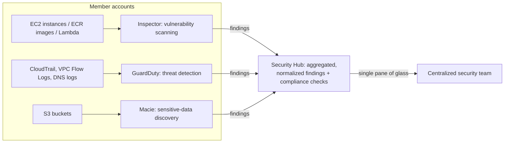
Each service answers a distinct question (vulnerability, anomaly, sensitive data); Security Hub
answers none of those directly — it's purely the normalization/aggregation/compliance-mapping
layer on top.

### Real AWS Image


*Source: [AWS Documentation — AWS Security Reference Architecture](https://docs.aws.amazon.com/prescriptive-guidance/latest/security-reference-architecture/welcome.html). "Delegated administrator" is the specific term worth remembering — all four services support designating one account (typically a dedicated Security Tooling account, as pictured) to view/manage findings across every account in the org, without that account needing direct access into each member account individually.*

### IAM Policy Example
```json
{
  "Version": "2012-10-17",
  "Statement": [{
    "Effect": "Allow",
    "Action": ["securityhub:GetFindings", "securityhub:BatchUpdateFindings"],
    "Resource": "*"
  }]
}
```
Security Hub findings don't support fine-grained resource ARNs the way Bedrock models do — the
least-privilege lever here is the action list (e.g. read-only `GetFindings` for an analyst role vs.
`BatchUpdateFindings` reserved for an automated remediation role).

### Exam Tips
- Security Hub aggregates; it doesn't detect anything on its own — a question asking "which
  service actually found X" is never Security Hub if X is a vulnerability, anomaly, or sensitive
  data finding specifically.
- Inspector = known vulnerabilities (CVE-based); GuardDuty = behavioral/threat anomalies; Macie =
  sensitive data discovery — three different questions, three different services.
- "Delegated administrator" + "centralized Security Tooling account" is the standard pattern for
  org-wide visibility across all four of these services.

---

## 12. Shield

### Definition
**AWS Shield** provides DDoS protection. **Shield Standard** is free and automatic for every AWS
customer, covering common network/transport-layer (L3/L4) attacks. **Shield Advanced** is a paid
tier adding larger-scale attack protection, a 24/7 Shield Response Team, and cost protection for
scaling charges incurred during an attack.

### Analogy
Shield Standard is the building's standard fire-suppression sprinkler system — installed
everywhere automatically, no extra cost, handles the common case. Shield Advanced is a premium
fire-insurance-plus-dedicated-fire-marshal-on-call package: for the rare, large, or unusual
emergency, you get a 24/7 expert team and your insurance even covers the extra water bill from the
sprinklers running — but it costs a monthly premium most buildings don't need.

### When to Use
- Shield Standard: every AWS workload automatically gets this — no decision required.
- Shield Advanced: internet-facing applications where DDoS resilience is a business-critical
  requirement, needing larger-attack coverage, expert response, and cost protection.

### When NOT to Use
- Don't pay for Shield Advanced if the workload has no specific large-scale-DDoS business
  requirement — Standard's free, automatic coverage is sufficient for most cases.
- Don't treat Shield as a substitute for WAF — Shield operates at the network/transport layer;
  it doesn't inspect HTTP request content for SQLi/XSS at all.

### Use Cases
1. A public website automatically protected against common volumetric attacks via Shield
   Standard, with zero configuration.
2. An e-commerce platform during a known high-traffic event (e.g. a major sale) opting into
   Shield Advanced for the 24/7 response team and cost protection against attack-driven
   autoscaling charges.
3. A financial services company requiring contractual DDoS SLAs that only Shield Advanced
   provides.
4. Combining Shield Advanced with WAF and CloudFront for a layered perimeter defense
   architecture.
5. Shield Advanced's cost protection crediting back unexpected scaling charges proven to result
   from a DDoS event.
6. Proactive engagement with the Shield Response Team ahead of a planned high-visibility event
   expected to attract attacker attention.

### Why Important
DDoS resilience questions test whether you know the free/automatic baseline (Standard) versus
when the business case justifies the paid tier (Advanced) — and that Shield and WAF are stacked,
complementary layers, not competing choices.

### Diagram

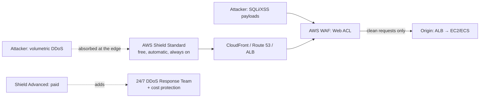
Shield absorbs volumetric/network-layer attacks before traffic even reaches the application
layer; WAF then inspects whatever got through for malicious *content* — the two are stacked, not
alternatives.

### Real AWS Image


*Source: [AWS Documentation — AWS Shield resilient web application architecture](https://docs.aws.amazon.com/waf/latest/developerguide/ddos-attack-protection-availability.html). Notice WAF sits structurally INSIDE the perimeter Shield already protects — this ordering (Shield at the edge, WAF one layer in) is the recurring architecture the exam expects you to recognize, not just recall as a fact.*

### IAM Policy Example
```json
{
  "Version": "2012-10-17",
  "Statement": [{
    "Effect": "Allow",
    "Action": ["shield:DescribeProtection", "shield:GetSubscriptionState"],
    "Resource": "*"
  }]
}
```
Read-only visibility into Shield Advanced protection status — a security team's monitoring role
typically needs only `Describe*`/`Get*` actions, not `shield:CreateProtection` or billing-related
actions.

### Exam Tips
- Shield Standard is free and automatic for everyone — no configuration decision exists for it.
- Shield Advanced's cost protection (crediting scaling charges from an attack) is a frequently
  tested, easy-to-forget specific feature, distinct from just "more DDoS protection."
- Shield operates at L3/L4; WAF operates at L7 (HTTP content) — a scenario needing both volumetric
  and application-layer-payload protection needs both services together.

---

## 13. WAF

### Definition
**AWS WAF** is a layer-7 web application firewall — a Web ACL of rules (custom or AWS Managed
Rules) inspecting HTTP(S) request content for malicious patterns (SQL injection, XSS, bad bots)
before allowing a request to reach CloudFront, ALB, API Gateway, or AppSync.

### Analogy
If Shield is the building's perimeter fence keeping out a stampede, WAF is the front-desk security
guard who still lets visitors in through the gate but checks everyone's bag content on the way —
catching the person who got past the fence carrying something they shouldn't, which the fence
itself was never designed to check for.

### When to Use
- Any internet-facing HTTP(S) endpoint needing protection against SQLi/XSS/bad-bot/rate-based
  attacks at the request-content level.
- Virtual patching: blocking exploitation of a known application vulnerability via a WAF rule
  while a real code fix is still in progress.

### When NOT to Use
- Don't rely on WAF for network/transport-layer DDoS protection — that's Shield's job; WAF
  inspects content, not raw traffic volume.
- Don't use WAF as a substitute for actual application-level input validation/sanitization in
  code — it's a defense-in-depth layer, not a replacement for secure coding practices.

### Use Cases
1. Blocking common SQL injection attempts in query parameters via AWS Managed Rules' SQLi rule
   group.
2. Rate-based rules throttling a single IP making an abnormal number of login attempts
   (credential-stuffing mitigation).
3. Geographic match rules blocking traffic from regions the business doesn't operate in.
4. Virtual patching a known CVE in a third-party library the application depends on, via a custom
   WAF rule, while the real patch is scheduled.
5. Bot Control managed rule group distinguishing legitimate crawlers from scraping bots.
6. Protecting a GraphQL API behind AppSync from malicious query-complexity-based denial-of-service
   patterns.

### Why Important
WAF is the exam's standard answer for any "malicious HTTP request content" scenario, and
recognizing it as a layer-7, content-inspecting control (distinct from Shield's layer-3/4 role) is
the specific distinction tested repeatedly.

### Diagram

```mermaid
flowchart LR
    REQ[Incoming HTTP(S) request] --> WACL[WAF Web ACL]
    WACL --> RULES{Rules: AWS Managed Rules\n+ custom rules}
    RULES -->|match: SQLi/XSS/bad bot| BLOCK[Block / CAPTCHA / Count]
    RULES -->|no match| ALLOW[Forward to CloudFront/ALB/API Gateway origin]
```
A Web ACL's rules are evaluated in priority order, and each rule's action (Block/Allow/Count/
CAPTCHA) is independently configurable — "Count" mode is specifically useful for testing a new
rule's effect on real traffic before switching it to Block, a detail worth knowing for a
"how do I safely roll out a new WAF rule" scenario.

### Real AWS Image


*Source: [AWS Documentation — aws-wafwebacl-cloudfront AWS Solutions Construct](https://docs.aws.amazon.com/solutions/latest/constructs/aws-wafwebacl-cloudfront.html). The Web ACL sits in front of CloudFront specifically, inspecting every request before it reaches the distribution — placing it at the edge (vs. at the origin ALB) catches malicious requests as early as possible and reduces load on everything downstream.*

### IAM Policy Example
```json
{
  "Version": "2012-10-17",
  "Statement": [{
    "Effect": "Allow",
    "Action": ["wafv2:GetWebACL", "wafv2:UpdateWebACL"],
    "Resource": "arn:aws:wafv2:us-east-1:111122223333:regional/webacl/my-web-acl/abcd1234"
  }]
}
```
Scoped to one specific Web ACL ARN — a team managing one application's WAF rules shouldn't need
`wafv2:*` across every Web ACL in the account.

### Exam Tips
- WAF is layer 7 (request content); Shield is layer 3/4 (network/transport volume) — they're
  stacked, not competing.
- AWS Managed Rules (SQLi, XSS, bad bot, account takeover prevention) cover common cases without
  writing custom rules — know they exist before assuming every rule must be hand-written.
- "Count" mode lets you observe a new rule's match rate on real traffic before switching it to
  "Block" — the safe rollout pattern for a new WAF rule.

---

## 14. Bedrock

### Definition
**Amazon Bedrock** provides API access to foundation models (Anthropic Claude, Meta Llama, Amazon
Titan/Nova, and others) for generative AI applications — text, chat, image, and agentic
workflows — without hosting or managing the underlying model infrastructure yourself.

### Analogy
Bedrock is like subscribing to electricity from the grid instead of building your own power
plant — you get the capability (a very capable language model) on demand, pay for what you use,
and never touch the generator itself; your job is wiring it safely into your building (IAM
scoping, VPC endpoints, Guardrails), not generating the electricity.

### When to Use
- Any generative AI feature (chatbot, summarizer, content generator, autonomous agent) needing
  foundation-model capability without hosting your own model.
- RAG applications combining a foundation model with your own retrieval layer (Knowledge Bases)
  over proprietary data.
- Fine-tuning a foundation model on your own data while keeping that training data under your own
  control, not shared across other customers.

### When NOT to Use
- A narrow, well-defined task an existing AI Service already does (don't reach for a general
  foundation model to extract text from a form when Textract already does exactly that, more
  cheaply and predictably).
- Don't put secrets or sensitive instructions directly in a system prompt as if automatically
  protected — see
  [`prompt-injection-and-genai-security-deep-dive.md`](prompt-injection-and-genai-security-deep-dive.md).

### Use Cases
1. A customer-support chatbot using a Knowledge Base (RAG) over the company's own support
   documentation.
2. A document-summarization feature for internal legal/compliance teams.
3. A Bedrock Agent with scoped tool access automating multi-step customer-service workflows,
   gated by human approval for irreversible actions.
4. Fine-tuning a model on proprietary support-ticket data for domain-specific accuracy, with the
   training data staying within the customer's own control.
5. A multi-tenant SaaS chatbot isolating each tenant's RAG data via session-tag-scoped STS
   credentials and tenant-filtered retrieval.
6. Invoking Bedrock exclusively through a VPC interface endpoint for a compliance requirement that
   no AI traffic touch the public internet.

### Why Important
Bedrock is the concrete service behind nearly every Task 2.3 scenario — access control, VPC
endpoints, training opt-out, Guardrails, prompt injection, and agent security are all discussed
*in terms of* Bedrock specifically, even when the underlying principle generalizes to other AI
services.

### Diagram

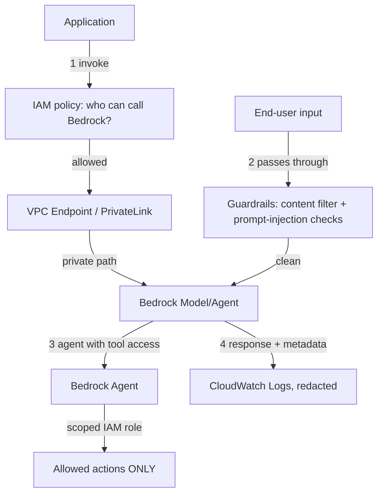
Every numbered step maps directly to one of Task 2.3's six risk areas — this single diagram is
the whole task statement compressed into one picture, repeated and expanded throughout
[`ai-service-security-risks.md`](ai-service-security-risks.md).

### Real AWS Image


*Source: [AWS Documentation — Amazon Bedrock AgentCore Runtime](https://docs.aws.amazon.com/bedrock-agentcore/latest/devguide/runtime-service-contract.html). Each agent session's isolated microVM is a security property distinct from IAM scoping — a compromised or prompt-injected session is contained to its own session's resources, not the host or other sessions, which matters most in exactly the multi-tenant scenarios Task 2.3 describes.*

### IAM Policy Example
```json
{
  "Version": "2012-10-17",
  "Statement": [
    {
      "Effect": "Allow",
      "Action": ["bedrock:InvokeModel", "bedrock:InvokeModelWithResponseStream"],
      "Resource": "arn:aws:bedrock:us-east-1::foundation-model/anthropic.claude-*"
    },
    {
      "Effect": "Allow",
      "Action": "bedrock:ApplyGuardrail",
      "Resource": "arn:aws:bedrock:us-east-1:111122223333:guardrail/abcd1234"
    }
  ]
}
```
Scoped to one model family and one specific guardrail — never `bedrock:*` on `Resource: "*"` for
a runtime application role.

### Exam Tips
- Bedrock does not use customer prompts/completions to train the underlying foundation models by
  default — a contractual guarantee, but verify/confirm it per service rather than assuming it's
  universal.
- VPC endpoints for `bedrock-runtime` (and `bedrock-agent-runtime` for agents) keep traffic off
  the public internet — pair with no NAT/IGW route for the strongest version of "never touches
  the public internet."
- Scope both the action list AND the resource ARN on a Bedrock IAM policy — a resource-scoped
  policy with `bedrock:*` as the action is still over-permissioned.

---

## 15. CloudWatch (Security Angle)

### Definition
**Amazon CloudWatch** collects metrics, logs, and alarms for AWS resources and applications. From
a Domain 2 lens, CloudWatch Logs is the "what did the application do" system of record — distinct
from CloudTrail's "who called which AWS API" — and is where sensitive-data-in-logs risks
(including the AI-specific version in Task 2.3) actually manifest.

### Analogy
If CloudTrail is the building's badge-swipe log (who entered which door), CloudWatch Logs is each
employee's own desk diary of what they did once inside — useful for understanding behavior and
debugging problems, but it's also exactly where an employee might accidentally jot down something
sensitive they shouldn't have, like a customer's SSN copied straight out of a support ticket.

### When to Use
- Application-level debugging and troubleshooting ("why did my function return the wrong value").
- Alerting on operational or security-relevant application behavior via metric filters and
  alarms.
- Centralizing log retention and access-controlled review across a fleet of resources.

### When NOT to Use
- Don't rely on CloudWatch Logs to answer "who called this AWS API" — that's CloudTrail's job;
  CloudWatch only sees what your own application chose to log.
- Don't log full raw request/response payloads to/from sensitive systems (databases, AI
  services) by default — redact/mask before writing, not after.

### Use Cases
1. A metric filter and alarm on `ERROR`-level log lines triggering a PagerDuty notification.
2. Redacting PII/secrets from a Lambda function's logs before writing, specifically to prevent
   the Task 2.3 "sensitive data in logs" failure mode for an AI-service integration.
3. CloudWatch Logs Insights querying across millions of log lines to find every occurrence of a
   failed authentication attempt.
4. Centralized log aggregation from multiple accounts into one logging account for audit
   purposes.
5. A dashboard combining metrics from GuardDuty findings volume and Security Hub compliance score
   for an executive security posture view.
6. Setting log group retention policies to satisfy a compliance requirement without manual
   per-log-group management.

### Why Important
"PII appeared in CloudWatch Logs because it was part of a prompt sent to Bedrock" is one of this
exam's most repeated Task 2.3 symptom descriptions, and the correct diagnostic order (check the
log-writing code path first, since logging often happens before any safety layer ever runs) is a
specific, testable skill distinct from the service itself.

### Diagram

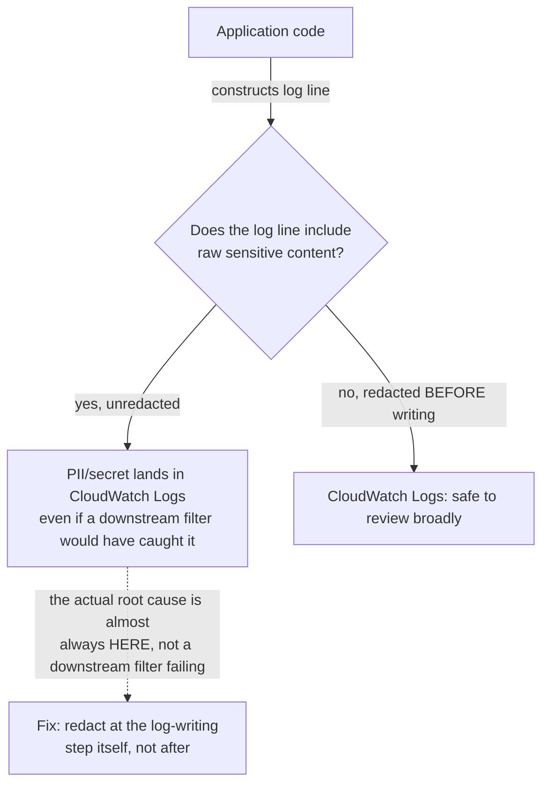
The recurring real-world and exam lesson: a security control (Guardrails, a WAF rule, an IAM
policy) existing *somewhere* in the system doesn't help if the leak happens at a point the control
never sees — logging raw input before it passes through any filtering layer is the single most
common root cause behind "sensitive data showed up in logs" incidents.

### Real AWS Image


*Source: [AWS Documentation — CloudWatch automatic dashboard](https://docs.aws.amazon.com/AmazonCloudWatch/latest/monitoring/CloudWatch_Automatic_Dashboards.html). The default dashboard aggregates alarm states across services with zero manual setup — useful to know for "fastest way to get a basic operational health view" scenarios, where building a custom dashboard isn't actually necessary.*

### IAM Policy Example
```json
{
  "Version": "2012-10-17",
  "Statement": [{
    "Effect": "Allow",
    "Action": ["logs:GetLogEvents", "logs:FilterLogEvents"],
    "Resource": "arn:aws:logs:us-east-1:111122223333:log-group:/aws/lambda/payments-fn:*"
  }]
}
```
Scoped to one function's log group — a support/debugging role reviewing logs shouldn't have
`logs:*` across every log group in the account, especially if some log groups contain more
sensitive application data than others.

### Exam Tips
- CloudTrail answers "who called which AWS API"; CloudWatch Logs answers "what did the
  application do" — a combined-symptom question needs both tools, each for its own half.
- When PII/secrets appear in logs, check the log-writing code path first — the most common root
  cause is that logging happened before any filtering/redaction layer ran, not that the filter
  itself failed.
- Guardrails' own trace/diagnostic output can itself contain fragments of the sensitive content it
  caught — don't assume a security feature's diagnostic output is automatically safe to log
  verbatim.

---

## 16. Cognito

### Definition
**Amazon Cognito** provides authentication and authorization for an *application's end users* —
**User Pools** handle sign-up/sign-in (including social/SAML IdPs and MFA), issuing JWTs; **Identity
Pools** exchange those JWTs for temporary, user-scoped AWS credentials via STS.

### Analogy
Cognito is your product's own front-desk registration system — issuing visitor badges (JWTs) to
your customers specifically, checking ID at sign-up, and optionally handing a visitor a
temporary internal access card (via Identity Pools + STS) if they need to reach something inside
the building directly, like grabbing a locker themselves instead of asking staff. It has nothing
to do with your own employees' building access — that's Identity Center.

### When to Use
- Any application needing its own customers to sign up/sign in (email/password, social login,
  SAML).
- A mobile/web client needing direct, user-scoped temporary AWS credentials without a backend
  intermediary (via Identity Pools).

### When NOT to Use
- Workforce/employee access to AWS accounts — that's IAM Identity Center, not Cognito.
- A backend-only architecture where the user never needs direct AWS credentials (the backend's
  Lambda execution role handles all AWS access) — a User Pool alone (no Identity Pool) is
  sufficient; don't add the Identity Pool exchange complexity unnecessarily.

### Use Cases
1. A consumer mobile app's users signing up with email/password or Google/Facebook login via a
   User Pool.
2. A mobile client writing workout data directly to DynamoDB without a backend, using Identity
   Pool-issued, user-scoped temporary credentials.
3. API Gateway validating a Cognito User Pool JWT (the access token specifically) via a Cognito
   authorizer before invoking a backend Lambda.
4. Enforcing MFA for a consumer-facing banking app's User Pool sign-in.
5. Federating an enterprise customer's own SAML IdP into a B2B SaaS product's Cognito User Pool
   for "login with your company account."
6. Issuing a refresh token so a mobile app can silently obtain new short-lived tokens without
   forcing the user to re-enter credentials.

### Why Important
The Cognito-vs-IAM-Identity-Center confusion, and the User-Pool-vs-Identity-Pool confusion, are
two of Domain 2's most repeated distinctions — both resolved by the same question: "whose identity
is this, and what does it need to do."

### Diagram

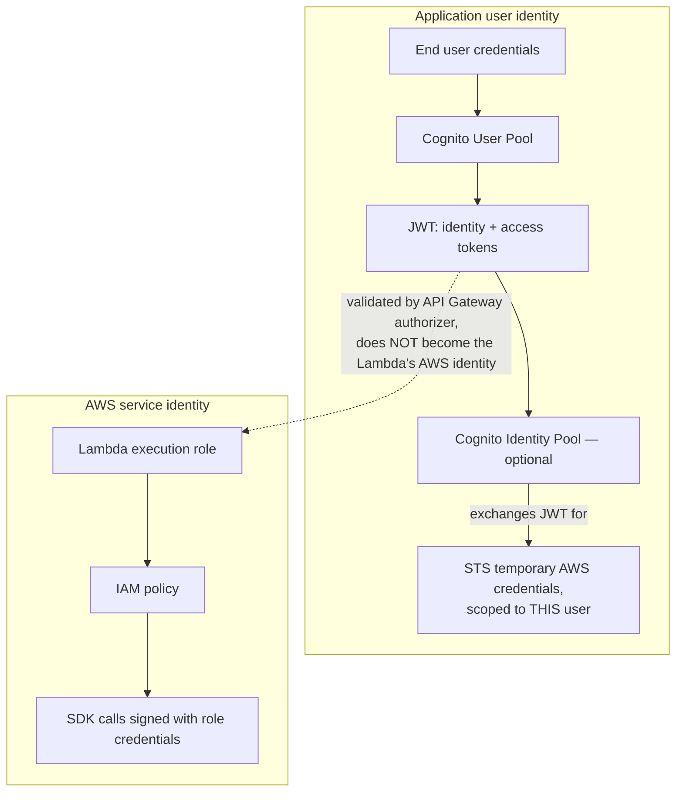
Two separate identity chains that meet at API Gateway but never merge — a function's AWS
permissions almost always come from its own execution role, not from the calling user's Cognito
identity, unless an Identity Pool exchange was deliberately built for direct client-side AWS
access.

### Real AWS Image


*Source: [AWS Documentation — Identity pools (federated identities)](https://docs.aws.amazon.com/cognito/latest/developerguide/identity-pools.html). The User Pool → Identity Pool → STS chain is specifically the "mobile app needs temporary AWS credentials scoped to each user" pattern — recognize it as THREE distinct services cooperating, not one Cognito feature doing everything.*

### IAM Policy Example
```json
{
  "Version": "2012-10-17",
  "Statement": [{
    "Effect": "Allow",
    "Action": "s3:GetObject",
    "Resource": "arn:aws:s3:::user-uploads-bucket/${cognito-identity.amazonaws.com:sub}/*"
  }]
}
```
A policy variable (`${cognito-identity.amazonaws.com:sub}`) scoping an Identity-Pool-issued
role's permissions to only the calling user's own prefix — one reusable role serving every user,
each scoped to only their own data via the variable.

### Exam Tips
- Cognito is for *application end-users*; IAM Identity Center is for *workforce* access to AWS
  accounts — this single distinction resolves nearly every exam question mentioning both.
- An API Gateway Cognito authorizer validates the **access token**, not the ID token — know which
  of the three JWTs (ID, access, refresh) is actually checked on each request.
- User Pools alone (no Identity Pool) are sufficient when the user never needs direct AWS
  credentials — don't assume every Cognito scenario requires the Identity Pool exchange.

---

## 17. DynamoDB (Security Angle)

### Definition
From a Domain 2 lens, **DynamoDB** is the NoSQL data store whose Task 2.2 relevance is entirely
about how it's secured once chosen as the data layer — encryption at rest (KMS-backed, on by
default), fine-grained access control via IAM policy conditions scoped to specific
items/attributes, and VPC endpoint access for private connectivity.

### Analogy
If choosing DynamoDB as your data store is choosing which warehouse to rent, Domain 2's DynamoDB
content is entirely about the locks you put on that warehouse once you've rented it — who has a
key to which specific shelf (fine-grained IAM conditions), whether the walls themselves are
soundproofed (encryption at rest), and whether deliveries arrive via the public street or a
private loading dock (VPC endpoint).

### When to Use
- Any DynamoDB table where a security requirement (encryption key control, fine-grained
  per-item/attribute access, private network access) needs to be reasoned about explicitly rather
  than assumed as "handled."

### When NOT to Use
- Don't assume DynamoDB's at-rest encryption needs explicit enabling — it's on by default with an
  AWS-owned key; a customer-managed key is an *additional* control layer, not a baseline
  requirement.
- Don't grant a Lambda function's execution role table-wide `dynamodb:*` when the application only
  ever needs specific items/attributes for the calling user — fine-grained conditions exist
  specifically to avoid this over-grant.

### Use Cases
1. A table encrypted at rest with a customer-managed KMS key for a security team requiring
   independent audit/revocation control over the encryption key.
2. A `dynamodb:LeadingKeys` condition restricting a Cognito-Identity-Pool-scoped role to only
   items whose partition key matches the calling user's own identity.
3. A VPC gateway endpoint for DynamoDB, keeping table access off the public internet for a
   Lambda function with no NAT/IGW route.
4. Fine-grained access control limiting a specific IAM role to only certain attributes within an
   item via `dynamodb:Attributes` conditions.
5. CloudTrail-logging every `UpdateItem`/`DeleteItem` call on a sensitive table for audit
   purposes (via data events, since table-level API calls like these are management-plane events
   already captured by default, but item-level granularity requires deliberate design).
6. Point-in-time recovery and on-demand backups as a data-integrity control complementing (not
   replacing) encryption and access control.

### Why Important
DynamoDB recurs across the exam as the default "data store" in architecture scenarios, and
Domain 2 specifically tests whether you can reason about *securing* it (encryption key choice,
fine-grained access, private connectivity) rather than just how to query it.

### Diagram

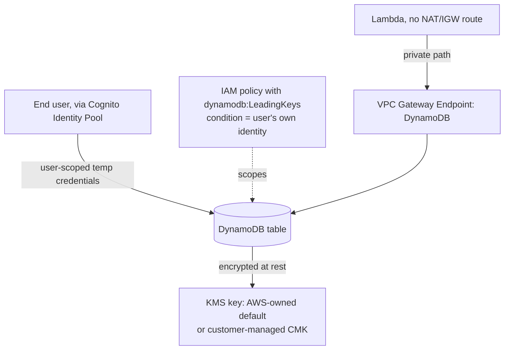
Three independent security layers stacked on the same table: fine-grained access control (who can
touch which item), encryption at rest (what protects the data on disk), and private connectivity
(how traffic reaches the table) — each answers a different "what could go wrong" question.

### Real AWS Image


*Source: [AWS Documentation — DynamoDB partitions and data distribution](https://docs.aws.amazon.com/amazondynamodb/latest/developerguide/HowItWorks.CoreComponents.html). This partitioning detail matters for the `dynamodb:LeadingKeys` fine-grained access pattern above: scoping a policy to a user's own partition key works cleanly specifically because DynamoDB's own data model already organizes items by partition key — the access-control mechanism rides on the same structural concept as the data model.*

### IAM Policy Example
```json
{
  "Version": "2012-10-17",
  "Statement": [{
    "Effect": "Allow",
    "Action": ["dynamodb:GetItem", "dynamodb:Query"],
    "Resource": "arn:aws:dynamodb:us-east-1:111122223333:table/user-profiles",
    "Condition": {
      "ForAllValues:StringEquals": { "dynamodb:LeadingKeys": ["${cognito-identity.amazonaws.com:sub}"] }
    }
  }]
}
```
One reusable policy, attached to a single Identity-Pool-issued role, correctly scoping every
user's access to only their own partition-key items.

### Exam Tips
- Encryption at rest is on by default with an AWS-owned key — a customer-managed key is an
  *additional* audit/control layer, not something you must explicitly enable to get baseline
  encryption.
- `dynamodb:LeadingKeys` conditions are the standard fine-grained-access mechanism for
  Cognito-Identity-Pool-scoped, per-user table access.
- A VPC gateway endpoint (like S3's) keeps DynamoDB traffic off the public internet for workloads
  with no NAT/IGW route — the same PrivateLink-family mechanism discussed for Bedrock elsewhere in
  this file.

---

## 18. GuardDuty

### Definition
**Amazon GuardDuty** is a continuous, agent-less threat-detection service analyzing CloudTrail
events, VPC Flow Logs, DNS logs, and (optionally) EKS audit logs / S3 data events / runtime
monitoring to flag anomalous or malicious activity — compromised credentials, reconnaissance,
cryptomining, data exfiltration patterns.

### Analogy
GuardDuty is a security guard who doesn't check IDs at any door (that's IAM's job) and doesn't
inspect anyone's bag (that's WAF/Inspector's job) — instead, they watch the building's overall
behavior patterns and notice when something's off: a badge that normally swipes in at 9am
suddenly swiping in at 3am from a city it's never been in before. It requires no agent installed
anywhere because it's watching logs the building already generates, not standing physically at
any one door.

### When to Use
- Continuous, account-wide threat detection without deploying any agent.
- Detecting compromised credentials via anomalous API call patterns (unusual region, unusual API
  sequence, known malicious IP).
- Detecting cryptomining or data-exfiltration behavior from compute resources.

### When NOT to Use
- Don't expect GuardDuty to find known software vulnerabilities in an EC2 instance's installed
  packages — that's Inspector's job, a fundamentally different (CVE-based, not anomaly-based)
  detection method.
- Don't rely on GuardDuty alone for compliance-standard mapping — that's Security Hub's
  aggregation role.

### Use Cases
1. Detecting an EC2 instance suddenly communicating with a known cryptomining pool IP.
2. Flagging an IAM user's credentials being used from an impossible-travel location pattern.
3. Detecting an S3 bucket's data being accessed in a pattern consistent with exfiltration (with
   S3 protection enabled).
4. Delegated-administrator aggregation of GuardDuty findings across every account in an
   Organization into one security account.
5. Automated response: a GuardDuty finding triggering an EventBridge rule that isolates a
   compromised EC2 instance's security group automatically.
6. EKS protection flagging anomalous Kubernetes audit log activity in a managed cluster.

### Why Important
"Unusual API call pattern suggesting compromised credentials" is one of this exam's most reliable
one-line signals for GuardDuty specifically, and distinguishing it from Inspector (vulnerabilities)
and Macie (sensitive data) by *what kind of question it answers* is a core Domain 2 detective-
controls skill.

### Diagram

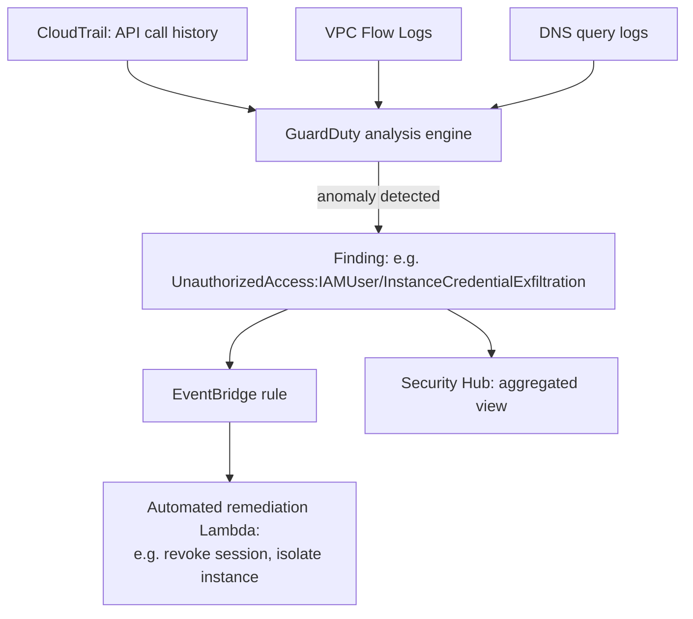
GuardDuty requires no agent and no additional data collection setup — it analyzes logs the
account is already generating, which is the mechanical reason it's described as "continuous" and
"agent-less" rather than something you deploy onto compute resources.

### Real AWS Image


*Source: [AWS Documentation — GuardDuty threat detection example](https://docs.aws.amazon.com/sap/latest/general/security-services.html). This picture captures the layered detection chain precisely: CloudTrail records the raw API call (the IAM permission change itself), and GuardDuty is the analysis layer that recognizes the PATTERN of that change as suspicious — CloudTrail alone would just be a neutral log entry; GuardDuty is what turns it into an actionable finding.*

### IAM Policy Example
```json
{
  "Version": "2012-10-17",
  "Statement": [{
    "Effect": "Allow",
    "Action": ["guardduty:GetFindings", "guardduty:ListFindings"],
    "Resource": "*"
  }]
}
```
Read-only finding access for a security analyst role — administrative actions like
`guardduty:CreateDetector` or `guardduty:DisassociateFromMasterAccount` should be reserved for a
separate, more tightly scoped administrative role.

### Exam Tips
- GuardDuty = behavioral anomaly/threat detection; Inspector = known CVE vulnerability scanning;
  Macie = sensitive data discovery — three different detection methods, three different symptoms.
- GuardDuty requires no agent — it analyzes existing CloudTrail/VPC Flow Log/DNS log data, which
  is why it's "continuous" with no deployment step onto compute resources.
- Delegated-administrator aggregation across an Organization is the standard pattern for org-wide
  GuardDuty visibility, the same pattern used for Security Hub, Macie, and Inspector.

---

## 19. Macie

### Definition
**Amazon Macie** continuously scans S3 buckets using machine learning and pattern matching to
discover and classify sensitive data (PII, financial data, credentials) at rest, generating
findings about what's there and where — a purely **detective** control, not a preventive one.

### Analogy
Macie is an auditor who walks through every filing cabinet in the warehouse (S3 buckets) with a
checklist, flagging any drawer that contains something it shouldn't (an unredacted SSN, a
credential left in a text file) — the auditor doesn't lock any drawer or stop anyone from putting
sensitive papers in next time; they just tell you what's already there so you can decide what to
do about it.

### When to Use
- Discovering whether sensitive data (PII, credentials, financial data) already exists
  unencrypted/unclassified somewhere in S3, especially after a migration or data-lake
  consolidation.
- Ongoing, scheduled scanning to catch newly written sensitive data landing in buckets it
  shouldn't.
- Compliance evidence that sensitive-data discovery scanning is actively running.

### When NOT to Use
- Don't use Macie as a preventive control — it never blocks a write or encrypts anything; pair it
  with a preventive control (bucket policy, KMS, Access Analyzer) for actual prevention.
- Don't use Macie for data stores other than S3 — it's S3-specific; it has no equivalent for
  DynamoDB or RDS.

### Use Cases
1. A one-time Macie scan after a data-lake migration, confirming whether any unredacted customer
   SSNs landed in a shared analytics bucket.
2. Ongoing scheduled jobs flagging any new object containing credit card numbers written to a
   bucket that should only ever contain anonymized data.
3. Feeding Macie findings into Security Hub for a consolidated compliance-posture view alongside
   GuardDuty and Inspector findings.
4. Confirming, as part of an incident investigation, exactly which objects in a bucket contained
   sensitive data before a suspected exposure.
5. Scoping Macie's scan to specific buckets/prefixes to control cost on a very large data lake,
   rather than scanning everything indiscriminately.
6. Using Macie's findings to prioritize which buckets need a bucket-policy tightening or
   encryption-key upgrade first.

### Why Important
"A company wants to find out if PII already exists unencrypted in an S3 bucket, not prevent it
going forward" is the exam's standard Macie signal — the preventive-vs-detective distinction is
the entire reasoning skill being tested, since Macie's name alone doesn't make its role obvious.

### Diagram

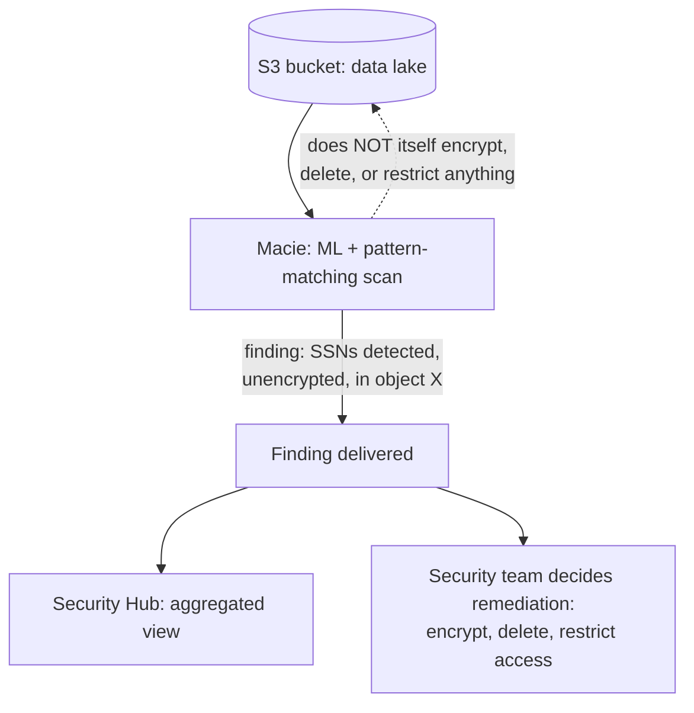
The dotted line is the entire exam-relevant point: Macie's output is information, not action —
every remediation step following a Macie finding is a separate, deliberate decision made by a
human or an automated response built on top of the finding, not something Macie does on its own.

### Real AWS Image


*Source: [AWS Documentation — Macie sensitive data discovery example](https://docs.aws.amazon.com/sap/latest/general/security-services.html). "Continuously analyzing" is the operative phrase — Macie can run as an ongoing scheduled job, not just a one-time audit, which matters for "catch new sensitive data as it lands" requirements distinct from a one-time post-migration check.*

### IAM Policy Example
```json
{
  "Version": "2012-10-17",
  "Statement": [{
    "Effect": "Allow",
    "Action": ["macie2:GetFindings", "macie2:ListFindings"],
    "Resource": "*"
  }]
}
```
Read-only finding access — `macie2:CreateClassificationJob` (starting a new scan, which incurs
cost based on data scanned) should be reserved for a more deliberately scoped administrative or
automated role.

### Exam Tips
- Macie is detective, not preventive — it never encrypts, blocks, or restricts anything itself;
  pair it with a preventive control for actual prevention.
- "Find out if PII already exists" (past/existing data) is Macie; "stop new PII from being
  written unencrypted" (going forward) is a preventive control like a bucket policy or KMS — don't
  conflate the two halves of a combined requirement.
- Macie is S3-specific — it has no equivalent scanning capability for DynamoDB, RDS, or other data
  stores.

---

## 20. Amazon Q

### Definition
**Amazon Q** is AWS's generative-AI assistant family: **Amazon Q Developer** assists with code
generation, review, and AWS troubleshooting inside IDEs/the console; **Amazon Q Business** is an
enterprise assistant that answers questions grounded in a company's own indexed data sources
(documents, wikis, SaaS tools), typically authenticated via IAM Identity Center.

### Analogy
Amazon Q Developer is a pair-programmer embedded directly in your IDE who already knows AWS
cold. Amazon Q Business is a knowledgeable new hire who, on day one, has already read every
internal wiki page, support ticket, and shared drive document your company has access-controlled
them to see — and (critically) only answers using exactly what that specific employee's own
permissions already allow them to see, not everything in the index indiscriminately.

### When to Use
- Q Developer: accelerating code-writing, debugging, and AWS-specific troubleshooting inside a
  developer's existing workflow.
- Q Business: an enterprise search/Q&A assistant grounded in a company's own indexed content,
  respecting each user's existing access permissions.

### When NOT to Use
- Don't use Q Business as a substitute for Bedrock if you need low-level model control, custom
  fine-tuning, or a fully custom application — Q Business is a packaged, opinionated assistant
  product, not a general foundation-model API.
- Don't assume Q Business bypasses a user's existing document permissions — if anything, the
  exam tests whether you know it specifically *respects* them via connector-level access-control
  mapping.

### Use Cases
1. A developer using Q Developer inside their IDE to generate boilerplate and get inline
   AWS-service-specific suggestions.
2. An internal engineering-docs search assistant built on Q Business, indexing Confluence/
   SharePoint/S3-stored documentation with access control preserved per source system.
3. Q Developer explaining a confusing CloudFormation error directly inside the console.
4. Q Business answering an HR policy question, sourced only from documents the asking employee
   already has permission to view in the underlying SaaS tool.
5. Custom plugins extending Q Business to take action (not just answer questions) via connected
   Bedrock agents, scoped the same way any agent's action group would be.
6. IAM Identity Center-authenticated access ensuring Q Business inherits the company's existing
   workforce identity and permission model rather than a separate login system.

### Why Important
Amazon Q sits at the overlap of Domain 1 (AI-assisted development) and Domain 2/Task 2.3
(securing an AI service your organization uses) — recognizing which side of that line a scenario
is testing (helping you write code vs. securing an AI feature your business exposes) is itself an
exam skill.

### Diagram

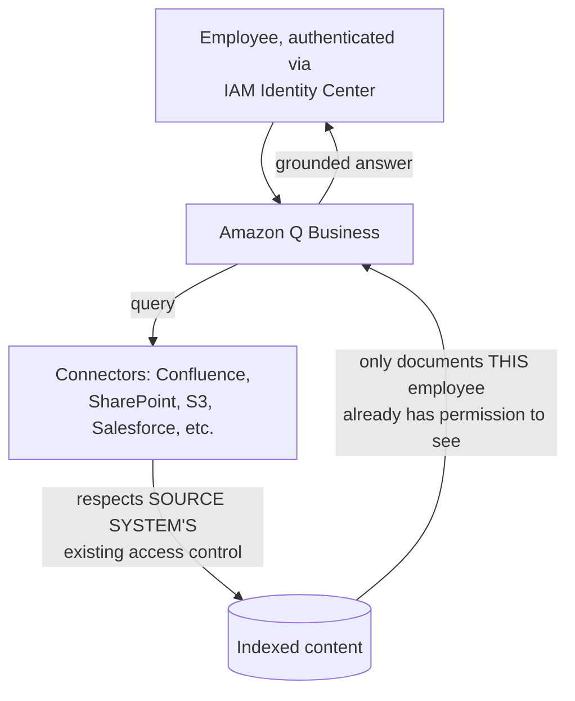
The access-control-preservation detail is the single most exam-relevant fact about Q Business:
indexing a document doesn't widen who can see its content through Q — the connector maps and
enforces the *source system's* existing permissions, so Q Business never becomes an accidental
permission-bypass mechanism.

### Real AWS Image


*Source: [AWS Machine Learning Blog — Amazon Q Business reference architecture](https://aws.amazon.com/blogs/machine-learning/). IAM Identity Center sits at the authentication layer here, not Cognito — Q Business is a workforce-facing tool (employees asking internal questions), reinforcing the same Identity-Center-vs-Cognito distinction tested throughout this file.*

### IAM Policy Example
```json
{
  "Version": "2012-10-17",
  "Statement": [{
    "Effect": "Allow",
    "Action": ["qbusiness:ChatSync", "qbusiness:GetApplication"],
    "Resource": "arn:aws:qbusiness:us-east-1:111122223333:application/abcd1234"
  }]
}
```
Scoped to one specific Q Business application — administrative actions (creating/deleting a data
source connector) should be a separate, more restricted role than the one granted to end users
simply chatting with the assistant.

### Exam Tips
- Q Business respects the *source system's* existing access control via connectors — indexing a
  document for Q doesn't grant broader visibility than the user already had in the original tool.
- Q Business typically authenticates via IAM Identity Center (workforce identity), not Cognito —
  consistent with the broader workforce-vs-customer identity distinction.
- Distinguish Q Developer (helping *you* write code, a Domain 1 topic) from securing an AI service
  *your application* exposes to others (Domain 2/Task 2.3) — they're different sides of "AI and
  development," tested separately.

---

## 21. S3 (Security Angle)

### Definition
From a Domain 2 lens, **Amazon S3**'s relevance is entirely about securing object storage:
encryption at rest (SSE-S3, SSE-KMS, SSE-C), access control (bucket policies, ACLs, Block Public
Access), and VPC endpoint access for private connectivity — the same three-layer pattern as
DynamoDB, applied to object storage instead of a NoSQL table.

### Analogy
If DynamoDB's security story is about locking individual shelves in a warehouse, S3's is about
securing an entire storage facility with many separate units — each unit (bucket) has its own
lock combination (bucket policy), the building has a master "no units may ever be rented to the
public" switch that overrides any individual unit's settings (Block Public Access), and deliveries
can come through the public loading dock or a private tunnel (VPC endpoint).

### When to Use
- Any S3 bucket holding data with encryption-at-rest, access-control, or network-path
  requirements that need to be reasoned about explicitly.
- Enforcing org-wide "no public buckets" guardrails via Block Public Access and/or an RCP.

### When NOT to Use
- Don't rely on bucket-level Block Public Access settings alone if an org-wide guarantee is
  required — a determined or mistaken account-level change could still occur; an RCP at the
  Organizations layer is the structurally unbypassable version of this requirement.
- Don't assume default encryption settings satisfy every compliance requirement — a security team
  needing audit control over the decryption key specifically needs a customer-managed KMS key, not
  the default AWS-managed option.

### Use Cases
1. Default bucket encryption (SSE-S3 or SSE-KMS) ensuring every new object is encrypted at rest
   without per-upload configuration.
2. Account-wide S3 Block Public Access preventing any bucket from ever being made public, even by
   a future bucket policy mistake.
3. A bucket policy granting a specific cross-account role read access, evaluated independently of
   that role's own identity-based policy (the resource-based-policy pattern from the IAM section).
4. A VPC gateway endpoint for S3, keeping bucket access off the public internet for workloads with
   no NAT/IGW route.
5. S3 Object Lock enforcing WORM (write-once-read-many) retention for compliance-mandated
   immutability.
6. Macie scanning a bucket's contents for sensitive data as the detective-control complement to
   these preventive controls.

### Why Important
S3 recurs as the default "object storage" answer across nearly every domain of this exam, and
Domain 2 specifically tests the encryption/access-control/network-path triad that applies anytime
S3 holds anything sensitive — the same reasoning pattern as DynamoDB, intentionally, since both
sections of this file use the same three-layer security model.

### Diagram

```mermaid
flowchart TD
    CLIENT[Client / cross-account role] -->|request| BPA{Block Public Access\nenabled account/bucket-wide?}
    BPA -->|yes| DENY[Public access requests denied,\nregardless of bucket policy]
    BPA -->|no| POLICY[Bucket policy + IAM policy\nevaluated together, union logic]
    POLICY --> S3B[(S3 bucket)]
    S3B -->|encrypted at rest| KMS[KMS: default SSE-S3\nor customer-managed SSE-KMS]
    LAMBDA[Lambda, no NAT/IGW route] -->|private path| VPCE[VPC Gateway Endpoint: S3]
    VPCE --> S3B
```
Block Public Access is evaluated *before* the bucket policy even matters — it's an account/
bucket-level override that can make an otherwise-public-granting bucket policy a complete no-op,
which is the exam's standard "why isn't this bucket public even though the policy says it should
be" answer.

### Real AWS Image


*Source: [AWS Documentation — Amazon S3 strong consistency](https://docs.aws.amazon.com/AmazonS3/latest/userguide/Welcome.html#ConsistencyModel). Not a security feature directly, but relevant to a Task 2.3 overlap: S3's strong read-after-write consistency means a RAG pipeline's just-updated document is immediately reflected in the next retrieval — no eventual-consistency window where a security-relevant document update (e.g. removing a poisoned file) might not yet be visible to a retrieval call.*

### IAM Policy Example
```json
{
  "Version": "2012-10-17",
  "Statement": [{
    "Sid": "DenyUnencryptedUploads",
    "Effect": "Deny",
    "Principal": "*",
    "Action": "s3:PutObject",
    "Resource": "arn:aws:s3:::prod-data/*",
    "Condition": { "StringNotEquals": { "s3:x-amz-server-side-encryption": "aws:kms" } }
  }]
}
```
A bucket policy (resource-based) denying any upload that doesn't specify KMS encryption — a
preventive control ensuring every new object is encrypted the way the security team requires,
independent of what any individual uploader's IAM policy allows.

### Exam Tips
- Block Public Access is evaluated before the bucket policy and can make an otherwise-public-
  granting policy a no-op — the standard answer for "why isn't this bucket actually public."
- A VPC gateway endpoint (the same PrivateLink-family mechanism as DynamoDB/Bedrock) keeps S3
  traffic off the public internet for workloads with no NAT/IGW route.
- Default encryption settings satisfy "data is encrypted at rest" generally, but a security team
  needing independent audit/revocation control over the key specifically needs a customer-managed
  KMS key, not the AWS-managed default.

---

## 22. Shared Responsibility Model Deep Dive

### Definition
The **Shared Responsibility Model** divides security obligations between AWS ("security **of**
the cloud" — physical infrastructure, hardware, the managed services' own software) and the
customer ("security **in** the cloud" — data, IAM configuration, OS/network configuration where
applicable, encryption choices) — the exact split shifting depending on the service's
abstraction level (IaaS vs. PaaS vs. SaaS-like managed services).

### Analogy
Renting an apartment: the landlord (AWS) is responsible for the building's structural integrity,
the foundation, the exterior walls, the physical locks on the main entrance — things you could
never realistically fix yourself. You (the customer) are responsible for locking your own
apartment door, deciding who gets a key, and not leaving your windows open — things only you can
control because only you know who should have access. A fully-furnished serviced apartment
(a SaaS-like managed service) shifts more of the "what's inside" responsibility to the landlord
than a bare unfurnished unit (raw EC2/IaaS) does — the split moves, but there's always a
line, and you're always responsible for *something* on your side of it.

### When to Use This Reasoning
- Any question asking "whose responsibility is X" for a specific control (patching, encryption,
  physical security, IAM configuration).
- Distinguishing what shifts between EC2 (customer patches the guest OS) and a fully managed
  service like Lambda or DynamoDB (AWS patches everything up to the application code/data layer).

### When NOT to Use It
- Don't use it to answer "how do I implement X" — it's a responsibility-attribution framework, not
  an implementation guide; pair it with the specific service's actual security mechanics.

### Use Cases
1. Confirming that AWS, not the customer, is responsible for patching the underlying hypervisor
   and physical hardware for any EC2 instance.
2. Confirming that the customer, not AWS, is responsible for the guest OS patching on an EC2
   instance — but NOT on Lambda, where AWS manages the entire runtime.
3. Clarifying that encryption-at-rest *configuration* (which KMS key, whether it's enabled) is
   always the customer's responsibility, even though AWS provides and operates the underlying KMS
   infrastructure.
4. Explaining to a compliance auditor why a security certification (e.g. SOC 2) covers AWS's
   "of the cloud" responsibilities but the customer still needs their own audit evidence for their
   "in the cloud" configuration.
5. Recognizing that for a fully managed service like DynamoDB, AWS's responsibility line extends
   further (no OS to patch at all) than for EC2, while the customer's IAM/data/encryption
   responsibilities remain constant across both.
6. Explaining why a misconfigured S3 bucket made public is always a customer responsibility
   failure, never an AWS infrastructure failure — the bucket policy is squarely "in the cloud."

### Why Important
This model is the conceptual foundation every other Domain 2 topic in this file sits on top of —
every control discussed (IAM, KMS, Secrets Manager, VPC endpoints) is something the model places
squarely on the **customer's** side of the line; recognizing that AWS will never configure these
for you, no matter how "managed" a service feels, is the single idea the whole domain assumes you
already understand.

### Diagram

```mermaid
flowchart TD
    subgraph CUSTOMER["Customer: Security IN the cloud"]
        DATA[Customer data]
        IAM[IAM configuration]
        OSCONFIG[Guest OS / network / firewall\nconfiguration — IaaS only]
        ENCCHOICE[Encryption choices: which key,\nwhether SSE is enabled]
    end
    subgraph AWS_SIDE["AWS: Security OF the cloud"]
        HW[Physical hardware]
        HYPER[Hypervisor / virtualization layer]
        REGIONS[Regions, AZs, edge locations]
        MANAGEDSVC[Managed services' own software\ne.g. DynamoDB/Lambda runtime internals]
    end
    CUSTOMER -.sits ON TOP OF.-> AWS_SIDE
```
The line shifts based on abstraction level — for EC2 (IaaS), the customer's box extends down to
guest OS configuration; for Lambda/DynamoDB (fully managed), AWS's box extends up to cover
everything except data, IAM configuration, and encryption choices, since there's no OS for the
customer to touch at all. The *existence* of a line, and the fact that IAM/data/encryption always
sit on the customer's side regardless of abstraction level, never changes.

### Real AWS Image


*Source: [AWS Documentation — Shared responsibility model](https://docs.aws.amazon.com/waf/latest/developerguide/ddos-shared-responsibility.html). This is AWS's own canonical framing, worth memorizing as a picture — "customer responsibility for security IN the cloud" always sits on top (visible, closer to the application), "AWS responsibility for security OF the cloud" always sits underneath (infrastructure, invisible to the customer) — a mnemonic matching the diagram's own visual layout.*

### IAM Policy Example
Not directly applicable — the Shared Responsibility Model is an attribution framework, not an
access-control mechanism with its own policy syntax. Every IAM policy example elsewhere in this
file is itself an exercise of the customer's "security in the cloud" responsibility.

### Exam Tips
- Physical security, hardware, and the hypervisor are always AWS's responsibility, regardless of
  which service or abstraction level is being discussed.
- Guest OS patching is a customer responsibility on EC2 (IaaS) but doesn't exist as a concept at
  all for Lambda/DynamoDB (fully managed) — the line shifts with abstraction level, but IAM
  configuration, data, and encryption choices are ALWAYS on the customer's side.
- A compliance certification covering AWS's infrastructure doesn't cover the customer's own
  misconfiguration — a public S3 bucket or an over-permissioned IAM role is always a customer-side
  failure, never an AWS infrastructure failure.

---

## 23. VPC Endpoints & PrivateLink

### Definition
**VPC Endpoints** let resources inside a VPC reach AWS services without traversing the public
internet. **Gateway endpoints** (S3, DynamoDB only) work via route-table entries; **Interface
endpoints**, built on **AWS PrivateLink**, create ENIs inside your VPC's private subnets for
nearly every other AWS service (including `bedrock-runtime`, Secrets Manager, KMS).

### Analogy
Calling an AWS service over the public internet (even via TLS) is like driving from your office
to a vendor's office using public city streets — safe enough with your windows up (TLS), but
still visible traffic on a road anyone could be watching. A VPC endpoint is a private, dedicated
tunnel directly from your building's basement to the vendor's basement — the delivery never
appears on any public street at all, which matters not because the TLS-protected cargo was
unsafe, but because some contracts/regulations require "never even touches the public road," not
just "the cargo was locked."

### When to Use
- Any compliance requirement stating AI/sensitive-service traffic must never traverse the public
  internet, not merely "must be encrypted."
- Keeping a VPC-resident workload's calls to S3/DynamoDB/Bedrock/Secrets Manager/KMS entirely on
  the AWS private network backbone.
- Reducing NAT Gateway data-processing costs for high-volume traffic to AWS services that support
  endpoints (traffic through an endpoint doesn't need to traverse a NAT Gateway at all).

### When NOT to Use
- Don't add a VPC endpoint when the workload isn't VPC-resident at all (e.g. a Lambda function not
  configured to run inside a VPC) — there's no private network boundary for the endpoint to
  attach to.
- Don't assume an endpoint alone achieves full isolation — pair it with removing the NAT/IGW route
  entirely for the strongest "never touches the public internet" guarantee, and add an endpoint
  policy/security group for principal and network-level scoping.

### Use Cases
1. A compliance-mandated VPC interface endpoint for `bedrock-runtime`, ensuring Bedrock calls
   never leave the AWS private network.
2. An S3 gateway endpoint eliminating NAT Gateway data-processing charges for a high-volume
   data-pipeline Lambda.
3. A DynamoDB gateway endpoint for a VPC-resident application needing table access with no
   internet route at all.
4. An endpoint policy scoping which principals/actions are permitted through a shared VPC
   endpoint, when multiple workloads in one VPC shouldn't all have equal access.
5. A security group on an interface endpoint's ENIs, restricting which subnets/security groups
   can even reach the endpoint at the network layer.
6. A Secrets Manager interface endpoint, keeping a Lambda function's secret retrieval entirely
   off the public internet alongside its KMS decrypt calls.

### Why Important
Task 2.3's "data privacy — VPC endpoints for private connectivity" bullet makes this the specific
AWS-mechanism answer for nearly every "keep AI-service traffic off the public internet" scenario,
and it's the identical mechanism (PrivateLink) used for every other private-connectivity
requirement across the whole exam — one concept, many services.

### Diagram

```mermaid
flowchart TD
    subgraph VPC["Customer VPC"]
        LAMBDA[Lambda function, no internet route] --> ENI[Interface endpoint ENIs\nin private subnets]
    end
    ENI -->|AWS PrivateLink, stays on AWS backbone| SVC[com.amazonaws.region.bedrock-runtime]
    SVC --> BR[Bedrock service]
    POLICY[Endpoint policy] -.restricts which principals/actions\ncan use this endpoint.-> ENI
    SG[Security group on the endpoint ENIs] -.restricts which\nsubnets/SGs can reach it.-> ENI
```
Three independent layers restrict who can actually use the private path: **no internet route at
all** (the strongest guarantee — the workload literally cannot reach the public endpoint even if
it tried), **endpoint policy** (a resource-policy-like scope on the endpoint itself), and
**security group on the endpoint's ENIs** (network-layer scoping of which subnets/SGs can reach
it) — each answers a different "why doesn't this work" or "how do I further restrict this"
question.

### Real AWS Image


*Source: [AWS Documentation — Access AWS services through AWS PrivateLink](https://docs.aws.amazon.com/vpc/latest/privatelink/concepts.html). Even traffic leaving through an internet gateway stays on the AWS network backbone for many services — but a VPC endpoint is still the stronger, explicit guarantee for a compliance requirement, because it removes any dependency on an internet gateway existing or being correctly configured at all.*

### IAM Policy Example
```json
{
  "Version": "2012-10-17",
  "Statement": [{
    "Effect": "Allow",
    "Principal": { "AWS": "arn:aws:iam::111122223333:role/ChatbotRuntimeRole" },
    "Action": "bedrock:InvokeModel",
    "Resource": "*",
    "Condition": { "StringEquals": { "aws:SourceVpce": "vpce-0abcd1234efgh5678" } }
  }]
}
```
An endpoint policy (or a resource policy with an `aws:SourceVpce` condition) scoping access to
only requests arriving through this specific VPC endpoint — useful when multiple workloads share
a VPC but only one should be allowed to call Bedrock through the shared private path.

### Exam Tips
- Gateway endpoints exist only for S3 and DynamoDB; every other service (including Bedrock,
  Secrets Manager, KMS) uses interface endpoints via PrivateLink — know which type a given
  service uses.
- "No internet route at all" + a VPC endpoint is the strongest satisfaction of "never touches the
  public internet," stronger than TLS alone and stronger than an endpoint without also removing
  the NAT/IGW route.
- An endpoint policy and a security group on the endpoint's ENIs are two *different* scoping
  layers (principal/action vs. network source) — "it's configured right but still doesn't work"
  troubleshooting often means the security group, a networking construct, was overlooked while
  focus stayed on the IAM/endpoint-policy side.

---

## Appendix: One Additional Worked Exam Scenario Per Topic

Each topic above already includes Use Cases and Exam Tips; this appendix adds one more
fully-worked, scenario-style question per topic — the style the real exam uses most, where you
have to infer the right service from a situation description rather than a direct name-the-service
prompt.

**ACM & Private CA.** *A fintech's internal payment-processing microservices communicate over
mTLS using certificates issued by a self-managed internal CA hierarchy. A renewal script updates
leaf certificates automatically, but every ~2 years connections start failing right after a
renewal, even though the leaf certs are freshly issued and valid.* Diagnosis: the intermediate/
subordinate CA certificate itself is approaching its own expiration, and a renewed leaf
certificate can never have a validity period extending past its issuing CA's remaining validity —
this is exactly the nested-validity constraint shown in the Private CA image above. Fix: migrate
to ACM Private CA, which manages and tracks the full CA hierarchy's validity automatically, rather
than relying on a renewal script that only watches leaf certificates.

**CloudTrail.** *A security team investigating an incident in `eu-west-1` finds no relevant
CloudTrail events, even though the team is certain the activity occurred there, and a trail
exists and is actively logging in `us-east-1`.* Diagnosis: the trail was created as a
single-region trail in `us-east-1` and never configured as multi-region. Fix: CloudTrail trails
should be configured for all regions by default for any real security posture — a single-region
trail is a recurring exam trap testing whether you remember multi-region is a deliberate setting,
not automatic.

**IAM Identity Center (SSO).** *A contractor's engagement ends on a Friday. The security team
needs their access to every one of the 12 AWS accounts they could reach revoked by end of day,
with zero per-account manual IAM user deletion.* Diagnosis/solution: because the contractor was
provisioned through IAM Identity Center (ideally federated from the company's own identity
source), disabling or removing their single Identity Center user immediately invalidates every
permission-set-derived session across all 12 accounts — no per-account cleanup needed, which is
the entire point of centralizing workforce identity instead of provisioning 12 separate IAM users.

**IAM.** *A role's identity-based policy grants `s3:*` on `Resource: "*"`. The role also has a
permission boundary limiting it to `s3:GetObject` on one bucket, and an SCP at the OU level denies
all S3 access in this specific account entirely.* Diagnosis: despite the broad identity policy
and the merely-narrowing boundary, the SCP's explicit deny at the Organizations layer makes **all**
S3 calls fail — SCPs are evaluated first and an explicit deny there is never reachable by a lower
layer's Allow, no matter how the boundary and identity policy combine.

**KMS.** *A Lambda function's execution role has `kms:Decrypt` granted via IAM policy on a
specific CMK's ARN. Every invocation still fails with `AccessDeniedException` on the Decrypt
call.* Diagnosis: the CMK's own key policy never grants that execution role (or doesn't grant it
via the default key policy's `IAM User Permissions` statement being removed/edited) — KMS is one
of the two resource types (alongside IAM role trust policies) where an identity-based policy's
Allow is never independently sufficient; the key policy must also explicitly allow it.

**Lambda (security angle).** *A VPC-resident Lambda function that previously called Bedrock
successfully over the internet via a NAT Gateway now fails after the team removes the NAT Gateway
for a cost-reduction initiative, without adding a replacement.* Diagnosis: removing the NAT
Gateway removed the function's only path to the public internet, and no VPC interface endpoint
for `bedrock-runtime` was ever created as a replacement private path. Fix: add the VPC interface
endpoint — this simultaneously satisfies a cost-reduction goal (no more NAT Gateway data-processing
charges for this traffic) and a Task 2.3 data-privacy improvement (the traffic never touches the
public internet at all going forward).

**Organizations & SCPs.** *A security team wants to guarantee no account in the Organization,
including the management account's own delegated admins, can ever launch EC2 instances outside
two approved regions — a requirement that must hold even if a future administrator account is
compromised.* Diagnosis/solution: an SCP with a `Deny` on `ec2:RunInstances` (and similar
region-sensitive actions) conditioned on `aws:RequestedRegion` not being one of the two approved
regions, attached at the root of the Organization — this is the only mechanism that holds even
against a compromised administrator, since no identity-based policy inside any account can
override an Organizations-level SCP.

**AI Services Overview.** *An application pipeline uses Rekognition for image moderation,
Comprehend for sentiment analysis, and Textract for document extraction, all invoked from one
Lambda function's execution role. A security review flags the role as over-permissioned.*
Diagnosis: the role likely holds broad `rekognition:*`, `comprehend:*`, and `textract:*` actions
rather than the narrow, specific operations each pipeline stage actually calls (e.g.
`rekognition:DetectModerationLabels` specifically, not the full action namespace) — since most AI
Services don't support fine-grained resource ARNs, the only available least-privilege lever is the
action list, and it should still be trimmed to exactly what's used.

**STS & Role Switching.** *A partner integration's cross-account role assumption works correctly
from the partner's production account but a security audit later discovers any AWS account in the
world could technically assume the role, not just the partner's.* Diagnosis: the trust policy's
`Principal` was scoped correctly to the partner's account ARN, but no `sts:ExternalId` condition
was required — without it, if the partner's own account ARN or role were ever reused/guessed by an
unrelated third party under certain confused-deputy conditions, nothing else in the trust policy
would stop the assumption. Fix: add a unique, hard-to-guess `sts:ExternalId` condition, standard
practice for any trust policy involving a third party.

**Secrets Manager vs. Parameter Store.** *A team stores a frequently-changing feature-flag value
in Secrets Manager "to be safe," and a cost review flags unexpectedly high monthly charges for a
value that's neither sensitive nor ever rotated.* Diagnosis: Secrets Manager bills per secret per
month plus per API call, and this value has no rotation requirement and isn't actually sensitive
— it should be a Parameter Store Standard parameter instead, which is free for this usage pattern
and provides everything the feature flag actually needs.

**Security Hub & Inspector.** *A CISO asks for one number representing the organization's overall
compliance posture against the CIS AWS Foundations Benchmark across 60 accounts, to report to the
board next week.* Diagnosis/solution: enable Security Hub's CIS standard across all 60 accounts
via a delegated administrator, which computes and aggregates a compliance score automatically —
Inspector alone wouldn't provide this (it's vulnerability-specific, not a broad compliance-standard
score), making Security Hub the only correct single answer here.

**Shield.** *An e-commerce company expects a 10x traffic spike during a flash sale and wants
assurance that any DDoS-driven autoscaling cost overrun during the event will be financially
covered, plus access to AWS's dedicated incident responders if something goes wrong during the
sale.* Diagnosis/solution: Shield Standard (automatic, free) doesn't include cost protection or a
dedicated response team — this specific combination of requirements (cost protection + 24/7 DRT
access) is exactly what justifies subscribing to Shield Advanced for the event.

**WAF.** *A web application has a known SQL injection vulnerability in a third-party library.
The vendor's patch is three weeks away, but the security team needs exploitation blocked
immediately.* Diagnosis/solution: a WAF rule (or AWS Managed Rules' SQL injection rule group)
providing "virtual patching" — blocking the exploit pattern at the edge immediately, buying time
for the real code-level fix without taking the application offline or rushing an untested patch.

**Bedrock.** *A chatbot's IAM role is scoped to `bedrock:InvokeModel` on one specific Claude model
ARN — correctly narrow by most measures — but a red-team exercise still finds the role can modify
the account's Guardrails configuration.* Diagnosis: the role likely also holds a broader
`bedrock:*` grant somewhere else, or the Guardrails-management actions were never excluded when the
policy was written — the fix is auditing the full action list against exactly what the runtime
chatbot needs (`InvokeModel`, `InvokeModelWithResponseStream`, `ApplyGuardrail`) and removing
anything management-plane-related, which a runtime chatbot role should never need.

**CloudWatch (security angle).** *A post-incident review finds a customer's full credit card
number in a Lambda function's CloudWatch Logs, even though the team enabled Bedrock Guardrails'
sensitive-information filter on the model's output weeks earlier.* Diagnosis: the credit card
number was part of the **input** prompt text, logged by application code *before* the request was
ever sent to Bedrock — Guardrails' output-side filter never had a chance to catch it, because it
only inspects the model's response, not pre-request application logging. Fix: redact at the
log-writing step itself, and separately verify Guardrails is also configured to filter the input
direction if that's where sensitive content is expected to appear.

**Cognito.** *A fitness app's mobile client needs to write workout data directly to a DynamoDB
table immediately after a user logs in, without routing every write through a backend API.*
Diagnosis/solution: a Cognito User Pool for sign-up/sign-in, paired with a Cognito Identity Pool
exchanging the resulting JWT for temporary, user-scoped STS credentials — the mobile client then
calls DynamoDB directly using those credentials, never embedding a long-lived AWS access key and
never needing a backend intermediary for this specific write path.

**DynamoDB (security angle).** *A multi-tenant SaaS product uses one shared DynamoDB table for
all tenants' data, partitioned by a `tenantId#itemId` composite key. A security review asks how
to guarantee Tenant A's Cognito-authenticated users can never read Tenant B's items, even if an
application bug tried to query across tenants.* Diagnosis/solution: a `dynamodb:LeadingKeys`
IAM condition on the Identity-Pool-issued role, scoped to each user's own `tenantId` prefix,
enforced at the AWS IAM layer — this holds even if application code has a bug, because the
restriction is enforced independently of the application's own query logic.

**GuardDuty.** *An account shows a GuardDuty finding `UnauthorizedAccess:IAMUser/
ConsoleLoginSuccess.B` originating from a geographic region the company has no employees or
operations in, for a user who logged in normally from their usual location an hour earlier.*
Diagnosis: this is GuardDuty's anomaly-detection engine flagging behaviorally implausible activity
(impossible travel) — likely a compromised credential being used concurrently from an
unauthorized location. Immediate response: rotate/revoke the affected credentials and investigate
via CloudTrail for what the suspicious session actually did.

**Macie.** *A healthcare company completes a migration of ten years of historical records into a
single S3 data lake bucket for analytics. Before granting the analytics team broad read access,
compliance wants certainty that no unredacted patient SSNs or medical record numbers exist
anywhere in the migrated data.* Diagnosis/solution: run a Macie classification job across the
bucket before granting broader access — Macie's detection of existing sensitive data is exactly
the pre-access-grant due-diligence step this requirement calls for, distinct from any preventive
control that would only protect data written going forward.

**Amazon Q.** *A company deploys Amazon Q Business indexed against their internal Confluence
wiki. An employee from the Marketing team asks Q a question whose answer exists only in a
Confluence space restricted to Engineering, and gets a response saying it has no relevant
information.* Diagnosis (expected, not a bug): Q Business's connector maps and enforces
Confluence's own existing space-level permissions — indexing content for Q never grants broader
visibility than the asking user already had in the source system, so the Marketing employee
correctly gets no answer rather than an answer sourced from content they couldn't otherwise see.

**S3 (security angle).** *A developer writes a bucket policy intended to grant public read access
to a marketing asset bucket for a new microsite. After deployment, public requests still receive
`AccessDenied`, even though the bucket policy syntax is confirmed correct.* Diagnosis: the
account or bucket has S3 Block Public Access enabled, which overrides any bucket policy attempting
to grant public access — Block Public Access is evaluated as a structural override, independent of
whether the policy granting access is otherwise perfectly valid.

**Shared Responsibility Model Deep Dive.** *An auditor asks who is responsible for ensuring the
physical hard drives underlying an RDS database are securely wiped when decommissioned, versus who
is responsible for ensuring the database's own IAM authentication is configured correctly.*
Diagnosis: physical media decommissioning is AWS's "security OF the cloud" responsibility
(hardware lifecycle, physical security); IAM authentication configuration for the database is
squarely the customer's "security IN the cloud" responsibility — two different questions, two
different sides of the same model, and misattributing either is a common audit-interview mistake.

**VPC Endpoints & PrivateLink.** *A compliance team confirms a VPC interface endpoint for
`bedrock-runtime` exists and has no NAT/IGW route from the calling Lambda — yet a penetration test
later shows an unrelated, lower-trust workload sharing the same VPC can also successfully invoke
Bedrock through that same endpoint.* Diagnosis: the endpoint itself (and the removed internet
route) correctly keeps traffic private, but neither an endpoint policy scoping which principals
may use it, nor a security group on the endpoint's ENIs restricting which subnets/security groups
can reach it, was configured — "no internet route" answers one threat model (public internet
exposure) while endpoint policies and security groups answer a different one (over-broad sharing
within the same private network), and both need configuring independently.

## Mega Case Study: a Complete Secure Multi-Account SaaS Platform

This case study deliberately touches nearly every one of the 23 topics above in one coherent
architecture, the way a senior-level exam scenario (or a real platform security review) actually
combines them. Read it after finishing all 23 sections, as a synthesis exercise.

**The business.** A B2B SaaS company runs a multi-tenant support-ticketing platform with an
AI-powered ticket-summarization feature. It operates three AWS accounts (dev, staging, prod)
under one Organization, serves enterprise customers who each require data isolation, and has just
added a Bedrock-powered chatbot that answers questions using each customer's own ticket history.

```mermaid
flowchart TD
    subgraph ORG["AWS Organization"]
        MGMT[Management account] -->|SCP: deny leaving org,\ndeny disabling CloudTrail| OU[All member OUs]
        MGMT -->|RCP: no S3 bucket\nmay ever be public| OU
    end
    subgraph WORKFORCE["Workforce access"]
        EMP[Company engineers] -->|SSO via\nIAM Identity Center| ICAC[Scoped per-account\npermission sets]
    end
    subgraph PROD["Prod account"]
        CUSTOMER[Customer end user] -->|sign in| COG[Cognito User Pool]
        COG -->|JWT with tenantId claim| APIGW[API Gateway]
        APIGW -->|Cognito authorizer validates| COG
        APIGW -->|invoke| L[Lambda: ticket API + chatbot orchestrator]
        L -->|execution role| IAMROLE[IAM role, least privilege,\nscoped to this function's needs only]
        L -->|AssumeRole + tenantId session tag| STS[STS]
        STS -->|session-scoped temp credentials| L
        L -->|fine-grained LeadingKeys condition| DDB[(DynamoDB: tickets,\npartitioned by tenantId)]
        DDB -->|encrypted at rest| KMS[KMS customer-managed key]
        L -->|fetch DB creds, cached| SM[Secrets Manager]
        L -->|non-secret config| PS[Parameter Store]
        L -->|no NAT/IGW route| VPCE[VPC Interface Endpoint:\nbedrock-runtime]
        VPCE --> BR[Bedrock + Guardrails:\ndenied topics, PII filter, prompt-attack filter]
        L -->|redacted before writing| CW[CloudWatch Logs]
        CT[CloudTrail: every API call,\nincl. InvokeModel, audited]
        S3DOC[S3: tenant-partitioned\nattachment storage] -->|encrypted, Block Public Access ON| KMS
        MAC[Macie: scheduled scan] -.-> S3DOC
        GD[GuardDuty] -.monitors.-> CT
        INS[Inspector] -.scans.-> L
        SH[Security Hub] -->|aggregates| GD
        SH -->|aggregates| INS
        SH -->|aggregates| MAC
        CF[CloudFront] --> WAF[WAF Web ACL]
        WAF --> APIGW
        SHIELD[Shield Standard] -.protects.-> CF
    end
```

**Walking through which of the 23 topics does what, and why:**

1. **Organizations & SCPs / RCPs** sit above everything — an SCP prevents any account (including
   a compromised prod administrator) from disabling CloudTrail or leaving the Organization; an
   RCP guarantees no S3 bucket across all three accounts can ever become public, independent of
   any individual bucket policy mistake.
2. **IAM Identity Center** handles the *company's own engineers'* access across dev/staging/prod
   — scoped permission sets per account, federated from the company's existing identity source,
   revocable instantly and centrally on offboarding.
3. **Cognito** handles *customer* end-user authentication — completely separate identity chain
   from #2, carrying a `tenantId` claim in its JWT that the rest of the architecture depends on
   for tenant isolation.
4. **IAM** governs the Lambda execution role's baseline permissions — scoped tightly to exactly
   this function's needs (ticket table access, specific Secrets Manager ARN, specific Bedrock
   model/guardrail ARN), never a broad wildcard grant.
5. **STS & Role Switching** provides the tenant-isolation mechanism inside a single account: the
   orchestrator assumes a role with a `tenantId` session tag, and a session policy further
   restricts the resulting credentials to that tenant's own data — the same mechanism used for
   cross-account access, applied intra-account for multi-tenancy.
6. **DynamoDB** stores ticket data, partitioned by `tenantId`, with a `LeadingKeys` condition
   enforcing tenant isolation at the IAM layer — a backstop that holds even if application code
   has a bug.
7. **KMS** encrypts the DynamoDB table and S3 attachment bucket at rest with a customer-managed
   key, giving the security team independent audit/revocation control over decryption.
8. **Secrets Manager** holds the database credential (rotating automatically); **Parameter
   Store** holds non-secret configuration like log level — the classic rotation-need-driven split.
9. **VPC Endpoints & PrivateLink** keep the chatbot's Bedrock calls off the public internet
   entirely — no NAT/IGW route from the orchestrator Lambda, satisfying a customer contractual
   requirement that ticket content never traverse the public internet en route to an AI model.
10. **Bedrock**, with **Guardrails**' denied topics, sensitive-information filter, and
    prompt-attack detection, generates ticket summaries while filtering both the input (user
    question) and output (model response) directions — and the IAM policy invoking it is scoped to
    one specific model family and one specific guardrail ARN.
11. **CloudWatch Logs** captures application behavior with sensitive fields redacted *before*
    writing, specifically preventing the "PII appeared in logs because it was part of a Bedrock
    prompt" failure mode discussed throughout this file.
12. **CloudTrail** independently audits every API call, including every `bedrock:InvokeModel`
    call tagged with the session's `tenantId` — giving a security audit a way to reconstruct
    exactly which tenant's session triggered which model invocation, distinct from what
    CloudWatch's application-level logs capture.
13. **S3** stores ticket attachments, tenant-partitioned, encrypted, with Block Public Access
    enforced account-wide (and backstopped by the org-wide RCP from point 1).
14. **Macie** runs scheduled scans over the attachment bucket, catching any sensitive data that
    might have landed somewhere it shouldn't — a detective control complementing the preventive
    KMS/Block-Public-Access controls.
15. **GuardDuty** continuously watches CloudTrail/VPC Flow Logs/DNS logs for anomalous activity
    across the whole account — a compromised engineer credential or an exfiltration attempt would
    surface here.
16. **Inspector** continuously scans the Lambda function's dependencies for known vulnerabilities.
17. **Security Hub** aggregates GuardDuty, Inspector, and Macie findings into one dashboard,
    mapped against a compliance standard, for the security team's single pane of glass.
18. **WAF**, sitting in front of **CloudFront**, inspects incoming HTTP requests for SQLi/XSS/bad
    bot patterns before they ever reach API Gateway.
19. **Shield Standard** automatically protects the CloudFront distribution against common
    volumetric DDoS patterns, at no extra cost and no configuration.
20. **ACM** issues the public TLS certificate for the CloudFront distribution's custom domain,
    auto-renewing; if any internal service-to-service hop needed its own TLS trust chain
    separate from the public internet-facing one, **Private CA** would issue those certificates.
21. **Shared Responsibility Model**: every single control described above (1-20) sits on the
    customer's side of the line — AWS secures the physical infrastructure and the managed
    services' own runtime, but every IAM policy, every KMS key choice, every Guardrails
    configuration, and every bucket policy here is this company's own responsibility to get
    right, regardless of how "managed" each underlying service feels.
22. **AI Services Overview / Amazon Q** don't appear directly in this particular architecture,
    but if the company later added an internal engineering-docs Q Business assistant for its own
    employees (distinct from the customer-facing Cognito-authenticated chatbot), it would
    authenticate via the same IAM Identity Center setup from point 2 — workforce tooling, not
    customer-facing — and would respect whatever access control already exists on the indexed
    source documents.

**Why this exercise matters for the exam:** almost no single real Domain 2 scenario question
tests only one service in isolation — most combine two or three topics from this file, and the
skill being tested is recognizing which *combination* of controls a described requirement
actually needs, the same way this case study layers 20+ controls to satisfy one coherent set of
business requirements (tenant isolation, data privacy, audit trail, cost-conscious secret
management, and defense-in-depth AI security) simultaneously.

## Quick Reference: "Which Service, Given This One-Line Symptom"

A compressed drill across all 23 topics, for a final pass before the exam:

| One-line symptom | Service/topic |
|---|---|
| "Internal-only hostname must never appear in a public certificate transparency log" | ACM Private CA |
| "Who called this API, and when, across the whole org" | CloudTrail |
| "Employees need SSO across many AWS accounts" | IAM Identity Center |
| "Reason about a combination of policies to predict access" | IAM |
| "Why can't I encrypt a 10GB file directly" | KMS (envelope encryption) |
| "A function's permissions come from where, exactly" | Lambda execution role (IAM) |
| "Even an admin can't do X, org-wide" | Organizations SCP/RCP |
| "A narrow, well-defined AI task, no custom model needed" | AI Services (Textract/Comprehend/etc.) |
| "Cross-account access without a shared long-lived key" | STS AssumeRole |
| "Secret rotates automatically, zero downtime" | Secrets Manager |
| "Non-secret config, free, no rotation needed" | Parameter Store |
| "One dashboard, compliance score, across many accounts" | Security Hub |
| "Known CVE in an EC2/ECR/Lambda artifact" | Inspector |
| "Volumetric DDoS, automatic, free" | Shield Standard |
| "DDoS cost protection + 24/7 response team" | Shield Advanced |
| "SQL injection / XSS in HTTP request content" | WAF |
| "Foundation-model access for a chatbot/agent" | Bedrock |
| "What did the application actually do" | CloudWatch Logs |
| "Application end-users sign up/sign in" | Cognito |
| "Multi-tenant isolation within one shared table" | DynamoDB `LeadingKeys` condition |
| "Unusual API pattern suggesting compromised credentials" | GuardDuty |
| "Does unredacted PII already exist somewhere in S3" | Macie |
| "Enterprise assistant grounded in indexed company docs" | Amazon Q Business |
| "Why isn't this bucket public even though the policy allows it" | S3 Block Public Access |
| "Who patches the guest OS vs. who patches the hypervisor" | Shared Responsibility Model |
| "AI/sensitive traffic must never touch the public internet" | VPC Endpoints / PrivateLink |

## Pricing Model Quick Reference

A compressed pricing mental model across all 23 topics — not exact numbers (which change), but
the *shape* of each service's cost driver, since the exam occasionally tests cost-shape reasoning
("which option avoids a per-call charge," "which is free by default") alongside security
correctness:

| Topic | Cost shape |
|---|---|
| ACM (public) | Free |
| ACM Private CA | Monthly CA fee + per-certificate-issued charge |
| CloudTrail | Management events free; data events and CloudTrail Lake billed per event/GB |
| IAM Identity Center | Free |
| IAM | Free |
| KMS | Monthly per-key fee + per-API-call charge (free tier for AWS-managed keys) |
| Lambda | Per-invocation + per-GB-second compute; env vars/IAM add no extra cost |
| Organizations / SCPs | Free |
| AI Services (Textract/Comprehend/etc.) | Per-unit-processed (per page, per character, per request) |
| STS | Free |
| Secrets Manager | Per-secret monthly fee + per-API-call charge |
| Parameter Store (Standard) | Free |
| Security Hub | Per-finding-ingested + per-check charge |
| Inspector | Per-resource-scanned (per instance, per image, per function) |
| Macie | Per-GB-scanned (first-time classification is the main cost driver) |
| Shield Standard | Free |
| Shield Advanced | Flat monthly subscription (significant) + organization-wide coverage |
| WAF | Per-Web-ACL + per-rule + per-million-requests |
| Bedrock | Per-token (on-demand) or hourly (provisioned throughput); Guardrails billed per-text-unit separately |
| CloudWatch Logs | Per-GB-ingested + per-GB-stored + per-alarm |
| Cognito | Free tier of monthly active users, then per-MAU |
| DynamoDB | Per-request (on-demand) or provisioned-capacity-hours; KMS CMK adds its own per-key fee if used |
| GuardDuty | Per-GB of analyzed log volume (CloudTrail/VPC Flow/DNS) |
| Amazon Q Business | Per-user per-month subscription |
| S3 | Per-GB-stored + per-request; VPC gateway endpoints for S3 are free |
| VPC Interface Endpoints | Hourly charge + per-GB-processed (gateway endpoints for S3/DynamoDB are free) |

The two most-tested cost facts specifically: **S3 and DynamoDB gateway endpoints are free**
(unlike every interface endpoint, which has an hourly + per-GB charge), and **Parameter Store
Standard parameters are free** while **Secrets Manager charges per secret per month** — both
facts the exam uses to test whether a "free/cost-conscious" requirement points you toward the
right half of a two-option service choice.

## Common Confusions: Services the Exam Loves to Pair as Distractors

| Easily confused pair | The one-sentence disambiguator |
|---|---|
| Cognito vs. IAM Identity Center | Cognito = your app's customers; Identity Center = your company's workforce |
| Secrets Manager vs. Parameter Store | Rotation need (Secrets Manager) vs. no rotation need (Parameter Store) |
| GuardDuty vs. Inspector vs. Macie | Anomaly detection vs. known-CVE scanning vs. sensitive-data discovery — three different questions |
| SCP vs. IAM policy | SCP narrows an account-wide ceiling; IAM policy grants within that ceiling |
| Permission boundary vs. SCP | Boundary scopes ONE role/user; SCP scopes an entire account/OU |
| Shield vs. WAF | Shield = network/transport-layer volume; WAF = application-layer request content |
| ACM vs. ACM Private CA | Public-trust internet-facing certs vs. internal-only private-trust certs |
| VPC gateway endpoint vs. interface endpoint | Gateway = S3/DynamoDB only, free, route-table-based; Interface = everything else, PrivateLink ENIs, hourly cost |
| CloudTrail vs. CloudWatch Logs | Who called an AWS API vs. what did the application do |
| Bedrock vs. AI Services vs. SageMaker | General foundation-model API vs. narrow pre-built task service vs. build-your-own custom model |

## Second Mega Case Study: a Regulated Healthcare Records API

A shorter second synthesis exercise, deliberately choosing a different subset of the 23 topics
than the SaaS platform case study above, to show the same reasoning skill applied to a different
business context.

**The business.** A healthcare technology company runs a patient-records API on AWS, subject to
strict regulatory requirements: patient data must be encrypted with an auditable, revocable key;
every access to patient data must be individually attributable; no patient data may ever leave
AWS's network boundary toward a third-party AI vendor without explicit verification that it won't
be used for model training; and any vulnerability in the underlying compute must be detected and
remediated quickly.

```mermaid
flowchart TD
    CLINICIAN[Clinician, authenticated via\nhospital's SAML IdP] -->|federated login| IC[IAM Identity Center]
    IC -->|permission set,\nscoped to records-api account| ROLE[Federated session]
    ROLE -->|AssumeRole, session tagged\nwith clinicianId| STS[STS]
    STS --> API[API Gateway + Lambda:\nrecords API]
    API -->|dynamodb:LeadingKeys scoped\nto patientId the clinician is treating| DDB[(DynamoDB: patient records)]
    DDB -->|encrypted at rest| CMK[KMS customer-managed key,\ntightly scoped key policy]
    API -->|AI-assisted summarization,\nVPC endpoint only, no NAT/IGW| VPCE[VPC Interface Endpoint: bedrock-runtime]
    VPCE --> BR[Bedrock, training opt-out\nverified and documented]
    API -->|every InvokeModel + GetItem call| CT[CloudTrail: per-clinician audit trail]
    INS[Inspector] -.continuously scans.-> API
    SH[Security Hub] -->|aggregates Inspector findings\n+ compliance standard mapping| COMPLIANCE[Compliance dashboard]
```

**Why each choice:**
1. **IAM Identity Center**, federated from the hospital's own SAML IdP, because clinicians are a
   *workforce* accessing an internal system, not a product's retail customers — Cognito would be
   the wrong service here even though clinicians are technically "end users" of the API, because
   they're the healthcare organization's own staff, not the technology company's paying
   customers.
2. **STS session tagging with `clinicianId`** gives every subsequent AWS API call (both the
   DynamoDB read and the Bedrock invocation) a consistent, auditable identity marker, satisfying
   the "every access must be individually attributable" regulatory requirement at the AWS API
   layer, not just the application layer.
3. **`dynamodb:LeadingKeys`**, scoped to only the patients a given clinician is actively treating
   (derived from a separate authorization system, referenced via the session tag), enforces
   record-level access control at the IAM layer — holding even if application code has a bug that
   would otherwise let a clinician query outside their assigned patients.
4. **A customer-managed KMS key with a tightly scoped key policy** gives the compliance team
   independent audit/revocation control over who can decrypt patient data, satisfying "an
   auditable, revocable key" literally — the default AWS-managed key wouldn't give the compliance
   team this level of control.
5. **A VPC interface endpoint for `bedrock-runtime` with no NAT/IGW route**, combined with
   explicit verification of Bedrock's training opt-out behavior, satisfies both the network-path
   requirement ("never leave AWS's network boundary") and the training-use requirement
   ("verification it won't be used for model training") as two separate, independently-satisfied
   controls — one doesn't substitute for the other.
6. **CloudTrail** captures every `InvokeModel` and `GetItem` call tagged with the clinician
   session identity, giving compliance the per-access audit trail the regulation demands,
   independent of whatever the application's own logs capture.
7. **Inspector**, continuously scanning the API's underlying Lambda functions for known
   vulnerabilities, satisfies the "quickly detect and remediate compute vulnerabilities"
   requirement, with **Security Hub** providing the compliance-mapped dashboard view a regulator
   or auditor would actually want to see.

**What a wrong-answer version would look like:** using Cognito instead of Identity Center for
clinician access (conflating "end user" with "customer"); using the default AWS-managed KMS key
(fails the "auditable, revocable key" requirement specifically); relying on TLS alone for the
Bedrock call instead of a VPC endpoint (doesn't satisfy "never leave AWS's network boundary"
literally); and assuming Bedrock's training opt-out is automatic without documenting/verifying it
for this specific regulated use case.

## Exam-Day Checklist

A final pass across all 23 topics — if you can answer every line below from memory, you're ready:

- [ ] Explain envelope encryption and why KMS direct `Encrypt`/`Decrypt` is capped at 4KB.
- [ ] State the three-rule IAM evaluation summary, and know SCPs/boundaries/session policies are
      ceilings that only ever narrow.
- [ ] Explain why a KMS key policy or IAM role trust policy needs independent explicit Allow,
      unlike most other resource-based policies.
- [ ] Pick Cognito vs. IAM Identity Center correctly from "who is this identity for" alone.
- [ ] Pick Secrets Manager vs. Parameter Store from a rotation-need description, not the word
      "secret."
- [ ] Distinguish GuardDuty (anomaly), Inspector (known CVE), and Macie (sensitive data
      discovery) from a one-line symptom.
- [ ] Explain why "even an administrator can't do X, org-wide" always points to an SCP/RCP.
- [ ] Explain the difference between Shield (L3/L4 volume) and WAF (L7 content), and that they
      stack rather than compete.
- [ ] List Task 2.3's six AI-service risk areas from memory with one mitigation each.
- [ ] Explain why "no NAT/IGW route + VPC endpoint" is stronger than "it's encrypted over TLS"
      for a "never touches the public internet" requirement.
- [ ] Explain the Shared Responsibility Model's line and that it shifts with abstraction level
      (IaaS vs. fully managed) while IAM/data/encryption choices always stay on the customer's
      side.
- [ ] Walk through the cross-account STS `AssumeRole` sequence and name which document (trust
      policy vs. permissions policy) answers which question.

## Glossary of Recurring Acronyms and Terms

A reference for every abbreviation and term used repeatedly across this file, so you never have
to stop and guess what an acronym expands to mid-scenario:

- **ARN (Amazon Resource Name)** — the globally unique identifier for a specific AWS resource
  (e.g. `arn:aws:s3:::my-bucket`), used throughout IAM policies to scope exactly which resource a
  statement applies to.
- **CMK (Customer Master/Managed Key)** — a KMS key you create and control the key policy for, as
  opposed to an AWS-owned or AWS-managed key.
- **SCP (Service Control Policy)** — an Organizations-level guardrail capping what any identity in
  an account/OU can ever do, regardless of its own IAM policy.
- **RCP (Resource Control Policy)** — the resource-side mirror of an SCP, capping what any
  resource-based policy can ever grant, regardless of what it tries to allow.
- **STS (Security Token Service)** — issues short-lived temporary credentials, primarily via
  `AssumeRole`.
- **JWT (JSON Web Token)** — a signed token format used by Cognito (ID/access/refresh tokens) and
  SAML/OIDC federation flows to carry identity claims.
- **MFA (Multi-Factor Authentication)** — a second authentication factor beyond a password,
  commonly required via IAM policy conditions (`aws:MultiFactorAuthPresent`).
- **SAML (Security Assertion Markup Language)** — an XML-based federation protocol commonly used
  for enterprise SSO into IAM Identity Center or Cognito.
- **SCIM (System for Cross-domain Identity Management)** — a protocol for automatically
  provisioning/deprovisioning users from an external directory into IAM Identity Center.
- **OIDC (OpenID Connect)** — a token-based federation protocol used for workload identity
  federation (e.g. GitHub Actions assuming an AWS role without a stored secret).
- **CVE (Common Vulnerabilities and Exposures)** — the public identifier system for known software
  vulnerabilities; Inspector scans against this.
- **PII (Personally Identifiable Information)** — the category of sensitive data Macie and
  Guardrails' sensitive-information filter are built to detect/redact.
- **RAG (Retrieval-Augmented Generation)** — a pattern combining a foundation model with a
  retrieval step over your own data (e.g. Bedrock Knowledge Bases), the architecture most relevant
  to indirect prompt injection risk.
- **PrivateLink** — the underlying AWS technology behind VPC interface endpoints, keeping traffic
  to a supported service on the AWS private network backbone.
- **ENI (Elastic Network Interface)** — the virtual network interface a VPC interface endpoint
  creates inside your private subnets.
- **NAT Gateway / IGW (Internet Gateway)** — the two most common ways a VPC-resident resource
  reaches the public internet; removing both (with no replacement route) is the strongest version
  of "never touches the public internet."
- **WORM (Write Once, Read Many)** — the immutability guarantee S3 Object Lock provides for
  compliance-mandated retention.
- **A2I (Amazon Augmented AI)** — the human-review service that pairs with AI Services/Bedrock for
  low-confidence-output review.
- **DRT (DDoS Response Team)** — the 24/7 expert team Shield Advanced subscribers can engage
  during an active attack.
- **CIS Benchmark** — a widely referenced security configuration standard Security Hub can
  automatically check an account's configuration against.
- **MAU (Monthly Active User)** — the Cognito billing unit for User Pool pricing.
- **AWSCURRENT / AWSPENDING / AWSPREVIOUS** — the staged version labels Secrets Manager uses
  during rotation to enable zero-downtime credential swaps.
- **Delegated Administrator** — an AWS Organizations feature letting one member account (not just
  the management account) view/manage a specific service's (GuardDuty, Security Hub, Macie,
  Inspector) findings across the whole Organization.
- **Confused Deputy Problem** — the security risk `sts:ExternalId` conditions on a cross-account
  trust policy are specifically designed to prevent, where a legitimately-trusted third party
  could otherwise be tricked into misusing its own trusted access on an attacker's behalf.

## Closing Cross-Reference

This file is intentionally standalone, but for condensed review, worked case studies, and the
three topics too deep to fully re-expand here, see:

- [`README.md`](README.md) — condensed version with the domain-wide "bouncer/safe/camera"
  analogy and additional worked scenarios.
- [`ai-service-security-risks.md`](ai-service-security-risks.md) — the full Task 2.3 risk
  breakdown with two worked multi-requirement case studies.
- [`iam-policy-evaluation-logic.md`](iam-policy-evaluation-logic.md) — the complete IAM
  evaluation algorithm including SCPs, RCPs, permission boundaries, and session policies as four
  distinct ceilings.
- [`securing-lambda-environment-variables-and-secrets.md`](securing-lambda-environment-variables-and-secrets.md)
  — the full Lambda-secrets mechanics this file's Lambda and Secrets Manager sections summarize.
- [`prompt-injection-and-genai-security-deep-dive.md`](prompt-injection-and-genai-security-deep-dive.md)
  — direct vs. indirect injection, the six-layer defense stack, and three worked attack scenarios.
- [`labs.md`](labs.md) — eight hands-on Floci labs exercising most of the mechanisms described
  throughout this file.
