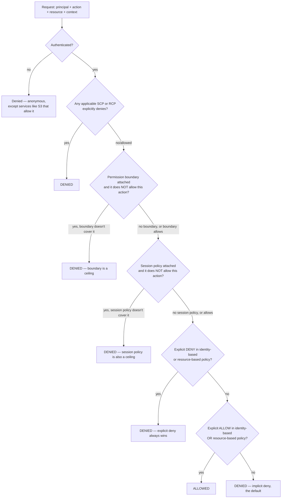

# IAM Policy Evaluation Logic for Developers (Identity vs. Resource Policy Precedence)


*Source: [AWS Documentation — Identity-based policies and resource-based policies](https://docs.aws.amazon.com/IAM/latest/UserGuide/access_policies_identity-vs-resource.html). This is the canonical AWS diagram for the single hardest Task 2.1 reasoning skill: predicting what a *combination* of policies actually allows, not reading one policy in isolation.*

## Definition

This doc is the deep-dive expansion of the README's "IAM policy evaluation, precisely" section —
the exact, mechanical algorithm AWS's enforcement code runs for every single API call, covering
every policy type that can apply (SCPs, RCPs, identity-based policies, resource-based policies,
permission boundaries, session policies) and the precedence rules between them. The README gives
you the three-rule summary; this doc gives you the parts that summary leaves out and that the exam
tests directly: *when* an Allow in a resource-based policy can override an implicit deny from a
missing identity-based policy, and why that behavior depends on *what kind of principal* is making
the call.

## Plain-English Analogy

Think of a corporate building with three independent security systems that all have to agree
before a door opens: a **company-wide badge policy** set by HQ (the SCP/RCP — it can only ever
*restrict* which badges work in which buildings, it can never grant a badge access it wouldn't
otherwise have), a **badge's own permission list** (the identity-based policy — "this badge opens
doors 1, 2, 3"), and a **sign on each specific door** saying who's allowed through regardless of
their badge ("anyone from Finance may enter, even without checking their badge list" — the
resource-based policy). If a door has no sign, only the badge's own permission list matters. If a
door *does* have a sign that explicitly names you, you can sometimes walk through even if your
badge wasn't programmed for that door — but not always: it depends on whether you're a *person*
with a badge (an IAM user) or someone *badged in for just today* by someone else (an assumed-role
session) — and the exam tests exactly this distinction.

## Purpose

Nearly every Domain 2 "will this call succeed" scenario question is unanswerable by reading a
single policy document in isolation — it requires correctly layering multiple policy types in the
right order. Getting the order wrong (e.g. assuming a resource-based policy's Allow always wins,
or assuming an SCP Allow actually grants something) is the single most common root cause of both
real-world "why can't my Lambda access this bucket" incidents and missed exam questions.

## When to Use This Reasoning

- Any time a scenario gives you **more than one policy** (an IAM policy *and* an S3 bucket policy,
  an IAM policy *and* an SCP, a KMS key policy *and* an IAM policy) and asks whether a call
  succeeds.
- Debugging real `AccessDenied` errors where the IAM policy "looks right" — the actual blocker is
  almost always a second policy layer (SCP, permission boundary, or an explicit deny somewhere)
  that a single-policy read misses.
- Designing a cross-account access pattern, where you must reason about identity policy (Account
  A) and resource/trust policy (Account B) together.

## When NOT to Use It

- A single-account, single-policy scenario where only one IAM policy applies and no resource
  policy exists — the exam simplifies this to "does the policy's Action/Resource/Condition match
  the request," no multi-policy layering needed.
- Don't reach for SCP/RCP reasoning on an exam question that's purely about *application-level*
  authorization (e.g. "should this user see this UI button") — that's a business-logic decision in
  your code, not an IAM evaluation question.

## The Full Evaluation Algorithm



Walking it top to bottom, because order matters and each layer is a different *kind* of check:

1. **Authentication** happens first — almost always a non-issue for the exam, but S3's support for
   anonymous requests (when a bucket policy explicitly allows `Principal: "*"`) is the one place
   it's worth remembering this step exists at all.
2. **SCPs and RCPs are evaluated as an outer boundary, not a permission grant.** An SCP can say
   "deny everything except these three services in this account," but it can never say "allow"
   anything that a lower-level policy doesn't also allow — it only *removes* possibilities. The
   same logic applies to the newer **Resource Control Policies (RCPs)**, which do the mirror job at
   the resource side (e.g. "no principal outside this org can ever access this resource, no matter
   what a bucket policy says"). Both SCPs and RCPs can only narrow, never widen.
3. **Permission boundaries** are the account-admin-set ceiling on a *specific* IAM user or role —
   "this role's effective permissions can never exceed what the boundary lists, no matter what its
   own identity-based policy grants." Commonly used so a team lead can create roles for their team
   without being able to accidentally (or deliberately) create a role more powerful than the
   boundary allows.
4. **Session policies** are the same ceiling concept applied at `AssumeRole`/`GetFederationToken`
   call time — `aws sts assume-role --policy '{...}'` passes an *additional* restricting policy
   that narrows what the resulting temporary credentials can do, below whatever the role's own
   permissions policy already allows. This is how a CI/CD pipeline can assume one broad
   "DeployerRole" but further restrict a specific pipeline run to only touch one stack's resources.
5. **Explicit deny, anywhere, wins.** This is true across identity-based policies, resource-based
   policies, SCPs, RCPs, permission boundaries, and session policies alike — the enforcement code
   looks for *any* applicable `Deny` first, across every policy type, before it even starts
   counting Allows.
6. **If nothing denied it, look for an explicit Allow.** This is the step with the subtle
   principal-type behavior covered in detail below.
7. **If nothing explicitly allowed it either, the default is implicit deny.** IAM has no
   "permissive by default" mode anywhere.

## Identity-Based vs. Resource-Based Policy Precedence — the Part Everyone Gets Wrong

The README's summary ("the resulting permissions are the union of identity and resource policy
permissions") is correct for the common case, but the exam's harder questions hinge on **who the
principal is**:

| Principal making the request | Resource-based policy grants it directly | Result if identity-based policy has NO matching Allow (implicit deny) |
|---|---|---|
| IAM user (same account, long-term credentials) | Yes | **Still ALLOWED** — the resource-based policy's Allow is sufficient on its own for an IAM user principal |
| IAM role session / STS federated session | Yes | **Still ALLOWED** — same logic, as long as the resource policy names the *session principal* (not just the role) correctly |
| Any principal | No (resource policy doesn't mention them at all) | **DENIED** — falls through to the identity-based policy alone, which has no matching Allow |
| Any principal | Resource policy has an explicit Deny | **DENIED** — explicit deny overrides everything regardless of what the identity-based policy says |

The one documented exception: **IAM role *trust* policies and KMS key policies must always
explicitly allow access** — for these two specific resource types, an identity-based policy's
Allow alone is never sufficient; the trust/key policy has to independently grant it too. This is
why "my Lambda's execution role has `kms:Decrypt` in its IAM policy but calls still fail" is almost
always a **KMS key policy** that never granted that role anything — IAM policy alone doesn't
reach into KMS's key policy requirement.

```json
// Example: an S3 bucket policy (resource-based) granting access that NO identity-based
// policy on the calling role mentions at all — this alone is enough to allow the call,
// because the principal is an IAM role session and the bucket policy names it directly.
{
  "Version": "2012-10-17",
  "Statement": [{
    "Sid": "AllowPartnerRoleReadOnly",
    "Effect": "Allow",
    "Principal": { "AWS": "arn:aws:iam::222233334444:role/PartnerIntegrationRole" },
    "Action": ["s3:GetObject", "s3:ListBucket"],
    "Resource": [
      "arn:aws:s3:::shared-reports-bucket",
      "arn:aws:s3:::shared-reports-bucket/*"
    ]
  }]
}
```
Exam angle: a question describing `PartnerIntegrationRole` with **no S3 permissions in its own IAM
policy at all**, but the bucket policy above attached to the target bucket, is testing whether you
know the call still succeeds — the resource-based policy alone is sufficient for a role-session
principal, no identity-based Allow required.

## Worked Example 1: the "looks permissive, actually fully blocked" trap

```json
{
  "Version": "2012-10-17",
  "Statement": [
    { "Effect": "Allow", "Action": "dynamodb:*", "Resource": "*" },
    { "Effect": "Deny",  "Action": "dynamodb:DeleteTable",
      "Resource": "arn:aws:dynamodb:us-east-1:111122223333:table/prod-orders",
      "Condition": { "StringNotEquals": { "aws:PrincipalTag/break-glass": "true" } } }
  ]
}
```
Reading just the first statement, this principal can do *anything* to DynamoDB. The second
statement denies `DeleteTable` on exactly one production table — **unless** the caller's session
carries a `break-glass` principal tag set to `"true"`. This is a real pattern: a conditional deny
that's normally in force but can be deliberately bypassed by a tightly controlled emergency-access
mechanism (a short-lived role assumption that attaches the tag). Exam angle: a question that adds
a `Condition` block to a Deny statement is testing whether you evaluate the condition *as part of*
determining whether the deny applies at all — an unmet condition means that specific Deny
statement simply doesn't apply to this request, and evaluation falls through to the next check
(here, the broad Allow), not that the Deny "partially" blocks the action.

## Worked Example 2: cross-account where the identity policy is silent

**Scenario:** Account A's `ReportingRole` has an IAM policy granting only `s3:GetObject` on its
own account's buckets — nothing about Account B at all. Account B's bucket has a bucket policy
granting `ReportingRole` (by full ARN) both `s3:GetObject` and `s3:ListBucket` on the bucket.
**Question:** can `ReportingRole` list the bucket's contents?

**Answer:** Yes. This is cross-account, so the "union" shortcut from the single-account table above
doesn't directly apply (cross-account is where SCP/RCP of the *resource's* account plus the
resource-based policy of Account B is what's actually evaluated for incoming cross-account
requests — Account A's own policies only ever control what `ReportingRole` is allowed to *attempt*
in the first place, not what Account B's resources must accept). Since the bucket policy
explicitly grants `s3:ListBucket` to `ReportingRole`'s exact ARN, and nothing in Account A's own
SCP denies this principal from making cross-account S3 calls, the resource-based policy's grant is
what actually authorizes this specific action — Account A's identity-based policy being silent
about `s3:ListBucket` doesn't block it, because the *resource owner's* Allow is what Account B's
side of the evaluation checks.

## Worked Example 3: SCP as an unbreakable ceiling, even for a full admin

**Scenario:** An Organizations SCP attached to an OU says:
```json
{
  "Version": "2012-10-17",
  "Statement": [{
    "Effect": "Deny",
    "Action": ["cloudtrail:StopLogging", "cloudtrail:DeleteTrail"],
    "Resource": "*"
  }]
}
```
A developer in that OU has an IAM policy granting `AdministratorAccess` (`"Action": "*",
"Resource": "*"`). **Question:** can they disable CloudTrail logging? **Answer:** No — the SCP's
explicit deny applies at the Organizations layer, which is evaluated *before* the identity-based
policy even gets considered, and no identity-based policy (not even a full admin policy) can
override an SCP. This is the single most common way the exam phrases "even an administrator
cannot do X" — it's always pointing at an SCP (or, for resource-level guardrails, an RCP), never at
an IAM policy, because IAM policies by definition cannot restrict what a *more broadly granted*
identity-based policy on the same principal would otherwise allow.

## Permission Boundaries vs. SCPs vs. RCPs vs. Session Policies — four ceilings, four different scopes

It's easy to conflate these because they all share the "ceiling, never a grant" behavior. The
difference is *scope*:

| Mechanism | Applies to | Set by | Typical use |
|---|---|---|---|
| SCP | Every principal in an account/OU, account-wide | Org management account | "No account in this OU may ever disable CloudTrail or leave the Organization" |
| RCP | Every request *to* a specific resource type, regardless of which account the caller is in | Org management account | "No S3 bucket in this org may ever be made public, even via a bucket policy that tries to" |
| Permission boundary | One specific IAM user or role | Account admin, at creation/attachment time | "This developer-created role can never exceed read-only + its own team's prefix, even if the developer who created it tries to attach a broader policy later" |
| Session policy | One specific temporary-credentials session | Whoever calls `AssumeRole`/`GetFederationToken`, at call time | "This specific CI/CD run gets credentials scoped to only the one stack it's deploying, even though the underlying DeployerRole is broader" |

Exam angle: a question that says "an IAM role's own policy grants broad access, but in practice the
role can only ever touch resources tagged `team=payments`" and asks what's doing the restricting
is almost always describing either a **permission boundary** (if it's a standing, always-on limit
on the role itself) or a **session policy** (if it's scoped to one particular assumption of the
role, varying call to call) — knowing which one requires noticing whether the limit is baked into
the role itself or passed fresh at `AssumeRole` time.

## Common Exam Scenarios

- *"A role has `AdministratorAccess` but still can't perform an action — what's blocking it, given
  no other IAM policy is attached?"* → an SCP or RCP explicit deny; identity-based policy breadth
  is irrelevant once an org-level deny applies.
- *"A bucket policy grants an external account's role read access, and that role's own IAM policy
  says nothing about this bucket at all — does the call succeed?"* → yes, for role-session
  principals a resource-based policy's explicit Allow is sufficient on its own.
- *"A KMS key's key policy doesn't mention a role, but the role's IAM policy grants `kms:Decrypt`
  on that key's ARN — does Decrypt succeed?"* → no; KMS key policies are one of the two exceptions
  where the resource (here, the key) must *independently* grant access — an IAM policy alone is
  never sufficient for a KMS key.
- *"A developer-created role should never be able to exceed read-only access, no matter what
  policy a well-meaning teammate attaches to it later"* → a permission boundary, attached once at
  creation, enforced on every subsequent policy change to that role.
- *"A single CI/CD pipeline run should get credentials scoped to only today's deployment target,
  even though the underlying role it assumes is much broader"* → a session policy passed on the
  specific `AssumeRole` call, not a change to the role's own permissions policy.
- *"A Deny statement has a `Condition` block that isn't met by this particular request — does the
  Deny still block it?"* → no; an unmet condition means that specific statement doesn't apply at
  all, and evaluation continues to the next applicable statement.

## Common Pitfalls (the exam's favorite wrong answers)

1. Assuming an SCP's `Allow` statement *grants* something — it never does; SCPs only narrow.
2. Assuming a resource-based policy's Allow always overrides an identity-based policy's implicit
   deny, for *every* resource type — it's true for most resources and role/user principals, but
   **not** for IAM role trust policies or KMS key policies, which require independent Allow.
3. Treating a permission boundary as if it *grants* the permissions it lists — it doesn't; a role
   with a generous boundary but a near-empty identity-based policy still can't do much, because the
   boundary is a ceiling on the *intersection*, not a floor.
4. Forgetting that an unmet `Condition` on a Deny statement means the statement simply doesn't
   apply — some test-takers read any Deny statement as an automatic block regardless of its
   condition.
5. Confusing "the call to `AssumeRole` succeeded" with "the resulting credentials can do
   everything the target role's policy says" — a session policy or permission boundary can still
   narrow what those temporary credentials are allowed to do afterward.

## Why This Is Important

Real-world: the majority of "why doesn't my application have the AWS access it should" incidents
that reach a senior engineer (rather than being solved by "just attach AdministratorAccess," the
wrong instinct) are multi-policy-layer problems exactly like the ones above — an SCP nobody
remembered, a KMS key policy that was never updated, a permission boundary set during onboarding
that nobody revisited. Exam weight: Task 2.1 explicitly tests the ability to reason about
*combinations* of IAM users, roles, and policies, not just read one policy document, and this
evaluation order is the mechanism every one of those scenario questions is built on.

## Exam Tips

- When a question gives you two or more policies, write out (mentally or on scratch paper) which
  evaluation step each one participates in — SCP/RCP ceiling, permission boundary ceiling, session
  policy ceiling, then explicit deny, then explicit allow — rather than trying to eyeball the
  combined effect.
- "Even an administrator can't do X" always points to an SCP or RCP, never an IAM policy — IAM
  policies by definition can't restrict a broader grant on the *same* principal.
- "The resource's policy grants it but the identity's policy doesn't mention it at all — does it
  still work?" depends on the resource type: yes for most resources and role/user principals;
  **no** for IAM role trust policies and KMS key policies, which always need independent explicit
  Allow from the resource side.
- A `Condition` block on a Deny statement is not decorative — if it isn't met, that Deny simply
  doesn't apply, and you fall through to the next check in the algorithm.

## Related Terms

- [`services/security-identity-compliance/iam.md`](../../../services/security-identity-compliance/iam.md)
- [`services/security-identity-compliance/organizations-and-scps.md`](../../../services/security-identity-compliance/organizations-and-scps.md)
- [`services/security-identity-compliance/sts-and-role-switching.md`](../../../services/security-identity-compliance/sts-and-role-switching.md)
- [`services/security-identity-compliance/kms.md`](../../../services/security-identity-compliance/kms.md)
- [`README.md`](README.md#iam-policy-evaluation-precisely) — the condensed version this doc expands on.
