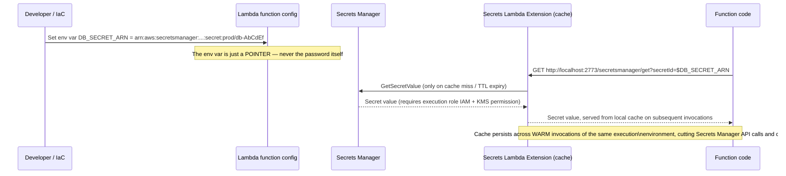

# Securing Lambda Environment Variables and Secrets End to End


*Source: [AWS Documentation — Working with Lambda environment variables](https://docs.aws.amazon.com/lambda/latest/dg/configuration-envvars.html). This console view is the first place developers reach for config/secrets in a Lambda function — and the first place Task 2.2's "manage sensitive data" guidance gets ignored if you stop here.*

## Definition

A deep, end-to-end walkthrough of exactly what protection Lambda environment variables get for
free, where that protection stops, and the full chain of decisions (KMS key choice, Secrets
Manager vs. Parameter Store, caching strategy, IAM scoping) a developer actually has to make to
get a secret from "stored somewhere" to "used safely inside a running function." The README and
`secrets-manager-vs-parameter-store.md` cover the service-choice decision; this doc covers the
mechanics of actually wiring secrets into Lambda correctly, which is where Task 2.2 scenario
questions get specific.

## Plain-English Analogy

A Lambda environment variable is like a sticky note on the inside of a locked filing cabinet
drawer — the drawer itself (Lambda's storage) is locked by default (encrypted at rest with an
AWS-managed key), but anyone who can open the drawer (anyone with `lambda:GetFunctionConfiguration`
on your function) can read the sticky note in plain text once it's open, and the note never
changes itself (no rotation). Routing the secret through Secrets Manager instead is like replacing
the sticky note with a phone number to a vault teller who checks your ID (IAM policy) before
reading the combination aloud, and who also happens to hand out a *new* combination every 30 days
automatically (rotation) — strictly more secure, at the cost of one extra phone call (API call)
per secret per cold start, which is the entire "why not just use env vars for everything" tradeoff
this doc walks through.

## Purpose

Developers reach for environment variables first because they're the path of least resistance —
set in the console or IaC template, read with `os.environ` / `process.env`, done. The exam (and
real production incidents) test whether you know the three specific gaps that path leaves open:
no rotation, visibility to anyone who can read the function's configuration (not just invoke it),
and plaintext exposure in deployment artifacts (CloudFormation templates, CI/CD logs, Lambda
console screenshots shared in a support ticket) if you're not deliberate about it.

## When to Use Plain Environment Variables

- Non-secret configuration: log level, feature flags, a region name, a timeout value, a
  non-sensitive endpoint URL.
- A secret's **reference** (e.g. a Secrets Manager secret ARN or a Parameter Store parameter name)
  — the env var holds *where to look*, not the secret value itself. This is the recommended
  pattern and is covered in detail below.
- Values that change per-deployment-stage (dev/staging/prod) but aren't sensitive, set via your
  IaC tool's per-stage parameters.

## When NOT to Use Plain Environment Variables for the Value Itself

- Database passwords, API keys, OAuth client secrets, or any credential that should rotate —
  these belong in Secrets Manager (or Parameter Store SecureString at minimum), referenced by ARN
  from an env var, never stored as the env var's literal value.
- Anything that must not appear in a CloudFormation/Terraform plan output, a CI/CD build log, or a
  `lambda get-function-configuration` CLI response visible to a broader audience than "people who
  are allowed to invoke this function."
- Anything with a compliance requirement for audited, scheduled rotation — Lambda environment
  variables have no native rotation mechanism at all.

## How Lambda Actually Encrypts Environment Variables — the Two Layers

```mermaid
flowchart TD
    DEV[Developer sets env var value] --> ATREST{Encryption at rest}
    ATREST -->|always on, no opt-out| DEFAULTKEY[AWS managed key aws/lambda\nor a customer-specified CMK]
    DEFAULTKEY --> STORED[Stored encrypted in Lambda's\nconfiguration backend]
    DEV -.optional.-> TRANSIT{Encryption helpers\nfor encryption in transit}
    TRANSIT -->|enabled| CMK[Customer managed KMS key, chosen explicitly]
    CMK --> CLIENTSIDE[Console/SDK encrypts the VALUE\nclient-side before it's even sent to Lambda]
    CLIENTSIDE --> STORED
    STORED -->|at invoke time| RUNTIME[Lambda decrypts at rest automatically,\nhands plaintext to your function via os.environ]
    CLIENTSIDE -.if transit encryption was used,\nvalue is STILL ciphertext in os.environ.-> CODE[Your code must call\nKMS Decrypt itself]
```

Two genuinely different protections, easy to conflate:

1. **Encryption at rest is always on and automatic** — Lambda encrypts every environment variable
   using either the AWS-owned `aws/lambda` service key (default, free, you don't manage it) or a
   customer-managed KMS key you specify via `KMSKeyArn` on the function configuration. Either way,
   by the time your function code runs, Lambda has already decrypted the stored value and handed
   you plaintext through `os.environ` / `process.env` — you never call KMS yourself for this layer.
2. **Encryption in transit ("encryption helpers") is opt-in and client-side** — when enabled in
   the console, specific environment variable *values* are encrypted with a customer-managed KMS
   key **before** they're ever sent to the Lambda API, and they stay ciphertext in
   `GetFunctionConfiguration` responses and in `os.environ` at runtime — your function code has to
   explicitly call `kms:Decrypt` on that ciphertext to get the plaintext value back. This is the
   layer that actually protects a secret's value from anyone who can read the function's
   configuration (e.g. via the console or `lambda:GetFunctionConfiguration`) but shouldn't be able
   to see its contents.


*Source: [AWS Documentation — Working with Lambda environment variables](https://docs.aws.amazon.com/lambda/latest/dg/configuration-envvars.html). This is the same console surface where the "Encryption configuration" section (encryption-in-transit helpers) lives — easy to skip past if you're only focused on getting the function working.*

The exam-relevant distinction: **at-rest encryption protects the stored data from someone without
AWS API access at all; encryption-in-transit helpers protect the value from someone who legitimately
has `lambda:GetFunctionConfiguration` but shouldn't be able to read secret contents.** A question
describing "a teammate with read-only console access to Lambda functions can see a database
password in plain text under Environment Variables" is pointing directly at the missing
encryption-in-transit-helpers step, not at at-rest encryption (which was already protecting the
value just fine against a completely unauthorized party).

## Why Environment Variables Alone Still Aren't Enough for Real Secrets

Even with encryption-in-transit helpers correctly configured, three gaps remain that push a real
secret toward Secrets Manager instead:

1. **No rotation.** Changing an env var's value means a new deployment (or at minimum a
   `UpdateFunctionConfiguration` call) — there's no scheduled, automatic rotation mechanism built
   into Lambda environment variables the way Secrets Manager has for RDS/Aurora/Redshift/DocumentDB.
2. **Deployment-artifact exposure.** A CloudFormation template, Terraform plan, SAM template, or
   CI/CD pipeline log can end up containing the plaintext value (even if Lambda itself encrypts it
   at rest) if the IaC source or build log isn't itself handled carefully — a secret hardcoded into
   a template is one `git log` away from exposure, independent of what Lambda does with it.
3. **No fine-grained access auditing of secret *reads*, specifically.** CloudTrail logs
   `UpdateFunctionConfiguration` calls (who changed the env var), but there's no equivalent to
   Secrets Manager's `GetSecretValue` audit trail that tells you specifically *when the secret
   value itself was retrieved for use*, as opposed to when the function's configuration changed.

## The Recommended Pattern: Env Var Holds a Reference, Not the Secret



Step by step:
1. The environment variable holds the secret's **ARN or name**, which is not itself sensitive — it
   tells the function *where* to look, the same way a URL isn't a password even though it points
   at one.
2. At runtime, the function (or, better, the **AWS Parameters and Secrets Lambda Extension**, a
   managed layer AWS publishes) calls `secretsmanager:GetSecretValue` to fetch the actual value.
3. The extension **caches the secret in memory for the lifetime of the execution environment**
   (i.e. across warm invocations of the same container, not just within one invocation),
   respecting a configurable TTL — this is what keeps per-invocation Secrets Manager API costs low
   despite not using a plain env var; without caching, high-traffic functions calling
   `GetSecretValue` on every single invocation would both be slow (extra network round trip) and
   expensive (per-API-call Secrets Manager pricing).
4. On a cold start, the cache is empty and the first invocation pays the latency cost of the real
   `GetSecretValue` call — this is the one tradeoff worth knowing by name for performance-sensitive
   scenario questions: **env vars have zero extra cold-start latency; Secrets Manager/Parameter
   Store lookups add one on the first invocation of a fresh execution environment, amortized to
   near-zero afterward.**

```python
# Function code using the AWS Parameters and Secrets Lambda Extension's local HTTP cache,
# rather than calling Secrets Manager directly on every invocation
import os, json, urllib.request

SECRET_ARN = os.environ["DB_SECRET_ARN"]  # the env var holds only the ARN, not the password

def get_db_password():
    req = urllib.request.Request(
        f"http://localhost:2773/secretsmanager/get?secretId={SECRET_ARN}",
        headers={"X-Aws-Parameters-Secrets-Token": os.environ["AWS_SESSION_TOKEN"]},
    )
    with urllib.request.urlopen(req) as resp:
        secret = json.loads(resp.read())
    return json.loads(secret["SecretString"])["password"]
```

## IAM Scoping — the Execution Role Needs Two Separate Grants

A function reading a KMS-encrypted secret from Secrets Manager needs **both** of the following —
missing either one produces an `AccessDenied`, and the exam likes to test whether you know it's
two separate checks:

```json
{
  "Version": "2012-10-17",
  "Statement": [
    {
      "Sid": "ReadOnlyThisSecretOnly",
      "Effect": "Allow",
      "Action": "secretsmanager:GetSecretValue",
      "Resource": "arn:aws:secretsmanager:us-east-1:111122223333:secret:prod/db-AbCdEf"
    },
    {
      "Sid": "DecryptWithTheSpecificCMKThatEncryptsThisSecret",
      "Effect": "Allow",
      "Action": "kms:Decrypt",
      "Resource": "arn:aws:kms:us-east-1:111122223333:key/abcd1234-ef56-7890-ab12-cd34ef567890",
      "Condition": {
        "StringEquals": { "kms:ViaService": "secretsmanager.us-east-1.amazonaws.com" }
      }
    }
  ]
}
```
1. **`secretsmanager:GetSecretValue`** scoped to the exact secret ARN — never `Resource: "*"` for
   a runtime application role, the same least-privilege principle as every other Domain 2 service.
2. **`kms:Decrypt`** on the *specific* KMS key that encrypts that secret — if the secret uses the
   default `aws/secretsmanager` AWS-managed key, this permission is implicitly covered and you
   don't need a separate statement; if it uses a customer-managed key (the common choice when a
   security team wants audit control over who can decrypt), the execution role needs this
   explicit grant, and **the key's own key policy** also has to allow it (remember from
   [`iam-policy-evaluation-logic.md`](iam-policy-evaluation-logic.md): KMS key policies are one of
   the two resource types where an IAM policy alone is never sufficient).
3. The `kms:ViaService` condition is a defense-in-depth best practice — it scopes the Decrypt grant
   to only apply when the call is routed through Secrets Manager specifically, not a direct
   `kms:Decrypt` call against the key from anywhere else.

## Worked Exam Scenario 1: "the password works in dev but not in prod"

**Setup:** A function's env var `DB_SECRET_ARN` is identical between dev and prod stacks except
for the account ID. In dev it works; in prod, `GetSecretValue` throws `AccessDeniedException`.
**Diagnostic order:**
1. Confirm the secret actually exists at that ARN in the prod account (a surprisingly common typo
   source when ARNs are templated across accounts).
2. Confirm the prod execution role has `secretsmanager:GetSecretValue` on that exact ARN — a
   common miss is a role created from a slightly different IAM policy template in prod that never
   got the statement added.
3. **Check the KMS key policy**, not just the IAM policy — if prod's secret uses a customer-managed
   key (common for prod, often skipped in dev for simplicity) and the key policy never granted the
   prod execution role `kms:Decrypt`, the IAM policy being perfectly correct won't matter at all.

## Worked Exam Scenario 2: "cold starts got slower after moving secrets out of env vars"

**Setup:** A team moves a database password from a plain environment variable to Secrets Manager
via the Lambda Extension, and notices p99 latency increased specifically on cold starts.
**Explanation (not a bug — expected):** a plain env var has zero extra latency because Lambda
already decrypted it before your code even starts; a Secrets Manager lookup via the extension adds
one real network call to Secrets Manager **on the first invocation of each fresh execution
environment**, which is exactly the cold-start path. **Mitigation options a developer actually
has:** provisioned concurrency (keeps warm execution environments ready, so the extension's cache
is already populated more often), or accepting the tradeoff as the cost of rotation support and
not storing the password in the exposed env var layer at all — this is the concrete, numeric
version of the "Secrets Manager costs more but you get rotation" tradeoff from
[`secrets-manager-vs-parameter-store.md`](../../../services/security-identity-compliance/secrets-manager-vs-parameter-store.md).

## Worked Exam Scenario 3: "the secret showed up in a CI/CD log"

**Setup:** A CloudFormation deploy pipeline's build log contains a database password in plain
text, even though the Lambda function's environment variable is correctly configured with
encryption-in-transit helpers. **Root cause (the pattern this exam loves):** the password was
hardcoded as a literal value **in the CloudFormation template parameter passed to the deploy
command**, which the CI/CD tool logged as part of its "here's what I'm deploying" output — the
leak happened *before* the value ever reached Lambda's encryption layers at all. **Fix:** never
pass a secret value as a literal template parameter; instead, template the Secrets Manager ARN
(not sensitive) as the parameter, and have the function fetch the real value at runtime as shown
above — the fix is architectural (don't let the secret exist in plaintext in the deploy pipeline at
all), not a Lambda configuration setting.

## Common Mistakes

- Storing the actual secret value as a plain environment variable "because it's already encrypted
  at rest" — true, but it ignores the rotation gap and the console/API visibility gap.
- Enabling encryption-in-transit helpers but never actually calling `kms:Decrypt` in the function
  code — the value just sits as unusable ciphertext in `os.environ`, which usually surfaces as a
  confusing runtime error rather than a security gap, but wastes the entire point of enabling it.
- Granting `kms:Decrypt` on `Resource: "*"` to make an `AccessDenied` go away quickly — scope it to
  the specific key ARN, the same least-privilege principle tested throughout Domain 2.
- Calling `GetSecretValue` directly on every single invocation without any caching layer — works,
  but adds unnecessary latency and Secrets Manager API cost on every warm invocation, not just cold
  starts; use the Lambda Extension's cache or implement your own TTL-based cache in global scope.
- Logging the full event payload or environment for debugging and forgetting it includes decrypted
  secret values once your code has fetched them into memory — treat any variable holding a secret
  value the same way you'd treat it in application logs generally (see
  [`ai-service-security-risks.md`](ai-service-security-risks.md#sensitive-data-in-logs) for the
  AI-specific version of this exact mistake).

## Why This Is Important

Real-world: "a secret leaked because it sat as a plain environment variable, visible to more
people/systems than intended, with no rotation" is one of the most common real security
postmortems for serverless applications — not because env vars are inherently broken, but because
the path of least resistance (just type it into the console) skips every protection layer covered
here. Exam weight: Task 2.2's "manage sensitive data" bullet is tested heavily, and Lambda is the
compute service Domain 2 assumes throughout — expect secrets-in-Lambda specifics, not just the
abstract Secrets-Manager-vs-Parameter-Store table.

## Exam Tips

- At-rest encryption of Lambda env vars is automatic and free; encryption-in-transit helpers are
  opt-in, client-side, and require your code to call `kms:Decrypt` explicitly — know which layer a
  described symptom is missing.
- "A secret needs scheduled rotation" always points to Secrets Manager, never a Lambda environment
  variable, regardless of how that variable is encrypted.
- A function's execution role needs **two separate grants** to decrypt a Secrets-Manager-stored,
  CMK-encrypted secret: `secretsmanager:GetSecretValue` on the secret, and `kms:Decrypt` on the
  specific key — missing either produces `AccessDenied`, and the KMS key policy must independently
  allow it too.
- A latency increase isolated to cold starts, right after moving a value out of a plain env var and
  into Secrets Manager/Parameter Store, is the expected cost of that tradeoff, not a misconfiguration
  — provisioned concurrency or the Lambda Extension's caching are the standard mitigations.

## Related Terms

- [`services/security-identity-compliance/secrets-manager-vs-parameter-store.md`](../../../services/security-identity-compliance/secrets-manager-vs-parameter-store.md)
- [`services/security-identity-compliance/kms.md`](../../../services/security-identity-compliance/kms.md)
- [`services/compute/lambda.md`](../../../services/compute/lambda.md)
- [`iam-policy-evaluation-logic.md`](iam-policy-evaluation-logic.md)
- [`README.md`](README.md#encryption-at-rest-envelope-encryption-in-one-picture)
