# MASTER CHUNK — DVA-C03 Domain 3: Testing and Deployment (22%)

> **Standalone reference.** This single file covers every service/topic in Domain 3 in full depth —
> Definition, plain-English analogy, Purpose, When to Use, When NOT to Use, Use Cases, Why
> Important, a Mermaid diagram, a real curl-verified AWS image, a code/config snippet, and Exam
> Tips for each. Read it top to bottom as one continuous study document, or jump to any section —
> each is self-contained and doesn't assume you've read the others first. For the domain-level
> narrative (how these services fit together into one pipeline), see [`README.md`](README.md); for
> individual deeper-dive docs, see the full `services/` tree linked throughout.

## Table of Contents

1. [AWS AppConfig](#1-aws-appconfig)
2. [AWS CDK (Cloud Development Kit)](#2-aws-cdk-cloud-development-kit)
3. [AWS Cloud9 & AWS CloudShell](#3-aws-cloud9--aws-cloudshell)
4. [AWS CloudFormation](#4-aws-cloudformation)
5. [AWS CodeArtifact](#5-aws-codeartifact)
6. [AWS CodeBuild](#6-aws-codebuild)
7. [AWS CodeCommit](#7-aws-codecommit)
8. [AWS CodeDeploy](#8-aws-codedeploy)
9. [AWS CodePipeline](#9-aws-codepipeline)
10. [AWS Fargate](#10-aws-fargate)
11. [AWS IAM](#11-aws-identity-and-access-management-iam)
12. [AWS Lambda](#12-aws-lambda)
13. [AWS STS & Role Switching](#13-aws-sts--role-switching)
14. [Secrets Manager vs. Parameter Store](#14-secrets-manager-vs-systems-manager-parameter-store)
15. [AWS SAM](#15-aws-serverless-application-model-sam)
16. [Amazon API Gateway](#16-amazon-api-gateway)
17. [Amazon CloudWatch](#17-amazon-cloudwatch)
18. [Amazon ECR](#18-amazon-elastic-container-registry-ecr)
19. [Amazon ECS](#19-amazon-elastic-container-service-ecs)
20. [Amazon EKS](#20-amazon-elastic-kubernetes-service-eks)
21. [Containers vs. VMs vs. Serverless](#21-containers-vs-vms-vs-serverless)

---

## 1. AWS AppConfig

**Definition.** AWS AppConfig lets you change how a running application behaves — turn on a
feature for 10% of users, flip an operational setting, change a tuning parameter — **without
redeploying code**, and without flipping the switch for 100% of production traffic all at once.
It's a deployment system for *configuration*, not application code.

**Plain-English analogy.** A plain config value (Parameter Store) is a light switch — flip it and
every bulb in the house changes instantly, all at once, with no way to test on just one room
first. AppConfig is a smart dimmer system with a scheduled ramp: it brings up 10% of the lights
first, watches whether the house's smoke detector (a CloudWatch alarm) stays quiet, and only then
continues ramping to 100% — automatically dimming back down to zero if the detector ever trips.

**Purpose.** Config changes feel lower-risk than code deploys, so teams often skip the safety
rails they'd insist on for code — and a bad feature flag or a wrong tuning parameter can take down
production exactly like bad code can. AppConfig exists to give configuration changes the *same*
safe-deployment discipline (gradual rollout, validation, automatic rollback) that CodeDeploy gives
application deployments.

**When to Use.** A feature flag or operational setting needs a gradual, observable rollout with
automatic rollback if a CloudWatch alarm trips; multiple applications need a consistent way to
read config/flags without each reinventing a polling mechanism; configuration changes need
pre-deployment validation (schema checks, or a custom Lambda validator) before they ever reach a
single host.

**When NOT to Use.** A single static secret or config value with no rollout concept (use Secrets
Manager/Parameter Store instead — AppConfig adds deployment-strategy overhead that's pure
unnecessary complexity for a value that's always either 100% on or 100% off with no gradual
concern). A value that changes on every request (AppConfig is for configuration, refreshed
periodically via caching, not a live, per-request data store).

**Use Cases.**
1. Gradual feature-flag rollout with automatic rollback tied to an error-rate alarm.
2. Operational "kill switch" to instantly disable a problematic feature without a code deploy.
3. Centralizing tuning parameters (cache TTLs, retry counts) read consistently across many Lambda
   functions via the AppConfig Lambda extension's local HTTP cache.
4. Validating a configuration change's schema/business-rules via a Lambda validator before any
   host ever receives it.
5. A/B testing a new algorithm's parameters against a percentage of production traffic.
6. Coordinating a config change across a fleet of EC2/ECS instances using the AppConfig Agent,
   which polls centrally and serves from a local cache, avoiding a thundering-herd of direct calls.

**Why Important.** Config-change-induced outages are extremely common and often invisible to
"deployment" postmortem processes that only track code releases — AppConfig closes that gap, and
it's a direct, explicitly named DVA-C03 Task 3.1 topic ("manage environment-specific application
configuration").

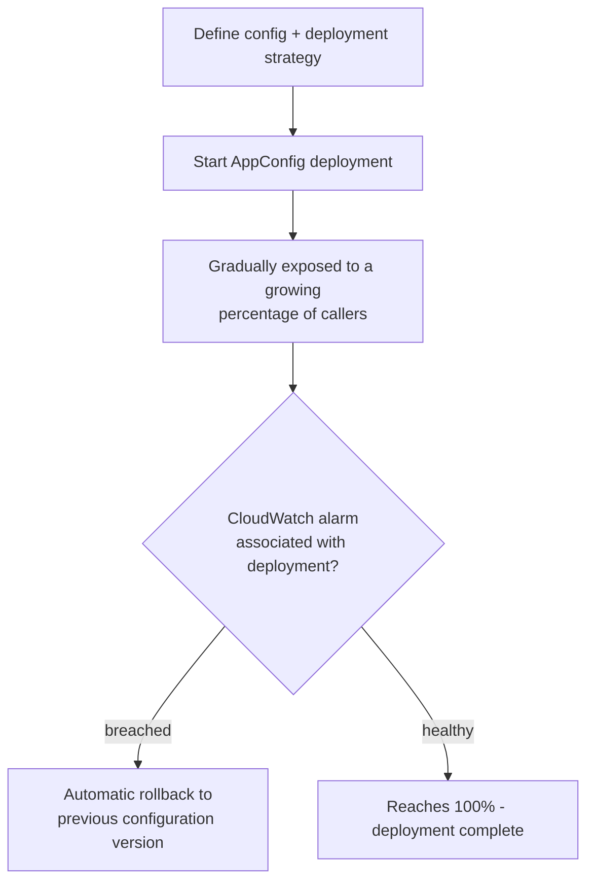

Walkthrough: this is structurally identical to CodeDeploy's deployment model — a deployment
strategy (percentage + interval), a gradual rollout, and an alarm-driven automatic rollback — just
applied to configuration data instead of application code, which is precisely why these two
services are so often confused and so important to distinguish on the exam.


*Source: [AWS AppConfig User Guide](https://docs.aws.amazon.com/appconfig/latest/userguide/appconfig-introduction.html), © Amazon Web Services. This shows the full lifecycle: a configuration profile is created, a deployment strategy (the ramp shape) is chosen, the deployment runs, and applications retrieve the current value — with the AppConfig Agent/extension caching it locally so every host isn't hammering the AppConfig API directly.*

```yaml
# CloudFormation snippet: an AppConfig deployment with a gradual strategy and alarm rollback
Resources:
  FeatureFlagStrategy:
    Type: AWS::AppConfig::DeploymentStrategy
    Properties:
      Name: "Canary10PercentEvery5Minutes"
      DeploymentDurationInMinutes: 25
      GrowthFactor: 10
      GrowthType: LINEAR
      FinalBakeTimeInMinutes: 10
      ReplicateTo: NONE
  FeatureFlagDeployment:
    Type: AWS::AppConfig::Deployment
    Properties:
      ApplicationId: !Ref AppConfigApp
      ConfigurationProfileId: !Ref FeatureFlagProfile
      DeploymentStrategyId: !Ref FeatureFlagStrategy
      EnvironmentId: !Ref ProdEnvironment
      ConfigurationVersion: "3"
```

**Exam Tips.**
- The #1 trap: confusing AppConfig (gradual *deployment* of config, with rollback) with Parameter
  Store/Secrets Manager (instant, all-or-nothing value storage, no rollout concept at all).
- "Gradual rollout" + "automatic rollback on alarm" + *configuration/feature flag* (not application
  code) is the unambiguous AppConfig signal.
- The AppConfig Lambda extension serves from `localhost:2772`, caching locally so a Lambda function
  doesn't call the AppConfig API on every single invocation.

**Common Architectures.**
1. *Feature-flag platform for a multi-team org.* A shared AppConfig application with per-team
   configuration profiles, each with its own deployment strategy and alarm, so one team's risky
   flag rollout can never affect another team's independently-configured flags.
2. *Operational kill switch wired into an incident runbook.* An on-call engineer's documented
   response to a specific failure mode is "deploy the pre-created 'disable feature X' configuration
   version" — a one-command, pre-tested mitigation rather than an improvised emergency code change.

**Troubleshooting.**
- *A deployment seems stuck mid-rollout.* Check the associated CloudWatch alarm's actual state —
  `ALARM` state pauses the rollout by design; this isn't a stuck/broken deployment, it's the safety
  mechanism doing its job.
- *An application reads a stale configuration value after a deployment completed.* Confirm the
  application (or the AppConfig Agent/Lambda extension) is actually polling on an interval shorter
  than the team's expectation — a long poll interval is a common, easy-to-miss cause of perceived
  staleness.
- *A validator rejects every deployment, including obviously-valid ones.* Check the validator
  Lambda's own IAM permissions and its actual validation logic — a validator that errors out (vs.
  explicitly rejecting) is often misread as "every deployment is invalid" when it's actually just
  the validator itself failing to run.

**Additional Exam Scenarios.**
- *"A gradual feature-flag rollout must pause automatically if error rates spike, without a human
  watching a dashboard."* → an AppConfig deployment strategy with an associated CloudWatch alarm —
  the deployment's own ramp halts and reverts on alarm breach, no human intervention required.
- *"A team wants one consistent place to read tuning parameters across 40 Lambda functions, without
  each function independently polling an API on every invocation."* → the AppConfig Lambda
  extension, which caches locally and polls in the background, rather than each function's code
  calling the AppConfig API directly per invocation.

**Pricing Model (summary).** Billed per configuration retrieval beyond a fairly generous free tier;
using the AppConfig Agent/Lambda extension's caching meaningfully reduces billed retrievals versus
having every invocation call the API directly.

**Limits & Quotas.** Configuration data size: 64 KB (Freeform)/8 KB (Feature Flags) per version.
Deployment strategies: up to 1,000 per account. Minimum deployment duration: 0 minutes (instant) up
to 24 hours. Exam-relevant takeaway: a scenario describing a gradual rollout over many hours/days
is still well within AppConfig's supported range — it's not a service limitation forcing a faster
rollout than the business actually wants.

**Related Terms.** [`services/management-governance/appconfig.md`](../../../services/management-governance/appconfig.md) ·
[`services/security-identity-compliance/secrets-manager-vs-parameter-store.md`](../../../services/security-identity-compliance/secrets-manager-vs-parameter-store.md) ·
[`services/developer-tools/codedeploy.md`](../../../services/developer-tools/codedeploy.md) (the
structurally-analogous deployment model).

---

## 2. AWS CDK (Cloud Development Kit)

**Definition.** The AWS CDK lets you define cloud infrastructure using a real programming language
— TypeScript, Python, Java, C#, or Go — instead of writing YAML/JSON by hand. You write code, the
CDK "synthesizes" it into a standard CloudFormation template, and CloudFormation does the actual
deployment.

**Plain-English analogy.** Raw CloudFormation is like assembling furniture from a printed
instruction sheet where every single screw is spelled out by hand, with no way to say "repeat this
20 times with slightly different numbers" — you copy-paste the same block 20 times and hope you
didn't typo one. CDK is the same furniture assembly, but described as a small program: "build 20 of
these, varying only the name" — loops, functions, and conditionals, the same tools you'd use to
avoid repetitive, error-prone work in any other kind of code.

**Purpose.** CloudFormation templates are declarative text with no loops, no functions, and no type
checking. AWS built CDK so infrastructure could be written with the same abstractions as
application code — loops, conditionals, classes, package imports, unit tests, IDE autocomplete —
while still producing a plain CloudFormation template underneath, deploying through the exact same
reliable, audited engine.

**When to Use.** Complex infrastructure needing loops/conditionals/reusable patterns across many
near-identical resources; a team that wants infrastructure code reviewed, tested, and packaged like
application code (because it genuinely is code); building a library of reusable architecture
patterns (constructs) to share across many teams/projects.

**When NOT to Use.** A simple, small, stable stack where raw CloudFormation's directness is
sufficient and an extra toolchain/build step isn't worth the overhead; a team with zero appetite
for learning a general-purpose programming language for infrastructure, who'd rather stick to
YAML/JSON directly; needing a fast, offline, built-in local Lambda testing experience (SAM's `sam
local` has no CDK-native equivalent).

**Use Cases.**
1. Generating N nearly-identical resources (e.g., one S3 bucket + IAM role per tenant) via a loop
   instead of N copy-pasted template blocks.
2. Building a reusable "three-tier web app" construct once, instantiated across dozens of projects
   with different parameters, enforcing consistent best practices automatically.
3. Running `cdk diff` as a hard CI gate, failing the pipeline if an infrastructure change touches a
   security-sensitive resource type without explicit review.
4. Teams already fluent in TypeScript/Python wanting unit-testable infrastructure code with the
   same IDE tooling (autocomplete, refactoring) they use for application code.
5. Composing infrastructure from AWS-provided and community-published construct libraries instead
   of writing every resource property from scratch.
6. Multi-stack applications where stacks need to share values/exports programmatically rather than
   via brittle, hand-wired CloudFormation cross-stack references.

**Why Important.** CDK's `cdk diff` is directly named in DVA-C03 Task 3.2 (validate infrastructure
templates before deploying), and CDK itself is explicitly listed in Task 3.3's IaC deployment
bullet alongside CloudFormation and SAM.

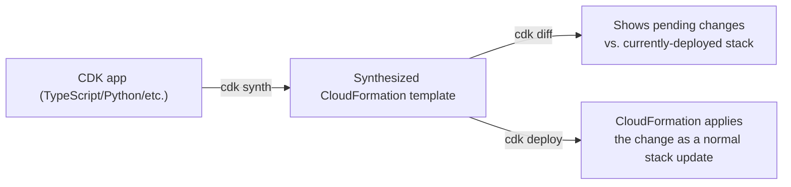

Walkthrough: `cdk synth` and `cdk diff` both happen **before** anything touches a live resource —
`cdk diff` specifically compares the newly-synthesized template against what's currently deployed,
giving the same "review the plan before you apply it" safety CloudFormation change sets provide
natively, just surfaced through CDK's own CLI.


*Source: [AWS blog — reference architecture patterns commonly expressed as CDK constructs](https://aws.amazon.com/blogs/), © Amazon Web Services. This is the canonical serverless construct shape (API Gateway + Lambda + DynamoDB) that a CDK L3 construct can encapsulate once and reuse across many stacks, instead of redefining the same three-resource wiring by hand every time.*

```python
# A CDK construct in Python — loops over regions, something raw CloudFormation
# makes awkward without macros
from aws_cdk import aws_s3 as s3, Stack
from constructs import Construct

class MultiRegionBuckets(Stack):
    def __init__(self, scope: Construct, id: str, regions: list[str], **kwargs):
        super().__init__(scope, id, **kwargs)
        for region in regions:
            s3.Bucket(self, f"Bucket-{region}",
                bucket_name=f"orders-backup-{region}",
                versioned=True)
```

**Exam Tips.**
- "Needs loops/conditionals/reusable patterns across many near-identical resources" → CDK over SAM
  or raw CloudFormation.
- `cdk diff` is CDK's direct answer to Task 3.2's "validate infrastructure templates before
  deploying."
- All CDK apps still deploy as ordinary CloudFormation stacks — drift detection, rollback behavior,
  and stack events all work identically to a hand-written template.

**Common Architectures.**
1. *Shared construct library across an organization.* A platform team publishes an internal CDK
   construct library (npm/PyPI package) encapsulating company-standard patterns (a compliant S3
   bucket, a standard VPC shape); application teams consume it instead of each re-deriving the same
   security/compliance properties independently.
2. *`cdk diff` as a mandatory CI gate.* A CodeBuild phase runs `cdk diff --fail`, failing the
   pipeline if the diff touches IAM or security-group resources without an explicit
   human-reviewed label on the pull request — turning infrastructure review into an enforced gate
   rather than a convention.

**Troubleshooting.**
- *`cdk deploy` fails with a bootstrap-related error.* The target account/Region needs
  `cdk bootstrap` run once before any CDK deployment — a common first-time setup gap, not a bug in
  the app's own code.
- *`cdk diff` shows unexpected changes to resources you didn't touch.* Often caused by a CDK/
  construct-library version bump changing a construct's default property values — pin construct
  library versions deliberately rather than floating on `latest`.
- *A construct's generated IAM policy is broader than expected.* L2/L3 constructs often generate
  permissive-but-safe defaults for convenience; read the synthesized template (`cdk synth`) to see
  the exact generated policy before assuming it matches your intent.

**Additional Exam Scenarios.**
- *"A platform team wants every new microservice's infrastructure to start from an identical,
  reviewed, best-practice baseline, without each team writing CloudFormation from scratch."* → a
  shared, versioned CDK construct library, instantiated with per-team parameters.
- *"An infrastructure change must be reviewed for security impact before merging, not just after
  deployment."* → `cdk diff` run in CI as a mandatory gate on the pull request, not a developer's
  optional local habit.

**Pricing Model (summary).** CDK itself is free and open source; you pay only for the
CloudFormation-managed resources it provisions, identical to writing the same template by hand.

**Limits & Quotas.** Inherits every CloudFormation limit (500 resources/stack after synthesis, 1
MB template size via S3 upload, 5-level nested stack depth) since `cdk synth` produces an ordinary
CloudFormation template. Exam-relevant takeaway: a CDK app that "looks small" in source code can
still hit the 500-resources-per-stack ceiling once synthesized, because L2/L3 constructs often
expand into several underlying resources each.

**Related Terms.** [`services/management-governance/cdk.md`](../../../services/management-governance/cdk.md) ·
[`services/management-governance/cloudformation.md`](../../../services/management-governance/cloudformation.md) ·
[`services/developer-tools/sam.md`](../../../services/developer-tools/sam.md) (the
serverless-focused sibling tool).

---

## 3. AWS Cloud9 & AWS CloudShell

**Definition.** AWS CloudShell is a free, browser-based terminal pre-authenticated with your
console credentials and pre-loaded with the AWS CLI and common tools — no setup, no local install.
AWS Cloud9 was a full browser-based IDE (editor, debugger, terminal, EC2-backed) for writing,
running, and debugging code entirely in the browser; AWS stopped onboarding new Cloud9 customers
in July 2024.

**Plain-English analogy.** CloudShell is borrowing a fully-charged phone with your SIM already in
it just to make one quick call — zero setup, but it's just a phone, nothing more. Cloud9 was
renting a fully-furnished apartment — a real place you could actually live and work in (build,
run, debug an entire application), at the cost of actually paying for the apartment (the EC2
instance underneath) the whole time you had it.

**Purpose.** Both solve "I need to run commands/write code against AWS without local setup," at
different depths. CloudShell exists purely so you always have a working, authenticated CLI
terminal from any browser. Cloud9 existed to go further: a full IDE on a real, configurable EC2
instance.

**When to Use.** CloudShell: incident response from a locked-down/borrowed machine, workshops at
scale, quick one-off scripting, running `sam`/`cdk` commands without local toolchain setup.
Cloud9 (legacy context only): recognizing it in older exam material or maintaining an inherited
environment.

**When NOT to Use.** CloudShell for anything needing persistent heavy compute, long-running
background processes, or large build artifacts (1 GB storage ceiling, 20-30 min idle timeout).
Cloud9 for any new project today — use GitHub Codespaces or a local Dev Container instead, per
AWS's own current guidance.

**Use Cases.**
1. On-call incident response from a machine with no AWS CLI installed and no local credentials.
2. Reaching a private VPC resource for a one-off diagnostic via a CloudShell VPC environment.
3. Running `sam build`/`sam deploy` or `cdk deploy` without a local Docker/Node.js toolchain.
4. Training/workshop environments provisioned instantly for every attendee with zero setup step.
5. Quick `boto3` scripting for a one-off health check, with zero `pip install` needed.
6. (Legacy) maintaining an inherited Cloud9 environment until it's migrated to a modern equivalent.

**Why Important.** Removes "I can't get a working terminal right now" as an incident-response
blocker — directly referenced in DVA-C03 Domain 1 as a developer-convenience tool, and a reliable
distractor-eliminator against answers proposing local CLI setup or standing up EC2 just to run a
few commands.

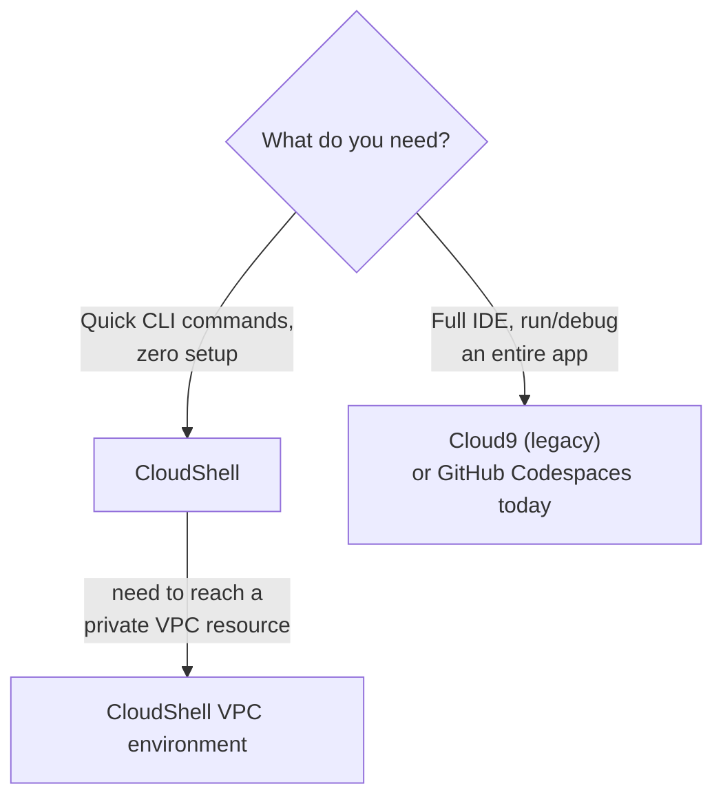

Walkthrough: the decision is really about depth of need — a terminal alone (CloudShell) versus a
full, persistent, billable development environment (Cloud9's historical role, now filled by
Codespaces for new projects).


*Source: [AWS CloudShell User Guide — "What is AWS CloudShell?"](https://docs.aws.amazon.com/cloudshell/latest/userguide/welcome.html), © Amazon Web Services. Notice there's no file tree or code editor — deliberately just a terminal, the clearest visual confirmation of CloudShell's narrower scope versus Cloud9's full IDE.*

```bash
# A realistic CloudShell incident-response session - zero setup, already authenticated
aws sts get-caller-identity
aws ecs describe-services --cluster prod-cluster --services orders-api-svc \
  --query 'services[0].events[0:5]'
aws logs tail /ecs/orders-api --since 15m --follow
```

**Exam Tips.**
- CloudShell = terminal only, free, zero setup. Cloud9 = full IDE, EC2-backed, you pay for the
  instance, legacy/no-longer-onboarding-new-customers.
- CloudShell VPC environments answer "reach a private resource from a zero-setup CLI session" —
  and have **no persistent storage at all**, unlike standard sessions' 1 GB.
- A question describing current, forward-looking guidance will never recommend Cloud9 for a new
  project.

**Common Architectures.**
1. *Zero-trust incident-response terminal.* Operations staff investigate incidents exclusively
   through CloudShell from the console, never installing the CLI locally, relying entirely on IAM
   Identity Center/SSO session permissions — reducing the attack surface of long-lived local
   credentials scattered across personal machines.
2. *CloudShell VPC environment for a one-off private-resource query.* A CloudShell VPC environment
   configured with a specific subnet/security group runs a `psql`/`mysql` CLI command directly
   against a private RDS instance for a one-off diagnostic — no bastion host or VPN needed.

**Troubleshooting.**
- *A script's output disappeared after closing the browser tab.* Anything written outside `$HOME`
  in a standard session doesn't persist; anything in a VPC environment doesn't persist at all, even
  in `$HOME` — this is expected, not a bug.
- *CloudShell can't reach a private database.* A standard session has internet-routed access only;
  reaching a private VPC resource needs an explicit CloudShell **VPC environment**, not a setting
  on the default session.
- *"CloudShell isn't available"* in a given Region — check the current supported-Regions list
  rather than assuming universal availability; CloudShell has a smaller Region footprint than most
  services.

**Additional Exam Scenarios.**
- *"An engineer working from an unfamiliar, locked-down machine during an incident needs
  pre-authenticated CLI access immediately, with no install step."* → AWS CloudShell, inheriting
  the console session's IAM identity automatically.
- *"A one-off diagnostic script needs to query a database reachable only from inside a specific
  VPC, with no bastion host provisioned."* → a CloudShell VPC environment configured with the
  relevant subnet/security group.

**Pricing Model (summary).** CloudShell is free with generous monthly usage limits. Cloud9 charged
only for the underlying EC2 instance and EBS storage — the IDE layer itself was never billed
separately.

**Limits & Quotas.** CloudShell: 1 GB persistent `$HOME` storage per Region; 20–30 minute idle
timeout (10 minutes in GovCloud); zero persistent storage in VPC environments. Exam-relevant
takeaway: the "VPC environments have no persistent storage at all" detail is specifically and
frequently tested — don't assume standard CloudShell's 1 GB guarantee carries over.

**Related Terms.** [`services/developer-tools/cloud9-and-cloudshell.md`](../../../services/developer-tools/cloud9-and-cloudshell.md) ·
[`services/developer-tools/codecommit.md`](../../../services/developer-tools/codecommit.md),
[`services/developer-tools/codebuild.md`](../../../services/developer-tools/codebuild.md) (tools
often invoked from either terminal).

---

## 4. AWS CloudFormation

**Definition.** AWS CloudFormation lets you describe the AWS resources you want in a text file,
and AWS builds, updates, and tears them down automatically, in the right order, the same way every
time — Infrastructure as Code (IaC).

**Plain-English analogy.** Building infrastructure by clicking through the console is cooking from
memory — it mostly works, but nobody can review it, reproduce it exactly, or know for certain what
changed between two attempts. CloudFormation is cooking from a written recipe: the recipe (template)
is reviewable, versionable, and produces the identical dish every single time someone follows it.

**Purpose.** Manual console/CLI infrastructure doesn't scale, isn't repeatable, and isn't
reviewable — nobody can "diff" a sequence of clicks. CloudFormation turns infrastructure into a
versioned, reviewable artifact that produces an identical environment every time it's deployed.

**When to Use.** Any infrastructure that needs to be reproducible across environments (dev,
staging, prod, DR); anything requiring peer review before being applied; anything needing a
documented rollback story if a deployment fails partway through.

**When NOT to Use.** A genuinely one-off, throwaway resource with zero reuse value (though even
here, IaC habits usually still pay off); when a team's workload is overwhelmingly non-serverless,
multi-cloud, and a provider-agnostic tool (Terraform) is already standard elsewhere in the org (not
an AWS-certified-exam consideration, but a real-world one).

**Use Cases.**
1. Reproducing an identical environment across dev/staging/prod from one source-controlled
   template.
2. Peer-reviewing infrastructure changes in a pull request before they're ever applied.
3. Automatic rollback on stack-update failure, reverting partially-applied changes without manual
   cleanup.
4. StackSets deploying the same template consistently across many accounts/regions at once.
5. Nested stacks decomposing a very large architecture into manageable, independently-versioned
   template files.
6. Change sets previewing exactly what an update would do before committing to it.

**Why Important.** CloudFormation underlies both SAM and CDK — literally every IaC deployment on
DVA-C03 eventually becomes a CloudFormation stack, making it the foundational concept for all of
Task 3.2/3.3's IaC content regardless of which authoring tool a scenario names.

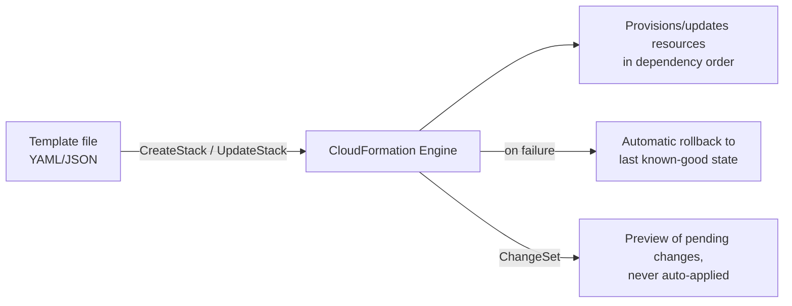

Walkthrough: automatic rollback-on-failure is CloudFormation's most important safety property — a
stack update that fails partway through doesn't leave infrastructure in a half-applied, unknown
state; CloudFormation reverts the resources it already touched back to their prior configuration.


*Source: [AWS CloudFormation User Guide](https://docs.aws.amazon.com/AWSCloudFormation/latest/UserGuide/Welcome.html), © Amazon Web Services. The core mental model: one template produces one stack, which is the group of resources CloudFormation manages together as a single unit — update or delete the stack, and every resource in it is updated or deleted together.*

```yaml
AWSTemplateFormatVersion: '2010-09-09'
Resources:
  OrdersTable:
    Type: AWS::DynamoDB::Table
    Properties:
      BillingMode: PAY_PER_REQUEST
      AttributeDefinitions:
        - AttributeName: id
          AttributeType: S
      KeySchema:
        - AttributeName: id
          KeyType: HASH
Outputs:
  TableName:
    Value: !Ref OrdersTable
    Export:
      Name: OrdersTableName
```

**Exam Tips.**
- Every IaC path (raw CloudFormation, SAM, CDK) ends up as a CloudFormation stack — drift
  detection, rollback, and change sets apply identically regardless of authoring tool.
- A **change set** previews a pending update without applying it — the raw-CloudFormation
  equivalent of `cdk diff`.
- Stack rollback-on-failure is automatic and on by default — a scenario about a failed deployment
  leaving orphaned, half-created resources is testing whether you know this almost never happens
  without the team having explicitly disabled rollback.

**Common Architectures.**
1. *StackSets for organization-wide baseline resources.* A central security team deploys a
   mandatory CloudTrail/Config baseline to every account in an AWS Organization via a single
   StackSet, rather than each account team remembering to deploy it individually.
2. *Nested stacks decomposing a large application.* A top-level stack references nested stacks for
   networking, compute, and data layers separately — each independently versioned and reviewable,
   rather than one enormous, unmanageable template file.

**Troubleshooting.**
- *A stack update fails and stays `UPDATE_ROLLBACK_FAILED`.* Occasionally a resource can't be
  automatically rolled back (e.g., a resource that was manually modified outside CloudFormation);
  this requires manual intervention (`ContinueUpdateRollback` skipping the specific resource), not
  an automatic retry.
- *A deployment hangs waiting on a resource.* Check for a resource with a `DependsOn` cycle or a
  custom resource (Lambda-backed) that never sends a `SUCCESS`/`FAILED` signal back to
  CloudFormation — the stack will wait until the resource's timeout, not indefinitely silently.
- *A stack shows drift but the team never manually changed anything.* Check for a *different*
  automation (another script, another team's Lambda) touching the same resource outside this
  specific stack's control.

**Additional Exam Scenarios.**
- *"The exact same baseline security configuration must be deployed consistently across 200
  accounts in an AWS Organization."* → CloudFormation **StackSets**, not 200 individually-run stack
  deployments.
- *"A very large template is becoming unmanageable as a single file."* → decompose into **nested
  stacks**, each independently versioned, rather than one monolithic template.

**Pricing Model (summary).** No direct charge for CloudFormation itself — you pay only for the
resources it provisions, exactly as if created any other way.

**Limits & Quotas.** 500 resources per stack; 1 MB template size (direct) with S3-backed upload for
larger templates; 5-level nested stack depth; 200 stack parameters. Exam-relevant takeaway: the
500-resource ceiling is the one most commonly tested numerically — a question about "why does a
large template fail to deploy with a resource-count error" is pointing here, with the fix being
decomposition into nested stacks, not a limit-increase request (this one isn't adjustable).

**Related Terms.** [`services/management-governance/cloudformation.md`](../../../services/management-governance/cloudformation.md) ·
[`iac-drift-detection-and-remediation.md`](iac-drift-detection-and-remediation.md) (what happens
after a successful deployment) ·
[`services/management-governance/cdk.md`](../../../services/management-governance/cdk.md),
[`services/developer-tools/sam.md`](../../../services/developer-tools/sam.md) (both compile to
CloudFormation).

---

## 5. AWS CodeArtifact

**Definition.** AWS CodeArtifact is a fully managed artifact repository — a secure, private place
to store and fetch software packages (npm, Maven/Gradle, PyPI, NuGet, Ruby gems, Swift, Generic)
your builds depend on, instead of pulling every dependency straight from the public internet on
every build.

**Plain-English analogy.** Pulling dependencies directly from the public internet on every build is
like driving to a different store every single day to buy the same ingredient, hoping it's in
stock and hasn't changed brands. CodeArtifact is stocking your own pantry once — a private,
reliable supply you control, that doesn't go empty just because the public store down the street
had a bad day.

**Purpose.** Hitting public registries directly on every build creates three problems:
availability (a public outage breaks your build at a moment you don't control), security (no
verification a package wasn't tampered with or doesn't collide with an internal package name —
dependency confusion), and cost/speed (repeated downloads of the same artifact). CodeArtifact
solves all three with one managed, private repository layer.

**When to Use.** Any build pulling third-party packages where availability, security, or speed
matters; internal, never-publicly-published packages that must never resolve from the public
internet under the same name (dependency confusion defense); teams wanting repository chaining
(internal packages + a cached upstream public registry) in one consistent resolution path.

**When NOT to Use.** A tiny, single-developer project with no CI pipeline where the overhead of
setting up a private repository outweighs any benefit; genuinely public, open-source packages
meant for public distribution (that's what the public registries themselves are for).

**Use Cases.**
1. Shielding builds from a public registry outage or a yanked package version.
2. Blocking dependency confusion attacks via package origin controls restricting upstream fetches
   for internally-namespaced package names.
3. Caching frequently-used public packages locally for faster, more reliable builds.
4. Centralizing internal, private package publishing (a shared internal library) with the same
   access-control model as every other AWS resource (IAM).
5. Chaining repositories (team repo → org repo → public upstream) so a change in one layer doesn't
   require every consuming team to reconfigure their own build tooling.
6. Supporting MLA-C02-relevant ML pipelines that need private, auditable Python package sources for
   training/inference code.

**Why Important.** A build that silently breaks because a public package was yanked, or silently
gets compromised via a dependency-confusion attack, is a real and recurring supply-chain risk —
CodeArtifact is a direct, explicitly named Task 3.1 "dependency management" answer.

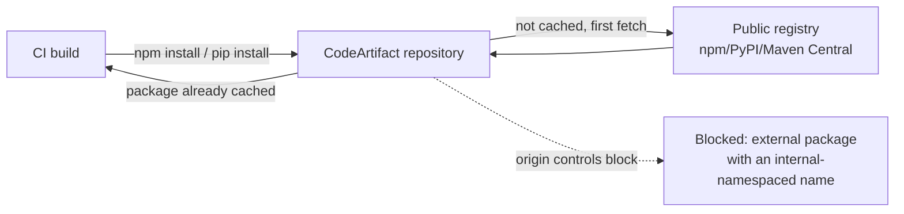

Walkthrough: once a package version is fetched through CodeArtifact's upstream connection, it's
cached permanently — a later public-registry outage or removal doesn't affect subsequent builds
pulling that exact version, since CodeArtifact already has its own copy.


*Source: [AWS CodeArtifact User Guide](https://docs.aws.amazon.com/codeartifact/latest/ug/welcome.html), © Amazon Web Services. Shows exactly how one org-wide CodeArtifact setup can chain a team-specific repository through an org repository through to the public registry — one fetch path, cached at every layer.*

```bash
# Authenticate npm to a CodeArtifact repository, then install as normal
aws codeartifact login --tool npm --repository my-repo --domain my-domain --domain-owner 123456789012
npm install   # resolves from CodeArtifact, which itself caches from the public registry
```

**Exam Tips.**
- Don't confuse CodeArtifact (package/dependency repository) with CodeCommit (source control) or
  ECR (container image registry) — three entirely different artifact types.
- "A build keeps failing because a public package was yanked/removed" → CodeArtifact's permanent
  caching is the fix.
- "A malicious package with the same name as an internal package was published publicly" →
  dependency confusion, fixed by origin controls, not a naming convention alone.

**Common Architectures.**
1. *Three-tier repository chaining.* A team repository pulls from an org-wide repository, which
   pulls from a public-registry-connected upstream repository — one consistent resolution chain,
   cached at every layer, with the org repository acting as the single point of upstream-access
   control.
2. *Origin controls blocking dependency confusion.* A repository configured to block upstream
   fetches for internally-namespaced package names (e.g., `@mycompany/*`) ensures a build can never
   accidentally resolve an attacker-published public package sharing that namespace.

**Troubleshooting.**
- *A build suddenly can't resolve a previously-working package version.* Check whether the
  upstream connection itself changed (a new restriction, a revoked token) rather than assuming
  CodeArtifact lost the cached version — once fetched, a version is retained permanently.
- *Publishing an internal package fails with an authorization error.* Confirm the publishing
  principal's IAM policy includes `codeartifact:PublishPackageVersion` scoped to the correct
  domain/repository — a common gap after first setting up a new internal package.

**Additional Exam Scenarios.**
- *"A team's builds began failing en masse when a public npm package was removed by its author."*
  → CodeArtifact's permanent caching of previously-fetched versions is the preventive fix, applied
  going forward (it wouldn't retroactively help a package never previously fetched through it).
- *"Security wants assurance that no build can ever resolve a malicious package under an internal
  namespace from the public internet."* → CodeArtifact package origin controls, not a naming
  convention or manual registry review process.

**Pricing Model (summary).** Billed per GB stored and per request beyond a modest free tier —
inexpensive relative to the availability/security risk it mitigates.

**Limits & Quotas.** Domains per account: 10 (soft); repositories per domain: 100 (soft); package
versions per repository: effectively unbounded in practice. Exam-relevant takeaway: the exam cares
far more about the architectural fact that CodeArtifact permanently caches fetched versions than
about any specific numeric ceiling here.

**Related Terms.** [`services/developer-tools/codeartifact.md`](../../../services/developer-tools/codeartifact.md) ·
[`services/developer-tools/codebuild.md`](../../../services/developer-tools/codebuild.md) (typical
consumer during the install phase) ·
[`services/containers/ecr.md`](../../../services/containers/ecr.md) (the container-image-specific
sibling registry).

---

## 6. AWS CodeBuild

**Definition.** AWS CodeBuild is a fully managed build service: it compiles source code, runs
automated tests, and produces deployable artifacts (a zip, a container image) without you
provisioning, patching, or scaling your own build servers.

**Plain-English analogy.** Running your own Jenkins server is owning a car — you maintain it,
insure it, and it depreciates whether you drive it or not. CodeBuild is calling a taxi only when
you actually need a ride — you pay per trip (per build minute), and when you're not using it, it
costs you nothing and needs no garage.

**Purpose.** Self-hosted build servers mean patching the OS, scaling for busy release weeks, and
securing infrastructure unrelated to actually shipping software. CodeBuild makes "run my
build/test commands" a pay-per-build-minute API call via a simple YAML spec (`buildspec.yml`).

**When to Use.** Any CI build/test step producing a deployable artifact (zip or container image);
replacing self-hosted Jenkins; needing VPC-connected builds to reach a private test database;
matrix/batch builds for multi-architecture images.

**When NOT to Use.** A team needing a vast, mature third-party plugin ecosystem (self-hosted
Jenkins still wins there); a GitHub-only shop wanting zero AWS console configuration at all (GitHub
Actions may be simpler to adopt); extremely long-running builds at predictable constant volume
where a self-managed fleet might undercut CodeBuild's per-minute price at very large scale.

**Use Cases.**
1. Building and pushing a container image to ECR as part of deployment.
2. Running unit/integration tests as a hard pipeline gate before any artifact is produced.
3. VPC-connected integration tests against a private RDS instance.
4. Matrix/batch builds producing both amd64 and Graviton/arm64 image variants.
5. Secretless credential injection via `env.secrets-manager`/`env.parameter-store` mappings.
6. Security-gated builds failing on SAST/dependency-scanning findings before an image reaches ECR.

**Why Important.** CodeBuild is the canonical build-stage service for both Task 3.1 (prepare
artifacts) and Task 3.3 (deploy via CI/CD), and the place Task 3.2's automated test execution
actually runs.

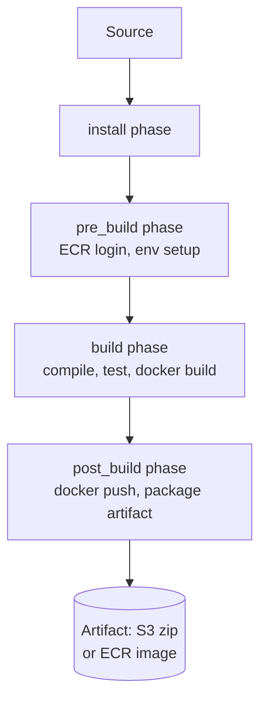

Walkthrough: any phase failing (non-zero exit) stops the build immediately — later phases never
run and no artifact is produced, which is why a `post_build` failure after tests already passed
still marks the whole build `FAILED`.


*Source: [AWS CodeBuild User Guide — "AWS CodeBuild concepts"](https://docs.aws.amazon.com/codebuild/latest/userguide/concepts.html), © Amazon Web Services.*

```yaml
version: 0.2
phases:
  pre_build:
    commands:
      - aws ecr get-login-password | docker login --username AWS --password-stdin $AWS_ACCOUNT_ID.dkr.ecr.$AWS_DEFAULT_REGION.amazonaws.com
  build:
    commands:
      - npm test
      - docker build -t orders-api:$CODEBUILD_RESOLVED_SOURCE_VERSION .
  post_build:
    commands:
      - docker push $AWS_ACCOUNT_ID.dkr.ecr.$AWS_DEFAULT_REGION.amazonaws.com/orders-api:$CODEBUILD_RESOLVED_SOURCE_VERSION
artifacts:
  files:
    - imagedefinitions.json
```

**Exam Tips.**
- `imagedefinitions.json` (plain ECS deploy) vs. `imageDetail.json` + `appspec.yaml` + `taskdef.json`
  (ECS blue/green deploy) — two different, specifically-named artifact bundles for two different
  CodePipeline deploy action types.
- CodeBuild projects are **not VPC-connected by default** — reaching a private database needs
  explicit VPC configuration.
- `env.secrets-manager`/`env.parameter-store` keep secrets out of the buildspec file itself.

**Common Architectures.**
1. *Build-once, deploy-many promotion.* One CodeBuild project builds and pushes a single
   commit-SHA-tagged image; dev/staging/prod deploy stages only ever reference that same image,
   never triggering a rebuild per environment.
2. *Security-gated build with SAST and dependency scanning.* A dedicated buildspec phase runs a
   static analysis tool and fails the build on findings above a severity threshold, blocking the
   image from ever reaching ECR — shift-left security enforced mechanically, not by convention.

**Troubleshooting.**
- *Build fails at `pre_build` with an ECR auth error.* The CodeBuild service role lacks
  `ecr:GetAuthorizationToken`, or the login command's account/region doesn't match the actual
  repository.
- *Cache doesn't speed up repeat builds.* Confirm the project-level cache type (`S3` vs `LOCAL`)
  matches what the buildspec's `cache.paths` expects — both must agree, declaring one in the
  buildspec alone isn't sufficient.
- *A secret leaked into CloudWatch Logs.* A stray `echo $SECRET_VAR` anywhere in the buildspec
  leaks it — CodeBuild does not redact arbitrary command output automatically, regardless of how
  the variable was injected.

**Additional Exam Scenarios.**
- *"A buildspec needs to authenticate to a private npm registry without the token ever appearing
  in source control."* → `env.secrets-manager` mapping, fetched fresh at build start.
- *"A CodeBuild project needs to run integration tests against a private RDS instance with no
  public endpoint."* → explicit VPC configuration on the project — not the default.

**Pricing Model (summary).** Billed per build minute by compute type, with a modest free tier for
new accounts; no charge when not actively building.

**Limits & Quotas.** 8-hour maximum build timeout; 60 concurrently running builds per account
(adjustable); 100 KB inline buildspec size. Exam-relevant takeaway: the 8-hour ceiling is
occasionally used to rule out CodeBuild for a genuinely multi-day build process (signaling the
build needs decomposing), not as a limit to request raising.

**Related Terms.** [`services/developer-tools/codebuild.md`](../../../services/developer-tools/codebuild.md) ·
[`services/developer-tools/codepipeline.md`](../../../services/developer-tools/codepipeline.md),
[`services/developer-tools/codedeploy.md`](../../../services/developer-tools/codedeploy.md) (the
other pipeline stages) ·
[`testing-strategies-for-serverless-apps.md`](testing-strategies-for-serverless-apps.md) (what
typically runs inside the build phase).

---

## 7. AWS CodeCommit

**Definition.** AWS CodeCommit was a fully managed, private Git source control service, secured by
IAM instead of a separate login system. AWS stopped onboarding new customers in mid-2024, steering
toward GitHub/GitLab/Bitbucket via CodeConnections.

**Plain-English analogy.** Hosting source code on a third-party SaaS Git host is renting a storage
unit from a company with its own separate keys and access list. CodeCommit was keeping that same
storage inside your own house, governed by the same house keys (IAM) as every other room.

**Purpose.** Let organizations keep source code inside their AWS account boundary — same IAM,
same KMS encryption, same VPC-endpoint isolation as everything else — removing a third-party
dependency from the software supply chain for compliance-sensitive teams.

**When to Use (historically/legacy).** Compliance-bound environments wanting source code to never
leave the AWS account boundary; fully air-gapped/VPC-only Git hosting; maintaining an inherited
pre-2024 CodeCommit environment.

**When NOT to Use.** Any new project today — use GitHub/GitLab/Bitbucket via CodeConnections,
AWS's own current guidance; anything needing a rich code-review/bot ecosystem (GitHub's is far
larger).

**Use Cases.**
1. Merge-blocking approval rules enforcing N required reviewers before a PR can merge at all.
2. EventBridge rules triggering CodeBuild on push to a specific branch.
3. Cross-account centralized repository access via IAM role assumption.
4. VPC-endpoint-only Git access with zero public internet path required.
5. CodeGuru Reviewer integration posting automated code-review comments on every pull request.
6. Migrating off CodeCommit to GitHub via CodeConnections with zero downstream pipeline changes.

**Why Important.** Even as a legacy service, it's the clean, simple illustration of "IAM governs
everything," and its approval-rule mechanism is a direct example of enforcing review *before*
code can merge — a stronger, earlier control than a deploy-time approval gate alone.

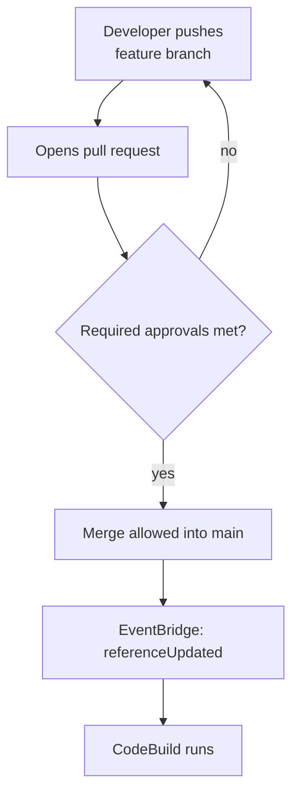

Walkthrough: the approval gate sits **before** the automated pipeline even starts — untested,
unreviewed code never reaches the branch the pipeline watches in the first place.


*Source: [AWS Reference Architecture Diagrams — "Database DevOps on AWS"](https://docs.aws.amazon.com/reference-architecture-diagrams/latest/database-devops/database-devops-development.md), © Amazon Web Services.*

```json
{
  "approvalRuleTemplateName": "require-two-approvals",
  "approvalRuleTemplateContent": "{\"Version\": \"2018-11-08\", \"DestinationReferences\": [\"refs/heads/main\"], \"Statements\": [{\"Type\": \"Approvers\", \"NumberOfApprovalsNeeded\": 2}]}"
}
```

**Exam Tips.**
- Approval rules are a **merge-time** control, distinct from CodePipeline's **deploy-time** manual
  approval action — "before code can merge" vs. "before code is released to production."
- Don't confuse CodeCommit (source control) with CodeArtifact (package repository).
- Newer exam content increasingly assumes GitHub via CodeConnections as the Source stage.

**Common Architectures.**
1. *CodeConnections as the modern replacement.* A GitHub repo is connected via a one-time
   CodeConnections authorization; CodePipeline's Source stage references it exactly as it would a
   CodeCommit repo, with zero downstream Build/Deploy stage changes required.
2. *CodeGuru-gated pull requests.* Every PR automatically receives CodeGuru Reviewer's automated
   findings before a human reviewer looks, reducing human review burden to confirming/dismissing
   automated findings plus reviewing business logic.

**Troubleshooting.**
- *`git clone` fails with authentication errors.* Usually the wrong credential helper —
  `git-remote-codecommit` needs the `codecommit::` URL prefix and valid local AWS CLI credentials.
- *A pull request is stuck despite apparent approvals.* Check that approvers are actually members
  of the `ApprovalPoolMembers` the rule references — approving from an identity outside that pool
  silently doesn't count.

**Additional Exam Scenarios.**
- *"A fully private VPC with no internet gateway must still support developers pushing to a
  company Git repository."* → a VPC endpoint for CodeCommit, avoiding any public internet egress.
- *"A team must migrate off CodeCommit with zero downstream pipeline changes."* → repoint only the
  Source stage at the new provider via CodeConnections; Build/Deploy stages are unaffected.

**Pricing Model (summary).** Legacy per-user/per-GB pricing for existing repositories; new
projects should budget for GitHub/GitLab's own pricing plus free CodeConnections.

**Limits & Quotas.** 1,000 repositories per Region (soft); 10 GiB recommended practical repository
size ceiling; 2 GiB hard file-size-per-commit limit. Exam-relevant takeaway: the exam cares more
about the architectural facts (IAM governs access, approval rules can block merges) than these
specific numbers, but the file-size limit is occasionally used to justify "large binaries belong
in S3, not committed directly."

**Related Terms.** [`services/developer-tools/codecommit.md`](../../../services/developer-tools/codecommit.md) ·
[`services/developer-tools/codepipeline.md`](../../../services/developer-tools/codepipeline.md) (typically
consumes it as the Source stage) ·
[`services/developer-tools/codeartifact.md`](../../../services/developer-tools/codeartifact.md)
(a commonly-confused, different artifact type).

---

## 8. AWS CodeDeploy

**Definition.** AWS CodeDeploy is a fully managed deployment service that automates releasing new
application versions onto EC2 instances, on-premises servers, Lambda functions, or ECS services —
handling *how do we roll this out safely*: in what order, how fast, and what happens if something
breaks.

**Plain-English analogy.** Deploying without CodeDeploy is handing out new restaurant menus to
every table simultaneously with no way to recall a misprinted one. CodeDeploy is handing the new
menu to one table first, watching for complaints, and only then handing it to the rest — or
instantly taking it back if the first table complains.

**Purpose.** Deployments are statistically where most outages happen. CodeDeploy makes releases
repeatable, automated, and safe — defining exactly how traffic/instances move from old to new, with
automatic CloudWatch-alarm-triggered rollback.

**When to Use.** Any production release needing a defined, safe traffic-shifting or rollout
strategy with automatic rollback; Lambda canary/linear traffic shifting; ECS blue/green via a
second target group; EC2/on-premises rolling or all-at-once in-place updates.

**When NOT to Use.** A very simple Lambda deployment where native alias weighted routing suffices
without needing alarms/hooks; Kubernetes-native (EKS) deployments, which typically use
Kubernetes-native rolling updates or a service mesh instead.

**Use Cases.**
1. Blue/green production rollout for a payments-critical service needing instant rollback.
2. Canary rollout limiting blast radius for a risky Lambda change.
3. Cost-sensitive rolling deployment to an EC2 fleet with no duplicate infrastructure.
4. Lambda deployment with pre/post-traffic validation hook Lambdas running smoke tests.
5. Multi-region/multi-account coordinated rollout, each with isolated alarms and rollback.
6. ECS blue/green managed declaratively via a CloudFormation CodeDeploy Blue/Green Hook.

**Why Important.** Directly named in DVA-C03 Task 3.3 ("CodeDeploy, CodePipeline, blue/green/
canary/rolling strategies, rollback") — one of the most literally-tested topics in this domain.

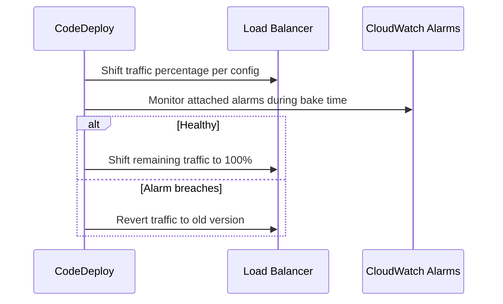


*Source: [AWS CodeDeploy User Guide — "Deployments on an Amazon ECS Compute Platform"](https://docs.aws.amazon.com/codedeploy/latest/userguide/deployment-steps-ecs.html), © Amazon Web Services.*

```yaml
# appspec.yaml - Lambda traffic shift
version: 0.0
Resources:
  - OrdersFunction:
      Type: AWS::Lambda::Function
      Properties:
        Name: "orders-api"
        Alias: "live"
        CurrentVersion: "4"
        TargetVersion: "5"
Hooks:
  - BeforeAllowTraffic: "PreTrafficHook"
  - AfterAllowTraffic: "PostTrafficHook"
```

**Exam Tips.**
- Memorize the EC2 lifecycle hook order: `ApplicationStop` → `DownloadBundle` → `BeforeInstall` →
  `Install` → `AfterInstall` → `ApplicationStart` → `ValidateService`.
- CodeDeploy's alarm-based rollback is distinct from ECS's native deployment circuit breaker.
- Full detail on all three strategies: [`blue-green-canary-linear-deployment-strategies.md`](blue-green-canary-linear-deployment-strategies.md).

**Common Architectures.**
1. *ECS blue/green via a CloudFormation Hook.* A single CloudFormation template defines the ECS
   service, task definition, and the CodeDeploy Blue/Green Hook together — the deployment strategy
   itself becomes version-controlled infrastructure.
2. *Lambda canary with pre/post-traffic validation.* A SAM `DeploymentPreference` wraps CodeDeploy
   to shift 10% of traffic, running a `PreTraffic` hook validating the new version works at all
   before any real traffic reaches it.

**Troubleshooting.**
- *Deployment stuck "In Progress" indefinitely.* A lifecycle hook script never exits — check the
  CodeDeploy agent logs on the instance for which hook is stuck.
- *Automatic rollback didn't trigger despite an obvious issue.* Verify a CloudWatch alarm is
  actually **attached to the deployment group** — a standing alarm elsewhere in the account doesn't
  count.
- *ECS blue/green stuck waiting on test traffic validation.* The `AfterAllowTestTraffic` hook
  Lambda must explicitly call `PutLifecycleEventHookExecutionStatus` — a function that runs checks
  but never reports status leaves CodeDeploy waiting until timeout.

**Additional Exam Scenarios.**
- *"A deployment needs pre-traffic and post-traffic validation hooks before/after a shift."* →
  AppSpec `BeforeAllowTraffic`/`AfterAllowTraffic` lifecycle hooks running a Lambda smoke test.
- *"ECS blue/green deployments must be managed declaratively alongside the rest of the
  infrastructure."* → CodeDeploy-via-CloudFormation support, making the strategy itself IaC.

**Pricing Model (summary).** No additional CodeDeploy charge for EC2/Lambda deployments — only the
underlying compute is billed; on-premises instance deployments incur a small per-instance fee.

**Limits & Quotas.** 3,000 applications per account (soft); 300 deployment groups per application;
up to 10 CloudWatch alarms per deployment group; 1-hour default deployment timeout (configurable).
Exam-relevant takeaway: knowing a deployment group can have up to 10 alarms, and that exceeding a
single alarm's threshold is enough to trigger rollback by default, matters more than the raw
numeric ceiling itself.

**Related Terms.** [`services/developer-tools/codedeploy.md`](../../../services/developer-tools/codedeploy.md) ·
[`blue-green-canary-linear-deployment-strategies.md`](blue-green-canary-linear-deployment-strategies.md) (full
strategy comparison) ·
[`services/developer-tools/sam.md`](../../../services/developer-tools/sam.md) (`DeploymentPreference`
wraps this service for Lambda).

---

## 9. AWS CodePipeline

**Definition.** AWS CodePipeline is a fully managed CI/CD orchestration service: it connects
Source, Build, Test, and Deploy steps into one automated pipeline that runs every time code
changes, without custom glue scripts chaining them together.

**Plain-English analogy.** Automating each pipeline step individually but having no orchestrator is
having excellent individual cooks but no head chef calling out the order and timing — CodePipeline
is the head chef, making sure each station's output flows correctly into the next, in the right
order, with explicit holds (approval gates) when needed.

**Purpose.** Each release step can be automated individually, but someone still has to wire them
together in the right order, pass artifacts between them, and gate progress on approvals.
CodePipeline is that orchestration layer, declaratively defined.

**When to Use.** Any multi-stage release process needing consistent, automatic triggering,
artifact-passing, and approval gating; coordinating CodeBuild/CodeDeploy/CloudFormation actions
into one auditable, repeatable flow.

**When NOT to Use.** A single, standalone build with no deployment step at all (plain CodeBuild
triggered by a webhook may be sufficient); extremely simple personal projects where GitHub Actions
alone already covers the full build-and-deploy need.

**Use Cases.**
1. Source → Build → Test → Deploy orchestrated end to end with zero custom scripting.
2. Manual approval gates before production deploy stages, informed by an AI-generated risk summary.
3. Fanning out to multiple deployment groups/accounts/regions from one pipeline execution.
4. Cross-account deployment via STS AssumeRole into a target account's deploy role.
5. ECS blue/green deploy actions consuming `appspec.yaml` + `taskdef.json` + `imageDetail.json`.
6. Parallel actions within a stage (e.g., running security scanning alongside unit tests).

**Why Important.** The orchestration backbone for Task 3.3's entire "deploy via CI/CD" task
statement — nearly every worked scenario in this domain assumes CodePipeline is the thing tying
source/build/test/deploy together.

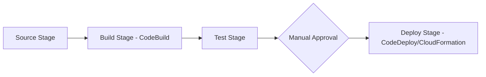


*Source: [AWS Reference Architecture Diagrams — "Database DevOps on AWS"](https://docs.aws.amazon.com/reference-architecture-diagrams/latest/database-devops/database-devops-development.md), © Amazon Web Services.*

```json
{
  "stages": [
    {"name": "Source", "actions": [{"actionTypeId": {"category": "Source", "provider": "CodeStarSourceConnection"}}]},
    {"name": "Build", "actions": [{"actionTypeId": {"category": "Build", "provider": "CodeBuild"}}]},
    {"name": "Approve", "actions": [{"actionTypeId": {"category": "Approval", "provider": "Manual"}}]},
    {"name": "Deploy", "actions": [{"actionTypeId": {"category": "Deploy", "provider": "CodeDeployToECS"}}]}
  ]
}
```

**Exam Tips.**
- CodePipeline never builds/tests/deploys itself — it always delegates to CodeBuild, CodeDeploy,
  CloudFormation, or a custom action.
- The ECS **blue/green** deploy action needs `appspec.yaml` + `taskdef.json` + `imageDetail.json`;
  the plain ECS deploy action needs only `imagedefinitions.json`.
- A manual approval action is where "AI flags risk, human still approves" lives on the exam.

**Common Architectures.**
1. *Multi-account fan-out.* A single pipeline execution deploys sequentially or in parallel to
   dev, staging, and production deployment groups across separate AWS accounts, each stage
   assuming a cross-account role via STS.
2. *Source-triggered, artifact-chained pipeline.* Each stage's output artifact feeds the next
   stage's input automatically — the Source stage's git checkout becomes the Build stage's input,
   the Build stage's compiled artifact becomes the Deploy stage's input, with CodePipeline managing
   the S3-backed artifact store transparently.

**Troubleshooting.**
- *A stage shows "Failed" with no clear reason.* Check the underlying action's own service
  (CodeBuild logs, CloudFormation events) — CodePipeline's own console surfaces a summary, but the
  detailed failure reason usually lives in the delegated service.
- *An approval action never appears for the approver.* Confirm the approver's IAM permissions
  include `codepipeline:PutApprovalResult` and that SNS notification topic (if configured) is
  correctly subscribed.

**Additional Exam Scenarios.**
- *"A release must deploy to three separate AWS accounts in sequence, each gated by its own
  validation."* → one CodePipeline with three deployment stages, each assuming a cross-account
  role via STS for its respective target account.
- *"An AI tool flags a deployment as risky, but the team still wants a human to confirm before
  production changes go live."* → a CodePipeline manual approval action, informed but not replaced
  by the AI's risk summary.

**Pricing Model (summary).** Billed per active pipeline per month beyond a free tier; underlying
CodeBuild/CodeDeploy/CloudFormation usage is billed separately by those services.

**Limits & Quotas.** 25 actions per stage (soft); 50 stages per pipeline (soft); artifact store
objects expire per the configured S3 lifecycle, not CodePipeline itself. Exam-relevant takeaway:
these limits rarely constrain real pipelines, but the architectural fact that CodePipeline stores
artifacts in S3 between stages (not in some proprietary internal store) is occasionally tested.

**Related Terms.** [`services/developer-tools/codepipeline.md`](../../../services/developer-tools/codepipeline.md) ·
[`services/developer-tools/codebuild.md`](../../../services/developer-tools/codebuild.md),
[`services/developer-tools/codedeploy.md`](../../../services/developer-tools/codedeploy.md) (the
actions it orchestrates) ·
[`services/security-identity-compliance/sts-and-role-switching.md`](../../../services/security-identity-compliance/sts-and-role-switching.md) (cross-account
deploy pattern).

---

## 10. AWS Fargate

**Definition.** AWS Fargate is a serverless compute engine for containers — it runs ECS or EKS
workloads without provisioning, patching, or managing any EC2 servers at all.

**Plain-English analogy.** Running containers on EC2-backed ECS is owning the oven your restaurant
cooks in — you maintain, clean, and pay for it whether it's in use or not. Fargate is a
commercial kitchen you rent by the exact minute you're actually cooking — no oven maintenance, pay
only for active cook time.

**Purpose.** ECS/EKS removed the need to build your own orchestrator, but teams still had to size,
patch, and scale the EC2 instances containers ran on. Fargate removes that remaining layer
entirely — you describe the container's resource needs, AWS runs it on infrastructure you never
see.

**When to Use.** Spiky, unpredictable traffic with long idle gaps; teams with no dedicated ops/
platform staff; multi-tenant SaaS needing per-task network isolation; filling the gap beyond
Lambda's 15-minute duration ceiling.

**When NOT to Use.** Dense, steady-state workloads at high, predictable scale (EC2 launch type with
Reserved Instances is usually cheaper); GPU/custom-kernel-module workloads (Fargate doesn't support
them); EKS DaemonSets (Fargate has no node concept).

**Use Cases.**
1. ALB-fronted web service, fully serverless from edge to compute, zero EC2 anywhere.
2. Event-driven batch processing via `RunTask`, billed only for actual processing duration.
3. Filling the Lambda-duration-limit gap for a step that might run over 15 minutes.
4. Self-hosted CI/CD build runners that start on-demand per job and disappear afterward.
5. Multi-tenant SaaS isolation boundary — one task/ENI per tenant.
6. Scheduled scale-to-zero dev/test environments costing nothing outside business hours.

**Why Important.** Directly named in DVA-C03 Task 3.3's new container-deployment emphasis
(ECS/EKS/Fargate), and a recurring SAA-C03 cost-optimization scenario (EC2 vs. Fargate tradeoff).

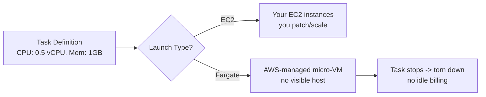


*Source: [AWS Reference Architecture Diagrams — "Modern Serverless Mobile/Web Application Architecture"](https://docs.aws.amazon.com/reference-architecture-diagrams/latest/modern-serverless-mobile-web/modern-serverless-mobile-web.md), © Amazon Web Services.*

```json
{
  "family": "orders-worker",
  "requiresCompatibilities": ["FARGATE"],
  "networkMode": "awsvpc",
  "cpu": "1024",
  "memory": "2048",
  "runtimePlatform": {"cpuArchitecture": "ARM64", "operatingSystemFamily": "LINUX"},
  "containerDefinitions": [{"name": "orders-worker", "image": "123456789012.dkr.ecr.us-east-1.amazonaws.com/orders-worker:v2"}]
}
```

**Exam Tips.**
- "No servers to manage" tests Fargate *as the launch type* — orthogonal to whether the
  orchestrator is ECS or EKS.
- Fargate has a hard maximum task size (16 vCPU / 120 GB) and **no GPU support** — a GPU scenario
  instantly disqualifies it.
- Graviton (ARM64) Fargate tasks are priced lower per vCPU-second than x86_64.

**Common Architectures.**
1. *Lambda-duration-limit escape hatch.* A Step Functions state machine uses Lambda for fast
   steps and calls out to a Fargate `RunTask` for any step that might run past Lambda's 15-minute
   ceiling — a large file transform or long external API polling loop.
2. *Scheduled scale-to-zero dev/test environments.* Non-production Fargate services scale to
   `desiredCount: 0` outside business hours via an EventBridge Scheduler rule, costing nothing
   while idle — unlike a stopped EC2 instance, which still bills for attached EBS storage.

**Troubleshooting.**
- *`CannotPullContainerError` specific to Fargate.* Frequently a private subnet with no NAT
  Gateway and no ECR VPC endpoints — Fargate tasks in fully private subnets need one or the other
  to pull images at all.
- *Task fails with an ENI-related stopped reason.* The specified subnet ran out of available IPs,
  or a security group/NACL blocks required traffic — Fargate tasks cannot start without a
  successfully provisioned ENI.
- *Unexpectedly high cost vs. an EC2 launch-type estimate.* Usually a sizing mismatch — Fargate
  bills for the full reservation regardless of actual usage, same as EC2; right-sizing against
  CloudWatch Container Insights data matters just as much.

**Additional Exam Scenarios.**
- *"A batch job sometimes needs more than 15 minutes and must not be Lambda-duration-limited, but
  should still be billed only for actual run time."* → ECS `RunTask` on Fargate, often orchestrated
  via Step Functions.
- *"A workload needs GPU-backed inference."* → Fargate is disqualified outright — no GPU support
  at all; use EC2 launch type or EKS with GPU node groups instead.

**Pricing Model (summary).** Billed per second for reserved vCPU/memory; Fargate Spot offers up to
~70% discount for interruption-tolerant workloads; Graviton (ARM64) tasks price lower per
vCPU-second than x86_64.

**Limits & Quotas.** 16 vCPU / 120 GB maximum per task; 20 GiB default ephemeral storage (up to 200
GiB); 1 mandatory ENI per task. Exam-relevant takeaway: the exam cares less about exact numbers and
more about knowing Fargate **has** a maximum task size at all — a 64-vCPU single-container
requirement instantly rules Fargate out as a single-task answer.

**Related Terms.** [`services/containers/fargate.md`](../../../services/containers/fargate.md) ·
[`services/containers/ecs.md`](../../../services/containers/ecs.md),
[`services/containers/eks.md`](../../../services/containers/eks.md) (the two orchestrators it runs
under) ·
[`21-containers-vs-vms-vs-serverless`](#21-containers-vs-vms-vs-serverless) (where it sits on the
abstraction spectrum).

---

## 11. AWS Identity and Access Management (IAM)

**Definition.** IAM controls **who (or what) can do what, to which AWS resource, under which
conditions**. Every API call against AWS is checked against IAM before it's allowed to happen.

**Plain-English analogy.** IAM is a hotel's keycard system, not a single master key handed to
everyone. Each guest (user/role) gets a keycard programmed for exactly their room and the gym
(least privilege) — not a master key that opens every door in the building, which is what a
single shared root login would be.

**Purpose.** AWS needed a way to let one account be used safely by many humans and services
simultaneously, each with exactly the access they need and no more — making least privilege the
default operating model instead of "one shared login, full access, hope nothing goes wrong."

**When to Use.** Every single AWS interaction, always — there's no "opt out" of IAM; the only
choice is how granular and least-privilege your policies are.

**When NOT to Use.** N/A as a service choice — but **do** avoid long-lived IAM user access keys
wherever a role (assumed via STS, with automatic credential expiry) can be used instead, and avoid
overly broad wildcard policies (`"Action": "*"`, `"Resource": "*"`) except in deliberately scoped,
reviewed break-glass scenarios.

**Use Cases.**
1. Scoping a CI/CD pipeline's own service role to exactly the actions/resources it needs (ECR push
   to one repo, not all repos).
2. Granting an EC2/Lambda/ECS workload a role instead of embedding static access keys in code.
3. Permission boundaries capping the maximum permissions a delegated administrator can grant to
   others, even if their own policy would otherwise allow it.
4. Resource-based policies (S3 bucket policies, Secrets Manager resource policies) granting
   cross-account access alongside the consuming account's own identity policy.
5. Service control policies (via Organizations) setting an organization-wide permission ceiling no
   identity policy can exceed.
6. IAM Access Analyzer identifying unused permissions and external access before they become an
   incident.

**Why Important.** IAM is foundational across all three certs and every single domain — nothing
in Domain 3's pipeline (CodeBuild's role, CodeDeploy's service role, the Lambda execution role)
works without a correctly-scoped IAM policy underneath it.

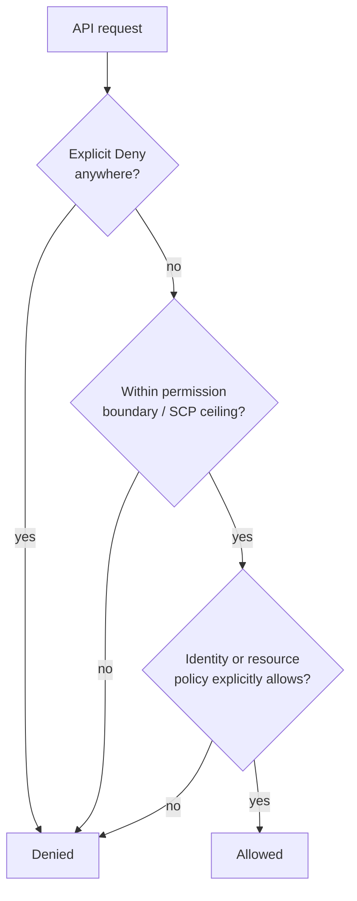

Walkthrough: an explicit Deny anywhere always wins; absent that, the request must fall within any
applicable ceiling (permission boundary, SCP) *and* be explicitly allowed by at least one policy —
the "implicit deny" default means anything not explicitly allowed is denied.


*Source: [AWS IAM User Guide — "Policy evaluation logic"](https://docs.aws.amazon.com/IAM/latest/UserGuide/reference_policies_evaluation-logic.html), © Amazon Web Services.*

```json
{
  "Version": "2012-10-17",
  "Statement": [{
    "Effect": "Allow",
    "Action": ["ecr:PutImage", "ecr:InitiateLayerUpload", "ecr:UploadLayerPart", "ecr:CompleteLayerUpload"],
    "Resource": "arn:aws:ecr:us-east-1:123456789012:repository/orders-api"
  }]
}
```

**Exam Tips.**
- Explicit Deny always wins, regardless of any Allow elsewhere.
- Permission boundaries cap maximum possible permissions; they never *grant* anything by
  themselves.
- Cross-account access always needs **both** sides (resource policy + consuming identity policy)
  to agree — a one-sided grant silently denies.

**Common Architectures.**
1. *Least-privilege pipeline roles.* Each pipeline stage (CodeBuild, CodeDeploy) runs under its
   own narrowly-scoped service role rather than one shared, overly broad "CI/CD role" — a
   compromised build can't accidentally deploy to production if the build role has no deploy
   permissions at all.
2. *Permission boundary for delegated administrators.* A team lead can create and attach IAM
   policies to their own team's roles, but a permission boundary caps the maximum they can ever
   grant, preventing accidental or malicious privilege escalation beyond the team's intended scope.

**Troubleshooting.**
- *`AccessDenied` despite a seemingly correct identity policy.* Check for a resource-based policy
  or permission boundary being more restrictive than expected — IAM evaluation considers all
  applicable policies together, not just the one you're looking at.
- *A role's permissions seem to have "disappeared" after adding a permission boundary.* The
  boundary caps what the role's identity policy can grant — if the boundary is narrower than the
  identity policy, the effective permission is the intersection, not the identity policy alone.

**Additional Exam Scenarios.**
- *"A CI/CD pipeline's build stage should never be able to modify production infrastructure,
  even if its IAM policy is later misconfigured."* → scope the build role's permissions
  narrowly from the start (least privilege), and/or use a permission boundary as a second,
  independent ceiling.
- *"Multiple AWS accounts need a consistent permission ceiling no account administrator can
  exceed."* → Service Control Policies via AWS Organizations, not per-account IAM policy review.

**Pricing Model (summary).** IAM itself has no direct charge — it's included with every AWS
account at no additional cost.

**Limits & Quotas.** 5,000 IAM users per account (soft); 1,500 managed policies per account; 10
managed policies attached per role/user; 6,144 character policy size (managed). Exam-relevant
takeaway: hitting the attached-policy-count limit is a real signal to consolidate permissions into
fewer, broader (but still least-privilege) policies rather than endlessly attaching more.

**Related Terms.** [`services/security-identity-compliance/iam.md`](../../../services/security-identity-compliance/iam.md) ·
[`services/security-identity-compliance/sts-and-role-switching.md`](../../../services/security-identity-compliance/sts-and-role-switching.md) (temporary
credentials built on IAM roles) ·
[`services/security-identity-compliance/organizations-and-scps.md`](../../../services/security-identity-compliance/organizations-and-scps.md) (the
org-wide permission ceiling).

---

## 12. AWS Lambda

**Definition.** AWS Lambda runs your code without you provisioning or managing a server — you
upload a function, tell AWS what triggers it, and AWS runs it only when triggered, billing only
for milliseconds actually executed.

**Plain-English analogy.** Running a full-time EC2 server for occasional work is paying rent on an
office 24/7 even when nobody's there. Lambda is renting a meeting room by the minute, only when
someone's actually in it — you never pay for empty time.

**Purpose.** Most applications spend most of their time idle. Lambda solves "run this logic only
when X happens" with zero surrounding server lifecycle — no OS to patch, no capacity to plan, no
idle cost.

**When to Use.** Event-driven, bursty, short-lived processing (under 15 minutes); glue code
between services; APIs with unpredictable or sparse traffic where scale-to-zero matters.

**When NOT to Use.** Anything needing to run longer than 15 minutes continuously (use Fargate/EC2
instead); GPU/custom-kernel-module workloads; extremely high, constant, 24/7 traffic where a
steadily-utilized container/EC2 fleet is cheaper per unit of compute than per-invocation billing.

**Use Cases.**
1. API Gateway-triggered request/response handlers for a serverless REST API.
2. S3-event-triggered file processing (thumbnail generation, validation) with zero idle cost.
3. Scheduled/cron-style jobs via EventBridge Scheduler for nightly reports or cleanup.
4. Canary/blue-green traffic-shifted deployments via CodeDeploy + alias versioning.
5. Step Functions orchestration steps for the fast portions of a longer workflow.
6. Lambda@Edge/CloudFront Functions for lightweight request/response manipulation at the edge.

**Why Important.** Central to both DVA-C03 and SAA-C03 — Lambda packaging/versioning and
deployment strategy are explicitly named in Task 3.3, and Lambda's duration/memory limits are a
recurring, directly-tested architectural constraint.

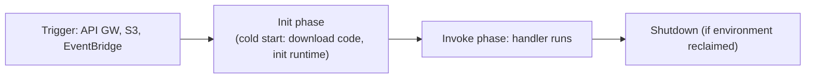

Walkthrough: the "cold start" penalty is the Init phase — subsequent invocations against an
already-warm execution environment skip straight to Invoke, which is why provisioned concurrency
(keeping environments pre-initialized) eliminates cold starts for latency-sensitive workloads.


*Source: [AWS Lambda Developer Guide — "Lambda execution environment"](https://docs.aws.amazon.com/lambda/latest/dg/lambda-runtime-environment.html), © Amazon Web Services.*

```python
import json
def handler(event, context):
    body = json.loads(event.get("body", "{}"))
    return {"statusCode": 200, "body": json.dumps({"received": body})}
```

**Exam Tips.**
- Lambda's **15-minute hard duration ceiling** is a direct disqualifier in scenario questions —
  anything longer needs Fargate/EC2, not a workaround.
- Provisioned concurrency pre-warms execution environments specifically to eliminate cold starts
  for latency-sensitive paths.
- Shared dependencies belong in a **Lambda layer** to avoid bloating every function's own package.

**Common Architectures.**
1. *Canary deployment with provisioned concurrency.* A Lambda canary shift combines CodeDeploy's
   traffic-shifting config with provisioned concurrency on the new version, so the canary slice
   isn't hit with cold starts during the exact window being validated.
2. *Shared layer for common dependencies.* A platform team publishes a versioned Lambda layer for
   a commonly-used SDK; updating it once propagates to every function on their next deploy, instead
   of 40 separate dependency bumps.

**Troubleshooting.**
- *A function times out exactly at 15 minutes regardless of its own configured timeout.* This is
  Lambda's hard execution ceiling — no configuration can raise it; the fix is decomposing the work,
  not adjusting a setting.
- *Cold starts are hurting latency-sensitive paths intermittently.* Configure provisioned
  concurrency for that specific function/version/alias — on-demand concurrency alone always risks
  a cold start on a scale-up event.
- *A deployment package exceeds the size limit.* Move shared/large dependencies into a Lambda
  layer, or switch to container-image packaging, which has a larger size ceiling than zip.

**Additional Exam Scenarios.**
- *"A function needs to warm up before a canary traffic shift begins, so early real users don't
  hit cold starts."* → provisioned concurrency configured ahead of the CodeDeploy canary shift —
  the two features are independent and must be deliberately combined.
- *"40 Lambda functions all bundle the same large third-party SDK, bloating every deployment
  package."* → a shared Lambda layer, versioned centrally.

**Pricing Model (summary).** Billed per invocation plus GB-seconds of actual duration; provisioned
concurrency adds its own separate, continuous charge regardless of invocation volume.

**Limits & Quotas.** 15-minute maximum execution duration (hard); 10 GB maximum memory; 250 MB
deployment package size (zip, unzipped, with layers) or 10 GB for container images; 1,000
concurrent executions per Region by default (adjustable). Exam-relevant takeaway: the 15-minute
ceiling and the zip-vs-container-image size difference are both directly, frequently tested facts.

**Related Terms.** [`services/compute/lambda.md`](../../../services/compute/lambda.md) ·
[`services/developer-tools/sam.md`](../../../services/developer-tools/sam.md) (`DeploymentPreference`
for safe Lambda rollouts) ·
[`services/networking-content-delivery/api-gateway.md`](../../../services/networking-content-delivery/api-gateway.md) (most
common trigger).

---

## 13. AWS STS & Role Switching

**Definition.** AWS Security Token Service (STS) issues short-lived, temporary credentials instead
of permanent ones. "Role switching" is a principal temporarily becoming a different IAM role by
calling STS and receiving a fresh, auto-expiring access key/secret/session token.

**Plain-English analogy.** A static IAM user access key is a house key that works forever until
someone manually changes the locks. An STS-issued temporary credential is a hotel keycard that
auto-deactivates at checkout time, with zero manual revocation needed — if it leaks, the blast
radius is bounded by the clock, not by someone noticing.

**Purpose.** Long-term credentials are a liability: if leaked, they work forever until manually
revoked. STS exists so almost nothing in AWS ever needs a long-term secret — automatically
expiring credentials drastically shrink the blast radius of any leak.

**When to Use.** Cross-account access (a pipeline deploying into a separate production account);
federated user access; EC2/Lambda/ECS workload identities (instance profiles, execution roles);
any scenario where a principal needs to act with different, temporary permissions than its own.

**When NOT to Use.** Never use a long-lived IAM user access key where an assumable role would
work instead — this is close to an absolute rule on both the exam and in real practice.

**Use Cases.**
1. A CI/CD pipeline's own account assuming a role in a separate production account to deploy,
   holding no standing production credentials at all.
2. An EC2 instance's attached instance profile providing temporary credentials to the application
   running on it, with zero hardcoded keys.
3. Federated SSO users assuming a role mapped to their identity-provider group membership.
4. Cross-account S3/Secrets Manager access combining a resource policy and `sts:AssumeRole`.
5. A Lambda function's execution role providing scoped, automatically-rotated credentials for
   every invocation.
6. Service-linked roles letting an AWS service itself assume a role scoped to exactly what that
   service needs to do on your behalf.

**Why Important.** The cross-account deployment pattern (pipeline account assumes a role in the
target account) is directly relevant to Task 3.3's CI/CD deployment content and is a recurring
SAA-C03/DVA-C03 security-architecture topic.

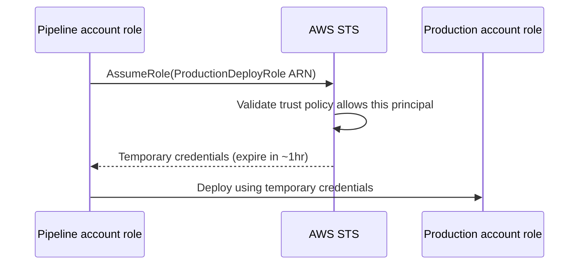


*Source: [AWS IAM User Guide](https://docs.aws.amazon.com/IAM/latest/UserGuide/id_roles_common-scenarios_aws-accounts.html), © Amazon Web Services.*

```bash
aws sts assume-role \
  --role-arn arn:aws:iam::999999999999:role/ProductionDeployRole \
  --role-session-name pipeline-deploy
```

**Exam Tips.**
- A pipeline deploying cross-account should **never** hold standing credentials in the target
  account — it should `AssumeRole` for the duration of the deploy only.
- Temporary credentials auto-expire — no manual revocation step needed, unlike static keys.
- Trust policies (on the role being assumed) and permission policies (what the role can then do)
  are two separate, both-required pieces.

**Common Architectures.**
1. *Cross-account CI/CD deployment.* A pipeline account's CodePipeline/CodeBuild role assumes a
   deploy role in each target account only for the duration of the deploy action, never holding
   standing production credentials.
2. *EC2/Lambda/ECS workload identity.* An application never embeds static keys — it reads
   automatically-rotated temporary credentials from its instance profile/execution role, refreshed
   transparently by the SDK well before expiry.

**Troubleshooting.**
- *`AssumeRole` fails with an access-denied error.* Check the target role's **trust policy**
  explicitly allows the calling principal — a correct permission policy on the role doesn't matter
  if the trust policy doesn't name the caller.
- *Temporary credentials expire mid-long-running-operation.* The calling SDK/CLI should refresh
  automatically before expiry if using the standard credential provider chain; a custom script
  manually caching credentials needs its own refresh logic.

**Additional Exam Scenarios.**
- *"A pipeline deploying into a separate AWS account must never hold standing credentials in that
  account."* → cross-account `AssumeRole`, scoped to only the deploy action's duration.
- *"An EC2 instance's application must call AWS APIs without any credentials ever stored on the
  instance."* → an attached instance profile, providing automatically-rotated temporary
  credentials via the instance metadata service.

**Pricing Model (summary).** STS itself has no direct charge — temporary credential issuance is
included at no additional cost.

**Limits & Quotas.** Temporary credentials: 15 minutes to 36 hours lifetime depending on how
they're obtained (role chaining caps at 1 hour); role session name required for auditability.
Exam-relevant takeaway: the exact expiry window matters less than knowing it's always bounded and
auto-expiring — a scenario emphasizing credentials that "just stop working on their own" after a
window is describing STS-issued temporary credentials, not a static access key.

**Related Terms.** [`services/security-identity-compliance/sts-and-role-switching.md`](../../../services/security-identity-compliance/sts-and-role-switching.md) ·
[`services/security-identity-compliance/iam.md`](../../../services/security-identity-compliance/iam.md) (trust
policies and permission policies) ·
[`services/security-identity-compliance/iam-identity-center-sso.md`](../../../services/security-identity-compliance/iam-identity-center-sso.md) (federated
role-switching at human scale).

---

## 14. Secrets Manager vs. Systems Manager Parameter Store

**Definition.** Both store configuration values and sensitive data so applications never hardcode
them — but they're different services: Secrets Manager is purpose-built for secrets needing
automatic rotation; Parameter Store is a general-purpose, largely-free config/secret store with no
built-in rotation engine.

**Plain-English analogy.** Parameter Store is a locked filing cabinet — secure, cheap, and holds
anything, but nobody automatically shreds and reissues the documents inside on a schedule. Secrets
Manager is a bank vault with an automatic combination-changing service built in — more expensive,
but it rotates the combination (credential) on schedule without anyone manually doing it.

**Purpose.** Hardcoding credentials is one of the oldest, most persistent breach sources. Both
services let applications fetch a secret via an IAM-governed API call instead of storing it in
plaintext near the code; Secrets Manager additionally solves the harder problem of rotating that
secret on a schedule without breaking the application mid-rotation.

**When to Use.** Secrets Manager: a database credential needing automatic rotation, cross-account
secret sharing, compliance requiring demonstrable rotation evidence. Parameter Store: hundreds to
thousands of mostly non-rotating config values, sensitive values that don't need automated
rotation, hierarchical config fetched in one call.

**When NOT to Use.** Don't force a genuinely rotation-needed secret into Parameter Store just to
save money (you'd be rebuilding Secrets Manager's rotation engine yourself, poorly). Don't put
2,000 non-secret config values into Secrets Manager "for consistency" — the per-secret fee adds up
fast for no benefit.

**Use Cases.**
1. An RDS database password rotating automatically via a Secrets Manager rotation Lambda, zero
   manual steps, zero downtime.
2. 2,000 feature-flag/environment config values in Parameter Store Standard, effectively free.
3. Cross-account secret sharing via a Secrets Manager resource policy.
4. A full application config tree fetched in one `GetParametersByPath --recursive` call.
5. ECS task definitions referencing a Secrets Manager ARN directly with zero application SDK code.
6. A long-lived, manually-rotated third-party API key stored as a Parameter Store `SecureString`.

**Why Important.** The "which service, cheapest, rotation needed" decision is one of the most
commonly tested scenario questions in this whole category, directly mapping to DVA-C03 Domain 2
and Task 3.1's externalized-configuration requirement.

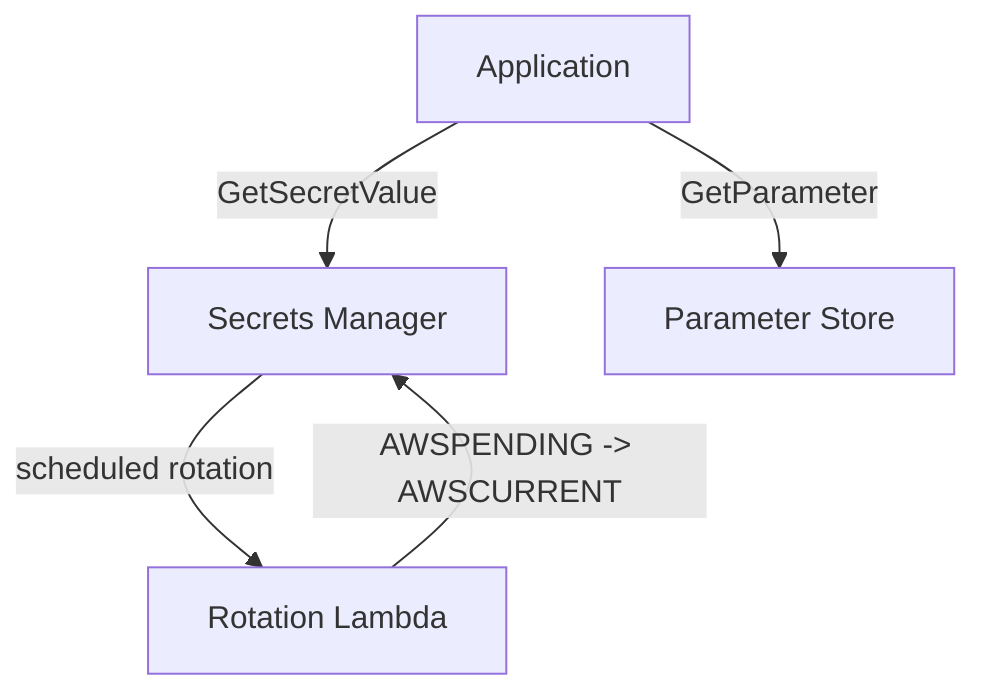


*Source: [AWS Secrets Manager User Guide — "Lambda function rotation strategies"](https://docs.aws.amazon.com/secretsmanager/latest/userguide/rotation-strategy.html), © Amazon Web Services.*

```bash
aws secretsmanager get-secret-value --secret-id prod/db/credentials
aws ssm get-parameters-by-path --path "/app/prod/" --recursive --with-decryption
```

**Exam Tips.**
- Rotation needed → Secrets Manager, regardless of cost. No rotation, cost matters, high volume →
  Parameter Store Standard.
- Both encrypt via KMS — the difference is rotation tooling and pricing, not encryption strength.
- `AWSCURRENT`/`AWSPENDING`/`AWSPREVIOUS` staging labels are Secrets-Manager-specific vocabulary.

**Common Architectures.**
1. *RDS with console-managed rotation.* The RDS console's "manage credentials in Secrets Manager"
   option during database creation automatically wires up rotation with zero manual Lambda
   configuration — a one-click, Secrets-Manager-specific capability.
2. *Mixed-tier configuration strategy.* A large application keeps database passwords and
   third-party OAuth tokens in Secrets Manager (rotation needed) while feature flags and
   environment names live in Parameter Store Standard (no rotation needed, effectively free at
   volume).

**Troubleshooting.**
- *Application can't connect to the database right after a rotation.* Check whether the
  application caches the secret at startup only, rather than re-fetching `AWSCURRENT`
  periodically — this is the single most common cause.
- *`SecureString` value comes back encrypted/garbled.* The call is missing `--with-decryption`
  (CLI) or the SDK's equivalent flag — SecureString values return as ciphertext by default.
- *Hit the 10,000-parameter limit in Parameter Store Standard.* This is the clean signal to
  migrate to Advanced tier, or re-evaluate whether some of those parameters actually belong in
  Secrets Manager instead.

**Additional Exam Scenarios.**
- *"A rotating database credential must be referenced by an ECS task definition with zero
  application code to fetch it."* → reference the Secrets Manager ARN directly in the task
  definition's `secrets` block.
- *"An application needs its entire configuration tree fetched in one call at startup."* →
  Parameter Store's `GetParametersByPath --recursive`, a capability Secrets Manager has no direct
  equivalent for.

**Pricing Model (summary).** Secrets Manager: ~$0.40/secret/month + per-10,000-API-calls fee.
Parameter Store Standard: free up to 10,000 parameters; Advanced tier adds a small per-parameter
and per-API-call charge for higher limits.

**Limits & Quotas.** Secrets Manager: 64 KB max secret size, 500,000 secrets per account (soft).
Parameter Store Standard: 10,000 parameters per account, 4 KB value size; Advanced tier: 100,000
parameters, 8 KB values. Exam-relevant takeaway: hitting the 10,000-parameter Standard-tier ceiling
is the clean, specific signal to either move to Advanced tier or re-evaluate whether some values
actually belong in Secrets Manager.

**Related Terms.** [`services/security-identity-compliance/secrets-manager-vs-parameter-store.md`](../../../services/security-identity-compliance/secrets-manager-vs-parameter-store.md) ·
[`services/security-identity-compliance/kms.md`](../../../services/security-identity-compliance/kms.md) (the
encryption layer underneath both) ·
[`services/management-governance/appconfig.md`](../../../services/management-governance/appconfig.md) (the
third, commonly-confused "store a value" service with a deployment strategy of its own).

---

## 15. AWS Serverless Application Model (SAM)

**Definition.** AWS SAM is an open-source framework for defining serverless applications in a
simplified YAML template, plus a CLI (`sam`) that builds, tests, and deploys it — a thin,
serverless-focused layer built directly on top of CloudFormation.

**Plain-English analogy.** Writing raw CloudFormation for a serverless app is assembling furniture
with every individual screw spelled out by hand. SAM is a furniture kit with pre-assembled
sub-parts for the serverless-specific pieces (a function + its role + its trigger, in one line) —
still real furniture, still inspectable, just far less repetitive to put together.

**Purpose.** Raw CloudFormation for serverless apps means repetitive boilerplate per function. SAM
compresses that into shorthand (`AWS::Serverless::Function` expands into the function, its IAM
role, and event source mappings) while remaining "real" CloudFormation underneath via a transform.

**When to Use.** Fully serverless apps (Lambda + API Gateway + DynamoDB); needing genuinely fast,
fully offline local Lambda testing (`sam local`); wanting CodeDeploy-wrapped canary/blue-green
Lambda deployments declared in a few lines (`DeploymentPreference`).

**When NOT to Use.** Infrastructure spanning broad, non-serverless categories (VPCs, EC2 fleets,
RDS clusters) — raw CloudFormation or CDK fit better there; teams wanting a real general-purpose
programming language with loops/conditionals (use CDK).

**Use Cases.**
1. A Lambda + API Gateway + DynamoDB REST API defined in a handful of SAM resource blocks.
2. `sam local invoke`/`start-api` testing a function fully offline, zero AWS cost, before any
   deployment.
3. `DeploymentPreference: Canary10Percent5Minutes` wiring a full CodeDeploy canary deployment
   declaratively, with pre/post-traffic hooks and alarm-based rollback.
4. Policy templates (`DynamoDBReadPolicy`) granting scoped IAM access without hand-writing policy
   JSON.
5. `sam sync` for a fast dev-loop iteration, explicitly not meant for production deployments.
6. `AWS::Serverless::Application` nesting a published Serverless Application Repository component.

**Why Important.** SAM's `DeploymentPreference` is one of the most directly-tested, most
SAM-specific features on DVA-C03 — it's the concrete mechanism behind declarative Lambda
blue/green and canary deployment.

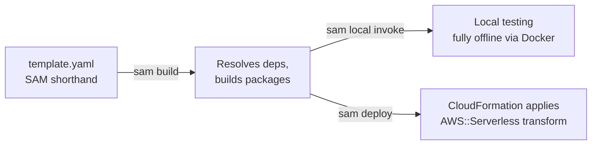


*Source: [AWS SAM Developer Guide — "How AWS SAM works"](https://docs.aws.amazon.com/serverless-application-model/latest/developerguide/what-is-sam-overview.html), © Amazon Web Services.*

```yaml
Resources:
  GetOrderFunction:
    Type: AWS::Serverless::Function
    Properties:
      CodeUri: src/get_order/
      Handler: app.handler
      AutoPublishAlias: live
      DeploymentPreference:
        Type: Canary10Percent5Minutes
        Alarms: [!Ref OrdersErrorAlarm]
```

**Exam Tips.**
- `sam local invoke`/`start-api` is SAM's uniquely strong, directly-tested differentiator — no
  other IaC tool in this family has a built-in local Lambda emulator.
- `DeploymentPreference` is a SAM-only shorthand for CodeDeploy's Lambda traffic-shifting — no
  separate AppSpec file is needed when using it.
- `sam sync` bypasses CloudFormation's changeset mechanism — fast but explicitly not
  production-safe.

**Common Architectures.**
1. *Fully serverless REST API with canary deployment.* `AWS::Serverless::Api` + multiple
   `AWS::Serverless::Function` resources, each with `DeploymentPreference` wired for canary
   rollout and alarm-based rollback — the single most common SAM template shape on DVA-C03.
2. *Nested SAR application.* An `AWS::Serverless::Application` resource references a published
   Serverless Application Repository component (e.g., a Slack notifier) as a nested stack,
   composing pre-built functionality instead of reimplementing it.

**Troubleshooting.**
- *`sam deploy` fails with a transform error.* Almost always a SAM syntax mistake — `sam validate`
  catches most of these before any deploy attempt.
- *`sam local invoke` works but the deployed function behaves differently.* Check for environment
  variables or IAM permissions present in the real deployed environment but not replicated in the
  local invoke's configuration — `sam local` emulates the runtime, not every deployed setting.
- *Canary deployment hangs indefinitely.* The hook function failed to call
  `PutLifecycleEventHookExecutionStatus`, or lacks permission to do so — check the hook's own
  CloudWatch Logs, not the deployed function's.

**Additional Exam Scenarios.**
- *"A developer wants to test a Lambda function's behavior locally, including a simulated API
  Gateway event, fully offline before any deployment."* → `sam local start-api` — the uniquely-SAM
  feature among the three IaC tools.
- *"A function needs least-privilege DynamoDB read access without hand-writing an IAM policy
  document."* → a SAM policy template (`DynamoDBReadPolicy`), scoped via `TableName`.

**Pricing Model (summary).** SAM itself is free and open source; you pay for whatever resources it
provisions (Lambda, API Gateway, DynamoDB, CodeDeploy if `DeploymentPreference` is used).

**Limits & Quotas.** Inherits CloudFormation's 500-resource-per-stack limit (easy to hit faster
than expected, since one `AWS::Serverless::Function` expands into 5+ raw resources at transform
time). Exam-relevant takeaway: a seemingly small SAM template failing to deploy with a
resource-limit error is testing whether you understand the transform's expansion, not a SAM-
specific bug.

**Related Terms.** [`services/developer-tools/sam.md`](../../../services/developer-tools/sam.md) ·
[`services/developer-tools/codedeploy.md`](../../../services/developer-tools/codedeploy.md) (the
engine behind `DeploymentPreference`) ·
[`services/management-governance/cdk.md`](../../../services/management-governance/cdk.md) (the
programmatic alternative).

---

## 16. Amazon API Gateway

**Definition.** Amazon API Gateway is a fully managed service for creating, publishing, securing,
and monitoring APIs — the "front door" between API clients and backend logic (Lambda, HTTP
servers, other AWS services), handling routing, auth, throttling, and transformation.

**Plain-English analogy.** Building an API without API Gateway is running a restaurant with no
host stand — customers walk straight into the kitchen, nobody checks a reservation, and the chefs
get overwhelmed with no pacing. API Gateway is the host stand: it checks who's allowed in
(authorizers), paces how fast tables get sat (throttling), and routes each guest to the right
section (routes/integrations) before the kitchen ever sees them.

**Purpose.** Building a production API by hand means solving authentication, rate limiting,
request validation, CORS, versioning, and monitoring before writing any business logic. API
Gateway handles all of that as a managed, auto-scaling layer so developers focus on backend logic.

**When to Use.** Any Lambda-backed or HTTP-backed API needing managed auth/throttling/versioning;
partner/monetized APIs needing usage plans and API keys; WebSocket-based real-time applications.

**When NOT to Use.** Extremely high-throughput internal service-to-service traffic where the
per-request cost and added hop are unnecessary overhead (use direct ALB/NLB or VPC Lattice);
GraphQL APIs (use AppSync instead).

**Use Cases.**
1. A serverless REST/HTTP API backed by Lambda and DynamoDB, scaling automatically.
2. Usage plans and API keys metering free/pro/enterprise tiers of a monetized partner API.
3. A Private REST API reachable only via a VPC interface endpoint, never the public internet.
4. A WebSocket API for a real-time chat/dashboard application with `$connect`/`$disconnect`
   lifecycle routes.
5. Stage variables enabling safe dev/prod configuration separation without duplicating the API.
6. CloudFront placed in front of API Gateway for edge caching and DDoS absorption on a public API.

**Why Important.** Central to DVA-C03 Task 3.1 (configuring stages as part of the deployment
artifact) and one of the most tested services overall since API Gateway + Lambda is the primary
serverless development pattern on this exam.

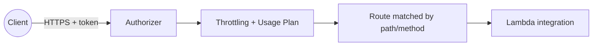


*Source: [AWS Docs — "What is Amazon API Gateway?"](https://docs.aws.amazon.com/apigateway/latest/developerguide/welcome.html), © Amazon Web Services.*

```bash
aws apigateway put-integration --rest-api-id <api-id> --resource-id <res-id> \
  --http-method GET --type AWS_PROXY --integration-http-method POST \
  --uri arn:aws:apigateway:us-east-1:lambda:path/2015-03-31/functions/arn:aws:lambda:us-east-1:123456789012:function:GetOrder/invocations
```

**Exam Tips.**
- HTTP API: cheaper, lower-latency, simple JWT auth. REST API: API keys, usage plans, caching,
  private VPC-only APIs — pick based on which feature set the scenario names.
- The **29-second integration timeout is hard**, not raisable — a long-running backend needs an
  asynchronous redesign, not a limit increase request.
- Throttling is layered (account, method, usage plan) — the most restrictive limit wins.

**Common Architectures.**
1. *Multi-tier partner API with usage plans.* Multiple external partners each get their own API
   key tied to a usage plan with distinct rate limits, letting one API serve differently-tiered
   consumers from the same underlying routes.
2. *Private, VPC-internal API.* A REST API configured as `PRIVATE`, reachable only through an
   interface VPC endpoint, with a resource policy restricting invocation to specific endpoints —
   for internal microservice APIs that should never be publicly exposed.

**Troubleshooting.**
- *Requests intermittently fail with 429 even though overall traffic looks fine.* Check all three
  throttling layers — a tighter-than-expected usage-plan limit for one specific API key is a very
  common cause even when account-wide traffic looks healthy.
- *CORS errors despite the Lambda returning the correct header.* In proxy integrations, CORS
  headers must be returned by the function on *every* response including errors, and the OPTIONS
  preflight method must be explicitly configured — API Gateway doesn't inject CORS automatically.
- *A private API returns 403 even from inside the VPC.* Check the resource policy explicitly names
  the specific VPC endpoint ID — a private API type alone doesn't automatically trust every
  endpoint.

**Additional Exam Scenarios.**
- *"A mobile app backend needs low cost, low latency, simple JWT auth, no usage plans needed."* →
  HTTP API, not REST API.
- *"A data-processing endpoint occasionally needs more than a minute to complete."* → the
  29-second integration timeout is a hard ceiling; redesign for an asynchronous pattern.

**Pricing Model (summary).** Billed per API call (HTTP APIs cheaper per-call than REST) plus data
transfer out; REST APIs add optional hourly caching charges if enabled.

**Limits & Quotas.** 10,000 requests/sec account-level steady-state (soft, Region-dependent); 29
second hard integration timeout; 10 MB payload size; 300 resources per REST API. Exam-relevant
takeaway: the 29-second timeout being **non-adjustable** is the single most-tested limit in this
section — don't propose a limit-increase request as the answer to a long-running-backend scenario.

**Related Terms.** [`services/networking-content-delivery/api-gateway.md`](../../../services/networking-content-delivery/api-gateway.md) ·
[`services/compute/lambda.md`](../../../services/compute/lambda.md) (most common integration
target) ·
[`services/networking-content-delivery/vpc-endpoints-privatelink.md`](../../../services/networking-content-delivery/vpc-endpoints-privatelink.md) (private
API access).

---

## 17. Amazon CloudWatch

**Definition.** Amazon CloudWatch is AWS's monitoring and observability service — metrics, logs,
dashboards, alarms, and Logs Insights queries, with most AWS services reporting to it automatically
at zero setup cost.

**Plain-English analogy.** Running infrastructure without CloudWatch is flying a plane with no
instrument panel — you only know something's wrong when you feel the crash. CloudWatch is the
instrument panel: altitude, speed, and engine temperature (metrics) are visible continuously, and
alarms sound before the situation becomes a crash.

**Purpose.** Running infrastructure without monitoring means finding out about outages from
customers, not metrics. CloudWatch turns "it feels slow" into a number you can alert on, built into
every major AWS service automatically.

**When to Use.** Any production workload, always; specifically for Domain 3: CloudWatch alarms
driving CodeDeploy's automatic rollback, and metrics informing deployment bake-time health checks.

**When NOT to Use.** N/A as a yes/no choice — but third-party/open-source observability stacks
(Prometheus/Grafana) may be chosen alongside or instead of CloudWatch-native dashboards depending
on an org's existing tooling investment, which is a real-world (not typically exam) consideration.

**Use Cases.**
1. A CloudWatch alarm on 5xx error rate associated with a CodeDeploy deployment group, driving
   automatic rollback.
2. Logs Insights querying structured application logs for a specific error pattern during an
   incident.
3. Custom metrics (via `put-metric-data` or embedded metric format) tracking business-specific KPIs.
4. Dashboards aggregating metrics across many services into one operational view.
5. Container Insights surfacing Fargate task CPU/memory utilization for right-sizing decisions.
6. A metric filter counting ERROR log lines as a custom metric feeding an alarm.

**Why Important.** The metric data a rollback decision is based on, throughout this entire domain
— CodeDeploy, AppConfig, and ECS circuit breakers all ultimately depend on CloudWatch alarms to
know when something's actually wrong.

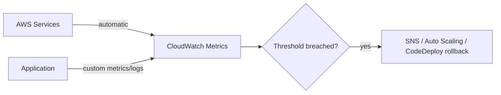


*Source: [Amazon CloudWatch User Guide](https://docs.aws.amazon.com/AmazonCloudWatch/latest/monitoring/CloudWatch-default-dashboard.html), © Amazon Web Services.*

```bash
aws cloudwatch put-metric-alarm --alarm-name checkout-high-error-rate \
  --namespace CheckoutApp --metric-name CheckoutErrors --statistic Sum \
  --period 300 --evaluation-periods 1 --threshold 5 \
  --comparison-operator GreaterThanThreshold
```

**Exam Tips.**
- CodeDeploy's alarm-based rollback requires an alarm **explicitly associated with the deployment
  group** — a scenario describing "rollback didn't happen even though things were clearly broken"
  is almost always testing this missing association.
- Metric filters (log-derived custom metrics) are distinct from application-emitted custom
  metrics — know both paths exist.
- CloudWatch is the bridge between Domain 3 (deployment) and Domain 4 (troubleshooting) — the same
  alarms serve both purposes.

**Common Architectures.**
1. *Alarm-gated automatic rollback.* A CloudWatch alarm on 5xx error rate, explicitly associated
   with a CodeDeploy deployment group, drives automatic rollback the moment the shift to a new
   version starts producing real errors in production.
2. *Metric filter deriving a custom metric from logs.* A metric filter counts `ERROR` log lines
   from a Lambda function's log group as a custom namespace/metric, which an alarm then watches —
   turning unstructured log text into an alertable number.

**Troubleshooting.**
- *An alarm never enters `ALARM` state despite clearly elevated errors.* Check the alarm's
  evaluation period and datapoints-to-alarm configuration — a single noisy spike may not satisfy
  "N out of M periods breached" depending on how strictly the alarm is configured.
- *A metric filter shows zero matches despite obvious ERROR lines in the logs.* Check the filter
  pattern's exact syntax against a sample log line — CloudWatch Logs filter patterns are
  case-sensitive and have specific matching syntax that's easy to get subtly wrong.
- *Dashboard widgets show gaps or "No data."* Confirm the metric's namespace/dimensions match
  exactly what's being emitted — a typo'd dimension name silently results in an empty graph, not
  an error.

**Additional Exam Scenarios.**
- *"A monitoring alarm should automatically trigger a rollback during a deployment, not just alert
  a human."* → configure CodeDeploy's rollback to trigger on the CloudWatch alarm's state, not
  just on deployment failure.
- *"ERROR-level log lines need to become an alertable metric without changing application code."*
  → a CloudWatch Logs metric filter translating a log pattern into a custom metric.

**Pricing Model (summary).** Billed per custom metric, per alarm, per GB of logs ingested/stored,
and per dashboard beyond a free tier; most AWS-service-native metrics are free.

**Limits & Quotas.** 1-second finest custom metric resolution; 500 alarms per account (soft,
adjustable); Logs Insights query limited to a 20-field result set per query by default.
Exam-relevant takeaway: the exam cares most about the architectural fact that alarms need explicit
association with whatever they're meant to gate (a CodeDeploy deployment group, an Auto Scaling
policy) — standing alone, an alarm does nothing but notify.

**Related Terms.** [`services/management-governance/cloudwatch.md`](../../../services/management-governance/cloudwatch.md) ·
[`services/developer-tools/codedeploy.md`](../../../services/developer-tools/codedeploy.md) (alarm-
driven rollback consumer) ·
[`services/containers/ecs.md`](../../../services/containers/ecs.md) (Container Insights).

---

## 18. Amazon Elastic Container Registry (ECR)

**Definition.** Amazon ECR is a fully managed, private Docker/OCI container image registry — the
AWS-hosted equivalent of Docker Hub, private by default, tightly integrated with IAM.

**Plain-English analogy.** Pulling images directly from a public registry on every deploy is
borrowing a book from a public library every single time you need it, hoping it's still on the
shelf. ECR is buying your own copy and keeping it on your own shelf — always available, under
your own access control.

**Purpose.** Container images need somewhere with strong access control, reliability, and tight
integration with what's going to run them. ECR puts the registry inside your AWS account
boundary, governed by the same IAM policies as everything else.

**When to Use.** Any container workload on ECS/EKS/Fargate/Lambda; strict push/pull access control
per CI pipeline; vulnerability-gated deployment pipelines; multi-region/account DR replication.

**When NOT to Use.** Deliberately distributing open-source images publicly at scale (use ECR
Public or Docker Hub instead); an org already standardized on another registry with existing CI
integration and no AWS-compute-specific need to switch.

**Use Cases.**
1. A repository resource policy restricting push access to only the CI pipeline's IAM role.
2. Lifecycle policies automatically expiring untagged images after N days, controlling storage
   cost.
3. Enhanced (Inspector-powered) scanning continuously rescanning stored images as new CVEs publish.
4. Cross-region/cross-account replication for disaster recovery, preserving tags and digests.
5. A pull-through cache rule serving repeat pulls of public base images from inside AWS.
6. Pulling images from a fully private subnet via `ecr.api`/`ecr.dkr`/`s3` VPC endpoints.

**Why Important.** Explicitly named in DVA-C03 Task 3.1 ("Build container images for ECR") — one
of the most directly-tested container topics on this exam.

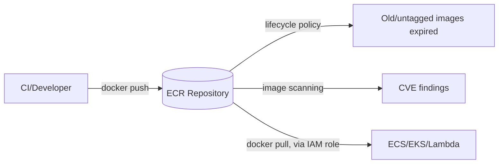


*Source: [Amazon ECR User Guide — "Automate the cleanup of images"](https://docs.aws.amazon.com/AmazonECR/latest/userguide/LifecyclePolicies.html), © Amazon Web Services.*

```bash
aws ecr get-login-password --region us-east-1 | docker login --username AWS \
  --password-stdin 123456789012.dkr.ecr.us-east-1.amazonaws.com
docker push 123456789012.dkr.ecr.us-east-1.amazonaws.com/orders-api:$(git rev-parse --short HEAD)
```

**Exam Tips.**
- ECR never runs your container — it only stores/serves the image; confusing it with ECS/EKS (the
  runtime) is a common trap.
- Lifecycle policy rules are **priority-ordered and short-circuit per image** — a broad rule placed
  before a narrow, protective rule wins, which is a frequent trap.
- "Fully private subnet needs to pull an image" → VPC endpoints for `ecr.api`, `ecr.dkr`, and `s3`.

**Common Architectures.**
1. *Vulnerability-gated promotion.* Enhanced (Inspector-powered) scanning results feed an
   EventBridge rule that blocks an image's promotion to the next pipeline stage until Critical/High
   findings are resolved.
2. *Cross-account replication for disaster recovery.* A platform account's canonical, scanned
   images replicate automatically into each application team's own account and into a DR Region,
   preserving tags and digests exactly.

**Troubleshooting.**
- *`docker push`/`pull` fails with "no basic auth credentials."* The Docker login token from
  `get-login-password` expires after 12 hours — re-authenticate rather than assuming a persistent
  credentials issue.
- *A tag that should be "latest" is actually an old image.* Tags are mutable by default — without
  tag immutability enabled, a later push with the same tag silently repoints it; a common cause of
  "I deployed new code but the old version is still running."
- *A lifecycle policy deleted an image that was still needed.* Almost always a rule-ordering bug —
  use `start-lifecycle-policy-preview` to dry-run a policy's effect before applying it for real.

**Additional Exam Scenarios.**
- *"Old, untagged ECR images must be cleaned up automatically after 24 hours, but production-
  tagged images must never be deleted regardless of age."* → a lifecycle policy with a
  higher-priority rule for untagged images and a lower-priority, narrowly-scoped rule for
  production tags — never one catch-all rule.
- *"A CI pipeline must authenticate to ECR with no long-lived credentials in the build
  environment."* → `aws ecr get-login-password`, exchanging the build role's temporary STS
  credentials for a short-lived Docker login token.

**Pricing Model (summary).** Billed per GB-month of stored image data; same-Region pulls to AWS
compute are free; enhanced scanning is billed separately per image scanned.

**Limits & Quotas.** 10,000 repositories per Region (soft); 10 GiB maximum per image layer; 100
lifecycle policy rules per repository. Exam-relevant takeaway: lifecycle policies being
priority-ordered and short-circuiting per image is the single most tested behavioral fact here,
mattering far more than the raw rule-count ceiling.

**Related Terms.** [`services/containers/ecr.md`](../../../services/containers/ecr.md) ·
[`services/containers/ecs.md`](../../../services/containers/ecs.md),
[`services/containers/eks.md`](../../../services/containers/eks.md) (consumers of its images) ·
[`services/developer-tools/codebuild.md`](../../../services/developer-tools/codebuild.md) (typical
publisher of new images).

---

## 19. Amazon Elastic Container Service (ECS)

**Definition.** Amazon ECS is a fully managed container orchestrator — you tell it "run 3 copies
of this container, keep them healthy," and ECS handles scheduling, restarting, and load-balancer
wiring.

**Plain-English analogy.** Running containers without an orchestrator is managing a restaurant
shift by yelling instructions at individual cooks one at a time. ECS is the shift manager who
automatically reassigns a station the moment a cook calls in sick, without you lifting a finger.

**Purpose.** Before orchestrators, running containers at scale meant hand-rolling your own
scheduler. ECS is AWS's own container orchestrator, deeply integrated with the rest of AWS
(IAM, ALB, CloudWatch) without needing a separate control plane to manage.

**When to Use.** Container workloads wanting deep native AWS integration without adopting the
broader Kubernetes ecosystem; teams not already invested in Kubernetes tooling/expertise.

**When NOT to Use.** Teams with existing Kubernetes expertise, Helm charts, or multi-cloud
Kubernetes needs (use EKS instead) — ECS's API is AWS-proprietary, not portable elsewhere.

**Use Cases.**
1. A web service behind an ALB, scaled automatically by Application Auto Scaling.
2. Blue/green deployment via CodeDeploy using a second target group.
3. Scheduled batch jobs via `RunTask`, with no persistent service running between jobs.
4. The ECS deployment circuit breaker automatically rolling back a crash-looping task revision
   with zero CloudWatch alarm configuration required.
5. Service discovery via Cloud Map for internal microservice-to-microservice calls.
6. Capacity provider strategies mixing Fargate and Fargate Spot for cost optimization.

**Why Important.** Explicitly named in DVA-C03 Task 3.3's new container-deployment emphasis
(ECS/EKS/Fargate), with its own distinct deployment circuit breaker behavior worth distinguishing
from CodeDeploy's alarm-based rollback.

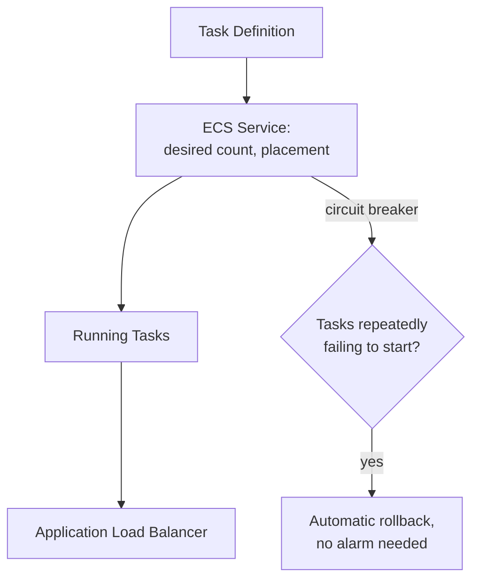


*Source: [Amazon ECS Developer Guide](https://docs.aws.amazon.com/AmazonECS/latest/developerguide/Welcome.html), © Amazon Web Services.*

```json
{
  "family": "checkout-service",
  "networkMode": "awsvpc",
  "requiresCompatibilities": ["FARGATE"],
  "cpu": "256",
  "memory": "512",
  "containerDefinitions": [{"name": "checkout", "image": "123456789012.dkr.ecr.us-east-1.amazonaws.com/checkout:v3"}]
}
```

**Exam Tips.**
- ECS's **deployment circuit breaker** is distinct from CodeDeploy's alarm-based rollback — the
  circuit breaker needs zero alarm configuration and reacts to deployment-level health failures.
- `register-task-definition` never overwrites — it creates a new numbered revision; `update-service`
  shifts the running service to it.
- "No servers to manage" + ECS points at the **Fargate launch type**, not ECS itself as a separate
  axis.

**Common Architectures.**
1. *ALB-fronted web service, fully serverless from edge to compute.* CloudFront/ALB → ECS Service
   on Fargate (private subnets) → RDS/DynamoDB — zero EC2 instances anywhere in the request path.
2. *Deployment circuit breaker protecting against a crash-looping release.* An ECS service
   configured with the deployment circuit breaker automatically detects a new task set repeatedly
   failing to reach a healthy state and rolls back to the previous task definition revision, with
   zero CloudWatch alarm configuration required.

**Troubleshooting.**
- *A service's tasks keep stopping and restarting.* Check the task's own exit code/stopped reason
  via `describe-tasks` — often a health check failure or an application crash, not an
  orchestration-layer problem.
- *`update-service` doesn't seem to deploy the new task definition.* Confirm `--force-new-
  deployment` was passed if the task definition family name didn't change, or confirm the new
  revision number is actually referenced — ECS won't redeploy a service pointed at an unchanged
  task definition reference.
- *The deployment circuit breaker didn't trigger despite an obviously broken release.* Confirm it's
  actually enabled on the service — it's an opt-in deployment configuration, not a default
  behavior.

**Additional Exam Scenarios.**
- *"A new container-based microservice must scale automatically without managing EC2 instances."*
  → ECS (or EKS) on **Fargate**, not self-managed EC2-backed ECS/EKS.
- *"An ECS deployment should automatically roll back if the new task set never reaches a healthy
  state, without any alarm configuration."* → the ECS deployment circuit breaker, distinct from
  CodeDeploy's alarm-based rollback.

**Pricing Model (summary).** No separate ECS orchestration fee — you pay for the underlying
compute (EC2 instance-hours or Fargate per-second billing) the tasks run on.

**Limits & Quotas.** 5,000 services per cluster (soft); 10 container definitions per task
definition (soft); task definition revisions are immutable and unlimited in count. Exam-relevant
takeaway: the "revisions are immutable, never overwritten" fact is the one most directly tested —
a rollback is always "point the service at a previous revision," never "edit and redeploy the
same revision."

**Related Terms.** [`services/containers/ecs.md`](../../../services/containers/ecs.md) ·
[`services/containers/fargate.md`](../../../services/containers/fargate.md) (its most common
launch type) ·
[`services/developer-tools/codedeploy.md`](../../../services/developer-tools/codedeploy.md) (ECS
blue/green deployments).

---

## 20. Amazon Elastic Kubernetes Service (EKS)

**Definition.** Amazon EKS runs upstream, certified Kubernetes for you — you keep the standard
Kubernetes API and ecosystem while AWS manages the control plane.

**Plain-English analogy.** Self-managing Kubernetes is building and maintaining your own
power plant to run your factory. EKS is plugging into the public power grid — you still run your
machines (workloads) exactly the same way, you just stop operating the power plant (control plane)
yourself.

**Purpose.** Kubernetes is the industry-standard container orchestrator outside AWS too — many
orgs already have Kubernetes expertise, Helm charts, and multi-cloud/on-prem clusters, and want the
same API on AWS rather than learning ECS's proprietary model.

**When to Use.** Teams with existing Kubernetes expertise/tooling; multi-cloud or hybrid
on-prem-plus-AWS Kubernetes strategies; needing the broader Kubernetes ecosystem (Helm, operators,
custom controllers).

**When NOT to Use.** A team with zero existing Kubernetes investment that just needs to run
containers on AWS as simply as possible — ECS's shallower learning curve and tighter native AWS
integration usually wins there.

**Use Cases.**
1. A multi-cloud organization running the identical Kubernetes manifests on AWS and another cloud.
2. Leveraging an existing Helm chart library without rewriting for a proprietary orchestrator API.
3. EKS Fargate profiles running pods without managing any EC2 node fleet at all.
4. Custom Kubernetes operators managing complex, stateful application lifecycles.
5. A platform team standardizing CI/CD (CodeCommit→CodePipeline→CodeBuild→ECR) deploying into EKS
   alongside existing on-prem Kubernetes workloads.
6. Fine-grained node group management (GPU node groups) for ML workloads needing Kubernetes-native
   scheduling.

**Why Important.** Named alongside ECS/Fargate in DVA-C03 Task 3.3's container-deployment
emphasis — recognizing when a scenario's Kubernetes-specific vocabulary (Helm, operators, pods)
points to EKS instead of ECS is a direct, testable skill.

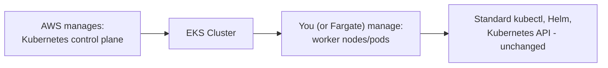


*Source: [AWS Reference Architecture Diagrams](https://docs.aws.amazon.com/reference-architecture-diagrams/latest/modernize-applications-with-microservices-using-amazon-eks/modernize-applications-with-microservices-using-amazon-eks.md), © Amazon Web Services.*

```bash
eksctl create cluster --name demo-cluster --fargate
kubectl apply -f deployment.yaml
kubectl get pods
```

**Exam Tips.**
- "Kubernetes-native vocabulary" (Helm, pods, operators, kubectl) in a scenario points to EKS, not
  ECS, even if the underlying need (run containers) sounds identical to an ECS use case.
- EKS still benefits from Fargate as a launch type, exactly like ECS does — "no nodes to manage" +
  EKS points to EKS Fargate profiles.
- CodeDeploy's ECS-specific blue/green support does **not** extend to EKS — EKS deployments
  typically use Kubernetes-native rolling updates or a service mesh/Argo Rollouts instead.

**Common Architectures.**
1. *Full CI/CD into EKS.* CodeCommit (or GitHub) → CodePipeline → CodeBuild → ECR → EKS, with
   `kubectl`/Helm-based deployment steps replacing CodeDeploy's ECS-specific blue/green action,
   since that action targets ECS Services specifically, not Kubernetes Deployments.
2. *Mixed node group and Fargate profile cluster.* A cluster runs stateless, bursty workloads on
   EKS Fargate profiles while GPU-dependent or DaemonSet workloads run on a traditional managed
   node group — matching each workload's actual constraint to the right compute layer within one
   cluster.

**Troubleshooting.**
- *Pods stuck in `Pending` on a Fargate profile.* Check the Fargate profile's selector (namespace/
  labels) actually matches the pod — a mismatched selector means the pod never gets scheduled onto
  Fargate at all, and there's no node group fallback unless one is separately configured.
- *`kubectl` commands fail with an authentication error.* Confirm the IAM principal is mapped in
  the cluster's `aws-auth` ConfigMap (or access entries) — IAM identity alone isn't sufficient
  without this Kubernetes-side mapping.
- *A DaemonSet never schedules any pods.* DaemonSets require actual nodes — they cannot run on
  Fargate profiles at all, since Fargate has no node concept; use a managed node group instead.

**Additional Exam Scenarios.**
- *"A platform team with existing Helm charts and Kubernetes operators wants to run the same
  workloads on AWS without rewriting for a proprietary orchestrator API."* → EKS, preserving the
  standard Kubernetes API/tooling investment.
- *"A DaemonSet-based logging agent needs to run on every node in the cluster."* → a managed node
  group, not Fargate profiles, since Fargate has no node concept for DaemonSets to schedule onto.

**Pricing Model (summary).** A per-cluster-hour control-plane fee, plus the underlying compute
(EC2 node groups or Fargate per-second billing) the pods actually run on.

**Limits & Quotas.** 100 nodes per managed node group (soft); 4 Fargate profiles per cluster
(soft); standard Kubernetes per-namespace resource quotas apply exactly as upstream. Exam-relevant
takeaway: EKS's own AWS-specific limits (cluster/node-group counts) are rarely tested in depth —
standard Kubernetes resource-management concepts (namespaces, resource quotas, pod limits) carry
over unchanged and are more likely to appear in a question's scenario description.

**Related Terms.** [`services/containers/eks.md`](../../../services/containers/eks.md) ·
[`services/containers/fargate.md`](../../../services/containers/fargate.md) (its serverless
compute layer) ·
[`services/containers/ecs.md`](../../../services/containers/ecs.md) (the AWS-proprietary
alternative orchestrator).

---

## 21. Containers vs. VMs vs. Serverless

**Definition.** Three different answers to "how much of the computer do I want to manage myself,
versus hand to AWS?" — a VM (EC2) is a full emulated computer with its own OS kernel; a container
shares the host's kernel in a lightweight, portable unit; serverless (Lambda) removes the server
concept almost entirely.

**Plain-English analogy.** A VM is renting an entire house — your own walls, your own utilities,
full control, full responsibility. A container is renting an apartment in a shared building — your
own unit, but the building's plumbing and structure (the kernel) are shared and someone else
maintains them. Serverless is staying in a hotel room booked by the night — you show up, use it,
and leave; someone else handles literally everything about the building, you never even see the
staff.

**Purpose.** Every cloud architecture decision starts here: how much infrastructure do you want to
own? Each model trades control for reduced operational burden, differently on cost, startup
latency, portability, and flexibility.

**When to Use.** VMs: legacy software licensed to a specific kernel/hardware identity, GPU-heavy
training needing direct hardware access. Containers: microservices migrations wanting consistent
packaging and fast scaling. Serverless: event-driven, bursty, short-lived processing wanting zero
idle cost.

**When NOT to Use.** VMs for stateless workloads that fit a container (pure ops overhead).
Containers for extremely short, bursty, low-traffic handling where even a container's few-second
startup is overkill. Serverless for long-running (>15 min) processes or very high, constant,
24/7 traffic where per-invocation billing costs more than a steady container/EC2 fleet.

**Use Cases.**
1. GPU-heavy ML training needing specific drivers/kernel modules → EC2 (VM level).
2. A microservices migration off a monolith wanting consistent packaging → containers.
3. Infrequent, bursty webhook/glue processing → serverless (Lambda).
4. A pipeline mixing short Lambda steps and a long Fargate `RunTask` step via Step Functions.
5. Multi-tenant SaaS isolation via per-tenant Fargate tasks rather than separate VMs per tenant.
6. A hybrid system: Fargate web API + Lambda async image processing + an EC2 GPU nightly batch job
   — all three layers in one real production system.

**Why Important.** Directly listed in SAA-C03 Domain 2/4 and DVA-C03 Domain 1/3 as the
foundational compute-model mental model — "serverless is always cheaper" is a reliable wrong-answer
trap the exam tests repeatedly.

```mermaid
flowchart TB
    subgraph VM["VMs (EC2)"]
        HV[Hypervisor] --> VM1[Guest OS + App]
    end
    subgraph CTR["Containers (ECS/EKS)"]
        Host[Host Kernel] --> C1[Container: App + libs]
    end
    subgraph SL["Serverless (Lambda)"]
        Event[Event] --> Fn[Function runs,\nscales to zero when idle]
    end
```


*Source: [AWS Architecture Blog — "Compute Abstractions on AWS: A Visual Story"](https://aws.amazon.com/blogs/architecture/compute-abstractions-on-aws-a-visual-story/), © Amazon Web Services.*

```bash
# Same workload, three abstraction levels (see full worked example in containers-vs-vms-vs-serverless.md)
aws ec2 run-instances --image-id ami-0abc --instance-type t3.medium        # VM
aws ecs run-task --cluster demo --task-definition web-api --launch-type FARGATE  # Container
aws lambda invoke --function-name web-api-fn out.json                      # Serverless
```

**Exam Tips.**
- A workload needing **>15 minutes continuous execution** can never be vanilla Lambda — instant
  disqualifier.
- A workload needing **GPUs or custom kernel modules** can never run on Fargate — instant
  disqualifier regardless of how attractive Fargate's simplicity sounds.
- "Constant, high, predictable 24/7 traffic" is the counter-intuitive case where **serverless is
  likely more expensive** than Reserved EC2/Fargate — a classic inverted-intuition trap.

**Common Architectures.**
1. *Full-spectrum hybrid system.* A real production system rarely lives at exactly one abstraction
   level — a web API runs on Fargate (containers), an async image-processing step runs on Lambda
   (serverless) triggered by an S3 event, and a GPU-based nightly training job runs on dedicated
   EC2 (VM), because Fargate doesn't support GPUs at all.
2. *Incremental lift-and-shift to serverless.* A legacy monolith starts as an EC2 Auto Scaling
   Group, gets containerized without rearchitecting (same monolith, now in Docker, on ECS EC2
   launch type), migrates to Fargate once comfortable, and finally has specific stateless endpoints
   peeled off into Lambda — a realistic incremental journey, not a single leap.

**Troubleshooting.**
- *A Lambda-based system got more expensive as traffic grew, despite "serverless scales
  automatically."* Not a bug — per-invocation billing scales linearly (or worse) with volume; the
  fix is re-evaluating the compute choice at the new traffic level, not debugging Lambda config.
- *A container deployment takes much longer to recover from a crash than the old VM did.* Usually
  a misconfigured health check or a slow-starting image (large layers, slow app boot), not an
  inherent container weakness — containers should start in seconds.
- *A GPU workload was moved to Fargate and model inference stopped working.* Expected — Fargate
  does not support GPUs at all; this is a hard platform limitation, not a configuration gap.

**Additional Exam Scenarios.**
- *"A workload has highly variable, unpredictable traffic with long idle periods, and the team has
  no dedicated operations staff."* → Fargate or Lambda — the "no ops staff" detail rules out EC2
  launch type's patch/capacity-management burden.
- *"A workload runs 24/7 at consistently high, predictable utilization, and the team already has
  strong EC2 operational practices."* → EC2 with Savings Plans, *not* serverless — the trap
  question designed to catch people who default to "serverless is always cheaper."

**Pricing Model (summary).** VM: per instance-hour regardless of utilization. Containers: EC2
launch type bills like EC2; Fargate bills per-second for the reservation regardless of actual
usage. Serverless: per invocation plus GB-seconds of actual execution — true pay-per-use,
including scaling to $0 when idle.

**Limits & Quotas.** VM: effectively unbounded single-instance size (hundreds of vCPUs available).
Container (Fargate): 16 vCPU / 120 GB per task. Serverless (Lambda): 15-minute duration, 10 GB
memory. Exam-relevant takeaway: several questions are purely testing whether you know these hard
ceilings exist at all — a 20-minute batch job or a 64-vCPU single-container requirement is designed
to eliminate Lambda or Fargate respectively, independent of any other architectural consideration.

**Related Terms.** [`services/containers/containers-vs-vms-vs-serverless.md`](../../../services/containers/containers-vs-vms-vs-serverless.md) ·
`../compute/ec2.md`, [`services/compute/lambda.md`](../../../services/compute/lambda.md) (the two
anchors of this spectrum) ·
[`services/containers/ecs.md`](../../../services/containers/ecs.md),
[`services/containers/eks.md`](../../../services/containers/eks.md),
[`services/containers/fargate.md`](../../../services/containers/fargate.md) (the middle of the
spectrum).

---

*End of MASTER-CHUNK.md. For the domain-level narrative tying these 21 topics into one CI/CD
pipeline, see [`README.md`](README.md). For hands-on exercises, see [`labs.md`](labs.md). For the
three new deep-dive topic docs this chunk complements, see
[`blue-green-canary-linear-deployment-strategies.md`](blue-green-canary-linear-deployment-strategies.md),
[`testing-strategies-for-serverless-apps.md`](testing-strategies-for-serverless-apps.md), and
[`iac-drift-detection-and-remediation.md`](iac-drift-detection-and-remediation.md).*
