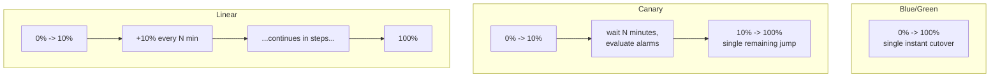
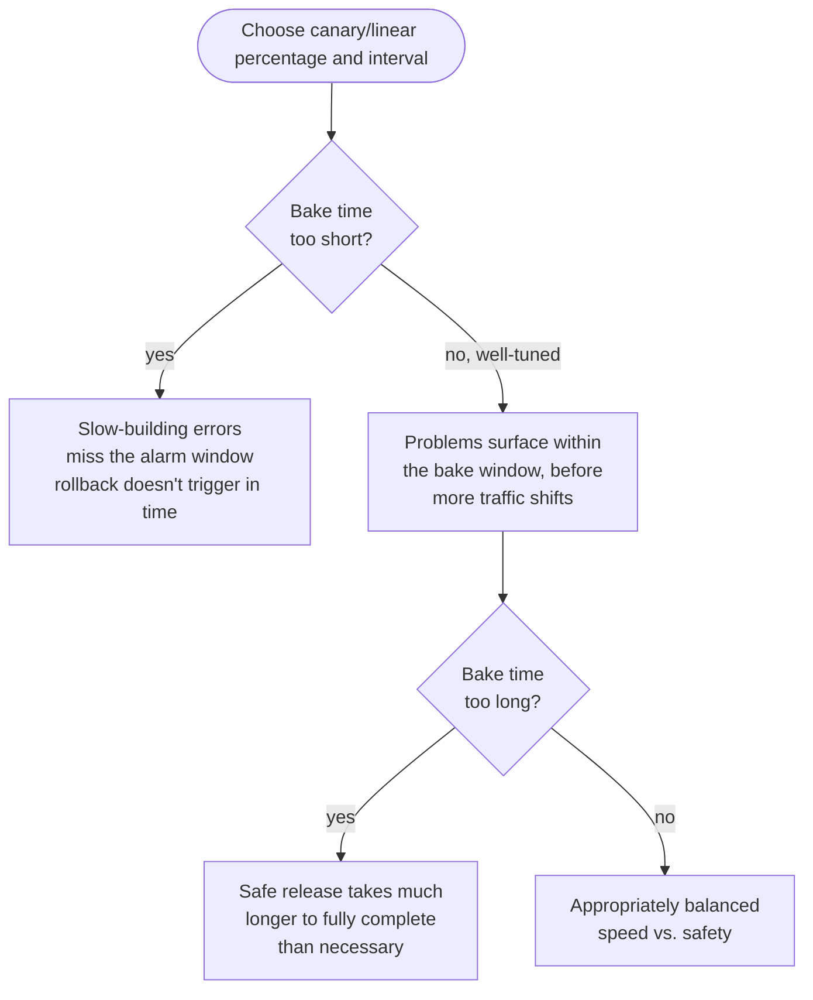

# Blue/Green vs. Canary vs. Linear Deployment Strategies

> **Domain:** [DVA-C03 Domain 3 — Testing and Deployment](README.md) · Task 3.3


## Definition

Blue/green, canary, and linear are three different **traffic-shifting shapes** CodeDeploy (or
SAM's `DeploymentPreference`, which wraps CodeDeploy) can use to move live traffic from an old
application version to a new one. They answer the same question — "how fast, and in what
pattern, does the new version start receiving real users?" — with three different answers, each
trading rollback speed, blast-radius control, and infrastructure cost differently.

## Plain-English analogy

Picture opening a renovated restaurant:
- **Blue/green** is building an entire second dining room next door, fully staffed and ready,
  then one evening simply redirecting every reservation to the new room. If the new room has a
  problem (the oven's broken), you redirect everyone straight back to the old room instantly —
  it never closed.
- **Canary** is quietly seating 10% of tonight's reservations in the renovated room first, while
  90% still go to the old one. If those first few tables have a bad experience, you stop seating
  anyone else there and only those 10% were affected.
- **Linear** is the same idea as canary, but instead of sending 10% once and waiting, you keep
  adding another 10% of tables to the new room every few minutes, in steady, predictable
  increments, until everyone has moved over.

## Purpose

Every deployment strategy exists to answer "if this release is bad, how much damage happens
before we notice, and how fast can we undo it?" Rolling deployments (covered in the main README)
update the same fleet in batches with no second environment at all. Blue/green, canary, and
linear instead all involve some form of a **second, parallel target** (a second environment, a
second Lambda alias traffic-shift, a second ECS task set) — the three live specifically to give
you fine-grained control over *how that second target earns traffic*, which rolling deployments
don't offer at all.

## When to Use

- **Blue/green** — when the absolute priority is a near-instant, full rollback, and you can
  tolerate briefly paying for duplicate infrastructure (a second ASG, a second ECS task set, a
  second RDS read replica fleet) during the cutover window. Classic fit: payments, checkout,
  anything where even a few minutes of visible instability is unacceptable.
- **Canary** — when the priority is limiting blast radius for a risky but not catastrophic
  change, and you're willing to accept a slower full rollout in exchange for an automatic
  "pause and evaluate" checkpoint. Classic fit: a new recommendation algorithm, a UI change, an
  API version bump where you want real traffic validation before committing fully.
- **Linear** — when you want canary's blast-radius control but in smoother, more
  granular increments rather than one single jump from 10% to 100% — useful when a sudden jump
  to 100% (even after a 10% canary passed) still feels too abrupt for the workload's risk profile.

## When NOT to Use

- **Don't use blue/green** when the cost of running double infrastructure, even briefly, isn't
  justified by the risk — a low-stakes internal tool doesn't need a second full environment on
  every release.
- **Don't use canary/linear** when the deployment target is something that genuinely can't run
  two versions side-by-side safely (e.g., a destructive, non-backward-compatible database
  migration applied in the same deploy) — partial traffic hitting old code against a migrated
  schema can break things worse than an all-at-once cutover with explicit downtime.
- **Don't use any of the three** for a workload where rolling (same fleet, batch by batch, no
  duplicate infrastructure) is sufficient — cost-sensitive, non-customer-facing batch workloads
  rarely need the sophistication (or expense) of true blue/green or canary tooling.

## Use Cases

1. **Payments/checkout service needing instant full rollback.** Blue/green via CodeDeploy, second
   ALB target group — the only one of the three with a true instant, all-or-nothing flip-back.
2. **Public API introducing a potentially breaking response-shape change.** Canary
   (`LambdaCanary10Percent5Minutes` or `ECSCanary10Percent5Minutes`) — validate against a small
   real-traffic slice before committing the rest.
3. **Gradual rollout of a UI experiment with smooth traffic ramp.** Linear
   (`LambdaLinear10PercentEvery1Minute`) — steadier, more granular traffic increase than a single
   canary jump, useful when the team wants multiple checkpoints during the ramp, not just one.
4. **Database schema change bundled with application code in the same release.** None of the
   three traffic-shifting strategies alone — this needs a backward-compatible migration strategy
   (expand/contract pattern) *regardless* of which deployment strategy moves traffic, because two
   versions of application code may run simultaneously during any gradual shift.
5. **Regulated fintech release requiring both automated validation and a human sign-off.**
   Canary with `AfterAllowTestTraffic`/`PostTraffic` smoke-test hooks plus a CodePipeline manual
   approval action before the canary stage even begins — combining Task 3.2's validation with
   Task 3.3's deployment strategy.
6. **Container-based checkout service moving to blue/green via CloudFormation.** ECS blue/green
   through CodeDeploy's CloudFormation Hook, giving the deployment strategy itself the same
   IaC-managed, reviewable, version-controlled treatment as the rest of the stack.

## Why Important

Deployment strategy choice is directly, explicitly named in the DVA-C03 exam guide under Task 3.3
("blue/green/canary/rolling strategies, rollback") — this is one of the highest-yield, most
literally-tested topics in the entire Testing and Deployment domain. Getting the tradeoffs wrong
in production is also one of the most common real causes of customer-visible outages, since
deployments are statistically the single riskiest moment in a running system's life.

## Diagram: the three strategies, traffic-shift shape compared



Walkthrough: blue/green's traffic-shift line is a single vertical jump (0% to 100% at one moment)
— all the safety comes from the *environment* being fully duplicated and pre-validated before that
jump, not from the shift itself being gradual. Canary's line has exactly one pause-and-check
point partway through, then a second, larger jump for the remainder. Linear's line is a staircase
with many small, evenly-spaced steps — the most gradual of the three, trading a longer total
rollout time for the smoothest, most continuously-observable ramp.

## Real AWS reference diagrams


*Source: [AWS CodeDeploy User Guide — "Deployments on an EC2/On-Premises Compute Platform"](https://docs.aws.amazon.com/codedeploy/latest/userguide/deployment-steps-server.html), © Amazon Web Services.*


*Source: [AWS CodeDeploy User Guide — "Deployments on an Amazon ECS Compute Platform"](https://docs.aws.amazon.com/codedeploy/latest/userguide/deployment-steps-ecs.html), © Amazon Web Services.*

Discussion: the EC2 diagram shows an in-place, file-copy-and-script-run deployment model (relevant
to rolling and all-at-once configs); the ECS diagram shows a traffic-rerouting-between-two-already-
running-task-sets model (relevant to blue/green, canary, and linear — all of which apply to ECS
and Lambda, not to EC2's in-place model). Confusing these two is a common exam trap: a scenario
describing "replacement task set" and "target group" language is the ECS/blue-green-family shape;
a scenario describing "file copy" and "lifecycle hook scripts on an instance" is the EC2/in-place
shape — different mechanics entirely, even though both are "CodeDeploy."

## Worked example: identical application, three AppSpec/CodeDeploy configurations

**Blue/green — Lambda, instant full cutover:**
```yaml
# appspec.yaml
version: 0.0
Resources:
  - OrdersFunction:
      Type: AWS::Lambda::Function
      Properties:
        Name: "orders-api"
        Alias: "live"
        CurrentVersion: "4"
        TargetVersion: "5"
Hooks:
  - BeforeAllowTraffic: "PreTrafficValidation"
  - AfterAllowTraffic: "PostTrafficValidation"
```
```bash
awslocal deploy create-deployment-group \
  --application-name orders-api --deployment-group-name prod \
  --deployment-config-name CodeDeployDefault.LambdaAllAtOnce \
  --service-role-arn arn:aws:iam::000000000000:role/CodeDeployServiceRole
```

**Canary — same AppSpec, only the deployment config changes:**
```bash
awslocal deploy create-deployment-group \
  --application-name orders-api --deployment-group-name prod-canary \
  --deployment-config-name CodeDeployDefault.LambdaCanary10Percent5Minutes \
  --service-role-arn arn:aws:iam::000000000000:role/CodeDeployServiceRole
```

**Linear — same AppSpec again, only the deployment config changes:**
```bash
awslocal deploy create-deployment-group \
  --application-name orders-api --deployment-group-name prod-linear \
  --deployment-config-name CodeDeployDefault.LambdaLinear10PercentEvery1Minute \
  --service-role-arn arn:aws:iam::000000000000:role/CodeDeployServiceRole
```

What matters here: **the AppSpec file never changes between the three strategies** — only the
`--deployment-config-name` differs. This is the single most important practical takeaway: picking
a deployment strategy is a configuration choice on the deployment group, not a different way of
writing the AppSpec or the application code. A question describing "switching from blue/green to
canary for this Lambda function" is testing whether you know this is a one-line config change, not
a redesign.

## ECS AppSpec for blue/green (the container-specific shape)

```yaml
version: 0.0
Resources:
  - TargetService:
      Type: AWS::ECS::Service
      Properties:
        TaskDefinition: "arn:aws:ecs:us-east-1:123456789012:task-definition/orders-api:22"
        LoadBalancerInfo:
          ContainerName: "orders-api"
          ContainerPort: 8080
Hooks:
  - BeforeInstall: "PreInstallLambdaHook"
  - AfterAllowTestTraffic: "SmokeTestLambdaHook"
  - AfterAllowTraffic: "PostTrafficLambdaHook"
```

Unlike the Lambda AppSpec (which references function versions/aliases), the ECS AppSpec
references a **task definition** and a **target group's container/port pairing** — there's no
file-copy section at all, because nothing is "installed"; a whole new, fully-running task set is
created, validated, and then traffic is rerouted to it via the load balancer.

## Deployment configuration bake-time tradeoffs



Walkthrough: the specific percentage and interval in a named config (`10Percent5Minutes` vs.
`10PercentEvery1Minute`) is a bake-time tuning decision, not an arbitrary AWS default — a workload
whose failure signatures take longer than 5 minutes to manifest (e.g., a slow memory leak) needs a
longer bake time or a custom deployment configuration, since the pre-built named configs cover only
the most common intervals.

## Common Architectures

**1. Blue/green payments service with CloudFormation-managed ECS**
A CloudFormation template defines the ECS service, task definition, and a CodeDeploy Blue/Green
Hook in one place — the deployment strategy itself becomes version-controlled infrastructure, not
a manually-run `aws deploy create-deployment` command someone has to remember the right flags for.

**2. Canary Lambda API with pre/post-traffic smoke tests**
SAM's `DeploymentPreference: Canary10Percent5Minutes` with `Hooks.PreTraffic`/`PostTraffic`
pointing at dedicated validation Lambda functions — the canary percentage is only exposed to real
traffic after a synthetic smoke test already passed against the new version in isolation.

**3. Linear rollout for a high-traffic content API**
A public read-heavy API uses `LambdaLinear10PercentEvery1Minute` specifically because a single
10%-then-100% canary jump still represents too large a blast radius at that traffic volume — the
smoother linear ramp gives the on-call team more checkpoints to catch a problem before it reaches
everyone.

**4. Mixed strategy across environments**
The same application uses **linear** in staging (where the team wants to watch the gradual ramp
closely for forward-compatibility bugs) and **blue/green** in production (where instant rollback
matters more than gradual observation) — the deployment strategy is a per-deployment-group choice,
not a fixed, application-wide setting.

## Troubleshooting / Common Issues

- **Canary deployment appears "stuck" at 10% indefinitely.** Check the `AfterAllowTestTraffic` or
  equivalent hook Lambda — if it never calls
  `codedeploy:PutLifecycleEventHookExecutionStatus`, CodeDeploy waits until the deployment group's
  timeout, not forever, but long enough to look stuck in the interim.
- **Linear deployment rolled back after only 2 of 10 steps, with no obvious application error.**
  Check whether the CloudWatch alarm attached to the deployment group is too sensitive (too low a
  threshold, too short an evaluation period) relative to normal traffic variance — a flapping
  alarm during a legitimate, healthy rollout is a frequent false-positive cause.
- **Blue/green rollback happened, but the "blue" environment doesn't have the exact previous
  version.** This indicates blue was torn down or modified before the rollback — the whole premise
  of blue/green's instant-rollback property depends on blue being left completely untouched and
  warm until the deployment is confirmed healthy; tearing it down early (to save cost) defeats the
  safety property entirely.
- **A deployment configuration change didn't take effect on the next deployment.** Confirm the
  deployment group (not just the application) was updated — the deployment configuration is a
  property of the **deployment group**, and an application can have multiple deployment groups each
  with their own, independently-configured strategy.

## Exam Tips

- **The fastest-rollback signal is blue/green.** "Instant," "near-zero downtime rollback," "briefly
  double infrastructure cost acceptable" → blue/green, every time.
- **The blast-radius-minimization signal is canary/linear.** "Small percentage of users first,"
  "limit exposure before full rollout" → canary or linear; choose canary for a single checkpoint,
  linear for continuous, smaller steps.
- **A scenario switching strategies without mentioning any AppSpec change is testing that the
  AppSpec stays constant** — only the deployment configuration name changes.
- Know the exact named strings for both Lambda and ECS compute platforms
  (`LambdaCanary10Percent5Minutes`, `ECSLinear10PercentEvery1Minute`, etc.) — recognizing the
  pattern (`<Compute><Shape><Percent><Interval>`) lets you infer meaning even for an unfamiliar
  specific combination.
- EC2/on-premises in-place deployments do **not** have true blue/green or canary — they only
  support all-at-once/rolling (`OneAtATime`, `HalfAtATime`, `AllAtOnce`); true blue/green on EC2
  requires standing up a second ASG as an architectural pattern layered *on top of* CodeDeploy,
  not a built-in EC2 deployment configuration.

## Related Terms

- [`README.md`](README.md) — the domain-level overview this doc deepens
- [`services/developer-tools/codedeploy.md`](../../../services/developer-tools/codedeploy.md) —
  full CodeDeploy service reference
- [`services/developer-tools/sam.md`](../../../services/developer-tools/sam.md) — SAM's
  `DeploymentPreference` shorthand for the same underlying mechanism
- [`testing-strategies-for-serverless-apps.md`](testing-strategies-for-serverless-apps.md) — the
  smoke tests that typically run as AppSpec hooks during any of these three strategies
