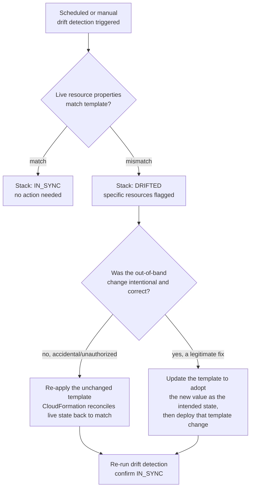
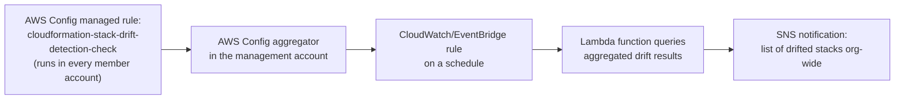

# IaC Drift Detection and Remediation

> **Domain:** [DVA-C03 Domain 3 — Testing and Deployment](README.md) · Task 3.2


## Definition

**Drift** is what happens when a resource CloudFormation (or CDK/SAM, which both compile down to
CloudFormation) is managing stops matching what the template says it should look like — usually
because someone changed it directly in the console, the CLI, or via a different automation
entirely, bypassing the IaC pipeline. **Drift detection** is CloudFormation's built-in capability
to compare a stack's live resources against its template and report exactly which resources
diverged and how. **Remediation** is the process of bringing a drifted resource back into
alignment — either by re-applying the template (the recommended default) or, in specific
justified cases, by updating the template to adopt the out-of-band change as the new intended
state.

## Plain-English analogy

Think of a CloudFormation template as a blueprint and the live stack as the actual building built
from it. Drift is what happens when a contractor, mid-project, decides on their own to move a
wall two feet to the left without updating the blueprint — the building and the blueprint now
disagree, and nobody looking only at the blueprint would know the wall actually moved. Drift
detection is sending an inspector to walk through the building with the blueprint in hand,
measuring every wall and flagging every place reality doesn't match the plan. Remediation is
deciding, for each flagged wall: move it back to match the blueprint (re-apply the template), or
update the blueprint to reflect where the wall actually is now (if the move was a legitimate,
intentional fix that should become the new standard).

## Purpose

Infrastructure as Code's entire value proposition — "the template is the single source of truth,
anyone can see exactly what's deployed by reading the repo" — quietly breaks the moment someone
makes an out-of-band change. This happens constantly in real organizations: an on-call engineer
fixes an urgent security group rule directly in the console during an incident and forgets to
update the template afterward; a well-meaning teammate "just quickly" adjusts a Lambda's memory
setting to fix a timeout, outside the pipeline. Drift detection exists to catch this class of
silent divergence automatically, rather than relying on someone eventually noticing the template
no longer matches reality (often only after a *subsequent* deployment unexpectedly reverts their
manual fix, with no idea why).

## When to Use

- Any time a stack is managed by CloudFormation/CDK/SAM and there's any realistic chance someone
  (including automated tooling outside the pipeline) might touch a managed resource directly.
- As a scheduled, recurring check across an entire multi-account organization — not a one-off,
  manually-triggered check run only when something already looks wrong.
- Immediately after resolving a production incident where a console-level change was made under
  time pressure, to confirm exactly what changed and bring it back under IaC control deliberately.

## When NOT to Use (or its limits)

- Drift detection doesn't catch everything — **not every resource type supports drift
  detection**, and some property types (especially ones involving secrets or dynamically-generated
  values) are excluded from comparison by design.
- It's a **detection** mechanism, not a **prevention** mechanism — it tells you drift already
  happened, it doesn't stop someone from making an out-of-band change in the first place (that's a
  separate control: restrictive IAM policies preventing direct console modification of
  CloudFormation-managed resources, enforced via SCPs or resource-level IAM conditions).
- Running drift detection on every single resource of a very large stack on a tight schedule can
  itself generate meaningful API call volume — for large multi-account estates, this is usually
  automated via AWS Config rules rather than naive, brute-force per-stack polling.

## Use Cases

1. **Post-incident reconciliation.** An on-call engineer manually widened a security group rule to
   resolve an urgent connectivity issue at 2 AM. The next morning, drift detection flags exactly
   that rule as drifted, giving the team a precise, automatic record of what changed outside the
   pipeline — rather than relying on the engineer's memory or a Slack message to document it.
2. **Organization-wide compliance monitoring.** A security team wants automatic, continuous
   detection of unauthorized infrastructure changes across hundreds of AWS accounts. An AWS Config
   managed rule (`cloudformation-stack-drift-detection-check`) evaluates every stack's drift status
   on a schedule, aggregating results centrally via Config aggregators.
3. **Pre-release sanity check.** Before a major deployment, a team runs drift detection on the
   target stack specifically to confirm no unexpected out-of-band change will interact badly with
   the incoming update — catching a surprise before the deployment, not after it fails or behaves
   unexpectedly.
4. **Adopting an intentional manual fix into IaC.** A manually-applied emergency fix turns out to
   be the right long-term configuration. Rather than letting the next deployment silently revert
   it, the team updates the template to match the drifted value deliberately, closing the loop
   correctly instead of leaving the fix as untracked drift indefinitely.
5. **Multi-region disaster recovery parity checks.** A DR region's stack must stay in lock-step
   with its primary region's template. Scheduled drift detection on both regions' stacks confirms
   neither has silently diverged, which would otherwise only be discovered during an actual
   failover — the worst possible time to find out.
6. **Onboarding a legacy, partially-console-managed stack into IaC.** A team retroactively writing
   a CloudFormation template for infrastructure that previously existed only via console clicks
   uses drift detection (after an initial, deliberately-matching template import) to verify the new
   template's accuracy against the real, already-running resources.

## Why Important

**Real-world weight:** undetected drift is a recurring, genuinely dangerous failure mode — a
security-relevant manual fix (an opened port, a loosened IAM policy) that nobody tracks can sit
unnoticed for months, and a *subsequent*, unrelated deployment can either silently revert a
legitimate fix (causing a regression) or silently fail to pick up a security gap the template still
describes as closed. **Exam weight:** Task 3.2 ("Implement and automate application testing")
explicitly includes "validate infrastructure templates ... before deploying them," and drift
detection is the natural, directly-related extension of that principle to **after** deployment —
a template can be perfectly valid at deploy time and still diverge from reality later.

## Diagram: the drift detection and remediation decision flow



Walkthrough: the critical decision point is the middle diamond — drift detection only tells you
**that** something changed and **what** it now looks like; it never tells you whether that change
was good or bad. A human (or a policy) has to make that call. The two remediation paths converge
on the same final step: re-running drift detection to confirm the stack is back to `IN_SYNC`,
closing the loop rather than assuming the fix worked.

## Real AWS reference diagrams


*Source: [AWS CloudFormation User Guide — "Detect drift on an entire CloudFormation stack"](https://docs.aws.amazon.com/AWSCloudFormation/latest/UserGuide/detect-drift-stack.html), © Amazon Web Services.*


*Source: [AWS CloudFormation User Guide — "Detect drift on an entire CloudFormation stack"](https://docs.aws.amazon.com/AWSCloudFormation/latest/UserGuide/detect-drift-stack.html), © Amazon Web Services.*


*Source: [AWS CloudFormation User Guide — "Detect drift on an entire CloudFormation stack"](https://docs.aws.amazon.com/AWSCloudFormation/latest/UserGuide/detect-drift-stack.html), © Amazon Web Services.*

Discussion: the three screenshots show the full console workflow in order — triggering detection
from the Stack actions menu, the resulting stack-level summary (overall `DRIFTED`/`IN_SYNC` status
plus per-resource counts), and finally the detail view showing the **expected** (template) value
side by side with the **actual** (live) value for each drifted property. That third screenshot is
the single most exam-relevant image here: it makes concrete that drift detection reports a
property-level diff, not just a binary "something changed" flag — which is exactly the granularity
needed to decide whether a drift is benign or a real security issue.

## Automated, multi-account drift detection architecture


*Source: [AWS Prescriptive Guidance — "Set up CloudFormation drift detection in a multi-Region, multi-account organization"](https://docs.aws.amazon.com/prescriptive-guidance/latest/patterns/set-up-aws-cloudformation-drift-detection-in-a-multi-region-multi-account-organization.html), © Amazon Web Services.*



Walkthrough: this pattern avoids the operationally unrealistic alternative of someone manually
running `detect-stack-drift` against every stack in every account — the **AWS Config managed
rule** does the actual per-account evaluation automatically and continuously, the **aggregator**
rolls results up to one place, and a scheduled Lambda simply *queries* that already-aggregated data
and notifies on findings. This is the architecture a question about "automatically detect drift
across our entire AWS Organization, not just one account" is pointing toward.

## Worked example: CLI drift detection and remediation end to end

```bash
# 1. Trigger drift detection on a stack (returns a detection ID, since it's asynchronous)
aws cloudformation detect-stack-drift --stack-name orders-api-stack

# 2. Poll until the detection operation completes
aws cloudformation describe-stack-drift-detection-status \
  --stack-drift-detection-id <id-from-step-1>

# 3. See the overall stack-level drift status
aws cloudformation describe-stacks --stack-name orders-api-stack \
  --query 'Stacks[0].DriftInformation'

# 4. See exactly which resources drifted and how
aws cloudformation describe-stack-resource-drifts \
  --stack-name orders-api-stack \
  --stack-resource-drift-status-filters MODIFIED DELETED

# 5a. Remediation path A — re-apply the template, reconciling live state back to it
aws cloudformation deploy --template-file template.yaml --stack-name orders-api-stack

# 5b. Remediation path B — adopt the drifted value: edit template.yaml to match the
#     new, intentional value, THEN deploy that updated template
aws cloudformation deploy --template-file template.yaml --stack-name orders-api-stack

# 6. Confirm the fix worked
aws cloudformation detect-stack-drift --stack-name orders-api-stack
```

What matters here: steps 5a and 5b use the **exact same CLI command** — the difference is entirely
in whether you edited `template.yaml` first. This is the practical, testable core of remediation:
CloudFormation doesn't have a separate "fix drift" API distinct from its normal deploy mechanism —
remediation is just a normal deployment, either of the unchanged template (reverting the drift) or
of a template updated to adopt the drift as new intended state.

## Drift detection's known limitations (exam-relevant)

- **Not every resource type supports drift detection.** Some newer or less common resource types
  are excluded; a stack can show some resources as `NOT_CHECKED` rather than `IN_SYNC`/`MODIFIED`,
  which is a different, weaker signal than confirmed-clean.
- **Dynamically-generated or ignorable properties are excluded by design.** Certain properties
  that AWS itself changes behind the scenes (some auto-generated IDs, certain default-value
  behaviors) don't count as drift even though their live value technically differs from what a
  naive comparison might expect.
- **Drift detection is a point-in-time snapshot, not continuous monitoring.** It only reflects the
  state at the moment it was run — this is precisely why a *scheduled*, recurring detection
  cadence (via AWS Config, not a single manual check) is the production-grade pattern, not a
  one-time "we checked once" assurance.
- **CDK and SAM templates drift exactly like raw CloudFormation, because they compile down to it.**
  There's no separate "CDK drift" or "SAM drift" concept — once synthesized/transformed into a
  CloudFormation template and deployed, drift detection works identically regardless of the
  authoring tool.

## Additional worked exam scenarios

- *"A security audit needs continuous, automatic detection of configuration drift across 200 AWS
  accounts, with centralized alerting, not a manual per-account check."* → AWS Config's
  `cloudformation-stack-drift-detection-check` managed rule deployed org-wide via Config rules,
  aggregated centrally, with EventBridge/SNS alerting on findings — not a scheduled script running
  `detect-stack-drift` account by account.
- *"A stack shows `DRIFTED`, and the team wants the live infrastructure to go back to exactly what
  the template describes, discarding the manual change."* → re-deploy the **unchanged** template —
  CloudFormation reconciles the live resource back to the declared state; no special "revert drift"
  API call is needed.
- *"A manual emergency change turned out to be the correct long-term fix, and the team wants future
  deployments to stop reverting it."* → update the template itself to match the new value, then
  deploy that updated template — adopting the drift rather than reverting it.
- *"A newly-created resource type in a stack always shows `NOT_CHECKED` during drift detection."* →
  expected and not a configuration error — not every resource type supports drift detection; this
  is a documented limitation, not something to debug further.
- *"CDK diff shows no pending changes, but the console shows the stack as DRIFTED."* → these are
  two different checks entirely: `cdk diff` compares your **source code's synthesized template**
  against the **last deployed template** (catching changes you're *about* to make); drift detection
  compares the **last deployed template** against **live resource state** (catching changes that
  already happened outside the pipeline). A clean `cdk diff` says nothing about drift, and vice
  versa.

## Exam Tips

- **Drift detection answers "did reality diverge from the template," not "will my next deployment
  change anything"** — that second question is what `cdk diff`/change sets answer; don't confuse
  the two, they're genuinely different checks catching different problems at different times.
- A scenario about automating detection across many accounts points to **AWS Config managed rules
  + aggregators**, not a custom-built, manually-triggered per-stack script.
- Remediation is always a **normal deployment** — either of the unchanged template (revert) or an
  updated one (adopt) — there's no special "fix drift" API distinct from `UpdateStack`/`deploy`.
- Not every resource supports drift detection, and some properties are intentionally excluded —
  don't assume a `NOT_CHECKED` status means "confirmed clean."
- This applies identically regardless of whether the stack was authored in raw CloudFormation, SAM,
  or CDK, since all three ultimately deploy a CloudFormation stack.

## Troubleshooting / Common Issues

- **Drift detection shows `MODIFIED` for a property that was never manually touched.** Check
  whether a *different* automation (a Lambda-backed custom resource, a separate script, another
  team's tooling) is also touching the same resource outside this specific CloudFormation stack —
  drift isn't always a human console click; it's often a second, uncoordinated automation path.
- **`detect-stack-drift` never finishes / stays `IN_PROGRESS` for a long time.** Large stacks with
  many resources take longer to evaluate; poll `describe-stack-drift-detection-status` rather than
  assuming a hang, and check for resource types known to be slow to evaluate (some nested stack
  configurations) before escalating.
- **Drift detected on a resource immediately after a successful, intentional deployment.** This is
  a genuine red flag worth investigating immediately — it suggests something is modifying the
  resource within moments of deployment, often an automated reconciliation loop (e.g., a custom
  Lambda-backed resource or an external controller) racing against CloudFormation itself.
- **A stack's drift status never clears even after re-deploying the exact same template.** Re-run
  `detect-stack-drift` explicitly after the deployment completes — drift status is not
  automatically re-evaluated on every stack update; it only reflects the state as of the last time
  detection was explicitly triggered.

## Pricing Model (summary)

Drift detection itself has no separate charge — it's included with CloudFormation at no additional
cost. The AWS Config managed rule used for automated, scheduled detection across accounts is billed
under standard AWS Config pricing (per configuration item recorded and per rule evaluation), which
is the main cost consideration for the multi-account automated pattern described above, not drift
detection as a CloudFormation feature in isolation.

## Related Terms

- [`README.md`](README.md) — the domain-level overview this doc deepens
- [`services/management-governance/cloudformation.md`](../../../services/management-governance/cloudformation.md) —
  full CloudFormation service reference, including change sets
- [`services/management-governance/cdk.md`](../../../services/management-governance/cdk.md) —
  `cdk diff`, the pre-deployment analog to post-deployment drift detection
- [`services/management-governance/aws-config.md`](../../../services/management-governance/aws-config.md) —
  the service powering automated, multi-account drift detection
