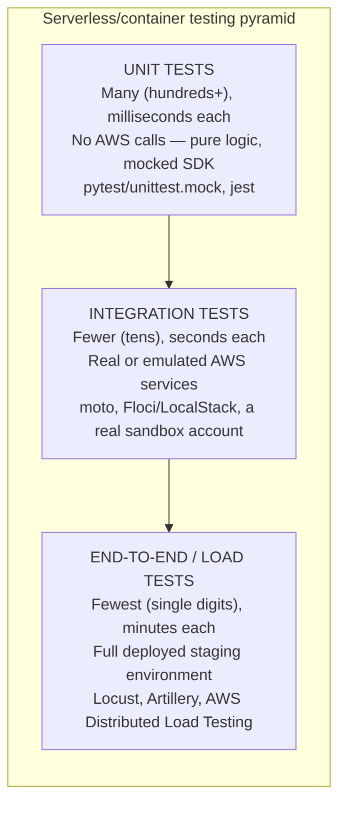
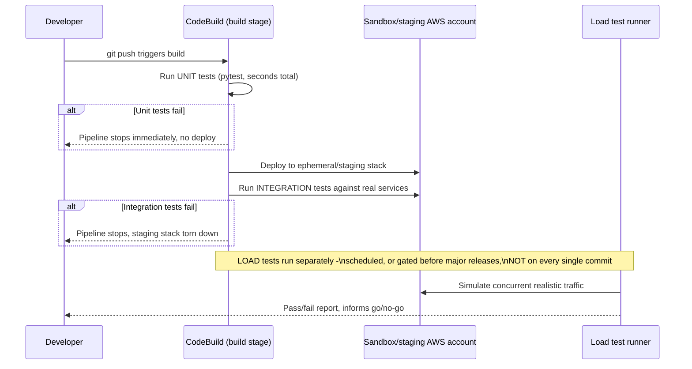

# Unit vs. Integration vs. Load Testing Strategy for Serverless Apps

> **Domain:** [DVA-C03 Domain 3 — Testing and Deployment](README.md) · Task 3.2


## Definition

A serverless testing strategy is the deliberate choice of **which kind of test runs where, how
often, and against what** — pure logic tested in milliseconds with no AWS calls at all (unit),
behavior tested against real or emulated AWS services (integration), and system-level behavior
tested under realistic concurrent traffic (load) — so that the majority of your pipeline's test
time is spent on the cheapest, fastest checks, and only a small amount is spent on the slowest,
most expensive ones.

## Plain-English analogy

Testing a serverless application is like testing a new car before it ships. You don't start by
driving it cross-country (load test) — you first check that each individual part works on a bench
(unit test: does the engine turn over, does the brake pedal respond), then you take it for a short
test drive around the block with the real road, real traffic lights (integration test: does the
whole assembled car behave correctly in a realistic-but-controlled environment), and only once
both of those pass do you put it through a full endurance/stress test on the highway at rush hour
(load test). Skipping straight to the highway test without ever checking the brakes on the bench
first is slow, expensive, and finds problems far too late to fix cheaply.

## Purpose

Serverless and container applications are unusually easy to test badly in one specific way:
because Lambda functions and containers are small, individually-deployable units, it's tempting to
skip writing true unit tests and instead validate everything by actually deploying to a sandbox
AWS account and poking it manually or with slow, deployed integration tests. This strategy document
exists to codify the opposite, correct instinct: **push as much verification as possible down into
fast, free, locally-run unit tests**, use a moderate layer of integration tests against emulated or
real AWS services for the things unit tests genuinely can't verify (IAM permission boundaries,
actual DynamoDB query behavior, real event payload shapes), and reserve load/end-to-end tests —
the slowest and most expensive layer — for validating a small number of critical paths under
realistic concurrent traffic before a major release.

## When to Use

Every serverless or containerized application benefits from this layered strategy, but it matters
most when:
- The team deploys frequently (multiple times a day) and can't afford a 30-minute, fully-deployed
  test suite on every commit.
- The application has non-trivial business logic (validation, calculations, branching) that's
  cheap to test in isolation without any AWS dependency at all.
- Cold-start latency, concurrency limits, or downstream throttling are real production risks that
  only a load test — not a unit or integration test — can actually surface.

## When NOT to Use (or when to adjust)

- **Don't** try to unit-test things that are genuinely integration concerns (e.g., "does this IAM
  policy actually grant the permission I think it does") — mocking out the AWS SDK call entirely
  defeats the point of verifying real permission behavior; that belongs in an integration test
  against a real or emulated AWS account.
- **Don't** run a full load test on every single commit — load tests are slow and resource-
  intensive; running one per commit either slows every developer down or gets skipped/ignored
  under time pressure, defeating its purpose. Run load tests on a schedule or before major
  releases instead.
- **Don't** treat "it passed in a Lambda console test event" as equivalent to automated testing —
  console test events are a manual, ad hoc verification tool (useful during development), not a
  repeatable, CI-integrated automated test.

## Use Cases

1. **Validating business logic with zero AWS dependency.** A Lambda handler's input validation,
   price calculation, or response formatting is tested with plain unit tests mocking the AWS SDK
   entirely — runs in milliseconds, needs no network access, and can run on every single commit
   with zero marginal infrastructure cost.
2. **Verifying real DynamoDB query behavior.** A function's actual `Query`/`GetItem` calls are
   tested against a real or emulated DynamoDB table (Floci, LocalStack, or `moto` in Python) — a
   unit test mocking the DynamoDB client entirely would never catch a genuine key-schema mismatch
   or an incorrectly-formed expression.
3. **Confirming least-privilege IAM actually works, not just reads correctly.** An integration test
   deploys a function with its real, scoped-down execution role (not an admin role used only for
   testing) and confirms it can do exactly what it needs and nothing more — catching the common
   "it worked in dev because dev used a permissive role" class of bug before production.
4. **Simulating an API Gateway event without a live API Gateway.** A hand-crafted or
   console-template test event (an S3 Put event, an SNS notification, an API Gateway proxy
   request) exercises the handler's event-parsing logic directly, without needing any of those
   services actually deployed — a fast, free, high-value middle-ground check.
5. **Load-testing before a marketing-driven traffic spike.** Before a known high-traffic event
   (a product launch, a sale), a dedicated load test against a staging environment validates
   concurrency limits, cold-start behavior under burst load, and downstream database/API
   throttling — something no unit or integration test, however thorough, can substitute for.
6. **Regression-testing an AI-assisted test suite.** An AI coding assistant proposes a batch of new
   unit tests for previously-uncovered code paths; a human still reviews them for business-logic
   correctness (the AI can't know your actual business rules) before merging — this is the Task
   3.2 "AI-assisted test generation" bullet applied specifically at the unit-test layer.

## Why Important

Task 3.2 of the DVA-C03 exam guide is explicitly "Implement and automate application testing" —
and a disproportionate share of real-world CI/CD pain (slow pipelines, flaky tests, "works in
staging, fails in prod") traces back to an inverted or missing testing pyramid. Getting this
strategy right is both a direct exam topic and one of the highest-leverage real engineering
practices for a team shipping serverless/container applications frequently.

## Diagram: the testing pyramid, explained layer by layer



Walkthrough: the pyramid's shape is the whole point — **width represents how many tests you
should have at each layer**, not how important each layer is. Every layer matters; the strategy is
about *proportion*. A pipeline spending most of its total test-run time in the narrow top layer
(end-to-end/load) has an inverted pyramid — slow, flaky, and expensive per pipeline run, a specific
anti-pattern the exam expects you to recognize and know how to correct.

## Diagram: where each test layer runs in the pipeline



Walkthrough: unit tests run **before anything is even deployed** — this is the cheapest possible
place to fail fast. Integration tests require a deployed (even if ephemeral/sandboxed) environment,
which is why they're meaningfully slower and why you want fewer of them. Load tests are
deliberately decoupled from the per-commit pipeline entirely in a mature setup — they're either
scheduled (nightly, weekly) or explicitly gated before a major release, never run on every push.

## Real AWS reference: CloudWatch dashboard surfacing load-test results


*Source: [Amazon CloudWatch User Guide](https://docs.aws.amazon.com/AmazonCloudWatch/latest/monitoring/CloudWatch-default-dashboard.html), © Amazon Web Services.*

Discussion: a load test's real value isn't just "pass/fail" — it's the CloudWatch metrics it
generates during the run (Lambda concurrent executions, throttles, duration p99; DynamoDB
throttled requests; API Gateway 5xx rate) that tell you *where* the system actually buckled under
load. A load-testing strategy that doesn't also wire its target environment's CloudWatch metrics
into the same report is only answering "did it survive," not "what will break first as traffic
keeps growing" — the more useful question for genuine capacity planning.

## Worked example: unit test, integration test, and a load test script for the same function

**The function under test:**
```python
# handler.py
import boto3, os

def validate_order(order):
    if order.get("quantity", 0) <= 0:
        raise ValueError("quantity must be positive")
    return True

def handler(event, context):
    order = event["order"]
    validate_order(order)  # pure logic, independently testable
    table = boto3.resource("dynamodb").Table(os.environ["TABLE_NAME"])
    table.put_item(Item=order)
    return {"statusCode": 201}
```

**Unit test — tests `validate_order` in total isolation, no AWS SDK involved at all:**
```python
import pytest
from handler import validate_order

def test_rejects_zero_quantity():
    with pytest.raises(ValueError):
        validate_order({"quantity": 0})

def test_accepts_positive_quantity():
    assert validate_order({"quantity": 1}) is True
```

**Integration test — tests the full handler against a real DynamoDB table (Floci):**
```python
import boto3, os, pytest
from handler import handler

@pytest.fixture
def table(scope="module"):
    ddb = boto3.client("dynamodb", endpoint_url="http://localhost:4566", region_name="us-east-1")
    ddb.create_table(
        TableName="orders-it", KeySchema=[{"AttributeName": "id", "KeyType": "HASH"}],
        AttributeDefinitions=[{"AttributeName": "id", "AttributeType": "S"}],
        BillingMode="PAY_PER_REQUEST")
    os.environ["TABLE_NAME"] = "orders-it"
    yield
    ddb.delete_table(TableName="orders-it")

def test_handler_writes_order_to_dynamodb(table):
    event = {"order": {"id": "abc", "quantity": 2}}
    result = handler(event, None)
    assert result["statusCode"] == 201
```

**Load test — Locust script simulating concurrent order submissions against staging:**
```python
# locustfile.py
from locust import HttpUser, task, between

class OrderUser(HttpUser):
    wait_time = between(0.5, 2)

    @task
    def submit_order(self):
        self.client.post("/orders", json={"order": {"id": "load-test", "quantity": 1}})
```
```bash
# Run against a real staging API Gateway endpoint, simulating 200 concurrent users
locust -f locustfile.py --host https://staging-api.example.com \
  --users 200 --spawn-rate 20 --run-time 5m --headless
```

What matters here: notice the layered progression — the unit test needs **nothing but Python**, the
integration test needs **Floci running**, and the load test needs a **real deployed staging
endpoint**. Each layer's infrastructure requirement grows, which is exactly why each layer should
run less frequently than the one below it.

## Additional worked exam scenarios

- *"A Lambda function's test suite takes 25 minutes because every test deploys a fresh stack and
  calls the real deployed API."* → this is an inverted pyramid — the fix is converting most of
  these into unit tests with mocked AWS SDK calls, keeping only the handful that genuinely need a
  deployed environment as integration tests.
- *"A team wants to validate that a Lambda function correctly parses an S3 object-created event,
  without provisioning any S3 bucket."* → a hand-crafted or console-template S3 event test payload,
  invoked directly against the handler — a unit-test-layer check, no live S3 bucket needed at all.
- *"Before a planned marketing campaign expected to 10x normal traffic, the team wants confidence
  the system won't fall over."* → a scheduled load test against staging (not production), using a
  tool like Locust or AWS's Distributed Load Testing solution, examining CloudWatch metrics
  (throttles, concurrency, latency) during the run.
- *"An AI tool generated 40 new unit tests for a previously untested module."* → a human still
  reviews them for correctness against actual business rules before merging — the AI can infer
  obvious edge cases from the code's shape, but cannot know intent the code doesn't already encode.
- *"A function behaves correctly in every unit test but throws a permissions error only when
  actually deployed."* → this is exactly the gap integration tests close — the function's IAM
  execution role's *real* scoped permissions were never exercised by a unit test that mocked the
  AWS SDK entirely.

## Exam Tips

- **"Fast, no AWS calls, many of them" is the unit-test signal.** "Talks to a real/emulated AWS
  service, fewer of them" is the integration-test signal. "Simulates realistic concurrent user
  traffic against a deployed environment" is the load-test signal.
- A question describing a slow, mostly-end-to-end test suite is testing whether you recognize an
  **inverted testing pyramid** and know the fix is pushing coverage down, not just "run tests in
  parallel to make it faster."
- **Mock test events** (Task 3.2's named capability) sit conceptually between unit and integration
  — they test event-parsing logic with no live upstream service, making them closer to a unit test
  in cost even though they're validating integration-shaped concerns.
- Load testing is explicitly **not** meant to run on every commit — recognize scheduled/pre-release
  load testing as the correct cadence, distinct from the always-on-every-push cadence of unit
  tests.
- This topic connects directly to [`README.md`](README.md#testing-pyramid-for-serverless-and-container-apps)'s
  pyramid summary and to
  [`services/developer-tools/sam.md`](../../../services/developer-tools/sam.md)'s `sam local
  invoke` (the tool most directly enabling fast, local, pre-deployment testing for Lambda).

## Pricing Model (summary)

None of the testing layers themselves are separately priced AWS services — the cost is in what
they consume. Unit tests run in CI compute (CodeBuild build-minutes) with no AWS resource cost at
all. Integration tests against real AWS services incur the normal per-service usage cost of
whatever they touch (DynamoDB read/write capacity, Lambda invocations) at test scale, which is
typically negligible. Load tests are the one layer worth budgeting deliberately for — simulating
hundreds or thousands of concurrent users generates real Lambda invocations, API Gateway requests,
and database read/write capacity consumption at the target environment, which is exactly why they
should run against a staging environment and on a deliberate schedule, not continuously.

## Related Terms

- [`README.md`](README.md) — the domain-level overview this doc deepens
- [`services/compute/lambda.md`](../../../services/compute/lambda.md) — the most common unit under
  test in this strategy
- [`services/developer-tools/codebuild.md`](../../../services/developer-tools/codebuild.md) —
  where unit and integration test phases typically execute in a pipeline
- [`services/developer-tools/sam.md`](../../../services/developer-tools/sam.md) — `sam local
  invoke`/`start-api` for fully offline testing
- [`services/management-governance/cloudwatch.md`](../../../services/management-governance/cloudwatch.md) —
  the metrics a load test's results are actually read from
