# DVA-C03 Domain 4 — Master Chunk: Troubleshooting and Optimization (22%)

**Standalone reference.** This single file covers every service and topic named in DVA-C03
Domain 4 (Troubleshooting and Optimization) in full depth, with no dependency on any other file
in this repository — read this alone and you have the complete domain. The domain's three task
statements, which every section below maps back to:

- **Task 4.1 — Assist in root cause analysis.** Use CloudWatch Logs/Metrics, X-Ray tracing, and
  CloudTrail to find *what* happened, *where* in a distributed chain it happened, and *who/what*
  caused it — plus AI-assisted error analysis as a verified-before-acting hypothesis generator.
- **Task 4.2 — Instrument code for observability.** Emit structured logs, custom metrics, and
  trace segments/subsegments *before* an incident, not scrambled together during one.
- **Task 4.3 — Optimize applications on AWS.** Lambda performance tuning, cost/performance
  tradeoffs across compute and data stores, and AI-assisted optimization recommendations.

## How to read this document

Each of the 14 services/topics below follows the same fixed structure: **Definition**, a
plain-English **Analogy**, **Purpose**, **When to Use**, **When NOT to Use**, 4-6 **Use Cases**,
**Why It's Important**, at least one **Mermaid diagram** explained step by step, at least one
**real AWS documentation image** (every URL below returns HTTP 200 as of this writing — verified
by direct `curl` request) with discussion, and 2-3 **Exam Tips**. Services are covered in the
order a real investigation tends to touch them — observability first, then identity/audit, then
compute, then the governance/cost layer, then the data layer — rather than alphabetically, so
reading start to finish also teaches the domain's own investigative logic.

## Table of Contents

1. [Amazon CloudWatch](#1-amazon-cloudwatch)
2. [AWS X-Ray](#2-aws-x-ray)
3. [AWS CloudTrail](#3-aws-cloudtrail)
4. [AWS Config](#4-aws-config)
5. [AWS Identity and Access Management (IAM)](#5-aws-identity-and-access-management-iam)
6. [AWS Lambda](#6-aws-lambda)
7. [Amazon API Gateway](#7-amazon-api-gateway)
8. [AWS Systems Manager](#8-aws-systems-manager)
9. [AWS Cost Management Tools](#9-aws-cost-management-tools)
10. [AWS Trusted Advisor](#10-aws-trusted-advisor)
11. [AWS Well-Architected Tool](#11-aws-well-architected-tool)
12. [Amazon DynamoDB](#12-amazon-dynamodb)
13. [Amazon ElastiCache](#13-amazon-elasticache)
14. [Database Selection Guide](#14-database-selection-guide)
15. [Closing: the whole domain as one investigation](#closing-the-whole-domain-as-one-investigation)

---

## 1. Amazon CloudWatch

### Definition

Amazon CloudWatch is AWS's monitoring and observability service. It collects **metrics**
(numbers over time — CPU %, request count, error rate), **logs** (text output from your
applications and AWS services), and lets you visualize them on **dashboards**, trigger **alarms**
when something crosses a threshold, and search through logs with a query language called **Logs
Insights**.

### Analogy

CloudWatch is the nervous system of your AWS account. Metrics are nerve endings reporting
sensation continuously (pain, temperature, pressure — CPU%, error count, latency); logs are the
detailed diary each organ keeps of what it actually did; alarms are the reflex arc that makes you
flinch *before* your conscious brain even processes what happened, by firing an automated action
the instant a threshold is crossed; dashboards are the conscious awareness layer where a human
actually looks at the aggregated picture. A body with no nervous system doesn't know it's injured
until something visibly fails; an AWS account with no CloudWatch doesn't know it's unhealthy until
a customer complains.

### Purpose

Running infrastructure without monitoring is flying blind — you find out your application is down
when a customer complains, not when it actually broke. AWS built CloudWatch as the built-in,
always-on nervous system for everything running on AWS: every major service (EC2, Lambda, RDS,
DynamoDB, ELB, and dozens more) automatically reports metrics to CloudWatch with zero setup, and
you can add your own custom metrics and logs on top for application-specific visibility. The
underlying problem CloudWatch solves is **turning "it feels slow" into a number you can alert
on** — human perception of system health doesn't scale past a handful of services and doesn't
work at 3 AM, so CloudWatch exists to make "is this healthy" a continuously evaluated expression
against real telemetry, not a gut feeling.

### When to Use

- Any AWS resource or application where you need to know, automatically and continuously, whether
  it's healthy — which is to say, nearly everything you run in production.
- You need to alert a human or trigger an automated action (Auto Scaling, a Lambda remediation)
  the moment a specific condition is met, rather than discovering it later.
- You need ad hoc, on-demand investigation into exactly what happened during an incident, using
  real log content rather than guessing.
- You need a custom, business-specific signal (orders processed, payment failures) that no
  default AWS service metric captures.

### When NOT to Use

- **Auditing who did what** — that's CloudTrail, not CloudWatch; this is the single most common
  exam and real-world confusion in this entire domain.
- **Deep distributed tracing across microservices** (which specific hop in a call chain added
  latency) — that's X-Ray, which CloudWatch complements but doesn't replace.
- **Long-term, cheap archival of logs for compliance** (years, rarely queried) — exporting
  CloudWatch Logs to S3 (with lifecycle rules to Glacier) is cheaper than keeping everything in
  CloudWatch Logs' standard retention indefinitely.
- **Checking whether a resource's configuration complies with a policy** — that's AWS Config;
  CloudWatch has nothing to say about whether an S3 bucket is encrypted, only about performance.

### Use Cases

1. **Auto Scaling triggered by a workload-accurate custom metric.** An I/O-bound queue
   processor's actual bottleneck is queue depth, not CPU — emitting `QueueDepth` via
   `PutMetricData` and scaling on that metric directly reflects real load, where CPU alone would
   scale too late or not at all.
2. **Centralizing logs from a fleet instead of SSHing into each instance.** An incident spans
   dozens of containers; every instance/container ships to the same log group, so one Logs
   Insights query spans the whole fleet at once instead of checking each one's local log file.
3. **Composite alarms to reduce on-call noise.** Combining a latency alarm AND an error-rate
   alarm into one composite alarm only pages when both conditions are true simultaneously — a
   much stronger signal of a real problem than either alone.
4. **Root-cause investigation after an incident, using Logs Insights instead of raw files.** A
   `stats count() by message` query against the relevant time window returns the top error
   messages in seconds, versus downloading and grepping gigabytes of raw log files.
5. **Cost/performance tuning via Lambda duration and memory metrics.** CloudWatch's automatic
   `Duration`/`Max Memory Used` metrics directly inform a data-driven Lambda right-sizing decision
   instead of guessing — see the Lambda section below for the full cost math this feeds.
6. **Catching gradual performance drift with Anomaly Detection.** A SageMaker endpoint's latency
   creeps upward over weeks, never crossing any single static threshold — Anomaly Detection models
   the metric's expected statistical band and flags the deviation a fixed alarm would miss.

### Why It's Important

CloudWatch is usually the first and last place an engineer looks during an incident — first to
see what broke (metrics spiking, errors in logs), last to confirm the fix worked (metrics back to
normal). Alarms tied to Auto Scaling are what actually keeps a web application responsive under
variable load without a human watching dashboards 24/7. On the exam, Task 4.1 explicitly names
CloudWatch Logs/Metrics as a root-cause tool, and Task 4.2 is almost entirely about instrumenting
custom metrics and structured logs into CloudWatch.

### Diagram: Metric → Alarm → Action, Explained

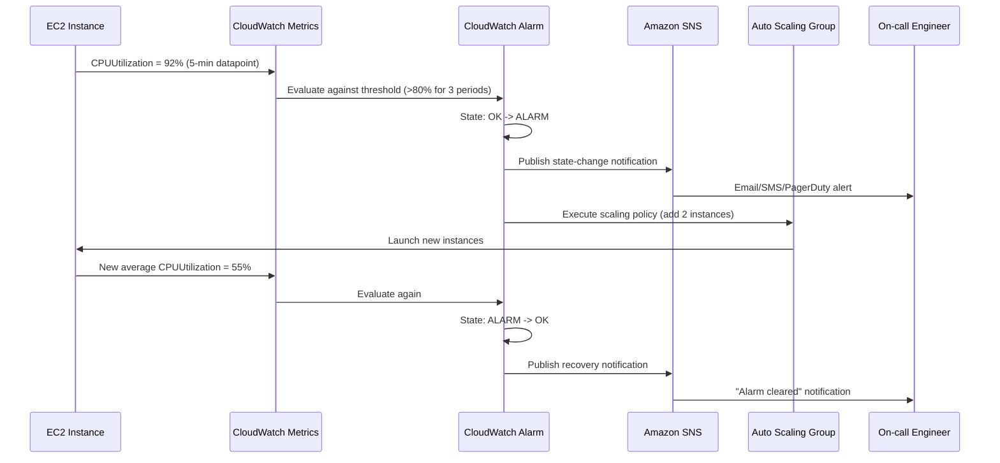

Walking through it: (1) the resource keeps reporting a metric on its normal cadence; (2) the alarm
doesn't react to a single data point — it requires the threshold to hold for the configured number
of **evaluation periods**, which prevents a single brief spike from triggering unnecessary action
(a deliberate design against alert flapping); (3) once in `ALARM` state, every configured action
fires — both a human notification *and* an automated remediation (scaling) can happen from the
same alarm simultaneously; (4) once the underlying condition resolves, the alarm re-evaluates and
transitions back to `OK`, which itself can also notify, so the team knows the incident
self-resolved rather than wondering if it's still ongoing.

### Image: The CloudWatch Console's Default Dashboard


*Source: [AWS Documentation — Amazon CloudWatch User Guide](https://docs.aws.amazon.com/AmazonCloudWatch/latest/monitoring/). This automatic overview page is where every investigation starts — it rolls up alarm states by service across the whole account, so a person logging in cold can immediately see which service has an active problem before drilling into any specific metric, log group, or trace.*

### Exam Tips

- **The classic trap: CloudWatch ≠ CloudTrail.** CloudWatch = performance/health (metrics, logs,
  alarms). CloudTrail = audit (who did what). A question about "detect unauthorized API activity"
  is CloudTrail, never CloudWatch.
- **Custom metrics require `PutMetricData`** — AWS service metrics are automatic; your own
  business metrics are not, and must be explicitly pushed from application code (Task 4.2).
- **Metric filters turn log text into a metric; Logs Insights is query-on-demand** — a question
  about proactive alerting on a log pattern wants a metric filter + alarm; a question about ad hoc
  historical search wants Logs Insights. They are not interchangeable.

---

## 2. AWS X-Ray

### Definition

AWS X-Ray is a distributed tracing service: it follows a single request as it travels through
every component of your application — API Gateway, a Lambda function, a database call, a
downstream microservice — and stitches all of that together into one visual timeline, so you can
see exactly where time was spent and where something broke, instead of grepping through a dozen
separate log streams trying to guess.

### Analogy

Think of a package shipped across five different delivery trucks and three sorting facilities
before reaching your door. Without tracking, if the package arrives late, you have no idea which
leg of the journey was slow — you'd have to call every facility and manually cross-reference
timestamps. X-Ray is the package's tracking number: every facility scans it in and out, and a
single tracking page assembles the whole journey into one timeline showing exactly which leg took
too long. The "service map" is the zoomed-out version of this — not one package's journey, but
the shipping network's overall health, with slow or error-prone routes highlighted in red.

### Purpose

A monolith running on one server has one log file; if something's slow, you look at that one log.
A modern application split across API Gateway, three Lambda functions, a Step Functions
workflow, DynamoDB, and an external payment API has *no single log* — a single user-facing
request might touch six services, each writing its own logs in its own format, with no shared
thread connecting them. X-Ray exists to solve exactly this: every request gets a single **trace
ID** that follows it through every service it touches, and X-Ray assembles all the pieces back
into one coherent picture automatically.

### When to Use

- Any distributed/serverless application where a single request crosses more than one service —
  which is nearly every non-trivial application on AWS.
- Finding intermittent latency spikes that don't show up as outright errors.
- Confirming a fix actually worked by comparing the service map's latency before and after a
  change.
- Filtering traces by a specific business dimension (customer ID, order ID) using annotations.

### When NOT to Use

- **A genuinely single-service, single-log-file application** — if there's no cross-service call
  chain to visualize, X-Ray's value proposition doesn't apply; plain CloudWatch Logs/Metrics
  cover a monolith's needs without the extra setup.
- **Auditing who made an AWS API call** — X-Ray shows application request flow and timing, not
  identity/audit of management-plane actions; that's CloudTrail.
- **A full metrics/alerting platform** — X-Ray is not a replacement for CloudWatch; the two are
  complementary (CloudWatch says *something* crossed a threshold, X-Ray says *why*, at the
  individual-request level).
- **Code-level CPU/memory profiling inside one process** — that's Amazon CodeGuru Profiler, a
  different granularity than X-Ray's between-service tracing.

### Use Cases

1. **Serverless checkout pipeline latency debugging.** A checkout flow spans API Gateway, three
   chained Lambda functions, and DynamoDB; Active Tracing on each hop immediately shows which
   specific function/call in the chain is slow, per request, without manual log correlation.
2. **Microservices error-rate triage during an incident.** An on-call engineer paged for
   elevated 5xx errors across a 12-microservice fleet uses the service map to immediately spot
   the one red (high error-rate) node, rather than checking twelve separate dashboards in turn.
3. **Third-party API latency attribution.** A subsegment specifically wrapping an outbound call
   to an external card-network API isolates its latency cleanly from the rest of the request,
   settling "is it us or them" with data instead of guesswork.
4. **Step Functions workflow visibility.** Tracing the Lambda functions invoked by each state in
   a stalling state machine gives per-call timing and error detail the execution history alone
   doesn't expose.
5. **ML inference pipeline latency breakdown.** Tracing API Gateway → Lambda (feature lookup) →
   SageMaker endpoint → Lambda (post-processing) separately cleanly separates model inference time
   from surrounding glue code — preventing wasted optimization effort on the wrong layer.
6. **Canary/blue-green deployment safety verification.** Tagging requests by deployment version
   with a custom annotation lets the service map be filtered to "new version only" traffic for a
   clean before/after comparison, rather than eyeballing blended aggregate metrics.

### Why It's Important

As architectures decompose into more services, "where did this specific slow/broken request
actually go" becomes genuinely hard to answer without tracing — mean time to resolve an incident
is directly shaped by how fast an on-call engineer can localize the problem to one service. On
DVA-C03 specifically, Domain 4 is where X-Ray is most heavily tested: a developer-facing scenario
describing a multi-service application with an intermittent, hard-to-reproduce performance
problem is the classic setup, and the expected answer is almost always "enable X-Ray tracing,"
not "add more log statements."

### Diagram: Sampling, Explained

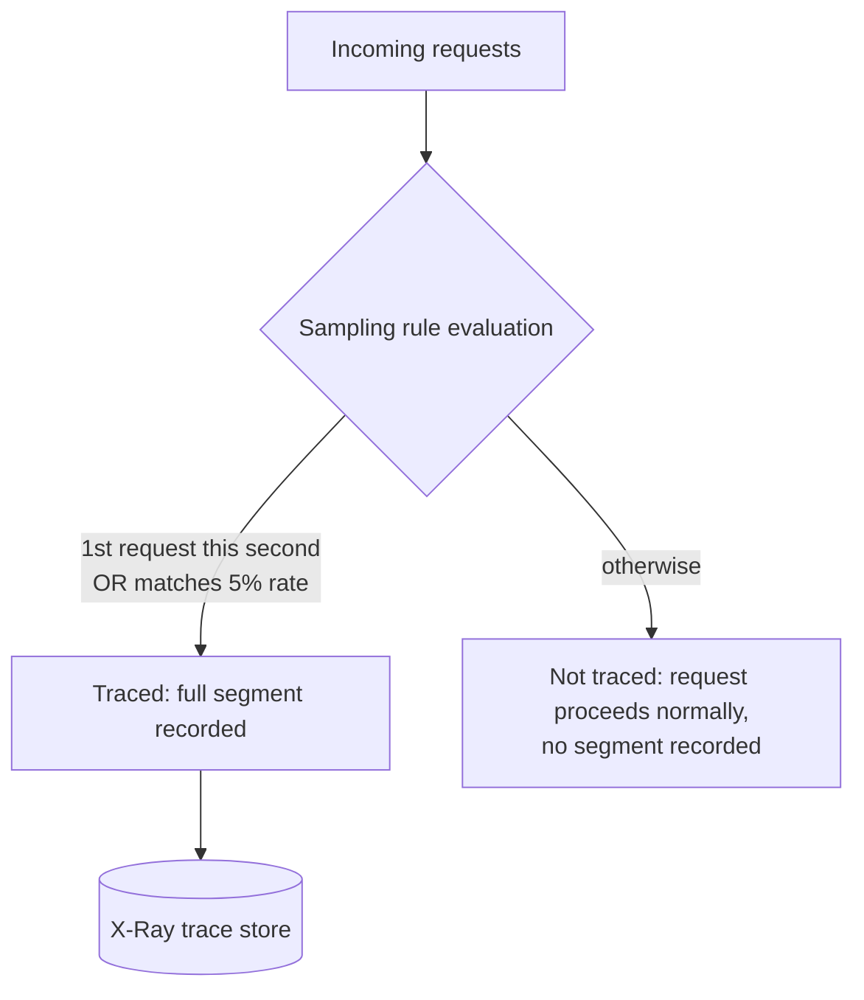

Tracing every single request at high volume would be both expensive and, past a certain scale,
not actually more useful — you don't need 50,000 identical healthy traces per minute to know a
service is healthy. X-Ray's default rule traces the first request each second plus 5% of any
additional requests, per service, tunable via custom sampling rules. The exam-relevant idea: a
question describing "some requests don't appear in X-Ray even though tracing is clearly enabled
and working" is almost always describing expected sampling behavior, not a misconfiguration.

### Image: An X-Ray Service Map


*Source: [AWS X-Ray Developer Guide — "What is AWS X-Ray?"](https://docs.aws.amazon.com/xray/latest/devguide/aws-xray.html). This is the view to open first, before you even know which trace to drill into — nodes are services, edges are calls between them, edge color reflects error/fault rate (green healthy, red/yellow problems). Finding the red node localizes "which service" in seconds, before opening any individual trace to find "which specific request and why."*

### Exam Tips

- **"Where in the chain is it slow" → X-Ray; "what exactly happened in this one function" →
  CloudWatch Logs; "who/what made this API call" → CloudTrail** — the master symptom-routing
  triad for this entire domain.
- **Annotations are indexed/searchable; metadata is not** — if a scenario needs to *filter* traces
  by a field, that's an annotation; if it just needs the data visible once you've found the trace,
  that's metadata.
- **Enabling tracing on Lambda is a configuration flag, not a rewrite** — but the execution role
  still needs `xray:PutTraceSegments`/`AWSXRayDaemonWriteAccess`, or tracing silently reports zero
  data despite looking "enabled."

---

## 3. AWS CloudTrail

### Definition

AWS CloudTrail records every API call made in your AWS account — who made it, what they called,
when, from what IP address, and whether it succeeded — and stores that history as an immutable
audit log. In one sentence: CloudTrail answers **"who did what, and when?"**

### Analogy

If CloudWatch is the nervous system, CloudTrail is the building's security camera footage plus a
notarized sign-in log at the front desk, running continuously whether or not anything interesting
happens. Nobody has to press record — it's always on — and crucially, the footage itself is kept
in a vault nobody inside the building (not even the building manager, acting alone) can quietly
edit. Months later, when someone asks "who was in this room at 2am," you don't rely on anyone's
memory; you pull the tape.

### Purpose

Every single action in AWS — launching an EC2 instance, deleting an S3 bucket, changing an IAM
policy — happens as an API call under the hood. Without a record of those calls, after-the-fact
questions like "who deleted that bucket on Tuesday?" are unanswerable. CloudTrail gives every
account a built-in, tamper-evident audit trail by default, satisfying both security investigation
needs and compliance requirements. The deeper reason it exists as a *separate* service from
CloudWatch: audit data and performance data have fundamentally different consumers and integrity
requirements — a performance dashboard can tolerate a dropped data point; an audit log cannot be
trustworthy if events can silently vanish or be edited.

### When to Use

- Reconstructing exactly what happened and when during an incident post-mortem, specifically the
  *API-driven* changes (not application-level behavior).
- Proving, for a compliance audit, who had access to a resource and what they did with it.
- Near-real-time detection of security control tampering (someone disabling GuardDuty or stopping
  a trail) via a metric filter on CloudTrail events delivered to CloudWatch Logs.
- Correlating an incident's start time against recent API call history to catch a human- or
  pipeline-caused regression — the central Task 4.1 use case in this domain.

### When NOT to Use

- **"Is my application running correctly?"** — that's CloudWatch, not CloudTrail; CloudTrail has
  nothing to say about application performance.
- **Real-time resource configuration compliance** ("is every S3 bucket encrypted right now?") —
  that's AWS Config, which evaluates current/historical *state*, not the API call history that
  produced it.
- **Network traffic inspection** — that's VPC Flow Logs, a different log type capturing IP
  traffic rather than AWS API calls.
- **Cost attribution** — CloudTrail doesn't tell you what anything cost.

### Use Cases

1. **Incident post-mortem reconstruction.** Production went down at 14:30; CloudTrail's Event
   History gives a precise, timestamped, attributable sequence of every administrative action in
   the hour before — necessary but not sufficient, since it only covers API-driven changes.
2. **Finding who disabled a security control.** GuardDuty findings stopped appearing three days
   ago; filtering CloudTrail for `DeleteDetector`/`UpdateDetector` events in that window finds the
   exact principal and timestamp responsible.
3. **Correlating a latency spike with an infrastructure change.** This domain's own case study:
   checkout latency spiked right after a deploy with no application code change — CloudTrail
   reveals a CloudFormation stack update that quietly changed DynamoDB capacity mode as an
   unreviewed side effect.
4. **Cost anomaly investigation: finding who launched the expensive resource.** Cost Anomaly
   Detection flags *what* and *how much*; searching CloudTrail for `RunInstances` in the anomaly's
   window finds *who*.
5. **Multi-account governance via an Organization Trail.** One trail at the management account
   level automatically covers every current and future member account, closing the "an attacker
   in a compromised account disables logging to cover their tracks" gap.
6. **Scoped data-event auditing of one sensitive S3 bucket.** An advanced event selector logging
   every individual read of a PII bucket, without logging every object read account-wide (which
   would be cost-prohibitive).

### Why It's Important

CloudTrail is frequently the deciding piece of evidence in both security incident response and
compliance audits. Disabling CloudTrail is itself one of the first things a security team watches
for, because an attacker's first move after gaining access is often to blind the audit trail.
DVA-C03 Domain 4, Task 4.1 explicitly names CloudTrail alongside CloudWatch and X-Ray as a named
root-cause-analysis tool for the "who/what changed this" angle specifically.

### Diagram: The CloudTrail → CloudWatch → SNS Near-Real-Time Alerting Pipeline

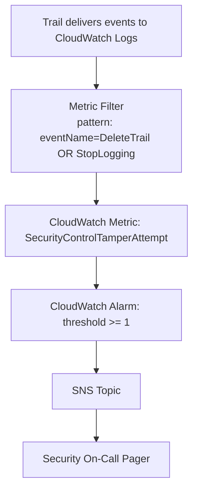

This is the canonical "detect tampering with the audit system itself" pattern, and it depends on
CloudTrail delivering to CloudWatch Logs *in addition to* S3 — S3-only delivery has no equivalent
real-time alerting path without extra tooling to poll/process the S3 objects. Walking through it:
a trail streams events to a CloudWatch Logs log group; a metric filter watches for specific
dangerous event names; a match increments a custom metric; an alarm on that metric fires an SNS
notification the moment someone (or something) tries to disable the audit trail itself — turning
a theoretically-auditable action into an actively-alerted one.

### Image: The CloudTrail Event History Console


*Source: [AWS CloudTrail User Guide](https://docs.aws.amazon.com/awscloudtrail/latest/userguide/). This is the free, always-on, 90-day rolling view of management events — searchable with no trail configuration required. The fact that this view exists by default, in every account, with zero setup, is exactly why "no trail was ever configured and the data is now gone" is such a commonly tested failure mode: Event History's 90-day window is a hard, fixed ceiling, and a trail delivering to S3/Lake is the only way to see further back.*

### Exam Tips

- **CloudTrail = WHO did WHAT (API call audit log); CloudWatch = performance/health.** If the
  question is about accountability/audit/compliance/forensics, it's CloudTrail. If it's about
  performance, availability, or operational health, it's CloudWatch.
- **Data events are off by default** — a question about needing to track individual `GetObject`
  calls on a sensitive bucket, with nothing showing up, points to enabling data events on the
  trail, not assuming CloudTrail is broken.
- **90 days is a hard, fixed Event History window** — a question about needing more than 90 days
  of history, with no trail ever configured, has the honest answer "that data is gone."

---

## 4. AWS Config

### Definition

AWS Config continuously records the configuration of your AWS resources over time and checks
them against rules you define — "is this S3 bucket encrypted?", "does this security group allow
unrestricted SSH?" — flagging anything **non-compliant**. In one sentence: AWS Config answers
**"what does my infrastructure look like right now, and does it follow the rules?"**

### Analogy

If CloudTrail is the security camera footage of every action taken, AWS Config is a building
inspector who walks through continuously, comparing the building's *current state* against the
fire code — not asking who moved a couch, just whether the couch is currently blocking an exit.
The inspector doesn't care how the couch got there (a tenant, a mover, a renovation crew); Config
doesn't care who changed a security group, only whether it's currently compliant and how its
state has changed over time. You need both the camera footage (CloudTrail, for "who") and the
inspector's report (Config, for "is it currently okay, and when did that change").

### Purpose

Configuration drifts silently. A security group gets a "temporary" open rule during an incident
and nobody remembers to close it. Without something watching continuously, these violations sit
undetected until an audit or a breach surfaces them. Config gives every account a
continuously-updated inventory of every resource's configuration, plus a rules engine that
evaluates compliance automatically and keeps a full history. The deeper distinction: Config
doesn't care *who* changed something (that's CloudTrail) and it doesn't provision anything
(that's CloudFormation/CDK) — it's purely an **observer and evaluator**.

### When to Use

- Continuous compliance drift detection against a security baseline, catching violations within
  seconds rather than at the next quarterly audit.
- Auto-remediating a clear-cut misconfiguration (a public S3 bucket, an open security group) the
  instant it's detected, via an attached SSM Automation document.
- Answering "what did this resource's configuration look like right before it broke," as a Task
  4.1 investigative input distinct from CloudTrail's "who changed it."
- Deploying a portable compliance baseline (a Conformance Pack) identically across every account
  in an Organization.

### When NOT to Use

- **"Who made this change?"** — that's CloudTrail; Config tells you *what* changed and *whether
  it's compliant*, not the identity/API call that caused it.
- **Deploying infrastructure in the first place** — that's CloudFormation/CDK/Terraform; Config
  is a passive observer of what already exists.
- **Real-time performance monitoring** — CloudWatch, not Config.
- **A single, small account with a tiny, well-known resource footprint** — the overhead/cost of
  continuous recording may not be worth it versus a periodic manual review at that scale.

### Use Cases

1. **Continuous compliance drift detection.** A CIS Benchmark requires every EBS volume
   encrypted; a Config rule evaluating on every volume change catches drift within seconds, not
   months, at the cost of an ongoing per-item recording fee that scales with account churn.
2. **Auto-remediating a public S3 bucket the instant it's detected.** A managed rule with an
   automatic remediation action (an SSM Automation document re-applying a private ACL) closes the
   exposure window with zero human involvement — but should be reserved for rules with
   essentially zero false-positive risk, since it could also "fix" an intentionally public bucket.
3. **Incident post-mortem using Config's configuration timeline.** A resource behaves
   unexpectedly and CloudTrail shows no obviously relevant human action — Config's timeline shows
   the exact property values before and after, independent of whether CloudTrail cleanly
   attributes a human cause.
4. **Enforcing a company-specific tagging policy no AWS-managed rule covers.** A custom
   Lambda-backed rule encodes organization-specific logic (a valid `CostCenter` taxonomy) that no
   generic best-practice rule can express.
5. **Conformance Pack as a portable compliance baseline via StackSets.** A platform team deploys
   the exact same 40 PCI-DSS-related rules to every new AWS account, using the same deployment
   mechanism as infrastructure baselines.
6. **Correlating a Config finding with the CloudTrail event that caused it.** A security group is
   flagged non-compliant; `get-compliance-details-by-resource` gives the exact timestamp it
   changed, and searching CloudTrail for that resource/timestamp surfaces the specific principal.

### Why It's Important

Config is frequently the backbone of a company's compliance program — SOC 2 and PCI-DSS auditors
routinely ask for continuous monitoring evidence, and Config's conformance packs plus history are
the standard way to produce it. Its auto-remediation capability closes the gap between "we
noticed a misconfiguration" and "it's fixed," which for public-facing security issues can be the
difference between a near-miss and a breach. On DVA-C03 Domain 4, Config complements CloudTrail
and CloudWatch as the third root-cause-analysis data source.

### Diagram: Config Rule Evaluation and Auto-Remediation Flow

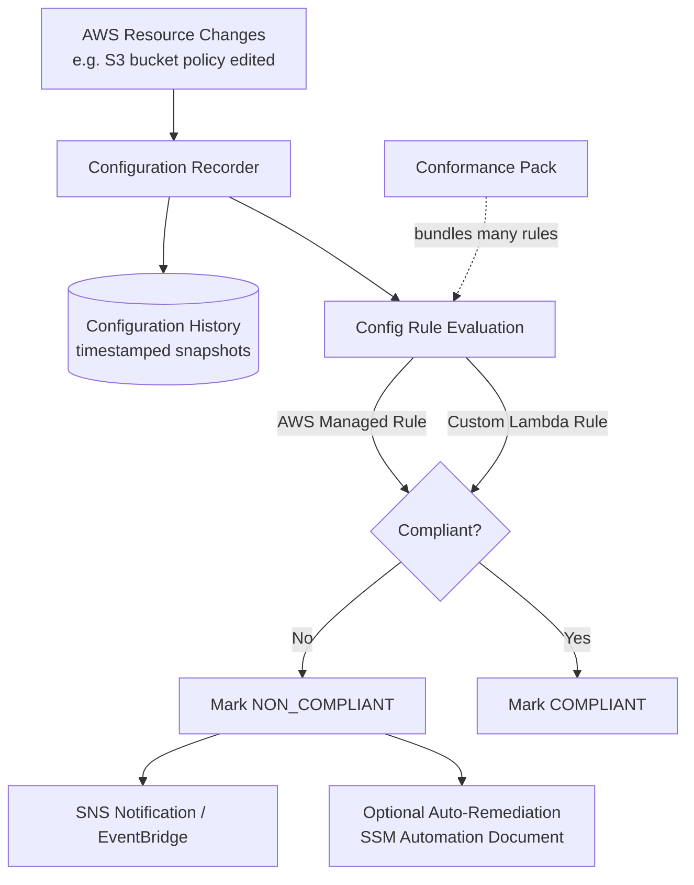

Walking through it: (1) a resource changes; (2) the Configuration Recorder detects it and stores a
new timestamped snapshot in the configuration history, so you can later ask "what did this look
like on a specific date"; (3) any rule attached to that resource type re-evaluates immediately;
(4) the rule marks the resource compliant or non-compliant; (5) a non-compliant result can notify
a human *and*, optionally, trigger automatic remediation — an SSM Automation document that fixes
the problem without waiting for a person to act. Critically, remediation is optional and separate
from detection: you can run Config in detect-only mode broadly and add auto-fix only for the
specific rules you trust to self-heal safely.

### Image: The AWS Config Console Dashboard


*Source: [AWS Lambda Developer Guide](https://docs.aws.amazon.com/lambda/latest/dg/), docs.aws.amazon.com. This compliance dashboard shows compliant/non-compliant rules and resource counts at a glance — the equivalent, for configuration state, of CloudWatch's default dashboard for performance state. Notice this view alone never tells you *who* caused a non-compliant finding; that half of the investigation always requires pairing with CloudTrail, exactly as the domain's recurring "what tool + CloudTrail" pattern predicts.*

### Exam Tips

- **Config = "is it configured correctly, and has that ever changed?"** — distinct from
  CloudTrail's "who made the API call" and CloudWatch's "is it performing well."
- **Auto-remediation is a Config feature, not CloudTrail's or CloudWatch's** — questions about
  automatically fixing a public bucket point to a Config rule with an SSM Automation remediation
  action.
- **Custom rules are Lambda-backed** — a question describing company-specific logic no
  AWS-managed rule covers points to a custom rule calling `PutEvaluations`, not an AWS-managed one.

---

## 5. AWS Identity and Access Management (IAM)

### Definition

IAM is the service that controls **who (or what) can do what, to which AWS resource, under
which conditions**. Every single API call made against AWS — console click, CLI command, SDK
call, another AWS service acting on your behalf — is checked against IAM before it's allowed to
happen. If IAM doesn't exist for a resource type, nothing in AWS can touch it, including you.

### Analogy

IAM is a building's entire access-control system at once: the ID badges (users), the
temporary visitor passes that self-destruct after a few hours (roles/temporary credentials), the
door locks themselves (resource-based policies on the specific rooms), and the master rule that
"a locked door stays locked even if someone's badge says they're allowed in" (explicit Deny always
wins, no matter what else grants access). A badge that works for the lobby doesn't automatically
work for the server room in a *different* building (cross-account access) — that room's own
separate lock has to agree too, not just your badge.

### Purpose

AWS needed a way to let one AWS account be used safely by many different humans, applications,
and other AWS services simultaneously, each with exactly the access they need and no more. Before
IAM-style systems existed, the common failure mode was "one shared root login, full access, hope
nothing goes wrong" — a single leaked credential meant total account compromise. IAM exists to
make **least privilege** the default operating model, and it is also the single mechanism AWS
uses internally — every AWS service defers to IAM to decide if a request is allowed.

### When to Use

- Granting a human, application, or AWS service exactly the permissions it needs — which is to
  say, every single interaction with AWS, without exception.
- Diagnosing an `AccessDenied` error during an incident — IAM's policy evaluation chain is the
  single most common root cause of "it worked yesterday, fails today" when nothing else changed.
- Delegating role-creation to a non-admin team safely, via a permission boundary that caps what
  any role they create can ever do.
- Cross-account access between two separate AWS accounts, which always requires a role (and its
  trust policy), never a user's own identity policy alone.

### When NOT to Use

- **An application's own customer-facing login (millions of end users)** — that's Cognito User
  Pools, not IAM users; IAM is for AWS account/resource access, not your product's own
  authentication.
- **Workforce SSO across many AWS accounts** — IAM Identity Center is purpose-built for this;
  provisioning individual IAM users per account doesn't scale past a handful of people.
- **Org-wide, un-overridable guardrails** — that's Service Control Policies (SCPs) in AWS
  Organizations, a different, broader-scoped mechanism than IAM policies alone.
- **Storing long-term access keys in application code** — a role (EC2 instance profile, Lambda
  execution role) is almost always the correct alternative; an exam answer proposing hardcoded
  keys is wrong whenever a role option exists.

### Use Cases

1. **Diagnosing a Lambda function's `AccessDenied` error calling DynamoDB.** The execution role
   is checked first (the most common cause), then any resource-based policy on the target; IAM's
   evaluation order (explicit Deny, then SCP/boundary ceilings, then identity/resource Allow) is
   the exact checklist a Task 4.1 investigation walks through.
2. **Cross-account S3 access.** An identity policy in Account A allowing `s3:GetObject` is
   necessary but *not sufficient* if the bucket lives in Account B — the bucket's own
   resource-based policy must separately and explicitly allow that principal too.
3. **A permission boundary silently capping an otherwise-correct policy.** A developer's identity
   policy grants `dynamodb:*`, but a boundary set by a central platform team only allows
   `GetItem`/`Query` — the resulting `AccessDenied` on a write looks identical to "no permissions
   at all," a genuinely confusing real-world debugging scenario.
4. **An SCP denying an action the identity policy would otherwise allow.** An account-wide SCP
   restricting regions overrides even a developer's own `ec2:*` Allow policy — removing the SCP
   wouldn't need to add anything, since the identity policy already permits it elsewhere; SCPs
   only ever subtract.
5. **Scoping a mobile app's direct DynamoDB access to each user's own data.** The
   `dynamodb:LeadingKeys` condition key lets an IAM policy ensure a caller can only touch items
   whose partition key matches their own identity, without a backend API in between.
6. **Granting an EC2-hosted application temporary, auto-rotating credentials instead of
   long-term access keys.** An IAM role assumed via an instance profile means the application
   never needs (and should never have) hardcoded keys baked into its deployment.

### Why It's Important

IAM questions are not confined to "security" sections of any of the three related certs — they
appear embedded inside storage, compute, database, and ML questions too, because "which policy
lets this Lambda read this DynamoDB table" is simultaneously a Domain 4 troubleshooting question
and a Domain 1/3 development question. Nearly every real `AccessDenied` incident is ultimately an
IAM policy evaluation question, making this the single most load-bearing diagnostic skill in the
entire domain.

### Diagram: The Policy Evaluation Logic

```mermaid
flowchart TD
    A[Request arrives: Principal + Action + Resource + Context] --> B{Explicit DENY\nin any applicable policy?}
    B -- Yes --> Z[DENY — request stops here]
    B -- No --> C{SCP at Org/OU level\nallows this action?}
    C -- No --> Z
    C -- Yes --> D{Permission boundary\nallows this action?}
    D -- No --> Z
    D -- Yes --> E{Session policy\n(if assumed via STS) allows it?}
    E -- No --> Z
    E -- Yes --> F{Identity-based policy\nALLOWs the action?}
    F -- No --> G{Resource-based policy\nALLOWs the action?}
    G -- No --> Z2[Implicit DENY — default]
    G -- Yes --> H[ALLOW]
    F -- Yes --> H
```

Walking through it: (1) **explicit Deny always wins immediately**, no matter what else says
Allow — checked first, short-circuits everything else; (2) every **containing boundary** must
say yes next — the SCP ceiling, the permission boundary, and the session policy, each of which
can only take away permissions, never grant new ones; (3) only after all ceilings pass does AWS
check whether an identity-based policy *or* a resource-based policy grants the action — either
one alone is enough for most services (S3, KMS, SQS, SNS, Lambda); (4) if nothing explicitly
allows the action anywhere, the result is **implicit deny** — AWS's default posture is "deny
everything not explicitly allowed." This single flowchart is the most repeated diagnostic tool in
IAM-related Domain 4 questions, because nearly every `AccessDenied` scenario maps onto one
specific box in it.

### Image: The Official AWS Permission Boundary Intersection Diagram


*Source: [AWS IAM User Guide — "Policy evaluation logic"](https://docs.aws.amazon.com/IAM/latest/UserGuide/reference_policies_evaluation-logic.html). This is the single diagram that resolves the single most confusing real-world IAM debugging scenario: a permission boundary that doesn't explicitly grant an action behaves, for the intersection calculation, exactly like denying it — producing an `AccessDenied` that looks identical to "the identity policy is wrong," when the identity policy may in fact be entirely correct.*

### Exam Tips

- **Explicit Deny beats everything** — a scenario with one statement that Denies and another that
  Allows the same action always resolves to Deny, often disguised across an identity policy, an
  SCP, and a permission boundary simultaneously in the same question.
- **No matching statement = implicit deny, not "allowed by default"** — IAM's default posture is
  deny-all; a question implying silence means access is wrong.
- **Same-account identity+resource policy = union; cross-account = both required separately** —
  the nuance that separates a surface-level answer from a correct one on harder cross-account
  scenario questions.

---

## 6. AWS Lambda

### Definition

AWS Lambda runs your code for you without you ever provisioning or managing a server — you upload
a function, tell AWS what should trigger it, and AWS runs it only when that trigger fires, billing
you only for the milliseconds it actually executed.

### Analogy

Lambda is a pop-up kitchen stall that only exists for the exact duration of one customer's order.
The moment an order (an event) arrives, a fully-equipped kitchen materializes, cooks the meal, and
hands it over; if no orders are coming in, there's no idle kitchen sitting there costing you rent.
The catch: materializing a brand-new kitchen from nothing (a **cold start**) takes longer than
reusing one that's already standing from the last order (a **warm start**) — which is exactly why
a restaurant expecting a predictable lunch rush might pay to keep a few kitchens standing and
staffed in advance (**provisioned concurrency**) rather than materializing one from scratch for
every single customer.

### Purpose

Most applications spend most of their time idle, waiting for something to happen. Running a
full-time server to handle that is wasteful: you pay 24/7 for work that happens in short bursts.
Lambda solves "I just need this specific piece of logic to run when X happens" without any of the
surrounding server lifecycle — no OS to patch, no capacity to plan, no idle cost. This is the
foundational idea of **serverless compute**: the server still exists physically, but you never
see it, manage it, or pay for it while it's idle.

### When to Use

- Event-driven, bursty, or unpredictable-traffic workloads with real idle time between
  invocations — the textbook serverless sweet spot.
- Work that reliably finishes well within 15 minutes, with no need for specialized hardware or
  full OS-level control.
- A function behind a strict latency SLA, evaluated *together* with cold-start mitigation
  (provisioned concurrency or SnapStart) if that SLA can't tolerate occasional multi-second delays.
- Lightweight ML inference, glue logic between AWS services, and API backends paired with API
  Gateway or a Function URL.

### When NOT to Use

- **Long-running processes over 15 minutes** — use Fargate, EC2, or break the work into steps
  orchestrated by Step Functions; this is a hard ceiling, not a raisable quota.
- **High, sustained, predictable throughput at large enough scale** — per-invocation Lambda
  pricing can cost more than a steady-state EC2/Fargate fleet sized to match; model both before
  committing (see the worked cost example below).
- **Workloads needing specialized hardware or full OS-level control** (custom kernel modules,
  specific GPU driver versions) — use EC2.
- **Stateful, long-lived in-memory data that must persist across requests with guarantees** —
  Lambda environments can be recycled at any time; treat Lambda as stateless and use
  ElastiCache/DynamoDB for anything that must survive.

### Use Cases

1. **E-commerce order-confirmation image processing.** A product review photo needs resizing and
   content scanning the moment it's uploaded — a few hundred milliseconds of work with real idle
   time between uploads, exactly Lambda's sweet spot versus an always-on image-processing service.
2. **Fintech real-time fraud-check API.** API Gateway + Lambda scales per-request automatically,
   so a 3am traffic spike is handled identically to a quiet Tuesday afternoon with nobody
   pre-provisioning capacity for either.
3. **Infrastructure automation reacting to an AWS Config finding.** A security team's function
   automatically disables an IAM access key inactive for 90 days, triggered by a rule evaluation —
   the "small piece of logic reacting to an AWS-internal event" pattern Lambda is built for.
4. **Lightweight ML inference behind an unpredictable-traffic API.** A small, fast classification
   model fits comfortably within Lambda's limits, and request volume is too spiky to justify a
   warm, dedicated inference endpoint billed by the hour regardless of traffic.
5. **Checkout-critical path needing cold-start elimination.** Provisioned concurrency pre-warms a
   fixed number of environments for a latency-critical checkout function, at a real, continuous,
   separate cost roughly doubling the function's monthly bill in the worked example below.
6. **A sustained, constant-throughput service with no idle time.** Running the equivalent of 2
   vCPU/4GB continuously 24/7 costs more on Lambda than an equivalent EC2 instance — the concrete
   case where Lambda's idle-time advantage simply doesn't apply.

### Why It's Important

Lambda is the clearest expression of "pay for value, not for idle capacity," removing an entire
category of operational work. It's also a common source of surprising bugs for newcomers — cold
starts, VPC networking quirks, and the 15-minute timeout all bite people who assume it behaves
like a tiny always-on server. On DVA-C03, an entire task statement (Domain 1, Task 1.2) is
dedicated to developing Lambda code, and Domain 4's Task 4.3 specifically tests the cold-start and
memory/cost tuning covered here.

### Diagram: Synchronous vs. Asynchronous vs. Poll-Based Invocation

```mermaid
flowchart TD
    subgraph SYNC[Synchronous - e.g. API Gateway, ALB, Function URLs]
        S1[Caller invokes] --> S2[Lambda runs] --> S3[Caller waits for response/error directly]
    end
    subgraph ASYNC[Asynchronous - e.g. S3, SNS, EventBridge]
        A1[Event source invokes] --> A2[Lambda queues internally]
        A2 --> A3[Lambda runs - retries automatically on failure]
        A3 -->|still failing after retries| A4[Dead Letter Queue / on-failure destination]
    end
    subgraph POLL[Poll-based - e.g. SQS, Kinesis, DynamoDB Streams]
        P1[Event source mapping polls the source] --> P2[Batches records]
        P2 --> P3[Lambda runs with a batch]
        P3 -->|batch item fails| P4[Retry batch / bisect / skip per config]
    end
```

This single diagram is the most important thing to internalize about Lambda beyond "it runs
code": the invocation model determines **who is responsible for handling failure**. In the
synchronous case, the caller sees the error directly. In the asynchronous case, Lambda silently
retries twice more on your behalf before giving up — meaning a function with no DLQ/destination
configured can fail repeatedly with nobody ever finding out. In the poll-based case, a single
malformed record can block an entire batch (the classic "poison pill" failure mode) until it's
resolved. Picking the wrong mental model for a given trigger type is the single most common source
of "why did my Lambda silently stop processing" incidents.

### Image: The Lambda Execution Environment Lifecycle (Init, Invoke, Shutdown)


*Source: [AWS Documentation — Understanding the Lambda execution environment lifecycle](https://docs.aws.amazon.com/lambda/latest/dg/lambda-runtime-environment.html). This diagram shows one execution environment handling three consecutive invocations — `Init` only happens once, before the first invocation; every subsequent invocation on a **warm** environment skips straight to `Invoke`, which is exactly why the second and third calls are faster than the first. This is the single clearest visual explanation of why "move expensive setup outside the handler" is the standard cold-start advice: code placed there only pays the Init cost once per environment, not once per invocation.*

### Exam Tips

- **15-minute hard timeout** — any question describing a process that can run "hours" rules
  Lambda out; look for Step Functions, Fargate, or Batch instead.
- **Reserved vs. provisioned concurrency are NOT the same** — reserved concurrency caps/guarantees
  a slice of account concurrency for a function; provisioned concurrency pre-warms environments
  to eliminate cold starts. Don't conflate them.
- **Compute cost is memory × duration, never memory alone** — raising memory can *reduce* total
  cost for a CPU-bound function because duration drops faster than the per-GB-second rate rises,
  up to the point where the workload stops being CPU-bound.

---

## 7. Amazon API Gateway

### Definition

Amazon API Gateway is a fully managed service for creating, publishing, securing, and monitoring
APIs — it's the "front door" that sits between API clients (web apps, mobile apps, other
services) and your backend logic (Lambda functions, HTTP servers, other AWS services), handling
everything around the actual business logic: routing, auth, throttling, request/response
transformation, and versioning.

### Analogy

API Gateway is a hotel's front desk and concierge rolled into one. Every guest (request) checks
in at the desk first — ID is verified (the authorizer), the desk enforces how many guests a given
travel agency can book per day (usage plans/throttling), and only then does the desk direct the
guest to the right room (the correct backend integration). The kitchen (your Lambda function)
never has to check anyone's ID itself or worry about overbooking — that's entirely the front
desk's job, which is exactly why teams building directly on raw compute end up re-implementing a
worse version of this same front desk themselves.

### Purpose

Building a production-grade API by hand means solving a long list of cross-cutting concerns
before writing a single line of business logic: authentication, rate limiting, request
validation, CORS, versioning, usage metering, caching, and monitoring. API Gateway exists so
developers can focus purely on the backend logic while AWS handles all of that surrounding API
infrastructure as a managed, auto-scaling layer.

### When to Use

- A new serverless API backed by Lambda and DynamoDB, where you want auth/throttling/versioning
  handled by a managed layer rather than custom code.
- A public, monetized partner API needing per-customer rate limits and quotas via usage plans and
  API keys.
- An internal-only API that must never be reachable from the public internet — a Private REST API
  behind a VPC interface endpoint.
- Diagnosing a symptom where client-visible errors (429, 403) don't correlate with any backend
  metric showing distress — a Task 4.1 pattern specific to this service's position in front of
  the compute layer.

### When NOT to Use

- **Extremely high-throughput, low-latency internal service-to-service traffic** — the
  per-request pricing and added hop can be unnecessary overhead; consider direct ALB/NLB routing
  or VPC Lattice for east-west traffic instead.
- **GraphQL APIs** — AWS AppSync is purpose-built for GraphQL (resolvers, subscriptions, offline
  sync) rather than bolting GraphQL onto REST-shaped API Gateway.
- **A single-Lambda webhook receiver with no auth complexity** — a Lambda Function URL (a direct
  HTTPS endpoint on the function itself) can be simpler and cheaper for that one narrow case.
- **A backend call that can genuinely take longer than 29 seconds** — API Gateway's integration
  timeout is a hard, non-raisable ceiling; redesign for an asynchronous pattern instead.

### Use Cases

1. **Multi-tier serverless web backend.** A new product needs a REST/HTTP API backed by Lambda
   and DynamoDB with no servers to manage at any layer — the canonical API Gateway + Lambda +
   DynamoDB pairing.
2. **Monetized partner API with tiered access.** Free, pro, and enterprise pricing tiers each get
   their own usage plan and API key, natively metered and throttled without custom rate-limiting
   code.
3. **Compliance-driven private internal API.** A Private REST API type behind an interface VPC
   endpoint, with a resource policy naming allowed endpoints, satisfies "never publicly
   reachable" at the API Gateway configuration level, not just via network ACL controls.
4. **Real-time chat application via WebSocket API.** Persistent, bidirectional connections routed
   by a `$connect`/`$disconnect`/custom-route model, with a DynamoDB-backed connection-ID store
   for pushing messages to specific connected clients.
5. **Diagnosing intermittent partner-specific 429s with a healthy backend.** A 429 with a
   healthy-looking Lambda function behind it is the signature of a rejection that never reached
   the backend at all — checking usage-plan-level throttling (not the function) finds the cause.
6. **Legacy backend modernization via custom (non-proxy) integration.** API Gateway fronts an
   existing on-prem HTTP backend expecting a specific legacy payload shape, using mapping
   templates to adapt modern client requests without touching the legacy code.

### Why It's Important

API Gateway removes an enormous amount of "undifferentiated heavy lifting" — teams that build
their own auth/throttling/versioning layer on raw compute routinely spend weeks on
infrastructure API Gateway provides out of the box, and get it wrong more often (rate-limiting
bugs, inconsistent auth enforcement across routes). On DVA-C03, API Gateway + Lambda is the
primary serverless development pattern tested, and in Domain 4 specifically it's the frequent
first suspect — or frequent red herring — whenever a client sees an error the backend doesn't.

### Diagram: Layered Throttling — Most Restrictive Wins

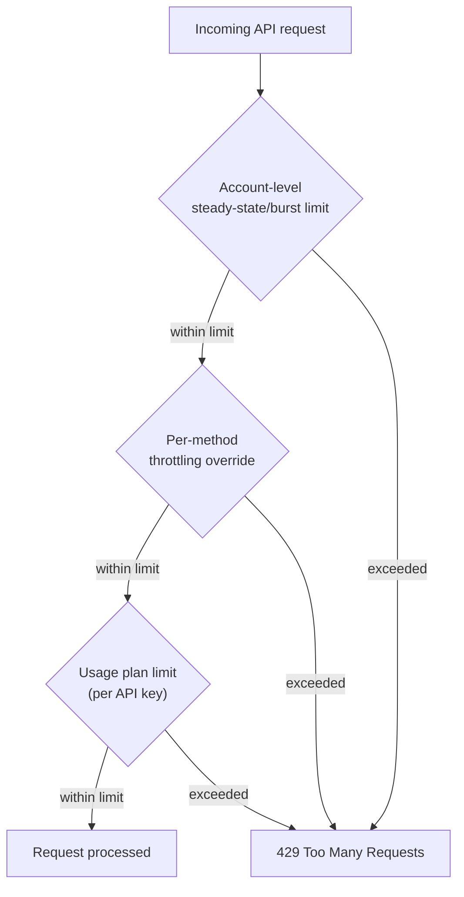

All three layers can be configured simultaneously and independently, and a request only needs to
violate **one** of them to be rejected with a 429 — the account-level default, a per-method
override, and a usage-plan limit specific to one API key/consumer. A scenario describing one
customer being throttled while others aren't is almost always a usage-plan-level limit being hit,
not the account-wide default — exactly the diagnostic path this domain's third worked case study
(in the main README) walks through for a real partner-integration incident.

### Image: The API Gateway Architecture Diagram


*Source: [AWS Documentation — "What is Amazon API Gateway?"](https://docs.aws.amazon.com/apigateway/latest/developerguide/welcome.html). This diagram shows API Gateway as the front door between clients and backend targets, handling traffic management, authorization/access control, monitoring, and API version management — everything in this picture happens *before* a request reaches your actual business logic, which is exactly why a healthy backend metric doesn't rule out a problem at this layer during an investigation.*

### Exam Tips

- **HTTP API vs. REST API**: lowest cost/latency and simple JWT auth → HTTP API. API
  keys/usage plans, request validation, caching, or private VPC-only APIs → REST API.
- **The 29-second integration timeout is hard, not soft** — a scenario about a long-running
  backend process through API Gateway is pointing at an asynchronous redesign, not a limit
  increase request, since this specific limit cannot be raised at all.
- **Throttling is layered, and the most restrictive layer wins** — a question about one customer
  being throttled while others aren't is almost always their specific usage-plan limit, not the
  account-wide default.

---

## 8. AWS Systems Manager

### Definition

AWS Systems Manager (SSM) is a collection of operational tools for managing fleets of EC2
instances and on-premises servers at scale — running commands across hundreds of machines at
once, storing configuration/secrets centrally, opening a secure shell session without SSH keys
or open ports, and patching operating systems automatically.

### Analogy

Traditional server management is like needing a physical key to every door in a building, and
leaving those doors unlocked (open SSH ports) so you can get in quickly when needed — a
convenience that's also exactly how an intruder gets in. Systems Manager replaces every physical
lock with an intercom system: nobody can walk up to a door and try a key at all (no inbound
ports), but anyone with the right building credentials can call the front desk, get verified, and
be let in through a channel the building itself controls and logs — the door is never
"unlocked," because there's no door-level lock to pick in the first place; access is mediated
entirely by a trusted central system.

### Purpose

Managing a handful of servers by hand doesn't scale past a few machines, and opening SSH/RDP
ports for access is itself a security liability. Systems Manager lets fleets of instances be
configured, patched, inspected, and accessed — all through the AWS API, authenticated by IAM,
logged by CloudTrail, with zero inbound ports ever opened. The underlying design principle is
**inversion of connection direction**: the agent on each instance reaches *out* to AWS, and the
administrator talks to AWS, never directly to the instance.

### When to Use

- Eliminating SSH keys and open port 22/3389 entirely across a fleet, replacing them with
  IAM-governed, fully-logged Session Manager access.
- Fleet-wide patch compliance on a predictable schedule, with reporting for an audit.
- Fan-out diagnostic or remediation commands across a tagged fleet during an incident, where the
  target list should automatically include newly launched Auto Scaling instances.
- Centralizing application configuration (Parameter Store) across Lambda, ECS, EC2, and CI/CD so
  five different compute platforms read the same canonical value instead of five duplicated copies.

### When NOT to Use

- **Secrets requiring automatic rotation or native cross-account resource policies** — Secrets
  Manager is purpose-built for that; Parameter Store's SecureString can hold a secret but doesn't
  natively rotate it.
- **Container orchestration/patching** — containers are typically replaced, not patched in place;
  Patch Manager targets EC2/on-prem OS patching specifically.
- **Dynamic application configuration with deployment strategies and automatic rollback** — AWS
  AppConfig is the sibling service purpose-built for that, beyond what Parameter Store alone
  provides.
- **A very small, single-instance setup with SSH already tightly controlled** — the overhead of
  standing up SSM may not be justified, though Session Manager's security benefit (no open ports)
  usually still wins at any scale.

### Use Cases

1. **Zero-bastion-host network design.** An entire fleet in private subnets, with no bastion host
   and no inbound SSH/RDP rule anywhere — access is exclusively via Session Manager, governed by
   IAM policy, optionally restricted further by IAM Condition keys.
2. **Fleet patch management with compliance reporting.** A 200-instance production fleet stays
   patched against known CVEs on a predictable cadence, with Patch Manager's baseline +
   maintenance window + compliance reporting, used as direct evidence for a security audit.
3. **Fan-out diagnostic commands during an incident.** Run Command targets by tag, not a static
   instance list, so checking disk usage and service status across every `Role=web` instance
   automatically covers newly launched Auto Scaling instances with no target-list maintenance.
4. **Centralizing a database connection string across five compute platforms.** Parameter Store
   gives one canonical location any service reads via API, eliminating drift between duplicated
   copies previously hardcoded in five places.
5. **Feeding dynamic values into CloudFormation/CDK without committing secrets to Git.** A
   `{{resolve:ssm:/myapp/prod/db/host:1}}` dynamic reference resolves at deploy time, keeping the
   literal value out of the versioned template.
6. **Auditing exactly what commands ran in a Session Manager session after an incident.**
   Session logging to CloudWatch Logs/S3 produces a durable, centralized transcript no local
   shell-history file (which an attacker with root could delete) can provide.

### Why It's Important

Session Manager eliminating open SSH/RDP ports is one of the highest-leverage, lowest-effort
security improvements available on AWS — it closes one of the most commonly exploited attack
surfaces with no workflow downside, since every session is still fully logged. Parameter Store is
the quiet backbone of most well-run AWS environments' configuration management. On DVA-C03,
Systems Manager resurfaces in Domain 4 specifically for Run Command-based diagnostics and
Config's auto-remediation (which is SSM Automation underneath).

### Diagram: Session Manager Connection Establishment

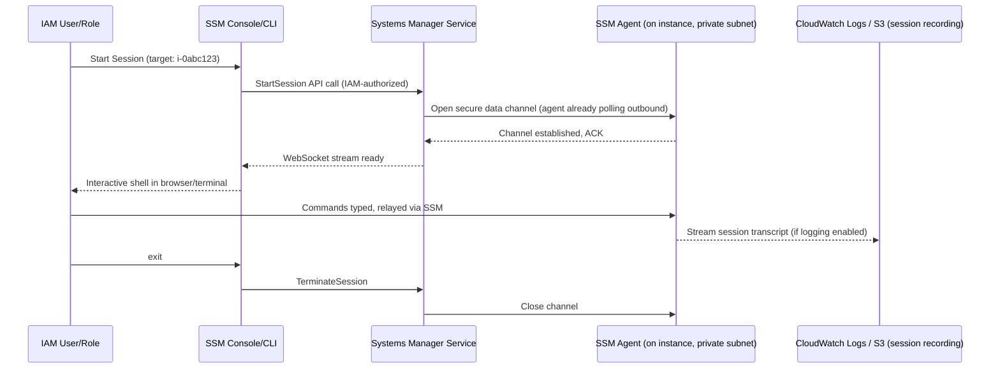

Walking through it: the user requests a session against a specific instance ID, authorized purely
by IAM policy — no SSH key exchange of any kind. Systems Manager relays the request to that
instance's *already-established outbound* agent connection — at no point does AWS or the user
initiate an inbound connection to the instance. If session logging is enabled, every keystroke
and output line streams to CloudWatch Logs/S3 in parallel with the live session, producing a
durable audit transcript automatically. Ending the session cleanly tears down the channel — no
lingering open port or orphaned connection to clean up, unlike a forgotten bastion-host session.

### Image: Starting a Session Manager Session


*Source: ["Using AWS Systems Manager in Hybrid Cloud Environments," AWS Architecture Blog](https://aws.amazon.com/blogs/architecture/using-aws-systems-manager-in-hybrid-cloud-environments/). Notice what's absent from this console flow entirely: no SSH key field, no bastion-host hostname, no security-group port configuration. The entire "no open ports" value proposition is visible in what this screen simply doesn't ask for.*

### Exam Tips

- **"No bastion host, no open SSH port, fully audited shell access" → Session Manager** — one of
  the most reliable keyword matches on this exam.
- **A missing IAM instance profile is the #1 real-world and exam-tested cause** of "I can't
  connect via Session Manager" — not a network/security-group issue, since Session Manager
  requires no inbound rule at all.
- **Parameter Store vs. Secrets Manager**: if a question specifically mentions automatic
  rotation, the answer is Secrets Manager even though Parameter Store SecureString looks
  superficially similar.

---

## 9. AWS Cost Management Tools

### Definition

AWS Cost Management is a family of tools — **Cost Explorer**, **AWS Budgets**, **Cost Anomaly
Detection**, the **Cost and Usage Report (CUR)**, and **cost allocation tags** — that together
let you see where your AWS bill is going, get alerted before it goes over a limit you set or
when it behaves unusually, and break spending down by team, project, or environment.

### Analogy

Think of a household budget app. **Cost Explorer** is the app's history view — "here's exactly
where your money went last month, broken down by category." **Budgets** is the app proactively
texting you "you're at 80% of your grocery budget with a week left in the month" — before you
overspend, not after the statement arrives. **Cost Anomaly Detection** is different from both: it
has learned your normal spending rhythm and texts you "this is unusual for you" the moment a
charge doesn't fit your pattern, even if it's well under any budget cap you've set — the way a
bank's fraud alert doesn't need you to set a dollar threshold, it just needs to know what "normal
for you" looks like.

### Purpose

An AWS bill is one aggregate number covering potentially thousands of resources — without tools
to break it down, "why did our bill jump 30% this month?" is nearly impossible to answer. AWS
built this toolset so cost visibility, forecasting, alerting, and attribution are native
capabilities, not something every company has to build themselves from raw billing exports. The
deeper reason this matters at scale: cloud cost is variable and attributable at a granularity
traditional finance tooling was never built for — a single shared account can have a thousand
teams spinning resources up and down continuously.

### When to Use

- Monthly finance reviews needing spend attributed by team/project via cost allocation tags.
- Proactive bill-shock prevention via threshold alerting (Budgets), ideally on both actual *and*
  forecasted spend for earlier warning.
- Detecting a spend pattern that's unusual for this specific account, even within an otherwise
  fine monthly budget (Cost Anomaly Detection) — see the dedicated topic page in this domain for
  the full investigation workflow.
- Deep, custom cost analysis beyond the console UI (the CUR via Athena/QuickSight), for a FinOps
  team blending AWS spend with internal project metadata.

### When NOT to Use

- **Real-time, per-second cost tracking during an active experiment** — billing data has a
  reporting lag of up to 24 hours; instrument your own resource-count-based estimate instead for
  truly live feedback.
- **General security/configuration best-practice checks** — that's Trusted Advisor (which
  includes a cost-optimization category, but isn't primarily a cost tool) or AWS Config.
- **Tiny personal/sandbox accounts with a handful of resources** — the basic Billing console
  dashboard may be enough; the full toolset earns its complexity at organizational scale.
- **Identifying who caused a cost anomaly** — Cost Anomaly Detection and Cost Explorer answer
  *what* and *how much*; CloudTrail is always the separate, paired tool for *who*.

### Use Cases

1. **Monthly finance review attributed by team.** Cost Explorer grouped by an activated cost
   allocation tag turns one aggregate invoice number into an attributable breakdown by owner —
   but only works if tags were activated *before* the spend occurred.
2. **The standard cost-spike drill-down: total → by service → by usage type → by tag.** A bill
   35% higher than last month is systematically narrowed from an abstract "something got more
   expensive" into "Team=ML's forgotten training instance," exactly as this domain's worked
   example demonstrates step by step.
3. **Proactive bill-shock prevention.** AWS Budgets alerts on forecasted spend, not just actual —
   forecasted alerts give earlier warning since they predict a breach before it actually happens.
4. **A forgotten large training instance left running over a weekend.** Cost Anomaly Detection's
   ML model, having learned the account's typically near-zero weekend EC2 spend, flags the
   sustained unusual usage roughly a day after it starts — see the full topic page for the
   complete, paired-with-CloudTrail investigation.
5. **Validating a Lambda memory-tuning change actually saved money.** Cost Explorer filtered to
   the Lambda service, compared before/after the change, gives the actual billed answer rather
   than a theoretical pricing-calculator estimate.
6. **Chargeback/showback for a managed services provider running five clients in one account.**
   Tag-based cost allocation (`Client=Acme`) produces a defensible per-client breakdown without
   needing five separate AWS accounts.

### Why It's Important

Cloud cost overruns are one of the most common operational surprises for companies new to AWS.
Budgets and Cost Anomaly Detection turn that from "discovered at month-end" into "caught within
hours," and cost allocation tags are what makes a shared multi-team bill explainable rather than
a mystery lump sum. DVA-C03 Domain 4's Task 4.3 explicitly covers cost/performance tradeoffs,
where this toolset's data informs whether an optimization actually saved money.

### Diagram: Budget Alert and Action Flow

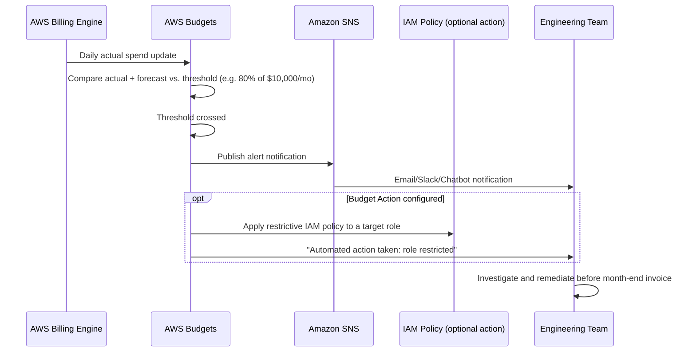

Walking through it: AWS's billing engine updates actual and forecasted spend roughly daily;
Budgets compares this against your configured threshold(s) — you can alert on **actual** spend,
**forecasted** spend, or both, with forecasted alerts giving earlier warning since they predict a
breach before it actually happens. Crossing a threshold fires a notification immediately, not at
month-end. Optionally, a **Budget Action** goes beyond notification into automated enforcement —
attaching a restrictive IAM policy to a role when a budget is exceeded, turning a *warning* into
an actual *guardrail*.

### Image: Cost Explorer's Usage-Type Breakdown


*Source: [AWS Documentation — Amazon CloudWatch User Guide (Cost Explorer integration)](https://docs.aws.amazon.com/AmazonCloudWatch/latest/monitoring/images/ce.png). This is the exact screen used in Step 2 of every cost-drill-down pattern in this domain — total cost grouped by usage type, the pivot point between "something in EC2 got expensive" and "specifically BoxUsage:m5.4xlarge did." Note it answers *what*, never *who* — that's always CloudTrail's job, paired afterward.*

### Exam Tips

- **Budgets = proactive, threshold-based alerting; Cost Explorer = retrospective/analytical
  visualization.** Don't swap them.
- **Cost allocation tags must be activated, not just applied** — a classic trap describing
  tagged resources not showing up in a cost breakdown, fixed by activating the tags in the
  Billing console, not re-tagging resources.
- **Cost Anomaly Detection catches pattern deviation; Budgets catches threshold crossing** — a
  gradual, sustained spend increase that never crosses a single day's cap is the textbook signal
  pointing at Anomaly Detection specifically.

---

## 10. AWS Trusted Advisor

### Definition

AWS Trusted Advisor is an automated service that inspects your AWS account against a set of AWS
best-practice checks and reports findings across five categories: **Cost Optimization,
Performance, Security, Fault Tolerance, and Service Limits**. In one sentence: it's AWS's
built-in "here's what you're doing wrong (or could do better), according to our own best
practices" checklist.

### Analogy

Trusted Advisor is a free, automated home inspection checklist — the kind that checks "does the
smoke detector have a battery, is the water heater pressure valve working, is the attic
insulated to code" — run against a fixed, standard list AWS itself maintains from decades of
experience across millions of accounts. It won't catch something specific to *your* household's
own rules (that's what a custom AWS Config rule is for, the equivalent of hiring your own
inspector with your own checklist) — but it costs nothing beyond a baseline support plan and
catches the most common, embarrassingly simple issues immediately, with zero setup.

### Purpose

AWS has decades of operational experience seeing what good and bad architectures look like — idle
load balancers, unencrypted public buckets, single-AZ database deployments with no failover.
Rather than making customers discover these issues the hard way, Trusted Advisor surfaces them
proactively, continuously, for free (at a basic level) in every account. The underlying design
tradeoff: Trusted Advisor is a **fixed, curated checklist**, not an extensible rules engine —
breadth and zero-effort, not depth and customization (that's Config's job).

### When to Use

- A zero-setup health check spanning five categories at once for a newly onboarded account with
  no existing tooling.
- Low-hanging-fruit cost cleanup — idle load balancers, unattached EBS volumes, underutilized
  instances accumulated over years of organic growth.
- Pre-emptive service quota exhaustion detection — available even on the free Basic support plan.
- A lightweight second opinion on security basics (root MFA, an open security group) alongside a
  specialized active-threat-detection tool like GuardDuty.

### When NOT to Use

- **Deep, continuous, rule-based compliance tracking with history and custom rules** — that's AWS
  Config, far more extensible than Trusted Advisor's fixed check library.
- **Active threat detection** (malware, compromised credentials, anomalous API behavior) — that's
  GuardDuty/Security Hub; Trusted Advisor checks *configuration*, not *behavior*.
- **Needing the full check library on a Basic/Developer support plan** — you simply won't see
  most checks; the fix is upgrading the AWS Support plan, not troubleshooting Trusted Advisor
  itself.
- **Granular, team-specific, codified rules** ("our company requires exactly this tag schema") —
  Trusted Advisor's checks are AWS-wide best practices, not customizable; Config custom rules fit
  that need instead.

### Use Cases

1. **Low-hanging-fruit cost cleanup.** An account accumulated unattached EBS volumes, idle load
   balancers, and underutilized instances over years of growth — the Cost Optimization category
   surfaces exactly this with zero engineering effort beyond reading the report, though it
   requires Business/Enterprise support to see at all.
2. **Pre-emptive service quota exhaustion detection.** A deployment about to fail because the
   account is approaching its default VPC-per-region limit — Service Limits checks are available
   on *every* support plan including Basic, making this specific category genuinely free.
3. **A real-world cost cleanup case study.** A 200-person company's shared account accumulates
   22 unattached EBS volumes, 6 unassociated Elastic IPs, 3 idle load balancers, and 9
   low-utilization instances — cross-referencing each finding against Cost Explorer before
   acting (not blindly terminating anything flagged "idle") recovers roughly $2,277/month with no
   custom tooling.
4. **Catching an exposed access key before it's exploited.** The "Exposed Access Keys" check is
   one of the few Security checks available even on Basic support, reflecting how seriously AWS
   treats this specific risk.
5. **Prioritizing multiple simultaneous findings during a triage.** Given root-MFA-missing
   (Security, Red), RDS-backups-disabled (Fault Tolerance, Yellow), and idle-load-balancers
   (Cost, Yellow) findings together, the correct order is active security risk first,
   data-loss/resilience risk second, cost waste last.
6. **A fleet-wide "is this instance really idle" cross-reference before deleting anything.**
   Trusted Advisor's "Low Utilization" finding is based on a specific lookback window; a batch job
   running one night a month can show as "idle" most days — confirming with a longer CloudWatch
   window before acting avoids destroying a legitimate, infrequent workload.

### Why It's Important

Trusted Advisor is often the very first thing a new AWS account owner should look at — it
routinely surfaces immediately actionable, embarrassingly simple findings that represent real
risk and cost zero effort to fix once known. For cost-conscious teams, its Cost Optimization
checks regularly identify idle/forgotten resources worth real money. DVA-C03 Domain 4 tests it as
a named tool for identifying low-hanging-fruit optimization opportunities, and the "which support
plan unlocks which checks" fact is the single most commonly tested detail about this service.

### Diagram: Check Evaluation and Remediation Flow

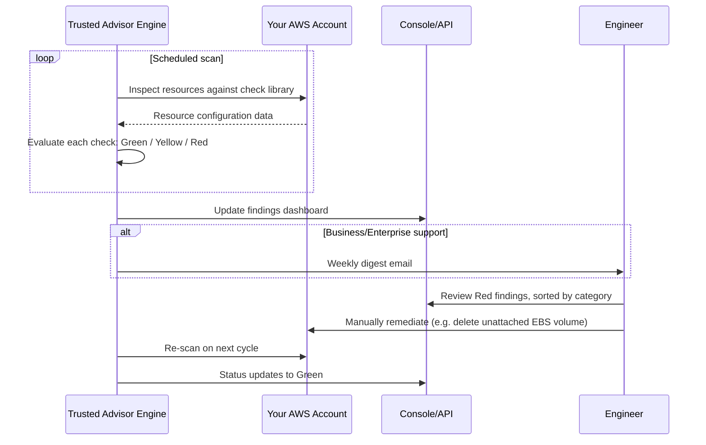

The critical detail this diagram makes visible: **remediation is manual**. Unlike AWS Config,
which can auto-remediate via an SSM Automation document, Trusted Advisor only identifies and
recommends — at no point in this flow does the service itself fix anything. A scenario asking
"will Trusted Advisor automatically close this open security group" has the answer "no," every
time, regardless of the finding's category.

### Image: The Trusted Advisor Organizational Dashboard


*Source: [AWS Cloud Intelligence Dashboards guidance](https://docs.aws.amazon.com/guidance/latest/cloud-intelligence-dashboards/trusted-advisor-dashboard.html). This is the Enterprise-Support-only consolidated view across an entire AWS Organization — notice it requires aggregating many individual accounts' findings into one QuickSight dashboard, which is itself the concrete reason "Organization-wide visibility" is specifically an Enterprise Support feature, not something Business support alone provides.*

### Exam Tips

- **Memorize the five categories**: Cost Optimization, Performance, Security, Fault Tolerance,
  Service Limits. A sixth, Operational Excellence, has also been added more broadly.
- **Support plan tier gates check depth** — the #1 tested fact. Basic/Developer = minimal checks
  (service limits + a few security). Business/Enterprise = full library + API + weekly digest +
  Organization view.
- **Trusted Advisor does not auto-remediate** — unlike Config, remediation is always a manual
  step here; a question about automatic fixing points to Config, not Trusted Advisor.

---

## 11. AWS Well-Architected Tool

### Definition

The AWS Well-Architected Tool is a free console-based service that walks you through a
structured questionnaire about a specific workload's architecture — across six pillars
(Operational Excellence, Security, Reliability, Performance Efficiency, Cost Optimization, and
Sustainability) — and produces a report of risks found plus specific AWS guidance to fix each
one.

### Analogy

If Trusted Advisor is the automated home inspection checklist, the Well-Architected Tool is the
multi-hour, structured conversation with an experienced architect who sits down with you and asks
real questions no sensor can answer: "do you have a tested disaster-recovery plan," "is your
on-call team actually prepared for this failure mode," "have you thought about who reviews a
design before it ships." A checklist can tell you a smoke detector has a battery; it cannot ask
you whether your family has actually practiced a fire drill. That's the entire reason this tool
is a questionnaire, not a scanner — some of the most important architectural questions are about
process and judgment, not a configuration fact any API can read off a resource.

### Purpose

The AWS Well-Architected Framework is a large body of accumulated best-practice guidance.
Reading whitepapers doesn't by itself tell you whether *your specific workload* follows that
guidance — someone has to actually sit down, go question by question, and honestly assess the
real architecture. The tool turns that whitepaper guidance into a structured, repeatable,
documented self-review process with a persistent record you can revisit as the architecture
evolves, instead of a one-time conversation forgotten by the next design review.

### When to Use

- A structured pre-launch architecture review before a major production release, covering
  operational, security, reliability, performance, cost, and sustainability dimensions a
  feature-focused QA pass wouldn't naturally cover.
- Quarterly architectural debt tracking via Milestones, turning "we think we've improved" into a
  specific, defensible risk-count delta.
- Applying a specialized Lens (Serverless, Machine Learning, SaaS) to get architecture-style-
  specific questions a generic review would miss entirely.
- Compliance/partner review evidence that an automated scanner's findings alone can't satisfy —
  a documented, Milestone-tracked review is a different kind of evidence.

### When NOT to Use

- **Needing automated, continuous, no-effort scanning of your actual account** — this is a
  manual questionnaire you fill out yourself; for zero-manual-effort automated findings, use
  Trusted Advisor or AWS Config instead.
- **A single, tiny, low-stakes workload** — the full six-pillar review is a significant time
  investment; it earns its cost for workloads where an architecture mistake would be expensive.
- **Real-time security threat detection** — this tool reviews design decisions periodically, not
  live security events; that's GuardDuty/Security Hub territory.
- **Wanting an instant answer with no questionnaire** — Trusted Advisor's automated checks are
  quicker, even though they cover less ground than a full review.

### Use Cases

1. **A structured pre-launch architecture review.** A team about to launch a customer-facing
   service wants a disciplined check against AWS best practices beyond "it passed QA" — the
   six-pillar questionnaire forces consideration of dimensions a feature-focused test pass
   wouldn't naturally cover.
2. **Quarterly architectural debt tracking via Milestones.** Comparing Milestone risk counts
   quarter over quarter turns "we think we've improved" into a specific number — though risk
   count can legitimately rise even while real remediation happens, if new features introduce
   risk faster than old ones are fixed.
3. **Applying the Machine Learning Lens to an ML pipeline.** Questions addressing model drift
   monitoring, data lineage, and retraining triggers — none of which a generic review covers —
   directly relevant to operating and securing ML solutions.
4. **A mandatory governance gate before production launch.** Every new production workload must
   pass a review (at minimum Security and Reliability pillars) before go-live, with any High risk
   requiring remediation or an explicit, signed-off risk acceptance.
5. **A post-incident retrospective checking whether a risk was already known.** Checking a saved
   Milestone for the exact failure mode that caused an incident (e.g., "no tested disaster-
   recovery runbook") gives direct, dated evidence the risk was known and unaddressed.
6. **Cross-referencing a Reliability pillar answer against real telemetry instead of memory.**
   Before answering "do you test AZ-failure resilience," a CloudWatch Logs Insights query for
   actual chaos-test log entries over the last year gives hard evidence rather than an optimistic
   assumption.

### Why It's Important

The Well-Architected Framework is AWS's own canonical definition of "good architecture," and is
frequently referenced directly in enterprise procurement and partner competency programs. The
tool gives teams a lightweight, free, repeatable way to operationalize that framework instead of
leaving it a whitepaper nobody actually applies. On SAA-C03 the exam's own domain structure maps
almost directly onto four of the six pillars; on DVA-C03 Domain 4, it's referenced when
evaluating whether an optimization recommendation is actually sound practice, not just a quick
fix.

### Diagram: The Full Review Lifecycle, Including Re-Review Cadence

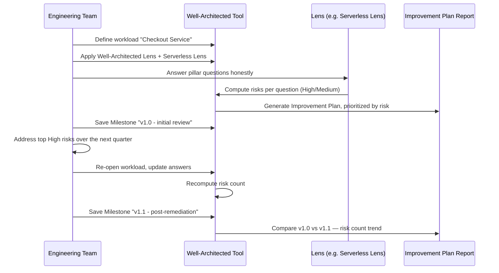

The realistic cadence this diagram shows is quarterly or pre-major-release, not continuous — a
team documents a workload once, generates an improvement plan, works through the highest-priority
items, then **re-opens the same workload record** (not a new one, which would lose the comparison
baseline) to update answers and save a new Milestone. Comparing milestones over time is what
turns "we think we've improved" into a specific, question-by-question risk-count delta.

### Image: Answering a Pillar Question in the Console


*Source: [AWS Well-Architected Tool User Guide](https://docs.aws.amazon.com/wellarchitected/latest/userguide/). This is a human, honestly self-assessing whether a specific best practice is followed — the single detail that most reliably distinguishes this tool from every other tool in this domain: there is no API call here reading a resource's configuration, only a structured, documented judgment call.*

### Exam Tips

- **Memorize all six pillars** — including Sustainability, added in 2021 and easy to forget with
  outdated study materials.
- **The tool is a manual questionnaire, not an automated scanner** — don't confuse it with
  Trusted Advisor or Config; "a human answers structured questions" points here, "automatic
  scanning with no human input" points to the other two.
- **It's free regardless of AWS Support plan** — unlike Trusted Advisor, there's no paywall
  gating which pillars/lenses you can use; a frequently tested contrast between the two.

---

## 12. Amazon DynamoDB

### Definition

Amazon DynamoDB is a fully managed NoSQL key-value and document database that stores data as
items identified by a key, scales automatically to essentially unlimited size and request rate,
and responds in single-digit milliseconds no matter how big your table gets.

### Analogy

DynamoDB is a vast warehouse with a perfect coat-check system: you hand over a claim ticket (the
partition key), and the attendant walks directly to the one specific shelf your item sits on —
not searching the whole warehouse, not checking every shelf, just one direct walk, no matter how
many millions of items are stored throughout the building. A relational database is closer to a
library with a card catalog that lets you ask much richer questions ("find every book published
between 1990-2000 by an author who also wrote about gardening") but that flexibility comes at the
cost of needing to actually search and cross-reference, which gets slower as the collection
grows. DynamoDB trades away the card catalog's flexibility for the coat check's speed at any scale
— which is exactly why you must know your "claim ticket" (access pattern) *before* you design the
table, the opposite order from relational modeling.

### Purpose

Relational databases hit real limits at internet scale: sharding a SQL database across many
servers is hard, slow, and operationally painful. DynamoDB gives applications the ability to
scale horizontally without limit, with predictable low-latency performance, by giving up the
things that make horizontal scaling hard in SQL — ad-hoc joins, complex multi-row transactions
across arbitrary tables, and strict upfront schema. The trade is blunt: you give up the ability to
ask new questions of your data cheaply later, in exchange for answering the questions you *do*
know about at effectively unlimited scale and flat latency forever.

### When to Use

- Massive, unpredictable-scale workloads with known, stable access patterns — a shopping cart, a
  session store, a gaming leaderboard, IoT device state.
- Serverless API backends (API Gateway + Lambda + DynamoDB), since DynamoDB's HTTP-API nature
  means no connection pool to exhaust across thousands of concurrent Lambda invocations.
- A real-time feature store for ML inference, where `GetItem`'s predictably fast, flat latency
  matters more than ad-hoc query flexibility.
- Globally distributed, multi-writer active-active applications via Global Tables.

### When NOT to Use

- **Complex JOINs across many entities, ad-hoc reporting queries, or access patterns that may
  change** — use RDS or Aurora; DynamoDB requires designing around known access patterns in
  advance, and changing patterns later often means redesigning keys.
- **Multi-row, multi-table ACID transactions as the default mode**, not the occasional
  exception — relational databases model this far more naturally.
- **Heavy analytical aggregation (SUM/AVG/GROUP BY across millions of rows) directly against live
  data** — export to Redshift or query via Athena/EMR; DynamoDB Scans for this are slow and
  expensive.
- **Deep relationship/traversal queries** (friend-of-a-friend, fraud rings) — Neptune, not a
  forced DynamoDB adjacency list past 1-2 hops.

### Use Cases

1. **E-commerce shopping cart during a flash-sale spike.** Carts keyed by `userId`, updated on
   every add/remove click, stay fast during concurrent-shopper traffic specifically because the
   access pattern is a pure key lookup with flat latency regardless of load.
2. **A read-heavy gaming leaderboard needing microsecond reads.** DAX (DynamoDB Accelerator)
   caches reads with zero custom invalidation code — purpose-built and API-compatible with the
   DynamoDB SDK, unlike ElastiCache's general-purpose caching, which would need hand-rolled logic.
3. **Diagnosing throttling as a hot partition vs. a capacity problem.** A partition key with low
   cardinality (e.g., a `status` field where 90% of items are `"PENDING"`) concentrates all
   traffic onto one partition regardless of total provisioned capacity — the fix is write
   sharding or a better key design, not simply raising capacity.
4. **Financial transaction ledger with fast range queries.** An append-only log keyed by
   `accountId` + `timestamp` supports "all transactions for account X this month" efficiently,
   with Streams feeding a downstream reconciliation job.
5. **Event-driven order-processing pipeline via DynamoDB Streams.** An `Orders` table's status
   changes trigger a Lambda consumer with no polling — simpler and free compared to a dedicated
   message bus, when the trigger is specifically "this table changed."
6. **Single-table design retrieving a user's profile and recent orders in one request.** A
   single `Query` against a well-designed composite key returns everything a screen needs at
   once — the DynamoDB-native equivalent of a relational JOIN, done through key design instead.

### Why It's Important

DynamoDB underpins some of the highest-traffic systems in the world — it was born from Amazon.com's
own shopping-cart scaling problems. The real-world skill it tests is *access-pattern-first
design*, a genuinely different mental model than SQL's "design the schema, let queries evolve
later." On DVA-C03, Task 1.3 (data stores in application development) covers DynamoDB's SDK
operations and consistency models directly, and Domain 4 revisits it heavily for the
hot-partition-vs-capacity throttling diagnosis and the on-demand-vs-provisioned cost tradeoff.

### Diagram: Partition Key Hashing, Splits, and Hot Partitions

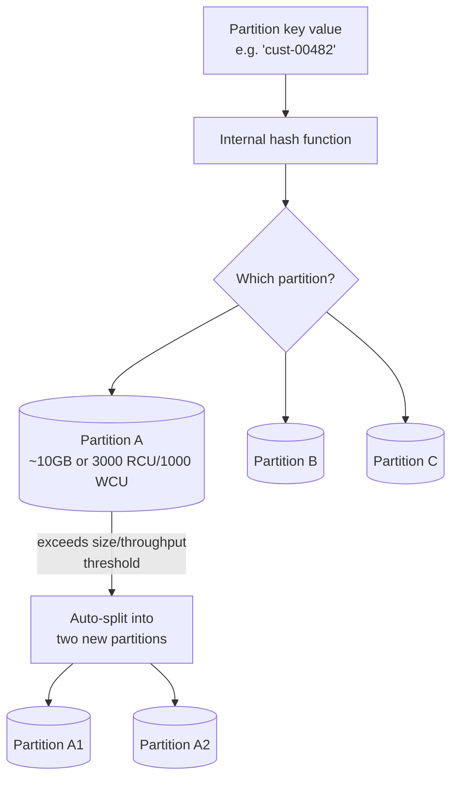

DynamoDB automatically splits a partition when it exceeds roughly 10 GB of storage, or when its
throughput demand consistently exceeds a single partition's share of capacity — this happens
transparently, without downtime, but it's a *consequence* of key design, not something you
control directly. A **hot partition** happens when one partition key value (or a small set)
receives a disproportionate share of traffic — all traffic for that one value lands on the same
partition no matter how many total partitions the table has, and that partition throttles while
the rest of the table sits idle. The standard fix — **write sharding** — appends a random or
calculated suffix to the partition key to spread what would otherwise be one hot key across N
partitions, then fans reads out across all N suffixes and merges results in the application.

### Image: DynamoDB's Partition Distribution and Write Sharding


*Source: [AWS DynamoDB Developer Guide](https://docs.aws.amazon.com/amazondynamodb/latest/developerguide/HowItWorks.Partitions.html). Items are not stored in sorted order across the table — the hash output determines placement, which is deliberately randomized to spread load evenly. This single image is the visual proof of why "two keys that look alphabetically close" (`cust-00482`, `cust-00483`) typically land on completely different partitions: the hash, not the literal string, decides placement.*

### Exam Tips

- **"Massive scale, unpredictable traffic, single-digit millisecond latency, flexible schema"**
  is the DynamoDB trigger phrase combo — but "complex joins" or "ad-hoc reporting" in the same
  question is a trap pointing away from it.
- **Eventually consistent reads (default, cheaper) vs. strongly consistent reads (explicit flag,
  2x the read cost, not available on GSIs)** — know both, and that GSIs can *never* be strongly
  consistent regardless of the flag.
- **Hot partition is a classic throttling scenario** — a poorly chosen partition key causes
  throttling even when total provisioned capacity looks sufficient; the fix is a higher-cardinality
  key or write sharding, never just "add more capacity."

---

## 13. Amazon ElastiCache

### Definition

Amazon ElastiCache is a managed, in-memory data store service — running either Redis (or the
open-source-compatible Valkey fork) or Memcached — that keeps frequently accessed data in RAM so
applications can read it back in sub-millisecond time instead of hitting a slower disk-based
database every time.

### Analogy

If your database is a well-organized archive in the basement, ElastiCache is the sticky note on
your desk with the answer to the question you get asked fifty times a day. Walking to the
basement (querying the database) is reliable and always correct, but slow if you do it for every
single question; the sticky note is instant, but only useful if you remember to update it the
moment the real answer changes — and if you forget, you confidently hand someone a stale answer
without realizing it. That exact tension — speed versus the discipline of keeping the note
current — is the entire caching problem in one sentence, and it's why ElastiCache "manages the
infrastructure, not your invalidation logic."

### Purpose

Databases read from disk-backed or network-attached storage, which, compared to RAM, is slow —
low single-digit milliseconds at best. For data read far more often than it changes, re-fetching
it from the database on every single request wastes both latency budget and database capacity.
ElastiCache puts a thin, managed, horizontally scalable layer of pure RAM in front of (or beside)
your database, so "hot" data can be served in microseconds. The deeper tradeoff: every cache
introduces a second copy of the truth, and keeping two copies in sync is a job that doesn't
disappear just because the cache is "managed" — that remains entirely the application's
responsibility, and it's the single biggest source of real production caching bugs.

### When to Use

- Reducing read load on a database serving the same slow-changing data repeatedly (a product
  catalog, a user's session) — the cache-aside pattern's textbook use case.
- A session store where sub-millisecond reads matter and Multi-AZ Redis failover is acceptable
  for the small, async-replication-driven durability tradeoff it carries.
- Real-time leaderboards and rankings, specifically when Redis's native Sorted Set data structure
  (not just raw read speed) is the actual requirement.
- Rate limiting / API throttling built on Redis's atomic `INCR` + `EXPIRE`, where the atomicity
  guarantee is what makes it safe under concurrent requests without a separate lock.

### When NOT to Use

- **Durable, authoritative storage of your data** — a real database (RDS/Aurora/DynamoDB).
  ElastiCache (especially Memcached) is not meant to be your source of truth; even Redis's
  persistence is a safety net, not a guarantee like a proper database's durability model.
- **DynamoDB-specific microsecond caching with zero custom invalidation logic to write** — DAX is
  purpose-built for that and API-compatible with the DynamoDB SDK, requiring less custom cache
  logic than ElastiCache.
- **Complex relational queries, not just key lookups** — ElastiCache has no concept of
  joins/schema; use RDS/Aurora directly, with ElastiCache sitting *in front of*, not instead of,
  the real database.
- **A budget-tight scenario where the read load isn't actually a bottleneck yet** — don't add a
  cache layer speculatively; it's extra infrastructure, extra invalidation complexity, and extra
  cost for a problem you may not have. Measure first.

### Use Cases

1. **Product catalog cache for a high-traffic e-commerce site.** Cache-aside with a TTL serves
   the overwhelming majority of reads from memory, with the real tradeoff being that every write
   path must now remember to invalidate the cached entry — a maintenance cost a read replica
   doesn't impose, since a replica still runs the full query against disk-backed storage.
2. **Session store with Multi-AZ Redis failover.** User sessions survive a node failure without
   forcing mass re-login — though because Redis replication is asynchronous, a failover during a
   write burst can lose the most recent, not-yet-replicated writes, the one meaningful durability
   gap versus a true database.
3. **Real-time gaming leaderboard using Sorted Sets.** `ZADD`/`ZREVRANGE` gives ranking natively
   from the data structure itself, without the application sorting scores — a specific, named
   data-structure trigger the exam increasingly expects you to recognize, not just "use Redis."
4. **API rate limiting with atomic counters.** A sliding-window limiter built on `INCR` +
   `EXPIRE` is safe under concurrent requests without a separate distributed lock, specifically
   because the increment is atomic server-side.
5. **Semantic caching in front of an LLM inference endpoint.** Caching responses to semantically
   similar (not just identical) prompts cuts both latency and expensive model inference calls, at
   the cost of a small risk of returning a near-but-not-exact-match response.
6. **Distributed locking for coordination across multiple app instances.** Redis's `SET key value
   NX EX ttl` pattern implements a simple, fast distributed lock for short-lived coordination
   (e.g., "only one instance processes this batch job at a time").

### Why It's Important

Cache invalidation is famously one of the two hard problems in computer science. Adding a cache
layer buys speed but adds a new question to every write path: "did I just make the cache stale?"
Real production incidents happen when teams add caching for performance but don't think through
invalidation, serving stale prices or stale inventory counts. On DVA-C03, Task 1.1/1.3 covers
implementing cache-aside logic directly, and Domain 4 revisits ElastiCache as a performance/cost
lever — adding a DAX/ElastiCache layer is a recurring "fix the right layer" answer in this
domain's worked case studies whenever a downstream database call, not application code, turns out
to be the bottleneck.

### Diagram: Cache-Aside (Lazy Loading), the Default Pattern

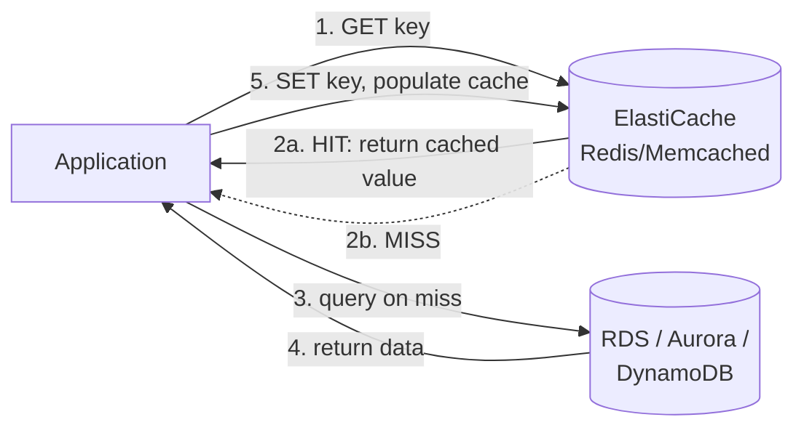

Step by step: the app asks the cache for a key first — nearly always the fastest possible path.
On a **cache hit**, the cached value returns immediately and the database is never touched. On a
**cache miss**, the app falls through to the real database, gets the authoritative (slower, but
correct) answer, and writes it back into the cache — often with a TTL — so the *next* request for
the same key is a hit. Over time, the cache "warms up" to hold the data that's actually being
requested. This is the default assumed pattern on the exam unless a question specifically
describes write-through or write-behind caching instead.

### Image: A Typical Redis/Valkey Cluster Topology


*Source: [AWS ElastiCache Developer Guide](https://docs.aws.amazon.com/AmazonElastiCache/latest/dg/WhatIs.Components.html). Each shard shown here has a primary node accepting writes plus replica nodes serving reads and standing ready for automatic failover — conceptually similar to RDS Multi-AZ, but entirely in-memory and far faster to fail over, since there's no disk-backed storage to reattach.*

### Exam Tips

- **"Reduce read load on the database" / "sub-millisecond latency" / "session store"** are the
  classic ElastiCache trigger phrases.
- **Redis vs. Memcached**: Redis = persistence, replication, richer data types, pub/sub, cluster
  mode sharding. Memcached = simpler, multi-threaded, no persistence/replication. "Need to
  survive a reboot" or "replication" or "pub/sub" always points to Redis.
- **ElastiCache for DynamoDB vs. DAX** — if a question specifically names DynamoDB, prefer DAX
  (purpose-built, no custom invalidation code); ElastiCache is the general-purpose answer for
  RDS/Aurora or custom caching needs.

---

## 14. Database Selection Guide

### Definition

This isn't a single service — it's the decision framework for picking *which* AWS database to
use for a given workload: relational (RDS/Aurora), key-value/NoSQL (DynamoDB), in-memory
(ElastiCache), document (DocumentDB), graph (Neptune), or analytical/data warehouse (Redshift).

### Analogy

Choosing a database is choosing the right tool from a full workshop, not grabbing the one
hammer you already own for every job. A screwdriver (DynamoDB) is fast and perfect for driving
one specific kind of fastener repeatedly at huge scale, but useless for cutting wood. A table saw
(Redshift) handles bulk cutting at volume but is the wrong tool for a single precise screw. Most
real furniture (a real production system) needs several tools used together — this is
**polyglot persistence**: using multiple purpose-built databases within one system, each handling
the part of the workload it's actually good at, rather than forcing everything through one
general-purpose database because it's the one you already know.

### Purpose

AWS deliberately offers many different databases instead of one "does everything" database
because different workloads have genuinely different needs that trade off against each other —
you cannot simultaneously optimize for unlimited horizontal write scale, complex ad-hoc joins,
strict ACID transactions across many tables, sub-millisecond latency, and petabyte-scale
analytical aggregation in a single engine. This guide exists because "which database should I
use" is one of the most common real architecture questions *and* one of the most heavily tested
exam skills — getting it right is less about memorizing features and more about correctly
identifying the **shape of the workload** first.

### When to Use (i.e., When to Apply This Decision Framework)

- Starting a new system and deciding its primary data store(s) — the most expensive and
  hardest-to-reverse architecture decision in most systems.
- A scenario bundles two genuinely separate data needs into one question (a social graph *and* a
  leaderboard) — recognizing "this is two decisions, not one" is itself the tested skill.
- Revisiting an existing choice at a real inflection point — 10x traffic growth, a newly stable
  access pattern, a newly required multi-Region story.
- Deciding whether to add a cache layer on top of whatever primary store you've already chosen.

### When NOT to Use (Anti-Patterns This Guide Specifically Warns Against)

- **Picking DynamoDB because it's "the scalable one" when access patterns are still
  unknown/evolving** — DynamoDB punishes late schema changes far more than a relational database;
  prototype with RDS/Aurora first if requirements are still shifting.
- **Forcing a graph problem into relational tables past 2-3 hops of traversal** — the JOIN chains
  become unreadable and slow; that's what Neptune is for.
- **Putting analytical workloads on your OLTP database** — a monthly report shouldn't be able to
  slow down checkout; separate the systems (Redshift, or Athena for occasional queries).
- **Storing large binary blobs directly inside any of these databases** — none of this family is
  built to store large files efficiently; they should hold a reference to S3 instead.

### Use Cases

1. **An e-commerce shopping cart scaling to millions of concurrent users during a flash sale.**
   Operational, not strictly relational, simple known key-based access → DynamoDB, likely
   On-Demand mode given the unpredictable spike.
2. **A bank's core ledger needing atomic multi-table debit/credit consistency.** Operational,
   strictly relational, ACID-as-default-mode, moderate predictable volume → RDS (or Aurora if
   extra throughput/failover speed is specifically also wanted).
3. **A gaming company's "friends who are also playing right now" feature AND a separate
   microsecond leaderboard.** Two distinct needs bundled in one scenario: the friends feature is
   relationship-traversal → Neptune; the leaderboard is cache-shaped → ElastiCache (Redis Sorted
   Sets), not Neptune for either half.
4. **A content platform already running on MongoDB wanting minimal rewrite.** Existing MongoDB
   investment is the deciding detail → DocumentDB, since DynamoDB would require abandoning the
   aggregation pipeline and redesigning access patterns entirely.
5. **A quarterly revenue report across three years of sales history from five regional
   databases.** Explicitly analytical, historical, multi-source → Redshift, fed by scheduled ETL
   or zero-ETL integrations.
6. **A fraud team's DynamoDB adjacency list that's outgrown 2-hop traversal queries.** The
   access pattern genuinely outgrew the current tool's structural limit → migrate specifically
   the relationship-traversal portion to Neptune, while leaving simple attribute lookups in
   DynamoDB — a polyglot-persistence answer, not an all-or-nothing migration.

### Why It's Important

The single most expensive and hardest-to-reverse architecture decision in most systems is the
choice of primary data store — migrating from one database family to another after the fact
often means redesigning the entire data access layer, not just swapping a connection string.
Getting the first-pass shape right prevents painful, costly re-architecture later. SAA-C03's
Domain 3.3 is essentially this decision tree verbatim; DVA-C03's Task 1.3 expects recognizing
which database an application's access pattern implies, and Domain 4 layers cost tradeoffs (the
focus of this document) on top of the same tree.

### Diagram: The Core Decision Tree

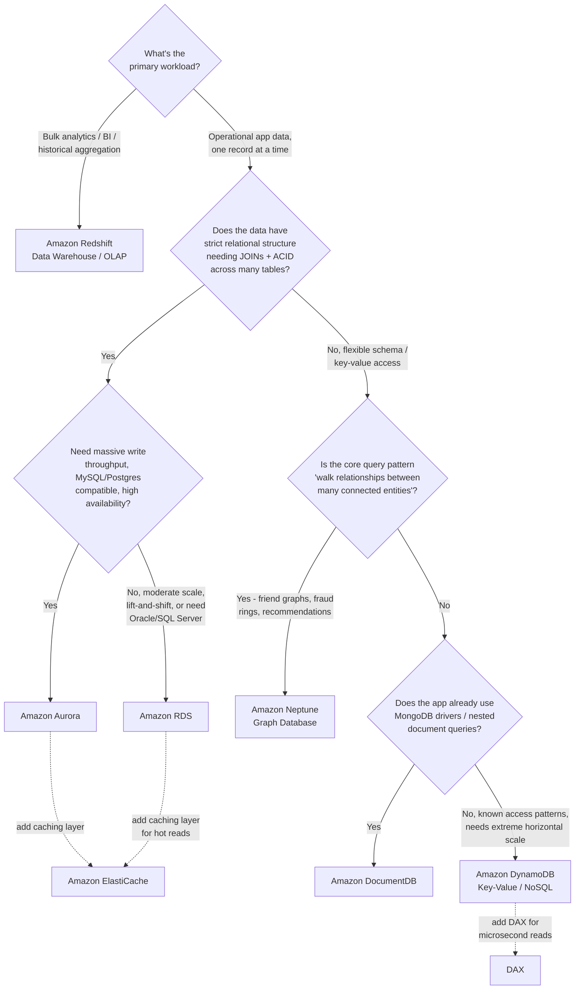

Walking through it: **first fork — operational vs. analytical.** If the workload is "run a
report/dashboard over millions of historical rows," stop here — that's Redshift, regardless of
the underlying operational system. **Second fork — relational structure needed?** Entities
connected by foreign keys, multi-table transactions, SQL JOINs → relational territory. **Third
fork (within relational) — scale/availability needs.** Migrating an existing engine as-is → RDS;
needing Aurora's extra throughput, faster failover, or Global Database → Aurora. **Fourth fork
(non-relational) — is this fundamentally about relationships?** Multi-hop traversal (social
graphs, fraud rings) → Neptune, even though the data could technically be forced into tables.
**Fifth fork — document vs. key-value.** Existing MongoDB investment → DocumentDB; fresh start
with known, simple access patterns → DynamoDB. **Caching is always an overlay, never a
replacement** for whichever operational database you land on.

### Image: The OLTP/OLAP Architectural Split, Illustrated With Two Real AWS Diagrams


*Source: [AWS RDS User Guide](https://docs.aws.amazon.com/AmazonRDS/latest/UserGuide/). This is the operational (OLTP) shape — fast, small, individual-record reads/writes against a transactional database, with synchronous standby replication for failover.*


*Source: [AWS Redshift Getting Started Guide](https://docs.aws.amazon.com/redshift/latest/gsg/). This is the analytical (OLAP) shape — bulk ingestion, columnar storage, and massively parallel aggregation across historical data. Placing these two official diagrams side by side makes the entire first fork of the decision tree visually obvious: one is built for a single fast record lookup, the other for scanning billions of rows at once — no single engine does both well, which is the entire reason this guide's first question is always "operational or analytical," before anything else.*

### Exam Tips

- **Read the scenario for the workload shape before the service names** — "thousands of small
  concurrent transactions" ≠ "one big nightly report" ≠ "walk a social graph"; identify the shape
  first, then match to the service family.
- **If two services both seem plausible, re-read for the tie-breaker keyword**: "MySQL/Postgres
  compatible" → Aurora over DynamoDB; "already using MongoDB" → DocumentDB over DynamoDB;
  "relationships, hops, connections" → Neptune over everything else; "historical, aggregate,
  dashboard" → Redshift over Aurora/RDS even though both are SQL.
- **Polyglot persistence is an expected, correct answer, not a hedge** — a scenario describing
  multiple distinct data needs often has the correct answer be two or three of these services
  together, not a single winner.

---

## Closing: the whole domain as one investigation

Every service above was presented on its own, but Domain 4 is tested — and experienced in real
incidents — as one continuous investigation where these 14 services hand off to each other in a
predictable order. This closing section ties them together as a single system, so the whole
domain is legible as one coherent skill rather than 14 separate flashcards.

### The master flowchart: every tool's place in one investigation

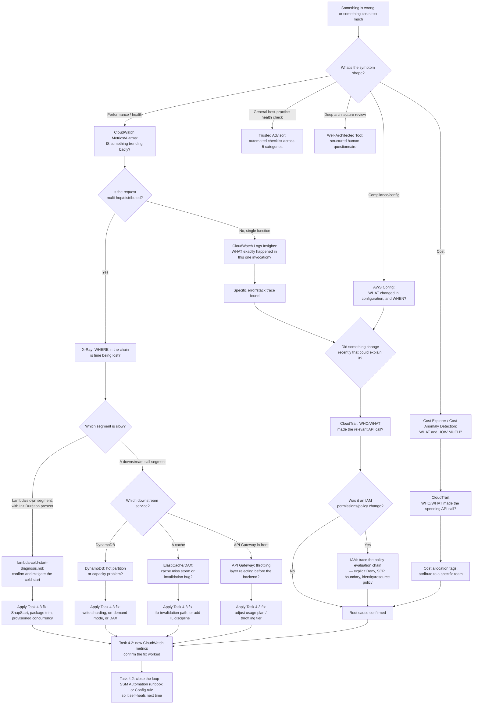

This flowchart is deliberately dense — it is meant to be the single artifact you could stare at
cold during an exam and correctly route almost any Domain 4 scenario description to the right
starting tool, and then correctly chain to the next one. Notice three structural patterns that
repeat throughout it, each worth internalizing as a transferable rule rather than memorizing once
per tool:

1. **Every "what/how much" detection tool is eventually paired with CloudTrail for "who."**
   AWS Config, CloudWatch, Cost Explorer/Cost Anomaly Detection — none of them is an audit log,
   and none independently names a responsible principal. This is not a coincidence across four
   different services; it's because CloudTrail is architecturally the *only* service in this
   domain that records identity at the API-call level.
2. **A "learned baseline vs. deviation" pattern recurs across three completely different
   signals.** X-Ray Insights (fault rate), CloudWatch Anomaly Detection (any metric), and Cost
   Anomaly Detection (spend) all use the identical underlying idea — learn what's normal for
   *this specific thing*, flag a statistically significant deviation from it — applied to trace
   data, performance data, and billing data respectively. Recognizing this as one pattern wearing
   three costumes is faster than treating each as an unrelated feature.
3. **Every fix funnels back through Task 4.2's instrumentation loop.** Whether the root cause was
   a cold start, a hot partition, a throttled usage plan, or a misconfigured security group, the
   investigation never truly ends at "fixed" — it ends at "fixed, verified by new telemetry, and
   closed so it can't silently recur" (an alarm, a Config rule, an SSM Automation runbook). A
   scenario that stops at "the engineer fixed it" without this final step is describing an
   incomplete response, and the exam frequently tests whether you notice the missing final step.

### Full cross-service lookup table

A single table mapping a described symptom or need to the correct starting service, covering
every service in this document plus the three domain-specific topic pages referenced throughout:

| If the scenario describes... | Reach for... |
|---|---|
| "Is this metric trending badly right now?" | CloudWatch Metrics/Alarms |
| "What exactly did this one function do during this one invocation?" | CloudWatch Logs Insights — see [`cloudwatch-logs-insights-debugging.md`](cloudwatch-logs-insights-debugging.md) |
| "Which hop in a multi-service call chain is adding latency?" | X-Ray service map / trace timeline |
| "Reconstruct one request's full story across several log groups" | A correlation ID + Logs Insights (requires Task 4.2 instrumentation already in place) |
| "Who/what made this specific AWS API call, and when?" | CloudTrail |
| "Is this resource currently configured correctly, and when did that change?" | AWS Config |
| "Why am I getting AccessDenied, and which policy is the actual blocker?" | IAM policy evaluation chain |
| "Why is this Lambda invocation slow on the first call but fast after?" | Cold start — see [`lambda-cold-start-diagnosis.md`](lambda-cold-start-diagnosis.md) |
| "SSH into a private-subnet instance with no bastion host and no open ports" | Systems Manager, Session Manager |
| "Where is our money actually going, broken down by team/service?" | Cost Explorer + activated cost allocation tags |
| "Alert us before we blow past a spending cap" | AWS Budgets |
| "Spend looks unusual for us, but never crossed any set threshold" | Cost Anomaly Detection — see [`cost-anomaly-detection-workflow.md`](cost-anomaly-detection-workflow.md) |
| "An automated, zero-effort checklist across cost/security/performance" | Trusted Advisor |
| "A structured, human-reviewed, trackable architecture assessment" | AWS Well-Architected Tool |
| "A key-value lookup needs to stay fast at effectively unlimited scale" | DynamoDB |
| "The same slow-changing data is read far more often than it's written" | ElastiCache (or DAX, specifically for DynamoDB) |
| "Which database should this workload even use in the first place?" | The Database Selection Guide's decision tree |
| "A client sees 429/403 errors but every backend metric looks healthy" | API Gateway throttling/authorizer layer, checked before the backend |

### A consolidated exam scenario bank: multi-service questions

The exam's hardest Domain 4 questions bundle two or three of these services into one scenario.
The following walkthroughs are deliberately cross-service, because that's the actual difficulty
level this domain tests at its upper end.

**Scenario 1 — cost, identity, and audit together.** A weekend Cost Anomaly Detection alert names
EC2 as the driver, with an estimated $340 impact, but no resource ID or principal. Walk the full
resolution in order.
> **Answer:** (1) Cost Explorer, filtered to the anomaly's time window and service, grouped by
> `USAGE_TYPE`, narrows "EC2" to a specific instance type/usage line and quantifies it precisely.
> (2) CloudTrail, searched for `RunInstances` in that same narrowed window, surfaces the exact
> principal and launch parameters. (3) If the account is shared, a further Cost Explorer query
> grouped by `Type=TAG,Key=Team` attributes the cost to a specific team. (4) The resource is
> terminated — the already-incurred cost remains on the bill regardless. (5) A preventive
> guardrail (a CloudWatch alarm on instance age, or an SCP restricting large instance types
> outside approved hours) is added so the same failure mode can't silently recur — Cost Anomaly
> Detection itself never performs step 5; it only ever detects.

**Scenario 2 — tracing, cold starts, and a database layer together.** A checkout API's p99
latency jumped after a deploy. An X-Ray trace shows the Lambda's own segment is fast, but a
downstream DynamoDB subsegment shows elevated latency and `ThrottledRequests > 0`. CloudTrail
shows a CloudFormation update around the deploy time changed the table's capacity mode. What's
the full, correctly-ordered fix, and which single wrong-but-tempting fix should be explicitly
rejected?
> **Answer:** The fix: (1) switch the table back to on-demand capacity (or correct the
> provisioned capacity) to directly address the throttling; (2) optionally add a DAX cache in
> front of the table if the read pattern is repeated hot keys; (3) add a CI/CD check flagging
> capacity-mode changes on production tables so this specific regression is caught in review next
> time; (4) add a CloudWatch alarm on `ThrottledRequests` going forward. The wrong-but-tempting
> fix to reject explicitly: **raising the Lambda function's memory.** The trace already proved
> the bottleneck is the downstream DynamoDB call, not the Lambda's own compute — more memory would
> add cost without fixing anything, the single most common "optimize the wrong layer" trap in this
> entire domain.

**Scenario 3 — IAM, Config, and Systems Manager together.** A security team wants every S3
bucket in an account automatically re-secured the instant it becomes publicly accessible, with
zero human involvement, and separately wants proof of exactly which principal made the change
that exposed it. Name every service involved and what each one specifically contributes.
> **Answer:** **AWS Config** (a managed rule like `s3-bucket-public-read-prohibited`) detects the
> non-compliant state continuously. **Systems Manager Automation** (attached to the Config rule
> as a remediation action, with `"Automatic": true`) is the execution layer that actually applies
> the fix — Config alone only detects and flags, it has no fix-applying mechanism of its own.
> **IAM** governs whether the remediation role itself has the right permissions to apply the fix
> (a separate role from Config's own service role — a common real failure mode is a correctly
> firing detection paired with a remediation role missing the specific permission to act).
> **CloudTrail** supplies the "which principal made the original exposing change" half, entirely
> separate from the detection-and-fix pipeline — Config's own timeline shows *what* changed, never
> *who*.

**Scenario 4 — Trusted Advisor, Cost Explorer, and the Well-Architected Tool together.** A
platform team wants three things: (a) an immediate, zero-setup health check across cost/security/
performance for a newly onboarded account, (b) exact dollar figures behind any cost findings
before prioritizing engineering time, and (c) a structured, trackable architecture review before
a major production launch. Match each need to the right tool and explain why none of the three is
a substitute for either of the others.
> **Answer:** (a) **Trusted Advisor** — automated, zero-manual-effort, available immediately
> (though full depth needs Business/Enterprise support). (b) **Cost Explorer** — Trusted
> Advisor's findings identify *which* resources are flagged, but Cost Explorer quantifies exactly
> *how much* those specific resources actually cost, the number that justifies engineering time.
> (c) **The Well-Architected Tool** — a deliberately manual, structured, Milestone-tracked human
> questionnaire, answering process/design questions ("do you have a tested DR runbook") that no
> automated scanner can observe. None substitutes for the others: Trusted Advisor is fast but
> shallow and fixed; Cost Explorer has no opinion on best practices at all, only dollars; the
> Well-Architected Tool is slow and deep but requires a human's honest time investment that
> Trusted Advisor's automation doesn't.

**Scenario 5 — the complete, no-shortcuts, five-tool investigation.** A production incident: a
partner integration intermittently fails with no corresponding Lambda error, cost crept up over
the same week without crossing any Budget, and a security review separately flags an S3 bucket as
non-compliant from around the same time. Are these three observations related, and how would you
determine that systematically rather than assuming either way?
> **Answer:** Don't assume they're related OR unrelated — investigate each with its own correct
> tool, then look for a shared time correlation. (1) **API Gateway** usage-plan throttling,
> checked first for the partner-specific 429s with a healthy Lambda backend — this is very
> plausibly unrelated to the other two. (2) **Cost Anomaly Detection**, since the cost increase
> never crossed a Budget threshold — a sustained, gradual deviation is exactly its signature,
> paired with CloudTrail to find which resource/principal drove it. (3) **AWS Config**'s
> configuration timeline for the flagged bucket, paired with CloudTrail for the specific API call
> that made it non-compliant. Only after independently establishing *what* happened and *when*
> for each of the three should you check whether the CloudTrail timestamps for (2) and (3)
> cluster around the same event (e.g., one unreviewed CloudFormation deploy that both changed
> infrastructure cost-relevantly and accidentally altered a bucket policy) — correlating by
> timestamp *after* establishing the facts, never assuming a shared cause up front just because
> three things happened in the same week.

### Final quick-reference: the three task statements, one line each

- **Task 4.1 (root cause analysis)** is fundamentally about **symptom routing**: correctly
  sending a described problem to CloudWatch Logs, CloudWatch Metrics, X-Ray, or CloudTrail
  (and, for configuration-shaped problems, AWS Config) without hesitation, then chaining to the
  next tool when the first one's answer points further.
- **Task 4.2 (instrumentation)** is fundamentally about **doing it in advance**: structured logs
  with a correlation ID, custom metrics for business-specific signals, and X-Ray tracing enabled
  on every hop — all of it worthless if added only after the incident it would have explained.
- **Task 4.3 (optimization)** is fundamentally about **matching the fix to the proven cause**,
  using real numbers (memory × duration, actual Cost Explorer dollars, a confirmed `Init
  Duration` field) rather than a reflexive first instinct — and always closing the loop with new
  telemetry proving the fix actually worked.

Every service in this document exists to serve exactly one of those three task statements, and
re-reading any individual section above through that lens — "which of the three tasks is this
actually for" — is the fastest way to turn fourteen separate services back into one coherent,
22%-of-the-exam domain.

## Appendix A: Quick Self-Test (Rapid-Fire Recognition)

A fast drill for pattern-matching trigger phrases to the correct service — cover the right-hand
column and check yourself before moving on:

1. "Which hop in a 5-service call chain is adding latency" → **X-Ray**
2. "Who deleted this S3 bucket at 2am three weeks ago" → **CloudTrail**
3. "Is this security group currently compliant, and when did it drift" → **AWS Config**
4. "Why am I getting AccessDenied despite my policy clearly allowing this" → **IAM policy
   evaluation chain** (check for explicit Deny, SCP, and permission boundary first)
5. "First invocation is slow, every invocation after is fast" → **Lambda cold start** —
   confirm via the `Init Duration` field
6. "SSH into a private-subnet instance, no bastion host, no open ports" → **Systems Manager,
   Session Manager**
7. "Alert me before I cross $10,000 this month" → **AWS Budgets**
8. "Spend looks unusual for us but never crossed any set threshold" → **Cost Anomaly Detection**
9. "A free, automated checklist across cost/security/performance" → **Trusted Advisor**
10. "A structured, human-answered, trackable architecture review" → **AWS Well-Architected
    Tool**
11. "A key-value lookup must stay fast at effectively unlimited scale, access pattern known" →
    **DynamoDB**
12. "The same slow-changing data is read constantly; reduce database load" → **ElastiCache**
    (or **DAX** specifically if the backing store is DynamoDB)
13. "Which database should a brand-new system even use" → the **Database Selection Guide**
    decision tree — operational vs. analytical first, then relational vs. key-value vs. graph
14. "A client sees 429s; every backend metric looks perfectly healthy" → **API Gateway**
    throttling layer, checked before the Lambda function
15. "How often is this error actually occurring, and what's the top message" → **CloudWatch
    Logs Insights**, not a metric filter (that's for proactive future alerting, not
    retrospective investigation)

If any of these took more than a few seconds, revisit that service's own section above before
moving on.

## Appendix B: Glossary of Load-Bearing Terms

A single glossary covering every term used across this document's 14 sections, grouped by the
concept family they belong to, since several of these terms sound similar across services but
mean genuinely different things:

**Tracing and instrumentation**
- **Trace ID** — the single identifier that follows one request across every service it touches,
  propagated via the `X-Amzn-Trace-Id` HTTP header, automatically for AWS-to-AWS hops.
- **Segment / Subsegment** — a segment is one service's contribution to a trace; a subsegment is
  a finer-grained piece of work inside it (one DynamoDB call, one outbound HTTP request).
- **Annotation vs. Metadata** — annotations are indexed/searchable on a trace; metadata is
  attached but not searchable. The single most repeated X-Ray exam distinction.
- **Correlation ID** — a value (often the same as the trace ID, by convention) deliberately
  written into every structured log line so a Logs Insights query can reconstruct one request's
  story across multiple log groups — a mechanism separate from, though commonly paired with,
  trace ID propagation.
- **Init Duration** — the `REPORT` log field present only on a cold Lambda invocation; its
  presence is the definitive signal distinguishing a cold start from any other kind of slowness.

**Audit and configuration**
- **Management Event vs. Data Event** (CloudTrail) — management events (account-level actions)
  are logged by default; data events (individual object/item-level operations) are opt-in and
  the most common source of an unexpectedly large CloudTrail bill when left unscoped.
- **Configuration Item** (Config) — a timestamped snapshot of a resource's configuration state,
  the unit Config's history and billing are both built around.
- **Compliant / Non-Compliant** (Config) — the binary verdict a Config rule assigns a resource;
  distinct from CloudTrail's event-level "did this specific call succeed or fail."

**Identity and access**
- **Explicit Deny** — a policy statement that always wins over any Allow, anywhere in the
  evaluation chain, with no exception.
- **Implicit Deny** — the default result when nothing anywhere explicitly allows an action; IAM's
  baseline posture is deny-everything-not-explicitly-allowed.
- **Permission Boundary** — a per-identity ceiling set via IAM, capping what a user/role can ever
  do regardless of its own identity policies; scoped to one account.
- **Service Control Policy (SCP)** — an org/OU-wide ceiling set via AWS Organizations, applying
  to every principal (including root) in every account under it; never grants, only restricts.

**Compute and performance**
- **Cold Start vs. Warm Start** — whether Lambda must provision a brand-new execution environment
  (cold) or reuse an already-initialized one (warm); the single fork that defines most of a
  function's latency variance.
- **Reserved Concurrency vs. Provisioned Concurrency** — reserved concurrency caps/guarantees a
  slice of account-level concurrency for one function; provisioned concurrency pre-warms
  environments specifically to eliminate cold starts. Not the same mechanism, not interchangeable.
- **SnapStart** — a Java-focused (with growing runtime support) feature that snapshots a fully
  initialized execution environment once and restores new environments from that snapshot,
  cutting cold starts dramatically at no ongoing cost, unlike provisioned concurrency.

**Cost and governance**
- **Cost Allocation Tag** — a tag that must be explicitly *activated* in the Billing console
  before it appears in any cost breakdown; applying the tag to a resource alone is not enough.
- **Unblended / Blended / Amortized Cost** — three legitimately different cost metrics Cost
  Explorer can show for the same spend; a discrepancy between them is not a bug.
- **Budget Action** — the enforcement layer beyond a Budget's notification: automatically
  attaching a restrictive IAM policy or stopping a resource type when a threshold is breached.
- **Pillar / Lens / Milestone** (Well-Architected Tool) — a pillar is one of the six assessment
  dimensions; a Lens applies pillar questions to a specific architecture style (Serverless, ML);
  a Milestone is a timestamped snapshot enabling before/after risk-count comparison.

**Data stores**
- **Partition Key / Hot Partition** (DynamoDB) — the key whose hash determines physical storage
  placement; a low-cardinality key concentrating traffic on one partition is the classic
  throttling root cause, fixed by write sharding or a better key design, never just "more
  capacity."
- **Cache-Aside / Write-Through / Write-Behind** (ElastiCache) — three different patterns for
  keeping a cache and a database in sync, each with a different latency/durability tradeoff;
  cache-aside is the default assumed pattern unless a question says otherwise.
- **Polyglot Persistence** — using multiple purpose-built databases within one system, each
  handling the part of the workload it's actually suited for; an expected, correct architecture
  pattern, not a sign of indecision.

## Appendix C: Verifying This Document's Images

Every image embedded in the 14 sections above was verified via a direct `curl -I`/`curl -o
/dev/null -w "%{http_code}"` request against its exact URL at the time this document was written,
confirming an HTTP 200 response before inclusion — consistent with this repository's standing
practice of only embedding real, currently-reachable AWS documentation images rather than
plausible-sounding but unverified URLs. If any image in this document ever returns a non-200
response in the future, that reflects AWS having moved or renamed the asset after this document
was written, not a URL that was ever included without having been checked.

## Appendix D: One-Paragraph Summary of Each Service, for Final Review

A last-pass, single-paragraph-per-service review — read this appendix alone, cover to cover, as
a final five-minute refresher the night before the exam: **CloudWatch** is performance/health
telemetry — metrics, logs, alarms, dashboards, Logs Insights. **X-Ray** is distributed tracing —
following one request's timing across every service it touches. **CloudTrail** is the audit
log — who/what made which API call, when, immutably. **AWS Config** is configuration-state
compliance over time — what a resource looks like now versus its history, independent of who
changed it. **IAM** is the permission system underneath every single one of these services —
explicit Deny always wins, ceilings (SCPs, boundaries) only ever subtract, and implicit deny is
the default. **Lambda** is serverless compute — pay only for actual execution time, with cold
starts as the structural cost of that tradeoff. **API Gateway** is the managed front door for
APIs — routing, auth, and layered throttling before a request ever reaches your backend.
**Systems Manager** is fleet management with zero open inbound ports — Session Manager, Run
Command, Patch Manager, and Parameter Store, all riding the same outbound agent connection.
**Cost Management Tools** are the family of Cost Explorer, Budgets, Cost Anomaly Detection, and
the CUR — visibility, proactive alerting, pattern-deviation detection, and raw granular export,
respectively. **Trusted Advisor** is a free, fixed, automated best-practice checklist across
five categories, gated in depth by AWS Support plan tier. **The Well-Architected Tool** is a
free, manual, structured, Milestone-tracked architecture self-assessment across six pillars.
**DynamoDB** is horizontally-scaling key-value storage demanding access-pattern-first design.
**ElastiCache** is an in-memory caching layer trading a second copy of the truth for
sub-millisecond reads. **The Database Selection Guide** is the decision tree tying all of the
database options together, starting with the operational-vs-analytical fork before anything
else. Internalizing which of Task 4.1, 4.2, or 4.3 each one primarily serves — and the few
places (Lambda cost math, cold starts, DynamoDB throttling) where a single service spans more
than one task statement — is the actual exam-ready version of this entire domain.

---

*This document is part of the `dva-c03/domain-4-troubleshooting-optimization/` folder. See
[`README.md`](README.md) for the task-statement-by-task-statement index of every file in this
folder, including the topic pages this master chunk cross-references throughout
([`observability-instrumentation.md`](observability-instrumentation.md),
[`cloudwatch-logs-insights-debugging.md`](cloudwatch-logs-insights-debugging.md),
[`lambda-cold-start-diagnosis.md`](lambda-cold-start-diagnosis.md),
[`cost-anomaly-detection-workflow.md`](cost-anomaly-detection-workflow.md)) and
[`labs.md`](labs.md) for hands-on exercises reinforcing every section above.*
